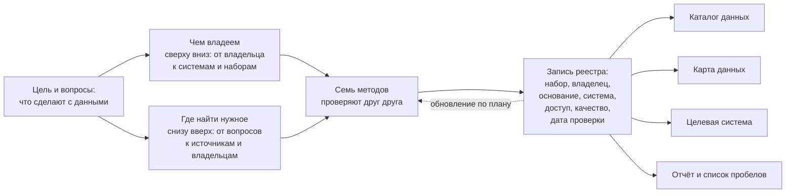

# Что такое инвентаризация данных

**Инвентаризация данных** — систематическое выявление и описание данных: какие наборы данных есть, в каких системах они хранятся, кто ими владеет, на каком основании их собирают, насколько они доступны и какого они качества. Результат — **реестр данных** (его ещё называют инвентарём): таблица, где у каждого набора есть описание, владелец и дата проверки. Из реестра строят то, ради чего всё затевали: каталог, карту данных, новую систему, отчёт о пробелах. Поэтому инвентаризацию начинают не с описи, а с [цели](./03-goals.md) — с того, что сделают с данными.

## Коротко

*Опорная схема книги: от цели через подходы и методы к реестру, из которого строят все результаты.*

Как читать схему:

- **Слева — цель и вопросы.** Они задают границы, подход и глубину описания ([«Зачем: цели»](./03-goals.md)).
- **Посередине — два встречных подхода и методы.** «Чем владеем» идёт от владельца вниз, «где найти нужное» — от вопросов вверх. Ни один метод не находит всего, поэтому их сочетают ([«Семь методов»](../02-approaches/02-methods.md)).
- **За ними — реестр.** Каждая его строка — набор данных с владельцем, основанием, системой, доступом, качеством и датой проверки.
- **Справа — что строят из реестра.** Каталог, карту, целевую систему и отчёт собирают из одних и тех же записей, а не ведут отдельно ([принцип «Реестр — это данные»](./04-principles.md#6-реестр--это-данные)).
- **Пунктир — петля обновления.** Системы закрываются, адреса меняются, поэтому записи перепроверяют по плану ([«Инвентаризация не заканчивается»](./04-principles.md#8-инвентаризация-не-заканчивается)).

## Одна запись реестра

Так выглядит одна запись. Пример условный — из сквозного примера книги о доступности медицинской помощи в регионах.

| Поле | Значение |
|------|----------|
| **Набор данных** | Федеральный регистр медицинских работников: одна запись — один медицинский работник |
| **Владелец** | Министерство здравоохранения |
| **Основание** | Положение о министерстве: «ведёт федеральный регистр медицинских работников» |
| **Система и оператор** | Ведомственная система здравоохранения; оператор — подведомственный центр медицинской статистики |
| **Режим доступа** | С ограничениями: органам власти — по межведомственному запросу; в наборе персональные данные |
| **Качество** | Не проверено: выборки данных нет |
| **Откуда известно** | Анализ полномочий: положение о министерстве |
| **Дата проверки** | Октябрь 2026 года |

Восемь полей отвечают на вопросы «что это», «кому писать», «почему данные существуют», «где лежат», «можно ли получить», «годится ли для задачи» и «можно ли верить записи». Полный состав записи — 14 обязательных атрибутов и расширенные — в главе [«Реестр данных»](../03-process/05-registry.md#минимальный-состав).

## От цели к результату

Инвентаризацию начинают, когда нужно что-то сделать с данными. Например, запустить **проактивную услугу** — такую, которую государство оказывает само, без заявления. Или построить **систему поддержки решений**, которая собирает данные для руководителей и аналитиков в одном месте. Или открыть данные, обучить модель. Цель решает, что искать, как глубоко описывать и чем всё закончится:

| Цель | Что описывают | Результат |
|------|---------------|-----------|
| Открыть данные министерства | Свои наборы: режим доступа с основанием, условия использования, нет ли персональных данных | Перечень наборов к открытию и их описания для портала |
| Ответить на 15 вопросов руководства о доступности медицинской помощи | Источники под каждый вопрос, их владельцы и доступность | Карта данных и список пробелов |
| Назначать пособие при рождении ребёнка без заявления | Системы, где лежат достоверные сведения о семье, — до полей | Требования к **целевой системе** — новой системе или доработке, ради которой ведут инвентаризацию |

Путь от цели к результату — [семь шагов](../03-process/01-steps.md): сформулировать цели и задачи, выбрать подход, найти и описать данные, привлечь экспертов, сопоставить цели с данными, спроектировать сбор от данных, собрать и опубликовать результат.

## Два подхода

**«Понять, чем владеем»** — опись своих данных: от владельца к его системам и наборам. **«Понять, где найти нужное»** — поиск данных под задачу, в том числе у других организаций: от вопросов к источникам и владельцам. Как выбрать подход и когда их сочетают — в главе [«Два подхода»](../02-approaches/01-two-approaches.md).

## Чем инвентаризация отличается от соседних понятий

| Понятие | На какой вопрос отвечает | Чем отличается от инвентаризации |
|---------|--------------------------|----------------------------------|
| **Каталог данных** | Какие наборы опубликованы и как их получить? | Описывает опубликованное, инвентаризация — всё, включая закрытое. Каталог часто строят из реестра |
| **Реестр информационных систем** | Какие системы есть у государства? | Учитывает системы, а не наборы в них. Для инвентаризации — один из главных источников |
| **Карта данных** | Где найти данные для ответа на вопросы? | Форма результата подхода «где найти нужное»: источники под вопросы, без подробного описания каждого набора |
| **Управление метаданными** (корпоративный каталог) | Где в компании лежит таблица и что в ней? | Постоянная работа с описаниями до таблиц и полей. Инвентаризация — её первый шаг ([DAMA-DMBOK](../05-frameworks/01-dama-dmbok.md)) |
| **Происхождение данных** (data lineage) | Откуда пришли значения в этой таблице? | Прослеживает потоки между системами. Реестр отмечает, откуда набор получает сведения, но не прослеживает каждое значение |
| **Реестр операций обработки персональных данных** | Какие персональные данные обрабатывают и зачем? | Требование законов о персональных данных; охватывает только их |
| **Учёт ИТ-активов** | Какие у нас серверы, лицензии и программы? | Учитывает оборудование и программы. Система попадает в реестр данных как место, где лежат наборы |
| **Делопроизводство и архив** | Где документы и переписка? | Учитывает документы. В реестр попадают сведения, которые из документов регулярно собирают: реестр выданных разрешений, а не папка с разрешениями |

## Почему это трудно

Почти в любом государстве и в любой большой организации данные разбросаны по десяткам и сотням систем, которые в разное время создавали разные подрядчики.

- **В государстве** органы власти эксплуатируют сотни систем с пересекающимися данными. Одни и те же сведения у граждан и бизнеса собирают по нескольку раз, справочники ведомств расходятся, а сквозная аналитика по всем ведомствам сразу невозможна. Проактивные услуги без инвентаризации не сделать: им нужно автоматически сопоставлять достоверные сведения из разных систем.
- **В компании** клиентов ведут в одной системе, договоры — в учётной, остатки — в складской, а отчёты собирают из выгрузок в таблицах. Подразделения сами подключают облачные сервисы, о которых не знает ИТ-служба. Сведения об одном клиенте лежат в нескольких местах и расходятся, и каждый отдел считает выручку по-своему.

Готовьтесь к разочарованию: нужных данных может не оказаться вовсе, а найденные — быть плохого качества ([«Принципы»](./04-principles.md#5-готовьтесь-к-разочарованию)).

## Что инвентаризация не делает

- **Не даёт самих данных.** Реестр говорит, что и где есть, но не заменяет выгрузку, интеграцию или договор с владельцем.
- **Не гарантирует полноты.** Реестр охватывает то, что найдено к дате проверки, поэтому у каждой записи есть дата.
- **Не заканчивается.** Данные и системы меняются, и разовая опись устаревает за год-два.

## Источники

- Бегтин И. [Каталоги данных](https://datacatalogs.begtin.tech/) — о том, как устроены каталоги данных.
- Главы [«Что инвентаризируют»](./02-what-is-inventoried.md#пример) и [«Реестр данных»](../03-process/05-registry.md#условный-пример-доступность-медицинской-помощи) — сквозной условный пример с регистром медицинских работников; запись этого набора — в шаблоне [registry.csv](pathname:///templates/registry.csv).
