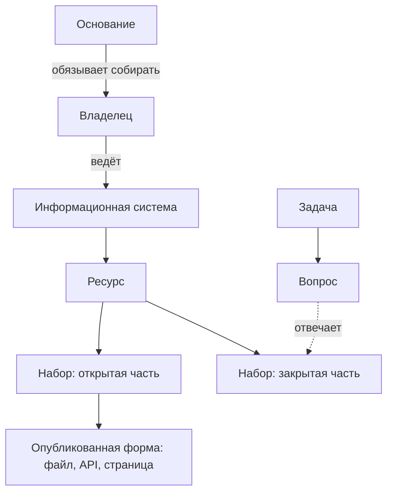

# Что инвентаризируют

Главная единица инвентаризации — **набор данных**: то, что можно описать, запросить и передать целиком. Но строка «регистр медицинских работников» сама по себе ничего не даёт. Чтобы набор получить и использовать, нужно знать, в какой системе он хранится, кто за него отвечает, на каком основании его собирают, на каких условиях выдают, годится ли он для задачи и когда всё это проверяли. Реестр данных описывает набор вместе с этим окружением и связи между ними. Глубину описания задаёт цель: для карты данных хватает источника и условий доступа, для обмена данными нужны поля.

## Коротко

| Элемент | Что это | Отвечает на вопрос | В реестре |
|---------|---------|--------------------|-----------|
| **Набор данных** | Совокупность однотипных сведений, которую описывают и передают целиком | Что есть? | Запись реестра: идентификатор, наименование, описание |
| **Ресурс** | То, что накоплено в системе: реестр, база, перечень, справочник | Из чего выделен набор? | Описание набора |
| **Информационная система** | Базы данных вместе с программами и оборудованием, которые их обрабатывают | Где хранится? | Информационная система и оператор (расширенный состав) |
| **Опубликованная форма** | Файл, программный интерфейс или страница, через которые набор можно получить | Как получить? | Ссылка для выгрузки, формат, дата публикации |
| **Владелец** | Организация, которая решает, что собирать и кому давать доступ, и ответственный сотрудник | Кому писать? | Организация-владелец, ответственный, контакты |
| **Основание** | Закон, полномочие или договор, ради которого данные собирают | Почему данные существуют? | Полномочие, нормативный акт (расширенный состав) |
| **Доступ** | Можно ли получить данные и на каких условиях | На каких условиях? | Режим доступа, условия использования |
| **Качество** | Полнота, актуальность, согласованность, валидность | Годится ли для задачи? | Отметка о контроле качества, периодичность, дата изменения |
| **Дата проверки** | Когда сведения о наборе проверены в последний раз | Можно ли верить записи? | Дата проверки записи (расширенный состав) |
| **Задача и вопрос** | Зачем ищут данные и что хотят узнать | Зачем набор нужен? | Связь «вопрос — набор» с доступностью |

Дата проверки нужна каждой записи, хотя в 14 обязательных атрибутов она не входит: без неё нельзя понять, насколько записи можно верить. Как заполнять каждый атрибут — в главе [«Реестр данных»](../03-process/05-registry.md), как атрибуты называются в DCAT и DCAT-US — в [«Стандартах описания»](../05-frameworks/02-metadata-standards.md#сопоставление-с-реестром).

## Как элементы связаны

Связи важнее самих элементов: именно они показывают, у кого и на каком основании просить данные.

- **Владелец данных и оператор системы — не всегда одно и то же.** Систему может эксплуатировать подведомственное учреждение или подрядчик, а решать о доступе к данным в ней — министерство. В реестр записывают обоих ([«Владелец, оператор, ответственный»](../03-process/03-owners-and-mandates.md#владелец-оператор-ответственный)). Цифровой кодекс Казахстана прямо допускает, что владелец цифровой системы не владеет ресурсами в ней, — тогда порядок доступа определяет соглашение между ними (статья 28).
- **В системе — несколько ресурсов, из ресурса выделяют один или несколько наборов.** Режим доступа ставят набору, а не системе: в одной системе бывают и открытые, и закрытые данные ([«Доступ и ограничения»](../03-process/06-access.md)).
- **У набора бывает несколько опубликованных форм** — файл на портале, программный интерфейс, страница поиска. Это одна запись с несколькими ссылками, а не несколько наборов.
- **Один набор отвечает на многие вопросы, на вопрос отвечают несколько наборов.** Связь «вопрос — набор» хранят отдельно и с доступностью: источник бывает доступен для одного вопроса и закрыт для другого ([«Реестр как данные»](../06-tools/03-registry-as-data.md#что-хранить)).

При подходе «чем владеем» реестр строят сверху вниз: от владельца к системам и наборам. При подходе «где найти нужное» — снизу вверх: от вопросов к наборам, которые на них отвечают, и уже потом к владельцам ([«Два подхода»](../02-approaches/01-two-approaches.md)).

## Набор данных: где провести границу

Что считать одним набором — самый частый вопрос при заполнении реестра. Слишком крупная запись, например вся система одной строкой, не отвечает ни на один вопрос о доступе. Слишком мелкие записи — по строке на каждый год — раздувают реестр и прячут главное.

Правило: если у частей разный **владелец**, **режим доступа**, **периодичность** или **условия использования**, это разные наборы; если всё совпадает — один набор, а части перечисляют в описании или схеме. Простая проверка: набор — то, что пользователь попросит одним запросом и получит одним ответом.

Как записывать систему с несколькими реестрами, один набор в нескольких системах, агрегат и полный набор, копию и первоисточник, группу однотипных источников — в разделе [«Что считать записью»](../03-process/05-registry.md#что-считать-записью) главы «Реестр данных». Ещё несколько случаев, где граница неочевидна:

| Ситуация | Как записать |
|----------|--------------|
| Один набор в CSV и через программный интерфейс | Одна запись, две опубликованные формы. В DCAT — два распространения или распространение и сервис данных |
| Выпуски одного ряда по месяцам или годам | Одна запись, выпуски — в истории изменений. В DCAT 3 такие выпуски описывают серией — классом `dcat:DatasetSeries` |
| Таблица базы данных, поле | Не набор, а часть схемы набора — расширенный атрибут «схема и структура данных» |
| Отчёт или сборник в PDF | Набор с режимом доступа «неструктурированные сведения», если это регулярная публикация данных ([шкала доступа](../03-process/06-access.md#шкала)) |

## Система, ресурс, набор и сайт

Эти слова чаще всего путают, а ошибка обходится дорого при обновлении: запись, привязанная не к тому элементу, теряет связь с данными.

- **Система** — программный комплекс с владельцем, оператором и основанием. О ней узнают из реестров информационных систем, документов о системах и госзакупок ([«Государственные данные»](../04-sources/02-government.md)). В одной системе бывает несколько ресурсов. Системы заменяют, а данные переезжают в новые, поэтому набор связывают с системой, но не отождествляют с ней.
- **Ресурс** — то, что накоплено в системе. Ресурс есть всегда, даже если наружу из него ничего не опубликовано.
- **Набор данных** — то, что описывают и передают как целое. Часто совпадает с ресурсом или его частью.
- **Опубликованная форма** — файл, программный интерфейс или страница, через которые набор можно получить. Одна страница портала часто показывает много наборов, а у одного набора бывает несколько форм.
- **Сайт** — витрина, а не источник. Один сайт показывает данные нескольких систем, а адрес меняется при реорганизациях. За сайтом ищут систему и владельца; если найти не удалось, сайт записывают как временную замену и отмечают это.

Каким из этих элементов стала запись, показывает атрибут «тип записи». Для карты данных, которая отвечает на вопрос «где искать», сайта часто хватает, для реестра — нет ([«Что считать записью»](../03-process/05-registry.md#что-считать-записью), [«Сайт вместо системы»](../08-practices/01-practices-and-anti-patterns.md#сайт-вместо-системы)).

## Глубина описания

Глубину задаёт цель: строка источника — для карты данных, запись по 14 атрибутам — для своих наборов и ключевых источников, описание до полей — для обмена данными, интеграции и обучения моделей ([«Глубина описания»](../03-process/05-registry.md#глубина-описания)). Закон США требует большего: в полном инвентаре данных федерального ведомства описание каждого набора, насколько это практически возможно, включает все имена переменных и их определения (44 U.S.C. § 3511).

Отдельные записи и значения инвентаризация не описывает: их смотрят выборкой, когда проверяют качество ([«Качество данных»](../03-process/07-quality.md)).

## Что ещё попадает в реестр

Кроме наборов в системах, в реестр записывают то, что легко пропустить:

- **Справочники и классификаторы** — регионы, виды деятельности, типы организаций. Их записывают отдельными наборами: от них зависит, сопоставимы ли данные разных систем.
- **Эталонные реестры** — сведения о людях, организациях, недвижимости, которые используют многие системы. У каждого такого набора отмечают, эталон это или копия. В Казахстане эталонные ресурсы закреплены законом: национальный регистр — единый источник достоверных сведений для государственных функций, услуг и статистики (статья 19 Цифрового кодекса).
- **Таблицы вне систем** — выгрузки и файлы, которые сотрудники ведут сами и регулярно передают другим. Их находят только опросами ([«Опросные листы и интервью»](../03-process/04-questionnaires.md)).
- **Неструктурированные сведения** — отчёты, сборники, страницы. Часто это единственное, что опубликовано из закрытого ресурса.
- **Чужие данные** — в подходе «где найти нужное» описывают наборы других организаций: государственные, общественные, коммерческие ([«Три слоя данных»](../04-sources/01-three-layers.md)).
- **Исчезнувшие источники** — их не удаляют, а помечают и добавляют ссылку на веб-архив ([«Как отметить в реестре»](../04-sources/06-legacy.md#как-отметить-в-реестре)).
- **То, чего нет** — полномочие, для которого набор не нашли, остаётся строкой с пометкой «не найдено» в листе полномочий, а пробел — в списке пробелов ([«Владельцы и полномочия»](../03-process/03-owners-and-mandates.md)).
- **Группы** — однотипные источники, которые нельзя перечислить поштучно ([«Одинаковая подробность»](../03-process/05-registry.md#одинаковая-подробность)).

## Что не инвентаризируют

- **Оборудование и программы** — серверы, лицензии, центры обработки данных. Это учёт ИТ-активов, а система попадает в реестр данных как место хранения наборов. Например, классификатор цифровых объектов Казахстана учитывает и программное обеспечение, и объекты инфраструктуры (статья 20 Цифрового кодекса); для инвентаризации данных из него нужны цифровые ресурсы и системы.
- **Документы и переписка** — это делопроизводство и архив. В реестр попадают сведения, которые из документов регулярно собирают: реестр выданных разрешений, а не папка с разрешениями.
- **Потоки данных между системами** — это происхождение данных (data lineage). Реестр отмечает, откуда набор получает сведения, но не прослеживает каждое значение ([«Что такое инвентаризация данных»](./01-what-is-data-inventory.md#чем-инвентаризация-отличается-от-соседних-понятий)).

## Как это называется в стандартах и законах

Понятия книги есть в стандартах описания и законах, но под другими именами, а иногда тем же словом называют другое. Таблицы помогают читать документы и сопоставлять реестр со стандартом.

| В книге | DCAT 3 |
|---------|--------|
| **Набор данных** | `dcat:Dataset` |
| **Серия наборов** | `dcat:DatasetSeries` |
| **Опубликованная форма** | `dcat:Distribution` — файл или другая форма набора; `dcat:DataService` — программный интерфейс |
| **Владелец** | `dct:publisher`, контакт — `dcat:contactPoint` |
| **Ресурс, информационная система** | отдельных классов нет |

| В книге | США, 44 U.S.C. | Казахстан, Цифровой кодекс | Россия, закон № 149-ФЗ |
|---------|----------------|----------------------------|------------------------|
| **Набор данных** | data asset (§ 3502) | отдельного термина нет | отдельного термина нет |
| **Ресурс** | — | цифровой ресурс (статья 24) | информация в базах данных системы (статья 2) |
| **Информационная система** | information system (§ 3502) | цифровая система (статья 28) | информационная система (статья 2) |
| **Сайт** | — | интернет-ресурс (статья 24) | сайт в сети «Интернет» (статья 2) |
| **Владелец** | owner; ведомство, которое ведёт набор (§ 3511) | собственник и (или) владелец (статья 38) | обладатель информации; оператор системы (статья 2) |

На что обратить внимание:

- **«Ресурс» в DCAT значит другое.** `dcat:Resource` — общий класс для набора, сервиса данных и каталога, напрямую его не используют. Ресурсу в смысле книги в DCAT отдельного класса нет: описывают наборы, выделенные из него.
- **Information resources в законе США шире ресурса книги:** так называют сведения вместе с людьми, оборудованием, деньгами и информационными технологиями (§ 3502, пункт 6). Data asset там же — совокупность элементов данных или наборов данных, которые можно сгруппировать (пункт 17): единицей инвентаря бывает и один набор, и их группа.
- **Владельца данных и оператора системы разделяют все три закона**, а в Казахстане владелец цифровой системы и владелец ресурсов в ней могут быть разными лицами (статья 28). Подробнее о ролях — в главе [«Владельцы и полномочия»](../03-process/03-owners-and-mandates.md#владелец-оператор-ответственный).
- **В Казахстане термины сменились 12 июля 2026 года.** В документах, принятых раньше, встречаются «информационная система», «электронный информационный ресурс» и «объект информатизации» ([«Казахстан»](../07-countries/01-kazakhstan.md#правовая-основа)).

## Пример

Сквозной условный пример книги — 15 вопросов руководства о доступности медицинской помощи в регионах ([«Цели и вопросы»](../03-process/02-goals-and-questions.md#пример)). Полномочие министерства «ведёт федеральный регистр медицинских работников» ([«Владельцы и полномочия»](../03-process/03-owners-and-mandates.md#пример)) раскладывается по элементам так:

| Элемент | Значение |
|---------|----------|
| Задача | Ответить на 15 вопросов руководства о доступности медицинской помощи в регионах |
| Вопрос | Где найти сведения о числе врачей по специальностям, регионам и годам — отдельно для городов и сёл? |
| Основание | Положение о министерстве: «ведёт федеральный регистр медицинских работников» |
| Владелец | Министерство здравоохранения |
| Информационная система | Система, в которой ведётся регистр; оператор — подведомственный центр медицинской статистики |
| Ресурс | Федеральный регистр медицинских работников |
| Набор 1 | `med-workers-register` — одна запись — один медицинский работник. С ограничениями: по межведомственному запросу, персональные данные |
| Набор 2 | `med-workers-yearbook` — численность врачей по специальностям и регионам, таблицы ежегодного сборника; владелец — центр. Неструктурированные сведения |
| Опубликованная форма | У набора 1 — нет; у набора 2 — сборник в PDF на сайте центра |
| Качество | Набор 1 не проверен — выборки нет; у набора 2 все регионы на месте и сумма по регионам совпадает с итогом по стране |
| Дата проверки | Октябрь 2026 года |

Из одного ресурса получилось два набора: полный и его агрегат, с разным режимом доступа и разным владельцем. Агрегат отвечает на вопрос о числе врачей по специальностям и регионам, но не делит их на города и сёла — для этого нужен полный регистр. Запрос о нём пишут министерству, а не центру: центр — оператор системы, а решает о доступе владелец. Записи обоих наборов по атрибутам — в [примере](../03-process/05-registry.md#пример) главы «Реестр данных».

## Источники

- W3C. [Data Catalog Vocabulary (DCAT) — Version 3](https://www.w3.org/TR/vocab-dcat-3/), рекомендация от 22 августа 2024 года: классы `dcat:Resource`, `dcat:Dataset`, `dcat:DatasetSeries`, `dcat:Distribution`, `dcat:DataService`.
- [44 U.S.C. § 3502](https://www.law.cornell.edu/uscode/text/44/3502) — определения data asset, information resources, information system; [44 U.S.C. § 3511](https://www.law.cornell.edu/uscode/text/44/3511) — состав полного инвентаря данных ведомства. На октябрь 2026 года.
- [Цифровой кодекс Республики Казахстан](https://adilet.zan.kz/rus/docs/K2600000255) от 09.01.2026 № 255-VIII, статьи 19, 20, 24, 28, 38; проверено по информационно-правовой системе «Әділет» 24 октября 2026 года.
- [Федеральный закон от 27.07.2006 № 149-ФЗ](https://www.consultant.ru/document/cons_doc_LAW_61798/) «Об информации, информационных технологиях и о защите информации», статья 2, пункты 3, 5, 12, 13; «КонсультантПлюс», на октябрь 2026 года.
- Главы [«Реестр данных»](../03-process/05-registry.md) — что считать записью и как заполнять атрибуты; [«Владельцы и полномочия»](../03-process/03-owners-and-mandates.md) — владелец, оператор и полномочие; [«Стандарты описания»](../05-frameworks/02-metadata-standards.md) — сопоставление атрибутов с DCAT и DCAT-US.
