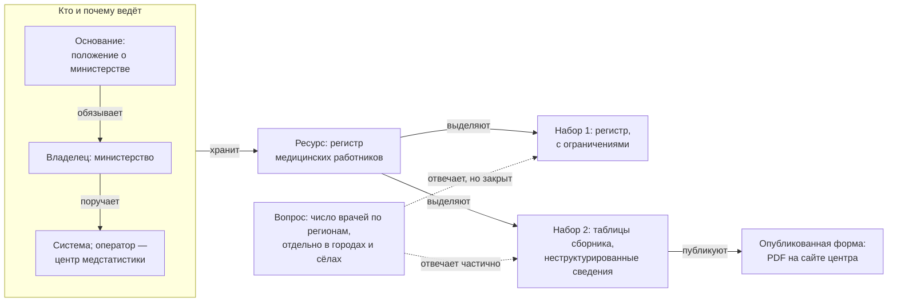

# Что инвентаризируют

Главная единица инвентаризации — **набор данных**: то, что можно описать, запросить и передать целиком. Но строка «регистр медицинских работников» сама по себе ничего не даёт. Чтобы набор получить и использовать, нужно знать, в какой системе он хранится, кто за него отвечает, на каком основании его собирают, на каких условиях выдают, годится ли он для задачи и когда всё это проверяли. Реестр описывает набор вместе с этим окружением, а глубину описания задаёт цель.

## Коротко

| Элемент | Отвечает на вопрос | В реестре |
|---------|--------------------|-----------|
| **Набор данных** | Что есть? | Запись реестра: идентификатор, наименование, описание |
| **Ресурс** | Из чего выделен набор? | Описание набора |
| **Информационная система** | Где хранится? | Информационная система и оператор |
| **Опубликованная форма** | Как получить? | Ссылка для выгрузки, формат, дата публикации |
| **Владелец** | Кому писать? | Организация-владелец, ответственный, контакты |
| **Основание** | Почему данные существуют? | Полномочие, нормативный акт |
| **Доступ** | На каких условиях? | Режим доступа, условия использования |
| **Качество** | Годится ли для задачи? | Отметка о контроле качества, периодичность, дата изменения |
| **Дата проверки** | Можно ли верить записи? | Дата проверки записи |
| **Задача и вопрос** | Зачем набор нужен? | Связь «вопрос — набор» с доступностью |

Дата проверки нужна каждой записи, хотя в 14 обязательных атрибутов она не входит: без неё нельзя понять, насколько записи можно верить. Как заполнять каждый атрибут — в главе [«Реестр данных»](../03-process/05-registry.md).

## Как элементы связаны

*Элементы реестра на условном примере: одно полномочие министерства, одна система, один ресурс и два набора с разным доступом.*

Связи важнее самих элементов: по ним видно, у кого и на каком основании просить данные. Подход «чем владеем» проходит эту цепочку по сплошным стрелкам — от основания и владельца к наборам. Подход «где найти нужное» идёт по пунктиру — от вопроса к наборам и уже потом к владельцу.

## Пример

Сквозной условный пример книги — 15 вопросов руководства о доступности медицинской помощи в регионах ([«Цели и вопросы»](../03-process/02-goals-and-questions.md#пример)). Полномочие министерства «ведёт федеральный регистр медицинских работников» раскладывается по элементам так:

| Элемент | Значение |
|---------|----------|
| Вопрос | Где найти сведения о числе врачей по специальностям, регионам и годам — отдельно для городов и сёл? |
| Основание | Положение о министерстве: «ведёт федеральный регистр медицинских работников» |
| Владелец | Министерство здравоохранения |
| Информационная система | Система, в которой ведётся регистр; оператор — подведомственный центр медицинской статистики |
| Ресурс | Федеральный регистр медицинских работников |
| Набор 1 | `med-workers-register` — одна запись — один медицинский работник. С ограничениями: по межведомственному запросу, персональные данные |
| Набор 2 | `med-workers-yearbook` — численность врачей по специальностям и регионам, таблицы ежегодного сборника; владелец — центр. Неструктурированные сведения |
| Опубликованная форма | У набора 1 — нет; у набора 2 — сборник в PDF на сайте центра |
| Качество | Набор 1 не проверен — выборки нет; у набора 2 все регионы на месте и сумма по регионам совпадает с итогом по стране |
| Дата проверки | Октябрь 2026 года |

Из одного ресурса получилось два набора: полный и его агрегат — сводные числа без сведений о конкретных людях. У них разный режим доступа и разный владелец. Агрегат отвечает на вопрос о числе врачей по специальностям и регионам, но не делит их на города и сёла — для этого нужен полный регистр. Запрос о нём пишут министерству, а не центру: центр — оператор системы, а решает о доступе владелец. Записи обоих наборов по атрибутам — в [примере](../03-process/05-registry.md#условный-пример-доступность-медицинской-помощи) главы «Реестр данных».

## Система, ресурс, набор и сайт

Эти слова чаще всего путают, а ошибка обходится дорого при обновлении: запись, привязанная не к тому элементу, теряет связь с данными.

- **Информационная система** — базы данных вместе с программами и оборудованием, которые их обрабатывают; у неё есть владелец, оператор и основание. Владелец данных и оператор системы — не всегда одно и то же: систему может эксплуатировать подведомственное учреждение или подрядчик, а решать о доступе — министерство ([«Владелец, оператор, ответственный»](../03-process/03-owners-and-mandates.md#владелец-оператор-ответственный)). Системы заменяют, а данные переезжают в новые, поэтому набор связывают с системой, но не отождествляют с ней.
- **Ресурс** — то, что накоплено в системе: реестр, база, перечень, справочник. В одной системе бывает несколько ресурсов. Ресурс есть всегда, даже если наружу из него ничего не опубликовано.
- **Набор данных** — то, что описывают и передают целиком. Часто совпадает с ресурсом или его частью. Таблица базы данных или поле — не набор, а часть его схемы.
- **Опубликованная форма** — файл, программный интерфейс или страница, через которые набор можно получить. У одного набора бывает несколько форм — это одна запись с несколькими ссылками, а не несколько наборов.
- **Сайт** — витрина, а не источник. Один сайт показывает данные нескольких систем, а адрес меняется при реорганизациях. За сайтом ищут систему и владельца; если найти не удалось, сайт записывают как временную замену и отмечают это ([«Сайт вместо системы»](../08-practices/01-practices-and-anti-patterns.md#сайт-вместо-системы)).

**Зачем различать ресурс и набор.** Режим доступа ставят набору, а не ресурсу и не системе. Из одного закрытого ресурса часто выделяют открытый набор — сводные числа, справочник, сборник, — и его можно публиковать, пока полный набор остаётся закрытым. Если записать один ресурс одной строкой, открытая часть потеряется, а закрытая будет выглядеть доступной.

Один набор отвечает на многие вопросы, а на вопрос отвечают несколько наборов. Поэтому связь «вопрос — набор» хранят отдельно и с доступностью: источник бывает доступен для одного вопроса и закрыт для другого ([«Реестр как данные»](../06-tools/03-registry-as-data.md#что-хранить)).

## Набор данных: где провести границу

Что считать одним набором — самый частый вопрос при заполнении реестра. Слишком крупная запись, например вся система одной строкой, не отвечает ни на один вопрос о доступе. Слишком мелкие записи — по строке на каждый год — раздувают реестр и прячут главное.

**Правило:** если у частей разный владелец, режим доступа, периодичность или условия использования, это разные наборы; если всё совпадает — один набор, а части перечисляют в описании или схеме. Простая проверка: набор — то, что пользователь попросит одним запросом и получит одним ответом.

Спорные случаи — копия и первоисточник, выпуски одного ряда, агрегат и полный набор, группа однотипных источников, — тип записи и глубину описания разбирает глава [«Реестр данных»](../03-process/05-registry.md#что-считать-записью). Глубину задаёт цель: для карты данных хватает строки источника, для своих наборов нужна запись по 14 атрибутам, для обмена данными и обучения моделей — описание до полей.

## Что ещё попадает в реестр

Кроме наборов в системах, в реестр записывают то, что легко пропустить:

- **Справочники и классификаторы** — регионы, виды деятельности, типы организаций. Их записывают отдельными наборами: от них зависит, сопоставимы ли данные разных систем.
- **Эталонные реестры** — сведения о людях, организациях, недвижимости, которыми пользуются многие системы. У каждого такого набора отмечают, эталон это или копия. В Казахстане эталонные ресурсы закреплены законом: национальные регистры — единый источник достоверных сведений ([«Казахстан»](../07-countries/01-kazakhstan.md#национальные-регистры)).
- **Таблицы вне систем** — выгрузки и файлы, которые сотрудники ведут сами и регулярно передают другим. Их находят только опросами ([«Опросные листы и интервью»](../03-process/04-questionnaires.md)).
- **Неструктурированные сведения** — отчёты, сборники, страницы. Часто это единственное, что опубликовано из закрытого ресурса.
- **Чужие данные** — в подходе «где найти нужное» описывают наборы других организаций: государственные, общественные, коммерческие ([«Три слоя данных»](../04-sources/01-three-layers.md)).
- **Исчезнувшие источники** — их не удаляют, а помечают и добавляют ссылку на веб-архив ([«Как отметить в реестре»](../04-sources/06-legacy.md#как-отметить-в-реестре)).
- **То, чего нет** — полномочие, для которого набор не нашли, остаётся строкой с пометкой «не найдено», а пробел — в списке пробелов ([«Владельцы и полномочия»](../03-process/03-owners-and-mandates.md)).
- **Группы** — однотипные источники, которые нельзя перечислить поштучно ([«Одинаковая подробность»](../03-process/05-registry.md#одинаковая-подробность)).

Чего в реестре данных нет — оборудования, документов, потоков между системами, — сказано в главе [«Что такое инвентаризация данных»](./01-what-is-data-inventory.md#чем-инвентаризация-отличается-от-соседних-понятий).

## Как это называется в стандартах и законах

В стандартах описания и законах те же понятия носят другие имена, а иногда тем же словом называют другое: «ресурс» в стандарте DCAT — общий класс для набора, сервиса и каталога, а не то, что накоплено в системе. Как понятия книги соотносятся с классами DCAT, сказано в главе [«Стандарты описания»](../05-frameworks/02-metadata-standards.md#словарь-профиль-и-формат), а как их называют законы разных стран — в приложении [«Нормативная база»](../09-appendices/02-legal-framework.md).

## Источники

- W3C. [Data Catalog Vocabulary (DCAT) — Version 3](https://www.w3.org/TR/vocab-dcat-3/), рекомендация от 22 августа 2024 года: класс `dcat:Resource`.
- Главы [«Реестр данных»](../03-process/05-registry.md) — что считать записью, глубина описания и как заполнять атрибуты; [«Владельцы и полномочия»](../03-process/03-owners-and-mandates.md) — владелец, оператор и полномочие; [«Стандарты описания»](../05-frameworks/02-metadata-standards.md) — сопоставление с DCAT и DCAT-US.
