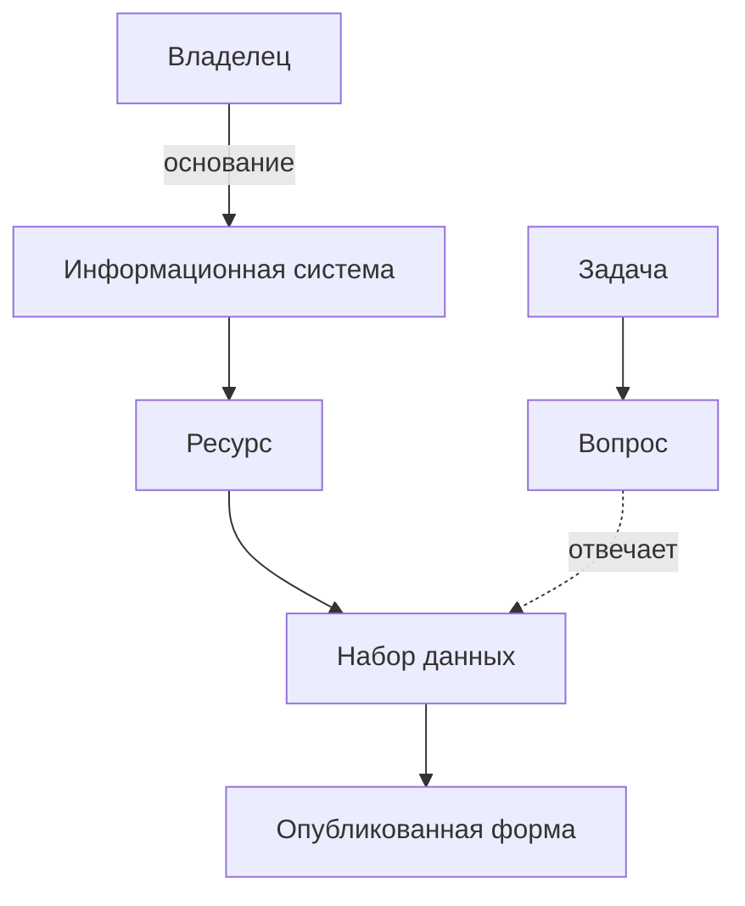

# Что инвентаризируют

Главная единица инвентаризации — **набор данных**. Но набор не существует сам по себе: он хранится в информационной системе, у него есть владелец и основание, по которому его собирают. Реестр данных описывает все эти элементы и связи между ними. Обязательна для каждой записи дата проверки: без неё нельзя понять, насколько записи можно верить.

## Элементы

| Элемент | Что это | Пример |
|---------|---------|--------|
| **Набор данных** | Совокупность однотипных сведений, которую можно описать и передать целиком | Реестр юридических лиц; ежемесячная статистика цен |
| **Ресурс** | Набор внутри системы — реестр, база, перечень, справочник | База данных «Юридические лица» в государственной системе |
| **Информационная система** | Базы данных вместе с программами и оборудованием, которые их обрабатывают | Государственная база данных, ведомственная учётная система |
| **Владелец** | Организация, которая ведёт набор и отвечает за него, и ответственный сотрудник | Министерство, его подведомственное учреждение, компания |
| **Основание** | Закон, полномочие или договор, ради которого данные собирают | Положение о министерстве, отраслевой закон |
| **Доступ** | Можно ли получить данные и на каких условиях | Открытые данные; по запросу; закрыто |
| **Качество** | Полнота, актуальность, согласованность | Обновляется ежемесячно; за 2019 год пропуски |
| **Опубликованная форма** | Файл или программный интерфейс, через который набор доступен | Набор на портале открытых данных |
| **Дата проверки** | Когда сведения о наборе проверены в последний раз | Октябрь 2026 года |

Полный состав записи реестра — 14 обязательных атрибутов и расширенные — в главе [«Реестр данных»](../03-process/05-registry.md).

## Как элементы связаны

При подходе «чем владеем» реестр строят сверху вниз: от владельца к системам и наборам. При подходе «где найти нужное» — снизу вверх: от вопросов к наборам, которые на них отвечают, и уже потом к владельцам ([«Два подхода»](../02-approaches/01-two-approaches.md)).

## Система, ресурс, набор и сайт

Эти слова чаще всего путают.

- **Система** — программный комплекс с владельцем и основанием. В одной системе бывает несколько ресурсов.
- **Ресурс** — то, что накоплено в системе. Ресурс есть всегда, даже если наружу из него ничего не опубликовано.
- **Набор данных** — то, что описывают и передают как целое. Часто совпадает с ресурсом или его частью.
- **Сайт** — витрина, а не источник. За сайтом ищут систему и владельца; если найти не удалось, сайт записывают как временную замену и отмечают это.

Подробнее о том, как не перепутать и не записать один набор дважды, — в главе [«Реестр данных»](../03-process/05-registry.md#один-набор-под-разными-именами).

## Источники

- И. Бегтин, презентация «Инвентаризация данных» — содержание реестра данных.
- Глава [«Что такое инвентаризация данных»](./01-what-is-data-inventory.md).
