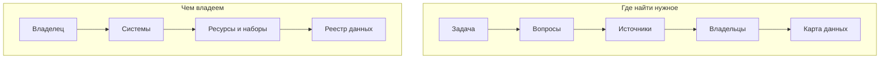

# Два подхода

Инвентаризацию ведут с одной из двух сторон. **«Понять, чем владеем»** — опись собственных данных: начинают с владельца и его систем и спускаются до наборов и полей. **«Понять, где найти нужное»** — поиск данных под задачу: начинают с вопросов и ищут ответы везде, в том числе у других организаций. Подход выбирают по цели ([«Зачем: цели»](../01-basics/02-goals.md)) и по тому, чьи данные нужны. От него зависят методы, глубина описания и результат — реестр своих данных или карта источников под задачу. В крупных проектах подходы сочетают, но один из них главный: тот, что следует из главной цели.

## Коротко

| | Чем владеем | Где найти нужное |
|---|---|---|
| **С чего начинают** | С владельца: организация, ведомство, отрасль | С задачи и вопросов к данным |
| **Чьи данные** | Свои | Любые: свои, других организаций, общественных проектов, компаний |
| **Направление** | Сверху вниз: владелец → системы → ресурсы и наборы | Снизу вверх: вопрос → источник → владелец |
| **Для чего** | Навести порядок в сборе данных, найти дубли, выделить чувствительные данные, подготовить открытие и обмен данными | Аналитика и поддержка решений, новые продукты, исследования и журналистика, отраслевые проекты |
| **Кто может провести** | Сама организация или тот, кому подчинены владельцы данных: нужно право требовать ответов | Кто угодно, в том числе со стороны: аналитик, исследователь, журналист |
| **Где ищут** | Свои системы, реестр информационных систем, документы о системах, госконтракты | Государственные, общественные и коммерческие источники — [три слоя данных](../04-sources/01-three-layers.md) |
| **Главные методы** | Опросы владельцев, инвентаризация систем, анализ полномочий | Кабинетные исследования, поиск наборов данных, эксперты, поиск по аналогии |
| **Глубина описания** | До ресурсов и полей, с ответственными, режимом доступа и чувствительностью | До источника, владельца и условий доступа |
| **Мера успеха** | В границах учтены все системы, у каждой записи есть владелец, основание, режим доступа и дата | На каждый вопрос найден источник или записан пробел |
| **Результат** | Реестр данных, внутренний каталог | Карта данных, список источников для проекта, список пробелов |
| **Типичная ловушка** | Опись ради описи: всё перечислено, ни на один вопрос не отвечено | Список чужих сайтов без владельцев и без проверки, что данные там есть |

В первом подходе владелец — начало работы, во втором — почти её конец: его находят по источнику, который отвечает на вопрос.

## Как выбрать подход

Подход выбирают до начала поиска, на втором из [семи шагов](../03-process/01-steps.md#2-выбрать-подход). Хватает четырёх вопросов.

1. **Чьи данные нужны?** Свои — «чем владеем». Чужие или пока неизвестно чьи — «где найти нужное».
2. **Есть ли вопросы к данным?** Если задача сформулирована вопросами вроде «где найти сведения о числе больниц по регионам?», это «где найти нужное»: вопросы задают, что искать. Если задача — навести порядок или выполнить требование закона, вопросы вторичны, и ведут опись своего.
3. **Можно ли требовать ответов от владельцев?** Анкеты работают, когда владельцы подчинены заказчику или обязаны отвечать по закону или приказу. Чужая организация заполнять анкету не обязана, поэтому без такого права остаются кабинетные исследования и поиск — инструменты подхода «где найти нужное».
4. **Насколько глубоко описывать?** До полей описывают свои системы, к документации которых есть доступ. Для чужих источников обычно хватает владельца, адреса и условий доступа.

Если ответы указывают в разные стороны — нужны и свои данные, и чужие, — подходы сочетают, а главным делают тот, что следует из главной цели ([«Несколько целей сразу»](../01-basics/02-goals.md#несколько-целей-сразу)).

| Группа целей | Подход | Пример |
|--------------|--------|--------|
| [Навести порядок](../01-basics/02-goals.md#навести-порядок) | чем владеем | Найти, где ведомство хранит персональные данные и кому их передаёт |
| [Делиться данными](../01-basics/02-goals.md#делиться-данными) | чаще оба | Открыть данные министерства: описать свои наборы и сверить их с тем, что ищут пользователи |
| [Использовать данные](../01-basics/02-goals.md#использовать-данные) | где найти нужное | Найти источники для аналитики доступности медицинской помощи по регионам |

## Чем владеем

Подход для организации, которая хочет знать свои данные: министерства, региона, компании. Его приоритет — то, что требует особого обращения, прежде всего персональные и другие чувствительные данные: их находят первыми, где бы они ни лежали.

**Когда применять.** Защита персональных данных, сокращение дублей и расходов, замена старых систем, требование закона вести реестр, подготовка открытия данных и обмена с партнёрами.

**Как делать.**

1. Записать границы: только центральный аппарат или вместе с подведомственными организациями, до систем, наборов или полей ([«Границы»](../03-process/02-goals-and-questions.md#границы)).
2. Составить перечень систем и их владельцев — по реестру информационных систем, нормативным актам о системах и госконтрактам ([«Государственные данные»](../04-sources/02-government.md#реестры-информационных-систем)).
3. Прочитать полномочия: положение об органе и отраслевые законы показывают, какие данные у него должны быть, даже если в перечне систем их нет ([«Как читать полномочия»](../03-process/03-owners-and-mandates.md#как-читать-полномочия)).
4. Опросить ответственных за системы и данные — анкетой, затем коротким интервью. Анкету отправляют от имени того, кто поставил задачу: на письмо руководителя отвечают быстрее ([«Опросные листы и интервью»](../03-process/04-questionnaires.md#как-проводить)).
5. Сверить ответы с перечнем систем, полномочиями и госзакупками: анкета показывает то, что владелец считает данными, а не всё, что у него есть ([«Как проверять ответы»](../03-process/04-questionnaires.md#как-проверять-ответы)).
6. Описать каждый набор по 14 атрибутам реестра, отметить чувствительность, режим доступа с основанием и качество ([«Реестр данных»](../03-process/05-registry.md#минимальный-состав)).

**Что получается.** [Реестр данных](../03-process/05-registry.md), который становится внутренним каталогом и основой для открытия данных, обмена с партнёрами или межведомственной интеграции. Часто у реестра две части: полная внутренняя и общедоступная — описания наборов, которые можно показать ([«Результат и поддержка»](../03-process/08-result-and-upkeep.md#виды-результата)).

**Пример.** Закон OPEN Government Data Act обязывает каждое федеральное ведомство США вести полный инвентарь данных — всех, что оно создаёт, собирает, контролирует или хранит, — с отметкой, открыт ли набор. Общедоступную часть ведомства публикуют файлом `data.json`, а каталог data.gov собирает их в одно место ([«Зарубежные методики»](../05-frameworks/04-international-practice.md#инвентари-данных-федеральных-ведомств-сша)). Узкий вариант того же подхода — реестр операций обработки персональных данных по статье 30 Общего регламента ЕС о защите данных (GDPR): опись своего, но только персональных данных.

**Ограничения.**

- Подход не видит чужих данных, даже если без них задачу не решить.
- Полнота зависит от владельцев: о забытых таблицах и выгрузках в анкете не напишут, поэтому ответы сверяют с другими источниками ([«Только опросы владельцев»](../09-practices/02-anti-patterns.md#только-опросы-владельцев)).
- Нужно право требовать ответов. Без приказа руководителя или нормы закона опрос превращается в просьбу.
- Чем глубже описание, тем дороже поддержка: реестр до полей приходится обновлять после каждой доработки систем.
- Главная ловушка — [опись ради описи](../09-practices/02-anti-patterns.md#опись-ради-описи): всё перечислено, но реестр не отвечает ни на один вопрос, потому что вопросов не было.

## Где найти нужное

Подход для задачи, которой не хватает данных: аналитики, продукта, исследования, журналистского расследования. Начинают с вопросов, которые задают руководители или аналитики, и для каждого ищут источники — у государства, в общественных проектах, у компаний. Данные чужие, поэтому опросы владельцев здесь почти не работают: основные методы — кабинетные исследования, поиск наборов данных и консультации экспертов ([«Семь методов»](./02-methods.md#какой-метод-для-какого-подхода)).

**Когда применять.** Система поддержки решений, отраслевая аналитика, новый продукт или сервис, исследование, подборка данных для хакатона или обучения модели. А ещё — когда нужно разобраться в незнакомой отрасли, прежде чем браться за опись своего.

**Как делать.**

1. Записать задачу и 10–20 укрупнённых вопросов и согласовать их с заказчиком до поиска ([«Цели и вопросы»](../03-process/02-goals-and-questions.md#вопросы)).
2. Для каждого вопроса понять, у кого должны быть данные: анализ полномочий подсказывает ведомство, поиск по аналогии — как такие данные собирают в других странах ([«Семь методов»](./02-methods.md#методы)).
3. Искать по трём слоям — государственные, общественные, коммерческие источники — поиском по наборам данных и кабинетными исследованиями ([«С чего начинать»](../04-sources/01-three-layers.md#с-чего-начинать), [«Поиск наборов данных»](../04-sources/05-dataset-search.md)).
4. Привязать каждый источник к вопросам, записать владельца и доступность — с основанием и датой ([шкала доступа](../03-process/06-access.md#шкала)).
5. Проверить с экспертами отрасли и записать пробелы: вопросы без источника и вопросы, на которые отвечают только закрытые источники.

**Что получается.** Результат часто оформляют как [карту данных](./04-data-maps.md): вопросы, источники и их доступность. Не менее важен список пробелов: он показывает, каких данных нет вообще, а какие есть, но закрыты.

**Пример.** Карта атласа [«Здравоохранение»](../08-atlas/04-health.md) проверена в декабре 2018 года. По её паспорту сведения взяты из ФГИС КИ, с официальных сайтов органов власти и из экспертного анализа — опросов владельцев в списке нет. На 20 вопросов в карте 54 источника и 71 пара «вопрос — источник»: в 39 данные доступны, в 2 — с ограничениями, в 30 — не доступны. На 5 вопросов из 20 не нашлось ни одного доступного источника: о заболеваемости, показателях деятельности медицинских учреждений, регистрах больных и инвалидов, заболевших и медицинских работниках. Этот список пробелов — главный вывод карты для аналитика.

Тот же подход в международном масштабе — Open Data Inventory: Open Data Watch смотрит со стороны пользователя, какие показатели национальные статистические службы публикуют и насколько открыто ([«Зарубежные методики»](../05-frameworks/04-international-practice.md#open-data-inventory-odin)).

**Ограничения.**

- Подход не видит закрытых систем, о которых нигде не написано. Анализ полномочий и эксперты подсказывают, что такие системы есть, но описать их снаружи нельзя.
- Описание неглубокое — до источника и условий доступа. Важные источники описывают отдельной записью реестра ([«Карты данных»](./04-data-maps.md#ограничения)).
- Доступность, отмеченная снаружи, не окончательна: «закрыто» и «не открылось из-за рубежа» — разные статусы, а владелец может выдать данные по запросу ([«Порядок проверки»](../03-process/06-access.md#порядок-проверки)).
- Результат стареет быстро: адреса чужих сайтов меняются без предупреждения. Из 136 адресов источников атласа к октябрю 2026 года у 29 исчезли домены ([«Как читать атлас»](../08-atlas/01-how-to-read.md#адреса-источников-в-октябре-2026-года)).
- Главная ловушка — список чужих сайтов без владельцев и без проверки, что нужные данные там есть ([«Сайт вместо системы»](../09-practices/02-anti-patterns.md#сайт-вместо-системы)).

## Подходы на семи шагах

Порядок [семи шагов](../03-process/01-steps.md) одинаков для обоих подходов, а наполнение шагов разное.

| Шаг | Чем владеем | Где найти нужное |
|-----|-------------|------------------|
| **1. Цели и задачи** | Что сделать со своими данными: защитить, открыть, передать, перенести | Какую задачу решить и на какие вопросы ответить |
| **3. Инвентаризация ресурсов** | Перечень систем, анализ полномочий, опросы владельцев | Поиск по трём слоям, кабинетные исследования, поиск по аналогии |
| **4. Эксперты** | Владельцы подтверждают описания своих наборов | Эксперты отрасли подсказывают источники и проверяют доступность |
| **5. Сопоставление с задачами** | Чего нет из положенного по полномочиям, что собирают дважды, что можно открыть | На какие вопросы нет источника или есть только закрытый |
| **6. Проектирование от данных** | Новые поля, выгрузки и программные интерфейсы в своих системах | Запросы владельцам, договоры о доступе, собственный сбор там, где данных нет ни у кого |
| **7. Результат** | Реестр данных, внутренний или публичный каталог | Карта данных, список источников для проекта |

## Когда подходы сочетают

Результат одного подхода становится исходными данными для другого. Реестры информационных систем, порталы открытых данных, инвентари ведомств — итог чужого «чем владеем» — служат главными источниками для «где найти нужное»: три из четырёх карт атласа составлены в том числе по ФГИС КИ, а data.gov собирает общедоступные части инвентарей федеральных ведомств США. Последний вопрос опросного листа — «каких данных не хватает подразделению?» — превращает опись своего в поиск нужного ([«Что спрашивать»](../03-process/04-questionnaires.md#что-спрашивать)).

В обратную сторону карта данных показывает владельцу, какие его закрытые системы нужны другим. На карте «Здравоохранение» egisz.rosminzdrav.ru — сайт единой государственной информационной системы в сфере здравоохранения — указан источником в 5 вопросах из 20, и во всех пяти данные не доступны. Для аналитика это пробел. Для владельца системы — повод описать её по подходу «чем владеем»: какие в ней ресурсы, что можно открыть, что выдавать по запросу, а что закрыто по закону.

Типичные сочетания:

- **Перед открытием данных** ведомство описывает свои данные («чем владеем») и сверяет их с тем, что востребовано у пользователей («где найти нужное»): с запросами, обращениями, отраслевыми картами данных.
- **Для проактивных услуг** государство сначала ищет, где лежат нужные сведения о человеке или организации («где найти нужное»), затем описывает эти системы до полей («чем владеем»). Так выполняют принцип однократности — брать сведения из системы, где они уже есть, а не запрашивать снова ([«Принципы в других методиках»](../01-basics/03-principles.md#принципы-в-других-методиках)). В Казахстане Цифровой кодекс требует брать данные из национальных регистров, если они там есть, — для этого нужно знать, какие сведения в каком регистре лежат ([«Казахстан»](../07-countries/01-kazakhstan.md#правовая-основа)).
- **Для отраслевой аналитики** находят источники под вопросы, а затем подробно описывают несколько ключевых систем, на которые приходится больше всего ответов.
- **Для обучения моделей** ищут подходящие наборы, в том числе чужие («где найти нужное»), а для своих наборов записывают происхождение, порядок сбора и условия использования («чем владеем»). Для систем ИИ высокого риска в ЕС это требование регламента об ИИ ([«Цели в законах и программах»](../01-basics/02-goals.md#цели-в-законах-и-программах)).

Главный подход задаёт глубину и сроки. Из второго берут только то, что нужно главной цели.

## Ошибки выбора

| Ошибка | Что происходит | Как исправить |
|--------|----------------|---------------|
| **Анкеты чужим организациям** | Ответы не приходят или приходят через месяцы, работа стоит | Кабинетные исследования и анализ полномочий; официальный запрос — только по ключевым источникам |
| **Поиск по сайтам вместо описи своего** | Внутренний реестр повторяет портал открытых данных, закрытых систем в нём нет | Перечень систем, полномочия и опросы владельцев ([«Учитывают всё, в том числе закрытое»](../01-basics/03-principles.md#2-учитывают-всё-в-том-числе-закрытое)) |
| **Карта до полей** | Чужие системы описывают до таблиц по обрывкам документации, и работа не заканчивается | Для карты — до источника и доступа; до полей — только ключевые источники, отдельной записью реестра |
| **Оба подхода без главного** | Глубина, сроки и состав команды расплываются, результат не готов ни для одной цели | Одна главная цель и один главный подход ([«Несколько целей сразу»](../01-basics/02-goals.md#несколько-целей-сразу)) |
| **Подход по привычке** | Подрядчик делает то, что умеет, — рассылает анкеты или ищет по сайтам — независимо от задачи | Выбирать по четырём вопросам [выше](#как-выбрать-подход) |

## Источники

- Глава [«Зачем: цели»](../01-basics/02-goals.md) — какой подход следует из какой цели.
- Глава [«Семь методов»](./02-methods.md) — какие методы работают для каждого подхода.
- Глава [«Карты данных»](./04-data-maps.md) — как оформить результат подхода «где найти нужное».
- Глава [«Зарубежные методики»](../05-frameworks/04-international-practice.md) — инвентари федеральных ведомств США и Open Data Inventory.
- Карта [«Здравоохранение»](../08-atlas/04-health.md) — вопросы, источники и доступность на декабрь 2018 года; [файл данных карты](https://github.com/ivbeg/data-inventory/blob/main/data/maps/health.yaml).
- [The OPEN Government Data Act: A Primer](https://www.everycrsreport.com/reports/IF12299.html) — Congressional Research Service.
- [Open Data Inventory](https://odin.opendatawatch.com/) — Open Data Watch.
- [Общий регламент ЕС о защите данных](https://eur-lex.europa.eu/eli/reg/2016/679/oj) (Regulation (EU) 2016/679), статья 30.
