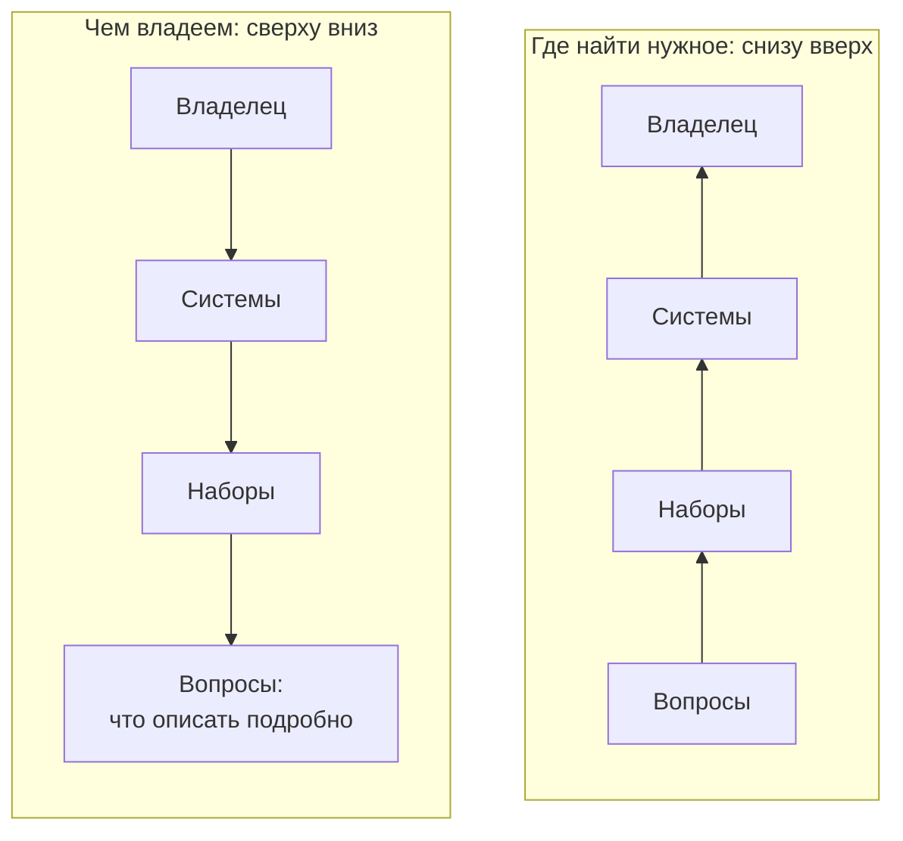
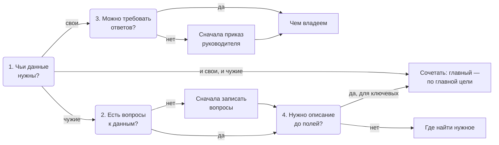

# Два подхода

Инвентаризацию ведут с одной из двух сторон. **«Понять, чем владеем»** — опись собственных данных: начинают с владельца и его систем и спускаются до наборов и полей. **«Понять, где найти нужное»** — поиск данных под задачу: начинают с вопросов и ищут ответы везде, в том числе у других организаций. Подход выбирают по цели и по тому, чьи данные нужны; в крупных проектах подходы сочетают, но один из них главный.

## Коротко

| | Чем владеем | Где найти нужное |
|---|---|---|
| **С чего начинают** | С владельца: организация, ведомство, отрасль | С задачи и вопросов к данным |
| **Чьи данные** | Свои | Любые: свои, других организаций, общественных проектов, компаний |
| **Для чего** | Навести порядок в сборе данных, найти дубли, выделить чувствительные данные, подготовить открытие и обмен | Аналитика и поддержка решений, новые продукты, исследования и журналистика, отраслевые проекты |
| **Кто может провести** | Сама организация или тот, кому подчинены владельцы данных: нужно право требовать ответов | Кто угодно, в том числе со стороны: аналитик, исследователь, журналист |
| **Где ищут** | Свои системы, реестр информационных систем, документы о системах, госконтракты | Государственные, общественные и коммерческие источники — [три слоя данных](../04-sources/01-three-layers.md) |
| **Главные методы** | Опросы владельцев, инвентаризация систем, анализ полномочий | Кабинетные исследования, поиск по каталогам данных, эксперты, поиск по аналогии |
| **Глубина описания** | До наборов и полей, с ответственными, режимом доступа и чувствительностью | До источника, владельца и условий доступа |
| **Мера успеха** | В границах учтены все системы, у каждой записи есть владелец, основание, режим доступа и дата | На каждый вопрос найден источник или записан пробел |
| **Результат** | Реестр данных, внутренний каталог | Карта данных, список источников для проекта, список пробелов |

*Одна лестница уровней, два направления. В подходе «чем владеем» владелец — начало работы, в подходе «где найти нужное» — почти её конец: его находят по источнику, который отвечает на вопрос.*

## Как выбрать подход

Подход выбирают до начала поиска, на втором из [семи шагов](../03-process/01-steps.md#2-выбрать-подход). Хватает четырёх вопросов.

*Дерево решений: четыре вопроса ведут к одному из подходов или к их сочетанию.*

1. **Чьи данные нужны?** Свои — «чем владеем». Чужие или пока неизвестно чьи — «где найти нужное».
2. **Есть ли вопросы к данным?** Вопросы вроде «где найти сведения о числе больниц по регионам?» задают, что искать. Без них поиск чужих данных не закончится ([«Цели и вопросы»](../03-process/02-goals-and-questions.md#вопросы)).
3. **Можно ли требовать ответов от владельцев?** Анкеты работают, когда владельцы подчинены заказчику или обязаны отвечать по закону или приказу. Без такого права опрос превращается в просьбу.
4. **Насколько глубоко описывать?** До полей описывают свои системы, к документации которых есть доступ. Для чужих источников обычно хватает владельца, адреса и условий доступа; ключевые источники описывают отдельной записью реестра.

Если ответы указывают в разные стороны, подходы сочетают, а главным делают тот, что следует из главной цели ([«Несколько целей сразу»](../01-basics/03-goals.md#несколько-целей-сразу)). Какой подход ведёт к какой цели — в главе [«Зачем: цели»](../01-basics/03-goals.md#три-группы-целей).

## Чем владеем

Подход для организации, которая хочет знать свои данные: министерства, региона, компании. Его приоритет — то, что требует особого обращения, прежде всего персональные и другие чувствительные данные: их находят первыми, где бы они ни лежали.

**Когда применять.** Защита персональных данных, сокращение дублей и расходов, замена старых систем, требование закона вести реестр, подготовка открытия данных и обмена с партнёрами.

**Что получается.** [Реестр данных](../03-process/05-registry.md), который становится внутренним каталогом и основой для открытия данных, обмена с партнёрами или межведомственной интеграции. Часто у реестра две части: полная внутренняя и общедоступная — описания наборов, которые можно показать. Так устроены инвентари данных федеральных ведомств США, которые требует закон ([«Зарубежные методики»](../05-frameworks/04-international-practice.md#инвентари-данных-федеральных-ведомств-сша)). Узкий вариант того же подхода — реестр операций обработки персональных данных по Общему регламенту ЕС о защите данных (GDPR): опись своего, но только персональных данных.

**Ограничения.**

- Подход не видит чужих данных, даже если без них задачу не решить.
- Полнота зависит от владельцев: о забытых таблицах и выгрузках в анкете не напишут, поэтому ответы сверяют с другими источниками ([«Только опросы владельцев»](../08-practices/01-practices-and-anti-patterns.md#только-опросы-владельцев)).
- Чем глубже описание, тем дороже поддержка: реестр до полей приходится обновлять после каждой доработки систем.
- Главная ловушка — [опись ради описи](../08-practices/01-practices-and-anti-patterns.md#опись-ради-описи): всё перечислено, но реестр не отвечает ни на один вопрос, потому что вопросов не было.

## Где найти нужное

Подход для задачи, которой не хватает данных: аналитики, продукта, исследования, журналистского расследования. Начинают с вопросов, которые задают руководители или аналитики, и для каждого ищут источники — у государства, в общественных проектах, у компаний. Данные чужие, поэтому опросы владельцев здесь почти не работают: основные методы — **кабинетные исследования** (ручной разбор сайтов, отчётов и документов), поиск по каталогам данных и разговоры с экспертами ([«Семь методов»](./02-methods.md#как-выбрать-и-сочетать-методы)).

**Когда применять.** Система поддержки решений, отраслевая аналитика, новый продукт или сервис, исследование, подборка данных для хакатона или обучения модели. А ещё — когда нужно разобраться в незнакомой отрасли, прежде чем браться за опись своего.

**Что получается.** Результат часто оформляют как [карту данных](./04-data-maps.md): вопросы, источники и их доступность. Не менее важен список пробелов: он показывает, каких данных нет вообще, а какие есть, но закрыты. Так работает сквозной условный пример книги — 15 вопросов о доступности медицинской помощи в регионах ([«Карты данных»](./04-data-maps.md#пример)). В международном масштабе так устроен Open Data Inventory: он смотрит со стороны пользователя, какие показатели публикуют национальные статистические службы ([«Зарубежные методики»](../05-frameworks/04-international-practice.md#open-data-inventory-odin)).

**Ограничения.**

- Подход не видит закрытых систем, о которых нигде не написано. Анализ полномочий и эксперты подсказывают, что такие системы есть, но описать их снаружи нельзя.
- Доступность, отмеченная снаружи, не окончательна: «закрыто» и «не открылось из-за рубежа» — разные статусы, а владелец может выдать данные по запросу ([«Порядок проверки»](../03-process/06-access.md#порядок-проверки)).
- Результат стареет быстро: адреса чужих сайтов меняются без предупреждения.
- Главная ловушка — список чужих сайтов без владельцев и без проверки, что нужные данные там есть ([«Сайт вместо системы»](../08-practices/01-practices-and-anti-patterns.md#сайт-вместо-системы)).

## Подходы на семи шагах

Порядок [семи шагов](../03-process/01-steps.md) одинаков для обоих подходов, а наполнение шагов разное. Второй шаг — выбор подхода — в таблицу не входит: он один для обоих. Шаги 4–6 подробно — в главе [«Пробелы и план»](../03-process/08-gaps-and-plan.md).

| Шаг | Чем владеем | Где найти нужное |
|-----|-------------|------------------|
| **1. Сформулировать цели и задачи** | Что сделать со своими данными: защитить, открыть, передать, перенести | Какую задачу решить и на какие вопросы ответить |
| **3. Найти и описать данные** | Перечень систем, анализ полномочий, опросы владельцев | Поиск по трём слоям, кабинетные исследования, поиск по аналогии |
| **4. Привлечь экспертов** | Владельцы подтверждают описания своих наборов | Эксперты отрасли подсказывают источники и проверяют доступность |
| **5. Сопоставить цели с данными** | Чего нет из положенного по полномочиям, что собирают дважды, что можно открыть | На какие вопросы нет источника или есть только закрытый |
| **6. Спроектировать сбор от данных** | Новые поля, выгрузки и программные интерфейсы в своих системах | Запросы владельцам, договоры о доступе, собственный сбор там, где данных нет ни у кого |
| **7. Собрать и опубликовать результат** | Реестр данных, внутренний или публичный каталог | Карта данных, список источников для проекта |

## Когда подходы сочетают

Результат одного подхода становится исходными данными для другого. Реестры информационных систем, порталы открытых данных, инвентари ведомств — итог чужого «чем владеем» — служат главными источниками для «где найти нужное». Последний вопрос опросного листа — «каких данных не хватает подразделению?» — превращает опись своего в поиск нужного ([«Что спрашивать»](../03-process/04-questionnaires.md#что-спрашивать)).

В обратную сторону карта данных показывает владельцу, какие его закрытые системы нужны другим. Если закрытая система стоит на карте источником во многих вопросах и ни в одном не доступна, для аналитика это пробел. Для владельца — повод описать её по подходу «чем владеем»: какие в ней ресурсы, что можно открыть, что выдавать по запросу, а что закрыто по закону.

Типичные сочетания:

- **Перед открытием данных** ведомство описывает свои данные («чем владеем») и сверяет их с тем, что востребовано у пользователей («где найти нужное»): с запросами, обращениями, отраслевыми картами данных.
- **Для проактивных услуг** государство сначала ищет, где лежат нужные сведения о человеке или организации («где найти нужное»), затем описывает эти системы до полей («чем владеем»). Так выполняют принцип однократности — брать сведения из системы, где они уже есть, а не запрашивать снова ([«Принципы в других методиках»](../01-basics/04-principles.md#принципы-в-других-методиках)).
- **Для отраслевой аналитики** находят источники под вопросы, а затем подробно описывают несколько ключевых систем, на которые приходится больше всего ответов.
- **Для обучения моделей** ищут подходящие наборы, в том числе чужие («где найти нужное»), а для своих записывают происхождение, порядок сбора и условия использования («чем владеем»). Для систем ИИ высокого риска в ЕС этого требует закон ([«Цели в законах и программах»](../01-basics/03-goals.md#цели-в-законах-и-программах)).

Главный подход задаёт глубину и сроки. Из второго берут только то, что нужно главной цели.

## Ошибки выбора

| Ошибка | Что происходит | Как исправить |
|--------|----------------|---------------|
| **Анкеты чужим организациям** | Ответы не приходят или приходят через месяцы, работа стоит | Кабинетные исследования и анализ полномочий; официальный запрос — только по ключевым источникам |
| **Поиск по сайтам вместо описи своего** | Внутренний реестр повторяет портал открытых данных, закрытых систем в нём нет | Перечень систем, полномочия и опросы владельцев |
| **Карта до полей** | Чужие системы описывают до таблиц по обрывкам документации, и работа не заканчивается | Для карты — до источника и доступа; до полей — только ключевые источники |
| **Оба подхода без главного** | Глубина, сроки и состав команды расплываются, результат не готов ни для одной цели | Одна главная цель и один главный подход |
| **Подход по привычке** | Подрядчик делает то, что умеет, — рассылает анкеты или ищет по сайтам — независимо от задачи | Выбирать по [дереву решений](#как-выбрать-подход) |

## Источники

- Главы [«Зачем: цели»](../01-basics/03-goals.md) — какой подход следует из какой цели; [«Семь методов»](./02-methods.md) — какие методы работают для каждого подхода; [«Карты данных»](./04-data-maps.md) — как оформить результат подхода «где найти нужное».
- Глава [«Зарубежные методики»](../05-frameworks/04-international-practice.md) — инвентари федеральных ведомств США и Open Data Inventory.
- [The OPEN Government Data Act: A Primer](https://www.everycrsreport.com/reports/IF12299.html) — Congressional Research Service.
- [Open Data Inventory](https://odin.opendatawatch.com/) — Open Data Watch.
- [Общий регламент ЕС о защите данных](https://eur-lex.europa.eu/eli/reg/2016/679/oj) (Regulation (EU) 2016/679).
