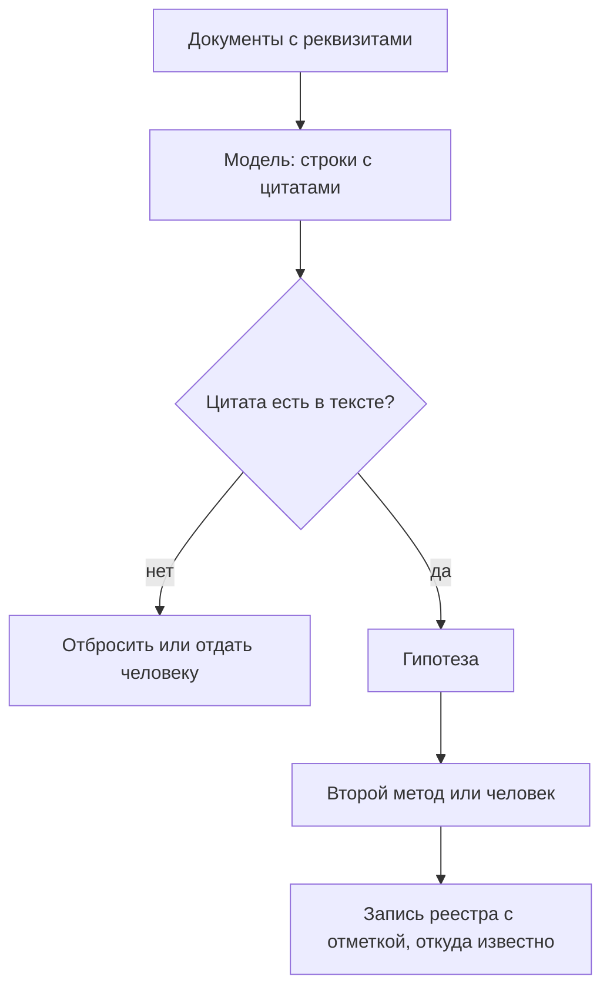

# ИИ в инвентаризации

Дольше всего в инвентаризации читают: положения об органах власти, отраслевые законы, технические задания, контракты, сайты, — а потом переносят прочитанное в сотни строк реестра. Большие языковые модели берут на себя и чтение, и черновое заполнение, а агенты — программы на основе моделей, которые сами открывают страницы, ищут и обращаются к другим сервисам, — обходят сайты и каталоги. Но модель не отличает прочитанное от додуманного и уверенно пишет правдоподобное. Поэтому правило одно: **вывод модели — гипотеза со ссылкой на источник.** Записью реестра он становится, когда его подтвердили документ, второй метод или человек.

## Коротко

| Задача | Метод | Что даёт модель | Как проверить |
|--------|-------|-----------------|---------------|
| **Читать положения и законы** | [Анализ полномочий](./02-methods.md#1-анализ-полномочий) | Строки «полномочие → ожидаемый набор» с актом, пунктом и цитатой | Цитата есть в тексте; акт действует |
| **Читать технические задания, паспорта систем, контракты** | [Инвентаризация систем](./02-methods.md#2-инвентаризация-информационных-систем) | Системы, операторы и ресурсы в них с номером документа | Сверка с реестром систем |
| **Обходить сайты** | [Кабинетные исследования](./02-methods.md#3-кабинетные-исследования) | Разделы с данными, отчёты, формы, публичные системы — с адресами | Адрес открывается, данные на месте, видна дата обновления |
| **Искать опубликованное** | [Специализированный поиск](./02-methods.md#4-специализированный-поиск) | Запросы на нескольких языках; кандидаты из поисковиков и каталогов | Дубли, дата обновления, владелец |
| **Сравнивать с перечнями** | [Поиск по аналогии](./02-methods.md#7-поиск-по-аналогии) | Свои наборы, разложенные по категориям наборов высокой ценности или ODIN; переведённые инвентари других стран | Пробел это или тот же набор под другим названием — решает человек |
| **Готовить и разбирать опросы** | [Опросы владельцев](./02-methods.md#5-опросы-владельцев) и [экспертов](./02-methods.md#6-опросы-экспертов) | Анкету, заполненную найденным; записи интервью, разложенные по полям реестра | Владелец подтверждает свою строку |
| **Описывать наборы** | [Реестр](../03-process/05-registry.md) | Черновик описания, темы, ключевые слова, связи между таблицами, поля, похожие на персональные данные | Ответственный правит и подтверждает |
| **Искать дубли** | [Реестр](../03-process/05-registry.md#один-набор-под-разными-именами) | Пары записей, похожих на один набор под разными именами | Объединяет человек |

Модель не решает, существует ли набор, кто за него отвечает, какой у него режим доступа и есть ли в нём персональные данные. По этим записям открывают данные, отказывают в доступе и пишут запросы, поэтому их подтверждает человек.

## Когда применять

- **Много однотипных документов.** Положения о десятках ведомств, сотни контрактов, тысячи страниц сайтов. Модель окупается, когда людям пришлось бы читать неделями; один документ быстрее прочитать самому.
- **Повторная инвентаризация.** Модель сравнивает новую редакцию акта или сайта с прежней и показывает, что изменилось, а значит, какие записи перепроверить ([«Поддержка»](../03-process/08-result-and-upkeep.md#поддержка)).
- **Пустые описания.** Набор есть, а описания нет или оно в одну строку: модель предлагает черновик по самим данным ([«Описания наборов»](#описания-наборов)).
- **Другие языки.** Инвентари и законы других стран для поиска по аналогии, запросы к зарубежным каталогам, описания на нескольких языках.

Не применять, где ошибка дорога, а проверить вывод нечем, и где данные нельзя отдать модели ([«Закрытые данные и внешние модели»](#закрытые-данные-и-внешние-модели)).

## Как делать



### 1. Дать модели текст, а не вопрос

Модель, которую спросили «какие реестры ведёт министерство», отвечает по памяти: по устаревшей редакции, по похожему ведомству другой страны или наугад. Модель, которой дали текст положения и попросили выписать из него полномочия, работает с источником.

- Документы собирают с реквизитами: акт — с номером, датой и редакцией; техническое задание и контракт — с номером; страницу сайта — с адресом и датой сохранения.
- Действует ли акт, проверяют до того, как отдать его модели ([«Перед ссылкой на нормативный акт»](../10-appendices/04-checklists.md#перед-ссылкой-на-нормативный-акт)).
- Длинные документы делят по статьям и разделам: в длинном тексте модель чаще пропускает.

### 2. Задать форму ответа — поля реестра

Ответ — таблица с полями реестра, источником и дословной цитатой. Свободный пересказ всё равно пришлось бы переносить в реестр руками.

Пример инструкции для анализа полномочий; перечень формулировок — из главы [«Владельцы и полномочия»](../03-process/03-owners-and-mandates.md#как-читать-полномочия):

```text
Ниже — текст положения о ведомстве. В первой строке — название,
номер, дата и редакция акта.

Выпиши каждое полномочие, за которым стоят данные: ведение реестра,
кадастра, регистра, учёта; выдача лицензий, разрешений, аккредитации;
контроль и надзор; сбор отчётности и статистики; оказание
государственных услуг; распоряжение бюджетными средствами.

Ответ — CSV с разделителем «;» и колонками:
полномочие;ожидаемый_набор;пункт;цитата

Правила:
- цитата — дословно из текста, без сокращений и правок;
- если набор в тексте прямо не назван, начни ожидаемый_набор со слова «вывод:»;
- не добавляй ничего из других источников и по памяти;
- если таких полномочий нет, ответь одним словом «нет».
```

### 3. Проверить в три слоя

1. **Программой.** Каждую цитату ищут в исходном тексте, с поправкой на пробелы и кавычки. Нет совпадения — строку отбрасывают или отдают человеку: так отсекаются выдуманные пункты и формулировки. Адреса проверяют скриптом, как адреса атласа ([«Проверка адресов»](../06-tools/03-registry-as-data.md#проверка-адресов)).
2. **Вторым методом.** Строка, которую нашла только модель, остаётся гипотезой, пока набор не подтвердили реестр систем, контракт, сайт или владелец ([«Как методы проверяют друг друга»](./02-methods.md#как-методы-проверяют-друг-друга)).
3. **Человеком.** Выборку проверяет специалист. Записи с последствиями — режим доступа, персональные данные, основание — проверяют все.

### 4. Начать с проверочной выборки

Прежде чем пускать модель по всем ведомствам, одно-два положения размечают вручную и сравнивают с ответом модели: сколько полномочий она пропустила и сколько добавила лишнего. Много пропусков — делят текст мельче или уточняют инструкцию; много лишнего — ужесточают требования к цитате. Сравнение повторяют при смене модели или инструкции: разные модели на одной инструкции отвечают по-разному.

### 5. Записать, откуда известно

У записи, которую составила или дополнила модель, в поле «откуда известно о наборе» ([«Расширенный состав»](../03-process/05-registry.md#расширенный-состав)) отмечают документ и цитату; модель, её версию, дату и инструкцию; статус — гипотеза или подтверждено, кем, когда и каким методом.

```yaml
id: licenses-registry
title: Реестр выданных лицензий
publisher: Министерство (условное)
mandate: ведёт реестр выданных лицензий
legal_act: Положение о министерстве, пункт 5.3, редакция от 01.09.2026
known_from:
  method: анализ полномочий
  quote: «ведёт реестр выданных лицензий»
  made_by: модель <название и версия>, инструкция mandates-v2, 24.10.2026
  status: гипотеза — в реестре систем и на сайте набор не найден
  confirmed_by:
checked: 2026-10
```

Пример условный, поля — как в [шаблоне реестра](../10-appendices/03-templates.md#реестр-данных). Отметка нужна трижды: при обновлении видно, что перепроверить; при смене модели — какие записи пересобрать; при споре — откуда взялась строка.

## Описания наборов

Описание — самый пустой атрибут реестра: у набора есть название и таблица, а текста о том, что в ней, за какой период и откуда, нет. Модель пишет черновик за секунды, но его качество зависит от того, что ей дали.

- **Не только название.** По одному названию модель пишет гладкий текст, но додумывает столбцы и источники данных.
- **Не одна схема.** Названия столбцов без значений превращают описание в перечень технических терминов без пояснений.
- **Схема и несколько характерных строк** — лучший из трёх вариантов: по значениям модель понимает, что лежит в столбцах.
- **Происхождение, период, территорию и ограничения** модель из таблицы не узнает. Их берут из документов и у ответственного, а в инструкции просят писать «не установлено», если в исходных данных этого нет.

Так показало исследование Королевского колледжа Лондона и Мюнхенского технического университета 2026 года на 252 наборах (1336 CSV-файлов) европейского портала data.europa.eu. Разные модели на одной инструкции описывали наборы систематически по-разному: одни выдвигали на первый план происхождение и качество, другие — структуру таблиц или выводы из данных. Выбор модели меняет содержание описаний — ещё одна причина её записывать. Описания моделей, по оценке авторов (её тоже выставляла модель), в большинстве случаев не хуже тех, что написали публикаторы.

Ещё две подсказки, которые модель даёт по самим данным:

- **Поля, похожие на персональные данные:** ФИО, адреса, телефоны, номера документов. Это повод проверить, а не решение о режиме доступа ([«Доступ и ограничения»](../03-process/06-access.md#юридические-ограничения)). Столбец `col_7` с номерами паспортов по названию не распознать, а по значениям — можно, если значения разрешено показать модели.
- **Связи и дубли:** одинаковые столбцы и значения в разных таблицах подсказывают, где один набор лежит в нескольких системах.

Черновик помечают как непроверенный, пока его не подтвердил ответственный, — так делает, например, DataHub ([«Что уже умеют инструменты»](#что-уже-умеют-инструменты)).

## Ошибки модели и как их ловить

| Ошибка | Как выглядит | Как ловить |
|--------|--------------|------------|
| **Выдумка** | Правдоподобное название системы, набора или пункта акта, которых нет в источнике | Дословная цитата и программный поиск её в тексте |
| **Ответ по памяти** | Устаревшая редакция акта, упразднённое ведомство, система из другой страны | Давать текст, а не вопрос; реквизиты и редакция — в самом документе |
| **Пропуск** | В длинном документе часть полномочий не выписана | Делить текст по статьям; проверочная выборка |
| **Ложное «данных нет»** | Агент не открыл сайт: он закрыт от роботов, не открывается из-за рубежа, данные спрятаны за формой поиска | «Не открылось» — не то же, что «нет данных» ([шкала доступа](../03-process/06-access.md#шкала)) |
| **Подмена владельца** | Оператор системы или подрядчик записан владельцем данных | Владельца берут из положения и акта о создании системы ([«Владельцы и полномочия»](../03-process/03-owners-and-mandates.md)) |
| **Уверенный вывод о доступе** | «Открыто», потому что есть страница; «персональных данных нет», потому что столбцы названы иначе | Режим доступа и чувствительность ставит человек с основанием |
| **Описание без данных** | По одному названию — гладкий текст с додуманными столбцами | Давать модели выборку строк; помечать черновик |

## Закрытые данные и внешние модели

Внешний сервис — модель другой компании, к которой обращаются через интернет, часто с серверами в другой стране. Всё, что ему отправили, покинуло контур организации.

- **Можно отдавать:** опубликованные акты, публичные сайты, открытые наборы и их описания.
- **Нельзя без решения владельца:** содержимое систем с персональными данными, служебной и другой охраняемой информацией. Схемы закрытых систем тоже бывают служебной информацией — это решает владелец.
- **Как обойтись:** модель в своём контуре — открытая модель на своих серверах; внешнему сервису — с согласия владельца — только названия и типы полей без строк или обезличенная выборка. Без строк описания хуже ([«Описания наборов»](#описания-наборов)), поэтому закрытые наборы лучше описывать моделью в своём контуре.
- **Закон.** Персональные данные, отправленные сервису с серверами за рубежом, — трансграничная передача: в ЕС её регулирует глава V GDPR, в России — статья 12 закона № 152-ФЗ, в Казахстане — статья 16 закона № 94-V.
- **Договор.** Условия сервиса читают заранее: хранит ли поставщик присланное и обучает ли на нём модели.

## Что получается

- Реестр, в котором у каждой записи видно, кто её составил — человек или модель — и подтверждена ли она.
- Список гипотез: полномочия без найденных наборов, системы из контрактов без владельца. Это вопросы для анкеты и интервью.
- Анкеты, заполненные найденным: владельцу остаётся подтвердить и дополнить ([«Опросные листы и интервью»](../03-process/04-questionnaires.md)).
- Черновики описаний, которые ответственный правит, а не пишет с нуля.
- Инструкции и проверочная выборка, которые переиспользуют при обновлении.

## Пример

Пример условный: составить перечень данных отраслевого министерства и трёх подведомственных служб по подходу «чем владеем».

1. **Документы.** Четыре положения в действующей редакции, отраслевой закон, технические задания и контракты на системы за пять лет из реестра закупок, сайты всех четырёх органов.
2. **Проверочная выборка.** Аналитик вручную размечает положение одной службы и сравнивает с ответом модели; инструкцию правят, пока пропусков и лишних строк не станет мало.
3. **Полномочия.** Модель выписывает полномочия из всех положений и закона; программа отбрасывает строки без дословной цитаты.
4. **Системы и сайты.** Модель выписывает системы и ресурсы из технических заданий и контрактов, агент обходит сайты и собирает разделы с данными и отчётами.
5. **Сведение.** Строки сводят по полномочию. Где совпали полномочие, система и публикация, запись подтверждена тремя методами; где есть только полномочие — строка «не найдено» и вопрос в анкету.
6. **Опрос.** Анкету, заполненную найденным, отправляют ответственным, интервью ведут люди, а модель раскладывает записи интервью по полям реестра.
7. **Подтверждение.** Режим доступа и отметку о персональных данных ставит специалист, описания правит ответственный, у каждой записи — отметка, откуда о ней известно.

Люди заняты тем, чего модель не делает: проверочной разметкой, интервью, решениями о доступе. Модель сокращает чтение, но не проверку — проверку закладывают в сроки.

## Что уже умеют инструменты

На октябрь 2026 года, по документации:

| Инструмент | Что делает автоматически | Как помечают и проверяют |
|------------|--------------------------|--------------------------|
| **OpenMetadata** (открытый код) | Находит столбцы с персональными данными по названиям и по выборке значений | Тег PII.Sensitive или PII.NonSensitive; порог уверенности настраивают |
| **DataHub Cloud** | Составляет описания таблиц и столбцов по названию, схеме, примерам значений и связям с другими таблицами | Текст, который не проверил человек, помечен значком |
| **BigQuery** (Google Cloud) | Модель Gemini составляет описания таблиц и столбцов | Описания просматривают, правят и публикуют в каталог |
| **data.gouv.fr** | С 25 февраля 2026 года — экспериментальный сервер MCP: ИИ-ассистенты ищут наборы, читают описания и данные французского портала, только на чтение | Портал предупреждает, что ответы моделей бывают неполными, приблизительными или ошибочными |

MCP (Model Context Protocol) — открытый протокол, по которому модели обращаются к внешним сервисам: каталогам, базам данных, поисковикам. Если у каталога есть сервер MCP, агент ищет наборы не по страницам сайта, а через программный интерфейс.

Каталог метаданных — следующий шаг после таблицы ([«От таблицы до каталога метаданных»](../06-tools/01-from-spreadsheet-to-catalog.md)). Встроенный ИИ не отменяет проверки: черновик в каталоге — тоже гипотеза.

## Инвентаризация для ИИ

ИИ не только ускоряет инвентаризацию, но и сам нуждается в её результате.

- **Данные для обучения.** Чтобы взять набор для обучения или проверки модели, нужно знать, откуда он, есть ли в нём персональные данные и разрешено ли так его использовать, — это владелец, режим доступа и условия использования из реестра. Для систем ИИ высокого риска в ЕС записывать происхождение обучающих данных и порядок их сбора обязательно — статья 10 регламента об ИИ ([«Цели в законах и программах»](../01-basics/02-goals.md#цели-в-законах-и-программах)). В Казахстане подготовка государственных данных для обучения моделей — одна из целей инвентаризации ([«Казахстан»](../07-countries/01-kazakhstan.md#что-особенного)).
- **Данные, готовые для ИИ.** Министерство торговли США в январе 2025 года выпустило руководство по публикации открытых данных для генеративного ИИ в пяти областях: документация, форматы данных и метаданных, хранение и распространение, лицензии и условия использования, целостность и качество. Британское руководство по подготовке государственных наборов для ИИ (январь 2026 года) условием того, что набор найдут, называет метаданные: владельца, лицензию, график обновления, статус проверки качества. Это атрибуты реестра ([«Реестр данных»](../03-process/05-registry.md)): подготовка данных для ИИ начинается с инвентаризации.
- **Реестр, который читают агенты.** Реестр, который хранится как данные и отдаётся через программный интерфейс, агент прочитает так же, как каталог data.gouv.fr через MCP. Реестр в отчёте или на картинке ему недоступен ([«Реестр как данные»](../06-tools/03-registry-as-data.md)).
- **Системы ИИ — тоже объект учёта.** Федеральные ведомства США не реже раза в год составляют инвентарь применений ИИ и публикуют его общедоступную часть (меморандум OMB M-25-21 от 3 апреля 2025 года). В ЕС поставщики систем ИИ высокого риска и органы власти, которые их применяют, регистрируют такие системы в базе данных ЕС (статьи 49 и 71 регламента об ИИ). У обучающих наборов в реестре данных стоит отмечать, в каких моделях и системах они использованы.

## Если только начинаете

- Одна задача — анализ полномочий одного ведомства по публичным документам.
- Одно положение, размеченное вручную, — для сравнения с моделью.
- Инструкция с дословными цитатами и программная проверка цитат.
- Отметка о модели в поле «откуда известно» — с первой записи.
- Во внешний сервис — только публичные документы.

Реестр, собранный моделью без проверки, — антипаттерн: в нём не отличить найденное от додуманного ([«Реестр со слов модели»](../09-practices/02-anti-patterns.md#реестр-со-слов-модели)).

## Ограничения

- Модели уверенно выдумывают правдоподобные названия систем, наборов и статей. Анализ полномочий — с моделью или без — даёт гипотезу о том, что данные должны быть, а не факт, что они есть.
- Агенты видят только публичную часть. Закрытые системы по-прежнему находят по документам и опросам, а таблицы на рабочих компьютерах — только на интервью ([«Ограничения»](./02-methods.md#ограничения)).
- Сайты, которые закрыты от роботов, не открываются из-за рубежа или прячут данные за формой поиска, агент не увидит или увидит не всё.
- Модели меняются: та же инструкция через полгода может дать другой результат. Поэтому модель, версию и дату записывают, а проверочную выборку повторяют.
- Время экономится на чтении, а не на проверке.

## Источники

- Главы [«Семь методов»](./02-methods.md) и [«Владельцы и полномочия»](../03-process/03-owners-and-mandates.md) — методы, которые ускоряет ИИ, и формулировки полномочий.
- [Less Is More? When Dataset Context Hurts LLM-Generated Dataset Descriptions](https://kclpure.kcl.ac.uk/ws/files/368041611/ICDE26_Workshop_LLM_generated_Dataset_Descriptions-1.pdf) — L.-Y. Gan, A. Das, J. Walker, K. Diepold, E. Simperl; King's College London и Technical University of Munich, принята к публикации в 2026 году; 252 набора (1336 CSV-файлов) портала data.europa.eu.
- [Expérimentation autour d'un serveur MCP pour datagouv](https://www.data.gouv.fr/posts/experimentation-autour-dun-serveur-mcp-pour-datagouv) — data.gouv.fr, 25 февраля 2026 года; [исходный код сервера](https://github.com/datagouv/datagouv-mcp); [Model Context Protocol](https://modelcontextprotocol.io/).
- Документация на октябрь 2026 года: [OpenMetadata — Auto-Classification](https://docs.open-metadata.org/latest/how-to-guides/data-governance/classification/auto-classification), [DataHub — AI Documentation](https://docs.datahub.com/docs/automations/ai-docs), [BigQuery — Generate data insights](https://docs.cloud.google.com/bigquery/docs/data-insights).
- [Generative Artificial Intelligence and Open Data: Guidelines and Best Practices](https://www.commerce.gov/sites/default/files/2025-01/GenerativeAI-Open-Data.pdf) — U.S. Department of Commerce, версия 1 от 16 января 2025 года.
- [Guidelines and best practices for making government datasets ready for AI](https://www.gov.uk/government/publications/making-government-datasets-ready-for-ai) — Government Digital Service, Department for Science, Innovation and Technology, 19 января 2026 года.
- [M-25-21: Accelerating Federal Use of AI through Innovation, Governance, and Public Trust](https://www.whitehouse.gov/wp-content/uploads/2025/02/M-25-21-Accelerating-Federal-Use-of-AI-through-Innovation-Governance-and-Public-Trust.pdf) — Office of Management and Budget, 3 апреля 2025 года, раздел 3(b)(v).
- [Регламент ЕС об искусственном интеллекте](https://eur-lex.europa.eu/eli/reg/2024/1689/oj) (Regulation (EU) 2024/1689), статьи 10, 49 и 71.
- [Общий регламент ЕС о защите данных](https://eur-lex.europa.eu/eli/reg/2016/679/oj) (Regulation (EU) 2016/679), глава V; [Федеральный закон от 27.07.2006 № 152-ФЗ «О персональных данных»](https://www.consultant.ru/document/cons_doc_LAW_61801/), статья 12; [закон Республики Казахстан «О персональных данных и их защите»](https://adilet.zan.kz/rus/docs/Z1300000094) от 21.05.2013 № 94-V, статья 16.
