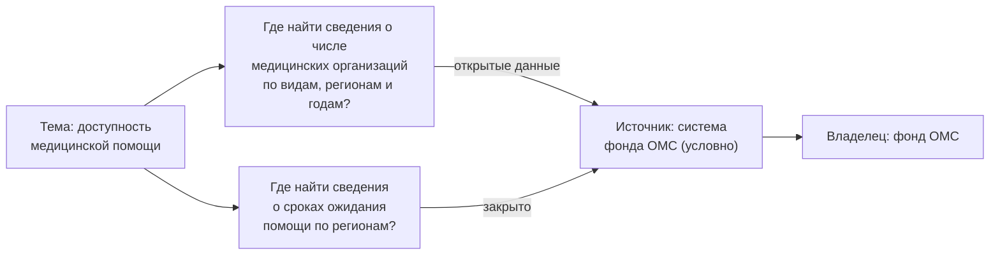
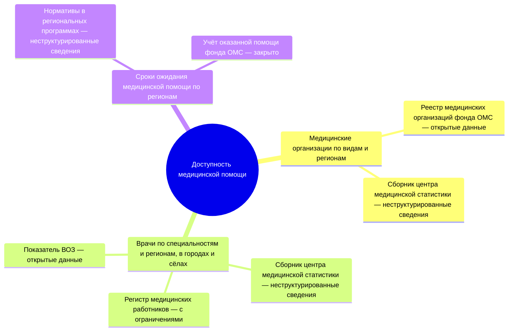
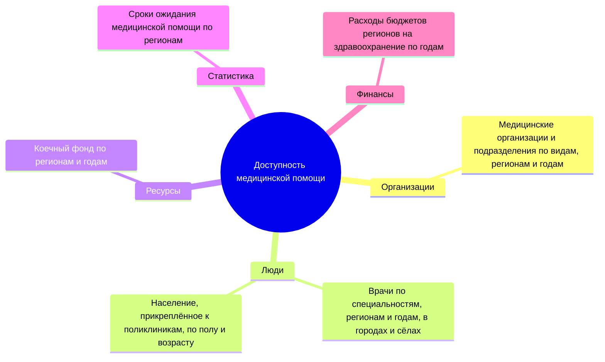
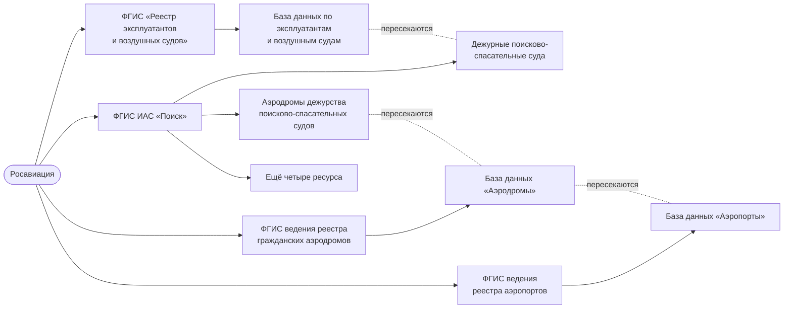
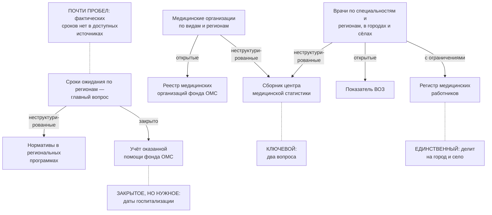

# Карты данных

**Карта данных** — форма результата подхода «где найти нужное»: по теме, территории, ведомству или продукту она показывает, где лежат нужные данные, у кого они и можно ли их получить. Карта отвечает на вопрос «где найти данные?», а не «как они устроены»: описание доходит до источника, владельца и доступа, но не до полей. Главное на карте — не картинка, а связи «вопрос — источник» с отметкой доступности и пробелы: вопросы, на которые нет ни одного доступного источника. Поэтому карту ведут как таблицу, а картинку строят из таблицы.

## Карта и реестр

Карта — не отдельный жанр, а реестр, к которому добавлены вопросы. В ней те же источники с владельцами, что и в [реестре данных](../03-process/05-registry.md), плюс список вопросов и связи между вопросами и источниками ([«Реестр как данные»](../06-tools/03-registry-as-data.md#что-хранить)).

| | Реестр данных | Карта данных |
|---|---|---|
| **Подход** | Чем владеем | Где найти нужное |
| **От чего строится** | От владельца и его систем | От вопросов, ведомства или продукта |
| **Чьи данные** | Свои | Любые, чаще чужие |
| **Единица** | Набор данных | Пара «вопрос — источник» |
| **Глубина** | До наборов и полей, 14 атрибутов | До источника, владельца и доступа |
| **Где отмечен доступ** | У набора | У пары: один источник бывает открыт для одного вопроса и закрыт для другого |
| **Главный вывод** | Что у нас есть и в каком состоянии | На какие вопросы данные есть, а на какие нет |
| **Кто пользуется** | Владелец, служба данных, каталог | Руководитель, аналитик, исследователь, журналист |

Если источник на карте важен для задачи, его описывают подробно — отдельной записью реестра. Так карта становится входом для подхода «чем владеем» ([«Когда подходы сочетают»](./01-two-approaches.md#когда-подходы-сочетают)).

## Из чего состоит карта

Элементы показаны на сквозном условном примере книги — 15 вопросах руководства о доступности медицинской помощи в регионах ([«Цели и вопросы»](../03-process/02-goals-and-questions.md#пример)).

| Элемент | Что это | Условный пример |
|---------|---------|-----------------|
| **Тема** | Отрасль, территория или задача, по которой составлена карта | Доступность медицинской помощи в регионах |
| **Вопрос** | Укрупнённый вопрос «где найти…?» | Где найти сведения о числе врачей по специальностям, регионам и годам — отдельно для городов и сёл? |
| **Источник** | Система, ресурс, набор данных, сайт или группа однотипных источников ([«Что инвентаризируют»](../01-basics/02-what-is-inventoried.md#система-ресурс-набор-и-сайт)) | Федеральный регистр медицинских работников; ежегодный сборник с таблицами о числе врачей |
| **Владелец** | Организация, которая ведёт источник | Министерство здравоохранения; оператор регистра — подведомственный центр медицинской статистики |
| **Доступность** | Можно ли получить из этого источника сведения для этого вопроса — по [шкале доступа](../03-process/06-access.md#шкала), с основанием и датой | Регистр — с ограничениями: органам власти по межведомственному запросу; сборник — неструктурированные сведения, таблицы в PDF |
| **Паспорт** | Вид карты, дата проверки, автор, откуда взяты сведения, лицензия | От вопросов с доступностью; октябрь 2026 года; анализ полномочий, поиск наборов, опрос владельцев и эксперты; CC BY 4.0 |

Доступность ставят паре «вопрос — источник», а не источнику. В том же примере фонд обязательного медицинского страхования (ОМС) ведёт и реестр медицинских организаций, и учёт оказанной помощи ([«Владельцы и полномочия»](../03-process/03-owners-and-mandates.md#пример)). Если источником на карте записана система фонда, она отвечает на два вопроса: реестр организаций открыт, а учёт, в котором лежат даты госпитализации, закрыт — персональные данные и врачебная тайна.

*Один источник, два вопроса, два статуса: доступность принадлежит паре «вопрос — источник».*

Один цвет на весь источник одну из этих пар показал бы неверно: открытый реестр выглядел бы закрытым или закрытый учёт — открытым.

## Виды карт

Виды различаются тем, что стоит в центре карты.

| Вид | Что в центре и уровни | Когда применять | Форма для показа |
|-----|-----------------------|-----------------|------------------|
| **[От вопросов](#от-вопросов)** | Тема → вопрос → источник | Понять, где искать данные по новой теме. Самый простой и частый вид | Интеллект-карта |
| **[С типовыми темами](#с-типовыми-темами)** | Тема → типовая тема → вопрос → источник | Охватить широкую тему, не пропустив групп вопросов | Несколько интеллект-карт по темам |
| **[По полномочиям](#по-полномочиям)** | Ведомство → полномочие → система → ресурс | Разобраться, какие данные накапливает ведомство. Ближе к подходу «чем владеем» | Схема со связями между ресурсами |
| **[От продукта](#от-продукта)** | Продукт ← системы и ресурсы разных владельцев | Спроектировать продукт или систему поддержки решений | Схема со связями |
| **[Доступности](#доступности)** | Ведомство → система, цвет — статус | Решить, что открывать или запрашивать, оценить закрытость отрасли | Доска с колонками |

### От вопросов

Вопросы звучат как «где найти…?» и повторяют реальные запросы руководства и аналитиков; к каждому привязаны источники ответа. Один источник часто отвечает на несколько вопросов. На карте ниже у каждой пары «вопрос — источник» записан статус по шкале доступа.

*Фрагмент карты от вопросов условного примера: три вопроса из пятнадцати. Статусы — по шкале доступа: открытые данные, неструктурированные сведения, с ограничениями, закрыто, не установлено. Статус записан словами, а не только цветом, — так он не пропадёт при печати и выгрузке.*

### С типовыми темами

Между темой и вопросами стоит ещё один уровень — типовые темы, которые повторяются от отрасли к отрасли: организации, люди, ресурсы, статистика, финансы. Они служат проверкой полноты: если в теме нет ни одного вопроса о людях или о деньгах, это пропуск или осознанное решение ([«Как проверить список»](../03-process/02-goals-and-questions.md#как-проверить-список)). Широкую карту по типовым темам удобно делить на несколько карт.

*Карта с типовыми темами: шесть вопросов условного примера, разложенные по пяти типовым темам. Источники к вопросам добавляют следующим уровнем.*

### По полномочиям

В центре — ведомство, от него расходятся информационные системы, от систем — ресурсы: реестры, базы, перечни. Полномочие, ради которого создана система, часто пишут в подписи, а не отдельным узлом, иначе карта разрастается. Карта строится со стороны поставщика данных, поэтому ближе к подходу «чем владеем», но составить её можно и снаружи — по положению об органе, реестру систем и контрактам ([«Семь методов»](./02-methods.md#2-инвентаризация-информационных-систем)).

Пример из прежней версии книги — карта Росавиации: девять информационных систем ведомства и их ресурсы. Самое ценное на ней — связи между ресурсами разных систем: они показывают, где сведения пересекаются. Ниже — упрощённая схема по этой карте: четыре системы из девяти и их пересечения.

*Упрощённая схема по карте Росавиации из прежней версии книги «Карты данных»: сплошные линии — система и её ресурсы, пунктир — ресурсы разных систем, где сведения пересекаются. Ещё четыре ресурса ФГИС ИАС «Поиск» — поисково-спасательные базы, зоны ответственности, аэронавигационная информация и авиапроисшествия. Карта не датирована, поэтому названия систем перед использованием сверяют с реестром систем.*

### От продукта

В центре — то, что предполагается построить на данных; вокруг — системы и ресурсы разных владельцев, которые для этого нужны и достаточны. Один источник часто питает несколько продуктов, поэтому форма карты — схема со связями, а не дерево.

*Карта от продукта из прежней версии книги «Карты данных». Продукты — единый реестр объектов законотворчества и нормативных правовых актов (НПА) и анализ финансово-экономических обоснований (ФЭО). Источники: система обеспечения законодательной деятельности (СОЗД) ГАС «Законотворчество» с мероприятиями, объектами законотворчества и работой комитетов Государственной думы (ГД); государственная система правовой информации — подпись на картинке обрезана; нормативные правовые акты; федеральный портал проектов НПА.*

Близкая методика — картирование экосистем данных Open Data Institute: участники, потоки данных между ними и ценность, которую они создают ([«Зарубежные методики»](../05-frameworks/04-international-practice.md#картирование-экосистем-данных-odi)).

### Доступности

Доска с колонками: колонка — ведомство, карточка — система или набор, цвет — статус по [шкале доступа](../03-process/06-access.md#шкала), включая серый «не установлено» ([«Доска с колонками»](../06-tools/02-mindmaps-and-boards.md#доска-с-колонками)). Видно, у кого больше закрытых систем. Но сама по себе карта доступности не говорит, важно ли закрытое: доступность не единственная характеристика данных, есть ещё актуальность, полнота, возможность связать с другими источниками. Поэтому доступность чаще наносят поверх карты другого вида.

## Как выбрать вид и форму

Вид выбирают по тому, кто будет пользоваться картой и что он хочет узнать. Если не уверены — начинайте с карты от вопросов: её проще всего показать заказчику, а доступность и полномочия можно добавить потом.

1. **Что в центре?** Вопросы заказчика — карта от вопросов; ведомство — по полномочиям; продукт — от продукта.
2. **Нужна ли доступность?** Если по карте будут решать, что открывать, запрашивать или подключать, — да, к любому виду.
3. **Насколько подробно?** До систем — быстрее, до ресурсов — полезнее. До полей описывают только ключевые источники, отдельной записью реестра.
4. **Кто будет читать?** Руководителю нужна картинка на одном листе, аналитику — таблица, программе — файл данных.

Виды сочетают: карта от вопросов с доступностью — для решения, что запрашивать; по полномочиям с доступностью — перед решением об открытии данных ведомства; от продукта с полномочиями — когда продукт опирается на системы одного ведомства. Чтобы сравнить несколько отраслей, ведут карты от вопросов с общим списком источников.

Сочетать проще, когда карта хранится как данные. Форма для ведения у всех видов одна — таблица или файл данных: три листа «источники», «вопросы», «связи» ([«Рабочая таблица»](../06-tools/02-mindmaps-and-boards.md#рабочая-таблица)). Интеллект-карта, схема и доска — способы показать эту таблицу.

## Как составить карту

Карта — частный случай инвентаризации по подходу «где найти нужное», и её составляют по тем же [семи шагам](../03-process/01-steps.md). Особенности карты — в том, как записывают источники, доступность и пробелы.

1. **Записать тему и границы**: отрасль или территорию, уровни власти, слои данных и дату. Широкую тему делят на несколько карт с общим списком источников ([«Границы»](../03-process/02-goals-and-questions.md#границы)).
2. **Сформулировать вопросы** — 10–20 укрупнённых, вроде «где найти сведения о числе больниц по регионам?», — и согласовать их с заказчиком до поиска. Покрытие проверяют по типовым темам.
3. **Найти источники** для каждого вопроса — по трём слоям: государственные, общественные, коммерческие. Основные методы — поиск по каталогам данных, кабинетные исследования и разговоры с экспертами; полномочия подсказывают, у кого искать ([«Как выбрать и сочетать методы»](./02-methods.md#как-выбрать-и-сочетать-методы)). Языковая модель может предложить вопросы и источники-кандидаты, но выдумывает правдоподобные адреса: каждую пару подтверждают ссылкой.
4. **Записать источник один раз** — в общем списке, с типом и владельцем; вопросы ссылаются на него по идентификатору. За сайтом ищут систему и владельца. Однотипные источники, которые нельзя перечислить, — сайты регионов, системы вузов — записывают группой ([«Одинаковая подробность»](../03-process/05-registry.md#одинаковая-подробность)).
5. **Отметить доступность каждой пары** — по шкале доступа, с основанием и датой, проверяя государственные сайты из сети их страны ([«Порядок проверки»](../03-process/06-access.md#порядок-проверки)). Непроверенная пара получает «не установлено», а не цвет по умолчанию.
6. **Выписать пробелы** — вопросы без доступного источника — с тем, что о них известно: данных нет ни у кого, данные есть, но закрыты, или есть только у коммерческих поставщиков ([«Пробелы и план»](../03-process/08-gaps-and-plan.md)).
7. **Проверить и опубликовать**: эксперт отрасли смотрит карту, затем публикуют паспорт, таблицу или файл данных, картинку из них и план обновления ([«Результат и поддержка»](../03-process/09-result-and-upkeep.md#публикация)).

Заготовки — три таблицы: источники, вопросы и связи — в приложении [«Шаблоны»](../09-appendices/03-templates.md#карта-данных).

## Что читать на карте

Готовую карту читают не по веткам, а по четырём находкам. Ради них её и составляют.

- **Пробелы** — вопросы, на которые нет ни одного доступного источника. Для аналитика это то, чего не будет в отчёте; для владельца — что у него ищут, но не находят.
- **Ключевые источники** — отвечают на много вопросов. Их первыми описывают подробно и первыми проверяют при обновлении.
- **Единственные источники.** Вопрос с одним источником уязвим: исчезнет источник — пропадёт ответ, поэтому такие источники проверяют при каждом обновлении.
- **Закрытое, но нужное** — источник, который не доступен для многих вопросов. Это кандидат на открытие или на официальный запрос владельцу ([«Когда подходы сочетают»](./01-two-approaches.md#когда-подходы-сочетают)).

Те же три вопроса условного примера, размеченные по этим находкам:

*Карта условного примера с выносками: ключевой источник, единственный, закрытое, но нужное, и вопрос, который ближе всех к пробелу. Подписи на стрелках — статус пары по шкале доступа. Пробела в этом фрагменте нет: у каждого вопроса есть хотя бы один доступный источник, но по срокам ожидания доступны только нормативы, а не фактические сроки.*

## Пример

Где мы в примере: вопросы согласованы на первом шаге ([«Цели и вопросы»](../03-process/02-goals-and-questions.md#пример)), статусы проверены ([«Доступ и ограничения»](../03-process/06-access.md#пример)), результат собран на седьмом шаге ([«Результат и поддержка»](../03-process/09-result-and-upkeep.md#условный-пример-доступность-медицинской-помощи)). Для департамента, который готовит справки руководству, наметили карту данных — таблицу «вопрос — источник — статус» и список пробелов по 15 вопросам о доступности медицинской помощи в регионах.

Что видно на карте:

- **Вид — от вопросов с доступностью.** У каждого вопроса записана типовая тема, у каждой пары «вопрос — источник» — статус по шкале доступа с основанием и датой.
- **Все три слоя данных.** Государственные источники центрального и регионального уровня; общественные — показатель ВОЗ, OpenStreetMap, научный набор с опросом пациентов о сроках ожидания ([«Общественные данные»](../04-sources/03-public.md#пример)); коммерческие — их сначала исключили границами, а после сопоставления с задачами разрешили для трёх вопросов.
- **«Закрыто» — после проверки, а не по умолчанию.** В черновике реестра «закрыто» стояло у всего, чего не нашли на сайтах. После проверки из 11 таких записей осталось три: остальные оказались доступны органам власти, по соглашению или в PDF либо ждут ответа на запрос.
- **Пробелы.** У десяти вопросов есть доступный источник, четыре закрыты частично, один — пробел. Среди частично закрытых — главный вопрос о фактических сроках ожидания: даты записывают во всех пяти регионах первой очереди, но в трёх разных видах.
- **Закрытое, но нужное.** Даты для расчёта сроков ожидания лежат в закрытом учёте фонда ОМС и в листах ожидания региональных систем. Вместо записей у владельцев решили просить сводные данные — число пациентов в листе ожидания и медианный срок по региону и месяцу.
- **Карта ведёт к реестру.** Записи о данных министерства и его центра медицинской статистики ушли во внутренний каталог министерства: для них карта стала входом в подход «чем владеем».

Пример показывает ход работы, а не то, как устроено здравоохранение в конкретной стране.

## Частые ошибки

| Ошибка | Что происходит | Как исправить |
|--------|----------------|---------------|
| **Доступность у источника, а не у пары** | Источник открыт для одного вопроса и закрыт для другого, а на карте у него один цвет | Ставить доступность паре «вопрос — источник» |
| **Вид не под задачу** | Карта по полномочиям вместо ответов на вопросы даёт полный, но бесполезный для заказчика список систем; карта доступности без вопросов показывает, что закрыто, но не важно ли это | Выбрать вид по четырём вопросам [выше](#как-выбрать-вид-и-форму) |
| **Одна карта на всё** | Карта не помещается на экран, целиком её никто не читает | Несколько карт с общим списком источников |

Сквозные ошибки — картинка без таблицы, сайт вместо системы, статус без основания, «доступно — значит годится» — в главе [«Практики и антипаттерны»](../08-practices/01-practices-and-anti-patterns.md#реестр-только-в-отчёте-или-картинке).

## Ограничения

- Карта показывает, где искать, но не описывает каждый набор подробно. Если источник важен, его описывают отдельной записью [реестра](../03-process/05-registry.md).
- Карта неполна: в ней то, что удалось найти к дате проверки. Закрытые системы, о которых нигде не написано, снаружи не видны.
- Карта стареет быстрее реестра: чужие адреса меняются без предупреждения, а доступность, отмеченная однажды, со временем перестаёт быть верной. Адреса проверяют программой ([«Проверка адресов»](../06-tools/03-registry-as-data.md#проверка-адресов)), доступность — по плану обновления.
- Доступность, отмеченная снаружи, не окончательна: владелец может выдать закрытые данные по запросу, а сайт, который не открылся, может работать из сети своей страны.
- Карта отмечает доступность, а не качество: открытый источник ещё не значит пригодный ([«Качество данных»](../03-process/07-quality.md)).

## Источники

- Главы [«Цели и вопросы»](../03-process/02-goals-and-questions.md#пример), [«Владельцы и полномочия»](../03-process/03-owners-and-mandates.md#пример), [«Доступ и ограничения»](../03-process/06-access.md#пример), [«Результат и поддержка»](../03-process/09-result-and-upkeep.md#условный-пример-доступность-медицинской-помощи) и [«Интеллект-карты, доски и таблицы»](../06-tools/02-mindmaps-and-boards.md) — сквозной условный пример, по которому составлены карты главы.
- Приложение [«Шаблоны»](../09-appendices/03-templates.md#карта-данных) — таблицы для своей карты.
- [Mapping data ecosystems](https://theodi.org/article/mapping-data-ecosystems/) — Open Data Institute, обновление 2022 года.
- Прежняя версия книги «Карты данных» — репозиторий [infoculture/datainventorydocs](https://github.com/infoculture/datainventorydocs), часть «Виды карт данных»: отсюда карта Росавиации, по которой нарисована упрощённая схема, и карта от продукта; её план, ревизия и сверка фактов — в [archive/](https://github.com/ivbeg/data-inventory/tree/main/archive) репозитория этой книги.
