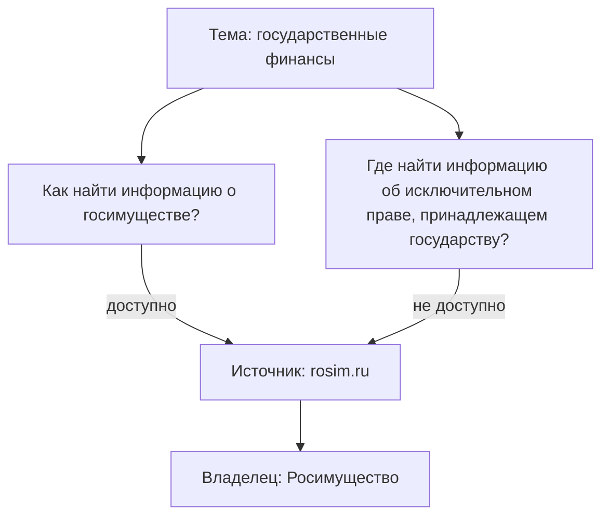

# Карты данных

**Карта данных** — форма результата подхода «где найти нужное»: по теме, территории, ведомству или продукту она показывает, где лежат нужные данные, у кого они и можно ли их получить. Карта отвечает на вопрос «где найти данные?», а не «как они устроены»: описание доходит до источника, владельца и доступа, но не до полей. Главное на карте — не картинка, а связи «вопрос — источник» с отметкой доступности и пробелы: вопросы, на которые нет ни одного доступного источника. Поэтому карту ведут как таблицу, а картинку строят из таблицы.

## Карта и реестр

Карта — не отдельный жанр, а реестр, к которому добавлены вопросы. В ней те же источники с владельцами, что и в [реестре данных](../03-process/05-registry.md), плюс список вопросов и связи между вопросами и источниками ([«Реестр как данные»](../06-tools/03-registry-as-data.md#что-хранить)). Различаются они тем, от чего строятся и что считают единицей.

| | Реестр данных | Карта данных |
|---|---|---|
| **Подход** | Чем владеем | Где найти нужное |
| **От чего строится** | От владельца и его систем | От вопросов, ведомства или продукта |
| **Чьи данные** | Свои | Любые, чаще чужие |
| **Единица** | Набор данных | Пара «вопрос — источник» |
| **Глубина** | До наборов и полей, 14 атрибутов | До источника, владельца и доступа |
| **Где отмечен доступ** | У набора | У пары: один источник бывает открыт для одного вопроса и закрыт для другого |
| **Главный вывод** | Что у нас есть и в каком состоянии | На какие вопросы данные есть, а на какие нет |
| **Кто пользуется** | Владелец, служба данных, каталог | Руководитель, аналитик, исследователь, журналист |

Если источник на карте важен для задачи, его описывают подробно — отдельной записью реестра. Так карта становится входом для подхода «чем владеем» ([«Когда подходы сочетают»](./01-two-approaches.md#когда-подходы-сочетают)).

## Из чего состоит карта

| Элемент | Что это | Пример из атласа |
|---------|---------|------------------|
| **Тема** | Отрасль, территория или задача, по которой составлена карта | Нефть и газ |
| **Вопрос** | Укрупнённый вопрос «где найти…?» | Где найти заявки на изучение недр? |
| **Источник** | Система, ресурс, набор данных, сайт или группа однотипных источников ([«Что инвентаризируют»](../01-basics/04-what-is-inventoried.md#система-ресурс-набор-и-сайт)) | rosnedra.gov.ru; сайты нефтяных компаний |
| **Владелец** | Организация, которая ведёт источник | Роснедра |
| **Доступность** | Можно ли получить из этого источника сведения для этого вопроса — по [шкале доступа](../03-process/06-access.md#шкала), с основанием и датой | Данные доступны |
| **Паспорт** | Вид карты, дата проверки, автор, откуда взяты сведения, лицензия | Декабрь 2019 года; сайты профильных органов власти и нефтегазовых компаний, экспертный анализ |

Доступность ставят паре «вопрос — источник», а не источнику. На карте «Государственные финансы» rosim.ru — сайт Росимущества — отвечает на два вопроса: сведения о госимуществе в нём доступны, об исключительных правах государства — нет.

То же на карте «Нефть и газ»: сайт государственной информационной системы топливно-энергетического комплекса www.gis-tek.ru даёт статистику добычи, но не сведения о компаниях. Один цвет на весь источник одну из этих пар показал бы неверно.

## Виды карт

Виды различаются тем, что стоит в центре карты.

| Вид | Что в центре | Уровни | Когда применять |
|-----|--------------|--------|-----------------|
| **[От вопросов](#от-вопросов)** | Вопросы к теме | Тема → вопрос → источник | Понять, где искать данные по новой теме. Самый простой и частый вид |
| **[С типовыми темами](#с-типовыми-темами)** | Вопросы, сгруппированные по типовым темам | Тема → типовая тема → вопрос → источник | Широкая тема, где важно не пропустить группу вопросов |
| **[По полномочиям](#по-полномочиям)** | Ведомство | Ведомство → полномочие → система → ресурс | Разобраться, какие данные накапливает ведомство. Ближе к подходу «чем владеем» |
| **[От продукта](#от-продукта)** | Продукт или решение | Продукт ← системы и ресурсы разных владельцев | Спроектировать продукт или систему поддержки решений |
| **[Доступности](#доступности)** | Режим доступа | Ведомство → система, цвет — статус | Решить, что открывать или запрашивать, оценить закрытость отрасли |

### От вопросов

Вопросы звучат как «где найти…?» и повторяют реальные запросы руководства и аналитиков; к каждому привязаны источники ответа. Один источник часто отвечает на несколько вопросов: на карте «Государственные финансы» budget.gov.ru указан в 9 вопросах из 21, zakupki.gov.ru — в 8. Все карты [атласа](../08-atlas/01-how-to-read.md) построены от вопросов, а доступность нанесена на них цветом.

### С типовыми темами

Между темой и вопросами стоит ещё один уровень — типовые темы, которые повторяются от отрасли к отрасли: статистика, организации, финансы, люди, ресурсы. Они служат проверкой полноты: если в теме нет ни одного вопроса о людях или о деньгах, это пропуск или осознанное решение ([«Как проверить список»](../03-process/02-goals-and-questions.md#как-проверить-список)). Широкую карту по типовым темам удобно делить на несколько карт.

### По полномочиям

В центре — ведомство, от него расходятся информационные системы, от систем — ресурсы: реестры, базы, перечни. Полномочие, ради которого создана система, часто пишут в подписи, а не отдельным узлом, иначе карта разрастается. Карта строится со стороны поставщика данных, поэтому ближе к подходу «чем владеем», но составить её можно и снаружи — по положению об органе, реестру систем и контрактам ([«Семь методов»](./02-methods.md#2-инвентаризация-информационных-систем)).

Пример из прежней версии книги — карта Росавиации: девять информационных систем ведомства и их ресурсы. Самое ценное на ней — оранжевые стрелки между ресурсами разных систем: они показывают, где сведения пересекаются, например аэродромы дежурства поисково-спасательных судов в ФГИС ИАС «Поиск» и реестр аэродромов. Карта не датирована, поэтому названия систем перед использованием сверяют с реестром.

Одну систему можно раскрыть отдельной картой: у ФГИС ИАС «Поиск» шесть ресурсов — от поисково-спасательных баз до авиапроисшествий.

### От продукта

В центре — то, что предполагается построить на данных; вокруг — системы и ресурсы разных владельцев, которые для этого нужны и достаточны. Один источник часто питает несколько продуктов, поэтому форма карты — схема со связями, а не дерево. В примере ниже продукты — единый реестр объектов законотворчества и нормативных актов и анализ финансово-экономических обоснований, а источники — система обеспечения законодательной деятельности, системы правовой информации и официального опубликования, портал проектов нормативных актов.

Близкая методика — картирование экосистем данных Open Data Institute: участники, потоки данных между ними и ценность, которую они создают ([«Зарубежные методики»](../05-frameworks/04-international-practice.md#картирование-экосистем-данных-odi)).

### Доступности

Доска с колонками: колонка — ведомство, карточка — система или набор, цвет — статус по [шкале доступа](../03-process/06-access.md#шкала), включая серый «не установлено» ([«Доска с колонками»](../06-tools/02-mindmaps-and-boards.md#доска-с-колонками)). Видно, у кого больше закрытых систем. Но сама по себе карта доступности не говорит, важно ли закрытое: доступность не единственная характеристика данных, есть ещё актуальность, полнота, возможность связать с другими источниками. Поэтому доступность чаще наносят поверх карты другого вида.

### Виды сочетают

- **Вопросы и доступность** — все карты атласа; в их файлах данных так и записано: `kind: [questions, availability]`.
- **Полномочия и доступность** — карта ведомства перед решением об открытии данных.
- **Продукт и полномочия** — когда продукт опирается на системы одного ведомства и их нужно разобрать подробно.

Сочетать проще, когда карта хранится как данные: один и тот же список источников показывают и деревом вопросов, и доской доступности.

## Как выбрать вид и форму

Вид выбирают по тому, кто будет пользоваться картой и что он хочет узнать. Если не уверены — начинайте с карты от вопросов: её проще всего показать заказчику, а доступность и полномочия можно добавить потом.

1. **Что в центре?** Вопросы заказчика — карта от вопросов; ведомство — по полномочиям; продукт — от продукта.
2. **Нужна ли доступность?** Если по карте будут решать, что открывать, запрашивать или подключать, — да, к любому виду.
3. **Насколько подробно?** До систем — быстрее, до ресурсов — полезнее. До полей описывают только ключевые источники, отдельной записью реестра ([«Ошибки выбора»](./01-two-approaches.md#ошибки-выбора)).
4. **Кто будет читать?** Руководителю нужна картинка на одном листе, аналитику — таблица, программе — файл данных.

| Задача | Вид | Форма для показа |
|--------|-----|------------------|
| Понять, где искать данные по новой теме | От вопросов | Интеллект-карта |
| Охватить широкую тему, не пропустив групп вопросов | С типовыми темами | Интеллект-карта, несколько карт по темам |
| Разобраться, какие данные накапливает ведомство | По полномочиям | Интеллект-карта со связями между ресурсами |
| Спроектировать продукт или систему поддержки решений | От продукта | Схема со связями |
| Решить, что открывать или запрашивать в первую очередь | От вопросов с доступностью | Таблица, интеллект-карта для показа |
| Оценить закрытость отрасли по ведомствам | Доступности | Доска с колонками |
| Сравнить несколько отраслей | От вопросов с общим списком источников | Таблицы из файлов данных, как в атласе |

Форма для ведения у всех видов одна — таблица или файл данных: три листа «источники», «вопросы», «связи» ([«Рабочая таблица»](../06-tools/02-mindmaps-and-boards.md#рабочая-таблица)). Интеллект-карта, схема и доска — способы показать эту таблицу. Чем их рисовать — в главе [«Интеллект-карты, доски и таблицы»](../06-tools/02-mindmaps-and-boards.md#чем-рисовать).

## Как составить карту

Карта — частный случай инвентаризации по подходу «где найти нужное», и её составляют по тем же [семи шагам](../03-process/01-steps.md) ([«Подходы на семи шагах»](./01-two-approaches.md#подходы-на-семи-шагах)). Особенности карты — в том, как записывают источники, доступность и пробелы.

1. **Записать тему и границы**: отрасль или территорию, уровни власти, слои данных и дату. Широкую тему делят на несколько карт с общим списком источников ([«Границы»](../03-process/02-goals-and-questions.md#границы)).
2. **Сформулировать вопросы** — 10–20 укрупнённых, вроде «где найти сведения о числе больниц по регионам?», и согласовать их с заказчиком до поиска. В картах атласа — от 16 до 21 вопроса. Покрытие проверяют по типовым темам ([«Вопросы»](../03-process/02-goals-and-questions.md#вопросы)).
3. **Найти источники** для каждого вопроса — по трём слоям: государственные, общественные, коммерческие. Основные методы — специализированный поиск, кабинетные исследования и разговоры с экспертами; полномочия подсказывают, у кого искать ([«Если времени мало»](./02-methods.md#если-времени-мало)). Языковая модель может предложить вопросы и источники-кандидаты, но выдумывает правдоподобные адреса: каждую пару подтверждают ссылкой ([«ИИ в инвентаризации»](./03-ai.md#ошибки-модели-и-как-их-ловить)).
4. **Записать источник один раз** — в общем списке, с типом и владельцем; вопросы ссылаются на него по идентификатору. За сайтом ищут систему и владельца; если не нашли, сайт записывают как временную замену и помечают. Однотипные источники, которые нельзя перечислить, — сайты регионов, системы вузов — записывают группой ([«Одинаковая подробность»](../03-process/05-registry.md#одинаковая-подробность)).
5. **Отметить доступность каждой пары** — по шкале доступа, с основанием и датой, проверяя государственные сайты из сети их страны ([«Порядок проверки»](../03-process/06-access.md#порядок-проверки)). Непроверенная пара получает «не установлено», а не цвет по умолчанию.
6. **Выписать пробелы** — вопросы без доступного источника — с тем, что о них известно: данных нет ни у кого, данные есть, но закрыты, или есть только у коммерческих поставщиков. Это вход для [анализа разрывов](../03-process/01-steps.md#5-сопоставить-цели-с-данными).
7. **Проверить и опубликовать**: эксперт отрасли смотрит карту, затем публикуют паспорт, таблицу или файл данных, картинку из них и план обновления ([«Результат и поддержка»](../03-process/08-result-and-upkeep.md#публикация)).

Заготовки — три таблицы и файл карты в формате атласа — в приложении [«Шаблоны»](../10-appendices/03-templates.md#карта-данных).

## Что читать на карте

Готовую карту читают не по веткам, а по четырём находкам. Ради них её и составляют.

- **Пробелы.** В атласе на 8 вопросов из 77 нет ни одного доступного источника: пять на карте «Здравоохранение» — заболеваемость, показатели медицинских учреждений, регистры больных и инвалидов, сведения о заболевших, медицинские работники; по одному — на картах «Образование» (успеваемость школьников и студентов), «Государственные финансы» (исключительные права государства) и «Нефть и газ» (коммерческие сервисы: все с ограничениями). Ещё у одного вопроса — о показателях бюджетной системы — доступность не отмечена. Для аналитика это то, чего не будет в отчёте; для владельца — что у него ищут, но не находят.
- **Ключевые источники** — отвечают на много вопросов: budget.gov.ru и zakupki.gov.ru на карте государственных финансов, clearspending.ru, fedstat.ru, gks.ru и zakupki.gov.ru — на всех четырёх картах атласа ([«Источники, которые встречаются почти везде»](../08-atlas/01-how-to-read.md#источники-которые-встречаются-почти-везде)). Их первыми описывают подробно и первыми проверяют при обновлении.
- **Единственные источники.** Вопрос с одним источником уязвим: исчезнет источник — пропадёт ответ. В атласе таких вопросов 17 из 77, и у четырёх из них домен единственного источника к октябрю 2026 года исчез: kurort.rosminzdrav.ru (курорты и санатории), gmo.rosminzdrav.ru (сведения о ГМО), graduate.edu.ru (трудоустройство выпускников), www.сацминэнерго.рф (аварии в нефтегазовой отрасли). Данные могли переехать, но искать их придётся заново.
- **Закрытое, но нужное** — источник, который не доступен для многих вопросов. На карте «Здравоохранение» сайт ЕГИСЗ указан в 5 вопросах из 20, и во всех пяти данные не доступны. Это кандидат на открытие или на официальный запрос владельцу ([«Когда подходы сочетают»](./01-two-approaches.md#когда-подходы-сочетают)).

## Пример: карта «Нефть и газ»

Карта [«Нефть и газ»](../08-atlas/03-oil-and-gas.md) проверена в декабре 2019 года. В ней 16 вопросов, 37 источников и 51 пара «вопрос — источник»: в 40 данные доступны, в 8 — с ограничениями, в 3 — не доступны. Сведения взяты с сайтов профильных органов власти и нефтегазовых компаний и из экспертного анализа; в отличие от трёх других карт атласа, без системы координации информатизации.

Что видно на карте:

- **Все три слоя данных.** Государственные источники — Росстат, Роснедра, Росгеолфонд, Минэнерго, ФТС; общественные — clearspending.ru и международные организации: JODI, Международное энергетическое агентство, ООН; коммерческие — Bloomberg, Reuters, биржа, отраслевые аналитические сервисы ([«Три слоя данных»](../04-sources/01-three-layers.md)).
- **Ограничения — у коммерческих, закрытое — у государства.** Все 8 пар «с ограничениями» приходятся на коммерческие сервисы, а все 3 «не доступно» — на государственные: два сервиса Росгеолфонда в вопросе об участках и лицензиях и www.gis-tek.ru в вопросе о компаниях.
- **Пробел — коммерческие данные.** На вопрос «какие коммерческие сервисы собирают данные об отрасли?» отвечают пять источников, и все с ограничениями: такие данные продают.
- **Четыре вопроса с одним источником** — кадастр месторождений, заявки на изучение недр, транспортная инфраструктура, аварии. Домен источника по авариям к октябрю 2026 года исчез, как и sobr.geosys.ru, который отвечал на три вопроса.
- **Почти все источники — сайты.** 31 источник записан сайтом, 6 — группами, ни один — системой или набором. Для 2019 года это было нормой, сегодня это первое, что стоит исправить при обновлении.

## Типичные ошибки

| Ошибка | Что происходит | Как исправить |
|--------|----------------|---------------|
| **Картинка без таблицы** | Карту нельзя проверить, обновить и сравнить с прошлой версией. Карты атласа пришлось переносить в данные с картинок, а карту [«Авиация»](../08-atlas/06-aviation.md) перенести не удалось | Вести таблицу или файл данных, картинку строить из них ([«Реестр только в отчёте или картинке»](../09-practices/02-anti-patterns.md#реестр-только-в-отчёте-или-картинке)) |
| **Сайт вместо системы** | Из 159 источников атласа 131 записан сайтом, 22 — группой, 6 — ресурсом, ни один — системой или набором. Домен меняется — связь с данными теряется | За сайтом искать систему и владельца ([«Сайт вместо системы»](../09-practices/02-anti-patterns.md#сайт-вместо-системы)) |
| **Доступность у источника, а не у пары** | Источник открыт для одного вопроса и закрыт для другого, а на карте у него один цвет | Ставить доступность паре «вопрос — источник» |
| **Цвет без основания и даты** | Статус нельзя проверить; «не открылся из-за рубежа» выглядит как «закрыто» | Статус по шкале с основанием и датой; непроверенное — «не установлено» ([«Статус доступа без основания»](../09-practices/02-anti-patterns.md#статус-доступа-без-основания)) |
| **Доступно — значит годится** | Источник открыт, но данные устарели, неполны или не той детализации — не по регионам, не по годам | Быстрая проверка качества хотя бы у ключевых источников ([«Качество данных»](../03-process/07-quality.md)) |
| **Вид не под задачу** | Карта по полномочиям вместо ответов на вопросы даёт полный, но бесполезный для заказчика список систем; карта доступности без вопросов показывает, что закрыто, но не важно ли это | Выбрать вид по четырём вопросам [выше](#как-выбрать-вид-и-форму) |
| **Одна карта на всё** | Карта не помещается на экран, целиком её никто не читает | Несколько карт с общим списком источников |

## Ограничения

- Карта показывает, где искать, но не описывает каждый набор подробно. Если источник важен, его описывают отдельной записью [реестра](../03-process/05-registry.md).
- Карта неполна: в ней то, что удалось найти к дате проверки. Закрытые системы, о которых нигде не написано, снаружи не видны.
- Карта стареет быстрее реестра: чужие адреса меняются без предупреждения. Из 136 адресов атласа 2018–2019 годов к октябрю 2026 года у 29 исчезли домены, а 13 переехали; доступность с тех пор не перепроверялась ([«Как читать атлас»](../08-atlas/01-how-to-read.md#адреса-источников-в-октябре-2026-года)).
- Доступность, отмеченная снаружи, не окончательна: владелец может выдать закрытые данные по запросу, а сайт, который не открылся, может работать из сети своей страны.
- Карта отмечает доступность, а не качество: открытый источник ещё не значит пригодный.

## Источники

- [Атлас карт данных](../08-atlas/01-how-to-read.md) — четыре отраслевые карты 2018–2019 годов в виде данных; [файлы карт](https://github.com/ivbeg/data-inventory/tree/main/data/maps), список источников и результаты проверки адресов на октябрь 2026 года — в папке [data/](https://github.com/ivbeg/data-inventory/tree/main/data) репозитория книги.
- Приложение [«Шаблоны»](../10-appendices/03-templates.md#карта-данных) — таблицы и файл для своей карты.
- [Mapping data ecosystems](https://theodi.org/article/mapping-data-ecosystems/) — Open Data Institute, обновление 2022 года.
- Прежняя версия книги «Карты данных» — репозиторий [infoculture/datainventorydocs](https://github.com/infoculture/datainventorydocs), часть «Виды карт данных»: отсюда карта Росавиации, карта от продукта и шаблоны; её план, ревизия и сверка фактов — в [archive/](https://github.com/ivbeg/data-inventory/tree/main/archive) репозитория этой книги.
