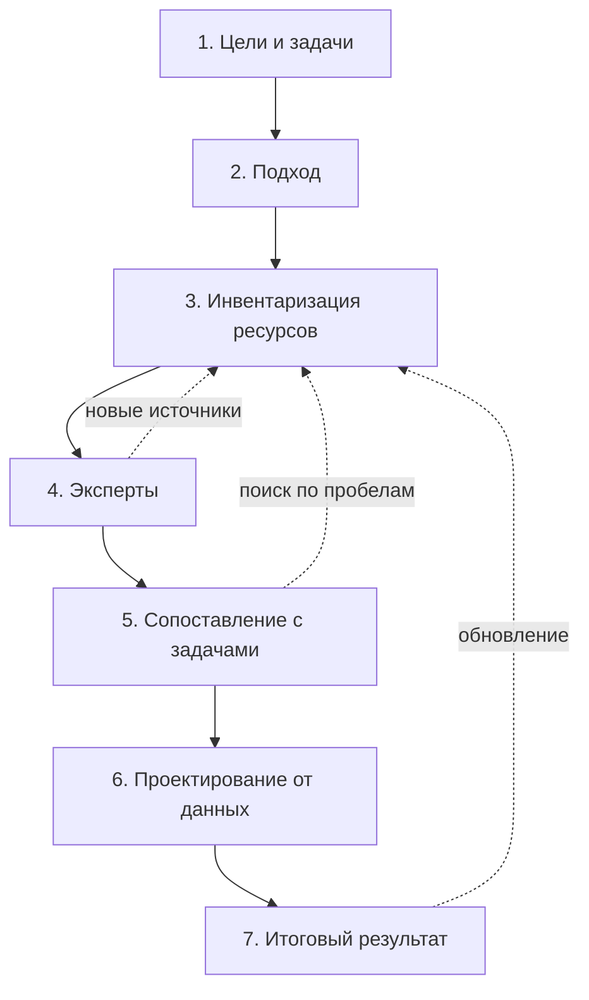

# Семь шагов

Инвентаризация проходит семь шагов — от цели до результата, которым пользуются. Первые два решают, что и зачем искать. Третий и четвёртый — найти, описать и проверить. Пятый показывает, хватает ли найденного для задачи. Шестой и седьмой превращают выводы в изменения систем и в каталог или карту данных. Каждый шаг заканчивается таблицей или документом, и они же — исходные данные для следующего шага: без согласованных вопросов нечего сопоставлять на пятом шаге, без списка пробелов нечего проектировать на шестом. Порядок одинаков для обоих подходов — «чем владеем» и «где найти нужное», — меняются методы, глубина описания и вид результата ([«Подходы на семи шагах»](../02-approaches/01-two-approaches.md#подходы-на-семи-шагах)). Шаги — цикл, а не линия: эксперты и пробелы возвращают к поиску, опубликованный результат — к обновлению.

## Коротко

| Шаг | Что делают | Что получается | Шаг закончен, когда |
|-----|------------|----------------|---------------------|
| **[1. Цели и задачи](#1-сформулировать-цели-и-задачи)** | Записывают цель, границы и вопросы к данным | Цель, границы, 10–20 вопросов, намеченный вид результата | Владелец задачи согласовал цель и вопросы |
| **[2. Подход](#2-выбрать-подход)** | Выбирают подход, методы и состав реестра | Главный подход, методы, состав атрибутов, заведённый реестр | Понятно, где искать, кого опрашивать и до какой глубины описывать |
| **[3. Инвентаризация ресурсов](#3-провести-инвентаризацию-ресурсов)** | Ищут системы и наборы и описывают их | Черновик реестра | Пройдены все владельцы в границах; у каждой записи есть владелец, режим доступа, отметка о качестве, откуда известно и дата — или «не установлено» |
| **[4. Эксперты](#4-привлечь-экспертов)** | Проверяют и дополняют найденное | Исправленный реестр, подтверждения владельцев ключевых наборов | Замечания разобраны, новые источники проверены и внесены |
| **[5. Сопоставление](#5-сопоставить-цели-с-данными)** | Сверяют вопросы и задачи с найденным | Таблица «вопрос — источник — статус», список пробелов | У каждого вопроса есть источник или записанный пробел |
| **[6. Проектирование](#6-спроектировать-обновление-от-задач)** | Решают, как закрыть пробелы | План: что изменить, у кого запросить, что собрать самим | У каждого пробела есть решение и ответственный или пометка, что пробел принимают |
| **[7. Результат](#7-определить-итоговый-результат)** | Собирают результат из реестра и публикуют | Каталог, целевая система, озеро данных или карта данных — с паспортом и датой | Результат опубликован или передан тем, кто им пользуется; у процесса есть владелец и график обновления |

## 1. Сформулировать цели и задачи

Инвентаризацию начинают с того, что сделают с данными: запустят проактивную услугу, построят систему поддержки решений или сквозную аналитику, откроют данные, обучат модель. Цель записывают одной-двумя фразами так, чтобы по ней можно было проверить результат, и сразу выводят из неё границы и вопросы. Этот шаг самый дешёвый, а ошибка на нём обходится дороже всех: без цели получается опись ради описи.

- Записать цель по четырём вопросам: что сделают с данными, кто воспользуется результатом и примет его, где границы, как проверить результат ([«Как записать цель»](../01-basics/02-goals.md#как-записать-цель)).
- Записать границы: организации и уровни, территорию, слои данных — государственные, общественные, коммерческие, — период, глубину описания и что исключено ([«Границы»](./02-goals-and-questions.md#границы)).
- Собрать вопросы на мозговом штурме с заказчиком и укрупнить их; для отраслевой темы ориентир — 10–20 вопросов ([«Вопросы»](./02-goals-and-questions.md#вопросы)). В подходе «чем владеем» вопросов меньше: они показывают, какие наборы описывать подробно, а какие — одной строкой.
- Наметить вид результата — каталог, целевая система, озеро данных, карта данных: от него зависит, что записывать на третьем шаге ([«Виды результата»](./08-result-and-upkeep.md#виды-результата)).
- Назвать владельца задачи — того, кто примет результат и на шестом шаге решит, какие пробелы закрывать.

**На выходе:** цель, границы, вопросы и вид результата, согласованные с владельцем задачи до начала поиска.

**Частая ошибка:** цель «провести инвентаризацию» без другого действия. Такую инвентаризацию лучше отложить, пока не появится задача ([«Опись ради описи»](../08-practices/02-anti-patterns.md#опись-ради-описи)).

## 2. Выбрать подход

Подход решает, с какой стороны идти: от владельца и его систем («чем владеем») или от вопросов к источникам («где найти нужное»). Подход выбирают по четырём вопросам: чьи данные нужны, есть ли вопросы к ним, можно ли требовать ответов от владельцев и насколько глубоко описывать ([«Как выбрать подход»](../02-approaches/01-two-approaches.md#как-выбрать-подход)). Если нужны и свои данные, и чужие, подходы сочетают, но главным делают один — тот, что следует из главной цели.

- Выбрать методы. Их не меньше трёх, и они закрывают слепые пятна друг друга ([«Если времени мало»](../02-approaches/02-methods.md#если-времени-мало)).
- Утвердить состав реестра: 14 обязательных атрибутов и те атрибуты расширенного состава, которые нужны цели, — и сопоставить их со стандартом описания. Сразу завести справочники значений для режима доступа, периодичности и типа записи и выбрать глубину описания ([«Расширенный состав»](./05-registry.md#расширенный-состав), [«Глубина описания»](./05-registry.md#глубина-описания), [«Стандарты описания»](../05-frameworks/02-metadata-standards.md)).
- Завести реестр таблицей или файлом данных с первого дня, а не собирать его в конце из отчётов ([шаблоны](../09-appendices/03-templates.md), [«Реестр как данные»](../06-tools/03-registry-as-data.md)).
- Для подхода «чем владеем» — получить приказ или письмо руководителя, которое обязывает подразделения отвечать. Без него опрос превращается в просьбу.
- Широкую тему разбить на очереди и начать с одной ([«Если тема большая»](#если-тема-большая)).

**На выходе:** главный подход, методы, состав атрибутов, заведённый реестр и порядок очередей.

**Частая ошибка:** подход по привычке. Подрядчик рассылает анкеты или ищет по сайтам, потому что так умеет, а не потому, что этого требует задача ([«Ошибки выбора»](../02-approaches/01-two-approaches.md#ошибки-выбора)).

## 3. Провести инвентаризацию ресурсов

Самый объёмный шаг: найти системы, ресурсы и наборы и записать каждый в реестр. Методы применяют в порядке, который работает: анализ полномочий показывает, что должно быть; инвентаризация систем и кабинетные исследования — что есть; специализированный поиск — что опубликовано; опросы владельцев — что упустили документы ([«Порядок, который работает»](../02-approaches/02-methods.md#порядок-который-работает)).

- Составить список владельцев по уровням — с подведомственными и преемниками упразднённых, — прочитать их полномочия и у каждого полномочия записать итог: найдено, найдено частично, не найдено, передано ([«Владельцы и полномочия»](./03-owners-and-mandates.md)).
- Искать по трём слоям — государственные, общественные, коммерческие источники ([«Где искать данные»](../04-sources/01-three-layers.md)).
- Для своих данных — разослать анкету, заранее заполненную найденным, каждому подразделению в границах, провести короткие интервью и сверить ответы с другими методами ([«Опросные листы и интервью»](./04-questionnaires.md)).
- Каждую находку сразу записать в реестр: владелец и основание, режим доступа с основанием ([«Доступ и ограничения»](./06-access.md)), быстрая проверка качества на самих данных ([«Быстрая проверка»](./07-quality.md#быстрая-проверка)), откуда известно о наборе, дата. Если сведение найти не удалось, пишут «не установлено» и где искать дальше ([«Если сведение не найдено»](./05-registry.md#если-сведение-не-найдено)).
- Перед добавлением записи — поискать её в реестре по синонимам и адресу ([«Один набор под разными именами»](./05-registry.md#один-набор-под-разными-именами)).
- В подходе «где найти нужное» каждый источник сразу привязывают к вопросам, на которые он отвечает.

**На выходе:** черновик реестра — по записи на каждый найденный набор или источник.

**Частая ошибка:** собирать находки в заметках и документах, а реестр заполнять в конце. Тогда теряется, откуда известно о наборе и когда его проверяли, а доступ и качество так и остаются «на потом».

## 4. Привлечь экспертов

Отраслевые специалисты, ассоциации, аналитики и исследователи знают системы, о которых не пишут на сайтах, и замечают ошибки во владельцах, адресах и статусах доступа. Владельцы ключевых наборов подтверждают описания: ответ владельца — самое сильное основание статуса доступа. Короткий разговор с экспертом полезен и в начале поиска, чтобы он подсказал источники. Отдельный шаг нужен для проверки: эксперту показывают уже собранный черновик ([«Опросы экспертов»](../02-approaches/02-methods.md#6-опросы-экспертов)).

- Показать эксперту черновик реестра или карты, а не спрашивать «какие данные есть»: по конкретной таблице и замечания конкретнее.
- Спросить: каких источников не хватает, что устарело, где ошибка во владельце или доступе, каким данным в отрасли не доверяют и почему.
- Каждую подсказку подтвердить источником — адресом, документом, выгрузкой — и только потом внести в реестр. Новые источники описывают по правилам третьего шага.
- Отправить описания ключевых наборов их владельцам на подтверждение ([«Проверка»](./08-result-and-upkeep.md#проверка)).

**На выходе:** исправленный реестр, отметки о подтверждении у ключевых записей и проверенные новые источники.

**Частая ошибка:** пропустить шаг, потому что «и так всё нашли». Тогда ошибки во владельцах и доступе находят пользователи — когда по записи уже пишут запрос или открывают данные.

## 5. Сопоставить цели с данными

Пятый шаг отвечает на главный вопрос инвентаризации — хватает ли данных для задачи. Для каждой задачи и вопроса проверяют: есть ли данные, доступны ли они ([«Доступ и ограничения»](./06-access.md)) и достаточно ли они хороши ([«Качество данных»](./07-quality.md)). Итог — список пробелов: чего нет, что закрыто, что непригодно. Это анализ разрывов (gap-анализ), и он часто важнее самого реестра.

- Свести таблицу «вопрос — источник — доступность — качество». Качество в ней — итог для пары: годится, годится с оговорками, не годится, не проверено, — по порогу, записанному до проверки ([«Годится ли для задачи»](./07-quality.md#годится-ли-для-задачи)). Вопрос без доступного источника годного качества — пробел.
- Различать виды пробелов: данных нет ни у кого; данные есть, но закрыты; данные доступны, но непригодны — неполны, устарели, не сходятся с другими источниками; статус не установлен.
- Прежде чем записать пробел, поискать ещё раз другим методом — по аналогии, у другого ведомства, в веб-архиве. Неразрешённые расхождения между методами тоже попадают в список ([«Как методы проверяют друг друга»](../02-approaches/02-methods.md#как-методы-проверяют-друг-друга)).
- В подходе «чем владеем» сверяют и в обратную сторону: что положено по полномочиям, но не найдено; что собирают дважды; что можно открыть или передать.
- Отметить, какие пробелы мешают главной цели, а какие — нет.

**На выходе:** таблица покрытия вопросов и список пробелов — с видом каждого и задачей, которой он мешает.

**Частая ошибка:** спрятать пробелы, чтобы не разочаровать заказчика. Результат без пробелов обещает, что данных хватит для всего, а обратное выясняется на первой же задаче ([«Готовьтесь к разочарованию»](../01-basics/03-principles.md#5-готовьтесь-к-разочарованию)).

## 6. Спроектировать обновление от задач

Пробелы закрывают изменением систем и договорённостями: новыми полями и справочниками, выгрузками и программными интерфейсами, соглашениями об обмене, новыми системами. Проектируют от данных (data-first), а не от экранов: сначала решают, какие сведения нужны, в какой структуре, с какими справочниками и кто их владелец, и только потом — как они будут выглядеть для пользователя. Данные переживут любую конкретную систему ([«Data-first в проектировании»](../01-basics/03-principles.md#7-data-first-в-проектировании)).

| Пробел | Что сделать |
|--------|-------------|
| Данные есть, но закрыты | Запрос владельцу, соглашение об обмене, обезличенная или агрегированная выгрузка. Если основания закрытия нет — предложить открыть ([«Что делать со статусом»](./06-access.md#что-делать-со-статусом)) |
| Данные есть, но непригодны | Исправить у источника: справочник, поле, порядок обновления; согласовать справочники с другим ведомством |
| Данные собирают дважды | Выбрать один источник достоверных сведений, остальные получают их обменом — по [принципу однократности](../01-basics/03-principles.md#принципы-в-других-методиках) |
| Данных нет ни у кого | Решить, кто должен их собирать и по какому полномочию; описать данные новой системы или доработки до того, как проектировать экраны |
| Пробел не мешает главной цели | Записать и принять до следующего обновления |

- У каждого решения — ответственный и срок. Решают владелец задачи и владельцы систем: команда инвентаризации предлагает, но не меняет чужие системы сама.
- Описание данных новой системы или доработки сразу вносят в реестр: система появляется уже инвентаризированной.
- В подходе «где найти нужное» чужие системы не изменить: остаются запросы владельцам, договоры о доступе и собственный сбор там, где данных нет ни у кого.

**На выходе:** план закрытия пробелов — что изменить, у кого запросить, что собрать самим, кто отвечает и к какому сроку.

**Частая ошибка:** остановиться на списке пробелов. Если пробел никто не взялся закрыть, следующая инвентаризация найдёт его на том же месте.

## 7. Определить итоговый результат

Вид результата намечают на первом шаге, а на седьмом его собирают из реестра, проверяют и публикуют: внутренний или публичный каталог данных, целевая информационная система, пополнение озера данных или карта данных для проекта ([«Виды результата»](./08-result-and-upkeep.md#виды-результата)). Результат — не отчёт об инвентаризации, а то, чем пользуются. Отчёт и картинки строят из реестра, а не наоборот.

- Проверить реестр: сначала программой, затем по чек-листу, экспертами и владельцами ключевых наборов ([«Проверка»](./08-result-and-upkeep.md#проверка), [«Перед публикацией реестра»](../09-appendices/04-checklists.md#перед-публикацией-реестра)).
- Если показать можно не всё, строить общедоступную часть выборкой записей и полей из полного реестра, а не вести отдельной копией ([«Полный реестр и общедоступная часть»](./08-result-and-upkeep.md#полный-реестр-и-общедоступная-часть)).
- Опубликовать с паспортом — цель, границы, методы и охват, состав, пробелы, — данными, а не только отчётом, по постоянному адресу, с лицензией, версией и датой ([«Паспорт»](./08-result-and-upkeep.md#паспорт), [«Публикация»](./08-result-and-upkeep.md#публикация)).
- Назначить владельца процесса и ответственных за записи и утвердить план обновления: по графику, по событиям и перед каждым важным использованием ([«Поддержка»](./08-result-and-upkeep.md#поддержка)). Если поддерживать результат никто не будет, опубликовать его как снимок с датой.

**На выходе:** опубликованный результат с паспортом, датой, владельцем процесса и планом обновления.

**Частая ошибка:** результат — только отчёт или картинка, без плана обновления. Через несколько лет такой результат приходится вручную переносить в данные, а часть адресов к тому времени уже не открывается ([«Реестр только в отчёте или картинке»](../08-practices/02-anti-patterns.md#реестр-только-в-отчёте-или-картинке)).

## Когда возвращаются назад

Шаги идут по порядку, но не строго один за другим. Три возврата — нормальная часть работы:

- **От экспертов к поиску.** Эксперт называет источник, о котором не знали. Его проверяют и описывают по правилам третьего шага.
- **От пробелов к поиску.** Прежде чем записать пробел, вопрос ищут ещё раз другим методом. Часть пробелов закрывается здесь же: данные нашлись под другим названием или у другого ведомства.
- **От результата к поиску.** Обновление — это повтор третьего–пятого шагов для того, что изменилось: адресов, владельцев, статусов доступа, систем. Новая задача возвращает к первому шагу, но реестр уже есть, и следующая инвентаризация начинается не с нуля.

Возврат к первому шагу из середины работы — сигнал, что цель записали плохо. Если на пятом шаге выясняется, что вопросы не те, их заново согласуют с владельцем задачи, а не подгоняют под найденное.

## Кто участвует

| Роль | Шаги | Что делает |
|------|------|------------|
| **Владелец задачи** | 1, 5, 6, 7 | Ставит цель и вопросы, подписывает письмо владельцам данных, решает, какие пробелы закрывать, принимает результат |
| **Составитель реестра** | все | Ведёт реестр и план работ, сводит ответы и замечания, отвечает за то, чтобы у каждой записи были владелец, основание, доступ и дата |
| **Владельцы систем и ответственные за данные** | 3, 4, 6 | Отвечают на анкеты и интервью, подтверждают описания, дорабатывают свои системы |
| **Эксперты отрасли** | 3, 4 | Подсказывают источники, проверяют и дополняют черновик |
| **Юрист или ответственный за защиту данных** | 3, 5, 7 | Проверяет основания закрытия и персональные данные, решает, что войдёт в общедоступную часть |
| **Архитекторы и разработчики** | 6 | Проектируют доработки и новые системы от данных |

Ответственный за данные — конкретный сотрудник, который знает данные: из профильного подразделения или ИТ, а не пресс-служба. В небольшой инвентаризации роли совмещают: составитель реестра сам ведёт кабинетные исследования и интервью. Но владелец задачи нужен всегда: без него некому принять результат и решить, какие пробелы закрывать.

## Если тема большая

Широкую тему — всё ведомство с подведомственными организациями, отрасль, регион — не проходят целиком за один раз. Её делят на очереди: по ведомствам, подразделениям, программам или типовым темам. Все семь шагов проходят на первой очереди и только потом берутся за следующую. Первая очередь проверяет сам метод — анкету, состав атрибутов, шкалу доступа: ошибку в анкете дешевле найти на одном подразделении, чем на всех сразу.

- Первой берут очередь, которая нужна главной цели, или ту, где владелец готов помогать.
- Порядок очередей записывают в план с датами: так видно, какая часть границ уже пройдена.
- Записи всех очередей ведут в одном реестре с общими идентификаторами: источник, который встречается в нескольких очередях, описывают один раз.

Так делают и по зарубежным методикам: GovEx пишет, что одни органы власти начинают с одного подразделения, одной информационной системы или одного стратегического приоритета, а Project Open Data предлагал федеральным ведомствам США делить работу на классы данных — по подразделениям, программам, функциям ([ниже](#шаги-в-других-методиках)).

## Если времени мало

Под одну срочную задачу — подборку данных для хакатона, первую оценку отрасли — шаги совмещают, но не пропускают:

- **Шаги 1–2** — одна встреча с владельцем задачи: цель, границы, 10–15 вопросов, подход и три метода.
- **Шаг 3** — минимальный набор методов ([«Если времени мало»](../02-approaches/02-methods.md#если-времени-мало)). Для каждого источника записывают владельца, режим доступа с основанием, откуда известно и дату; остальные атрибуты — только для ключевых источников.
- **Шаг 4** — один-два разговора с экспертами по готовому черновику.
- **Шаг 5** — таблица «вопрос — источник — статус» и список пробелов.
- **Шаги 6–7** — к каждому пробелу одна строка о том, как его закрыть; вместо каталога — таблица с датой.

Нельзя выбросить три вещи: записанную цель, список пробелов и дату. Без цели неясно, что искать; без пробелов — хватает ли найденного; без даты через полгода не понять, чему в результате ещё можно верить.

## Пример

Условный пример — цель из главы [«Зачем: цели»](../01-basics/02-goals.md#как-записать-цель): выяснить, какие сведения нужны, чтобы назначать пособие при рождении ребёнка без заявления, в каких системах они лежат и можно ли получить их без запроса к родителям.

| Шаг | Что сделали | Что получилось |
|-----|-------------|----------------|
| **1** | Записали цель и границы: ведомства, которые участвуют в назначении пособия, глубина — до полей. Собрали десяток вопросов: где найти сведения о рождении, о родителях и их занятости, о праве на пособие, о реквизитах для выплаты | Цель и вопросы, согласованные с министерством, которое назначает пособие |
| **2** | Сведения лежат у нескольких ведомств. Главный подход — «где найти нужное»: найти, где лежат сведения; найденные системы описать до полей по подходу «чем владеем». Методы — анализ полномочий, инвентаризация систем, опросы владельцев систем | Подход, методы, состав атрибутов с полями и справочниками |
| **3** | По полномочиям и реестру систем нашли четыре системы: систему записей актов гражданского состояния, регистр населения, систему социальной защиты, систему социального страхования. Описали нужные наборы до полей | Черновик реестра с режимами доступа и основаниями |
| **4** | Владелец системы записей актов уточнил: идентификатор родителя в записи о рождении заполнен не всегда: при регистрации по бумажным документам его вносят вручную и часто пропускают | Исправленная отметка о качестве, подтверждённые описания |
| **5** | Реквизитов для выплаты нет ни в одной системе. Сведения о родителях есть, но без идентификатора записи нельзя надёжно сопоставить. Сведения о занятости выдают только по межведомственному запросу | Три пробела: данных нет, данные непригодны, доступ с ограничениями |
| **6** | Сделать идентификатор родителя обязательным полем и проверять его по регистру населения при регистрации; реквизиты спрашивать у родителя один раз и хранить в системе выплат; на сведения о занятости заключить соглашение об обмене через программный интерфейс | План доработок трёх систем с ответственными и сроками |
| **7** | Описание данных услуги до полей с источниками; записи о наборах — во внутренний каталог ведомства | Описание данных для технического задания и записи в каталоге с датой и планом обновления |

Главный вывод — на пятом шаге: совсем без участия родителей пособие не назначить, потому что одного сведения нет ни в одной системе. Инвентаризация показала это до разработки услуги, а не после её запуска. Пример показывает ход работы, а не то, как услуга устроена в конкретной стране.

## Шаги в других методиках

В зарубежных руководствах те же этапы называются и делятся иначе ([«Зарубежные методики»](../05-frameworks/04-international-practice.md)).

- **GovEx** — руководство для городов США — предлагает пять шагов. Назначить, кто руководит инвентаризацией: директора по данным, орган управления данными или рабочую группу. Определить границы и план: обязательные метаданные, сроки, показатели. Описать данные по плану: представители подразделений описывают свои данные, координатор сводит их в общий машиночитаемый инвентарь. Проверить инвентарь и решить, какая его часть будет публичной: Филадельфия включает в инвентарь и наборы, которые никогда не опубликуют из-за персональных данных или безопасности. Расставить приоритеты публикации — по стратегическим целям, нуждам подразделений и общественному спросу. Инвентаризацию GovEx называет непрерывным процессом ([«GovEx Data Inventory»](../05-frameworks/04-international-practice.md#govex-data-inventory)).
- **Project Open Data** — руководство 2013 года к меморандуму OMB M-13-13 для федеральных ведомств США — описывает не шаги, а три направления зрелости инвентаря: расширять (Expand) — добавлять наборы по классам данных; обогащать (Enrich) — улучшать описания; открывать (Open) — увеличивать долю открытых наборов среди тех, которые можно открыть. К 30 ноября 2013 года ведомство сдавало план инвентаризации и первый инвентарь — как минимум наборы, опубликованные на data.gov до 1 августа 2013 года, и показательные наборы программ и подразделений. К 30 ноября 2014 года по плану нужно было учесть, насколько возможно, все данные всех подразделений и программ, а обновлять инвентарь — ежеквартально ([«Инвентари данных федеральных ведомств США»](../05-frameworks/04-international-practice.md#инвентари-данных-федеральных-ведомств-сша)).

Обе методики — это подход «чем владеем» с главной целью, известной заранее, — открытием данных. Поэтому в них нет выбора подхода, а анализ разрывов сведён к приоритетам публикации. Семь шагов книги шире: цель и подход выбирают каждый раз, а пробелы закрывают не только публикацией, но и изменением систем. Взять из этих методик стоит три вещи: план с очередями и датами, сводный машиночитаемый инвентарь и разделение полного реестра и его общедоступной части.

## Ограничения

- Семь шагов задают порядок, а не график. Сколько займёт каждый шаг, зависит от цели, границ и глубины описания.
- Шестой и седьмой шаги часто выходят за полномочия команды инвентаризации: менять системы и публиковать данные решают владельцы и руководство. Команда предлагает решение, но не принимает его, поэтому владелец задачи нужен с первого шага.
- В подходе «где найти нужное» шестой шаг узкий: чужие системы не изменить, остаются запросы, договоры и собственный сбор.
- Пройденные шаги не гарантируют полноты: реестр показывает, что найдено и как, а не всё, что существует ([«Ограничения»](../02-approaches/02-methods.md#ограничения)).

## Источники

- Глава [«Два подхода»](../02-approaches/01-two-approaches.md) — как подходы меняют наполнение шагов.
- Глава [«Семь методов»](../02-approaches/02-methods.md) — порядок методов на третьем шаге и минимальный набор.
- [GovEx Data Inventory](https://labs.centerforgov.org/data-governance/data-inventory/) — Johns Hopkins Center for Government Excellence: пять шагов инвентаризации для городов; страница обновлена 17 июля 2024 года, проверено в октябре 2026 года.
- Project Open Data — [Implementation Guide](https://web.archive.org/web/20240519174130/https://project-open-data.cio.gov/implementation-guide/), копия в Internet Archive от 19 мая 2024 года, — разделы о корпоративном инвентаре данных: Expand, Enrich, Open, план инвентаризации, сроки 2013–2014 годов и ежеквартальное обновление.
