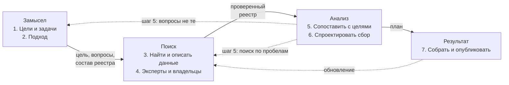

# Семь шагов

Инвентаризация проходит семь шагов — от цели до результата, которым пользуются. Каждый шаг заканчивается таблицей или документом, и они же — исходные данные для следующего: без согласованных вопросов нечего сопоставлять, без списка пробелов нечего проектировать. Порядок одинаков для обоих подходов — «чем владеем» и «где найти нужное», — меняются методы, глубина описания и вид результата ([«Подходы на семи шагах»](../02-approaches/01-two-approaches.md#подходы-на-семи-шагах)). Шаги — цикл, а не линия: эксперты и пробелы возвращают к поиску, опубликованный результат — к обновлению.

## Коротко

| Шаг | Что получается | Шаг закончен, когда | Подробно |
|-----|----------------|---------------------|----------|
| **[1. Сформулировать цели и задачи](#1-сформулировать-цели-и-задачи)** | Цель, границы, 10–20 вопросов, порог «годится», намеченный вид результата | Владелец задачи согласовал цель и вопросы | [«Цели и вопросы»](./02-goals-and-questions.md) |
| **[2. Выбрать подход](#2-выбрать-подход)** | Главный подход, методы, состав атрибутов, заведённый реестр | Понятно, где искать, кого опрашивать и до какой глубины описывать | [«Два подхода»](../02-approaches/01-two-approaches.md), [«Семь методов»](../02-approaches/02-methods.md) |
| **[3. Найти и описать данные](#3-найти-и-описать-данные)** | Черновик реестра | Пройдены все владельцы в границах; у каждой записи есть владелец, режим доступа, отметка о качестве, откуда известно и дата — или «не установлено» | Пять глав — от [«Владельцев и полномочий»](./03-owners-and-mandates.md) до [«Качества данных»](./07-quality.md) |
| **[4. Привлечь экспертов](#4-привлечь-экспертов)** | Исправленный реестр, подтверждения владельцев ключевых наборов | Замечания разобраны, новые источники проверены и внесены | [«Пробелы и план»](./08-gaps-and-plan.md#шаг-4-эксперты-и-владельцы) |
| **[5. Сопоставить цели с данными](#5-сопоставить-цели-с-данными)** | Таблица покрытия и список пробелов | У каждого вопроса — источник или пробел с видом | [«Пробелы и план»](./08-gaps-and-plan.md#шаг-5-таблица-покрытия) |
| **[6. Спроектировать сбор от данных](#6-спроектировать-сбор-от-данных)** | План: что запросить, о чём договориться, что собрать, что доработать | У каждого пробела — решение, ответственный и срок или пометка, что пробел принимают | [«Пробелы и план»](./08-gaps-and-plan.md#шаг-6-план) |
| **[7. Собрать и опубликовать результат](#7-собрать-и-опубликовать-результат)** | Каталог, карта данных или целевая система — с паспортом и датой | Результат опубликован или передан; у процесса есть владелец и график обновления | [«Результат и поддержка»](./09-result-and-upkeep.md) |

## 1. Сформулировать цели и задачи

Инвентаризацию начинают с того, что сделают с данными: назначат выплату без заявления, построят аналитику, откроют данные, обучат модель. Цель записывают так, чтобы по ней можно было проверить результат ([«Как записать цель»](../01-basics/03-goals.md#как-записать-цель)), и выводят из неё границы, вопросы и порог «годится» для главных из них. Здесь же намечают вид результата и называют владельца задачи — того, кто примет результат и на шестом шаге решит, какие пробелы закрывать. Шаг самый дешёвый, а ошибка на нём обходится дороже всех. Как его пройти — в главе [«Цели и вопросы»](./02-goals-and-questions.md).

## 2. Выбрать подход

Подход решает, с какой стороны идти: от владельца и его систем («чем владеем») или от вопросов к источникам («где найти нужное»). Если нужны и свои данные, и чужие, подходы сочетают, но главным делают один ([«Как выбрать подход»](../02-approaches/01-two-approaches.md#как-выбрать-подход)). Методов берут не меньше трёх, чтобы они закрывали слепые пятна друг друга. Состав реестра — 14 обязательных атрибутов и те расширенные, что нужны цели; реестр заводят таблицей или файлами данных с первого дня, а не собирают в конце из отчётов ([«Расширенный состав»](./05-registry.md#расширенный-состав)). Для подхода «чем владеем» нужен приказ или письмо руководителя, которое обязывает подразделения отвечать: без него опрос превращается в просьбу. Широкую тему делят на очереди ([ниже](#если-тема-большая)).

## 3. Найти и описать данные

Самый объёмный шаг: найти системы, ресурсы и наборы и сразу записать каждый в реестр. У записи — владелец и основание, режим доступа, быстрая проверка качества, откуда известно о наборе и дата. Если сведение найти не удалось, пишут «не установлено» и где искать дальше. Методы идут в порядке, который работает: полномочия показывают, что должно быть, реестры систем и кабинетные исследования — что есть, поиск по каталогам — что опубликовано, опросы владельцев — что упустили документы ([«Как выбрать и сочетать методы»](../02-approaches/02-methods.md#как-выбрать-и-сочетать-методы)). В подходе «где найти нужное» каждый источник сразу привязывают к вопросам, на которые он отвечает. Как пройти шаг — в пяти главах, начиная с [«Владельцев и полномочий»](./03-owners-and-mandates.md).

## 4. Привлечь экспертов

Эксперты дополняют и исправляют черновик реестра, а владельцы ключевых наборов подтверждают их описания: ответ владельца — самое сильное основание статуса доступа. Подтверждение записывают в одном месте — в поле «откуда известно». Кого считать экспертом, какие наборы ключевые и как записать ответ — в главе [«Пробелы и план»](./08-gaps-and-plan.md#шаг-4-эксперты-и-владельцы).

## 5. Сопоставить цели с данными

На пятом шаге выясняют, хватает ли данных для задачи. Каждый вопрос сверяют с найденным в таблице покрытия: есть ли источник, доступен ли он и годится ли по порогу. Вопрос без доступного источника годного качества — пробел; у пробела записывают вид и то, мешает ли он главной цели. Пробелы не прячут ([«Готовьтесь к разочарованию»](../01-basics/04-principles.md#5-готовьтесь-к-разочарованию)). Таблица покрытия и пять видов пробелов — в главе [«Пробелы и план»](./08-gaps-and-plan.md#шаг-5-таблица-покрытия).

## 6. Спроектировать сбор от данных

Пробелы закрывают изменениями, а не отчётом: запросом владельцу, договором о доступе, собственным сбором, доработкой системы — или записывают, что пробел принимают. Доработки проектируют от данных, а не от экранов ([«Data-first в проектировании»](../01-basics/04-principles.md#7-data-first-в-проектировании)). У каждой строки плана — ответственный и срок. Какое решение искать для каждого вида пробела и как записать строку плана — в главе [«Пробелы и план»](./08-gaps-and-plan.md#шаг-6-план).

## 7. Собрать и опубликовать результат

Вид результата намечают на первом шаге, а на седьмом собирают его из реестра, проверяют и публикуют. Это внутренний или публичный каталог данных, целевая информационная система, пополнение озера данных — общего хранилища данных организации — или карта данных для проекта. Результат — не отчёт об инвентаризации, а то, чем пользуются: отчёт и картинки строят из реестра, общедоступную часть — выборкой из полного реестра. Публикуют с паспортом, версией и датой, а до публикации назначают владельца процесса и план обновления; если поддерживать результат некому, публикуют снимок с датой. Подробно — в главе [«Результат и поддержка»](./09-result-and-upkeep.md).

## Когда возвращаются назад

Шаги идут по порядку, но не строго один за другим. На схеме семь шагов сгруппированы в четыре фазы. Сплошные стрелки подписаны тем, что фаза передаёт следующей, пунктирные — возвраты.

- **От экспертов к поиску.** Эксперт называет источник, о котором не знали. Его проверяют и описывают по правилам третьего шага.
- **От пробелов к поиску.** Прежде чем записать пробел, вопрос ищут ещё раз другим методом. Часть пробелов закрывается здесь же: данные нашлись под другим названием или у другого ведомства.
- **От пробелов к цели.** Если на пятом шаге выясняется, что вопросы не те, их заново согласуют с владельцем задачи, а не подгоняют под найденное. Такой возврат из середины работы — сигнал, что цель записали плохо.
- **От результата к поиску.** Обновление — это повтор третьего–пятого шагов для того, что изменилось: адресов, владельцев, статусов доступа, систем. Новая задача возвращает к первому шагу, но реестр уже есть, и следующая инвентаризация начинается не с нуля.

## Кто участвует

| Роль | Шаги | Что делает |
|------|------|------------|
| **Владелец задачи** | 1, 3, 5, 6, 7 | Ставит цель и вопросы, подписывает письмо владельцам данных, решает, какие пробелы закрывать, принимает результат |
| **Составитель реестра** | все | Ведёт реестр и план работ, сводит ответы и замечания, отвечает за то, чтобы у каждой записи были владелец, основание, доступ и дата |
| **Владельцы систем и ответственные за данные** | 3, 4, 6 | Отвечают на анкеты и интервью, подтверждают описания, дорабатывают свои системы |
| **Эксперты отрасли** | 3, 4 | Подсказывают источники, проверяют и дополняют черновик |
| **Юрист или ответственный за защиту данных** | 3, 5, 7 | Проверяет основания закрытия и персональные данные, решает, что войдёт в общедоступную часть |
| **Архитекторы и разработчики** | 6 | Проектируют доработки и новые системы от данных |

Ответственный за данные — конкретный сотрудник, который знает данные: из профильного подразделения или ИТ, а не пресс-служба. В небольшой инвентаризации роли совмещают: составитель реестра сам ведёт кабинетные исследования и интервью. Но владелец задачи нужен всегда: без него некому принять результат и решить, какие пробелы закрывать.

## Если тема большая

Широкую тему — всё ведомство с подведомственными организациями, отрасль, регион — не проходят целиком за один раз. Её делят на очереди: по ведомствам, подразделениям, программам или типовым темам. Все семь шагов проходят на первой очереди и только потом берутся за следующую. Первая очередь проверяет сам метод — анкету, состав атрибутов, шкалу доступа: ошибку в анкете дешевле найти на одном подразделении, чем на всех сразу.

- Первой берут очередь, которая нужна главной цели, или ту, где владелец готов помогать.
- Порядок очередей записывают в план с датами: так видно, какая часть границ уже пройдена.
- Записи всех очередей ведут в одном реестре с общими идентификаторами: источник, который встречается в нескольких очередях, описывают один раз.

Так советуют и зарубежные методики — GovEx и Project Open Data ([ниже](#шаги-в-других-методиках)).

## Если времени мало

Под одну срочную задачу — подборку данных для хакатона, первую оценку отрасли — шаги совмещают, но не пропускают. Пропустить нельзя пять вещей:

1. **Записанная цель с вопросами** — шаги 1–2 проходят на одной встрече с владельцем задачи: цель, границы, 10–15 вопросов, подход и три метода из минимального набора ([«Как выбрать и сочетать методы»](../02-approaches/02-methods.md#как-выбрать-и-сочетать-методы)). Без цели неясно, что искать.
2. **Владелец и режим доступа с основанием** у каждого источника на третьем шаге. Без них непонятно, кому писать и можно ли получить данные.
3. **Откуда известно** — тоже у каждого источника. Без этого запись нельзя ни проверить, ни обновить. Остальные атрибуты заполняют только для ключевых источников.
4. **Список пробелов** — после одного-двух разговоров с экспертами по готовому черновику (шаги 4–5). Без него неясно, хватает ли найденного.
5. **Дата** — у записей и у результата: вместо каталога — таблица с датой и по строке плана на каждый пробел (шаги 6–7). Без даты через полгода не понять, чему в результате ещё можно верить.

## Пример

Сквозной условный пример книги — 15 вопросов руководства о доступности медицинской помощи в регионах. Его продолжают главы о шагах, а главы частей II, IV–VI показывают на нём свои темы. Таблица показывает, где какой шаг и что на нём получилось; числа в главах сходятся с ней.

| Шаг | Глава | Что получилось |
|-----|-------|----------------|
| **1–2** | [«Цели и вопросы»](./02-goals-and-questions.md#пример) | Цель, границы с исключениями, подход «где найти нужное», 15 вопросов, четыре из них главные; у главных — порог «годится» |
| **3** | [«Владельцы и полномочия»](./03-owners-and-mandates.md#пример) | Шесть владельцев и 14 полномочий: девять — найдено, четыре — найдено частично, одно — не найдено |
| **3** | [«Реестр данных»](./05-registry.md#условный-пример-доступность-медицинской-помощи) | Черновик — 25 записей: 21 по 13 полномочиям и четыре из поиска наборов; у регистра и учёта фонда — записи-агрегаты |
| **3** | [«Опросные листы и интервью»](./04-questionnaires.md#пример) | Ответили все восемь адресатов; из девяти вписанных заранее строк восемь подтвердили, одну вычеркнули; шесть новых строк — 31 запись |
| **3** | [«Доступ и ограничения»](./06-access.md#пример) | Из 12 «закрыто» в черновике осталось три; три запроса владельцам ждут ответа |
| **3** | [«Качество данных»](./07-quality.md#условный-пример-доступность-медицинской-помощи) | Восемь наборов проверены за два дня: сроки ожидания можно посчитать в четырёх регионах из пяти, сравнить регионы нельзя |
| **4–6** | [«Пробелы и план»](./08-gaps-and-plan.md#пример) | Записи министерства подтверждены; у десяти вопросов есть доступный источник, четыре закрыты частично, один — пробел; план из семи строк |
| **7** | [«Результат и поддержка»](./09-result-and-upkeep.md#условный-пример-доступность-медицинской-помощи) | Карта данных, внутренний каталог и общедоступная часть — 30 записей из 31; паспорт; через полгода — семь строк в списке изменений |
| **После 7** | [«Реестр как данные»](../06-tools/03-registry-as-data.md#пример) | Правку прямо в опубликованной таблице стёрла следующая сборка; запрос к листам реестра за несколько минут нашёл три вопроса, ответить на которые можно только по закрытым данным |
| **После 7** | [«Data Mesh»](../05-frameworks/03-data-mesh.md#пример) | Пять доменов; через месяц домены ведут 26 записей из 31, отдел — пять записей о чужих данных |

Главный вывод — на пятом шаге: даты, по которым считают сроки ожидания, есть во всех пяти регионах первой очереди, но записаны по-разному, а сами записи открыть нельзя: в них персональные данные. Поэтому план шестого шага — не открыть записи, а договориться о сводных данных и одинаковом правиле расчёта.

## Шаги в других методиках

В зарубежных руководствах те же этапы называются и делятся иначе: GovEx предлагает городам США пять шагов, а Project Open Data — федеральным ведомствам США три направления развития инвентаря: расширять, обогащать и открывать ([«Зарубежные методики»](../05-frameworks/04-international-practice.md#govex-data-inventory)). Обе методики — это подход «чем владеем» с главной целью, известной заранее, — открытием данных. Поэтому в них нет выбора подхода, а анализ разрывов сведён к приоритетам публикации. Семь шагов книги шире: цель и подход выбирают каждый раз, а пробелы закрывают не только публикацией, но и изменением систем. Взять из этих методик стоит три вещи: план с очередями и датами, сводный машиночитаемый инвентарь и разделение полного реестра и его общедоступной части.

## Ограничения

- Семь шагов задают порядок, а не график. Сколько займёт каждый шаг, зависит от цели, границ и глубины описания.
- Пройденные шаги не гарантируют полноты: реестр показывает, что найдено и как, а не всё, что существует ([«Ограничения»](../02-approaches/02-methods.md#ограничения)).
- Шестой и седьмой шаги часто выходят за полномочия команды инвентаризации: менять системы и публиковать данные решают владельцы и руководство ([«Ограничения»](./08-gaps-and-plan.md#ограничения) главы «Пробелы и план»).

## Источники

- Глава [«Два подхода»](../02-approaches/01-two-approaches.md) — как подходы меняют наполнение шагов; глава [«Семь методов»](../02-approaches/02-methods.md) — порядок методов на третьем шаге и минимальный набор.
- [GovEx Data Inventory](https://labs.centerforgov.org/data-governance/data-inventory/) — Johns Hopkins Center for Government Excellence: пять шагов инвентаризации для городов; страница обновлена 17 июля 2024 года, проверено в октябре 2026 года.
- Project Open Data — [Implementation Guide](https://web.archive.org/web/20240519174130/https://project-open-data.cio.gov/implementation-guide/), копия в Internet Archive от 19 мая 2024 года: три направления развития корпоративного инвентаря данных — Expand, Enrich, Open.
