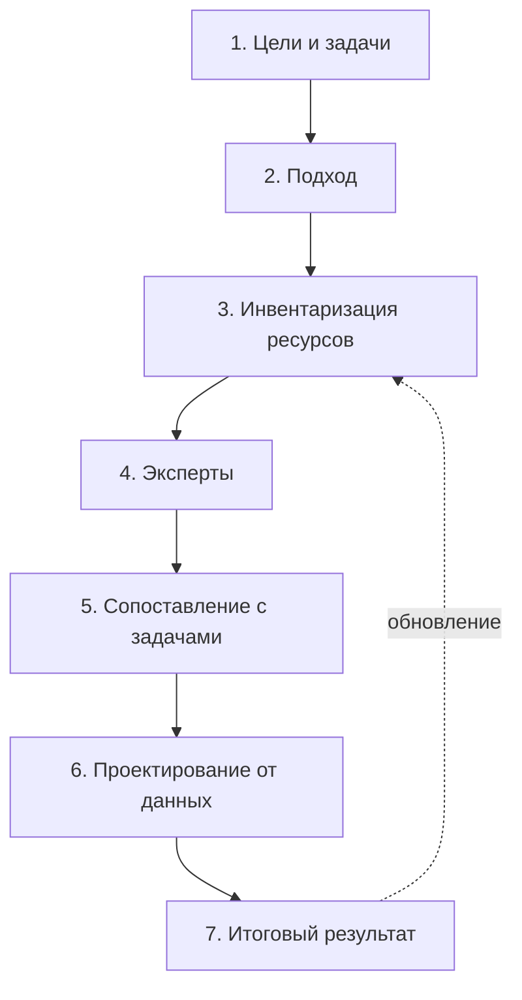

# Семь шагов

Инвентаризация проходит семь шагов. Первые два определяют, что и зачем искать. Третий и четвёртый — собственно поиск и описание. Пятый показывает, хватает ли найденного для задачи. Шестой и седьмой превращают результат в то, чем будут пользоваться: новые системы и каталог. Порядок одинаков для обоих подходов — «чем владеем» и «где найти нужное», — меняются только методы на третьем шаге.

## 1. Сформулировать цели и задачи

Что нужно сделать с данными: система поддержки решений, проактивные услуги, сквозная аналитика, открытие данных, обучение моделей. Цель записывают так, чтобы по ней можно было проверить результат. → [Зачем: цели](../01-basics/02-goals.md), [Цели и вопросы](./02-goals-and-questions.md)

## 2. Выбрать подход

«Изучаем, чем владеем» — внутренний аудит существующих систем. «Ищем, где найти нужное» — внешний поиск под задачу. → [Два подхода](../02-approaches/01-two-approaches.md)

## 3. Провести инвентаризацию ресурсов

Анализ полномочий, реестры информационных систем, порталы открытых данных, каталоги и сайты, опросные листы. Каждый найденный набор записывают в реестр с владельцем, основанием и датой. → [Семь методов](../02-approaches/02-methods.md), [Владельцы и полномочия](./03-owners-and-mandates.md), [Опросные листы](./04-questionnaires.md), [Реестр данных](./05-registry.md), [Где искать данные](../04-sources/01-three-layers.md)

## 4. Привлечь экспертов

Отраслевые специалисты и ассоциации знают системы, о которых не пишут на сайтах, и замечают ошибки. Их взгляд нужен и для проверки, и для дополнения найденного. → [Результат и поддержка](./08-result-and-upkeep.md#проверка)

## 5. Сопоставить цели с данными

Для каждой задачи и вопроса — есть ли данные, доступны ли они ([«Доступ и ограничения»](./06-access.md)) и достаточно ли они хороши ([«Качество данных»](./07-quality.md)). Итог — список пробелов: чего нет, что закрыто, что непригодно. Это анализ разрывов (gap-анализ), и он часто важнее самого реестра.

## 6. Спроектировать обновление от задач

Пробелы закрывают изменением систем: новые поля, новые выгрузки, программные интерфейсы, новые системы. Проектируют от данных (data-first), а не от экранов: данные переживут любую конкретную систему. → [Принципы](../01-basics/03-principles.md#4-data-first-в-проектировании)

## 7. Определить итоговый результат

Каталог данных — внутренний или публичный, целевая информационная система, пополнение озера данных или карта данных для проекта. Результат публикуют с датой и планом обновления. → [Результат и поддержка](./08-result-and-upkeep.md)

## Кто участвует

- **Владелец задачи** — даёт цели и вопросы и принимает результат.
- **Составитель реестра** — ведёт таблицу и отвечает за то, чтобы у каждой записи были владелец, основание, доступ и дата.
- **Владельцы систем и ответственные за данные** — отвечают на опросы и подтверждают описания. Ответственным должен быть сотрудник ИТ-подразделения, а не пресс-службы.
- **Эксперты отрасли** — проверяют и дополняют.

## Источники

- И. Бегтин, презентация «Инвентаризация данных» — «по шагам».
- Обзор «Инвентаризация данных в государственных информационных системах Казахстана», 2025–2026 — семь последовательных шагов от определения целей до создания каталога данных.
