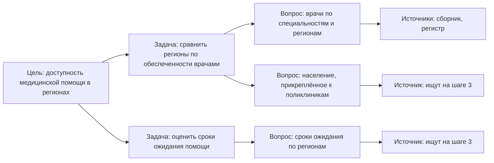

# Цели и вопросы

До начала поиска записывают четыре вещи: цель, границы, вопросы и порог «годится» — когда найденные данные считаются достаточными для ответа. Вместе это один-два листа, которые согласует владелец задачи, — итог первого из [семи шагов](./01-steps.md#1-сформулировать-цели-и-задачи). Вопросы задают направление всей работе: в подходе «где найти нужное» под них ищут источники, в подходе «чем владеем» их задают самому реестру. Ошибку здесь исправить дешевле всего: чего не спросили, того и не найдут.

## Коротко

| Что записать | Что это | Готово, когда |
|--------------|---------|---------------|
| **[Цель](#от-цели-к-вопросам)** | Что сделают с данными, кто примет результат, как его проверить | По цели можно сказать, достигнут ли результат |
| **[Границы](#границы)** | Организации и уровни, территория, слои данных, период, глубина, что исключено | Про любой найденный источник понятно, входит ли он в работу |
| **[Вопросы](#вопросы)** | 10–20 укрупнённых вопросов «где найти…?» или вопросы к реестру | Список прошёл [проверку](#как-проверить-список) и согласован с владельцем задачи до поиска |
| **[Порог «годится»](#порог-годится)** | Когда данных для вопроса достаточно: полнота, разрезы, период, свежесть | У каждого главного вопроса порог записан числами до проверки качества |

## От цели к вопросам

Цель записывают по четырём вопросам: что сделают с данными, кто воспользуется результатом и примет его, где границы, как проверить результат ([«Как записать цель»](../01-basics/03-goals.md#как-записать-цель)). Из цели выводят задачи — что конкретно нужно сделать на данных, — а из задач вопросы. Источник у вопроса появляется только на третьем шаге.

Цепочка нужна, чтобы у каждого вопроса было объяснение, зачем он: на пятом шаге по ней решают, какой пробел мешает главной цели, а какой можно принять ([«Пробелы и план»](./08-gaps-and-plan.md#шаг-5-таблица-покрытия)). Если вопрос не выводится ни из одной задачи, он лишний. Если задача не породила ни одного вопроса, её не будут проверять данными.

## Границы

Границы отвечают, где искать и где остановиться. Их записывают до вопросов: от границ зависит, какие вопросы вообще имеют смысл.

| Граница | Что записать | Пример |
|---------|--------------|--------|
| **Организации и уровни** | Какие ведомства или подразделения; центральные, региональные, муниципальные органы, подведомственные организации | Министерство и подведомственные учреждения, без региональных органов |
| **Территория** | Страна, регион, город; нужны ли данные по регионам и муниципалитетам | Вся страна по регионам |
| **Слои данных** | Только государственные источники или также общественные, коммерческие, международные ([«Три слоя данных»](../04-sources/01-three-layers.md)) | Государственные и международные; коммерческие — только бесплатные |
| **Период** | Текущее состояние или ряды за годы; с какого года | Ряды с 2015 года |
| **Глубина** | До систем, до ресурсов и наборов или до полей | До наборов; до полей — только ключевые источники |
| **Что исключено** | Что сознательно не ищут и почему | Частные клиники — в следующей очереди |

Глубину выбирают по цели ([«Как цель меняет инвентаризацию»](../01-basics/03-goals.md#как-цель-меняет-инвентаризацию)): чем глубже, тем дороже и описание, и его поддержка. Строку «что исключено» забывают чаще остальных. Без неё через год не отличить пропуск от решения: частные клиники не искали сознательно или о них не подумали.

В подходе «чем владеем» границы прежде всего организационные — чьи данные описывают. В подходе «где найти нужное» они тематические — о чём данные, а владельцем может оказаться кто угодно. Широкую тему делят на части и проходят по очереди ([«Если тема большая»](./01-steps.md#если-тема-большая)).

## Вопросы

Вопросы говорят, что именно искать. В подходе «где найти нужное» почти все начинаются со слов «где найти…?» или «как узнать…?» и повторяют реальные запросы руководства и аналитиков.

### Откуда брать вопросы

Лучшие вопросы — те, которые уже задавали. Прежде чем придумывать новые, собирают готовые:

- **Поручения и запросы за последний год** — от руководства, других ведомств, депутатов: на что отвечали вручную или не смогли ответить.
- **Отчёты, которые собирают вручную.** Каждый показатель такого отчёта — вопрос, на который у кого-то есть данные.
- **Показатели программ и стратегий.** У каждого целевого показателя должен быть источник.
- **Запросы снаружи** — обращения граждан, журналистов и исследователей, запросы данных на портале открытых данных.
- **Требования закона и методик оценки.** Шесть категорий [наборов высокой ценности](../05-frameworks/02-metadata-standards.md#наборы-высокой-ценности) ЕС — шесть групп вопросов для открытия данных; 22 категории данных методики ODIN — готовый список для статистики ([«Зарубежные методики»](../05-frameworks/04-international-practice.md#open-data-inventory-odin)); в США закон требует от федеральных ведомств план с вопросами и данными для ответа на них (learning agenda).
- **Мозговой штурм** — для того, чего в документах нет.

### Мозговой штурм

- **Позвать владельца задачи и тех, кто сейчас отвечает на запросы** — аналитиков, сотрудников профильных отделов. Без них составитель придумывает вопросы сам, и список повторяет то, что ему легко найти.
- **Записывать вопросы в той форме, в какой их задают в жизни** — с цифрами, регионами и годами. Отбирать и укрупнять потом.
- **Пройтись по типовым темам** ([ниже](#типовые-вопросы)) и спросить про каждую: что вы хотели бы знать об этом?
- **Отдельно спросить, каких данных не хватило в последний раз.** Ответ часто важнее всего остального списка.

Сырых вопросов на штурме всегда больше, чем останется: после укрупнения несколько вопросов из жизни сливаются в один. Языковая модель помогает подготовиться — предложить вопросы по типовым темам, найти повторы, привести вопросы к одной форме, — но не знает, что на самом деле спрашивают у заказчика. Её вопросы — заготовка для штурма, а не его замена ([«ИИ в инвентаризации»](../02-approaches/03-ai.md)).

### Как укрупнить

В реестре и на карте ответ на вопрос — не одно число, а источник данных. Поэтому вопросы из жизни укрупняют: убирают конкретный регион, год и объект и оставляют разрезы, в которых нужны данные.

| Вопрос из жизни | Укрупнённый вопрос |
|-----------------|--------------------|
| Сколько больниц в регионе? | Где найти сведения о числе больниц по регионам? |
| Сколько потрачено на информационные системы в этом году? | Где найти расходы органов власти на информационные технологии? |
| Сколько налога собрано в регионе за год? | Где найти данные о поступлении налогов по регионам и годам? |

- **Укрупняют, пока ответ — источник, а не число.**
- **Разрезы сохраняют.** «По регионам и годам» — часть вопроса: источник, где есть только итог по стране за последний год, на такой вопрос не отвечает.
- **Не укрупняют до «данных об экономике».** Слишком общий вопрос собирает десятки источников, которые больше ни на что не отвечают. Такой вопрос делят по разрезам или по видам сведений.
- **Один вопрос — одна потребность.** «Где найти адреса больниц и расписание транспорта до них?» — два вопроса с разными источниками.
- **Одна форма.** «Где найти…?» — так список проще читать и сравнивать с другими.

### Сколько вопросов

Ориентир для отраслевой темы — 10–20 вопросов. Меньше десяти для отрасли — тема, скорее всего, раскрыта не полностью; для узкой задачи, например одной услуги, хватает десятка. Больше двадцати пяти — тему стоит разделить: такой список трудно согласовать, а карту — прочитать.

### Вопросы к реестру

В подходе «чем владеем» вопросы задают не к чужим источникам, а к собственному реестру. Они решают, какие атрибуты записывать сверх [14 обязательных](./05-registry.md#минимальный-состав) и какие наборы описывать подробно.

| Цель | Вопросы к реестру | Что добавить в реестр |
|------|-------------------|-----------------------|
| **Защита персональных данных** | Где хранятся сведения о людях? На каком основании их собирают? Кому передают? | Отметку о персональных данных и чувствительности, основание, получателей |
| **Сокращение дублей** | Какие сведения собирают несколько раз? Какие справочники расходятся? | Схему до полей и справочников у наборов об одних и тех же объектах |
| **Замена системы** | Какие данные хранит старая система и кто ими пользуется? Что перенести, а что сдать в архив? | Пользователей набора, решение о переносе |
| **Открытие данных** | Что можно открыть? Что востребовано, но закрыто? | Основание ограничения, спрос — запросы и обращения |

**Вопрос к реестру — это фильтр.** «Где хранятся сведения о людях?» — выборка записей, у которых в колонке «персональные данные» стоит «да», с владельцем и основанием. «Что востребовано, но закрыто?» — записи с режимом доступа «закрыто», у которых в колонке спроса есть запросы. Если вопрос нельзя задать реестру как фильтр, в реестре не хватает колонки: её добавляют до поиска, а не после.

### Типовые вопросы

Типовые темы — статистика, организации, финансы, люди, ресурсы — повторяются от отрасли к отрасли ([«С типовыми темами»](../02-approaches/04-data-maps.md#с-типовыми-темами)). Вместе с ними повторяются и вопросы. Их удобно брать как заготовку и уточнять под отрасль.

| Типовая тема | Типовой вопрос |
|--------------|----------------|
| **Статистика** | Где найти статистику отрасли по регионам и годам? |
| **Организации** | Где найти перечень организаций отрасли с адресами, лицензиями и показателями деятельности? |
| **Финансы** | Где найти бюджетные расходы на отрасль? Где найти расходы и закупки организаций отрасли? |
| **Люди** | Где найти сведения о работниках отрасли? О тех, кого она обслуживает? |
| **Ресурсы** | Где найти реестры объектов, лицензий и разрешений отрасли? |

Типовой вопрос включают, только если он нужен цели. Но если по типовой теме нет ни одного вопроса, это должно быть записанным решением, а не пропуском.

## Порог «годится»

Порог отвечает, когда данных для вопроса достаточно. Его записывают рядом с вопросом до проверки качества: порог, придуманный после, подгоняют под найденное, и пробелов «нет». По этому порогу на третьем шаге ставят итог паре «вопрос — набор» — годится, годится с оговорками, не годится ([«Годится ли для задачи»](./07-quality.md#годится-ли-для-задачи)).

- **У главных вопросов — обязательно.** У попутных хватает общего порога, записанного в границах: например, все регионы и данные не старше года.
- **Числами, а не словами.** Не «данные хорошего качества», а «дата направления заполнена не меньше чем у 90% записей».
- **Из признаков, которые важны вопросу:** полнота ключевых полей, подробность и разрезы — регион, город и село, — длина ряда, свежесть, одна методика на весь ряд.
- **Порог — договорённость с владельцем задачи**, а не свойство данных. Его согласуют вместе с вопросами. Если на пятом шаге окажется, что порог не проходит ни один источник, его меняют с датой и с согласия владельца задачи, а не молча.

## Как проверить список

Перед согласованием список проверяют.

- **Ответ — данные.** На каждый вопрос можно ответить ссылкой на источник, а не мнением эксперта или объяснением. «Как устроена бюджетная система?» — вопрос о понимании, а не о данных.
- **Вопрос о данных, а не об источниках.** «Какие коммерческие сервисы собирают данные об отрасли?» спрашивает об источниках: по ответу не понять, что в них — цены, компании или объёмы производства. Коммерческий источник привязывают к вопросам по существу, а слой данных записывают у самого источника.
- **Нет повторов.** Два вопроса с одинаковыми источниками стоит объединить — или искать дальше, пока источники не разойдутся.
- **Не слишком широкий и не слишком узкий** — по правилам [укрупнения](#как-укрупнить).
- **У каждого вопроса есть задача.** Вопрос, который не нужен ни одной задаче из цели, вычёркивают, даже если он интересный.
- **Покрыты типовые темы — или пропуск осознанный и записан в границах.**
- **Отмечены главные вопросы** — без ответа на них цель не достигнута. У каждого главного — порог «годится».
- **Владелец задачи согласен** — до поиска источников, а не после.

## Как записать

Цель, границы и исключения записывают карточкой с датой и именем того, кто её согласовал. Вопросы ведут листом «Вопросы» рядом с реестром ([«Что хранить»](../06-tools/03-registry-as-data.md#что-хранить), шаблон [questions.csv](pathname:///templates/questions.csv)). Образцы карточки и листа — в [примере](#пример) ниже.

- **Номер** — постоянный: на него ссылаются связи «вопрос — источник», поэтому вопросы не перенумеровывают, а снятый вопрос помечают, а не удаляют.
- **Текст** — в укрупнённой форме.
- **Типовая тема** и **задача** — зачем нужен вопрос.
- **Приоритет** — главный вопрос или попутный.
- **Порог «годится»** — у главных обязательно.

Вопросы меняются по ходу работы, и это нормально: эксперт подсказывает пропущенный вопрос, на пятом шаге выясняется, что вопрос задан не так. Новый вопрос добавляют с датой и согласуют с владельцем задачи. Подгонять вопросы под найденное нельзя ([«Когда возвращаются назад»](./01-steps.md#когда-возвращаются-назад)).

## Пример

Здесь начинается сквозной условный пример книги — цель из главы [«Зачем: цели»](../01-basics/03-goals.md#как-записать-цель). Его продолжают главы о следующих шагах; где он на каждом шаге — в [сводной таблице](./01-steps.md#пример) главы «Семь шагов».

**Карточка «цель и границы».**

| Поле | Запись |
|------|--------|
| **Цель** | Найти источники для ответа на 15 вопросов руководства о доступности медицинской помощи в регионах и показать, каких данных нет |
| **Владелец задачи** | Заместитель министра здравоохранения |
| **Кто пользуется результатом** | Департамент, который готовит справки для руководства |
| **Как проверить результат** | У каждого из 15 вопросов — источник с доступностью и качеством или записанный пробел |
| **Вид результата** | Карта данных: таблица «вопрос — источник — статус» и список пробелов |
| **Подход** | «Где найти нужное» |
| **Организации и уровни** | Государственные источники центрального и регионального уровня |
| **Территория и период** | Вся страна по регионам; ряды за последние десять лет |
| **Слои данных** | Государственные; международные — для сравнения с другими странами; коммерческих нет |
| **Глубина** | До наборов |
| **Что исключено** | Частная медицина — следующей очередью; лекарственное обеспечение как отдельная тема |
| **Согласовано** | Заместитель министра, 29 сентября 2026 года |

**Вопросы.** На штурме с департаментом записали около тридцати вопросов из жизни. После укрупнения и проверки осталось 15, четыре из них главные. Фрагмент листа «Вопросы»:

| № | Вопрос | Тема, задача, приоритет | Порог «годится» |
|--:|--------|-------------------------|-----------------|
| 1 | Где найти сведения о числе медицинских организаций и их подразделений по видам, регионам и годам? | Организации; сеть медицинских организаций; попутный | Общий: все регионы, данные не старше года |
| 2 | Где найти сведения о числе врачей по специальностям, регионам и годам — отдельно для городов и сёл? | Люди; обеспеченность врачами; главный | Все регионы, ряд за пять лет, разрез «город — село» |
| 3 | Где найти сведения о коечном фонде по регионам и годам? | Ресурсы; обеспеченность койками; попутный | Общий; смена методики учёта отмечена |
| 4 | Где найти сведения о сроках ожидания медицинской помощи по регионам? | Статистика; сроки ожидания; главный | Дата направления и дата помощи заполнены не меньше чем у 90% записей; данные не старше квартала |
| 5 | Где найти расходы бюджетов регионов на здравоохранение по годам? | Финансы; расходы на жителя; попутный | Общий; исполнение, а не план |

**Как укрупняли и проверяли.**

- «Сколько фельдшерско-акушерских пунктов закрыли за пять лет?» стал вопросом 1, «Хватает ли врачей в сельских районах?» — вопросом 2.
- «Почему в этом регионе к онкологу ждут дольше, чем в соседнем?» — просьба об анализе, а не о данных. Её превратили в вопрос 4 — о данных, на которых этот анализ строят.
- «Где найти рейтинг лучших больниц?» не нужен ни одной задаче о доступности помощи — его вычеркнули.
- По теме «люди» сначала были только вопросы о врачах. Добавили вопрос о населении, прикреплённом к поликлиникам, по полу и возрасту: без него не посчитать обеспеченность врачами на жителя.
- Вопрос 4 отметили главным: ради него руководство и заказало работу.

Список и пороги согласовали до поиска. Пример показывает ход работы, а не то, как устроено здравоохранение в конкретной стране.

## Частые ошибки

- **Вопросы придумал составитель.** Список повторяет то, что легко найти, а не то, что нужно заказчику. Вопросы собирают на штурме с владельцем задачи и теми, кто отвечает на запросы.
- **Порог записали после проверки.** Найденный набор «годится», потому что порог подогнали под него, и пробелов «нет». Порог записывают вместе с вопросами, до поиска.
- **Вопросы перенумеровали.** Связи «вопрос — источник» указывают не на те вопросы. Номер — постоянный идентификатор; снятые вопросы помечают.

Сквозные ошибки — в главе «Практики и антипаттерны»: [«Опись ради описи»](../08-practices/01-practices-and-anti-patterns.md#опись-ради-описи) и [«Всё и сразу»](../08-practices/01-practices-and-anti-patterns.md#всё-и-сразу).

## Ограничения

- Вопросы ограничивают поиск: чего не спросили, того не найдут. Ценный источник, который не отвечает ни на один вопрос, в карту не попадает, поэтому такие находки записывают отдельным списком — они пригодятся для следующей задачи.
- Вопросы отражают сегодняшние задачи. Новая задача — новые вопросы, но реестр при этом не начинают заново.
- Ориентир 10–20 вопросов взят из практики, а не из нормы. Для одной услуги вопросов меньше, для отрасли с несколькими очередями — больше.
- Типовые темы — проверка полноты, а не обязательный набор: тема без вопросов допустима, если это записанное решение.

## Источники

- Главы [«Зачем: цели»](../01-basics/03-goals.md) — как записать цель; [«Семь шагов»](./01-steps.md) — место этого шага в работе; [«Карты данных»](../02-approaches/04-data-maps.md) — вопросы на картах и типовые темы; [«Качество данных»](./07-quality.md) — как проверяют порог «годится».
- [5 U.S. Code § 312](https://www.law.cornell.edu/uscode/text/5/312) — Agency evidence-building plan: список вопросов и список данных для ответа на них в стратегическом плане федерального ведомства; введён законом Foundations for Evidence-Based Policymaking Act of 2018. Проверено в октябре 2026 года.
- [Метаданные индикатора ЦУР 17.18.1](https://unstats.un.org/sdgs/metadata/files/Metadata-17-18-01a.pdf) — ООН, обновлено 28 марта 2024 года: индекс охвата ODIN — 22 категории социальной, экономической и экологической статистики.
- [Commission Implementing Regulation (EU) 2023/138](https://eur-lex.europa.eu/eli/reg_impl/2023/138/oj) — шесть категорий наборов высокой ценности.
- Прежняя версия книги «Карты данных» — репозиторий [infoculture/datainventorydocs](https://github.com/infoculture/datainventorydocs), глава «Выбор темы и подбор вопросов»: мозговой штурм, вопросы из жизни и их укрупнение.
