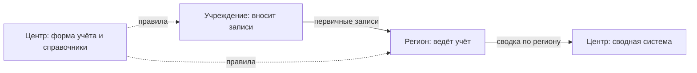

# Владельцы и полномочия

Данные накапливаются там, где кто-то обязан их собирать. Поэтому до поиска систем выясняют, кто в границах отвечает за тему, читают полномочия каждого и выписывают, какие данные из них следуют, — получается список того, что должно быть. Его проверяют другими методами, и у каждой строки появляется итог: нашли набор или записали «не найдено». Полномочие остаётся при наборе: оно объясняет, почему данные существуют, кому писать и на каких условиях их можно получить.

Сведения проверены 25 октября 2026 года, если не указано иное.

## Коротко

| Что сделать | Что получается | Готово, когда |
|-------------|----------------|---------------|
| **[Составить список владельцев](#кто-отвечает-за-тему)** | Организации по уровням — с подведомственными и преемниками упразднённых | Пройдены все уровни в границах; кого исключили, записано |
| **[Разделить роли](#владелец-оператор-ответственный)** | Владелец, оператор и ответственный у каждой записи | Владелец взят из документа, а не по домену или подрядчику |
| **[Найти документы](#где-искать-полномочия)** | Положения об органах, отраслевые законы, акты о системах | У каждого владельца — действующая редакция с датой проверки |
| **[Выписать полномочия](#как-читать-полномочия)** | Строки «полномочие — какие данные ожидаются» | У каждой строки — дословная цитата, акт и пункт |
| **[Проверить, есть ли данные](#от-полномочия-к-набору)** | Найденные системы и наборы | У каждой строки итог: найдено, найдено частично, не найдено, передано |

## Кто отвечает за тему

Список начинают с вопроса «кто обязан этим заниматься?», а не «у кого есть сайт об этом». Владельцев собирают по уровням в пределах [границ](./02-goals-and-questions.md#границы):

| Уровень | Что у них обычно есть | Где взять перечень |
|---------|-----------------------|--------------------|
| **Центральные органы власти** — министерства, службы, агентства | Реестры, лицензии, надзор, отраслевая отчётность | Акт о структуре правительства, справочник органов власти |
| **Региональные и муниципальные органы** | Первичный учёт по своим полномочиям, региональные системы | Сайты регионов; отраслевой закон, который разграничивает полномочия |
| **Подведомственные организации** — учреждения, центры информатизации и статистики | Сами системы и выгрузки: орган ставит задачу, учреждение ведёт данные | Перечень подведомственных на сайте органа |
| **Фонды и регуляторы** | Учёт застрахованных и выплат, отчётность поднадзорных организаций | Законы о них |
| **Компании** — банки, операторы связи, энергетика | Отчётность регулятору, раскрытие информации | Реестры лицензий регуляторов ([«Коммерческие данные»](../04-sources/04-commercial.md)) |
| **Международные организации** | Сопоставимые ряды по странам | Если сравнение с другими странами входит в границы |

**У темы почти всегда несколько владельцев.** В здравоохранении любой страны есть министерство, надзорный орган и фонд медицинского страхования или его аналог, и у каждого свои системы.

**Уровни делят одну функцию.** Центр утверждает форму учёта и ведёт сводную систему, регион ведёт учёт, учреждение вносит записи. Поэтому одни и те же сведения лежат у нескольких владельцев с разной подробностью: первичные записи — внизу, сводные показатели — наверху. Сплошные стрелки на схеме — данные, пунктирные — правила.

В условном примере книги так устроены листы ожидания плановой госпитализации: больница вносит направление, орган здравоохранения региона ведёт лист в своей системе, министерство получает сводные данные. Данные по регионам и муниципалитетам ищут ниже центрального уровня.

**У подведомственных данных часто больше, чем у самого органа.** Орган власти ставит задачу, а систему ведёт учреждение — центр информатизации, статистики, мониторинга. Такая система часто живёт на поддомене министерства или на сайте учреждения, и чья она, показывают документы, а не домен.

**Владельцев реорганизуют.** Полномочия передают, ведомства делят и сливают, а данные переезжают вслед за полномочием или остаются на старом адресе. Например, с 1 января 2023 года фонд социального страхования России объединили с пенсионным фондом в Социальный фонд России. Так эта пара и записана в шаблоне [owners.csv](pathname:///templates/owners.csv): упразднённый фонд и его преемник. Поэтому список сверяют с действующей структурой органов власти, а у упразднённых записывают преемника ([«Как отметить в реестре»](../04-sources/06-legacy.md#как-отметить-в-реестре)).

## Владелец, оператор, ответственный

Владельцем часто записывают того, кто ближе: оператора системы, подрядчика, хозяина домена. Это разные роли, и путать их дорого: запрос уходит не тому, кто решает о доступе.

| Роль | Кто это | Где в реестре |
|------|---------|---------------|
| **Владелец** | Организация, которая по закону, полномочию или договору решает, что собирать и кому давать доступ | Организация-владелец и полномочие |
| **Оператор** | Тот, кто эксплуатирует систему: подведомственное учреждение, центр информатизации, подрядчик | Информационная система и её оператор |
| **Ответственный** | Сотрудник, который знает данные и отвечает на вопросы о них | Ответственный и контакты ([«Минимальный состав»](./05-registry.md#минимальный-состав)) |

Законы и методики называют эти роли по-своему, но разделяют их так же:

| Где | Владелец | Кто ведёт данные по поручению |
|-----|----------|-------------------------------|
| **Закон об информации, Россия** | Обладатель информации — создал её или получил право разрешать и ограничивать доступ | Оператор информационной системы |
| **GDPR, Европейский союз** | Контролёр (controller) — определяет цели и средства обработки персональных данных | Обработчик (processor) |
| **Полный инвентарь данных ведомств США** | Владелец набора | Ведомства, которые ведут набор, — их записывают отдельно ([«Зарубежные методики»](../05-frameworks/04-international-practice.md#инвентари-данных-федеральных-ведомств-сша)) |
| **Великобритания** | Владелец информационного актива (Information Asset Owner) — отвечает за актив и его запись в реестре министерства | — |
| **DAMA-DMBOK** | Владелец данных (data owner) — принимает решения о данных своей области | Распорядители данных (data stewards) — смысл, качество, техническое ведение ([«DAMA-DMBOK»](../05-frameworks/01-dama-dmbok.md)) |

**Владельца берут из документа, а не по домену.** Домен показывает, кто держит сайт: оператора, подрядчика или проект, который перепубликует чужие данные. Если владельцев сначала заполнили по доменам, их помечают как не сверенные и сверяют по документам при обновлении. Ту же ошибку часто делают языковые модели ([«Ошибки модели»](../02-approaches/03-ai.md#ошибки-модели-и-как-их-ловить)).

**У копии свой владелец.** Если данные перепубликует другой сайт — общественный проект, агрегатор, коммерческий сервис, — копию записывают отдельным источником со своим владельцем и отмечают первоисточник: систему, где данные появляются по обязанности. Копия бывает удобнее, но если она отстала или закрылась, искать придётся у первоисточника.

**Владелец подтверждает описание.** Ключевые записи отправляют владельцу на подтверждение: его ответ — самое сильное основание и для владельца в записи, и для режима доступа ([«Шаг 4. Эксперты и владельцы»](./08-gaps-and-plan.md#шаг-4-эксперты-и-владельцы)).

## Сквозные владельцы

Некоторые владельцы встречаются почти в любой отраслевой инвентаризации: статистическое ведомство, налоговая служба или регистратор юридических лиц, казначейство и министерство финансов, система госзакупок. Их и их источники описывают один раз и переиспользуют от темы к теме ([«Один набор под разными именами»](./05-registry.md#один-набор-под-разными-именами)). В новой теме их проверяют первыми: они отвечают на типовые вопросы об организациях и финансах, и основное время остаётся на отраслевых владельцев.

## Где искать полномочия

Полномочия записаны не в одном документе. Положение об органе даёт перечень, остальные документы — подробности: что именно собирают, у кого и как дают доступ.

| Документ | Что в нём о данных |
|----------|--------------------|
| **Положение об органе** (устав, учредительный акт) | Перечень полномочий и функций |
| **Отраслевой закон** | Кто ведёт реестр, учёт или лицензирование, состав сведений, порядок доступа |
| **Акт о системе или реестре** | Оператор, состав сведений, кто передаёт данные и кто их получает, что открыто |
| **Регламенты услуг и формы заявлений** | Какие сведения собирают у граждан и компаний |
| **Формы отчётности и статистических наблюдений** | Какие показатели собирают, с кого и как часто ([«Статистика и формы сбора сведений»](../04-sources/02-government.md#статистика-и-формы-сбора-сведений)) |
| **Устав и государственное задание учреждения** | Что учреждение ведёт за орган власти |
| **Программы и стратегии** | Целевые показатели, у каждого из которых должен быть источник |

Где эти документы публикуют в каждой стране — в главах части «Страновые практики», реквизиты актов — в приложении [«Нормативная база»](../09-appendices/02-legal-framework.md). Перед чтением проверяют, действует ли акт и какая редакция последняя ([«Перед ссылкой на нормативный акт»](../09-appendices/04-checklists.md#перед-ссылкой-на-нормативный-акт)): по старой редакции владельцем окажется ведомство, у которого полномочия уже нет.

## Как читать полномочия

Положение не читают целиком. В нём ищут формулировки, за которыми стоят данные, и выписывают каждую отдельной строкой.

| Формулировка | Что за ней обычно стоит | Где проверить |
|--------------|-------------------------|---------------|
| ведёт реестр, кадастр, регистр, учёт, перечень | ресурс-реестр, часто в отдельной информационной системе | реестр систем, акт о реестре |
| регистрирует, присваивает номер, выдаёт свидетельство | регистр объектов с идентификаторами — кандидат в эталонный источник | акт о регистрации, поиск по номеру на сайте |
| выдаёт лицензии, разрешения, аккредитацию, сертификаты | реестр выданных документов, заявления и отказы | реестр лицензий на сайте органа |
| осуществляет контроль (надзор) | реестр подконтрольных объектов, результаты проверок, предписания | реестр проверок, отчёты о надзоре |
| собирает отчётность, формирует статистику, ведёт мониторинг | формы отчётности, показатели, первичные ответы | формы и план статистических работ |
| оказывает государственные услуги | заявления и решения в системе услуг | регламент услуги |
| распоряжается бюджетными средствами, предоставляет субсидии | расходы, контракты, субсидии и их получатели | бюджетные данные, [госзакупки](../04-sources/02-government.md#госзакупки) |
| управляет имуществом | реестр имущества, договоры аренды и продажи | реестр имущества, сайт торгов |
| утверждает формы, порядки, классификаторы | методику и справочники; сами данные ведут другие | у тех, кто форму заполняет и сводит |

Последняя строка — ловушка: орган, который утвердил форму учёта, часто сам этот учёт не ведёт. Владельцем данных записывают того, кто форму заполняет и сводит.

**За этими формулировками данных обычно нет:** «координирует», «участвует в разработке», «содействует», «обеспечивает реализацию государственной политики», «вносит предложения». За ними стоят переписка, проекты актов и отчёты, а не наборы. Их не выписывают: список разрастается, а находок не прибавляется.

**Эталонный реестр ищут первым.** Если закон называет ресурс источником достоверных сведений для других систем, данные из него берут остальные владельцы, и он ответит на вопросы сразу нескольких тем. В Казахстане это национальные регистры ([«Казахстан»](../07-countries/01-kazakhstan.md#правовая-основа)).

**Одна строка — одно полномочие.** У каждой строки — дословная цитата, акт с номером, датой и редакцией, пункт и ожидаемые данные. Если набор в тексте прямо не назван, ожидаемые данные начинают со слова «вывод:» — так видно, где документ, а где догадка составителя.

**До и после.** Так выглядит чтение на настоящем законе — главе Свода законов США о регистрации воздушных судов (49 U.S.C., глава 441). До — три фрагмента, формулировки выделены:

> **§ 44103(a)(1).** On application of the owner of an aircraft that meets the requirements of section 44102 of this title, the Administrator of the Federal Aviation Administration shall— (A) **register the aircraft**; and (B) **issue a certificate of registration** to its owner.
>
> **§ 44107(a).** The Administrator of the Federal Aviation Administration **shall establish a system for recording**— (1) **conveyances that affect an interest in civil aircraft** of the United States; …
>
> **§ 44114(b).** … upon request of a private aircraft owner or operator, the Administrator **shall withhold from broad dissemination or display** by the FAA … **the personally identifiable information** of such individual, including on a publicly available website of the FAA.

После — что из фрагментов попадает в лист «Полномочия»:

| Формулировка | Ожидаемые данные | Итог |
|--------------|------------------|------|
| § 44103(a)(1): регистрирует судно и выдаёт свидетельство о регистрации | Реестр воздушных судов с владельцами | Найдено: ежедневная выгрузка FAA ([карточка](#как-записать) ниже) |
| § 44107(a): ведёт систему записи сделок с гражданскими судами | вывод: записи о сделках и документах по каждому судну | Найдено частично: в той же выгрузке есть указатель документов, но не сами документы |
| § 44114(b): по просьбе владельца не показывает его личные сведения | Это не полномочие о данных, а ограничение | В лист не выписывают: это основание режима доступа в записи реестра — открытая часть выйдет без таких имён и адресов |

Формулировки — подсказки, а не правило: не каждый реестр ведётся в системе, и не каждая система упомянута в положении. Анализ полномочий хорошо ускоряют языковые модели — если дать модели текст положения, а не вопрос, и требовать дословную цитату к каждому полномочию ([«ИИ в инвентаризации»](../02-approaches/03-ai.md#как-делать)).

## От полномочия к набору

Полномочие говорит, что данные должны быть, но не что они есть, где и в каком виде. Это проверяют другими методами: реестрами систем, госзакупками, сайтами и поддоменами, порталами открытых данных и опросами владельцев ([«Семь методов»](../02-approaches/02-methods.md)). У каждой строки полномочия — один из пяти итогов:

| Итог | Что записать | Что дальше |
|------|--------------|------------|
| **Найдено** | Систему или набор со ссылкой на полномочие и с тем, откуда о нём известно | Описать по [14 атрибутам](./05-registry.md#минимальный-состав) |
| **Найдено частично** | Что нашли и чего не хватает: только сводные показатели, только поиск по одной записи, только последние годы | Спросить владельца о выгрузке ([«Что спрашивать»](./04-questionnaires.md#что-спрашивать)) |
| **Не найдено** | Строку «не найдено» и где искали | Спросить владельца: данные могут вести на бумаге, в таблицах или в подведомственном учреждении |
| **Передано** | Преемника и дату передачи | Искать у преемника, старые адреса — в [веб-архиве](../04-sources/06-legacy.md) |
| **Система есть, полномочия нет** | Основание, какое есть: обеспечение работы самого органа, договор, инициатива | Если основания нет совсем, это вопрос владельцу, а не повод исключить систему |

Последний случай становится чаще. В России, например, с 1 сентября 2026 года государственные органы создают системы для обеспечения своей деятельности на основании собственных актов. Такие системы не считаются государственными ([«Россия»](../07-countries/02-russia.md)).

Строки «не найдено» не удаляют. Это пробел или подсказка, где искать при обновлении; на пятом шаге по ним решают, что закрывать ([«Пробелы и план»](./08-gaps-and-plan.md#виды-пробелов)). К такому итогу стоит быть готовым: полномочие есть, а данных нет — полномочие не исполняют или исполняют на бумаге ([«Готовьтесь к разочарованию»](../01-basics/04-principles.md#5-готовьтесь-к-разочарованию)).

## В подходе «чем владеем»

Внутри организации владельцы — подразделения, а полномочия — их функции. Логика та же: что подразделение обязано делать, о том оно и ведёт записи.

| Где записаны функции | Что из них следует |
|----------------------|--------------------|
| Положения о подразделениях, должностные обязанности | Какие учёты и реестры ведёт подразделение |
| Регламенты процессов и услуг | Какие сведения собирают и куда передают |
| Требования закона и регулятора — отчётность, раскрытие, сроки хранения | Что организация обязана собирать и хранить, даже если сама этим не пользуется |
| Договоры с партнёрами и подрядчиками | Какие данные получают и передают и на каких условиях |

- **Владелец набора — подразделение, чья это функция, а не ИТ.** ИТ-подразделение обычно оператор: оно знает, где лежат данные, но не решает, кому их давать. Тот же принцип в Data Mesh — владение данными у доменов ([«Домены»](../05-frameworks/03-data-mesh.md#домены)).
- **У персональных данных основание обязательно.** GDPR требует от контролёра вести реестр операций обработки с их целями, и у каждой обработки должно быть законное основание. Для органа власти это обычно исполнение обязанности по закону или задачи в общественных интересах — то есть полномочие.
- **Функция без данных и данные без функции — обе находки.** Если подразделение обязано вести учёт, а в системах его нет, учёт ведут в таблицах или не ведут вовсе. Если набор есть, а функции под него нет, его, возможно, собирают по привычке — это кандидат на отказ от сбора и на сокращение дублей.

## Как записать

Владельцев и полномочия ведут двумя листами рядом с реестром, вопросами и источниками ([«Что хранить»](../06-tools/03-registry-as-data.md#что-хранить)); шаблоны — [owners.csv](pathname:///templates/owners.csv) и [mandates.csv](pathname:///templates/mandates.csv). В листе «Владельцы» — строка на организацию: постоянный идентификатор, название, уровень, слой данных — по основанию сбора, а не по форме собственности ([«Как определить слой»](../04-sources/01-three-layers.md#как-определить-слой)), — вышестоящая организация, контакты, документ о полномочиях, статус и преемник, дата проверки. В листе «Полномочия» — строка на полномочие. Так выглядит строка шаблона о реестре воздушных судов США:

| Поле | Значение |
|------|----------|
| **Идентификатор** | `faa-aircraft-registration` |
| **Владелец** | `faa` — идентификатор FAA из листа «Владельцы» |
| **Полномочие** | регистрация воздушных судов |
| **Дословная цитата** | «the Administrator of the Federal Aviation Administration shall— (A) register the aircraft; and (B) issue a certificate of registration to its owner.» |
| **Акт и пункт** | 49 U.S.C. § 44103, подраздел (a)(1) |
| **Ожидаемые данные** | реестр воздушных судов с владельцами |
| **Итог** | найдено |
| **Что найдено** | `faa-aircraft-registry` — запись реестра данных ([«Карточка записи FAA»](./05-registry.md#карточка-записи-faa)) |
| **Откуда известно** | анализ полномочий; страница FAA Releasable Aircraft Database Download ([«Как записать, откуда известно»](../02-approaches/02-methods.md#как-записать-откуда-известно)) |
| **Дата проверки** | 2026-10 |

Связь идёт в обе стороны. В записи реестра `faa-aircraft-registry` в поле «полномочие» стоит `faa-aircraft-registration`, а ограничение по § 44114(b) — в основании режима доступа той же записи. Так по любой записи видно, почему данные существуют, а по любому полномочию — что под ним нашли.

## Пример

Продолжение условного примера из главы [«Цели и вопросы»](./02-goals-and-questions.md#пример): 15 вопросов руководства о доступности медицинской помощи в регионах. Границы — государственные источники центрального и регионального уровня, международные — для сравнения; частная медицина и лекарственное обеспечение исключены.

**Владельцы.** Министерство здравоохранения и подведомственный ему центр медицинской статистики, надзорный орган в здравоохранении, фонд обязательного медицинского страхования, статистическое ведомство, органы управления здравоохранением регионов — одной группой. Ведомство, которое регулирует обращение лекарств, в список не вошло: тема исключена границами, и это записано. Международные источники для сравнения искали поиском наборов, а не по полномочиям.

**Полномочия.** Из положений и отраслевого закона выписали 14 полномочий. Часть из них:

| Владелец и полномочие (условно) | Ожидаемые данные | Итог |
|---------------------------------|------------------|------|
| Министерство: ведёт федеральный регистр медицинских работников | вывод: врачи по специальностям и регионам | Найдено: регистр в системе, которую эксплуатирует центр; доступ ограничен — персональные данные; сводные числа — в ежегодном сборнике центра |
| Надзорный орган: лицензирует медицинскую деятельность | реестр лицензий с адресами мест деятельности | Найдено: реестр открыт на сайте и отвечает на вопрос о числе медицинских организаций |
| Фонд ОМС: ведёт реестр медицинских организаций в системе ОМС и учёт оказанной помощи | реестр организаций; объёмы помощи по регионам | Найдено частично: реестр открыт, учёт помощи закрыт, сводные данные — по запросу |
| Статистическое ведомство: формирует официальную статистику здравоохранения | коечный фонд, число врачей по регионам и годам | Найдено: ряды за десять лет |
| Органы регионов: устанавливают предельные сроки ожидания помощи | вывод: нормативы сроков; о фактических сроках в тексте ничего нет | Найдено частично: нормативы есть, фактические сроки не измеряет никто |

**Что показал анализ.**

- Регистр медицинских работников лежит на домене центра. По домену владельцем записали бы центр. По положению владелец — министерство, а центр — оператор, поэтому запрос о доступе пишут министерству.
- Главный вопрос — о сроках ожидания — полномочиями не покрыт: никто не обязан измерять фактические сроки. Пробел записали, а вопрос включили в анкету органам регионов и в запрос фонду ([«Опросные листы и интервью»](./04-questionnaires.md#пример)): такие сведения могут найтись в обращениях граждан или в системах записи на приём.
- Два полномочия надзорного органа о контроле качества помощи дали реестр проверок, но не ответили ни на один из 15 вопросов. Находку записали отдельным списком: она пригодится для следующей задачи.

**Итог.** Шесть владельцев и 14 полномочий: девять — найдено, четыре — найдено частично, одно — не найдено. У каждой записи реестра есть владелец из документа и полномочие с цитатой. Пример показывает ход работы, а не то, как устроено здравоохранение в конкретной стране.

## Частые ошибки

- **Только центральный уровень.** Подведомственные учреждения и регионы, у которых и лежат данные, не попали в список. Проходят все уровни в границах и спрашивают орган о подведомственных.
- **Устаревшая редакция.** Записан владелец, у которого полномочия уже нет, или упразднённое ведомство. Акт проверяют перед ссылкой, у упразднённых записывают преемника.
- **Полномочие вместо проверки.** В реестре набор, который «должен быть», но его никто не видел. Итог «найдено» ставят только после подтверждения вторым методом или владельцем.

Сквозные ошибки — в главе «Практики и антипаттерны»: [«Владелец — тот, кто публикует»](../08-practices/01-practices-and-anti-patterns.md#владелец--тот-кто-публикует) и [«Строку удаляют, когда источник исчез»](../08-practices/01-practices-and-anti-patterns.md#строку-удаляют-когда-источник-исчез).

## Ограничения

- Полномочие говорит, что данные должны быть, а не что они есть и в каком виде. Рабочие таблицы, выгрузки и данные подрядчиков, которые собирают без прямого полномочия, этот метод не видит ([«Анализ полномочий»](../02-approaches/02-methods.md#1-анализ-полномочий)).
- Опубликованы не все документы: системы создают приказами, которые не публикуют, а порядок ведения реестра бывает с пометкой об ограниченном доступе.
- Положения пишут общими словами: одна формулировка покрывает несколько систем или ни одной.
- В компаниях функции записаны хуже, чем в государстве: положения о подразделениях устаревают, процессы меняются без документов. Там больше опираются на опросы владельцев.
- Названия органов и полномочий не переводятся один к одному: «надзор», «регистрация», «лицензирование» в разных странах значат разное. При поиске по аналогии сравнивают функции, а не названия ([«Поиск по аналогии»](../02-approaches/02-methods.md#7-поиск-по-аналогии)).

## Источники

- Главы [«Семь методов»](../02-approaches/02-methods.md#1-анализ-полномочий) — анализ полномочий среди других методов; [«ИИ в инвентаризации»](../02-approaches/03-ai.md) — как ускорить анализ полномочий; [«Карты данных»](../02-approaches/04-data-maps.md#по-полномочиям) — карта по полномочиям; [«Государственные данные»](../04-sources/02-government.md) — реестры систем, госзакупки, нормативные акты.
- [49 U.S. Code § 44103](https://www.law.cornell.edu/uscode/text/49/44103), подраздел (a)(1) — регистрация воздушных судов; [§ 44107](https://www.law.cornell.edu/uscode/text/49/44107), подраздел (a) — система записи сделок; [§ 44114](https://www.law.cornell.edu/uscode/text/49/44114), подраздел (b) — сокрытие личных сведений владельцев. Тексты — по Legal Information Institute Корнеллского университета, сверено 26 октября 2026 года.
- [Releasable Aircraft Database Download](https://www.faa.gov/licenses_certificates/aircraft_certification/aircraft_registry/releasable_aircraft_download) — FAA: состав базы, ежедневное обновление, процедура по 49 U.S.C. § 44114(b).
- Федеральный закон от 27.07.2006 № 149-ФЗ «Об информации, информационных технологиях и о защите информации», статья 2, пункты 5 и 12 — обладатель информации и оператор информационной системы, в редакции от 26.06.2026; Федеральный закон от 14.07.2022 № 236-ФЗ «О Фонде пенсионного и социального страхования Российской Федерации».
- [44 U.S. Code § 3511](https://www.law.cornell.edu/uscode/text/44/3511), подраздел (a)(2)(A), пункты vii и viii — ведомства, которые ведут набор, и владелец набора в полном инвентаре данных.
- [Regulation (EU) 2016/679](https://eur-lex.europa.eu/eli/reg/2016/679/oj) (GDPR) — статья 4, пункты 7 и 8 — контролёр и обработчик; статья 6 — законные основания обработки; статья 30 — реестр операций обработки.
- [The role of information asset owners in government](https://www.gov.uk/government/publications/information-asset-owner-role-guidance) — Кабинет министров Великобритании, обновлено 1 октября 2025 года.
- Прежняя версия книги «Карты данных» — репозиторий [infoculture/datainventorydocs](https://github.com/infoculture/datainventorydocs), главы «Привязка источников данных», «Нормативные акты и полномочия» и «Почему данные лежат там, где лежат».
