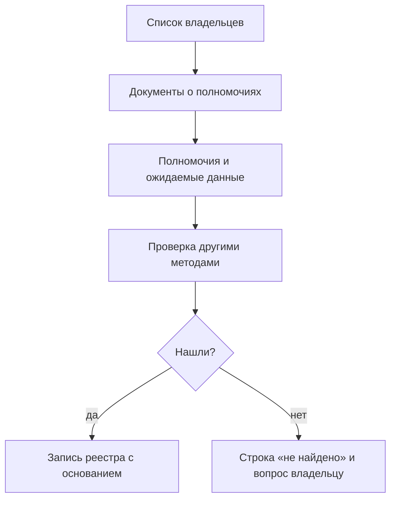

# Владельцы и полномочия

Данные накапливаются там, где кто-то обязан их собирать. Поэтому до поиска систем выясняют, кто в границах инвентаризации отвечает за тему, читают полномочия каждого и выписывают, какие данные из них следуют. Получается список того, что должно быть, — ещё до того, как найдена хоть одна система. Его проверяют реестрами систем, госзакупками, сайтами и опросами, и у каждой строки появляется итог: нашли набор или записали «не найдено». Полномочие записывают вместе с набором: оно объясняет, почему данные существуют, кому писать и на каких условиях их можно получить. В подходе «где найти нужное» так находят чужих владельцев, в подходе «чем владеем» — свои подразделения и то, что они обязаны вести. С этого начинается третий из [семи шагов](./01-steps.md#3-провести-инвентаризацию-ресурсов), и это первый метод в [порядке, который работает](../02-approaches/02-methods.md#порядок-который-работает).

## Коротко

| Что сделать | Что получается | Готово, когда |
|-------------|----------------|---------------|
| **[Составить список владельцев](#кто-отвечает-за-тему)** | Организации по уровням — с подведомственными и преемниками упразднённых | Пройдены все уровни в границах; кого исключили, записано |
| **[Найти документы](#где-искать-полномочия)** | Положения об органах, отраслевые законы, акты о системах | У каждого владельца — действующая редакция с датой проверки |
| **[Выписать полномочия](#как-читать-полномочия)** | Строки «полномочие — какие данные ожидаются» | У каждой строки — дословная цитата, акт и пункт |
| **[Проверить, есть ли данные](#от-полномочия-к-набору)** | Найденные системы и наборы | У каждой строки итог: найдено, найдено частично, не найдено, передано |
| **[Разделить роли](#владелец-оператор-ответственный)** | Владелец, оператор и ответственный у каждой записи | Владелец взят из документа, а не по домену или подрядчику |

## Кто отвечает за тему

Список начинают с вопроса «кто обязан этим заниматься?», а не «у кого есть сайт об этом». Владельцев собирают по уровням в пределах [границ](./02-goals-and-questions.md#границы):

| Уровень | Кто | Что у них обычно есть | Где взять перечень |
|---------|-----|-----------------------|--------------------|
| **Центральные органы власти** | Министерства, службы, агентства, комитеты | Реестры, лицензии, надзор, отраслевая отчётность | Акт о структуре правительства, справочник органов власти |
| **Региональные и муниципальные органы** | Профильные органы регионов и городов | Первичный учёт по своим полномочиям, региональные системы | Сайты регионов; отраслевой закон, который разграничивает полномочия |
| **Подведомственные организации** | Учреждения, государственные предприятия, центры информатизации и статистики | Сами системы и выгрузки: орган ставит задачу, учреждение ведёт данные | Перечень подведомственных на сайте органа, реестры государственных учреждений |
| **Фонды и регуляторы** | Фонды социального и медицинского страхования, центральный банк, независимые регуляторы | Учёт застрахованных и выплат, отчётность поднадзорных организаций | Законы о них |
| **Компании** | Банки, операторы связи, энергетика, недропользователи, государственные компании | Отчётность регулятору, раскрытие информации, данные о своей деятельности | Реестры лицензий регуляторов ([«Коммерческие данные»](../04-sources/04-commercial.md)) |
| **Международные организации** | ООН, Всемирный банк, ВОЗ, отраслевые агентства | Сопоставимые ряды по странам | Если сравнение с другими странами входит в границы |

**У темы почти всегда несколько владельцев.** В здравоохранении любой страны есть министерство, надзорный орган и фонд медицинского страхования или его аналог, и у каждого свои системы. На карте атласа [«Здравоохранение»](../08-atlas/04-health.md) у Минздрава России и Росздравнадзора по 15 источников из 50 (без групп), у остальных девяти владельцев — от одного до трёх. Большая часть источников двух главных владельцев — поддомены и разделы их сайтов, за которыми стоят отдельные системы.

**Уровни делят одну функцию.** Центральный орган утверждает форму учёта и ведёт сводную систему, региональный ведёт учёт, учреждение вносит записи. Поэтому одни и те же сведения лежат у нескольких владельцев с разной подробностью: первичные записи — внизу, сводные показатели — наверху. Данные по регионам и муниципалитетам ищут ниже центрального уровня. На карте «Здравоохранение» на вопрос о статистике заболеваемости отвечают mednet.ru и системы медицинских информационно-аналитических центров регионов — и оба источника закрыты.

**У подведомственных данных часто больше, чем у самого органа.** Орган власти ставит задачу, а систему ведёт учреждение — центр информатизации, статистики, мониторинга. На карте [«Образование»](../08-atlas/05-education.md) у 35 из 51 источника (без групп) владельца по адресу определить не удалось. Это поддомены министерств, порталы на домене edu.ru, сайты учреждений, проектов и СМИ. Чьи они, показывают документы, а не домен.

**Владельцев реорганизуют.** Полномочия передают, ведомства делят и сливают, а данные переезжают вслед за полномочием или остаются на старом адресе. В 2018 году Министерство образования и науки России разделили на Министерство просвещения и Министерство науки и высшего образования (указ Президента № 215): к первому перешли общее, среднее профессиональное и дополнительное образование. Три поддомена mon.gov.ru с карты «Образование» в октябре 2026 года уже не существуют. С 1 января 2023 года ФСС и ПФР объединены в Социальный фонд России (закон № 236-ФЗ), и у fz122.fss.ru на карте «Здравоохранение» владелец записан вместе с преемником. Поэтому список сверяют с действующей структурой органов власти, а у упразднённых записывают преемника ([«Исчезнувшие системы и веб-архивы»](../04-sources/06-legacy.md#как-отметить-в-реестре)).

## Где искать полномочия

Полномочия записаны не в одном документе. Положение об органе даёт перечень, остальные документы — подробности: что именно собирают, у кого и как дают доступ.

| Документ | Что в нём о данных |
|----------|--------------------|
| **Положение об органе** (устав, учредительный акт) | Перечень полномочий и функций |
| **Отраслевой закон** | Кто ведёт реестр, учёт или лицензирование, состав сведений, порядок доступа |
| **Акт о системе или реестре** — положение о системе, порядок ведения реестра | Оператор, состав сведений, кто передаёт данные и кто их получает, что открыто |
| **Регламенты услуг и формы заявлений** | Какие сведения собирают у граждан и компаний |
| **Формы отчётности и статистических наблюдений** | Какие показатели собирают, с кого и как часто |
| **Устав и государственное задание учреждения** | Что учреждение ведёт за орган власти |
| **Программы и стратегии** | Целевые показатели, у каждого из которых должен быть источник |

Где лежат эти документы, зависит от страны:

| Страна | Как устроены полномочия | Где искать |
|--------|-------------------------|------------|
| **Казахстан** | Положения о министерствах утверждает правительство. Цифровой кодекс прямо связывает данные с функциями: административные цифровые данные — те, что государственные органы формируют при исполнении функций и оказании услуг (статья 18) | adilet.zan.kz; проекты актов — legalacts.egov.kz |
| **Россия** | Положения о большинстве федеральных органов утверждает правительство, об органах, которыми руководит президент, — указ президента. Перечень органов — указ «О структуре федеральных органов исполнительной власти» | pravo.gov.ru, справочные правовые системы |
| **США** | Полномочия ведомств — в законах, собранных в Своде законов (U.S. Code). Описание структуры и функций ведомство обязано публиковать в Federal Register (5 U.S.C. § 552(a)(1)). Справочник US Government Manual у каждого ведомства приводит назначение и правовые основания | govinfo.gov, federalregister.gov, usgovernmentmanual.gov |
| **Европейский союз** | Задачи агентства — в его учредительном регламенте; обязанности вести реестры и собирать сведения — в отраслевых регламентах и директивах | eur-lex.europa.eu |

Перед чтением проверяют, действует ли акт и какая редакция последняя ([«Перед ссылкой на нормативный акт»](../10-appendices/04-checklists.md#перед-ссылкой-на-нормативный-акт)). По старой редакции владельцем окажется ведомство, у которого полномочия уже нет. Подробнее об актах как источнике — в главе [«Государственные данные»](../04-sources/02-government.md#нормативные-акты), акты по странам — в приложении [«Нормативная база»](../10-appendices/02-legal-framework.md).

## Как читать полномочия

Положение не читают целиком. В нём ищут формулировки, за которыми стоят данные, и выписывают каждую отдельной строкой.

| Формулировка | Что за ней обычно стоит | Где проверить |
|--------------|-------------------------|---------------|
| ведёт реестр, кадастр, регистр, учёт, перечень | ресурс-реестр, часто в отдельной информационной системе | реестр систем, акт о реестре |
| регистрирует, присваивает номер, выдаёт свидетельство | регистр объектов с идентификаторами — кандидат в эталонный источник | акт о регистрации, поиск по номеру на сайте |
| выдаёт лицензии, разрешения, аккредитацию, сертификаты | реестр выданных документов, заявления и отказы | реестр лицензий на сайте органа |
| осуществляет контроль (надзор) | реестр подконтрольных объектов, результаты проверок, предписания | реестр проверок, отчёты о надзоре |
| собирает отчётность, формирует статистику, ведёт мониторинг | формы отчётности, показатели, первичные ответы | формы и план статистических работ |
| оказывает государственные услуги | заявления и решения в системе услуг | регламент услуги |
| распоряжается бюджетными средствами, предоставляет субсидии | расходы, контракты, субсидии и их получатели | бюджетные данные, [госзакупки](../04-sources/02-government.md#госзакупки) |
| управляет имуществом | реестр имущества, договоры аренды и продажи | реестр имущества, сайт торгов |
| утверждает формы, порядки, классификаторы | методику и справочники; сами данные ведут другие | у тех, кто форму заполняет и сводит |

Последняя строка — ловушка: орган, который утвердил форму учёта, часто сам этот учёт не ведёт. Владельцем данных записывают того, кто форму заполняет и сводит.

**За этими формулировками данных обычно нет:** «координирует», «участвует в разработке», «содействует», «обеспечивает реализацию государственной политики», «вносит предложения». За ними стоят переписка, проекты актов и отчёты, а не наборы. Их не выписывают: список разрастается, а находок не прибавляется.

**Эталонный реестр ищут первым.** Если закон называет ресурс источником достоверных сведений для других систем, данные из него берут остальные владельцы, и он ответит на вопросы сразу нескольких тем. В Казахстане это национальные регистры — единый источник достоверных сведений по статье 19 Цифрового кодекса ([«Казахстан»](../07-countries/01-kazakhstan.md#правовая-основа)).

**Одна строка — одно полномочие.** У каждой строки — дословная цитата, акт с номером, датой и редакцией, пункт и ожидаемые данные. Если набор в тексте прямо не назван, ожидаемые данные начинают со слова «вывод:» — так видно, где документ, а где догадка составителя. Это та же форма, что в инструкции для языковой модели ([«Задать форму ответа»](../02-approaches/03-ai.md#2-задать-форму-ответа--поля-реестра)).

Формулировки — подсказки, а не правило: не каждый реестр ведётся в системе, и не каждая система упомянута в положении. Анализ полномочий хорошо ускоряют языковые модели — если дать модели текст положения, а не вопрос, и требовать дословную цитату к каждому полномочию ([«ИИ в инвентаризации»](../02-approaches/03-ai.md#как-делать)).

## От полномочия к набору

Полномочие говорит, что данные должны быть, но не что они есть, где и в каком виде. Это проверяют другими методами: реестрами систем, госзакупками, сайтами и поддоменами, порталами открытых данных и опросами владельцев ([«Семь методов»](../02-approaches/02-methods.md)).

Как выглядит путь от полномочия до набора, видно на примере реестра воздушных судов США:

| Звено | Пример |
|-------|--------|
| **Полномочие** | По 49 U.S.C. § 44103 Федеральное управление гражданской авиации (FAA) по заявлению владельца регистрирует воздушное судно и выдаёт ему свидетельство о регистрации |
| **Ресурс** | Реестр воздушных судов |
| **Опубликованная форма** | Вся база для скачивания: текстовые файлы с разделителем-запятой, обновляются ежедневно |
| **Ограничение** | По 49 U.S.C. § 44114(b) владельцы частных самолётов могут попросить не показывать их имя и адрес на общедоступном сайте FAA |

Основание задаёт не только то, что данные есть, но и то, чего в открытой части не будет.

У каждой строки полномочия — один из пяти итогов:

| Итог | Что записать | Что дальше |
|------|--------------|------------|
| **Найдено** | Систему или набор со ссылкой на полномочие и с тем, откуда о нём известно | Описать по [14 атрибутам](./05-registry.md#минимальный-состав) |
| **Найдено частично** | Что нашли и чего не хватает: только сводные показатели, только поиск по одной записи, только последние годы | Спросить владельца о выгрузке ([«Что спрашивать»](./04-questionnaires.md#что-спрашивать)) |
| **Не найдено** | Строку «не найдено» и где искали | Спросить владельца: данные могут вести на бумаге, в таблицах или в подведомственном учреждении |
| **Передано** | Преемника и дату передачи | Искать у преемника, старые адреса — в [веб-архиве](../04-sources/06-legacy.md) |
| **Система есть, полномочия нет** | Основание, какое есть: обеспечение работы самого органа, договор, инициатива | Если основания нет совсем, это вопрос владельцу, а не повод исключить систему |

Последний случай становится чаще. В России, например, с 1 сентября 2026 года государственные органы создают для обеспечения своей деятельности информационные системы, которые не являются государственными, на основании собственных актов ([«Россия»](../07-countries/02-russia.md)). Другие расхождения между методами разобраны в главе [«Семь методов»](../02-approaches/02-methods.md#как-методы-проверяют-друг-друга).

Строки «не найдено» не удаляют. Это пробел или подсказка, где искать при обновлении; на пятом шаге по ним решают, что закрывать ([«Сопоставить цели с данными»](./01-steps.md#5-сопоставить-цели-с-данными)). И к такому итогу стоит быть готовым: полномочие есть, а данных нет — полномочие не исполняют или исполняют на бумаге ([«Готовьтесь к разочарованию»](../01-basics/03-principles.md#5-готовьтесь-к-разочарованию)).

## Владелец, оператор, ответственный

Владельцем часто записывают того, кто ближе: оператора системы, подрядчика, хозяина домена. Это разные роли, и путать их дорого: запрос уходит не тому, кто решает о доступе.

| Роль | Кто это | Где в реестре |
|------|---------|---------------|
| **Владелец** | Организация, которая по закону, полномочию или договору решает, что собирать и кому давать доступ | Организация-владелец и полномочие |
| **Оператор** | Тот, кто эксплуатирует систему: подведомственное учреждение, центр информатизации, подрядчик | Информационная система и её оператор |
| **Ответственный** | Сотрудник, который знает данные и отвечает на вопросы о них | Ответственный и контакты ([«Минимальный состав»](./05-registry.md#минимальный-состав)) |

Законы и методики разделяют эти роли:

- **Россия.** Закон № 149-ФЗ различает обладателя информации — того, кто её создал или по закону или договору получил право разрешать и ограничивать доступ к ней, — и оператора информационной системы, который систему эксплуатирует (статья 2, пункты 5 и 12).
- **США.** В полном инвентаре данных федерального ведомства у каждого набора записывают отдельно ведомства, которые его ведут, и владельца набора (44 U.S.C. § 3511(a)(2)(A), пункты vii и viii; [«Зарубежные методики»](../05-frameworks/04-international-practice.md#инвентари-данных-федеральных-ведомств-сша)).
- **Европейский союз.** Общий регламент о защите данных (GDPR) различает контролёра (controller), который определяет цели и средства обработки персональных данных, и обработчика (processor), который обрабатывает их по поручению контролёра (статья 4, пункты 7 и 8).
- **DAMA-DMBOK.** Решения о данных своей области принимает владелец данных (data owner), а смысл, качество и техническое ведение поручают распорядителям данных (data stewards) — деловым и техническим ([«DAMA-DMBOK»](../05-frameworks/01-dama-dmbok.md)).

**Владельца берут из документа, а не по домену.** Домен показывает, кто держит сайт: оператора, подрядчика или проект, который перепубликует чужие данные. В атласе владельцы заполнены по доменам, и из 159 источников владелец есть у 80. У 22 групп источников одного владельца нет по определению, а у 57 сайтов по адресу не понять, чьи они. Сверка по документам — часть обновления атласа ([«Как перенести карту с картинки в данные»](../06-tools/03-registry-as-data.md#как-перенести-карту-с-картинки-в-данные)). Ту же ошибку часто делают языковые модели ([«Ошибки модели»](../02-approaches/03-ai.md#ошибки-модели-и-как-их-ловить)).

**У копии свой владелец.** Если данные перепубликует другой сайт — общественный проект, агрегатор, коммерческий сервис, — копию записывают отдельным источником со своим владельцем и отмечают первоисточник: систему, где данные появляются по обязанности. Копия бывает удобнее, но если она отстала или закрылась, искать придётся у первоисточника.

**Владелец подтверждает описание.** Ключевые записи отправляют владельцу на подтверждение: его ответ — самое сильное основание и для владельца в записи, и для режима доступа ([«Проверка»](./08-result-and-upkeep.md#проверка)).

## Источники, которые повторяются

Некоторые владельцы встречаются почти в любой отраслевой инвентаризации: статистическое ведомство, налоговая служба или регистратор юридических лиц, казначейство и министерство финансов, система госзакупок. В атласе Росстат, Федеральное казначейство и ФНС России — владельцы источников на всех четырёх картах, Минфин России — на трёх; clearspending.ru, fedstat.ru, gks.ru и zakupki.gov.ru есть на всех четырёх картах ([«Источники, которые встречаются почти везде»](../08-atlas/01-how-to-read.md#источники-которые-встречаются-почти-везде)).

Таких владельцев и их источники описывают один раз и переиспользуют от темы к теме ([«Один набор под разными именами»](./05-registry.md#один-набор-под-разными-именами)). В новой теме их проверяют первыми: они отвечают на типовые вопросы об организациях и финансах, и основное время остаётся на отраслевых владельцев.

## В подходе «чем владеем»

Внутри организации владельцы — подразделения, а полномочия — их функции. Логика та же: что подразделение обязано делать, о том оно и ведёт записи.

| Где записаны функции | Что из них следует |
|----------------------|--------------------|
| Положения о подразделениях, должностные обязанности | Какие учёты и реестры ведёт подразделение |
| Регламенты процессов и услуг | Какие сведения собирают и куда передают |
| Требования закона и регулятора — отчётность, раскрытие, сроки хранения | Что организация обязана собирать и хранить, даже если сама этим не пользуется |
| Договоры с партнёрами и подрядчиками | Какие данные получают и передают и на каких условиях |

- **Владелец набора — подразделение, чья это функция, а не ИТ.** ИТ-подразделение обычно оператор: оно знает, где лежат данные, но не решает, кому их давать. Тот же принцип в Data Mesh — владение данными у доменов ([«Data Mesh»](../05-frameworks/03-data-mesh.md)).
- **У персональных данных основание обязательно.** GDPR требует от контролёра вести реестр операций обработки с их целями (статья 30), и у каждой обработки должно быть законное основание (статья 6). Для органа власти это обычно исполнение обязанности по закону или задачи в общественных интересах (статья 6, пункт 1, подпункты c и e) — то есть полномочие.
- **Функция без данных и данные без функции — обе находки.** Если подразделение обязано вести учёт, а в системах его нет, учёт ведут в таблицах или не ведут вовсе. Если набор есть, а функции под него нет, его, возможно, собирают по привычке — это кандидат на отказ от сбора и на сокращение дублей ([«Зачем: цели»](../01-basics/02-goals.md)).

## Как записать

Владельцев и полномочия ведут двумя листами рабочей таблицы — рядом с реестром, вопросами и источниками ([«Рабочая таблица»](../06-tools/02-mindmaps-and-boards.md#рабочая-таблица)). Шаблоны — [owners.csv](pathname:///templates/owners.csv) и [mandates.csv](pathname:///templates/mandates.csv).

**Лист «Владельцы»** — по строке на организацию:

- **идентификатор** — постоянный: на него ссылаются полномочия и записи реестра;
- **полное и короткое название**;
- **уровень** — центральный, региональный, муниципальный, подведомственный, фонд, компания, международная организация, общественный проект;
- **слой данных** — государственный, общественный или коммерческий: по основанию сбора, а не по форме собственности ([«Как определить слой»](../04-sources/01-three-layers.md#как-определить-слой));
- **вышестоящая организация** — для подведомственных;
- **подразделение и контакты** — кому писать;
- **документ о полномочиях** — с номером, датой и редакцией;
- **статус** — действует или упразднён — и **преемник**;
- **дата проверки**.

**Лист «Полномочия»** — по строке на полномочие:

- **идентификатор** и **владелец** — идентификатор из листа «Владельцы»;
- **полномочие** — коротко и **дословной цитатой**;
- **акт и пункт** — с редакцией;
- **ожидаемые данные** — со словом «вывод:», если в тексте они прямо не названы;
- **итог** — найдено, найдено частично, не найдено, передано — и **что найдено**: идентификаторы систем и наборов;
- **откуда известно** и **дата проверки** ([«Как записать, откуда известно»](../02-approaches/02-methods.md#как-записать-откуда-известно)).

В реестре у набора остаются организация-владелец и полномочие: в колонке `mandate` шаблона [registry.csv](pathname:///templates/registry.csv) — идентификатор строки из листа «Полномочия». Так по любой записи видно, почему данные существуют, а по любому полномочию — что под ним нашли.

## Пример

Продолжение условного примера из главы [«Цели и вопросы»](./02-goals-and-questions.md#пример): 15 вопросов руководства о доступности медицинской помощи в регионах. Границы — государственные источники центрального и регионального уровня, международные — для сравнения; частная медицина и лекарственное обеспечение исключены.

**Владельцы.** Министерство здравоохранения и подведомственный ему центр медицинской статистики, надзорный орган в здравоохранении, фонд обязательного медицинского страхования, статистическое ведомство, органы управления здравоохранением регионов — одной группой. Ведомство, которое регулирует обращение лекарств, в список не вошло: тема исключена границами, и это записано. Международные источники для сравнения искали поиском наборов, а не по полномочиям.

**Полномочия.** Из положений и отраслевого закона выписали 14 полномочий. Часть из них:

| Владелец | Полномочие (условно) | Ожидаемые данные | Итог |
|----------|----------------------|------------------|------|
| Министерство | ведёт федеральный регистр медицинских работников | вывод: врачи по специальностям и регионам | Найдено: регистр в системе, которую эксплуатирует подведомственный центр; доступ ограничен — персональные данные; сводные числа — в ежегодном сборнике центра |
| Надзорный орган | лицензирует медицинскую деятельность | реестр лицензий с адресами мест деятельности | Найдено: реестр открыт на сайте и отвечает на вопрос о числе медицинских организаций и их подразделений |
| Фонд ОМС | ведёт реестр медицинских организаций, работающих в системе ОМС, и персонифицированный учёт оказанной помощи | реестр организаций; объёмы помощи по регионам | Найдено частично: реестр открыт, учёт помощи закрыт, сводные данные — по запросу |
| Статистическое ведомство | формирует официальную статистику здравоохранения | коечный фонд, число врачей по регионам и годам | Найдено: ряды за десять лет |
| Органы регионов | устанавливают предельные сроки ожидания медицинской помощи | вывод: нормативы сроков; о фактических сроках в тексте ничего нет | Найдено частично: нормативы есть, фактические сроки не измеряет никто |

**Что показал анализ.**

- Регистр медицинских работников лежит на домене подведомственного центра. По домену владельцем записали бы центр. По положению владелец — министерство, а центр — оператор, поэтому запрос о доступе пишут министерству.
- Главный вопрос — о сроках ожидания — полномочиями не покрыт: никто не обязан измерять фактические сроки. Пробел записали, а вопрос включили в анкету фонду и органам регионов ([«Опросные листы и интервью»](./04-questionnaires.md)): такие сведения могут найтись в обращениях граждан или в системах записи на приём.
- Два полномочия надзорного органа о контроле качества помощи дали реестр проверок, но не ответили ни на один из 15 вопросов. Находку записали отдельным списком: она пригодится для следующей задачи.

**Итог.** Шесть владельцев и 14 полномочий: девять — найдено, четыре — найдено частично, одно — не найдено. У каждой записи реестра есть владелец из документа и полномочие с цитатой. Как и на карте атласа «Здравоохранение» 2018 года, источник о медицинских работниках есть, но закрыт: там на этот вопрос отвечает только egisz.rosminzdrav.ru, и данные в нём не доступны. Пример показывает ход работы, а не то, как устроено здравоохранение в конкретной стране.

## Частые ошибки

| Ошибка | Что происходит | Как исправить |
|--------|----------------|---------------|
| **Владелец по домену** | Владельцем записан оператор, подрядчик или проект, который перепубликует данные; запрос уходит не тому, кто решает о доступе | Брать владельца из положения и акта о системе |
| **Только центральный уровень** | Подведомственные учреждения и регионы, у которых и лежат данные, не попали в список | Пройти все уровни в границах; спросить орган о подведомственных |
| **Пересказ вместо цитаты** | Полномочие нельзя проверить, а через год — понять, откуда оно взялось | Дословная цитата, акт, пункт, редакция |
| **Устаревшая редакция** | Записан владелец, у которого полномочия уже нет, или упразднённое ведомство | Проверить акт перед ссылкой; у упразднённых записать преемника |
| **Выписано всё подряд** | Список полномочий длиннее положения, а находок не прибавляется | Выписывать только формулировки, за которыми стоят данные, и только в границах |
| **Строки «не найдено» удалены** | Пробелы исчезают, при обновлении ищут заново | Оставлять строку с итогом и тем, где искали ([«Строку удаляют, когда источник исчез»](../09-practices/02-anti-patterns.md#строку-удаляют-когда-источник-исчез)) |
| **Полномочие вместо проверки** | В реестре набор, который «должен быть», но его никто не видел | Итог «найдено» — только после подтверждения вторым методом или владельцем |

## Ограничения

- Полномочие говорит, что данные должны быть, а не что они есть и в каком виде. Рабочие таблицы, выгрузки и данные подрядчиков, которые собирают без прямого полномочия, этот метод не видит ([«Анализ полномочий»](../02-approaches/02-methods.md#1-анализ-полномочий)).
- Опубликованы не все документы: системы создают приказами, которые не публикуют, а порядок ведения реестра бывает с пометкой об ограниченном доступе.
- Положения пишут общими словами: одна формулировка покрывает несколько систем или ни одной.
- В компаниях функции записаны хуже, чем в государстве: положения о подразделениях устаревают, процессы меняются без документов. Там больше опираются на опросы владельцев.
- Названия органов и полномочий не переводятся один к одному: «надзор», «регистрация», «лицензирование» в разных странах значат разное. При поиске по аналогии сравнивают функции, а не названия ([«Поиск по аналогии»](../02-approaches/02-methods.md#7-поиск-по-аналогии)).
- Владельцев реорганизуют, и список устаревает быстрее, чем кажется. Его сверяют при каждом обновлении.

## Источники

- Главы [«Семь методов»](../02-approaches/02-methods.md#1-анализ-полномочий) — анализ полномочий среди других методов; [«ИИ в инвентаризации»](../02-approaches/03-ai.md) — как ускорить анализ полномочий; [«Карты данных»](../02-approaches/04-data-maps.md#по-полномочиям) — карта по полномочиям на примере Росавиации; [«Государственные данные»](../04-sources/02-government.md) — реестры систем, госзакупки, нормативные акты.
- Карты атласа [«Здравоохранение»](../08-atlas/04-health.md) и [«Образование»](../08-atlas/05-education.md), [общий список источников](https://github.com/ivbeg/data-inventory/blob/main/data/sources.yaml) и [результаты проверки адресов](https://github.com/ivbeg/data-inventory/blob/main/data/source-checks.yaml). Числа владельцев посчитаны по файлам в октябре 2026 года; владельцы в них заполнены по доменам и по документам не сверены.
- Федеральный закон от 27.07.2006 № 149-ФЗ «Об информации, информационных технологиях и о защите информации», статья 2, пункты 5 и 12, в редакции от 26.06.2026. Проверено 25 октября 2026 года.
- Указ Президента РФ от 15.05.2018 № 215 «О структуре федеральных органов исполнительной власти», пункт 2 — разделение Министерства образования и науки; Федеральный закон от 14.07.2022 № 236-ФЗ «О Фонде пенсионного и социального страхования Российской Федерации».
- Цифровой кодекс Республики Казахстан от 09.01.2026 № 255-VIII, статьи 18 и 19 ([«Нормативная база»](../10-appendices/02-legal-framework.md#казахстан)).
- [5 U.S. Code § 552](https://www.law.cornell.edu/uscode/text/5/552), подраздел (a)(1) — описание структуры и функций ведомства в Federal Register; [44 U.S. Code § 3511](https://www.law.cornell.edu/uscode/text/44/3511), подраздел (a)(2)(A) — что записывают о наборе в полном инвентаре данных; [49 U.S. Code § 44103](https://www.law.cornell.edu/uscode/text/49/44103) — регистрация воздушных судов. Проверено в октябре 2026 года.
- [Releasable Aircraft Database Download](https://www.faa.gov/licenses_certificates/aircraft_certification/aircraft_registry/releasable_aircraft_download) — FAA: состав базы, ежедневное обновление, процедура по 49 U.S.C. § 44114(b). Проверено 25 октября 2026 года.
- [The United States Government Manual](https://www.usgovernmentmanual.gov/) — справочник органов власти США; издаёт Office of the Federal Register.
- [Regulation (EU) 2016/679](https://eur-lex.europa.eu/eli/reg/2016/679/oj) (GDPR) — статья 4, пункты 7 и 8; статьи 6 и 30.
- Прежняя версия книги «Карты данных» — репозиторий [infoculture/datainventorydocs](https://github.com/infoculture/datainventorydocs), главы «Привязка источников данных», «Нормативные акты и полномочия» и «Почему данные лежат там, где лежат».
