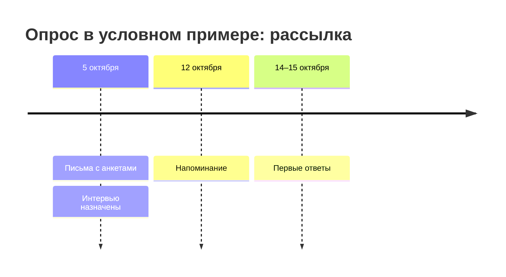
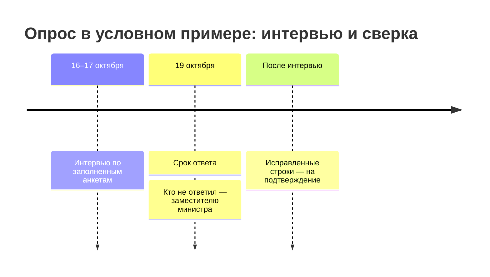
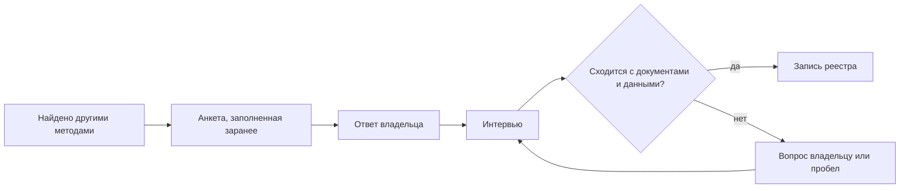

# Опросные листы и интервью

Опрос владельцев находит то, чего нет в документах: рабочие таблицы, журналы, выгрузки, справочники, данные у подрядчиков и купленные наборы. Но анкета показывает только то, что владелец считает данными, вспомнил и захотел назвать. Поэтому её не рассылают пустой: в неё заранее вписывают найденное другими методами, владелец подтверждает, исправляет и дополняет строки, а после — короткое интервью по заполненному листу. Это главный метод подхода «чем владеем»; чужим владельцам анкету не шлют.

Сведения проверены 25 октября 2026 года, если не указано иное.

## Коротко

| Что сделать | Что получается | Готово, когда |
|-------------|----------------|---------------|
| **[Выбрать адресатов](#кому-отправлять)** | Лист «Адресаты»: подразделения, роли, сотрудники | В каждом подразделении в границах есть адресат по имени, общих адресов нет |
| **[Заполнить анкету заранее](#заполнить-заранее)** | Строки с системами и наборами, найденными другими методами | У каждой строки записано, откуда она |
| **[Составить вопросы](#что-спрашивать)** | Анкета-таблица по полям реестра и вопросы о том, что ведут вне систем | Каждый вопрос ложится в поле реестра, в список адресатов или в список того, чего не хватает |
| **[Разослать и провести интервью](#как-проводить)** | Ответы и исправленные после интервью строки | Ответили все адресаты или отказ записан; по новым и вычеркнутым строкам прошли интервью |
| **[Проверить ответы](#как-проверять-ответы)** | Подтверждённые строки и список расхождений | У каждого расхождения — решение или вопрос владельцу |
| **[Перенести в реестр](#как-записать)** | Записи реестра с отметкой об опросе и датой; охват опроса в паспорте | У каждой строки анкеты есть итог |

## Когда применять

| Ситуация | Что делать |
|----------|------------|
| **Опись своих данных** («чем владеем») | Анкета каждому подразделению в границах и интервью — главный метод: без него реестр видит только то, что записано в документах |
| **Поиск под задачу внутри организации** | Анкета с вопросами о том, каких данных не хватает и кто их ведёт: ответы ведут к соседним подразделениям |
| **Чужие данные** («где найти нужное») | Не анкета, а короткий [запрос владельцу](#вопрос-чужому-владельцу) о конкретном наборе и разговор с [экспертами](../02-approaches/02-methods.md#6-опросы-экспертов) |
| **Обновление реестра** | Владелец получает выгрузку своих записей и отмечает, что изменилось ([«Поддержка»](./09-result-and-upkeep.md#поддержка)) |

Опрос не проводят первым. Пустая анкета собирает то, что владелец вспомнил. Анкета, заполненная найденным, проверяет найденное и добирает остальное ([«Опросы владельцев»](../02-approaches/02-methods.md#5-опросы-владельцев)).

### Вопрос чужому владельцу

Чужой владелец не обязан заполнять анкету, поэтому ему пишут коротко и о конкретном: какой набор нужен, есть ли он, в каком виде и на каких условиях его выдают. Как писать такой запрос по закону о доступе к информации и что считать ответом — в разделе [«Запрос владельцу»](./06-access.md#запрос-владельцу) главы «Доступ и ограничения».

## Кому отправлять

Анкету отправляют тем, кто работает с данными: подразделению, чья это функция, и тем, кто ведёт систему. Пресс-служба и канцелярия данных не знают, а общий адрес приёмной в ответе значит, что ответственного нет ([«Ответственный — пресс-служба»](../08-practices/01-practices-and-anti-patterns.md#ответственный--пресс-служба)). Один адресат знает не всё, поэтому спрашивают людей в разных ролях:

| Кто | Что знает | Чего обычно не знает |
|-----|-----------|----------------------|
| **Профильное подразделение** — руководитель и сотрудник, который ведёт учёт | Что собирают и зачем, кому передают, какие таблицы и журналы ведут вне систем | В какой базе и в каком виде лежат данные |
| **ИТ-подразделение или оператор системы** | Системы, базы, выгрузки, интеграции, схемы | Зачем собирают данные и кто решает о доступе |
| **Аналитики и те, кто готовит отчёты** | Какими данными пользуются на самом деле, откуда берут цифры, чего не хватает | Откуда данные пришли в систему |
| **Ответственный за защиту персональных данных** | Где лежат сведения о людях, на каком основании их обрабатывают, сколько хранят | Наборы без персональных данных |
| **Архив и делопроизводство** | Журналы, реестры и книги учёта по номенклатуре дел — перечню дел, которые организация обязана вести, со сроками хранения | Что из этого ведут в системах |
| **Контрактная служба** | Договоры с подрядчиками, соглашения об обмене данными, купленные наборы и подписки | Что в этих данных |
| **Подведомственные организации** | Свои системы и то, что они ведут за орган власти | Как данные используют в самом органе |

- **Адресат — человек, а не подразделение.** В каждом подразделении назначают одного ответственного за анкету: он собирает ответы коллег и приходит на интервью. Так предлагает и руководство GovEx для городов: связные (liaisons) в департаментах описывают их данные, а координатор сводит описания в инвентарь ([«Зарубежные методики»](../05-frameworks/04-international-practice.md#govex-data-inventory)).
- **Лист — подразделению, а не организации.** Одну анкету на всё ведомство заполнит ИТ или канцелярия, и таблицы профильных подразделений в ответ не попадут.
- **Подведомственным — отдельный лист** через орган власти: орган ставит учреждению задачу, учреждение ведёт данные ([«Кто отвечает за тему»](./03-owners-and-mandates.md#кто-отвечает-за-тему)).
- **Подрядчиков спрашивают через владельца.** У подрядчика остаются выгрузки и копии, но решает о них владелец.
- **Список адресатов растёт по ходу.** На интервью спрашивают, кто ещё работает с этими данными. Руководство Data Asset Framework (DAF) называет такой отбор «снежным комом»: сначала разговор с руководителями групп, потом с теми, на кого они укажут.

## Заполнить заранее

В анкету вписывают то, что уже нашли:

| Откуда | Что вписать |
|--------|-------------|
| **Полномочия** с итогом «не найдено» или «найдено частично» ([«От полномочия к набору»](./03-owners-and-mandates.md#от-полномочия-к-набору)) | Ожидаемый набор и вопрос, где он ведётся |
| **Реестр систем, акты о системах, контракты** ([«Государственные данные»](../04-sources/02-government.md#реестры-информационных-систем)) | Системы подразделения и их ресурсы |
| **Сайты и порталы открытых данных** | Опубликованные наборы — со ссылками и датами |
| **Номенклатура дел и графики хранения документов** | Журналы и книги учёта, которые подразделение обязано вести, в том числе вне систем. В США графики хранения федеральных ведомств собраны на сайте Национального архива (NARA) |
| **Реестр операций обработки персональных данных** | Где лежат сведения о людях и на каком основании |
| **Прошлая инвентаризация** | Записи реестра этого подразделения |

Владелец отмечает каждую строку:

| Отметка | Что значит | Что дальше |
|---------|------------|------------|
| **Подтверждаю** | Строка верна | В реестр с отметкой «подтверждено владельцем» |
| **Исправляю** | Строка верна с поправками | Исправить; если поправка расходится с документом — обсудить на интервью |
| **Новое** | Строку добавил владелец | Проверить выборкой, документом или на экране |
| **Не наше** | Набор ведёт другое подразделение или организация | Записать, у кого, и добавить адресата |
| **Не ведём** | Набор не ведут или перестали вести | Выяснить, когда и куда делись данные |
| **Не хватает** | Данные нужны подразделению, но их нет | В список для подхода «где найти нужное» |

- **Отметка обязательна.** Строка без отметки — не ответ. Иначе вписанное заранее принимают молча, и анкета подтверждает догадки составителя.
- **У каждой строки — откуда она:** статья акта, номер контракта, адрес страницы. Владелец видит, почему строку вписали, и спорит с документом, а не с составителем.
- **Строка-пример показывает подробность:** одна строка — один набор, а не вся система и не каждый файл.
- **Вычеркнутая строка — находка.** Система выведена из эксплуатации, набор передали другому подразделению, полномочие не исполняют — это записывают, а не стирают ([«Как отметить в реестре»](../04-sources/06-legacy.md#как-отметить-в-реестре)).

Заполнить анкету помогают языковые модели: они выписывают полномочия из положений и системы из контрактов, а владельцу остаётся подтвердить ([«Что получается»](../02-approaches/03-ai.md#что-получается)). Строки, которые составила модель, помечают так же, как в реестре.

## Что спрашивать

Анкета — таблица: строка — набор, колонки — вопросы. Вопросы повторяют [поля реестра](./05-registry.md#минимальный-состав), чтобы ответ переносился в реестр без переписывания. Машинные имена колонок — в шаблоне [questionnaire.csv](pathname:///templates/questionnaire.csv).

| № | Вопрос | Куда в реестре |
|--:|--------|----------------|
| 1 | В какой системе ведётся набор? Если вне систем — где: таблица, документ, почта, бумага | Информационная система |
| 2 | Как называется набор и что в нём: люди, организации, объекты, события; за какой период и территорию | Наименование, описание |
| 3 | Кто ведёт набор и может ответить на вопросы о нём — ФИО, должность, контакты | Ответственный, контакты |
| 4 | Как часто обновляются данные | Периодичность обновления |
| 5 | Откуда поступают данные: вносите сами, получаете от других организаций, покупаете | Описание; у копии — первоисточник |
| 6 | Кому и как данные передаются: другим ведомствам, гражданам, публично; есть ли ссылка | Ссылка для выгрузки, режим доступа |
| 7 | Есть ли в наборе сведения о людях | Режим доступа и основание |
| 8 | Есть ли другие ограничения доступа — тайна, договор? На каком основании | Режим доступа и основание ([«Доступ и ограничения»](./06-access.md)) |
| 9 | Есть ли описание структуры — схема, справочник полей | Схема данных |

И три вопроса о том, чего в таблице нет:

10. **Какие таблицы, журналы и списки вы ведёте вне систем?** Каждый ответ — новая строка с отметкой «новое».
11. **Каких данных вам не хватает для работы?** Каждый ответ — строка с отметкой «не хватает». Этот вопрос превращает опрос в источник для подхода «где найти нужное».
12. **Кто ещё работает с этими данными?** Ответ пополняет список адресатов.

### Как спросить

- **Не спрашивать «какие у вас данные».** Для сотрудника своя таблица или журнал — работа, а не данные. Спрашивают о работе и местах хранения: какой отчёт вы готовите каждый месяц и из чего, какие списки и журналы ведёте, что лежит на общем диске, в почте, в шкафу. Анкета Саутгемптонского университета — один из образцов руководства DAF — прямо перечисляет места: свои папки, общий сетевой диск, компьютер, переносные носители, бумага.
- **Простыми словами, без терминов.** Британский регулятор ICO советует так составлять анкету для описи персональных данных: зачем вы используете сведения о людях, о ком они, что именно о них известно, с кем вы ими делитесь, сколько их храните, как защищаете.
- **Значения из списка** — для периодичности, персональных данных и схемы, с вариантом «не знаю». «Не знаю» — тоже ответ: он показывает, кого спросить дальше.
- **Коротко.** Девять колонок и три вопроса заполняют за один раз. Анкета Саутгемптонского университета — не больше 25 вопросов и 10 минут, а тем, у кого данных нет, оставалось два вопроса. Ответ «данных не ведём» тоже записывают: без него пустое подразделение не отличить от неопрошенного.

### Анкета глазами адресата

Так выглядят три строки из двух анкет условного примера: центр медицинской статистики подтвердил строку, вписанную заранее, а орган здравоохранения региона добавил новую строку и строку «не хватает». Строки взяты из шаблона [questionnaire.csv](pathname:///templates/questionnaire.csv).

| Вопрос анкеты | Вписано заранее — центр | Новое — регион | Не хватает — регион |
|---------------|-------------------------|----------------|---------------------|
| **Отметка** | подтверждаю | новое | не хватает |
| **Откуда строка** | полномочие министерства: ведёт федеральный регистр медицинских работников | — | — |
| **Набор** | Регистр медицинских работников | Журнал ожидания плановой госпитализации | Сведения о пациентах из региона, которые лечатся в других регионах |
| **Что в нём** | Врачи и средние медицинские работники: специальность, место работы, регион | Пациенты, направленные на плановую госпитализацию: дата направления, дата госпитализации, медицинская организация | — |
| **Где ведётся** | Система учёта медицинских работников | Таблица на общем диске отдела | — |
| **Кто ведёт, контакты** | не заполнено — вопрос на интервью | не заполнено — вопрос на интервью | — |
| **Как часто обновляется** | ежедневно | раз в месяц | — |
| **Откуда поступают данные** | вносят медицинские организации | присылают больницы региона | — |
| **Кому передаются** | министерству; сводные числа — в ежегодном сборнике | — | — |
| **Сведения о людях** | да | да | — |
| **Ограничения и основание** | персональные данные; закон о персональных данных | персональные данные; основание не указано | — |
| **Описание структуры** | есть | нет | — |
| **Комментарий** | — | — | нужны для оценки доступности помощи |
| **Дата ответа** | 14.10.2026 | 15.10.2026 | 15.10.2026 |

Пустые ячейки — не ошибка адресата, а план интервью: кто ведёт оба набора и на каком основании таблица хранит сведения о пациентах.

## Как проводить

- **От имени владельца задачи.** Письмо подписывает тот, кто поставил задачу: на письмо руководителя отвечают быстрее, чем на письмо проектной команды. В пилотных проектах DAF отклик на анкеты бывал низким — люди устают от опросов, — и помогали поддержка руководства и местные помощники, которых коллеги знают.
- **Сначала объяснить.** До рассылки — короткая встреча с ответственными: зачем опрос, как заполнять, разбор строки-примера. GovEx называет обучение первым шагом к хорошей инвентаризации.
- **Сначала одна очередь.** Анкету проверяют на одном-двух подразделениях и только потом рассылают всем ([«Если тема большая»](./01-steps.md#если-тема-большая)).
- **Срок — дата, а не «до конца квартала».** Напоминание отправляют до срока, а о тех, кто не ответил к сроку, узнаёт владелец задачи. Опрос, растянутый на месяцы, теряет смысл: пока приходят последние ответы, первые устаревают.
- **Не в отпуска и не в отчётные недели.** В пилотных проектах DAF участие падало в отпуска и в периоды большой нагрузки.
- **Интервью назначают при рассылке.** Иначе между анкетой и разговором проходит много времени — об этом тоже предупреждает руководство DAF.

Так выглядит письмо в условном примере — восемь строк, по одной мысли в каждой:

> **Тема:** Анкета об учёте данных о доступности медицинской помощи — ответ до 19 октября
>
> Здравствуйте, Имя Отчество!
>
> Министерство составляет перечень данных о доступности медицинской помощи в регионах — для справок руководству.
>
> Во вложении — анкета вашего отдела: мы уже вписали в неё то, что нашли в положениях, реестре систем и на сайтах.
>
> Пожалуйста, отметьте каждую строку: «подтверждаю», «исправляю», «не наше» или «не ведём».
>
> Ниже допишите таблицы и журналы, которые отдел ведёт вне систем, и данные, которых вам не хватает.
>
> Срок ответа — 19 октября 2026 года.
>
> Интервью по заполненной анкете — 16 октября в 11:00, около 30 минут; покажите, пожалуйста, таблицы, из которых собираете отчёты.
>
> Ответы увидит только рабочая группа; в общедоступную часть перечня попадут описания наборов без имён сотрудников.
>
> Вопросы об анкете — руководителю рабочей группы, контакты в подписи.
>
> Заместитель министра

Сроки опроса в этом примере:

### Интервью

Интервью — не второй лист, а разговор по первому. Пятнадцать–тридцать минут по заполненной анкете находят больше, чем повторная рассылка. Новые строки — главная находка опроса, их обсуждают первыми.

| Минуты | Что делают | Что получается |
|--------|------------|----------------|
| 0–3 | Зачем разговор, что будет с ответами; согласие на запись, если её ведут | — |
| 3–15 | Новые строки: просят показать на экране, откуда данные, кто ещё с ними работает | Подтверждённые новые строки, новые адресаты |
| 15–22 | Вычеркнутые и исправленные строки, ответы «не знаю», пустые ячейки | Причины, у кого набор, недостающие поля |
| 22–27 | Что отдел отправляет каждый месяц и кому, по каким таблицам отвечает руководству, чего не хватает | Строки «новое» и «не хватает» |
| 27–30 | Что дальше: исправленные строки придут на подтверждение, к какой дате | Дата подтверждения |

- **Просить показать.** Открыть систему, общий диск, таблицу, из которой собирают отчёт. В пилотах DAF интервьюер вместе с сотрудником просматривал его личные и общие папки и так находил наборы, которые тот сам бы не назвал.
- **Вдвоём.** Один спрашивает, другой сразу вписывает ответы в анкету: записывать на ходу в одиночку трудно, предупреждает DAF.
- **Своими силами.** Руководство DAF советует поручать опрос своему сотруднику: у него есть доступ к данным, он понимает предмет и знает людей. Внешний подрядчик ведёт интервью вместе с ним.
- **Запись разговора — только с согласия.** Расшифровку и разбор по полям реестра можно поручить языковой модели. Но запись интервью — служебная информация, иногда с персональными данными, и внешнему сервису её не отдают без решения владельца ([«Закрытые данные и внешние модели»](../02-approaches/03-ai.md#закрытые-данные-и-внешние-модели)).
- **Итог — на подтверждение.** После интервью ответственный получает исправленные строки и подтверждает их письменно: такой ответ — основание для записи реестра.

## Как проверять ответы

Ответ владельца — сильное основание, но не доказательство. Каждую строку сверяют хотя бы с одним другим методом: запись, которую подтвердили два независимых метода, надёжна ([«Как методы проверяют друг друга»](../02-approaches/02-methods.md#как-методы-проверяют-друг-друга)). Расхождение возвращает к интервью, пока не появится решение или пробел.

| В ответе | Что может значить | Что сделать |
|----------|-------------------|-------------|
| Нет системы из реестра систем или контракта | Забыли; систему вывели из эксплуатации; её ведёт подрядчик | Спросить на интервью; проверить последний контракт и [веб-архив](../04-sources/06-legacy.md) |
| «Данных нет», а полномочие есть | Ведут на бумаге или в таблицах; ведёт подведомственное учреждение; полномочие не исполняют | Показать полномочие на интервью; оставить строку «не найдено» |
| Новая строка, документов о ней нет | Рабочая таблица — главная находка опроса — или известный набор под другим именем | Попросить выборку или показать на экране; поискать в реестре по синонимам ([«Один набор под разными именами»](./05-registry.md#один-набор-под-разными-именами)) |
| «Всё открыто» без ссылки | Выдачу по запросу путают с открытыми данными | Проверить по [порядку проверки](./06-access.md#порядок-проверки) |
| «Закрыто» без основания | Осторожность, привычка или решение владельца | Спросить норму; пока ответа нет — «не установлено». Если нормы нет — «закрыто» с причиной «решение владельца»: это кандидат на открытие ([«Шкала»](./06-access.md#шкала)) |
| Ответственный — приёмная, пресс-служба или руководитель | Ответственного нет | Спросить, кто работает с данными каждый день |
| Один набор в ответах нескольких подразделений | Копии или один набор под разными именами | Свести по идентификатору, найти первоисточник |
| «Обновляется ежедневно», а последняя запись годичной давности | Заявленное расходится с фактическим | Посмотреть выборку и записать отметку о [качестве](./07-quality.md) |

**Смотрят сами данные** — хотя бы выборку из наборов, нужных для цели: качество часто отличается от заявленного. **Сверяют с документами организации.** Для описи персональных данных ICO предлагает три шага: анкету, встречи с ключевыми подразделениями и сверку с политиками, регламентами и договорами — чтобы сравнить, как обработка задумана и как идёт на самом деле. Тот же порядок годится для любых данных.

Неразрешённые расхождения не удаляют: они становятся вопросами на интервью или пробелами ([«Таблица покрытия»](./08-gaps-and-plan.md#шаг-5-таблица-покрытия)).

## Как записать

Опрос ведут двумя листами рядом с реестром, владельцами и полномочиями ([«Что хранить»](../06-tools/03-registry-as-data.md#что-хранить)); шаблоны — [respondents.csv](pathname:///templates/respondents.csv) и [questionnaire.csv](pathname:///templates/questionnaire.csv).

- **Лист «Адресаты»** — строка на адресата: владелец из листа «Владельцы» ([«Как записать»](./03-owners-and-mandates.md#как-записать)), подразделение и роль, адресат и контакты, даты — отправлено, напоминание, ответ, интервью, — итог: ответил, ответил «данных не ведём», отказался, не ответил, переадресовал и кому.
- **Лист «Анкета»** — строка на набор: у строки, вписанной заранее, — идентификатор записи реестра и откуда строка; адресат, отметка, ответы на девять вопросов, комментарий и дата ответа.

В реестр строки переносят по отметке:

- **«подтверждаю» и «исправляю»** — в запись реестра; в поле «откуда известно» к прежнему источнику добавляют «подтверждено владельцем», адресата и дату — так же, как подтверждение на четвёртом шаге ([«Где записать подтверждение»](./08-gaps-and-plan.md#где-записать-подтверждение));
- **«новое»** — в реестр после проверки выборкой, документом или на экране; до проверки — с пометкой «со слов владельца»;
- **«не наше»** — новый адресат в листе «Адресаты»;
- **«не ведём»** — запись помечают, а не удаляют, с датой и преемником ([«Как отметить в реестре»](../04-sources/06-legacy.md#как-отметить-в-реестре));
- **«не хватает»** — в список для подхода «где найти нужное»: это готовые вопросы для следующей задачи ([«Как записать»](./02-goals-and-questions.md#как-записать)).

Охват опроса записывают в паспорт реестра: сколько адресатов ответило, кто отказался, кто не ответил. Без этого через год не отличить «данных нет» от «не спросили».

## Пример

Продолжение условного примера из глав [«Владельцы и полномочия»](./03-owners-and-mandates.md#пример) и [«Реестр данных»](./05-registry.md#условный-пример-доступность-медицинской-помощи): 15 вопросов руководства о доступности медицинской помощи в регионах, черновик реестра — 25 записей. Главный вопрос — о сроках ожидания — полномочиями не покрыт: никто не обязан измерять фактические сроки.

**Адресаты.** Отдел статистики и ИТ-отдел центра медицинской статистики, органы управления здравоохранением пяти регионов первой очереди — семь анкет. Фонду обязательного медицинского страхования — не анкета, а запрос из трёх вопросов: есть ли в учёте оказанной помощи дата направления и дата госпитализации и с какой подробностью их можно получить. Письма подписал заместитель министра, срок — две недели, интервью назначили при рассылке.

**Анкета.** Центру заранее вписали регистр медицинских работников, ежегодный сборник, отчётную форму о коечном фонде и ожидаемый набор по полномочию министерства с итогом «не найдено», регионам — нормативы сроков ожидания из региональных программ. Вопрос о сроках задали о работе, а не о данных: «Где записывают дату, когда пациента направили на плановую госпитализацию или записали к врачу, и дату, когда помощь оказали?»

**Что ответили и что показала проверка.**

| Адресат | Ответ | Проверка |
|---------|-------|----------|
| Центр медицинской статистики | Регистр, сборник и форму подтвердил. Ожидаемый набор вычеркнул с отметкой «не ведём»: учёт по этому полномочию не ведут ни в системе, ни в таблицах. Добавил таблицу выборочного обследования сроков ожидания | Полномочие осталось строкой «не найдено», вопрос ушёл министерству. Таблица — разовое обследование трёхлетней давности, а не ряд; записали с периодом |
| Три региона | Листы ожидания плановой госпитализации ведут в региональной медицинской системе | Систему знали по реестру систем, о листах ожидания в ней — нет. Выборка одного региона: у трети записей нет даты направления |
| Один регион | Журнал ожидания — таблица на общем диске отдела | На интервью таблицу показали на экране: её обновляют раз в месяц |
| Один регион | «Данных нет» | На интервью выяснилось, что система записи к врачу хранит даты записи и приёма: её не считали данными о сроках. Система нашлась в региональном контракте на сопровождение |
| Фонд ОМС | Дата госпитализации в учёте есть, даты направления нет; сводные данные — по запросу | Сроки по данным фонда не посчитать; учёт закрыт — персональные данные |

**Итог.**

| Что | Сколько |
|-----|--------:|
| Адресатов ответило | 8 из 8 |
| Строк вписано заранее | 9 |
| Подтверждено | 8 |
| Вычеркнуто | 1 |
| Новых строк | 6 |
| Записей в реестре после опроса | 31 |

Один регион ответил только после напоминания от заместителя министра. Новые строки — две таблицы вне систем, листы ожидания в известной системе у трёх регионов и система записи к врачу, о которой не знали. Регион, который ответил «данных нет», дал одну из главных находок. Главный вопрос закрыт частично: даты, по которым можно посчитать фактические сроки, записывают во всех пяти регионах, но в трёх разных видах, и сравнить регионы по ним пока нельзя — это пробел для шестого шага ([«Пробелы и план»](./08-gaps-and-plan.md#пример)). На вопрос «каких данных не хватает» три региона назвали сведения о пациентах, которые лечатся в других регионах, — вопрос записали для следующей очереди. Пример показывает ход работы, а не то, как устроено здравоохранение в конкретной стране.

## Частые ошибки

- **Одна анкета на организацию.** Отвечает ИТ или канцелярия, и таблицы профильных подразделений в ответ не попадают. Лист отправляют подразделению, адресату по имени.
- **Охват не записан.** «Данных нет» не отличить от «не ответили». Итог по каждому адресату — в листе «Адресаты», охват — в паспорте.
- **Опрос растянулся.** К последним ответам первые устарели. Срок — датой, напоминание — до срока, большую тему — очередями.

Сквозные ошибки — в главе «Практики и антипаттерны»: [«Только опросы владельцев»](../08-practices/01-practices-and-anti-patterns.md#только-опросы-владельцев) и [«Ответственный — пресс-служба»](../08-practices/01-practices-and-anti-patterns.md#ответственный--пресс-служба).

## Ограничения

- Опрос видит то, что владелец считает данными, вспомнил и захотел назвать. Даже при хороших вопросах рабочие таблицы и выгрузки подрядчика называют не всегда.
- Ответ зависит от того, чего владелец ждёт от опроса: если боится, что данные заберут или откроют, он называет меньше.
- Знание держится на людях. Сотрудник уходит — и знание о его таблицах уходит вместе с ним: в пилотах DAF данные терялись или оставались без дела, когда их не передавали при уходе сотрудника. Поэтому у записи ответственный и дата, а при обновлении опрос повторяют.
- Опрос дорог: интервью трудно назначить, они отнимают время у владельцев и составителей, а ответы приходится сверять.

## Источники

- Главы [«Семь методов»](../02-approaches/02-methods.md#5-опросы-владельцев) — опросы владельцев и экспертов среди других методов; [«Владельцы и полномочия»](./03-owners-and-mandates.md) — что вписать в анкету заранее; [«ИИ в инвентаризации»](../02-approaches/03-ai.md) — как модель заполняет анкету и разбирает записи интервью; [«Доступ и ограничения»](./06-access.md#запрос-владельцу) — запрос чужому владельцу.
- Шаблоны анкеты и листа адресатов — в приложении [«Шаблоны»](../09-appendices/03-templates.md#опросный-лист-для-владельцев).
- [GovEx Data Inventory](https://labs.centerforgov.org/data-governance/data-inventory/) — Johns Hopkins Center for Government Excellence: связные в департаментах и координатор, обучение как первый шаг.
- [How do we document our processing activities?](https://ico.org.uk/for-organisations/uk-gdpr-guidance-and-resources/accountability-and-governance/documentation/how-do-we-document-our-processing-activities/) — Information Commissioner's Office (Великобритания): анкета простыми словами с образцами вопросов, встречи с ключевыми подразделениями, сверка с политиками и договорами.
- [Data Asset Framework: Implementation Guide](https://www.data-audit.eu/docs/DAF_Implementation_Guide.pdf) — Digital Curation Centre, октябрь 2009 года: сочетание анкет и интервью, низкий отклик на анкеты, «снежный ком», два интервьюера, просмотр личных и общих папок, участие в отпуска и при большой нагрузке; образцы анкет, в том числе анкета Саутгемптонского университета (не больше 25 вопросов и 10 минут). Описание методики — на [сайте DCC](https://www.dcc.ac.uk/node/10357).
- [Records Control Schedules](https://www.archives.gov/records-mgmt/rcs) — National Archives and Records Administration (США): графики хранения документов федеральных ведомств.
