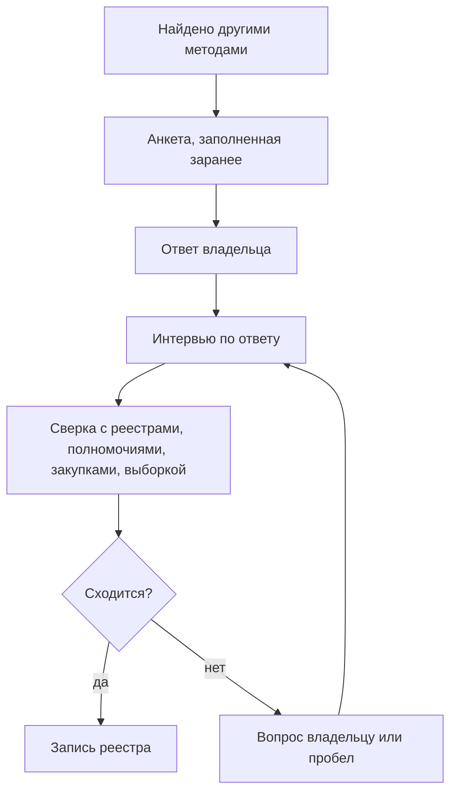

# Опросные листы и интервью

Опрос владельцев находит то, чего нет в документах: рабочие таблицы, журналы, выгрузки, справочники, данные у подрядчиков и купленные наборы. Только владелец знает, что ведётся вне систем и какими данными подразделение пользуется на самом деле. Но анкета показывает только то, что владелец считает данными, вспомнил и захотел назвать. Поэтому её не рассылают пустой: в анкету заранее вписывают найденное по полномочиям, реестрам систем, госзакупкам и сайтам, а владелец подтверждает, исправляет и дополняет строки. Вопросы повторяют поля реестра. После анкеты проводят короткое интервью по заполненному листу, а ответы сверяют с другими методами. Это главный метод подхода «чем владеем»; в [порядке, который работает](../02-approaches/02-methods.md#порядок-который-работает), его проводят после полномочий, реестров систем и поиска. В подходе «где найти нужное» анкета не работает: чужому владельцу отправляют короткий запрос о конкретных данных, а остальное спрашивают у экспертов.

## Коротко

| Что сделать | Что получается | Готово, когда |
|-------------|----------------|---------------|
| **[Выбрать адресатов](#кому-отправлять)** | Лист «Адресаты»: подразделения, роли, сотрудники | В каждом подразделении в границах есть адресат по имени, общих адресов нет |
| **[Заполнить анкету заранее](#заполнить-заранее)** | Строки с системами и наборами, найденными другими методами | У каждой строки записано, откуда она |
| **[Составить вопросы](#что-спрашивать)** | Анкета-таблица по полям реестра и вопросы о том, что ведут вне систем | Каждый вопрос ложится в колонку реестра, в список адресатов или в список того, чего не хватает |
| **[Разослать и провести интервью](#как-проводить)** | Ответы и исправленные после интервью строки | Ответили все адресаты или отказ записан; по новым и вычеркнутым строкам прошли интервью |
| **[Проверить ответы](#как-проверять-ответы)** | Подтверждённые строки и список расхождений | У каждого расхождения — решение или вопрос владельцу |
| **[Перенести в реестр](#как-записать)** | Записи реестра с отметкой об опросе и датой; охват опроса в паспорте | У каждой строки анкеты есть итог |

## Когда применять

| Ситуация | Что делать |
|----------|------------|
| **Опись своих данных** («чем владеем») | Анкета каждому подразделению в границах и интервью — главный метод: без него реестр видит только то, что записано в документах |
| **Поиск под задачу внутри организации** | Анкета с вопросами о том, каких данных не хватает и кто их ведёт: ответы ведут к соседним подразделениям |
| **Чужие данные** («где найти нужное») | Не анкета, а короткий [запрос владельцу](#вопрос-чужому-владельцу) о конкретном наборе и разговор с [экспертами](../02-approaches/02-methods.md#6-опросы-экспертов) |
| **Обновление реестра** | Владелец получает выгрузку своих записей и отмечает, что изменилось ([«Поддержка»](./08-result-and-upkeep.md#поддержка)) |

Опрос не проводят первым. Пустая анкета собирает то, что владелец вспомнил. Анкета, заполненная найденным, проверяет найденное и добирает остальное ([«Опросы владельцев»](../02-approaches/02-methods.md#5-опросы-владельцев)). Карты атласа составлены без опросов владельцев: данные на них чужие, и источники нашли по реестру систем, сайтам и с помощью экспертов ([«Как записать, откуда известно»](../02-approaches/02-methods.md#как-записать-откуда-известно)).

## Кому отправлять

Анкету отправляют тем, кто работает с данными: подразделению, чья это функция, и тем, кто ведёт систему. Пресс-служба и канцелярия данных не знают. Общий адрес приёмной в ответе значит, что ответственного нет ([«Ответственный — пресс-служба»](../09-practices/02-anti-patterns.md#ответственный--пресс-служба)).

Один адресат знает не всё, поэтому спрашивают людей в разных ролях:

| Кто | Что знает | Чего обычно не знает |
|-----|-----------|----------------------|
| **Профильное подразделение** — руководитель и сотрудник, который ведёт учёт | Что собирают и зачем, кому передают, какие таблицы и журналы ведут вне систем | В какой базе и в каком виде лежат данные |
| **ИТ-подразделение или оператор системы** | Системы, базы, выгрузки, интеграции, схемы | Зачем собирают данные и кто решает о доступе |
| **Аналитики и те, кто готовит отчёты** | Какими данными пользуются на самом деле, откуда берут цифры, чего не хватает | Откуда данные пришли в систему |
| **Ответственный за защиту персональных данных** | Где лежат сведения о людях, на каком основании их обрабатывают, сколько хранят | Наборы без персональных данных |
| **Архив и делопроизводство** | Журналы, реестры и книги учёта по номенклатуре дел, сроки хранения | Что из этого ведут в системах |
| **Контрактная служба** | Договоры с подрядчиками, соглашения об обмене данными, купленные наборы и подписки | Что в этих данных |
| **Подведомственные организации** | Свои системы и то, что они ведут за орган власти | Как данные используют в самом органе |

- **Адресат — человек, а не подразделение.** В каждом подразделении назначают одного ответственного за анкету: он собирает ответы коллег и приходит на интервью. Так предлагает руководство GovEx для городов: связные (liaisons) в каждом департаменте описывают его данные, а координатор сводит описания в инвентарь города ([«Зарубежные методики»](../05-frameworks/04-international-practice.md#govex-data-inventory)).
- **Лист — подразделению, а не организации.** Одну анкету на всё ведомство заполнит ИТ или канцелярия, и таблицы профильных подразделений в ответ не попадут.
- **Подведомственным — отдельный лист** через орган власти: орган ставит учреждению задачу, учреждение ведёт данные ([«Кто отвечает за тему»](./03-owners-and-mandates.md#кто-отвечает-за-тему)).
- **Подрядчиков спрашивают через владельца.** У подрядчика остаются выгрузки и копии, но решает о них владелец.
- **Список адресатов растёт по ходу.** На интервью спрашивают, кто ещё работает с этими данными. Руководство Data Asset Framework (DAF) называет такой отбор «снежным комом»: сначала разговор с руководителями групп, потом с теми, на кого они укажут.

## Заполнить заранее

В анкету вписывают то, что уже нашли:

| Откуда | Что вписать |
|--------|-------------|
| **Полномочия** с итогом «не найдено» или «найдено частично» ([«От полномочия к набору»](./03-owners-and-mandates.md#от-полномочия-к-набору)) | Ожидаемый набор и вопрос, где он ведётся |
| **Реестр систем, акты о системах, контракты** ([«Государственные данные»](../04-sources/02-government.md#реестры-информационных-систем)) | Системы подразделения и их ресурсы |
| **Сайты и порталы открытых данных** | Опубликованные наборы — со ссылками и датами |
| **Номенклатура дел и графики хранения документов** | Журналы, реестры и книги учёта, которые подразделение обязано вести, — в том числе вне систем. В США графики хранения федеральных ведомств (records schedules) собраны на сайте Национального архива (NARA) |
| **Реестр операций обработки персональных данных** | Где лежат сведения о людях и на каком основании |
| **Прошлая инвентаризация** | Записи реестра этого подразделения |

Владелец отмечает каждую строку:

| Отметка | Что значит | Что дальше |
|---------|------------|------------|
| **Подтверждаю** | Строка верна | В реестр с отметкой «подтверждено владельцем» |
| **Исправляю** | Строка верна с поправками | Исправить; если поправка расходится с документом — обсудить на интервью |
| **Новое** | Строку добавил владелец | Проверить выборкой, документом или на экране |
| **Не наше** | Набор ведёт другое подразделение или организация | Записать, у кого, и добавить адресата |
| **Не ведём** | Набор не ведут или перестали вести | Выяснить, когда и куда делись данные |
| **Не хватает** | Данные нужны подразделению, но их нет | В список для подхода «где найти нужное» |

- **Отметка обязательна.** Строка без отметки — не ответ. Иначе вписанное заранее принимают молча, и анкета подтверждает догадки составителя.
- **У каждой строки — откуда она:** статья акта, номер контракта, адрес страницы. Владелец видит, почему строку вписали, и спорит с документом, а не с составителем.
- **Строка-пример показывает подробность:** одна строка — один набор, а не вся система и не каждый файл.
- **Вычеркнутая строка — находка.** Система выведена из эксплуатации, набор передали другому подразделению, полномочие не исполняют — это записывают, а не стирают ([«Как отметить в реестре»](../04-sources/06-legacy.md#как-отметить-в-реестре)).

Заполнить анкету помогают языковые модели: они выписывают полномочия из положений и системы из контрактов, а владельцу остаётся подтвердить ([«Что получается»](../02-approaches/03-ai.md#что-получается)). Строки, которые составила модель, помечают так же, как в реестре.

## Что спрашивать

Анкета — таблица: строка — набор, колонки — вопросы. Вопросы повторяют [поля реестра](./05-registry.md#минимальный-состав), чтобы ответ переносился в реестр без переписывания.

| № | Вопрос | Колонка анкеты | Куда в реестре |
|--:|--------|----------------|----------------|
| 1 | В какой системе ведётся набор? Если вне систем — где: таблица, документ, почта, бумага | `system`, `storage` | Информационная система |
| 2 | Как называется набор и что в нём: люди, организации, объекты, события; за какой период и территорию | `dataset`, `description` | Наименование, описание |
| 3 | Кто ведёт набор и может ответить на вопросы о нём — ФИО, должность, контакты | `owner_person`, `owner_contacts` | Ответственный, контакты |
| 4 | Как часто обновляются данные | `update_frequency` | Периодичность обновления |
| 5 | Откуда поступают данные: вносите сами, получаете от других организаций, покупаете | `received_from` | Описание; у копии — первоисточник ([«У копии свой владелец»](./03-owners-and-mandates.md#владелец-оператор-ответственный)) |
| 6 | Кому и как данные передаются: другим ведомствам, гражданам, публично; есть ли ссылка | `shared_with` | Ссылка для выгрузки, режим доступа |
| 7 | Есть ли в наборе сведения о людях | `personal_data` | Режим доступа и основание |
| 8 | Есть ли другие ограничения доступа — тайна, договор? На каком основании | `access_restrictions`, `restriction_basis` | Режим доступа и основание ([«Доступ и ограничения»](./06-access.md)) |
| 9 | Есть ли описание структуры — схема, справочник полей | `schema_available` | Схема данных |

И три вопроса о том, чего в таблице нет:

10. **Какие таблицы, журналы и списки вы ведёте вне систем?** Каждый ответ — новая строка с отметкой «новое».
11. **Каких данных вам не хватает для работы?** Каждый ответ — строка с отметкой «не хватает». Этот вопрос превращает опрос в источник для подхода «где найти нужное».
12. **Кто ещё работает с этими данными?** Ответ пополняет список адресатов.

### Как спросить

- **Не спрашивать «какие у вас данные».** Для сотрудника своя таблица или журнал — работа, а не данные. Спрашивают о работе и местах хранения: какой отчёт вы готовите каждый месяц и из чего, какие списки и журналы ведёте, что лежит на общем диске, в почте, в шкафу. Анкета Саутгемптонского университета — один из образцов в руководстве DAF — прямо перечисляет места: свои папки, общий сетевой диск, компьютер или ноутбук, переносные носители, бумага.
- **Простыми словами, без терминов.** Британский регулятор ICO советует так составлять анкету для описи персональных данных и даёт образцы вопросов: зачем вы используете сведения о людях, о ком они, что именно о них известно, с кем вы ими делитесь, сколько их храните, как защищаете.
- **Значения из списка** — для периодичности, персональных данных и схемы, с вариантом «не знаю». «Не знаю» — тоже ответ: он показывает, кого спросить дальше.
- **Коротко.** Девять колонок и три вопроса заполняют за один раз. Анкета Саутгемптонского университета — не больше 25 вопросов и 10 минут. Ответить просили и тех, у кого данных нет, — им оставалось два вопроса. Ответ «данных не ведём» тоже записывают: без него пустое подразделение не отличить от неопрошенного.
- **Пояснение на одну страницу:** зачем инвентаризация, кто её поручил, к какой дате ответить, кому задать вопрос, кто увидит ответы и что попадёт в общедоступную часть реестра.

## Как проводить

- **От имени владельца задачи.** Письмо подписывает тот, кто поставил задачу: на письмо руководителя отвечают быстрее, чем на письмо проектной команды. В пилотных проектах DAF отклик на анкеты бывал низким — люди устают от опросов, — и помогали поддержка руководства и местные помощники: сотрудники, которых коллеги знают.
- **Сначала объяснить.** До рассылки — короткая встреча с ответственными: зачем опрос, как заполнять, разбор строки-примера. GovEx называет обучение первым шагом к хорошей инвентаризации.
- **Сначала одна очередь.** Анкету проверяют на одном-двух подразделениях и только потом рассылают всем: ошибку в вопросах дешевле найти на одном подразделении, чем на всех ([«Если тема большая»](./01-steps.md#если-тема-большая)).
- **Срок — дата, а не «до конца квартала».** Напоминание отправляют до срока. О тех, кто не ответил к сроку, узнаёт владелец задачи. Опрос, растянутый на месяцы, теряет смысл: пока приходят последние ответы, первые устаревают.
- **Не в отпуска и не в отчётные недели.** В пилотных проектах DAF участие падало в отпуска и в периоды большой нагрузки.
- **Интервью назначают при рассылке.** Иначе между анкетой и разговором проходит много времени — об этом тоже предупреждает руководство DAF.

### Интервью

Интервью — не второй лист, а разговор по первому. Пятнадцать–тридцать минут по заполненной анкете находят больше, чем повторная рассылка.

- **Идти по строкам:** новые, вычеркнутые, исправленные, с ответом «не знаю» и пустыми ячейками. Новые строки — главная находка опроса, их обсуждают первыми.
- **Просить показать.** Открыть систему, общий диск, таблицу, из которой собирают отчёт. В пилотах DAF интервьюер вместе с сотрудником просматривал его личные и общие папки и так находил наборы, которые тот сам бы не назвал.
- **Спрашивать о работе:** что подразделение отправляет каждый месяц и кому, что получает, по каким таблицам отвечает на запросы руководства.
- **Вдвоём.** Один спрашивает, другой сразу вписывает ответы в анкету. Так советует DAF: интервью отнимают много времени, а записывать на ходу в одиночку трудно.
- **Своими силами.** Руководство DAF советует поручать опрос своему сотруднику: у него есть доступ к данным, он понимает предмет и знает людей. Внешний подрядчик ведёт интервью вместе с ним.
- **Запись разговора — только с согласия.** Расшифровку и разбор по полям реестра можно поручить языковой модели. Но запись интервью — служебная информация, иногда с персональными данными, и внешнему сервису её не отдают без решения владельца ([«Закрытые данные и внешние модели»](../02-approaches/03-ai.md#закрытые-данные-и-внешние-модели)).
- **Итог — на подтверждение.** После интервью ответственный получает исправленные строки и подтверждает их письменно: такой ответ — основание для записи реестра.

## Вопрос чужому владельцу

Чужой владелец не обязан заполнять анкету, а опись его данных в границы не входит. Ему пишут коротко и о конкретном: какой набор нужен, за какой период и территорию, есть ли он, в каком виде и на каких условиях его можно получить. Три–пять вопросов в одном письме: владельцу проще ответить, а составителю — превратить ответ в запись.

Государственным владельцам пишут по законам о доступе к информации. Они дают право на ответ и срок, а ответ становится основанием режима доступа: «данных нет», «выдаём по соглашению», «закрыто по такой-то норме» ([«Порядок проверки»](./06-access.md#порядок-проверки)).

| Где | Закон | Срок ответа |
|-----|-------|-------------|
| **Казахстан** | Закон «О доступе к информации» от 16.11.2015 № 401-V, статья 11 | 15 календарных дней со дня поступления запроса. Если нужны сведения других обладателей информации, срок однократно продлевают не более чем на 15 календарных дней |
| **Россия** | Федеральный закон от 09.02.2009 № 8-ФЗ «Об обеспечении доступа к информации о деятельности государственных органов и органов местного самоуправления», статья 18 | 30 дней со дня регистрации запроса. Отсрочка — не более чем на 15 дней, о ней сообщают в течение семи дней |
| **США** | Закон о свободе информации (Freedom of Information Act, FOIA), 5 U.S.C. § 552 | Решение — в течение 20 рабочих дней; в необычных обстоятельствах — ещё до 10 рабочих дней |
| **Европейский союз** | Регламент (ЕС) № 1049/2001 о доступе к документам Европейского парламента, Совета и Комиссии, статья 7 | 15 рабочих дней со дня регистрации; в исключительных случаях — ещё 15 |
| **Великобритания** | Закон о свободе информации (Freedom of Information Act 2000), статья 10 | 20 рабочих дней со дня получения запроса. На запрос о повторном использовании информации — тоже 20 рабочих дней; для объёмных и сложных запросов срок продлевают, сообщив об этом в те же 20 дней (Re-use of Public Sector Information Regulations 2015, пункт 8) |
| **Франция** | Кодекс отношений между публикой и администрацией (CRPA), статьи R*311-12 и R311-13 | Молчание в течение месяца со дня получения запроса означает отказ. Отказ обжалуют в Комиссии по доступу к административным документам (CADA) в течение двух месяцев; комиссия даёт заключение за месяц. Без обращения в CADA в суд идти нельзя |
| **Польша** | Закон о доступе к публичной информации (ustawa o dostępie do informacji publicznej) от 6 сентября 2001 года, статья 13 | 14 дней со дня подачи заявления. Если не успевают, сообщают причину и новый срок — не позже двух месяцев со дня подачи. На заявление о повторном использовании — те же сроки (статья 40 закона об открытых данных 2021 года) |
| **Южная Корея** | Закон о раскрытии информации государственными органами (공공기관의 정보공개에 관한 법률), статья 11 | 10 дней со дня запроса; ещё 10 дней — с письменным уведомлением. Данные, которых нет в перечне публичных данных учреждения, запрашивают по статье 27 закона о публичных данных — с тем же сроком |

- **Закон даёт право на информацию и документы, а не на опись.** Запрос описывает, что нужно. В США запрос по FOIA должен достаточно точно описывать документы (5 U.S.C. § 552(a)(3)(A)). На вопрос «какие у вас есть данные?» обычно отвечают ссылкой на сайт. Но часть законов обязывает вести и публиковать перечни: во Франции — перечень основных документов с публичной информацией (статья L322-6 CRPA), в Польше — сведения о ведущихся реестрах, учётах и архивах и о порядке доступа к ним в Бюллетене публичной информации (статья 6 закона о доступе к публичной информации), в Южной Корее — перечень информации ведомства (статья 8 закона о раскрытии информации), а модельная схема публикации британского закона о свободе информации включает класс «списки и реестры». Такой перечень смотрят до запроса.
- **Сначала ищут чужие запросы.** Запросы и ответы на них публикуют общественные сайты: в Великобритании — WhatDoTheyKnow проекта mySociety, где в декабре 2023 года был подан миллионный запрос, во Франции — Ma Dada ассоциации Open Knowledge France: 25 октября 2026 года на ней было 52 889 запросов. Корейский государственный портал open.go.kr публикует перечни информации ведомств и подлинники документов центральных органов. Ответ на чужой запрос о том же наборе — готовое основание режима доступа, с датой ответа.
- **Ответ записывают с датой.** «Данных нет» от владельца — пробел с основанием. Если ответа нет, в основании записывают дату запроса и «ответа нет», а режим доступа остаётся «не установлено».
- **Компании отвечать не обязаны.** О данных компаний спрашивают ассоциации, регуляторов и экспертов, а о данных, которые компании продают, — как покупатели ([«Коммерческие данные»](../04-sources/04-commercial.md)).

## Как проверять ответы

Ответ владельца — сильное основание, но не доказательство. Каждую строку сверяют хотя бы с одним другим методом: запись, которую подтвердили два независимых метода, надёжна ([«Как методы проверяют друг друга»](../02-approaches/02-methods.md#как-методы-проверяют-друг-друга)).

| В ответе | Что может значить | Что сделать |
|----------|-------------------|-------------|
| Нет системы из реестра систем или контракта | Забыли; систему вывели из эксплуатации; её ведёт подрядчик | Спросить на интервью; проверить последний контракт и [веб-архив](../04-sources/06-legacy.md) |
| «Данных нет», а полномочие есть | Ведут на бумаге или в таблицах; ведёт подведомственное учреждение; полномочие не исполняют | Показать полномочие на интервью; оставить строку «не найдено» |
| Новая строка, документов о ней нет | Рабочая таблица — главная находка опроса — или известный набор под другим именем | Попросить выборку или показать на экране; поискать в реестре по синонимам ([«Один набор под разными именами»](./05-registry.md#один-набор-под-разными-именами)) |
| «Всё открыто» без ссылки | Выдачу по запросу путают с открытыми данными | Проверить по [порядку проверки](./06-access.md#порядок-проверки) |
| «Закрыто» без основания | Осторожность, привычка или решение владельца | Спросить норму; пока ответа нет — «не установлено». Если владелец подтвердил, что нормы нет, — «закрыто» с причиной «решение владельца»: это кандидат на открытие ([«Шкала»](./06-access.md#шкала)) |
| Ответственный — приёмная, пресс-служба или руководитель | Ответственного нет | Спросить, кто работает с данными каждый день |
| Один набор в ответах нескольких подразделений | Копии или один набор под разными именами | Свести по идентификатору, найти первоисточник |
| «Обновляется ежедневно», а последняя запись годичной давности | Заявленное расходится с фактическим | Посмотреть выборку и записать отметку о [качестве](./07-quality.md) |

**Смотрят сами данные** — хотя бы выборку из наборов, нужных для цели: качество часто отличается от заявленного ([«Качество данных»](./07-quality.md)).

**Сверяют с документами организации.** Для описи персональных данных ICO предлагает три шага: анкету, встречи с ключевыми подразделениями и сверку с политиками, регламентами и договорами — чтобы сравнить, как обработка задумана и как идёт на самом деле. Тот же порядок годится для любых данных.

Неразрешённые расхождения не удаляют: они становятся вопросами на интервью или пробелами ([«Сопоставить цели с данными»](./01-steps.md#5-сопоставить-цели-с-данными)). Реестр, собранный только из анкет, содержит только то, что владельцы вспомнили ([«Только опросы владельцев»](../09-practices/02-anti-patterns.md#только-опросы-владельцев)).

## Как записать

Опрос ведут двумя листами рабочей таблицы — рядом с реестром, владельцами и полномочиями ([«Рабочая таблица»](../06-tools/02-mindmaps-and-boards.md#рабочая-таблица)). Шаблоны — [respondents.csv](pathname:///templates/respondents.csv) и [questionnaire.csv](pathname:///templates/questionnaire.csv).

**Лист «Адресаты»** — по строке на адресата:

- **идентификатор** и **владелец** — идентификатор из листа «Владельцы» ([«Как записать»](./03-owners-and-mandates.md#как-записать));
- **подразделение** и **роль** — профильное подразделение, ИТ, аналитика, защита данных, архив, закупки, подведомственная организация;
- **адресат и контакты**;
- **даты:** отправлено, напоминание, ответ, интервью;
- **итог** — ответил, ответил «данных не ведём», отказался, не ответил, переадресовал — и кому;
- **дата проверки**.

**Лист «Анкета»** — по строке на набор:

- **идентификатор** — у строки, вписанной заранее, это идентификатор записи реестра;
- **адресат** — идентификатор из листа «Адресаты»;
- **отметка** — подтверждаю, исправляю, новое, не наше, не ведём, не хватает;
- **откуда строка** — у вписанных заранее: полномочие, контракт, адрес;
- **ответы** на девять вопросов;
- **комментарий** — у кого набор, если «не наше»; когда перестали вести, если «не ведём»;
- **дата ответа**.

В реестр строки переносят по отметке:

- **«подтверждаю» и «исправляю»** — в запись реестра; в поле «откуда известно» к прежнему источнику добавляют «опрос владельца» с адресатом и датой ([«Как записать, откуда известно»](../02-approaches/02-methods.md#как-записать-откуда-известно));
- **«новое»** — в реестр после проверки выборкой, документом или на экране; до проверки — с пометкой «со слов владельца»;
- **«не наше»** — новый адресат в листе «Адресаты»;
- **«не ведём»** — запись помечают, а не удаляют, с датой и преемником ([«Как отметить в реестре»](../04-sources/06-legacy.md#как-отметить-в-реестре));
- **«не хватает»** — в список для подхода «где найти нужное»: это готовые вопросы для следующей задачи ([«Как записать»](./02-goals-and-questions.md#как-записать)).

Охват опроса записывают в паспорт реестра: сколько адресатов ответило, кто отказался, кто не ответил. Без этого через год не отличить «данных нет» от «не спросили».

## Пример

Продолжение условного примера из глав [«Цели и вопросы»](./02-goals-and-questions.md#пример) и [«Владельцы и полномочия»](./03-owners-and-mandates.md#пример): 15 вопросов руководства о доступности медицинской помощи в регионах. Главный вопрос — о сроках ожидания — полномочиями не покрыт: никто не обязан измерять фактические сроки.

**Адресаты.** Отдел статистики и ИТ-отдел подведомственного министерству центра медицинской статистики, органы управления здравоохранением пяти регионов первой очереди — семь анкет. Фонду обязательного медицинского страхования — не анкета, а запрос из трёх вопросов: есть ли в учёте оказанной помощи дата направления и дата госпитализации и с какой подробностью их можно получить. Письма подписал заместитель министра, срок — две недели, интервью назначили при рассылке.

**Анкета.** Центру заранее вписали регистр медицинских работников, ежегодный сборник и отчётные формы, регионам — нормативы сроков ожидания из региональных программ. Вопрос о сроках задали о работе, а не о данных: «Где записывают дату, когда пациента направили на плановую госпитализацию или записали к врачу, и дату, когда помощь оказали?»

**Что ответили и что показала проверка.**

| Адресат | Ответ | Проверка |
|---------|-------|----------|
| Центр медицинской статистики | Регистр и формы подтвердил. Сборник вычеркнул: его выпускает статистическое ведомство, центр только передаёт ему формы. Добавил таблицу выборочного обследования сроков ожидания | Таблица — разовое обследование трёхлетней давности, а не ряд; записали с периодом |
| Три региона | Листы ожидания плановой госпитализации ведут в региональной медицинской системе | Систему уже знали по реестру систем, о листах ожидания в ней — нет. Выборка одного региона: у трети записей нет даты направления |
| Один регион | Журнал ожидания — таблица на общем диске отдела | На интервью таблицу показали на экране: её обновляют раз в месяц |
| Один регион | «Данных нет» | На интервью выяснилось, что система записи к врачу хранит даты записи и приёма: её не считали данными о сроках. Система нашлась в региональном контракте на сопровождение |
| Фонд ОМС | Дата госпитализации в учёте есть, даты направления нет; сводные данные — по запросу | Сроки по данным фонда не посчитать; учёт закрыт — персональные данные |

**Итог.** Ответили все восемь адресатов, один регион — после напоминания от заместителя министра. Из восьми строк, вписанных заранее, семь подтвердили, одну вычеркнули. Новых строк — шесть: две таблицы вне систем, листы ожидания в известной системе у трёх регионов и система записи к врачу, о которой не знали. Регион, который ответил «данных нет», дал одну из главных находок. Главный вопрос закрыт частично: даты, по которым можно посчитать фактические сроки, записывают во всех пяти регионах, но в трёх разных видах, и сравнить регионы по ним пока нельзя. Это пробел для шестого шага ([«Спроектировать обновление от задач»](./01-steps.md#6-спроектировать-обновление-от-задач)). На вопрос «каких данных не хватает» три региона назвали сведения о пациентах, которые лечатся в других регионах, — вопрос записали для следующей очереди. Пример показывает ход работы, а не то, как устроено здравоохранение в конкретной стране.

## Частые ошибки

| Ошибка | Что происходит | Как исправить |
|--------|----------------|---------------|
| **Пустая анкета** | Владелец перечисляет, что вспомнил; найденное другими методами никто не подтвердил | [Заполнить анкету заранее](#заполнить-заранее), у каждой строки — откуда она |
| **Одна анкета на организацию** | Отвечает ИТ или канцелярия; таблицы профильных подразделений в ответ не попадают | Лист подразделению, адресат по имени |
| **Вопрос «какие у вас данные?»** | Называют только системы | Спрашивать о работе, отчётах и местах хранения |
| **Свободный текст** | Ответы не сопоставить, в реестр их переписывают заново | Таблица со строкой-примером и значениями из списка |
| **Анкета без интервью** | Вычеркнутые строки и «не знаю» остаются без объяснений | Пятнадцать–тридцать минут по заполненному листу |
| **Ответ как факт** | В реестре набор со слов владельца, которого никто не видел | Итог — после проверки вторым методом или выборкой |
| **Охват не записан** | «Данных нет» не отличить от «не ответили» | Лист «Адресаты» и строка в паспорте |
| **Опрос растянулся** | К последним ответам первые устарели | Дата ответа, напоминание, очереди |

## Ограничения

- Опрос видит то, что владелец считает данными, вспомнил и захотел назвать. Даже при хороших вопросах рабочие таблицы и выгрузки подрядчика называют не всегда.
- Ответ зависит от того, чего владелец ждёт от опроса: если боится, что данные заберут или откроют, он называет меньше.
- Знание держится на людях. Сотрудник уходит — и знание о его таблицах уходит вместе с ним: в пилотах DAF данные терялись или оставались без дела, когда их не передавали при уходе сотрудника. Поэтому у записи ответственный и дата, а при обновлении опрос повторяют.
- Опрос дорог: интервью трудно назначить, они отнимают время у владельцев и составителей, а ответы приходится сверять.
- Для чужих данных опрос не работает. Закон о доступе к информации даёт право спросить о конкретном наборе, но не обязывает владельца описывать всё, что у него есть.

## Источники

- Главы [«Семь методов»](../02-approaches/02-methods.md#5-опросы-владельцев) — опросы владельцев и экспертов среди других методов; [«Владельцы и полномочия»](./03-owners-and-mandates.md) — что вписать в анкету заранее; [«ИИ в инвентаризации»](../02-approaches/03-ai.md) — как модель заполняет анкету и разбирает записи интервью; [«Доступ и ограничения»](./06-access.md#порядок-проверки) — запрос владельцу в порядке проверки доступа.
- Шаблоны анкеты и листа адресатов — в приложении [«Шаблоны»](../10-appendices/03-templates.md#опросный-лист-для-владельцев).
- [GovEx Data Inventory](https://labs.centerforgov.org/data-governance/data-inventory/) — Johns Hopkins Center for Government Excellence: связные в департаментах и координатор, обучение как первый шаг, инвентаризация с одного департамента. Проверено 25 октября 2026 года.
- [How do we document our processing activities?](https://ico.org.uk/for-organisations/uk-gdpr-guidance-and-resources/accountability-and-governance/documentation/how-do-we-document-our-processing-activities/) — Information Commissioner's Office (Великобритания): анкета простыми словами с образцами вопросов, встречи с ключевыми подразделениями, сверка с политиками и договорами. Проверено 25 октября 2026 года.
- [Data Asset Framework: Implementation Guide](https://www.data-audit.eu/docs/DAF_Implementation_Guide.pdf) — Digital Curation Centre, октябрь 2009 года: сочетание анкет и интервью, низкий отклик на анкеты, «снежный ком», два интервьюера, просмотр личных и общих папок, участие в отпуска и при большой нагрузке; образцы анкет и интервью, в том числе анкета Саутгемптонского университета (не больше 25 вопросов и 10 минут). Описание методики — на [сайте DCC](https://www.dcc.ac.uk/node/10357).
- [Records Control Schedules](https://www.archives.gov/records-mgmt/rcs) — National Archives and Records Administration (США): графики хранения документов федеральных ведомств.
- Закон Республики Казахстан от 16.11.2015 № 401-V «О доступе к информации», статья 11, пункт 10, — по тексту [prg.kz](https://prg.kz/Document/?doc_id=39415981) по состоянию на 25.08.2026: adilet.zan.kz из сети проверки не открылся. Проверено 25 октября 2026 года.
- Федеральный закон от 09.02.2009 № 8-ФЗ, [статья 18](https://www.consultant.ru/document/cons_doc_LAW_84602/bc8f145b9b0cf81ba35eefedf48e421cf362e0a5/), часть 6, в редакции от 31.07.2025. Проверено 25 октября 2026 года.
- [5 U.S. Code § 552](https://www.law.cornell.edu/uscode/text/5/552), подразделы (a)(3)(A), (a)(6)(A)(i) и (a)(6)(B)(i). Проверено 25 октября 2026 года.
- [Regulation (EC) No 1049/2001](https://eur-lex.europa.eu/eli/reg/2001/1049/oj) — доступ к документам Европейского парламента, Совета и Комиссии, статья 7.
- Великобритания: [Freedom of Information Act 2000, section 10](https://www.legislation.gov.uk/ukpga/2000/36/section/10); [Re-use of Public Sector Information Regulations 2015, regulation 8](https://www.legislation.gov.uk/uksi/2015/1415/regulation/8); [Model publication scheme](https://ico.org.uk/media2/for-organisations/documents/1153/model-publication-scheme.pdf), версия 1.2 от 23 октября 2015 года, класс «Lists and registers». Проверено 25 октября 2026 года.
- Франция: CRPA, статьи R*311-12, R311-13, R343-1, R343-3 — по [изданию кодекса на codes.droit.org](https://codes.droit.org/PDF/Code%20des%20relations%20entre%20le%20public%20et%20l'administration.pdf) от 24 октября 2026 года, собранному из Légifrance: legifrance.gouv.fr из сети проверки не открылся; [Quand et comment saisir la CADA](https://www.cada.fr/particulier/quand-et-comment-saisir-la-cada). Проверено 25 октября 2026 года.
- Польша: закон о доступе к публичной информации — [единый текст Dz.U. 2022 poz. 902](https://api.sejm.gov.pl/eli/acts/DU/2022/902/text.html), статьи 6, 8 и 13; закон об открытых данных — [единый текст Dz.U. 2023 poz. 1524](https://api.sejm.gov.pl/eli/acts/DU/2023/1524/text.html), статья 40. Тексты — из ELI Сейма: isap.sejm.gov.pl из сети проверки не открылся. Проверено 25 октября 2026 года.
- Южная Корея: [закон о раскрытии информации государственными органами](https://www.law.go.kr/법령/공공기관의정보공개에관한법률), статьи 8 и 11, в редакции закона № 19408 от 16.05.2023; [закон о публичных данных](https://www.law.go.kr/법령/공공데이터의제공및이용활성화에관한법률), статья 27. Проверено 25 октября 2026 года.
- Архивы запросов: [WhatDoTheyKnow](https://www.whatdotheyknow.com/) — mySociety, [миллионный запрос](https://www.mysociety.org/2023/12/04/a-million-public-requests-on-whatdotheyknow/) — 4 декабря 2023 года; сайт из сети проверки ответил 403; [Ma Dada](https://madada.fr/) — Open Knowledge France, число запросов на 25 октября 2026 года; [open.go.kr](https://www.open.go.kr/) — портал раскрытия информации Республики Корея.
