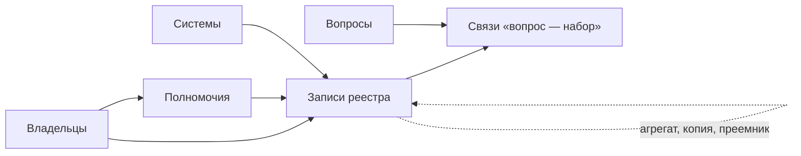

# Реестр данных

Реестр данных — главный результат инвентаризации: по записи на каждый набор, с владельцем, основанием, доступом и датой. Минимальный состав записи — 14 атрибутов. Они отвечают на четыре вопроса: что это за набор, чей он и кому писать, можно ли его получить и на каких условиях, насколько он свежий и годный. Расширенный состав связывает запись с системой, полномочием, нормативным актом, схемой и другими записями; его берут под цель, а не целиком. Сведения берут из документов и самих данных, а не со слов и не по домену. Если сведение найти не удалось, пишут «не установлено» и где искать дальше: честный пропуск полезнее догадки. Реестр заводят таблицей или файлом данных в первый день и заполняют при каждой находке, а не собирают в конце из отчётов ([«Реестр как данные»](../06-tools/03-registry-as-data.md)). В подходе «чем владеем» реестр — сам результат, в подходе «где найти нужное» — подробное описание ключевых источников карты.

## Коротко

| Что сделать | Что получается | Готово, когда |
|-------------|----------------|---------------|
| **[Решить, что считать записью](#что-считать-записью)** | Правило: запись — набор; система, сайт и группа — отдельными типами | Понятно, когда находка — одна запись, когда две и когда группа |
| **[Утвердить состав](#расширенный-состав)** | 14 атрибутов и те расширенные, что нужны цели | У каждого расширенного атрибута есть цель или вопрос, ради которого его заполняют |
| **[Завести справочники значений](#справочники-значений)** | Списки для режима доступа, периодичности, типа записи, владельцев | В полях, по которым считают и фильтруют, нет свободного текста |
| **[Заполнять при каждой находке](#как-заполнять)** | Запись с основанием, тем, откуда известно, и датой проверки | В 14 атрибутах нет пустых ячеек: значение, «нет» или «не установлено» |
| **[Искать дубли перед добавлением](#один-набор-под-разными-именами)** | Один набор — одна запись с синонимами | Поиск по синонимам, адресу и владельцу ничего не нашёл |
| **[Выровнять подробность](#одинаковая-подробность)** | Записи одного уровня, у групп — состав | Нет групп, которые пересекаются, и записей, которые дублируют часть группы |

## Что считать записью

Запись реестра — **набор данных**: то, что можно описать и передать целиком ([«Что инвентаризируют»](../01-basics/04-what-is-inventoried.md)). Система, ресурс и сайт — не записи о данных, а то, где набор лежит и где его показывают; они попадают в запись атрибутами. Правило для спорных случаев: если у частей разный владелец, режим доступа, периодичность или условия использования, это разные записи; если всё совпадает — одна запись, а части перечисляют в описании или схеме.

| Что нашли | Сколько записей | Почему |
|-----------|-----------------|--------|
| **Система с несколькими реестрами** | По записи на каждый набор; система — в атрибуте «Информационная система» | У наборов одной системы разные режимы доступа и периодичность |
| **Один набор в нескольких системах** | Одна запись, системы перечислены. Если копии расходятся — запись на каждую со ссылкой на эталонную | Иначе реестр покажет несколько наборов там, где есть один |
| **Полный набор и его сводные показатели** | Две записи, связанные между собой | Записи о людях закрыты, агрегаты открыты ([«Юридические ограничения»](./06-access.md#юридические-ограничения)) |
| **Первоисточник и копия на другом сайте** | Две записи; у копии свой владелец и ссылка на первоисточник | Копия отстаёт или закрывается, искать придётся у первоисточника ([«Владелец, оператор, ответственный»](./03-owners-and-mandates.md#владелец-оператор-ответственный), [«Общественные данные»](../04-sources/03-public.md#первоисточник)) |
| **Ежегодные выпуски одного ряда** | Одна запись, выпуски — в истории изменений | Это один набор, который обновляется |
| **Сайт, за которым не нашли систему** | Запись типа «сайт» с пометкой, что это временная замена | Сайт — витрина, а не источник ([«Система, ресурс, набор и сайт»](../01-basics/04-what-is-inventoried.md#система-ресурс-набор-и-сайт)) |
| **Много однотипных источников** | Одна запись типа «группа» с составом | Поштучно их не перечислить ([«Одинаковая подробность»](#одинаковая-подробность)) |

Тип записи — набор, ресурс, система, сайт или группа — пишут отдельным полем: по нему видно, сколько в реестре уже наборов, а сколько только адресов. В атласе этой книги из 159 источников 131 — сайты, 6 — ресурсы, 22 — группы, систем и наборов нет ни одного. Атлас — карта, а не реестр: за его сайтами ещё предстоит найти системы и наборы ([«Карта и реестр»](../02-approaches/04-data-maps.md#карта-и-реестр)).

## Минимальный состав

| № | Атрибут | Что писать | Откуда взять |
|--:|---------|------------|--------------|
| 1 | **Уникальный идентификатор** | Короткий код латиницей, который не меняется при переименовании, переезде и смене владельца | Присваивает составитель реестра |
| 2 | **Наименование** | Официальное название набора или ресурса | Акт о системе или реестре, страница набора |
| 3 | **Описание** | Что описывает одна строка набора, за какой период и территорию, записи это или сводные показатели, чего в наборе нет | Акт о системе, страница набора, описание полей, сама выгрузка |
| 4 | **Ответственный** | ФИО сотрудника, который отвечает за данные и может ответить на вопросы о них, — из профильного подразделения или ИТ, не пресс-служба. Если за содержание и за систему отвечают разные люди, записывают обоих | Анкета, страница набора, ответ владельца |
| 5 | **Контакты ответственного** | Рабочая почта и телефон ответственного, а не общий адрес приёмной | Там же |
| 6 | **Периодичность обновления** | Значение из справочника: ежедневно, ежемесячно, ежегодно, не обновляется | Акт о системе, страница набора; проверить по датам в самих данных |
| 7 | **Режим доступа** | Открытые данные, неструктурированные сведения, с ограничениями, закрыто, не установлено — с основанием и датой ([«Доступ и ограничения»](./06-access.md#шкала)) | [Порядок проверки](./06-access.md#порядок-проверки) |
| 8 | **Ссылка для выгрузки** | Прямой адрес файла или программного интерфейса, если набор опубликован | Страница набора, портал открытых данных, описание интерфейса |
| 9 | **Формат распространения** | CSV, JSON, XML, XLSX, PDF, API | Сам файл, а не подпись к нему на странице |
| 10 | **Дата публикации** | Когда набор впервые стал доступен | Страница набора, портал, веб-архив |
| 11 | **Дата последнего изменения** | Когда обновлены сами данные | Страница набора, последняя дата внутри данных |
| 12 | **Отметка о контроле качества** | Проверено ли качество, когда, по каким признакам и с каким результатом ([«Качество данных»](./07-quality.md#как-записать-в-реестр)) | Быстрая проверка выгрузки ([«Что проверять»](./07-quality.md#что-проверять)) |
| 13 | **Условия использования** | Лицензия со ссылкой или условия соглашения; если их нет — «не указаны» | Страница набора, условия использования сайта, соглашение |
| 14 | **Организация-владелец** | Владелец из документа — идентификатор из листа «Владельцы» | Положение об органе, акт о системе ([«Владельцы и полномочия»](./03-owners-and-mandates.md)) |

Атрибуты отвечают на четыре вопроса. Что это за набор — 1–3. Чей он и кому писать — 4, 5 и 14. Можно ли его получить и на каких условиях — 7, 8, 9 и 13. Насколько он свежий и годный — 6, 10, 11 и 12. Запись, в которой на один из вопросов нет ответа даже словами «не установлено», не готова.

## Как заполнять

Большинство ошибок реестра — не в том, каких атрибутов не хватает, а в том, как заполнены те, что есть.

### Идентификатор и наименование

**Идентификатор не меняется вслед за адресом и названием.** На него ссылаются полномочия, вопросы и другие записи; если он меняется, ссылки рвутся. Подойдёт короткий код латиницей с дефисами: `faa-aircraft-registry`. Его можно составить из домена, как в атласе, но после переезда сайта не переписывать. Сайт roszdravnadzor.ru с карты «Здравоохранение» в октябре 2026 года перенаправляет на roszdravnadzor.gov.ru, а идентификатор `roszdravnadzor-ru` остался прежним, и ссылки на него из вопросов карты работают. Новый адрес заменяет старый, а старый уходит в синонимы.

**Наименование — официальное**, из акта о системе или со страницы набора, а не из шапки сайта. Сокращения, прежние названия и адреса записывают синонимами в отдельном поле ([«Один набор под разными именами»](#один-набор-под-разными-именами)).

### Описание

Описание — самый пустой атрибут реестра: его часто пишут пересказом названия. «База данных воздушных судов» ничего не добавляет к названию. Рабочее описание отвечает на пять вопросов:

- **что такое одна строка** — человек, организация, объект, событие, показатель за период;
- **период и территория**;
- **подробность** — первичные записи или сводные показатели;
- **откуда данные** — из заявлений, отчётности, датчиков, других систем;
- **чего в наборе нет** — что исключено, скрыто или не собирается.

Без описания запись через несколько лет не восстановить. На карте «Здравоохранение» пять ресурсов Росздравнадзора записаны только фрагментами адреса на сайте roszdravnadzor.ru: `micode_price`, `mi_prices`, `clinic`, `Turnover`, `lssearch`. В октябре 2026 года сайт перенаправляет на главную страницу roszdravnadzor.gov.ru, и что лежало за этими адресами, по записям уже не понять: остались идентификаторы и вопросы о медицинских изделиях и лекарственных средствах, к которым они привязаны. Черновик описания по схеме и нескольким строкам данных хорошо пишет языковая модель — период, территорию и ограничения она из таблицы не узнает ([«Описания наборов»](../02-approaches/03-ai.md#описания-наборов)).

### Ответственный и контакты

Ответственный — человек, который ответит на вопрос о данных: что значит поле, почему пропуски, когда следующее обновление. Это не приёмная, не пресс-служба и не адрес для сообщений о сбоях сайта ([«Ответственный — пресс-служба»](../09-practices/02-anti-patterns.md#ответственный--пресс-служба)). У чужих данных имя сотрудника часто не узнать: тогда записывают подразделение, которое ведёт набор, и помечают, что сотрудник не установлен. Это лучше, чем общий адрес ведомства, но это пропуск, а не ответ.

### Периодичность и даты

**Периодичность записывают заявленную и проверяют по данным.** Если по положению набор обновляется ежемесячно, а последние даты внутри данных идут раз в квартал, записывают обе: расхождение — уже находка о качестве ([«Типичные находки»](./07-quality.md#типичные-находки)).

**Дата изменения данных — не дата страницы.** Страница выгрузки FAA в примере ниже обновлялась 13 мая 2025 года, а данные в архиве — от 23 октября 2026 года. Дату изменения берут из самих данных или из файла, а не из подвала сайта.

**Дату публикации подсказывает веб-архив.** Если на портале её нет, первая копия страницы набора в Internet Archive даёт границу: набор опубликован не позже этой даты ([«Веб-архив за минуту»](../04-sources/06-legacy.md#веб-архив-за-минуту)).

**Даты — в одном формате**: ГГГГ-ММ-ДД или ГГГГ-ММ, если день неизвестен. Тогда реестр можно сортировать и проверять программой.

### Режим доступа, ссылка и формат

**Режим доступа — с основанием и датой**, по шкале из главы [«Доступ и ограничения»](./06-access.md#шкала). Статус ставят набору, а не системе.

**Ссылка для выгрузки — прямой адрес файла или интерфейса.** Страница, на которой набор описан, — не выгрузка: DCAT различает адрес для скачивания (`dcat:downloadURL`) и адрес доступа — страницу или сервис (`dcat:accessURL`). Если данные можно посмотреть только поиском по одной записи, в ссылке пишут «нет — только поиск по одной записи», адрес страницы — в описании, а режим доступа — «неструктурированные сведения».

**Формат — тот, что в файле.** Подпись «CSV» на странице не гарантирует CSV в архиве; у таблицы «для печати» в XLSX формат — XLSX, а то, что она «для печати», записывают в отметку о качестве.

### Условия использования и владелец

**«Не указаны» — не значит «свободно».** Если на странице нет лицензии, это записывают как есть и уточняют у владельца. Бывает, что условия следуют из закона: произведения федерального правительства США не охраняются авторским правом (17 U.S.C. § 105). Тогда пишут и то, что на странице условий нет, и норму.

**Владельца берут из документа, а не по домену**, и записывают идентификатором из листа «Владельцы» — так при реорганизации его правят в одном месте ([«Владелец, оператор, ответственный»](./03-owners-and-mandates.md#владелец-оператор-ответственный)).

## Расширенный состав

Расширенные атрибуты связывают запись с остальной инвентаризацией и описывают набор глубже. Их берут под цель: каждая лишняя колонка — это работа при каждом обновлении.

**Связи:**

- **Информационная система** и её **оператор** — где ведётся набор и кто систему эксплуатирует ([«Владелец, оператор, ответственный»](./03-owners-and-mandates.md#владелец-оператор-ответственный)). Если в стране есть учёт систем, записывают и номер системы в нём: в Казахстане — на архитектурном портале цифровых объектов государства (статья 71 Цифрового кодекса), в России — в системе координации информатизации ([«Казахстан»](../07-countries/01-kazakhstan.md#где-учитывают-системы), [«Россия»](../07-countries/02-russia.md#реестры-и-платформы)).
- **Полномочие** — функция владельца, ради которой собираются данные: идентификатор строки из листа «Полномочия» ([«Как записать»](./03-owners-and-mandates.md#как-записать)).
- **Нормативный акт** — закон, постановление, приказ, с номером, датой и редакцией.
- **Связанные записи** — полный набор у агрегата, первоисточник у копии, преемник у выведенной из эксплуатации системы.

**Содержание:**

- **Схема и структура данных** — поля, типы, справочники; ссылка на описание полей, если оно опубликовано.
- **Персональные и другие чувствительные данные** — есть, нет, не установлено. В подходе «чем владеем» такие наборы находят первыми ([«Чем владеем»](../02-approaches/01-two-approaches.md#чем-владеем)).
- **Период, территория, темы и ключевые слова** — отдельными полями, если по ним ищут и фильтруют; иначе хватает описания.

**Ведение:**

- **Синонимы** — другие названия и прежние адреса.
- **Тип записи** — набор, ресурс, система, сайт, группа.
- **Статус записи** — действует, выведена из эксплуатации, адрес не работает ([«Как отметить в реестре»](../04-sources/06-legacy.md#как-отметить-в-реестре)).
- **История изменений** — версии набора и смены структуры.
- **Уровень обслуживания** — обязательства по доступности и качеству.
- **Дата проверки записи** и **откуда известно о наборе** — для того, кто будет реестр обновлять. Если запись составила языковая модель, здесь же отмечают, какая и когда, и подтверждена ли запись ([«ИИ в инвентаризации»](../02-approaches/03-ai.md#5-записать-откуда-известно)).

Какие из них нужны, зависит от цели и вида результата ([«Виды результата»](./08-result-and-upkeep.md#виды-результата)):

| Цель | Что добавить к 14 атрибутам |
|------|-----------------------------|
| **Открытие данных** | Тип записи, темы и ключевые слова, сопоставление со стандартом описания; у кандидатов на открытие — основание закрытия, если оно есть |
| **Обмен данными** | Схема, система и оператор, нормативный акт, персональные данные, уровень обслуживания |
| **Сокращение дублей и расходов** | Система и оператор, полномочие, связанные записи |
| **Защита персональных данных** | Персональные данные, полномочие и нормативный акт — законное основание обработки, система и оператор |
| **Аналитика, озеро данных, обучение моделей** | Схема, история изменений, период и территория, персональные данные |
| **Карта данных** | Синонимы, тип записи, связи с вопросами — листом «Связи», а не колонкой ([«Рабочая таблица»](../06-tools/02-mindmaps-and-boards.md#рабочая-таблица)) |

Чтобы реестр можно было обменивать с каталогами, атрибуты стоит сопоставить со стандартом описания — DCAT или его европейским профилем DCAT-AP ([«Сопоставление с реестром»](../05-frameworks/02-metadata-standards.md#сопоставление-с-реестром)).

## С чем сверить состав

14 атрибутов — не стандарт, а рабочий минимум инвентаризации. Полезно сравнить его с тем, что требуют каталоги и закон:

| Состав | Что обязательно | Чего не требует из 14 атрибутов | Что требует сверх них |
|--------|-----------------|---------------------------------|-----------------------|
| **DCAT-AP 3.0** — каталоги ЕС | У набора — название и описание; у распространения — адрес доступа | Все, кроме названия и описания: остальные свойства рекомендуемые или необязательные, а у распространения хватает адреса доступа — ссылка для выгрузки необязательна | — |
| **DCAT-US v1.1** — описания федеральных ведомств США | Всегда: идентификатор, название, описание, ключевые слова, дата изменения, публикатор, контакт, режим доступа, коды ведомства и программы | Ссылку и лицензию — «если применимо»; периодичность, дату публикации и качество — необязательно | Ключевые слова, коды ведомства и программы; пояснение `rights`, если набор открыт не полностью |
| **44 U.S.C. § 3511(a)(2)(A)** — полный инвентарь данных ведомства США | Описание с названиями и определениями всех переменных, название, статус раскрытия, способ получить или запросить доступ, дата обновления, ведомства, которые ведут набор, владелец, ограничения использования, местонахождение | Периодичность, формат, дату публикации, качество, контакт | Описание переменных, местонахождение |

Каталожные стандарты требуют минимум, чтобы найти опубликованное. У закона, который требует учесть все данные ведомства, в том числе закрытые, с 14 атрибутами больше общего: владелец, статус доступа, способ получить данные, дата обновления и ограничения использования. Он даже прямо допускает «не установлено»: статус раскрытия можно отметить как ещё не определённый на дату отметки. Отметки о качестве нет ни в одном обязательном составе — её добавляет инвентаризация: без неё набор найден, но неясно, можно ли ему верить.

## Справочники значений

Поля, по которым считают и фильтруют, заполняют значениями из списка. Иначе в одном реестре появятся «открыто», «откр.» и «да», и вопрос «сколько у нас закрытых наборов» станет ручной работой. Коды удобно брать так, чтобы их легко было сопоставить со стандартом:

| Поле | Значения | Как сопоставить со стандартом |
|------|----------|-------------------------------|
| **Режим доступа** | `open`, `unstructured`, `restricted`, `closed`, `unknown` | DCAT-AP: `PUBLIC`, `RESTRICTED`, `NON_PUBLIC`; DCAT-US v1.1: `public`, `restricted public`, `non-public`. У `unknown` соответствия нет: такие записи до публикации проверяют |
| **Периодичность** | `continuous`, `daily`, `weekly`, `monthly`, `quarterly`, `annual`, `irregular`, `never`, `unknown` | DCAT-AP — словарь частот Frequency Бюро публикаций ЕС; DCAT-US v1.1 — повторяющийся период ISO 8601: `R/P1D`, `R/P1M`, `R/P1Y` |
| **Формат** | CSV, JSON, XML, XLSX, PDF, API, ZIP с указанием, что внутри | `dcat:mediaType` — типы MIME: `text/csv`, `application/json` |
| **Тип записи** | `dataset`, `resource`, `system`, `site`, `group` | Те же типы, что у источников атласа ([`data/README.md`](https://github.com/ivbeg/data-inventory/blob/main/data/README.md)) |
| **Статус записи** | `active`, `retired`, `url_broken` | — |
| **Персональные данные** | `yes`, `no`, `unknown` | — |
| **Владелец, полномочие** | Идентификатор из листов «Владельцы» и «Полномочия» | `dct:publisher` — владелец из листа «Владельцы» |

Шкала доступа шире, чем в стандартах: «открытые данные» и «неструктурированные сведения» в DCAT-AP — оба `PUBLIC`. Различать их стоит во внутреннем реестре: от этого зависит, можно ли обработать набор машиной.

## Если сведение не найдено

Пустая ячейка в 14 атрибутах не допускается: по ней не отличить «не нашли» от «не искали» и «не бывает». Вместо неё — одно из трёх:

| Что писать | Когда | Пример |
|------------|-------|--------|
| **Значение** | Сведение найдено | «ежемесячно — по положению о системе» |
| **«Нет»** | Сведения не существует | Ссылки нет — набор не опубликован |
| **«Не установлено»** и где искать дальше | Сведение должно быть, но его не нашли | «не установлено — запрошено у владельца 20.10.2026» |

Если источники расходятся, в запись идёт значение из документа или из данных, а расхождение — в примечание. В кодовых полях вместо слов «не установлено» — код `unknown`.

## Пример записи

Реестр воздушных судов США — набор, который уже встречался в главе [«Владельцы и полномочия»](./03-owners-and-mandates.md#от-полномочия-к-набору): полномочие — 49 U.S.C. § 44103, ресурс — реестр воздушных судов, опубликованная форма — выгрузка всей базы. Так выглядит его запись, собранная со страницы FAA и из самой выгрузки 25 октября 2026 года:

| Атрибут | Значение |
|---------|----------|
| Идентификатор | `faa-aircraft-registry` |
| Наименование | Releasable Aircraft Database — общедоступная часть реестра воздушных судов США |
| Описание | Гражданские воздушные суда, зарегистрированные в США. Одна строка основного файла — одно судно: регистрационный номер (N-number), серийный номер, модель, год выпуска, владелец и его адрес, даты регистрации и лётной годности. Ещё шесть файлов: справочники моделей судов и двигателей, дилеры, снятые с учёта суда, зарезервированные номера, указатель документов. Владельцы частных судов могут попросить не показывать имя и адрес (49 U.S.C. § 44114(b)), поэтому выгрузка — не весь реестр |
| Ответственный | Aircraft Registration Branch (AFS-750) Реестра гражданской авиации FAA — подразделение; сотрудник не установлен |
| Контакты ответственного | справочная реестра: +1 866 762-9434. Адрес почты на странице выгрузки — для сообщений о сбоях сайта, а не для вопросов о данных |
| Периодичность обновления | `daily` — в 23:30 по центральному времени США, по странице выгрузки; в архиве, скачанном в воскресенье 25 октября 2026 года, — файлы от пятницы 23 октября |
| Режим доступа | `open` — вся база одним архивом, без регистрации; основание — страница выгрузки, проверено 25 октября 2026 года |
| Ссылка для выгрузки | [registry.faa.gov/database/ReleasableAircraft.zip](https://registry.faa.gov/database/ReleasableAircraft.zip) |
| Формат распространения | ZIP с семью текстовыми файлами, разделитель — запятая |
| Дата публикации | не установлено; страница выгрузки есть в веб-архиве с 12 августа 2005 года — значит, не позже |
| Дата последнего изменения | 2026-10-23 — по датам файлов и последней дате изменения записи в основном файле |
| Отметка о контроле качества | Быстрая проверка 25 октября 2026 года. В основном файле 317 999 записей, регистрационные номера не повторяются, последняя дата изменения записи — 23 октября 2026 года. Год выпуска пуст у 22% записей: FAA предупреждает, что необязательные поля бывают пустыми, но не говорит, какие именно. У 1,2% записей со статусом «действует» нет имени владельца — вопрос к владельцу набора. Значения дополнены пробелами до ширины поля, в конце каждой строки лишняя запятая — перед обработкой их убирают |
| Условия использования | на странице не указаны; произведения федерального правительства США авторским правом не охраняются (17 U.S.C. § 105) |
| Организация-владелец | `faa` — Federal Aviation Administration |
| Схема | описание полей [ardata.pdf](https://registry.faa.gov/database/ardata.pdf), редакция от 8 мая 2025 года |
| Полномочие | `faa-aircraft-registration` — регистрация воздушных судов, 49 U.S.C. § 44103 |
| История изменений | с 30 июля 2024 года в указателе документов есть поле с типом документа |
| Откуда известно | анализ полномочий; страница Releasable Aircraft Database Download |
| Дата проверки | 2026-10-25 |

Даже у хорошо описанного открытого набора два сведения не установлены — сотрудник и дата публикации, — а быстрая проверка дала вопрос владельцу. Это нормальная запись: видно, что известно, откуда и что спросить.

## Один набор под разными именами

Один и тот же набор встречается под разными именами: полное название, сокращение, прежнее название, адрес сайта, название раздела на портале. Если записать его трижды, реестр покажет три набора там, где есть один, а при обновлении поправят одну строку из трёх ([«Один набор под разными именами»](../09-practices/02-anti-patterns.md#один-набор-под-разными-именами)). Чаще всего дубли появляются, когда методы находят одно и то же: полномочие — как реестр, поиск — как набор на портале, опрос — как «нашу базу».

Чтобы этого не случилось:

- **идентификатор** — и связи с задачами, вопросами и полномочиями через него, а не через название;
- **синонимы** — в отдельной колонке: сокращения, прежние названия и адреса;
- **поиск перед добавлением** — по синонимам, адресу выгрузки и паре «владелец — предмет»;
- **общий список** для источников, которые повторяются от задачи к задаче ([«Источники, которые повторяются»](./03-owners-and-mandates.md#источники-которые-повторяются)).

В атласе так сделано с биржей: на карте «Нефть и газ» она записана старым доменом micex.ru, сейчас её адрес — moex.com, и в данных это один источник с синонимом. Порталы открытых бюджетов регионов на исходных картах названы по-разному и записаны одним источником с тремя синонимами ([«Как перенести карту с картинки в данные»](../06-tools/03-registry-as-data.md#как-перенести-карту-с-картинки-в-данные)).

Если дубль нашёлся после того, как на обе записи уже ссылаются, оставляют ту, что старше. Название второй уходит в синонимы, а её идентификатор — туда же, чтобы старые ссылки находили запись. Сведения сливают, расхождения записывают в примечание. Не путайте дубль со связанными записями: агрегат и полный набор, копия и первоисточник — разные наборы ([«Что считать записью»](#что-считать-записью)).

## Одинаковая подробность

В одном реестре записи должны быть одинаково подробными. Если одни ведомства описаны до наборов, а другие одной строкой «сайт министерства», реестр нельзя сравнивать и считать: у первых будто бы много данных, у вторых — мало.

Если перечислить источники поштучно невозможно («сайты нефтяных компаний»), записывают **группу** с пометкой и указывают:

- **что входит** — признак, по которому источник попадает в группу;
- **сколько** — хотя бы примерно;
- **почему не раскрыта** — для задачи хватает сводных данных, источников слишком много, их не перечислить снаружи;
- **что проверено выборочно** — какие источники смотрели и что нашли.

Группы не должны пересекаться. На карте «Образование» есть группа «информационные системы вузов» (вопрос 11) и группа «информационные системы вузов и ссузов» (вопрос 20): системы вузов входят в обе, и по данным не понять, одни это системы или разные. Такие группы объединяют или делят так, чтобы каждый источник попадал в одну. И источник, который описан отдельной записью, из группы исключают или отмечают, что он в ней раскрыт.

## Глубина описания

Не каждый набор нужно описывать по всем атрибутам. Глубину выбирают на втором шаге ([«Выбрать подход»](./01-steps.md#2-выбрать-подход)) и держат одинаковой внутри каждого уровня:

| Уровень | Что записывают | Для чего |
|---------|----------------|----------|
| **Строка источника** | Идентификатор, название, тип, владелец, адрес, синонимы, откуда известно, дата | Все источники карты данных; группы |
| **Запись по 14 атрибутам** | Минимальный состав и нужные цели расширенные атрибуты | Свои наборы в подходе «чем владеем»; ключевые и единственные источники карты |
| **До полей** | Ещё схема, система и оператор, полномочие, акт, история изменений | Наборы для обмена, интеграции, озера данных, обучения моделей |

**В подходе «чем владеем»** запись по 14 атрибутам — норма для всех наборов в границах. Ответственного, периодичность и схему знает сама организация, и «не установлено» в этих полях — повод для вопроса подразделению, а не допустимый итог ([«Опросные листы и интервью»](./04-questionnaires.md)).

**В подходе «где найти нужное»** большинство источников остаются строками карты, а по 14 атрибутам описывают ключевые и единственные источники ответа ([«Что читать на карте»](../02-approaches/04-data-maps.md#что-читать-на-карте)). Снаружи часть атрибутов не заполнить: кто отвечает за закрытый набор и как часто он обновляется, знает только владелец. Здесь «не установлено» — честный итог, а запись показывает, что спросить у владельца при запросе.

## Как вести реестр

Реестр ведут таблицей или файлом данных — шаблон [registry.csv](pathname:///templates/registry.csv) и описание его колонок — в приложении [«Шаблоны»](../10-appendices/03-templates.md#реестр-данных). Записи связаны с другими листами инвентаризации через идентификаторы:

- **Одна строка — одна запись**: не пишите несколько наборов в одну ячейку и одну запись в несколько строк.
- **Ссылки — идентификаторами**: владелец — из листа «Владельцы», полномочие — из листа «Полномочия», связанная запись — через поле связей.
- **Записи не удаляют**: исчезнувшему набору меняют статус и добавляют ссылку на веб-архив ([«Строку удаляют, когда источник исчез»](../09-practices/02-anti-patterns.md#строку-удаляют-когда-источник-исчез)).
- **История — версиями**: копии с датой или репозиторий git, и список изменений при каждом обновлении ([«Поддержка»](./08-result-and-upkeep.md#поддержка)).
- **Полная и общедоступная части**: общедоступную часть строят из полного реестра выборкой записей и полей, а не ведут отдельно ([«Виды результата»](./08-result-and-upkeep.md#виды-результата)).

Как только записей больше нескольких десятков, проверки стоит отдать программе — так, как это сделано для атласа ([«Проверки»](../06-tools/03-registry-as-data.md#проверки)):

- в 14 атрибутах нет пустых ячеек;
- идентификаторы не повторяются и не совпадают с синонимами других записей;
- коды — из справочников;
- владелец, полномочие и связанные записи есть в своих листах;
- даты в одном формате и не в будущем, дата изменения не раньше даты публикации;
- адреса отвечают — тем же способом, что адреса атласа ([«Проверка адресов»](../06-tools/03-registry-as-data.md#проверка-адресов));
- у каждой группы записан состав.

## Пример

Продолжение условного примера из главы [«Владельцы и полномочия»](./03-owners-and-mandates.md#пример): 15 вопросов руководства о доступности медицинской помощи в регионах, шесть владельцев и 14 полномочий — девять найдено, четыре найдено частично, одно не найдено.

**Сколько записей.** 13 полномочий с находками дали 21 запись: часть полномочий ведёт к нескольким наборам. У фонда медицинского страхования реестр медицинских организаций открыт, а учёт оказанной помощи закрыт — это две записи с разным режимом доступа. Поиск наборов добавил ещё четыре — международные ряды для сравнения. Полномочие с итогом «не найдено» записи не дало: оно осталось строкой в листе «Полномочия», а пробел — в списке пробелов.

**Дубли.** Ряды статистического ведомства нашли дважды: анализ полномочий — как раздел официальной статистики, поиск — как набор на портале открытых данных под другим названием. Адрес выгрузки совпал, и записи объединили: осталась первая, второе название ушло в синонимы. Реестр лицензий надзорного органа нашёлся и на сайте агрегатора — его записали отдельно, со своим владельцем и ссылкой на первоисточник.

**Подробность.** Органы управления здравоохранением регионов записаны группой. Что входит — профильные органы всех регионов; почему не раскрыта — для 15 вопросов хватает сводных данных центральных владельцев; три региона проверены выборочно, их системы перечислены в примечании к группе.

**Регистр и сборник.** Полномочие министерства «ведёт федеральный регистр медицинских работников» дало две записи — полный набор и его агрегат:

| Атрибут | `med-workers-register` | `med-workers-yearbook` |
|---------|------------------------|------------------------|
| Наименование | Федеральный регистр медицинских работников | Численность врачей по специальностям и регионам — таблицы ежегодного сборника |
| Описание | Одна запись — один медицинский работник: специальность, место работы, образование | Одна строка — специальность в регионе за год; сводные числа без персональных данных |
| Ответственный | не установлено — вопрос включён в анкету министерству | не установлено — в сборнике назван отдел, а не сотрудник |
| Режим доступа | `restricted` — по межведомственному запросу; основание — персональные данные и положение о системе | `unstructured` — таблицы в PDF |
| Ссылка для выгрузки | нет — набор не опубликован | адрес сборника на сайте центра |
| Отметка о контроле качества | не проверено — выборки данных нет | проверено: все регионы на месте, сумма по регионам совпадает с итогом по стране; для обработки таблицы нужно извлекать из PDF |
| Организация-владелец | министерство; оператор системы — центр медицинской статистики | центр медицинской статистики |
| Связанные записи | — | агрегат `med-workers-register` |

**Итог.** 25 записей по 14 атрибутам. Чаще всего «не установлено» стоит у ответственного — в 14 записях из 25 — и у даты публикации — в девяти. Ответственного не нашли ни у одного закрытого набора, и эти вопросы ушли в анкету владельцам ([«Что спрашивать»](./04-questionnaires.md#что-спрашивать)). Агрегат открыт и отвечает на вопрос о числе врачей по специальностям и регионам, но не делит их на города и сёла ([«Цели и вопросы»](./02-goals-and-questions.md#пример)). Для этого нужен полный регистр — его и запросили. Пример показывает ход работы, а не то, как устроено здравоохранение в конкретной стране.

## Частые ошибки

| Ошибка | Что происходит | Как исправить |
|--------|----------------|---------------|
| **Запись на систему или сайт** | Под одной строкой наборы с разными владельцами и режимами доступа; при переезде сайта связь с данными теряется | Запись — набор; система и адрес — его атрибуты ([«Сайт вместо системы»](../09-practices/02-anti-patterns.md#сайт-вместо-системы)) |
| **Пустые ячейки** | Не отличить «не нашли» от «не искали» и «не бывает» | Значение, «нет» или «не установлено» с тем, где искать |
| **Описание пересказывает название** | Непонятно, что в строке набора, за какой период и чего в нём нет; через несколько лет запись не восстановить | Одна строка, период, территория, подробность, источник данных, исключения |
| **Адрес вместо идентификатора** | Сайт переехал — запись «исчезла» или задвоилась | Постоянный идентификатор, адрес — отдельным атрибутом |
| **Страница вместо выгрузки** | Ссылка есть, а данных по ней не скачать; режим доступа завышен | Прямой адрес файла или интерфейса; страница — в описании |
| **Дата страницы вместо даты данных** | Набор кажется свежим или устаревшим не по делу | Дату изменения брать из самих данных |
| **Свободный текст в кодовых полях** | «открыто», «откр.», «да» — по реестру нельзя посчитать и отфильтровать | Справочники значений |
| **«Условия не указаны» — значит, свободно** | Данные используют без права на это | Записывать «не указаны» и уточнять у владельца |
| **Агрегат и полный набор в одной записи** | У строки два режима доступа, и ни один не верен | Две записи со связью |
| **Колонки на всякий случай** | Сто колонок, заполнены четырнадцать; обновлять дороже, чем пользоваться | Расширенные атрибуты — под цель |

## Ограничения

- Реестр говорит, что набор есть и как его получить, но не отвечает, годится ли он для конкретной задачи. Для этого смотрят сами данные ([«Качество данных»](./07-quality.md)).
- 14 атрибутов — минимум, чтобы найти набор и запросить его. Для обмена и интеграции нужны схема, соглашение и описание до полей, а их дорого поддерживать: после каждой доработки системы.
- Сам реестр — данные с режимом доступа. Описания закрытых систем, имена и телефоны ответственных, отметки о персональных данных показывают не всем; общедоступная часть — выборка записей и полей.
- Стандарты описания рассчитаны на опубликованные наборы: полей под оператора и полномочие в них нет, а основание закрытия есть только в DCAT-US — полем `rights`. Недостающее держат своими колонками.
- Реестр устаревает с первого дня: адреса, владельцы и статусы меняются быстрее, чем кажется ([«Результат и поддержка»](./08-result-and-upkeep.md#поддержка)).

## Источники

- Шаблон реестра — в приложении [«Шаблоны»](../10-appendices/03-templates.md#реестр-данных); главы [«Что инвентаризируют»](../01-basics/04-what-is-inventoried.md) — элементы записи, [«Владельцы и полномочия»](./03-owners-and-mandates.md) — владелец, оператор и полномочие, [«Стандарты описания»](../05-frameworks/02-metadata-standards.md) — сопоставление 14 атрибутов с DCAT и DCAT-US, [«Реестр как данные»](../06-tools/03-registry-as-data.md) — хранение и проверки.
- Данные атласа: [общий список источников](https://github.com/ivbeg/data-inventory/blob/main/data/sources.yaml), [карты](https://github.com/ivbeg/data-inventory/tree/main/data/maps) и [результаты проверки адресов](https://github.com/ivbeg/data-inventory/blob/main/data/source-checks.yaml). Типы источников, синонимы и группы посчитаны по файлам в октябре 2026 года.
- [Releasable Aircraft Database Download](https://www.faa.gov/licenses_certificates/aircraft_certification/aircraft_registry/releasable_aircraft_download) — FAA: состав архива, время обновления, процедура по 49 U.S.C. § 44114(b); описание полей [ardata.pdf](https://registry.faa.gov/database/ardata.pdf) от 8 мая 2025 года. Страница и выгрузка проверены 25 октября 2026 года, первая копия страницы в Internet Archive — от 12 августа 2005 года.
- [44 U.S. Code § 3511](https://www.law.cornell.edu/uscode/text/44/3511), подраздел (a)(2)(A) — что записывают о наборе в полном инвентаре данных ведомства; [17 U.S. Code § 105](https://www.law.cornell.edu/uscode/text/17/105) — произведения федерального правительства США; [49 U.S. Code § 44103](https://www.law.cornell.edu/uscode/text/49/44103) — регистрация воздушных судов. Проверено в октябре 2026 года.
- [DCAT-AP 3.0.0](https://semiceu.github.io/DCAT-AP/releases/3.0.0/) — SEMIC: обязательные свойства набора и распространения, словари Frequency и Access Rights Бюро публикаций ЕС.
- [DCAT-US v1.1 (Project Open Data Metadata Schema)](https://resources.data.gov/resources/dcat-us/) — resources.data.gov: обязательные поля, `accrualPeriodicity` в формате ISO 8601, `rights` для наборов с ограниченным доступом. На октябрь 2026 года.
- Цифровой кодекс Республики Казахстан от 09.01.2026 № 255-VIII, статья 71 ([«Нормативная база»](../10-appendices/02-legal-framework.md#казахстан)).
