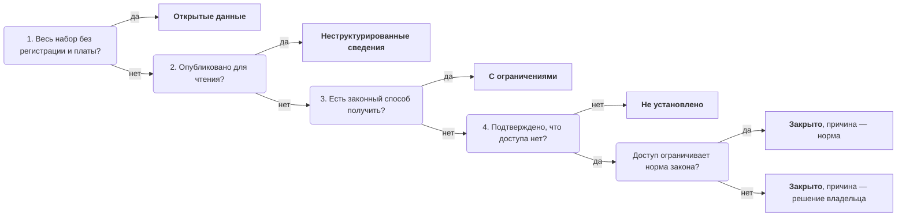

# Доступ и ограничения

Режим доступа отвечает, можно ли получить данные, кому и на каких условиях. Статус ставят набору — по самому доступному способу получить его, который проверили на деле, — и записывают вместе с подтверждением, причиной ограничения, условиями и датой. «Закрыто» — вывод, а не впечатление: его подтверждают документом или ответом владельца, а без подтверждения пишут «не установлено». Закрытые наборы остаются в реестре: из них часто можно получить агрегат, а некоторые можно открыть ([«Учитывают всё, в том числе закрытое»](../01-basics/04-principles.md#2-учитывают-всё-в-том-числе-закрытое)).

Сведения проверены 25 октября 2026 года, если не указано иное.

## Коротко

| Что сделать | Что получается | Готово, когда |
|-------------|----------------|---------------|
| **[Решить, чему ставить статус](#чему-ставить-статус)** | Статус у набора, у части набора или у пары «вопрос — источник» | Части с разным доступом записаны отдельно и связаны |
| **[Выбрать статус по шкале](#шкала)** | Один из пяти кодов — по четырём вопросам | Статус отвечает критерию шкалы, а не заявлению на сайте или словам владельца |
| **[Проверить по порядку](#порядок-проверки)** | Самый доступный способ получить данные, проверенный на деле | Файл скачан и открыт, интерфейс ответил, условия прочитаны или владелец ответил на запрос |
| **[Найти причину ограничения](#юридические-ограничения)** | Норма, условие договора или «нормы нет» | У каждого «закрыто» и «с ограничениями» есть причина; проверено, не входит ли набор в то, что закрыть нельзя |
| **[Записать условия](#условия-доступа)** | Кто, как, за сколько и за какой срок получает данные | По записи можно подать запрос или начать переговоры о соглашении |
| **[Решить, что делать](#что-делать-со-статусом)** | Действие для плана у каждого ограниченного набора | Ни один нужный цели набор не остался «закрыто» без решения |

## Чему ставить статус

Статус ставят тому, что можно получить целиком: набору, а не системе и не сайту. Правило то же, что для записей реестра: если у частей разный доступ, это разные записи ([«Что считать записью»](./05-registry.md#что-считать-записью)).

| Что нашли | Как поставить статус |
|-----------|----------------------|
| **Система с несколькими наборами** | Каждому набору свой статус: реестр организаций открыт, учёт обращений граждан закрыт |
| **Набор, часть которого закрыта** — поля о людях, отдельные записи, подробность ниже региона | Две записи: закрытый полный набор и доступная часть или агрегат, связанные между собой |
| **Один набор в нескольких формах** — файл, интерфейс, архив, поиск | Один статус — по самой доступной форме, в которой есть весь набор; остальные формы — в условиях доступа |
| **Источник на карте данных** | Статус у пары «вопрос — источник»: один сайт даёт сведения для одного вопроса и не даёт для другого ([«Из чего состоит карта»](../02-approaches/04-data-maps.md#из-чего-состоит-карта)) |

**Для кого статус.** По умолчанию — для внешнего пользователя без особых прав, который не работает у владельца. Если данные получает только часть пользователей — органы власти по межведомственному обмену, исследователи в защищённой среде, участники рынка по договору, — статус «с ограничениями», а кто именно их получает, пишут в условиях. Доступ внутри организации — каким подразделениям открыт набор — ведут отдельным полем: шкала описывает доступ снаружи.

## Шкала

| Статус и код | Критерий | Чем подтвердить | Пример |
|--------------|----------|-----------------|--------|
| **Открытые данные**, `open` | Набор целиком в машиночитаемом формате — файлом или через программный интерфейс — без регистрации и платы | Ссылка на файл или описание интерфейса; файл скачан и открыт | Выгрузка реестра воздушных судов FAA ([«Карточка записи FAA»](./05-registry.md#карточка-записи-faa)) |
| **Неструктурированные сведения**, `unstructured` | Опубликовано для чтения человеком: страницами, таблицами в PDF, сканами, поиском по одной записи | Ссылка на страницу или документ | Таблицы ежегодного сборника в PDF |
| **С ограничениями**, `restricted` | Законный способ получить данные есть, но не для всех или не сразу: регистрация, плата, соглашение, запрос | Условия доступа, тарифы, порядок запроса, положение о системе | Коммерческая база по подписке; интерфейс с ключом после регистрации |
| **Закрыто**, `closed` | Законного способа получить данные снаружи нет, и это подтверждено | Норма закона, акт о системе, ответ владельца | Учёт оказанной медицинской помощи с персональными данными |
| **Не установлено**, `unknown` | Проверить не удалось: сайт не открылся, условия не нашли, владелец не ответил | Что проверяли, когда и что делать дальше | Запрос отправлен, срок ответа не истёк |

- **Статус — по проверенному, а не по заявленному.** Раздел «Открытые данные», в котором лежат PDF, даёт «неструктурированные сведения». Ссылка, по которой файл не скачивается, — не открытые данные. «Всё открыто» в ответе владельца без ссылки — «не установлено», пока ссылку не найдут.
- **Открытые данные — целиком и без условий входа.** Так их определяют Открытое определение (Open Definition 2.1) и восемь принципов открытых государственных данных 2007 года. Интерфейс, который отдаёт только по одной записи, ближе к поиску, чем к открытым данным: статус — «неструктурированные сведения». Бесплатный ключ после регистрации — уже «с ограничениями», хотя и самыми мягкими.
- **Условия использования — отдельно от статуса.** Если файл можно скачать без регистрации, а лицензии нет нигде, статус — «открытые данные», а в условиях использования — «не указаны»: получить данные можно, а права на них неясны ([«Условия использования и владелец»](./05-registry.md#условия-использования-и-владелец)).
- **Неструктурированные сведения — самый дешёвый кандидат на публикацию.** Сведения уже открыты, но машиной их обработать можно только после разбора страниц или распознавания таблиц: открывать ничего не нужно, нужно выгрузить.
- **«С ограничениями» — много разных условий.** Бесплатная регистрация и многомесячное согласование соглашения попадают в один статус, поэтому условия записывают отдельно ([«Условия доступа»](#условия-доступа)).
- **«Не установлено» — с тем, что проверяли.** «Не установлено — сайт не открылся 23.10.2026, нужна проверка из сети страны» — рабочая запись. «Не установлено» без пояснения — та же пустая ячейка, только словами.

Каталожные стандарты различают три уровня доступа, а не пять. Как перевести статусы и причины в DCAT-AP и DCAT-US — в главе «Стандарты описания» ([«Справочники и словари»](../05-frameworks/02-metadata-standards.md#справочники-и-словари)).

### Как выбрать статус

Статус выбирают четырьмя вопросами по порядку: первый ответ «да» даёт статус. Вопросы определяют статус, а шаги [проверки](#порядок-проверки) дают доказательство.

Что делать с каждым статусом:

- **открытые данные** — проверить качество и условия использования;
- **неструктурированные сведения** — извлечь самим и предложить владельцу публиковать данными;
- **с ограничениями** — запрос или соглашение, срок и цену — в план;
- **не установлено** — проверить из сети страны и отправить запрос владельцу;
- **закрыто, причина — норма** — просить агрегат, обезличенную выборку или доступ в защищённой среде;
- **закрыто, причина — решение владельца** — кандидат на открытие или выдачу по запросу.

У «закрыто» две ветки, но статус один: причину — норму или решение владельца — пишут отдельным полем. От причины зависит, что делать дальше. Набор, закрытый без нормы, — не ошибка записи, а находка: его можно открыть или выдавать по запросу.

## Порядок проверки

Проверяют от самого открытого способа к самому закрытому и останавливаются на первом, который сработал: так получается статус. Для «с ограничениями» и «закрыто» идут дальше, до актов и запроса владельцу: там находится причина. Шаги 1–3 отвечают на первый вопрос дерева, шаг 4 — на второй, шаги 5 и 7 — на третий, шаги 6 и 7 — на четвёртый.

| № | Где смотреть | Что проверить | Что записать |
|--:|--------------|---------------|--------------|
| 1 | **Раздел открытых данных у владельца** | Файл скачивается и открывается, формат внутри тот, что заявлен; в файле весь набор, а не последний месяц | Прямую ссылку, формат, дату файла |
| 2 | **Национальный и региональные порталы** | То же и дату последнего обновления ([«Порталы открытых данных»](../04-sources/02-government.md#порталы-открытых-данных)) | Ссылку на набор и на первоисточник, если портал хранит копию |
| 3 | **Программный интерфейс** | Есть ли описание, нужен ли ключ, отдаёт ли интерфейс набор целиком или по одной записи | Адрес описания, как получить ключ |
| 4 | **Страницы и документы** | Есть ли сведения на страницах, в отчётах, сборниках, поиске по записи | Адрес и вид публикации |
| 5 | **Условия доступа** | Регистрация, тарифы, договор, порядок запроса, кому выдают | [Условия доступа](#условия-доступа) |
| 6 | **Нормативные акты** | Норма, которая ограничивает доступ, — и норма, которая запрещает его ограничивать ([«Что закрыть нельзя»](#что-закрыть-нельзя)) | Акт, статью, редакцию |
| 7 | **Запрос владельцу** | Есть ли набор, в каком виде и на каких условиях его выдают, какая норма ограничивает доступ ([ниже](#запрос-владельцу)) | Дату запроса, ответ, срок ответа по закону |

- **Сработало — значит, данные в руках.** Ссылка на странице — ещё не доступ: файл бывает пустым, по ссылке — ошибка или раздел «в разработке». Скачанный файл сразу проходит быструю проверку качества ([«Быстрая проверка»](./07-quality.md#быстрая-проверка)).
- **Открывшийся сайт — тоже ещё не доступ.** Домен, который владелец не продлил, регистрируют заново, и по прежнему адресу отвечает чужой сайт ([«Что случилось с адресом»](../04-sources/06-legacy.md#что-случилось-с-адресом)).
- **Из сети той страны.** Многие государственные сайты не открываются из-за рубежа, и набор ошибочно попадает в «закрытые». Сайт, который не ответил, ответил ошибкой или предъявил непринятый сертификат, — повод проверить из сети страны, а не вывод о закрытии. Если такой возможности нет, итог — «не установлено» с пометкой о сети. То же с ИИ-агентом: если он не открыл сайт, это не доказывает, что данных нет ([«Ошибки модели и как их ловить»](../02-approaches/03-ai.md#ошибки-модели-и-как-их-ловить)).
- **Дата у каждого результата.** Порталы закрываются и переезжают, условия меняются. Российский портал data.gov.ru не работал с марта 2023 по июль 2025 года, и наборы, опубликованные только на нём, на это время стали недоступны ([«Пример: data.gov.ru»](../04-sources/06-legacy.md#пример-datagovru)).

### Запрос владельцу

Если ни один открытый способ не сработал, пишут владельцу. Чужой владелец не обязан заполнять анкету, поэтому письмо — короткое и о конкретном: какой набор нужен, за какой период и территорию, есть ли он, в каком виде и на каких условиях его выдают. Три–пять вопросов в одном письме: владельцу проще ответить, а составителю — превратить ответ в запись.

- **Государственному владельцу пишут по закону о доступе к информации.** Такие законы есть во всех странах книги. Они дают право на ответ и срок, а ответ становится основанием статуса: «данных нет», «выдаём по соглашению», «закрыто по такой-то норме». Сроки ответа по странам — в приложении «Нормативная база» ([«Сроки ответа на запросы»](../09-appendices/02-legal-framework.md#сроки-ответа-на-запросы)).
- **Закон даёт право на сведения и документы, а не на опись.** Запрос описывает, что нужно: в США запрос по закону о свободе информации (FOIA) должен достаточно точно описывать документы. На вопрос «какие у вас есть данные?» обычно отвечают ссылкой на сайт. Но часть законов обязывает публиковать перечни реестров и документов — их смотрят до запроса.
- **Сначала ищут чужие запросы.** Запросы и ответы на них публикуют общественные сайты — WhatDoTheyKnow в Великобритании, Ma Dada во Франции. Ответ на чужой запрос о том же наборе — готовое основание статуса с датой ответа.
- **Ответ записывают с датой.** «Данных нет» от владельца — пробел с основанием. Если ответа нет, в подтверждении пишут дату запроса и «ответа нет», а статус остаётся «не установлено».
- **Компании отвечать не обязаны.** О данных компаний спрашивают ассоциации, регуляторов и экспертов, а о данных, которые компании продают, — как покупатель ([«Коммерческие данные»](../04-sources/04-commercial.md)).

## Юридические ограничения

Почти везде доступ к данным ограничивают по одним и тем же причинам:

- **персональные данные** и сведения о частной жизни;
- **государственная тайна** и служебная информация ограниченного распространения;
- **коммерческая, банковская, налоговая, врачебная и иные тайны**, установленные законом, в том числе конфиденциальность первичных статистических данных: статистики публикуют итоги, но не ответы отдельных респондентов;
- **права третьих лиц** — условия соглашений для данных, полученных от компаний, авторские права и права на базы данных;
- **безопасность** — оборона, общественный порядок, международные отношения.

### Ограничивают сведения, а не набор

Закон обычно ограничивает не набор целиком, а сведения в нём, и требует выдать остальное: закрытую часть отделяют, а то, что можно отделить, выдают. Так устроены, например, закон о свободе информации в США и правила доступа к документам институтов ЕС. Для инвентаризации отсюда три правила:

- **Закрытость части набора не делает закрытым весь набор.** Реестр с персональными данными может публиковаться обезличенно или в агрегатах — тогда у агрегата свой статус. Такие случаи записывают двумя строками, связанными между собой.
- **Агрегат — не всегда безопасен.** Сводная таблица по малым территориям и редким группам может раскрыть конкретных людей, поэтому малые значения в ней скрывают ([«Коммерческие данные»](../04-sources/04-commercial.md#ограничения)). Решают это владелец и юрист, а не составитель реестра.
- **У ограничения бывает срок.** Если в норме или решении есть срок, записывают дату, после которой основание отпадает, и в эту дату перепроверяют статус.

### Что закрыть нельзя

Законы перечисляют и сведения, доступ к которым ограничить нельзя: например, о деятельности государственных органов и расходовании бюджета, о состоянии окружающей среды и здравоохранения. В России и Казахстане ограничить доступ может только закон, а не приказ ведомства (в России — ещё акт Президента).

Поэтому нормативные акты проверяют в обе стороны: есть ли норма, которая ограничивает доступ, и нет ли нормы, которая запрещает его ограничивать или обязывает публиковать. Набор из второго перечня, который не опубликован или опубликован только страницами, — пробел с основанием: его можно потребовать, а не просить. Положение о системе или приказ ведомства сами по себе доступ обычно не ограничивают. Они описывают порядок доступа и подтверждают, что снаружи его нет, а причину ищут в законе, на который они ссылаются.

### Где искать основания

Основания ищут в законах о персональных данных, о доступе к информации и о тайнах, в отраслевых законах и в актах о системе; для данных компаний — в условиях соглашения или лицензии поставщика ([«Коммерческие данные»](../04-sources/04-commercial.md#как-использовать-при-инвентаризации)). Какие акты действуют в каждой стране книги, что они ограничивают и что обязывают публиковать — в приложении [«Нормативная база»](../09-appendices/02-legal-framework.md). Норму записывают с номером, датой, статьёй и редакцией и перед ссылкой проверяют, не утратила ли она силу ([чек-лист](../09-appendices/04-checklists.md#перед-ссылкой-на-нормативный-акт)).

### Закрытые наборы — тоже в реестре

Закрытый набор описывают так же, как открытый: закрыты данные, а не сведения о том, что они есть. Закон США требует включать в полный инвентарь данных ведомства все наборы, кроме систем национальной безопасности, а то, что нельзя скрыть по закону о свободе информации, — показывать в его общедоступной части. Регламент ЕС об управлении данными (Data Governance Act) идёт дальше: каждая страна публикует список защищённых данных государственных органов, доступных для повторного использования, — с форматом, объёмом и условиями, а Еврокомиссия ведёт по этим спискам общеевропейский реестр. Если закрыто даже описание набора, запись остаётся только в полном реестре ([«Полный реестр и общедоступная часть»](./09-result-and-upkeep.md#полный-реестр-и-общедоступная-часть)).

## Условия доступа

У статуса «с ограничениями» главное — условия: по ним решают, стоит ли добиваться данных и сколько это займёт.

| Что записать | Примеры |
|--------------|---------|
| **Кто может получить** | Любой после регистрации; организации; органы власти; аккредитованные исследователи; участники рынка |
| **Как** | Регистрация, заявка, договор, подписка, межведомственный запрос, запрос по закону о доступе к информации |
| **Сколько стоит** | Бесплатно, тариф, стоимость подписки |
| **Сколько ждать** | Срок ответа по закону ([«Запрос владельцу»](#запрос-владельцу)) или по опыту прошлых запросов |
| **Что выдают** | Весь набор или выборку, записи или агрегаты, формат, с какой задержкой |
| **Какие обязательства** | Цель использования, запрет передачи и публикации, работа только в защищённой среде, проверка результатов владельцем |

Так выглядят условия, записанные в законе. По регламенту ЕС об управлении данными государственный орган может выдавать защищённые данные для повторного использования только обезличенными или агрегированными либо для работы в защищённой среде — удалённо или в помещении владельца. Результаты такой работы орган вправе проверить, а решение по запросу принимает за два месяца, в сложных случаях — ещё до 30 дней. В реестре это четыре ячейки условий: кто решает, в каком виде выдают, где работают с данными, сколько ждать.

## Что делать со статусом

Статус — не итог, а вход для поиска пробелов и плана: по нему видно, какие пробелы закрываются запросом, какие — соглашением, а какие — только изменением системы ([«Шаг 6. План»](./08-gaps-and-plan.md#шаг-6-план)). Следующее действие для каждого статуса — на [дереве решений](#как-выбрать-статус).

В подходе «чем владеем» записи «неструктурированные сведения» и «закрыто» с причиной «решение владельца» — готовый список кандидатов на открытие: в первых не хватает формы, во вторых — решения. Для цели «открытие данных» этот список — главный результат проверки доступа. В подходе «где найти нужное» чужие наборы не открыть, и остаются запросы, соглашения и агрегаты.

## Доступ — не качество

Статус говорит, можно ли получить данные, но не говорит, хороши ли они. Открытый набор, который не обновлялся пять лет, полезен меньше, чем ограниченный ресурс с ежедневными данными. И наоборот: закрытый набор бывает лучшим источником для задачи — тогда решают, как его получить, а не ищут открытую замену хуже качеством. Доступ и качество — две разные колонки в таблице покрытия; качество записывают отдельно ([«Качество данных»](./07-quality.md)).

## Как записать

В реестре режим доступа — это пять колонок шаблона [registry.csv](pathname:///templates/registry.csv):

- **код статуса** (`access_level`) — `open`, `unstructured`, `restricted`, `closed`, `unknown`;
- **чем подтверждён** (`access_basis`) — ссылка, акт с пунктом, ответ владельца с датой; у «не установлено» — что проверяли, из какой сети и что дальше;
- **причина ограничения** (`access_restriction`) — коды ниже, несколько — через «;»;
- **условия доступа** (`access_conditions`) — у «с ограничениями»: кто, как, за сколько и за какой срок получает данные и что выдают;
- **дата проверки доступа** (`access_checked`). Статусы меняются чаще остальных атрибутов, поэтому у них своя дата, а не общая дата проверки записи.

| Код причины | Что значит |
|-------------|------------|
| `personal_data` | Персональные данные, личная и семейная тайна |
| `state_secret` | Государственная тайна |
| `official` | Служебная информация ограниченного распространения |
| `confidential` | Коммерческая, банковская, налоговая, врачебная, статистическая и иные тайны, установленные законом |
| `third_party` | Права третьих лиц: условия договора или лицензии, авторские права |
| `owner_decision` | Решение владельца, нормы нет |
| `none` | Ограничений нет |
| `unknown` | Причина не установлена |

Как эти пять полей выглядят в заполненной записи, показывает блок «Как получить» в [карточке записи FAA](./05-registry.md#карточка-записи-faa). На карте данных доступ записывают у пары в листе «Связи» — статус, подтверждение и дата теми же кодами ([links.csv](pathname:///templates/links.csv)). В паспорт реестра или карты записывают, когда и из какой сети проверяли доступ и сколько записей осталось «не установлено».

Программа проверяет, что у `restricted` и `closed` заполнена причина, у `restricted` — условия, у `open` — ссылка для выгрузки, а у `unknown` — что проверяли. Причина `none` бывает только у `open` и `unstructured`: регистрация и плата без нормы — это `owner_decision`. Дата проверки доступа должна быть не старше года ([«Проверки»](../06-tools/03-registry-as-data.md#проверки)).

## Пример

**Где мы в примере.** Шаг 3, после опроса владельцев ([«Опросные листы и интервью»](./04-questionnaires.md#пример)): 15 вопросов о доступности медицинской помощи в регионах, 31 запись — 25 из реестра ([«Реестр данных»](./05-registry.md#условный-пример-доступность-медицинской-помощи)) и шесть новых строк из анкет. В черновике реестра «закрыто» стояло у 12 записей — у всего, чего не нашли на сайтах.

**Что показала проверка.**

- **Сайт не открылся.** Сайт центра медицинской статистики не открылся из сети, откуда шла проверка. Из сети страны он открылся: таблицы сборника о числе врачей лежат в PDF — «неструктурированные сведения».
- **Доступ только органам власти.** Регистра медицинских работников на сайтах нет. Положение о системе даёт доступ органам власти по межведомственному запросу — «с ограничениями»; причина — персональные данные.
- **Закрыто, но есть агрегат.** Учёт оказанной помощи фонда медицинского страхования закрыт по закону: персональные данные и врачебная тайна. На запрос фонд ответил, что по соглашению выдаёт сводные данные — число госпитализаций по региону и месяцу. У агрегата своя запись, статус — «с ограничениями».
- **Закрыто без нормы.** Сведения о коечном фонде по больницам центр собирает в отчётной форме, а публикует только итоги по регионам. На запрос ответил: «Не публикуем, запросов не было». Персональных данных в сведениях нет, нормы, которая ограничивает доступ, тоже: «закрыто», причина — решение владельца.
- **Ответа нет.** Трём владельцам отправили запросы, срок ответа по закону ещё не истёк: «не установлено» с датой запроса.

Из 12 «закрыто» в черновике осталось три. Пять записей оказались доступны органам власти или по соглашению, одна опубликована в PDF, три ждут ответа. Шесть строк из анкет пришли с ответом владельца о порядке доступа: все они — по запросу.

| Статус | Записей | Что за ними |
|--------|--------:|-------------|
| Открытые данные | 6 | Четыре международных ряда, ряды статистического ведомства, реестр медицинских организаций фонда |
| Неструктурированные сведения | 6 | Сборники в PDF, поиск по одной записи в реестре лицензий надзорного органа, нормативы сроков ожидания в текстах региональных программ |
| С ограничениями | 13 | Регистр медицинских работников, листы ожидания трёх регионов и система записи к врачу — по межведомственному запросу; сводные данные фонда — по соглашению; платная копия реестра лицензий |
| Закрыто | 3 | Две — персональные данные и врачебная тайна, одна — решение владельца без нормы |
| Не установлено | 3 | Запросы отправлены, ответа нет |

**Итог.** Главный вопрос — о сроках ожидания. Даты, по которым их считают, лежат в закрытом учёте фонда и в листах ожидания региональных систем, и открыть сами записи нельзя: в них персональные данные. Проверка доступа подсказала решение для плана: не просить записи, а договориться о сводных данных — число пациентов в листе ожидания и медианный срок по региону и месяцу. Такой агрегат персональных данных не содержит, его можно получать регулярно и даже публиковать, если скрыть малые значения. Сведения о коечном фонде по больницам ушли в список кандидатов на открытие. Пример показывает ход работы, а не то, как устроено здравоохранение в конкретной стране.

## Частые ошибки

- **«По закону» без статьи.** Норму нельзя проверить, а она могла утратить силу или не касаться набора. Записывают акт, статью, редакцию.
- **Весь набор закрыт из-за нескольких полей.** Агрегат или обезличенную часть никто не запрашивает. Нужны две записи: полный набор и доступная часть.
- **«С ограничениями» без условий.** Бесплатный ключ и годовое согласование выглядят одинаково. Записывают, кто, как, за сколько и за какой срок получает данные.

Сквозные ошибки — статус доступа без основания, в реестре только открытое — в главе [«Практики и антипаттерны»](../08-practices/01-practices-and-anti-patterns.md).

## Ограничения

- Статус, отмеченный снаружи, не окончателен: владелец может выдать закрытые данные по запросу, а из набора, закрытого по закону, — агрегат.
- Шкала грубая: «с ограничениями» объединяет бесплатный ключ и многомесячное согласование соглашения. По шкале видно, можно ли получить данные, но не во что это обойдётся, — это видно по условиям.
- Составитель реестра записывает норму, но не толкует её. Распространяется ли тайна на конкретный набор и можно ли выдать агрегат, решают владелец и юрист.
- Нормы, условия и сайты меняются: статус верен на дату проверки.

## Источники

- Главы [«Реестр данных»](./05-registry.md#справочники-значений) — коды режима доступа; [«Стандарты описания»](../05-frameworks/02-metadata-standards.md#справочники-и-словари) — сопоставление шкалы с DCAT-AP и DCAT-US; [«Карты данных»](../02-approaches/04-data-maps.md#из-чего-состоит-карта) — доступность у пары «вопрос — источник».
- Приложение [«Нормативная база»](../09-appendices/02-legal-framework.md) — акты по странам, сроки ответа на запросы.
- [Open Definition 2.1](https://opendefinition.org/od/2.1/en/) — Open Knowledge Foundation: открытая лицензия или общественное достояние, доступ к данным целиком, машиночитаемость, открытый формат.
- [8 Principles of Open Government Data](https://opengovdata.org/) — принципы открытых государственных данных, Себастопольская встреча, декабрь 2007 года: в том числе доступность любому без регистрации.
- [5 U.S. Code § 552](https://www.law.cornell.edu/uscode/text/5/552), подразделы (a)(3)(A) и (b) — запрос по FOIA и исключения; [44 U.S. Code § 3511](https://www.law.cornell.edu/uscode/text/44/3511), подразделы (a)(2)(B) и (C) — закрытые наборы в полном инвентаре. Проверено 25 октября 2026 года.
- [Regulation (EU) 2022/868](https://eur-lex.europa.eu/eli/reg/2022/868/oj) — регламент об управлении данными (Data Governance Act) от 30 мая 2022 года, применяется с 24 сентября 2023 года: статьи 3, 5, 8 и 9; [Regulation (EC) No 1049/2001](https://eur-lex.europa.eu/eli/reg/2001/1049/oj), статья 4. Проверено 25 октября 2026 года.
- Федеральный закон от 27.07.2006 № 149-ФЗ, [статья 8](https://www.consultant.ru/document/cons_doc_LAW_61798/78b773a28f3ad19eb234697b20ab1d48c09f748a/) и [статья 9](https://www.consultant.ru/document/cons_doc_LAW_61798/35f4fb38534799919febebd589466c9838f571b2/), в редакции от 26.06.2026 — «КонсультантПлюс»; закон Республики Казахстан от 16.11.2015 № 401-V «О доступе к информации», статьи 5 и 6, — по тексту [prg.kz](https://prg.kz/Document/?doc_id=39415981) по состоянию на 25.08.2026. Проверено 25 октября 2026 года.
- Архивы запросов: [WhatDoTheyKnow](https://www.whatdotheyknow.com/) — mySociety; [Ma Dada](https://madada.fr/) — Open Knowledge France. Из сети, откуда проверялась книга, WhatDoTheyKnow ответил ошибкой 403.
