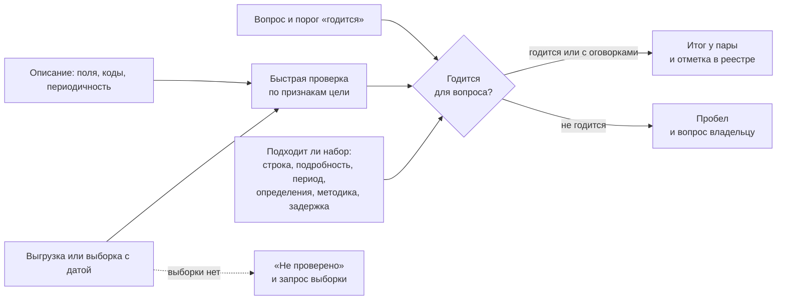

# Качество данных

Найти набор недостаточно: нужно понять, годится ли он для задачи. Качество — не свойство набора вообще, а пригодность для вопроса: один и тот же реестр годится, чтобы посчитать суда по штатам, и годится лишь с оговорками, чтобы оценить возраст парка. Поэтому смотрят сами данные, а не описание, и ставят итог паре «вопрос — набор»: годится, годится с оговорками, не годится, не проверено. Быструю проверку проходит каждый нужный цели набор сразу при находке, а находки идут в отметку реестра, в вопросы владельцу и в список пробелов.

Сведения проверены 25 октября 2026 года, если не указано иное.

## Коротко

| Что сделать | Что получается | Готово, когда |
|-------------|----------------|---------------|
| **[Выбрать признаки под цель](#что-проверять-в-первую-очередь)** | Главные признаки для каждого вопроса | Порог «годится» записан рядом с вопросом до проверки |
| **[Сверить описание с данными](#описание-и-данные)** | Заявленное и фактическое: периодичность, формат, поля, коды | Расхождения записаны и заданы владельцу вопросом |
| **[Провести быструю проверку](#быстрая-проверка)** | Числа по каждому признаку на выгрузке с датой | Каждый нужный цели набор проверен или помечен «не проверено» с причиной |
| **[Решить, годится ли для задачи](#годится-ли-для-задачи)** | Итог у каждой пары «вопрос — набор» | У каждой пары — одно из четырёх значений |
| **[Разобрать находки](#что-делать-с-находками)** | Оговорки, вопросы владельцам, пробелы | У каждой находки есть место: отметка, вопрос или пробел |
| **[Записать](#как-записать-в-реестр)** | Отметка в реестре, лист «Проверки качества», итог в листе «Связи» | Отметку можно повторить: в ней признаки, числа, дата данных и дата проверки |
| **[Подробно оценить ключевые наборы](#подробная-оценка)** | Правила до полей, доля ошибок по выборке | Для наборов, на которых строится решение, известна доля ошибок с границами |

## Что проверять

| Признак | Вопрос | Типичная находка |
|---------|--------|------------------|
| **Полнота** | Все ли записи и значения на месте? | Нет записей за год или по части регионов; пусто поле, ради которого брали набор; набор описан, но пуст |
| **Уникальность** | Каждый предмет записан один раз? | Одна организация трижды под разными написаниями |
| **Актуальность** | Достаточно ли свежие данные для задачи? | «Ежемесячно» по описанию, последняя запись — двухлетней давности |
| **Валидность** | Значения в нужном формате, из справочника, в допустимых пределах? | Год «0000», дата «01.01.1900», код без расшифровки, телефон в поле адреса |
| **Согласованность** | Не противоречат ли данные сами себе и другим источникам? | Сумма по регионам не равна итогу; справочники двух ведомств расходятся; прошлые значения переписаны задним числом |
| **Точность** | Соответствуют ли данные действительности? | Организация ликвидирована, а в наборе действует |
| **Пригодность формата** | Можно ли обработать данные машиной? | Объединённые ячейки, итоги вперемешку с данными, таблицы в PDF |

Первые шесть признаков — основные измерения качества данных, которые выделила DAMA UK в 2013 году; тот же список в 2020 году взяла британская государственная рамка качества данных ([«Рамки и стандарты качества»](#рамки-и-стандарты-качества)). Пригодность формата добавляют при инвентаризации: от неё зависит, можно ли обработать набор вообще. Точность проверяют последней: для неё нужен второй источник, и она дороже остальных признаков.

## Что проверять в первую очередь

Все семь признаков у каждого набора проверять не нужно: цель задаёт, без чего набор бесполезен ([«Как цель меняет инвентаризацию»](../01-basics/03-goals.md#как-цель-меняет-инвентаризацию)).

- **Аналитика** — полнота по периодам и территориям, согласованность, сопоставимость рядов: ряд не должен обрываться или менять методику без пометки.
- **Проактивные услуги и обмен данными** — точность и уникальность каждой записи, валидность идентификаторов, актуальность.
- **Открытие данных** — пригодность формата, актуальность, описание полей, нет ли в файле персональных данных.
- **Озеро данных и обучение моделей** — полнота, валидность, происхождение данных, представительность: есть ли в данных все группы и территории.
- **Карта данных** — актуальность и подробность: отвечает ли источник на вопрос.
- **Сокращение дублей** — согласованность копий и уникальность между системами.

Порог «годится» записывают до проверки, рядом с вопросом: «дата направления заполнена не меньше чем у 90% записей». Иначе порог подгоняют под найденное. Как записать порог у вопроса — в главе [«Цели и вопросы»](./02-goals-and-questions.md).

## Описание и данные

Перед проверкой читают описание: схему, справочники кодов, методику, страницу набора. Описание задаёт правила, по которым проверяют валидность, и говорит, чего ждать. Но описание — тоже данные, и ошибки бывают и в нём:

- В описании полей реестра воздушных судов FAA формат дат указан как ГГГГ/ММ/ДД, а в файлах даты записаны без разделителей: 20270430. У кода 8 типа владельца нет расшифровки, хотя он стоит у 2251 записи. Коды статуса 13 и 27 расшифрованы одинаково — «регистрация истекла».
- Периодичность на странице — «ежемесячно», а по датам внутри данных обновления идут раз в квартал.
- На странице подпись «CSV», а в архиве XLSX.

Расхождение описания и данных — находка: её записывают в отметку и задают владельцу вопросом. В отметке пишут и то, чему поверили при проверке, — правилу из описания или тому, что в файле.

**Качество описания — не качество данных.** Европейский портал data.europa.eu оценивает описания наборов, которые собирает с национальных порталов, по пяти измерениям: максимум — 405 баллов, «отлично» — от 351. Это оценка метаданных: набор с отличным описанием может быть пустым или устаревшим. В реестре нужно и то и другое — хорошее описание, чтобы набор нашли, и проверка данных, чтобы ему можно было верить.

## Быстрая проверка

Быстрая проверка — короткий набор проверок на самих данных: от нескольких минут до часа на набор. Её проходит каждый набор, нужный для цели, при находке — на третьем шаге ([«Найти и описать данные»](./01-steps.md#3-найти-и-описать-данные)). В скобках — признак, который проверяет шаг.

1. **Скачать выгрузку целиком** и записать две даты: когда скачали и на какую дату данные. Без них через месяц не понять, к какой версии относится отметка.
2. **Посмотреть глазами** первые и последние строки: заголовки, кодировку, разделитель, строки итогов и примечаний внизу таблицы (пригодность формата).
3. **Посчитать записи** и сравнить с ожидаемым: числом регионов, месяцев, организаций, числом из отчёта владельца (полнота).
4. **Снять профиль колонок**: доля пустых значений, минимум и максимум, число разных значений, самые частые значения (полнота, валидность). Пропуски бывают замаскированы — пробелами, нулями, «0000», «01.01.1900», «н/д»: профиль без очистки их не видит.
5. **Проверить ключ**: идентификатор не повторяется; если идентификатора нет — найти повторы по названию и адресу (уникальность).
6. **Проверить правила**: даты — датами и не в будущем, коды — из справочника, числа — в допустимых пределах (валидность).
7. **Проверить связи**: коды находятся в справочниках, суммы по разрезам совпадают с итогами, один и тот же предмет в двух файлах описан одинаково (согласованность).
8. **Проверить свежесть**: последняя дата внутри данных против заявленной периодичности и против того, насколько свежими данные нужны задаче (актуальность).
9. **Сверить выборку с другим источником** — если для цели важна точность (точность).
10. **Записать отметку** — с числами, а не словами «качество удовлетворительное» ([«Как записать в реестр»](#как-записать-в-реестр)).

Шаги 3–8 — запросы, которые пишут один раз и повторяют при каждом обновлении. Для небольшой таблицы хватит фильтров и сводных таблиц, для больших выгрузок удобнее программы ([«Инструменты»](#инструменты)). Запросы по описанию полей хорошо пишет языковая модель, но считает программа, а не модель, и найденное проверяет человек ([«Проверить в три слоя»](../02-approaches/03-ai.md#3-проверить-в-три-слоя)).

### Если выгрузки нет

Набор, в котором доступен только поиск по одной записи, проверяют выборкой: заранее выбирают 20–30 предметов из другого источника — например, организации из реестра соседнего ведомства — и ищут каждый. Так видно точность и полноту, но не уникальность и не свежесть всего набора.

У закрытого набора выборку запрашивают у владельца вместе с описанием полей. До ответа ставят «не проверено» и записывают, что и когда запросили. Слова владельца «данные хорошего качества» — не проверка: их записывают как заявление, а не как итог.

### Сколько записей сверять

Точность по самому набору не проверить: нужен независимый источник — документ, другой реестр, выезд, звонок. Сверка дорогая, поэтому смотрят выборку. Записи выбирают случайно, а не первые по списку: первые строки часто самые старые или самые аккуратные.

Сколько брать, подсказывает правило трёх: если в выборке из n записей ошибок нет, доля ошибок во всём наборе с вероятностью 95% не больше примерно 3/n. 30 записей без ошибок говорят, что ошибок меньше 10%, 100 — меньше 3%, 300 — меньше 1%. Если задаче нужна точность выше, выборку увеличивают или записывают, что точность не проверена.

## Пример проверки

**Где мы в примере.** Запись набора уже составлена ([«Карточка записи FAA»](./05-registry.md#карточка-записи-faa)). Так прошла быстрая проверка реестра воздушных судов США по выгрузке, скачанной 25 октября 2026 года, — файлы в ней от 23 октября:

| Признак | Как проверяли | Что нашли |
|---------|---------------|-----------|
| **Полнота** | Число записей основного файла, доля пустых значений по полям | 317 999 записей. Год выпуска пуст у 22,4% записей, дата лётной годности — у 14,1%, код двигателя — у 12,7%. У 3676 действующих регистраций — 1,2% — пусты сразу имя владельца и весь адрес |
| **Уникальность** | Повторы регистрационного номера, внутреннего идентификатора и кода транспондера Mode S | Повторов нет ни в одном из трёх |
| **Валидность** | Номера — по правилам номеров США; даты — как даты; штаты и индексы — по спискам и форматам | Номера и даты корректны, дат в будущем нет. Год «0000» у 150 записей. 7 индексов из 311 463 американских адресов не по формату. Коды стран — не ISO 3166: Пуэрто-Рико записано как RQ (491 запись), а не PR |
| **Согласованность** | Коды моделей и двигателей — по справочникам архива; тип судна и двигателя — против справочника моделей; номера — против списка зарезервированных | Все коды моделей и двигателей нашлись в справочниках. Тип судна расходится со справочником у 4 записей, тип двигателя — у 47. Ни один номер не числится одновременно зарегистрированным и зарезервированным |
| **Актуальность** | Последняя дата изменения записи; действующие регистрации с истёкшим сроком | Последние изменения — 23 октября 2026 года; у 41 070 записей последнее изменение — в 2026 году. Статус «действует» при истёкшем сроке регистрации — у 4 записей, без срока — у 2090 |
| **Точность** | — | Не проверялась: нужен независимый источник — документы владельцев или сигналы транспондеров |
| **Пригодность формата** | Открыть файлы программой | Семь текстовых файлов с разделителем-запятой и описание полей. Значения дополнены пробелами до ширины поля, в конце строк лишняя запятая |

Одна ловушка — в профиле. Пустые значения в файлах FAA — пробелы, а не пустые ячейки, и даты записаны текстом. Профиль поля «год выпуска» до и после очистки:

- **до очистки:** пустых значений 0%, а «0000» выглядит как год;
- **после очистки от пробелов:** год выпуска пуст у 22,4% записей, ещё у 150 записан «0000» — пропуск под видом значения.

Поэтому значения сначала очищают, а в профиле смотрят не только пустые ячейки, но и частые значения.

<details>
<summary>Проверить самому</summary>

Основные проверки — пять запросов в DuckDB к файлам архива `ReleasableAircraft.zip`:

```sql
CREATE TABLE m AS SELECT * FROM read_csv('MASTER.txt', all_varchar = true);
CREATE TABLE ref AS SELECT * FROM read_csv('ACFTREF.txt', all_varchar = true);

-- сколько записей и повторяются ли номера
SELECT count(*), count(DISTINCT trim("N-NUMBER")) FROM m;

-- доля пустых: значения дополнены пробелами, поэтому trim
SELECT avg((trim("YEAR MFR") = '')::int) FROM m;

-- пропуск под видом значения
SELECT count(*) FROM m WHERE trim("YEAR MFR") = '0000';

-- коды моделей, которых нет в справочнике
SELECT count(*) FROM m
LEFT JOIN ref ON trim(m."MFR MDL CODE") = trim(ref.CODE)
WHERE ref.CODE IS NULL;

-- свежесть: последняя дата изменения записи
SELECT max(trim("LAST ACTION DATE")) FROM m;
```

</details>

Набор хорошо согласован: справочники сходятся, ключи уникальны, данные свежие. Главные находки — пропуски и описание. Владельцу ушли бы три вопроса: почему у 3676 действующих регистраций нет имени и адреса — это записи, скрытые по просьбе владельцев? Что значит код 8 типа владельца? Чем отличаются коды статуса 13 и 27?

## Годится ли для задачи

Признаки отвечают, хорошо ли набор сделан. Но и безупречный набор может не ответить на вопрос. Поэтому итог у пары складывают из двух проверок: главные признаки в пределах порога, который записан у вопроса, и сам набор подходит к вопросу.



Подходит ли набор к вопросу, смотрят по описанию в реестре ([«Описание»](./05-registry.md#описание)) и по самим данным:

- **Что такое строка.** Записи или сводные показатели. Агрегат не заменит записей, если сведения о человеке нужно связать из двух систем.
- **Подробность.** Страна, регион, муниципалитет; год, месяц, день; разрезы — пол, возраст, город и село.
- **Период и длина ряда.** Хватит ли лет для сравнения, нет ли разрыва.
- **Определения.** Что считают «врачом», «организацией», «обращением». Если у двух ведомств одно слово значит разное, их данные нельзя складывать.
- **Методика.** Если она менялась внутри ряда, годы до и после изменения сравнивают с оговоркой.
- **Задержка.** Через сколько после события данные появляются: годовой сборник выходит через месяцы после конца года.

Если набор не подходит по этим признакам, это не плохое качество, а непригодность для вопроса. Записывают её так же — итогом у пары:

| Итог | Код | Когда |
|------|-----|-------|
| **Годится** | `fit` | Главные признаки в пределах порога, подробность и период подходят |
| **Годится с оговорками** | `fit_with_caveats` | Ответ получить можно, но с поправкой: часть записей пуста, сопоставим не весь ряд, нужна очистка |
| **Не годится** | `unfit` | Набор не отвечает на вопрос или нарушает порог в главном признаке |
| **Не проверено** | `not_checked` | Нет выгрузки или выборки, не дошли руки — с причиной |

Один и тот же реестр FAA по итогам проверки выше:

| Задача | Итог | Почему |
|--------|------|--------|
| Посчитать действующие суда по штатам и типам | `fit` | Номера уникальны, коды моделей и штатов корректны, данные двухдневной давности |
| Оценить возраст парка | `fit_with_caveats` | Год выпуска неизвестен у пятой части записей, ещё у 150 записан как «0000»; их исключают из расчёта и пишут, сколько исключено |
| Найти владельцев судов одной модели | `fit_with_caveats` | У 1,2% действующих регистраций нет ни имени, ни адреса |
| Посчитать полёты или налёт | `unfit` | Таких сведений в реестре нет — это не ошибка набора, а другая задача |

Итог ставят паре, а не набору: один набор годится для одного вопроса и не годится для другого — так же, как доступность на карте данных отмечают у пары ([«Из чего состоит карта»](../02-approaches/04-data-maps.md#из-чего-состоит-карта)). Потом итоги сводят в таблицу покрытия «вопрос — источник — доступность — качество» ([«Шаг 5. Таблица покрытия»](./08-gaps-and-plan.md#шаг-5-таблица-покрытия)).

## Что делать с находками

| Находка | Куда | Пример |
|---------|------|--------|
| **Не мешает задаче** | В отметку реестра | 7 почтовых индексов не по формату из 311 463 |
| **Мешает, но обходится** | Оговорка в отметке, итог «годится с оговорками» и поправка: что исключили и как пересчитали | Записи без года выпуска исключают из расчёта возраста парка и пишут, сколько |
| **Мешает задаче** | Итог «не годится» и пробел вида «есть, но не годятся» | Дата направления пуста у трети записей листа ожидания |
| **Похоже на ошибку у источника** | Вопрос владельцу с примерами записей | Действующая регистрация с истёкшим сроком |
| **Описание расходится с данными** | Вопрос владельцу; в отметке — чему поверили | Формат дат в описании полей и в файле |

- **Исправляют у источника, а не в копии.** Свою исправленную копию через год никто не вспомнит, а ошибка останется у всех остальных пользователей. Непригодные данные исправляют в плане — справочником, полем или порядком обновления у того, кто их ведёт, — и ищут первопричину: ошибку в форме ввода, в справочнике, в обмене между системами.
- **Владельцу пишут с примерами**: номер записи, поле, значение и почему оно похоже на ошибку. На «у вас плохие данные» не ответят.
- **Чужие данные не правят, а помечают.** В подходе «где найти нужное» ошибку чужого набора обходят: исключают записи, берут другой источник, сообщают владельцу.

## Как записать в реестр

Результат проверки записывают в атрибут «отметка о контроле качества» ([«Минимальный состав»](./05-registry.md#минимальный-состав)). В нём пишут:

- **когда и кто** проверял;
- **на чём**: выгрузка на какую дату, весь набор или выборка какого размера;
- **по каким признакам**;
- **что найдено** — числами: «год выпуска пуст у 22,4%», а не «есть пропуски»;
- **вопросы владельцу**, если они есть;
- **для каких задач годится** — итоги пар «вопрос — набор» или ссылка на них.

Пример — отметка в [карточке записи FAA](./05-registry.md#карточка-записи-faa). Если проверки не было, пишут «не проверено» и причину: «выборки нет — запрошена у владельца 20.10.2026». Пустая отметка не отличает «проверили, всё в порядке» от «не смотрели».

**Лист «Проверки качества».** Когда проверок много — подробная оценка, несколько задач, повторные проверки при обновлении, — их ведут отдельным листом рядом с реестром, по строке на проверку. Шаблон — [quality-checks.csv](pathname:///templates/quality-checks.csv). В строке: идентификатор проверки и запись реестра; вопрос, если проверка нужна только ему; признак; что именно смотрели; порог; результат числом; влияние — не мешает, оговорка, мешает (`none`, `caveat`, `blocking`); данные на дату, кто и когда проверял.

**Итог у пары «вопрос — набор»** записывают в лист «Связи» — колонкой рядом с доступом (`quality`), а оговорку — отдельной колонкой (`quality_note`); в отметке реестра остаётся сводка (шаблон листа — в приложении [«Шаблоны»](../09-appendices/03-templates.md#карта-данных)). В стандартах описания для результатов проверок есть словарь качества W3C DQV, но итога «годится для задачи» нет ни в одном, поэтому отметку держат своей колонкой ([«Сопоставление с реестром»](../05-frameworks/02-metadata-standards.md#сопоставление-с-реестром)).

## Подробная оценка

Быстрая проверка показывает, куда смотреть. Подробная оценка нужна наборам, на которых строится решение: назначение пособия, распределение бюджета, обучение модели, обмен с другой системой ([«Когда принципы спорят»](../01-basics/04-principles.md#когда-принципы-спорят)). От быстрой она отличается тремя вещами:

- **Правила до полей.** Для каждого поля — формат, справочник, пределы, связи с другими полями и наборами; правила проверяет программа при каждом обновлении. Это уже не инвентаризация, а управление качеством данных — область DAMA-DMBOK.
- **Точность на выборке.** Случайную выборку сверяют с независимым источником, а долю ошибок считают с границами — по правилу трёх или точнее ([«Сколько записей сверять»](#сколько-записей-сверять)).
- **Происхождение.** Откуда приходят значения, через какие системы проходят, где их вводят руками. Ошибку дешевле всего исправить там, где её вносят.

Подробную оценку делают вместе с владельцем: он знает правила, по которым данные собирают, и только он может исправить их у источника. Итог такой работы — план действий: какие признаки, как их измерять, что исправить и кто отвечает.

## Рамки и стандарты качества

Единого списка признаков качества нет. Шесть признаков DAMA UK — короткий общий список, и британская государственная рамка качества данных взяла его за основу. Рабочая группа DAMA NL собрала 60 измерений и советует не брать их все, а выбирать под требования. Для статистических рядов есть критерии качества европейской статистики и рамка Федерального комитета по статистической методологии США (FCSM), для аналитики и машинного обучения — стандарт ISO/IEC 5259-2. Описания этих рамок — в приложении [«Литература»](../09-appendices/05-bibliography.md#качество-данных), нормы о качестве данных в законах стран — в приложении [«Нормативная база»](../09-appendices/02-legal-framework.md). Любая рамка даёт список того, что можно проверить; что проверить, решает цель.

## Инструменты

| Задача | Чем |
|--------|-----|
| Профиль колонок, повторы, суммы в небольших таблицах | Электронная таблица: фильтры, сводные таблицы, условное форматирование |
| Разные написания одного значения, сверка со справочником | OpenRefine: фасеты и кластеризация похожих значений |
| Большие выгрузки | DuckDB: `SUMMARIZE` даёт профиль всех колонок одной командой, запросы SQL — проверки ключей, кодов и сумм |
| Проверка CSV по описанию полей | Frictionless: проверяет структуру файла и значения по схеме Table Schema |
| Правила, которые проверяют при каждом обновлении | Great Expectations, Soda; проверки в каталоге метаданных ([«От таблицы до каталога метаданных»](../06-tools/01-from-spreadsheet-to-catalog.md)) |

Инструмент не заменит порог и итог: программа посчитает долю пустых, но не скажет, годится ли набор для вопроса.

## Условный пример: доступность медицинской помощи

**Где мы в примере.** Шаг 3, после проверки доступа ([«Доступ и ограничения»](./06-access.md#пример)): 15 вопросов руководства о доступности медицинской помощи в регионах, 31 запись реестра. Главный вопрос — о фактических сроках ожидания помощи в пяти регионах первой очереди.

**Пороги.** Записали рядом с вопросами до проверки. Для сроков ожидания — дата направления и дата помощи заполнены не меньше чем у 90% записей, данные не старше квартала. Для численности врачей — все регионы, ряд за пять лет.

**Что проверяли.** Быструю проверку прошли восемь наборов, нужных для главных вопросов. На это ушло два дня. Итог — у каждой пары «вопрос — набор»; прочерк — набор для вопроса не нужен:

| Набор | Число врачей | Врачи в городах и сёлах | Сроки ожидания |
|-------|--------------|-------------------------|----------------|
| Таблицы ежегодного сборника о численности врачей | с оговорками | не годится | — |
| Листы ожидания госпитализации, два региона | — | — | с оговорками |
| Листы ожидания госпитализации, третий регион | — | — | не годится |
| Журнал ожидания — таблица одного региона | — | — | с оговорками |
| Система записи к врачу одного региона | — | — | годится — для приёма врача |
| Выборочное обследование сроков ожидания | — | — | не годится |
| Учёт оказанной помощи фонда медицинского страхования | — | — | не проверено |

- **Сборник.** Все регионы на месте, суммы сходятся с итогом. С 2023 года совместителей считают отдельно — ряд до и после не сопоставим без поправки. Разреза «город — село» нет.
- **Листы ожидания.** Дата направления пуста у 5% и 8% записей в двух регионах и у трети — в третьем. В одном регионе срок считают от записи в лист ожидания, а не от направления.
- **Журнал ожидания.** 412 строк за год, даты текстом в трёх форматах, 14 повторных направлений одного пациента записаны отдельными строками: годится после очистки дат и повторов.
- **Система записи к врачу.** 30 случайных записей сверили с медицинскими картами в двух поликлиниках — расхождений нет: по правилу трёх, ошибок меньше 10%.
- **Обследование.** Разовое, трёхлетней давности: для текущих сроков не годится, но годится как точка для сравнения.
- **Учёт фонда.** Закрыт, выборки нет; обезличенная выгрузка запрошена 20.10.2026.

**Итог.** Сроки ожидания можно посчитать в четырёх регионах из пяти, в трёх из них — с оговорками. В одном регионе дата направления пуста у трети записей, и порог не пройден. Сравнивать регионы между собой пока нельзя: срок считают по-разному. Оба пробела — вида «есть, но не годятся» — ушли в план: сделать дату направления обязательной и считать срок одинаково во всех регионах ([«Пробелы и план»](./08-gaps-and-plan.md#пример)). Данные ни разу не исправили молча у себя: владельцам ушли вопросы с номерами записей. Пример показывает ход работы, а не то, как устроено здравоохранение в конкретной стране.

## Частые ошибки

- **Пропуски под видом значений.** Профиль показывает 0% пустых, а в поле «0000», пробелы или «01.01.1900». Смотрят частые значения и пределы, а не только пустые ячейки.
- **Отметка без даты данных.** После обновления набора не понять, к какой версии относится отметка. В каждой отметке — дата данных и дата проверки.
- **«Владелец сказал, что данные хорошие».** Заявление записано как проверка. Заявление — в примечание, итог — после выборки.

Сквозные ошибки — набор без проверки качества, качество по описанию — в главе [«Практики и антипаттерны»](../08-practices/01-practices-and-anti-patterns.md).

## Ограничения

- Быстрая проверка находит ошибки, которые видны в самих данных: пустые поля, повторы, неверные коды, несходящиеся суммы. Неверное, но правдоподобное значение — чужой адрес, устаревший статус — она не видит: для этого нужна сверка с независимым источником.
- Отметка устаревает вместе с данными. Набор, который обновляется каждый день, через месяц — уже другой набор; при обновлении реестра проверку повторяют ([«Поддержка»](./09-result-and-upkeep.md#поддержка)).
- У закрытых и чужих наборов качество часто не проверить снаружи: выборки нет, а владелец не обязан её давать. «Не проверено» здесь — честный итог.
- Итог «годится» относится к вопросу, для которого проверяли. Для новой задачи проверку повторяют по её признакам и порогам.
- Инвентаризация измеряет качество, но не управляет им. Исправлять данные у источника и постоянно следить за ними — дело владельца и управления данными.

## Источники

- Главы [«Реестр данных»](./05-registry.md) — атрибут «отметка о контроле качества» и карточка записи FAA; [«DAMA-DMBOK и управление метаданными»](../05-frameworks/01-dama-dmbok.md) — качество данных как область управления данными; приложение [«Шаблоны»](../09-appendices/03-templates.md#проверки-качества) — листы «Проверки качества» и «Связи».
- [Releasable Aircraft Database Download](https://www.faa.gov/licenses_certificates/aircraft_certification/aircraft_registry/releasable_aircraft_download) — FAA: выгрузка скачана 25 октября 2026 года, файлы от 23 октября; описание полей [ardata.pdf](https://registry.faa.gov/database/ardata.pdf) от 8 мая 2025 года. Проверки выполнены в DuckDB 25 октября 2026 года.
- DAMA UK Working Group on «Data Quality Dimensions». The Six Primary Dimensions for Data Quality Assessment, октябрь 2013 года.
- [The Government Data Quality Framework](https://www.gov.uk/government/publications/the-government-data-quality-framework/the-government-data-quality-framework) — Government Data Quality Hub, 3 декабря 2020 года: шесть измерений DAMA UK, качество как пригодность для цели, планы действий и поиск первопричины. Проверено 25 октября 2026 года.
- Black A., van Nederpelt P. [How to Select the Right Dimensions of Data Quality](http://www.dama-nl.org/wp-content/uploads/2020/11/How-to-Select-the-Right-Dimensions-of-Data-Quality-v1.1-d.d.-14-Nov-2020.pdf) — DAMA NL, версия 1.1 от 14 ноября 2020 года: 60 измерений с определениями и четыре шага выбора.
- [A Framework for Data Quality](https://rosap.ntl.bts.gov/view/dot/72798) — FCSM-20-04, Federal Committee on Statistical Methodology, сентябрь 2020 года; [ISO/IEC 5259-2:2024](https://www.iso.org/standard/81860.html) — показатели качества данных для аналитики и машинного обучения; [Regulation (EC) No 223/2009](https://eur-lex.europa.eu/eli/reg/2009/223/oj) о европейской статистике, статья 12 — критерии качества.
- [Data Quality Vocabulary](https://www.w3.org/TR/vocab-dqv/) — W3C Working Group Note, 15 декабря 2016 года.
- Оценка качества метаданных data.europa.eu: [новость портала](https://data.europa.eu/en/news-events/news/enhancing-metadata-quality-across-europe-introducing-mqa-tool) от 17 октября 2025 года — оценка описаний, а не данных; пять измерений, 405 баллов и «отлично» от 351 — по [сообщению AgID](https://www.agid.gov.it/en/news/open-data-italy-leads-europe-datigovit) от 19 ноября 2025 года.
- Hanley J. A., Lippman-Hand A. If Nothing Goes Wrong, Is Everything All Right? Interpreting Zero Numerators. JAMA, 1983 — правило трёх.
- Инструменты: [DuckDB](https://duckdb.org/), [OpenRefine](https://openrefine.org/), [Frictionless](https://framework.frictionlessdata.io/), [Great Expectations](https://greatexpectations.io/), [Soda](https://www.soda.io/).
