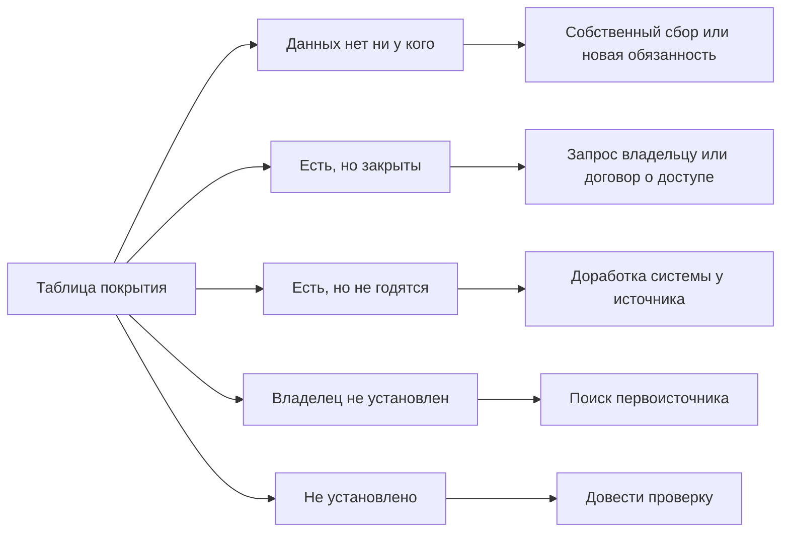

# Пробелы и план

Найденного почти никогда не хватает на всё, и главный итог инвентаризации — честный ответ, чего именно не хватает и что с этим делать. Эта глава — о трёх шагах между черновиком реестра и результатом. На четвёртом шаге эксперты и владельцы проверяют найденное, на пятом каждый вопрос сверяют с источниками в таблице покрытия, на шестом каждому пробелу назначают решение, ответственного и срок. Пробел без строки плана следующая инвентаризация найдёт на том же месте.

## Коротко

| Шаг | Что получается | Готово, когда |
|-----|----------------|---------------|
| **[4. Эксперты и владельцы](#шаг-4-эксперты-и-владельцы)** | Исправленный реестр; у ключевых записей — отметка «подтверждено владельцем» | Замечания разобраны, подсказки подтверждены источником, у ключевых записей — подтверждение или запрос с датой |
| **[5. Таблица покрытия](#шаг-5-таблица-покрытия)** | Строка на каждую пару «вопрос — источник» и список пробелов с видом | У каждого вопроса — доступный источник годного качества или пробел с видом и отметкой, мешает ли он цели |
| **[6. План](#шаг-6-план)** | Строки «пробел — решение — кто — срок» | У каждого пробела — решение и ответственный или запись, что пробел принимают |

## Что это

**Пробел** — вопрос, на который нет доступного источника годного качества: данных нет, они закрыты, не годятся или о них толком ничего не известно. Пробел — свойство пары «вопрос — данные», а не набора: один и тот же набор закрывает один вопрос и оставляет пробел в другом.

**Таблица покрытия** — сводка пятого шага: строка на каждую пару «вопрос — источник» с доступностью, качеством и видом пробела. Её собирают из реестра и листа «Вопросы», а не пишут заново. По ней владелец задачи видит, хватает ли данных для цели. Это анализ разрывов (gap-анализ), и он часто полезнее самого реестра.

**План** — строки «пробел — решение — кто — срок». Решений четыре: запрос владельцу, договор о доступе, собственный сбор и доработка системы. Пятый исход — принять пробел до следующего обновления — тоже записывают.

## Когда применять

Шаги 4–6 начинают, когда черновик реестра собран и у записей стоят режим доступа и отметка о качестве ([«Найти и описать данные»](./01-steps.md#3-найти-и-описать-данные)). Их проходят в обоих подходах, но с разным упором:

- **«Где найти нужное».** Главное — таблица покрытия. Шестой шаг узкий: чужие системы не изменить, остаются запросы, договоры и собственный сбор.
- **«Чем владеем».** Реестр сверяют ещё и с полномочиями: что положено, но не найдено; что собирают дважды; что можно открыть или передать. Шестой шаг шире: свои системы можно дорабатывать.
- **Срочная задача.** Один-два разговора с экспертами, таблица покрытия и по строке плана на пробел ([«Если времени мало»](./01-steps.md#если-времени-мало)).

## Шаг 4. Эксперты и владельцы

Эксперты и владельцы проверяют разное. Эксперт — отраслевой специалист, аналитик, исследователь, сотрудник ассоциации — знает отрасль снаружи: системы, о которых не пишут на сайтах, данные, которым в отрасли не доверяют. Владелец знает свои данные изнутри и отвечает за них: его ответ — самое сильное основание и для владельца в записи, и для режима доступа.

| Кто | Что проверяет | Что даёт |
|-----|---------------|----------|
| **Эксперты отрасли** | Каких источников не хватает, что устарело, где ошибка во владельце или доступе, каким данным не доверяют и почему | Новые источники и замечания |
| **Владельцы ключевых наборов** | Описание, режим доступа и его основание, ответственного | Подтверждение или исправление записи |

- **Показывают черновик, а не спрашивают «какие данные есть».** По конкретной таблице и замечания конкретнее ([«Опросы экспертов»](../02-approaches/02-methods.md#6-опросы-экспертов)).
- **Подсказку эксперта подтверждают источником** — адресом, документом, выгрузкой — и только потом вносят в реестр. Новый источник описывают по правилам третьего шага ([«Когда возвращаются назад»](./01-steps.md#когда-возвращаются-назад)).
- **Владельцу отправляют только его записи** выгрузкой, в которой он отмечает «подтверждаю» или «исправляю», как в анкете ([«Заполнить заранее»](./04-questionnaires.md#заполнить-заранее)).
- **Молчание — не подтверждение.** Без ответа запись остаётся с прежним основанием.
- **Документ сильнее мнения.** Если эксперт и документ расходятся, в запись идёт документ, а замечание эксперта — в примечание и в вопрос владельцу.

### Ключевые наборы

Подтверждение просят не для всех записей, а для ключевых — тех, ошибка в которых обходится дороже всего. Ключевой набор:

- **нужен для главного вопроса** — без ответа на него цель не достигнута ([«Как проверить список»](./02-goals-and-questions.md#как-проверить-список));
- **отвечает на несколько вопросов** — ошибка в его записи переходит во все ответы;
- **единственный источник ответа** — если запись неверна, ответа нет совсем ([«Что читать на карте»](../02-approaches/04-data-maps.md#что-читать-на-карте));
- **закрыт или с ограничениями** — от статуса зависит, пойдёт ли запрос и что попадёт в общедоступную часть.

### Где записать подтверждение

Подтверждение записывают в одном месте — в поле «откуда известно» (`known_from`) самой записи, после прежнего источника: кто подтвердил, чем и когда. Дату проверки записи (`checked`) меняют на дату ответа.

```text
анализ полномочий: положение о министерстве; подтверждено владельцем: Министерство здравоохранения, письмо от 2026-10-28
```

Если владелец не ответил, в том же поле — дата запроса и «ответа нет». Отметки, которые владелец поставил в анкете на третьем шаге, записывают так же ([«Как записать»](./04-questionnaires.md#как-записать)). Перед публикацией проверяют только, что у ключевых записей такая отметка есть ([«Проверка»](./09-result-and-upkeep.md#проверка)).

## Шаг 5. Таблица покрытия

Пятый шаг отвечает на главный вопрос инвентаризации — хватает ли данных для задачи. Для каждой пары «вопрос — источник» записывают доступность по [шкале доступа](./06-access.md#шкала) и итог качества для этого вопроса — по порогу, записанному до проверки ([«Порог „годится“»](./02-goals-and-questions.md#порог-годится)). Вопрос без доступного источника годного качества — пробел. Ниже — фрагмент таблицы условного примера книги: 5 вопросов из 15.

| Вопрос | Источник | Доступность | Качество | Вид пробела | Мешает цели? |
|--------|----------|-------------|----------|-------------|--------------|
| 1. Медицинские организации | Реестр медицинских организаций фонда ОМС | открытые данные | не проверено: вопрос попутный | не установлено | нет |
| 2. Врачи, города и сёла (главный) | Сборник центра; регистр медицинских работников | сборник — в PDF; регистр — с ограничениями | сборник — с оговорками, разреза «город — село» нет | есть, но закрыты | частично |
| 3. Коечный фонд | Ряды статистического ведомства | открытые данные | с оговорками: методика менялась | — | нет |
| 4. Сроки ожидания (главный) | Листы ожидания, журнал, запись к врачу; учёт фонда | листы, журнал и запись к врачу — с ограничениями; учёт фонда — закрыто; в записях персональные данные | в четырёх регионах из пяти; регионы не сравнить | есть, но не годятся | да |
| 9. Расстояния до больниц для сёл | OpenStreetMap; поездки абонентов оператора связи | открытые данные; оператор — по соглашению | на карте на треть меньше больниц; оператор — два региона | есть, но не годятся | частично |

- **Сначала ещё раз поискать.** Прежде чем записать пробел, вопрос ищут другим методом: по аналогии, у другого ведомства, в веб-архиве. Часть пробелов закрывается здесь же ([«Как методы проверяют друг друга»](../02-approaches/02-methods.md#как-методы-проверяют-друг-друга)).
- **Расхождения между методами — тоже пробелы.** Если один метод нашёл набор, а другой нет, и причину не выяснили, это строка списка, а не забытая заметка.
- **Мешает ли цели — по главным вопросам.** Пробел у главного вопроса мешает цели. Пробел у попутного можно принять.
- **Вопросы не подгоняют.** Если выясняется, что вопрос задан не так, это возврат к первому шагу, а не правка таблицы ([«Когда возвращаются назад»](./01-steps.md#когда-возвращаются-назад)).

### Виды пробелов

Вид пробела решает, что с ним делать: просить у владельца данные, которых нет ни у кого, бесполезно, а собирать самим то, что есть, но закрыто, — лишние расходы.

| Вид | Как определить | Пример из условного примера |
|-----|----------------|-----------------------------|
| **Данных нет ни у кого** | Ни один метод не нашёл источника, и ни одно полномочие не обязывает их собирать | Фактические сроки ожидания после анализа полномочий: измерять их никто не обязан |
| **Есть, но закрыты** | Источник найден, но он «закрыто» или «с ограничениями», и условия не выполнить | Учёт оказанной помощи фонда ОМС: персональные данные и врачебная тайна |
| **Есть, но не годятся** | Данные доступны, но не проходят порог: неполны, устарели, нет нужного разреза, методика другая | Листы ожидания одного региона: дата направления пуста у трети записей |
| **Есть, владелец не установлен** | Данные видны — копия, файл без издателя, — но кто их ведёт и на каком основании, неизвестно | Три копии ряда коечного фонда на агрегаторах без ссылки на источник — пока не нашёлся первоисточник |
| **Не установлено** | Проверить не удалось: доступ «не установлено», качество «не проверено», владелец не ответил | Три владельца ещё не ответили на запрос, срок по закону не истёк |

Вид пробела меняется по ходу работы. Пробел «данных нет ни у кого» по фактическим срокам ожидания продержался до опроса владельцев: регионы назвали листы ожидания и систему записи к врачу, и вид пробела сменился на «есть, но не годятся». Последний вид — пробел не в данных, а в знании о них. Его не прячут среди готовых ответов: в таблице покрытия он стоит так же, как остальные.

Подход «чем владеем» добавляет две находки, которые не пробелы покрытия, но тоже требуют решения:

- **положено по полномочию, но не найдено** — спросить владельца: учёт могут вести на бумаге, в таблицах или в подведомственном учреждении ([«От полномочия к набору»](./03-owners-and-mandates.md#от-полномочия-к-набору));
- **собирают дважды** — выбрать один источник достоверных сведений, остальные получают сведения обменом, по [принципу однократности](../01-basics/04-principles.md#принципы-в-других-методиках).

## Шаг 6. План

Пробелы закрывают не отчётом, а изменениями. Решают владелец задачи и владельцы систем: команда инвентаризации предлагает решение, но не меняет чужие системы сама. От вида пробела зависит, какое решение искать первым:



Если пробел не мешает главной цели, любое из этих решений можно заменить записью «принять до обновления».

У строки плана четыре поля:

- **пробел** — вопрос и вид пробела из таблицы покрытия;
- **решение** — запрос владельцу, договор о доступе, собственный сбор, доработка системы или «принять»;
- **кто** — подразделение владельца или сотрудник по имени, а не «команда инвентаризации»;
- **срок** — дата, а не «в следующем году».

| Решение | Когда | Что записать |
|---------|-------|--------------|
| **Запрос владельцу** | Данные есть, но не опубликованы, нужен другой разрез или основание закрытия не найдено | Что запросили, дату и ответ. Если нормы, которая ограничивает доступ, нет, — предложить открыть ([«Порядок проверки»](./06-access.md#порядок-проверки)) |
| **Договор о доступе** | Данные закрыты, но законный способ получить их есть: соглашение об обмене, обезличенная или сводная выгрузка | Условия и срок договора; сводная выгрузка — отдельной записью ([«Что делать со статусом»](./06-access.md#что-делать-со-статусом)) |
| **Собственный сбор** | Данных нет ни у кого, или их не получить | Методику, охват и дату; собранный набор — новая запись реестра |
| **Доработка системы** | Данные свои, но не годятся или их не хватает: нет поля, справочника, порядка обновления | Описание данных доработки — в реестр до того, как проектируют экраны |
| **Принять** | Пробел не мешает главной цели | Причину и когда пересмотреть — в паспорт результата ([«Паспорт»](./09-result-and-upkeep.md#паспорт)) |

### Доработка от данных, а не от экранов

Проектировать от данных (data-first) — значит сначала решить, какие сведения нужны, в какой структуре, с какими справочниками, кто их владелец и кому их отдают, а уже потом — как они выглядят для пользователя ([«Data-first в проектировании»](../01-basics/04-principles.md#7-data-first-в-проектировании)). Экраны меняют при каждой доработке, а данные переживают систему. Если начать с экрана, поле появится в форме, но останется необязательным, без проверки и без правила расчёта, и через год данные снова не сравнить.

До технического задания составляют короткое описание данных доработки:

- какие сведения и в каких полях;
- справочники значений;
- правила: какие поля обязательны, как их проверяют, как считают производные показатели;
- кто владелец и откуда приходят данные;
- что отдают другим и в каком виде: выгрузку, сводные данные, программный интерфейс.

Описание сразу вносят в реестр: доработанная или новая система появляется в нём уже описанной.

## Что получается

- Исправленный реестр: ключевые записи подтверждены владельцами, новые источники от экспертов проверены и описаны.
- Таблица покрытия — по строке на пару «вопрос — источник».
- Список пробелов — с видом и отметкой, мешает ли пробел цели.
- План — строки «пробел — решение — кто — срок»; принятые пробелы — в паспорт результата.

Всё это — данные, а не отчёт: таблицу покрытия строят из листов «Вопросы», «Связи» и реестра, план ведут листом рядом с ними ([«Что хранить»](../06-tools/03-registry-as-data.md#что-хранить)). Тогда при обновлении видно, какие пробелы закрылись, а какие остались.

## Пример

Продолжение условного примера из глав [«Доступ и ограничения»](./06-access.md#пример) и [«Качество данных»](./07-quality.md#условный-пример-доступность-медицинской-помощи): 15 вопросов руководства о доступности медицинской помощи в регионах, после третьего шага в реестре 31 запись. Где пример на других шагах — в [сводной таблице](./01-steps.md#пример) главы «Семь шагов».

**Шаг 4.** Черновик показали эксперту — экономисту здравоохранения, — а министерству и центру медицинской статистики отправили выгрузки их записей. Эксперт предупредил, что ряды коечного фонда нельзя сравнивать до и после смены методики учёта: это записали в отметку о качестве. Министерство подтвердило свои записи, центр исправил периодичность сборника. В записи регистра медицинских работников в поле «откуда известно» после «анализ полномочий: положение о министерстве» появилось «подтверждено владельцем: Министерство здравоохранения» с датой письма.

**Шаг 5.** Фрагмент таблицы покрытия — [выше](#шаг-5-таблица-покрытия). По всем 15 вопросам у десяти есть доступный источник, четыре закрыты частично, один — пробел. Главный вопрос о сроках ожидания закрыт частично: даты записывают во всех пяти регионах первой очереди, но в трёх разных видах, и сравнить регионы нельзя.

**Шаг 6.** План утвердил заместитель министра — владелец задачи.

| Пробел | Решение | Кто | Срок |
|--------|---------|-----|------|
| Вопрос 4: записи с датами не открыть — в них персональные данные | Договор о доступе: число пациентов в листе ожидания и медианный срок по региону и месяцу | Министерство, фонд ОМС, органы регионов | март 2027 |
| Вопрос 4: в одном регионе дата направления пуста у трети записей | Доработка системы: дата направления — обязательное поле | Орган здравоохранения региона и оператор системы | январь 2027 |
| Вопрос 4: срок считают по-разному | Доработка: одно правило расчёта и общий справочник видов помощи | Министерство утверждает, регионы дорабатывают | март 2027 |
| Вопрос 4: журнал ожидания — таблица на общем диске | Доработка: перенести журнал в региональную систему | Орган здравоохранения региона | апрель 2027 |
| Вопрос 2: в сборнике нет разреза «город — село» | Запрос владельцу: выгрузка из регистра с этим разрезом | Министерство, выгрузку готовит центр | ноябрь 2026 |
| Коечный фонд по больницам не публикуют, нормы нет | Запрос владельцу: предложить открыть | Центр медицинской статистики | апрель 2027 |
| Вопрос 9: в OpenStreetMap на треть меньше больниц, чем в реестре | Собственный сбор: привязать недостающие больницы по адресам из реестра | Департамент, который готовит справки | декабрь 2026 |

Сравнение со странами по показателю ВОЗ приняли как есть: у ВОЗ другое определение врача, и это отмечено в записи и в паспорте. Проверку качества реестра медицинских организаций отложили до обновления: вопрос о нём попутный.

**От данных, а не от экранов.** Для листов ожидания министерство сначала описало данные, а не форму:

- сведения — дата направления, дата помощи, вид помощи, медицинская организация;
- справочник видов помощи — общий для всех регионов;
- правило — срок считают от даты направления до даты помощи, дата направления обязательна;
- владелец — орган здравоохранения региона;
- что отдают — сводные данные по региону и месяцу, малые значения скрыты.

Экраны региональных систем дорабатывали уже по этому описанию, а описание сразу легло в записи листов ожидания в реестре. Пример показывает ход работы, а не то, как устроено здравоохранение в конкретной стране.

## Частые ошибки

- **Пробел без вида.** «Данных нет» и «закрыто» лежат в одном списке, и решение выбирают наугад: у владельца просят то, чего нет ни у кого. У каждого пробела записывают вид.
- **Молчание как подтверждение.** Владелец не ответил, а запись помечена подтверждённой. Без ответа основание остаётся прежним, а в «откуда известно» — дата запроса.
- **Решение без ответственного.** В плане «запросить данные» и «доработать систему», но не сказано кто и к какому сроку. Такая строка — пожелание, а не план.

Сквозные ошибки — в главе «Практики и антипаттерны»: [«Пробелов нет»](../08-practices/01-practices-and-anti-patterns.md#пробелов-нет) и [«Сдали и забыли»](../08-practices/01-practices-and-anti-patterns.md#сдали-и-забыли).

## Ограничения

- «Данных нет» значит «не нашли этими методами к этой дате». Поэтому у пробела записывают, где искали и когда, а при обновлении поиск повторяют.
- Порог «годится» — договорённость с владельцем задачи, а не свойство данных: с другим порогом таблица покрытия будет другой.
- Шестой шаг часто выходит за полномочия команды инвентаризации: менять системы и открывать данные решают владельцы и руководство. Команда предлагает решение, но не принимает его, поэтому владелец задачи нужен с первого шага.
- Подтверждение владельца — сильное основание, но не доказательство: владелец тоже ошибается или помнит, как было задумано, а не как есть. Ключевые записи сверяют ещё и с самими данными ([«Как проверять ответы»](./04-questionnaires.md#как-проверять-ответы)).

## Источники

- Главы [«Семь шагов»](./01-steps.md) — место шагов 4–6 в процессе и возвраты к поиску; [«Семь методов»](../02-approaches/02-methods.md) — опросы экспертов и как методы проверяют друг друга; [«Доступ и ограничения»](./06-access.md) и [«Качество данных»](./07-quality.md) — доступность и итог качества в таблице покрытия; [«Принципы»](../01-basics/04-principles.md) — «Готовьтесь к разочарованию» и «Data-first в проектировании».