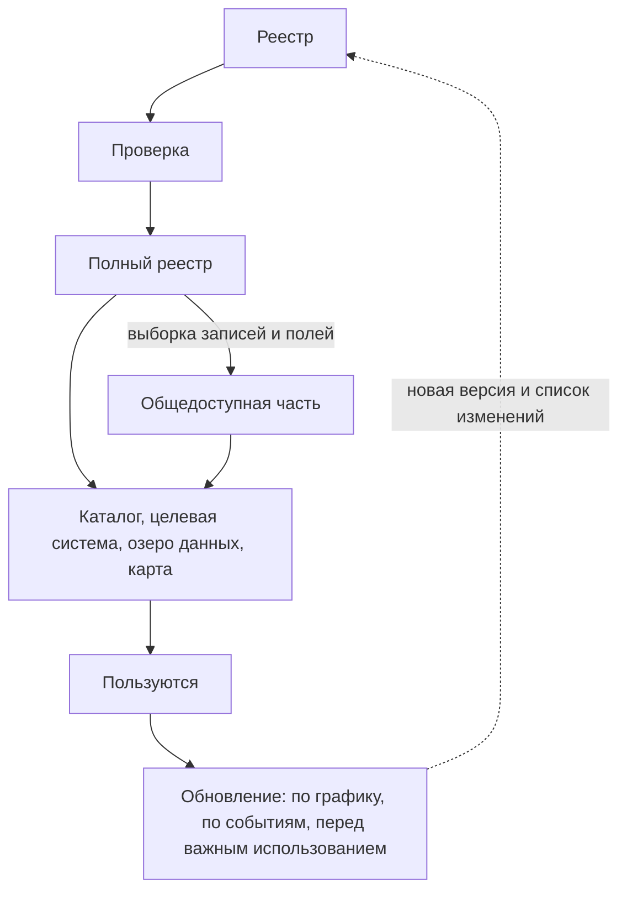

# Результат и поддержка

Инвентаризация заканчивается не отчётом, а результатом, которым пользуются: каталогом данных, целевой информационной системой, пополнением озера данных или картой данных. Все они строятся из одного реестра. Если показать можно не всё, общедоступную часть получают из полного реестра выборкой записей и полей, а не ведут отдельной копией. Перед публикацией реестр проверяют программа, составитель, эксперты и владельцы ключевых наборов. Публикуют данными, а не только отчётом: с паспортом, лицензией и версией, с датой у реестра и у каждой записи. После публикации у результата должен быть владелец процесса и план обновления, потому что реестр устаревает с первого дня. Из 136 адресов карт атласа 2018–2019 годов к октябрю 2026 года у 29 исчезли домены, а 13 переехали. Если поддерживать результат никто не будет, его честно публикуют как снимок на дату.

## Коротко

| Что сделать | Что получается | Готово, когда |
|-------------|----------------|---------------|
| **[Выбрать вид результата](#виды-результата)** | Каталог, целевая система, озеро данных, карта или их сочетание | Известно, кто пользуется результатом и что ему нужно из реестра |
| **[Решить, что показывать](#полный-реестр-и-общедоступная-часть)** | Правило: какие записи и поля входят в общедоступную часть | Правило утвердили владелец задачи и юрист; общедоступную часть строит выборка, а не ручная копия |
| **[Проверить](#проверка)** | Исправленный реестр, подтверждения владельцев | Проверки программой проходят без ошибок; замечания экспертов и владельцев разобраны |
| **[Составить паспорт](#паспорт)** | Цель, границы, методы, охват, состав, пробелы, даты, версия | По паспорту понятно, чему в реестре можно верить и чего в нём нет |
| **[Опубликовать](#публикация)** | Файлы данных и таблица по постоянному адресу, отчёт из них | Результат открыт тем, кому предназначен; его можно скачать и проверить программой |
| **[Передать](#кто-отвечает-после-публикации)** | Владелец процесса, ответственные за записи, план обновления | Команда инвентаризации может уйти, а обновление не остановится |
| **[Поддерживать](#поддержка)** | Новые версии и список изменений | Проверки идут по плану; исчезнувшие записи помечены, а не удалены |

## Виды результата

Вид результата намечают на первом шаге вместе с целью: от него зависит, что записывать ([«Сформулировать цели и задачи»](./01-steps.md#1-сформулировать-цели-и-задачи)). Для целевой системы нужно описание до полей, для карты — пары «вопрос — источник», для публичного каталога — описания по стандарту. На седьмом шаге результат собирают из реестра.

| Результат | Когда | Что из реестра нужно | Кто пользуется |
|-----------|-------|----------------------|----------------|
| **Внутренний каталог данных** | Подход «чем владеем»: организация хочет знать и использовать свои данные | Весь реестр, включая закрытые наборы, с ответственными и основаниями | Сотрудники, аналитики, ответственный за защиту данных |
| **Публичный каталог или портал открытых данных** | Открытие данных | Общедоступная часть: открытые наборы с условиями использования и описанием по стандарту ([DCAT](../05-frameworks/02-metadata-standards.md)), часто и закрытые — с основанием и порядком получения | Граждане, компании, исследователи, журналисты |
| **Каталог для партнёров** | Обмен данными с отраслью | Наборы, которые предоставляют, с условиями доступа и соглашениями | Банки, операторы связи, исследователи |
| **Целевая информационная система** | Проактивные услуги, межведомственная интеграция | Наборы, которые нужно соединить, до полей, со справочниками и источниками достоверных сведений | Архитекторы и разработчики |
| **Озеро данных** | Аналитика, обучение моделей | Наборы, которые загружают, с описаниями, схемами, отметками о качестве и условиями использования | Аналитики, команды моделей |
| **Карта данных** | Подход «где найти нужное» | Вопросы, источники и доступность каждой пары ([«Карты данных»](../02-approaches/04-data-maps.md)), подробные записи ключевых источников | Руководство, аналитики, исследователи |
| **Подборка наборов** | Хакатон, конкурс, дата-лаборатория | Наборы с адресами выгрузки, условиями и коротким описанием | Участники — на время события |

- **Отчёт — не результат.** Отчёт об инвентаризации, презентация и интеллект-карта — производные: их строят из реестра и указывают, из какой версии. Обратно не получается: из отчёта реестр не восстановить. Карты атласа 2018–2019 годов пришлось переносить с картинок в данные вручную ([«Реестр только в отчёте или картинке»](../09-practices/02-anti-patterns.md#реестр-только-в-отчёте-или-картинке)).
- **Результаты сочетают.** Распространённая схема — непубличный каталог с полным реестром и публичный портал с его общедоступной частью. Так устроены инвентари федеральных ведомств США: у ведомства полный инвентарь, а общедоступную часть из файлов `data.json` собирает каталог data.gov ([«Зарубежные методики»](../05-frameworks/04-international-practice.md#инвентари-данных-федеральных-ведомств-сша)). Карта данных для руководства и записи найденных систем во внутреннем каталоге — тоже сочетание: карта отвечает на вопросы, каталог хранит подробности.
- **Результат — там, где им пользуются.** Если аналитики ищут данные во внутреннем каталоге метаданных, реестр загружают туда, а не публикуют рядом отдельной таблицей ([«Четыре уровня»](../06-tools/01-from-spreadsheet-to-catalog.md#четыре-уровня)). Как выбрать платформу для публичного каталога и не дать ему умереть, разобрано в книге [«Каталоги данных»](https://datacatalogs.begtin.tech/).

Результат готов, когда им пользуются без составителя: по каталогу находят набор и понимают, как его получить; по карте отвечают на вопрос или видят пробел; по описанию до полей пишут техническое задание. Проверить это просто: дать результат тому, кто будет им пользоваться, и попросить найти ответ на два-три вопроса из списка ([«Цели и вопросы»](./02-goals-and-questions.md)).

## Полный реестр и общедоступная часть

Сам реестр — данные с режимом доступа. В нём бывают имена и телефоны сотрудников, описания закрытых систем, внутренние адреса, отметки о персональных данных. Поэтому у реестра часто две части. Полная — для владельца и тех, кто работает с данными. Общедоступная — для всех. Общедоступную часть строит программа: выбирает записи и поля из полного реестра при каждом обновлении. Если вести её отдельной копией, через полгода две части разойдутся.

| Что | Полный реестр | Общедоступная часть |
|-----|---------------|---------------------|
| **Открытые наборы** | Да | Да, все поля |
| **Наборы с ограничениями** | Да | Да: описание, владелец, режим доступа и порядок получения |
| **Закрытые наборы** | Да | Обычно да: наименование, описание, владелец, режим доступа с основанием. Не показывают, только если тайна — сам факт существования набора |
| **Ответственный** | Имя, должность, телефон | Адрес для вопросов о данных, который не меняется при смене сотрудника |
| **Внутренние адреса, схемы закрытых систем** | Да | Нет |
| **Откуда известно, служебные пометки, вопросы к владельцам** | Да | Нет или только метод |

**Закрытое не убирают, а объясняют.** Запись о закрытом наборе говорит пользователю, что данные есть и как их запросить, а владельцу — что решение о закрытии принято и обосновано. Так советуют все методики, которые это обсуждают:

- **Project Open Data** требовал включать в общедоступную часть инвентаря как минимум все открытые наборы и разрешал включать остальные — например, наборы с ограничениями, чтобы о них знали и знали, как их получить. У закрытого набора в описании объясняют, почему его нельзя открыть, а решение принимают вместе с юристами ведомства.
- **Закон OPEN Government Data Act** требует публиковать в инвентаре всё, что нельзя скрыть по закону о свободе информации (44 U.S.C. § 3511(a)(2)(C)). Решая, открывать ли набор, ведомство учитывает и риск сопоставления: набор сам по себе безопасен, а вместе с другими доступными сведениями раскрывает людей или уязвимости (§ 3511(a)(2)(E)).
- **GovEx** оставляет решение об открытости инвентаря органу управления данными, а чувствительные наборы советует не исключать, а описывать с пояснением, в чём их чувствительность. Филадельфия включает в инвентарь наборы, которые никогда не опубликуют ([«GovEx Data Inventory»](../05-frameworks/04-international-practice.md#govex-data-inventory)).
- **Регламент ЕС об управлении данными** (Data Governance Act, 2022/868) обязывает страны держать единую информационную точку с перечнем защищённых данных государственных органов — персональных, конфиденциальных, защищённых чужой интеллектуальной собственностью. По каждому ресурсу указывают как минимум формат, объём и условия повторного использования (статья 8). Национальные перечни собирает европейский реестр защищённых данных на портале data.europa.eu. Во Франции единый информационный пункт — DINUM, в Польше — раздел dane.gov.pl/pl/dga: в польском перечне защищённых ресурсов на 31 декабря 2025 года была 1781 позиция, а закон об управлении данными от 27 марта 2026 года (Dz.U. 2026 poz. 548, в силе с 23 июля 2026 года) обязывает органы публичного сектора вносить в него сведения.

- **Великобритания.** Список информационных активов, который требует регламент о повторном использовании информации публичного сектора 2015 года, по разъяснению Национального архива включает и неопубликованное. В реестре Министерства транспорта у 33 активов из 89 в поле «опубликован» стоит «нет» ([«Реестры информационных активов Великобритании»](../05-frameworks/04-international-practice.md#реестры-информационных-активов-великобритании)).
- **Франция.** Руководство data.gouv.fr по каталогизации называет внутренний каталог ведомства административным документом: его публикуют, а у каждой записи отмечают, можно ли её сообщать. На data.gouv.fr 25 октября 2026 года было 214 описаний наборов с ограниченным доступом и причиной ограничения.
- **Южная Корея.** data.go.kr публикует общий перечень данных, которые учреждения ещё не открыли, с годом открытия — 9987 строк в версии от 10 февраля 2026 года. Пользователь видит, что данные есть и когда их ждать.

**Пример — GSA.** Общедоступная часть инвентаря Администрации общих служб США (GSA) — файл по адресу `www.gsa.gov/data.json`, который перенаправляет на `open.gsa.gov/data.json`. 25 октября 2026 года в нём было 344 записи по схеме DCAT-US 3.0: 310 открытых, одна с ограничениями и 33 закрытые. У всех закрытых записано, что набор не публикуется и за подробностями надо обращаться к владельцу, а у 31 из 33 — и почему. У 13 причина — коммерческая тайна и сведения, полученные от компаний: это формулировка исключения 4 закона о свободе информации (5 U.S.C. § 552(b)(4)). У остальных — «только для сотрудников GSA» или «закупка до заключения контракта». Пользователь видит не только то, что можно скачать, но и то, что существует и почему закрыто.

- **Правило выборки записывают в паспорт:** какие записи и поля входят в общедоступную часть и кто это решил. Решают владелец данных и юрист или ответственный за защиту данных, утверждает владелец задачи ([«Кто участвует»](./01-steps.md#кто-участвует)).
- **Описание набора — не сам набор.** Описание без данных обычно безопасно. Но перечень систем с версиями программ и внутренними адресами помогает атакующему, а примеры значений из набора с персональными данными — уже персональные данные.

## Проверка

Перед публикацией реестр проверяют по очереди — от дешёвой проверки к дорогой:

| Кто | Что проверяет | Итог |
|-----|---------------|------|
| **Программа** | Пустые ячейки в 14 атрибутах, повторы идентификаторов и синонимов, коды из справочников, ссылки на владельцев и полномочия, даты, адреса ([«Как вести реестр»](./05-registry.md#как-вести-реестр)) | Список ошибок; публикуют, когда он пуст |
| **Составитель** | Всё, что не проверит программа, — по [чек-листу](../10-appendices/04-checklists.md#перед-публикацией-реестра): владелец из документа, основание режима доступа, откуда известно, состав групп, решения по пробелам. Плюс выборка: 10–20 случайных записей проверяют заново, с нуля | Исправленные записи и доля ошибок в выборке |
| **Эксперты отрасли** | Чего не хватает, что устарело, где ошибка во владельце или доступе | Новые источники, проверенные по правилам третьего шага ([«Привлечь экспертов»](./01-steps.md#4-привлечь-экспертов)) |
| **Владельцы ключевых наборов** | Описание, режим доступа, ответственного | Отметка «подтверждено владельцем» с датой — самое сильное основание статуса доступа |
| **Юрист или ответственный за защиту данных** | Общедоступную часть: нет ли в ней персональных данных, закрытых сведений, лишних полей | Утверждённое правило выборки |

- **Сначала программа, потом люди.** Эксперту и владельцу не отправляют реестр с пустыми ячейками и повторами: их время дороже.
- **Выборка проверяет метод.** Если в 10–20 случайных записях нашлось больше одной-двух ошибок, ошибка, скорее всего, повторяется по всему реестру: ищут её причину, а не исправляют записи по одной. Тот же приём проверяет языковую модель: её ответы сначала сравнивают с небольшой выборкой, размеченной вручную ([«Начать с проверочной выборки»](../02-approaches/03-ai.md#4-начать-с-проверочной-выборки)).
- **Владельцу — только его записи.** Выгрузкой, в которой он отмечает «подтверждаю» или «исправляю», как в анкете ([«Заполнить заранее»](./04-questionnaires.md#заполнить-заранее)). Молчание — не подтверждение: без ответа запись остаётся с прежним основанием.
- **Адреса — из сети страны.** Государственные сайты проверяют из сети той страны, которой они принадлежат: из-за рубежа многие не открываются ([«Адреса источников в октябре 2026 года»](../08-atlas/01-how-to-read.md#адреса-источников-в-октябре-2026-года)).
- **Расхождения не прячут.** Если эксперт и документ расходятся, в запись идёт документ, а замечание эксперта — в примечание и в вопрос владельцу.
- **Владелец задачи принимает результат по цели:** есть ли у каждого вопроса источник или записанный пробел ([«Сопоставить цели с данными»](./01-steps.md#5-сопоставить-цели-с-данными)).

## Паспорт

Паспорт — описание самого реестра: что, когда, кем, как и зачем инвентаризировано. Без него через год не понять, чему в реестре можно верить. «Данных нет» могло значить «не искали», а «закрыто» — «проверяли из-за рубежа».

| Поле | Что писать | Свойство DCAT |
|------|------------|---------------|
| **Название и описание** | Что за реестр или карта — одной-двумя фразами | `dct:title`, `dct:description` |
| **Цель и владелец задачи** | Ради чего инвентаризация, кто её поставил и принял ([«Как записать цель»](../01-basics/02-goals.md#как-записать-цель)) | — |
| **Подход и границы** | Подход; организации, территория, период, слои данных, глубина, что исключено ([«Границы»](./02-goals-and-questions.md#границы)) | `dct:spatial`, `dct:temporal` — частично |
| **Методы и охват** | Какими методами искали; сколько адресатов опроса ответило, кто нет; из какой сети проверяли адреса | — |
| **Состав** | Сколько записей по типам и режимам доступа; сколько вопросов и с каким покрытием | — |
| **Пробелы и ограничения** | Чего нет и почему; что не проверено | — |
| **Правило общедоступной части** | Какие записи и поля входят в неё, кто решил | — |
| **Составители и контакты** | Кто составил, куда писать об ошибках | `dct:creator`, `dcat:contactPoint` |
| **Владелец процесса и план обновления** | Кто отвечает за обновление; что, как часто и по каким событиям проверяют | `dct:publisher` — частично |
| **Даты** | Когда проводилась инвентаризация, дата этой версии, дата следующей проверки | `dct:issued`, `dct:modified` |
| **Версия** | Номер версии и ссылка на список изменений | `dcat:version`, `dcat:previousVersion` |
| **Лицензия** | Лицензия на сам реестр | `dct:license` |
| **Стандарт и файлы** | По какой схеме описаны записи, где лежат файлы данных | `dct:conformsTo`, `dcat:distribution` |

В DCAT каталог описывают теми же свойствами, что и набор, а в третьей версии стандарта добавлены свойства для версий. Полей под цель, методы, охват и пробелы в стандарте нет — их держат своими полями. В файле `data.json` паспорта нет вовсе: у GSA на верхнем уровне файла только тип и ссылка на схему, ни названия, ни даты, ни контакта. Поэтому паспорт хранят отдельным файлом рядом с реестром.

Паспорт карты атласа — пример короткого паспорта: тема, вид карты, дата проверки, число вопросов и источников, откуда сведения, автор, лицензия и ссылка на данные. Их хранят в файле карты и выводят на страницу программой ([«Как устроена страница карты»](../08-atlas/01-how-to-read.md#как-устроена-страница-карты)). Цели, границ и пробелов в паспортах атласа нет: при составлении карт в 2018–2019 годах их не записали.

## Публикация

- **Данные, а не только отчёт.** CSV — для людей и таблиц, JSON или YAML — для программ. Описания — по стандарту: DCAT-AP или DCAT-US, у которого общедоступная часть — файл `data.json` ([«Стандарты описания»](../05-frameworks/02-metadata-standards.md)). Отчёт, картинки и страницы строят из этих файлов ([«Реестр как данные»](../06-tools/03-registry-as-data.md)).
- **Постоянный адрес.** Файл лежит по адресу, который не меняется от версии к версии: на него ссылаются и с него собирают каталоги. Project Open Data требовал публиковать общедоступную часть инвентаря по адресу `www.[ведомство].gov/data.json`, и оттуда её забирает data.gov. Если адрес всё же меняется, старый перенаправляют на новый — как `www.gsa.gov/data.json` на `open.gsa.gov`. Прошлые версии лежат рядом, каждая по своему адресу.
- **Дата у реестра и у каждой записи.** Дата версии — в паспорте, дата проверки — в каждой записи (колонка `checked` в [шаблоне реестра](../10-appendices/03-templates.md#реестр-данных)). Дата изменения данных и дата проверки записи — разные даты: первую берут из самих данных, вторую ставит составитель, когда проверил запись.
- **Лицензия на сам реестр** — отдельно от условий использования наборов в нём: чтобы реестр можно было дополнять, сравнивать и перепубликовать. Подходят CC BY 4.0 и CC0. Текст этой книги распространяется по CC BY 4.0, карты атласа помечены CC0.
- **Канал для замечаний** — адрес или система задач, куда сообщать об ошибках и недостающих наборах. Project Open Data требовал от ведомств механизм обратной связи: пользователи помогают решить, что открывать в первую очередь. Замечание — повод проверить запись, а не основание её изменить.
- **Как цитировать** — если реестром будут пользоваться в исследованиях: автор, название, версия, дата, адрес. Пример — файл [CITATION.cff](https://github.com/ivbeg/data-inventory/blob/main/CITATION.cff) в репозитории этой книги.

Репозиторий git с файлами данных — простой способ получить постоянный адрес, версии и историю изменений бесплатно. Так хранятся данные атласа ([data/](https://github.com/ivbeg/data-inventory/tree/main/data)).

## Кто отвечает после публикации

Команда инвентаризации — проектная: после публикации она уходит. Если обязанности не передать, обновление остановится в тот же день. Передают три роли:

| Роль | Кто | Что делает |
|------|-----|------------|
| **Владелец процесса** | Директор по данным, офис управления данными, отдел статистики или аналитики — лучше тот, кто сам пользуется результатом | Отвечает за план обновления, сводит изменения, выпускает версии, отвечает на замечания |
| **Ответственные за записи** | Сотрудники подразделений-владельцев — обычно те же, кто отвечал на анкету | Сообщают об изменениях своих наборов, подтверждают записи при плановой проверке |
| **Юрист или ответственный за защиту данных** | Тот же, кто утвердил правило выборки | Проверяет общедоступную часть перед каждой версией |

- **В США роль закреплена законом:** требования к инвентарю ведомства выполняет его директор по данным (Chief Data Officer, 44 U.S.C. § 3520(c)(5)). В городах по руководству GovEx описания ведут связные в департаментах, а координатор сводит их в общий инвентарь ([«Кому отправлять»](./04-questionnaires.md#кому-отправлять)).
- **Во Франции, Польше и Южной Корее ответственный есть в каждом министерстве или учреждении.** Во Франции — администратор данных, алгоритмов и исходных кодов (AMDAC) по циркуляру премьер-министра 2021 года. В Польше — уполномоченный по открытости данных в министерствах, канцелярии премьер-министра и Главном статистическом управлении (статья 37 закона об открытых данных 2021 года). В Южной Корее — ответственный за предоставление публичных данных, имя которого учреждение публикует на сайте (статья 12 закона о публичных данных). Это владельцы процесса, а записи по-прежнему подтверждают подразделения-владельцы ([«Зарубежные методики»](../05-frameworks/04-international-practice.md)).
- **Передают не только файл:** паспорт, правило выборки, справочники значений, скрипты проверок, шаблоны, список пробелов с решениями и план обновления. Без скриптов и справочников следующий составитель начнёт заново.

## Поддержка

Реестр устаревает с первого дня. Реестру без даты проверки и плана обновления через год верят, и поэтому он вводит в заблуждение сильнее, чем его отсутствие ([«Инвентаризация не заканчивается»](../01-basics/03-principles.md#8-инвентаризация-не-заканчивается)). Поддержка — не повтор инвентаризации с нуля, а повтор третьего–пятого шагов для того, что изменилось ([«Когда возвращаются назад»](./01-steps.md#когда-возвращаются-назад)).

### Что устаревает

| Что меняется | Как быстро | Пример | Как заметить |
|--------------|------------|--------|--------------|
| **Адреса** | Быстрее всего | Из 136 адресов карт атласа 2018–2019 годов к октябрю 2026 года у 29 исчезли домены, 13 перенаправляют на другие адреса. Шесть адресов Росздравнадзора — главный сайт и пять его сервисов — ведут на главную страницу roszdravnadzor.gov.ru: где теперь сами сервисы, надо искать заново | Программа: есть ли домен, что отвечает сайт, куда перенаправляет |
| **Даты данных** | С периодичностью набора | В общедоступной части инвентаря GSA 121 запись обещает ежеквартальное обновление, и у всех 121 дата изменения старше года; самая старая — 1 сентября 2015 года | Программа: дата изменения старше, чем обещает периодичность |
| **Ответственные** | С каждой сменой сотрудника | Ответственный уволился — контакт ведёт в пустоту, а знание о его таблицах уходит вместе с ним ([«Ограничения»](./04-questionnaires.md#ограничения)) | Сверка со справочником сотрудников, рассылка ответственным |
| **Владельцы и названия** | С каждой реорганизацией | В 2018 году Минобрнауки России разделили на два министерства, с 2023 года ФСС и ПФР объединены в Социальный фонд ([«Кто отвечает за тему»](./03-owners-and-mandates.md#кто-отвечает-за-тему)) | Акты о структуре органов власти |
| **Нормативные акты** | С каждой редакцией | В Казахстане с 12 июля 2026 года действует Цифровой кодекс, а закон «Об информатизации» стал законом «О кибербезопасности», и нормы об информационных системах из него исключены ([«Правовая основа»](../07-countries/01-kazakhstan.md#правовая-основа)) | Проверка статуса акта ([чек-лист](../10-appendices/04-checklists.md#перед-ссылкой-на-нормативный-акт)) |
| **Режимы доступа** | С изменением политики или закона | Портал data.gov.ru закрыли в марте 2023 года и вновь открыли 15 июля 2025 года ([«Реестры и платформы»](../07-countries/02-russia.md#реестры-и-платформы)) | Повтор [порядка проверки](./06-access.md#порядок-проверки) |
| **Системы** | Медленнее всего | Систему выводят из эксплуатации, данные переносят в новую ([«Исчезнувшие системы и веб-архивы»](../04-sources/06-legacy.md)) | Госзакупки, планы информатизации, акты о системах |

Даты GSA показывают две болезни сразу. Либо данные не обновляют, либо обновляют, но не меняют дату в описании. Пользователю всё равно, какая из двух: обещанной периодичности он верить не может. При этом сам файл свежий — веб-сервер сообщает, что его последний раз изменили 19 октября 2026 года. Свежий файл ещё не значит свежие записи.

### Когда проверять

- **По графику.** Полная проверка — не реже раза в год: адреса, владельцы, ответственные, режимы доступа, нормативные акты. Адреса и даты данных — чаще, раз в месяц или квартал: программа делает это почти бесплатно. По руководству GovEx, некоторые города обязаны обновлять инвентарь ежегодно; Project Open Data требовал от федеральных ведомств США ежеквартальных отчётов.
- **По событиям.** Реорганизация, новый закон или новая редакция, запуск или вывод системы, новое соглашение об обмене, уход ответственного. В США закон задаёт срок: набор, который ведомство создало или выявило, вносят в инвентарь не позднее чем через 90 дней (44 U.S.C. § 3511(a)(3)).
- **Перед каждым важным использованием.** Перепроверяют записи, на которые опирается решение: режим доступа, дату данных, ответственного.
- **По замечанию.** Пользователь сообщил об ошибке или недостающем наборе.

### Кто обновляет

- **Ответственный — свои записи.** Он сообщает об изменении, когда оно происходит, а при плановой проверке получает выгрузку своих записей и отмечает, что изменилось ([«Когда применять»](./04-questionnaires.md#когда-применять)). Так устроен и учёт систем в Казахстане: сведения о цифровых объектах на архитектурном портале размещают и поддерживают в актуальном виде сами государственные органы и организации (статья 71 Цифрового кодекса; [«Где учитывают системы»](../07-countries/01-kazakhstan.md#где-учитывают-системы)).
- **Владелец процесса — сверку и версии.** Он сводит изменения, запускает проверки, выпускает версию и ведёт список изменений.
- **Программа — всё, что можно проверить без человека** ([ниже](#что-проверять-программой)).

### Что встроить в процессы

Самое дешёвое обновление происходит само, потому что встроено в работу организации:

| Событие | Что происходит с реестром |
|---------|---------------------------|
| Проектируют новую систему или доработку | Описание данных вносят в реестр до запуска: система появляется уже инвентаризированной ([«Спроектировать обновление от задач»](./01-steps.md#6-спроектировать-обновление-от-задач)) |
| Заключают контракт на создание, развитие или вывод системы | Запись системы обновляют по контракту |
| Выводят систему из эксплуатации | Запись получает статус «выведена из эксплуатации», преемника записывают и связывают с ней ([«Как отметить в реестре»](../04-sources/06-legacy.md#как-отметить-в-реестре)) |
| Реорганизуют подразделение или ведомство | Владельцем записей становится преемник, прежние названия уходят в синонимы |
| Публикуют набор открытых данных | Запись получает ссылку для выгрузки и новый режим доступа |
| Сотрудник уходит | Записи, за которые он отвечал, передают вместе с делами |

### Что проверять программой

- **Адреса:** есть ли домен, что отвечает сайт, куда перенаправляет. В репозитории книги для этого есть скрипт `npm run check-sources` ([«Проверка адресов»](../06-tools/03-registry-as-data.md#проверка-адресов)).
- **Свежесть:** дата изменения данных старше, чем обещает периодичность.
- **Сверку с каталогами:** наборы, которые появились на портале открытых данных или в каталоге метаданных, а в реестре их нет, — и наоборот.
- **Сверку со справочниками:** владелец есть в действующем перечне органов власти, ответственный — в справочнике сотрудников.
- **Проверки перед публикацией** — при каждой версии ([«Как вести реестр»](./05-registry.md#как-вести-реестр)).

Каталоги метаданных — OpenMetadata, DataHub — сами собирают описания таблиц из подключённых баз и замечают новые таблицы ([«От таблицы до каталога метаданных»](../06-tools/01-from-spreadsheet-to-catalog.md)). Но они не видят того, что лежит вне подключённых систем, — таблиц на общих дисках, бумажных журналов, чужих данных, — и ничего не знают об основаниях и полномочиях. Языковая модель сравнивает новую редакцию акта или сайта с прежней и показывает, какие записи перепроверить ([«Когда применять»](../02-approaches/03-ai.md#когда-применять)).

Программа говорит, что адрес умер или дата устарела, но не говорит почему. Переехал ли сайт, закрыли ли систему, забыли ли обновить дату — решает человек.

### Версии и список изменений

- **Записи не удаляют.** Исчезнувшему набору меняют статус — `retired` или `url_broken` в шаблоне реестра — и добавляют дату и ссылку на копию в веб-архиве ([«Строку удаляют, когда источник исчез»](../09-practices/02-anti-patterns.md#строку-удаляют-когда-источник-исчез)).
- **Версия — с датой.** Удобно называть версию месяцем выпуска, «2026-10», как дату проверки карт атласа. Прошлые версии не перезаписывают.
- **Список изменений — при каждой версии:** что изменилось, в какой записи, почему и откуда это известно. Без него тот, кто скачал прошлую версию, не узнает, что поменялось.
- **История — в git.** Репозиторий хранит каждую правку с датой и автором. Данные атласа ведут именно так, а раздел «Что изменилось» на странице каждой карты строится из её файла ([«Что из этого строится»](../06-tools/03-registry-as-data.md#что-из-этого-строится)).

### Снимок или живой реестр

Не каждый результат нужно поддерживать. Подборка для хакатона нужна на месяц, карта для разового исследования — на время исследования ([«Зачем: цели»](../01-basics/02-goals.md)). Такой результат публикуют как снимок: с датой и пометкой, что он не обновляется. Плохо не то, что результат устарел, а то, что по нему этого не видно.

Атлас этой книги — снимок с частичным обновлением. Доступность на картах — по легенде 2018–2019 годов и с тех пор не проверялась, а адреса проверены в октябре 2026 года. На каждой странице видно, что и когда проверяли ([«Как читать атлас»](../08-atlas/01-how-to-read.md)).

## Как записать

Рядом с реестром ведут два файла: паспорт с планом обновления и список изменений. Шаблоны — [passport.yaml](pathname:///templates/passport.yaml) и [changes.csv](pathname:///templates/changes.csv).

**Паспорт** — поля из таблицы [выше](#паспорт). В нём же правило общедоступной части и план обновления — по строке на проверку:

- **что проверяют** — адреса, свежесть, ответственных, владельцев, режимы доступа, акты;
- **как часто или по какому событию**;
- **кто** — владелец процесса, ответственные, программа;
- **даты** последней и следующей проверки.

**Список изменений** — по строке на изменение:

- **версия и дата**;
- **идентификатор записи**;
- **что изменилось** — поле, прежнее и новое значение; или «новая запись», «изменён статус»;
- **почему** — откуда известно: проверка адресов, ответ владельца, новый акт;
- **кто внёс**.

## Пример

Продолжение условного примера из глав [«Опросные листы и интервью»](./04-questionnaires.md#пример) и [«Реестр данных»](./05-registry.md#пример): 15 вопросов руководства о доступности медицинской помощи в регионах, 31 запись — 25 из реестра и шесть новых строк из анкет.

**Вид результата.** На первом шаге наметили карту данных для департамента, который готовит справки руководству: таблицу «вопрос — источник — статус» и список пробелов. По ходу добавились ещё два результата. Записи о данных министерства и его центра медицинской статистики ушли во внутренний каталог министерства. Общедоступную часть реестра министерство опубликовало на своей странице открытых данных как перечень данных о доступности медицинской помощи.

**Проверка.**

- Программа нашла три ошибки. У двух записей из анкет периодичность была записана свободным текстом — «раз в год» вместо `annual`. Таблицу одного региона записали дважды — по анкете и по итогам интервью.
- Из 15 случайных записей одна оказалась с неверной ссылкой для выгрузки: на сборник за прошлый год вместо текущего.
- Эксперт — экономист здравоохранения — предупредил, что ряды коечного фонда не сопоставимы до и после смены методики учёта. Это записали в отметку о качестве.
- Министерство подтвердило свои записи, центр исправил периодичность сборника.
- Юрист утвердил правило общедоступной части.

**Общедоступная часть.** В неё вошли 30 записей из 31. Журнал ожидания одного региона — таблицу на общем диске отдела — не включили: по плану шестого шага его переносят в региональную систему, и публиковать описание временного файла незачем. У шести записей с персональными данными — регистра медицинских работников, учёта оказанной помощи фонда, листов ожидания трёх регионов и системы записи к врачу — показаны наименование, описание, владелец, режим доступа с основанием и порядок запроса. Вместо имён ответственных — адрес отдела для вопросов о данных.

**Паспорт.** Цель и 15 вопросов; границы с исключениями; четыре метода — анализ полномочий, поиск наборов, опрос владельцев и эксперты; охват опроса — восемь адресатов, ответили все. Состав — 31 запись, шесть из них с персональными данными. Покрытие вопросов: у десяти есть доступный источник, четыре закрыты частично, один — пробел. Среди частично закрытых — главный вопрос о фактических сроках ожидания: даты записывают во всех пяти регионах первой очереди, но в трёх разных видах. Версия — месяц выпуска, лицензия — CC BY 4.0.

**Передача.** Владелец процесса — отдел медицинской статистики министерства: он готовит справки и сам пользуется картой. Ответственные за записи — те же адресаты опроса. План обновления: адреса — раз в месяц программой, даты данных — раз в квартал, полная проверка — раз в год. Внеочередная проверка — при запуске единых листов ожидания в регионах, при реорганизации и при изменении нормативов сроков ожидания.

**Первое обновление через полгода.** Статистическое ведомство перенесло витрину данных на новый адрес — у трёх записей поменялись ссылки для выгрузки. Один регион перевёл журнал ожидания в региональную систему: запись таблицы получила статус «выведена из эксплуатации», а листы ожидания в системе — новую запись со связью с прежней. Вышел новый сборник центра — у агрегата новая дата изменения. В одном регионе сменился ответственный. В списке изменений семь строк, ни одна запись не удалена; эти строки — в шаблоне [changes.csv](pathname:///templates/changes.csv). Пример показывает ход работы, а не то, как устроено здравоохранение в конкретной стране.

## Частые ошибки

| Ошибка | Что происходит | Как исправить |
|--------|----------------|---------------|
| **Результат — отчёт** | Реестр нельзя проверить, обновить, выгрузить в каталог | Данные — первоисточник, отчёт строят из них |
| **Общедоступная часть — отдельная копия** | Через полгода две части расходятся | Выборка из полного реестра программой при каждой версии |
| **Закрытое просто убрали** | Пользователь не знает, что данные есть и как их запросить; решения о закрытии не видно | Запись с режимом доступа, основанием и порядком получения — если сам факт существования не тайна |
| **Имена и телефоны в общедоступной части** | Публикуются персональные данные сотрудников; контакты устаревают с уходом людей | Адрес подразделения для вопросов о данных |
| **Нет паспорта** | Через год не понять, что искали, где и чему верить | Паспорт с целью, границами, методами, охватом и пробелами |
| **Дата только у реестра** | Не видно, какие записи свежие, а какие не проверяли годами | Дата проверки у каждой записи |
| **Файл свежий, записи старые** | Файл пересобирают каждую неделю, а записи годами не проверяют | Дата проверки записи меняется, только когда запись проверили |
| **Нет владельца процесса** | Команда ушла — обновление остановилось | Владелец процесса и ответственные за записи назначены до публикации |
| **Исчезнувшее удаляют** | Пропадает знание, что данные были и где их искать | Статус, дата и ссылка на веб-архив |
| **Снимок выдают за живой реестр** | Устаревшему результату верят | Пометка «не обновляется» и дата |

## Ограничения

- Реестр показывает, что найдено и проверено к дате, а не всё, что существует. Насколько ему можно верить, говорит паспорт — методы, охват и пробелы.
- Поддержка стоит денег и времени. Без владельца процесса и поддержки руководства её откладывают первой. Дешевле всего обходится то, что встроено в процессы и проверяется программой.
- Программа видит, что адрес умер или дата устарела, но не видит почему: решение остаётся за человеком.
- Общедоступная часть — компромисс: чем больше полей скрыто, тем меньше от неё пользы, чем больше показано, тем выше риск. Правило выборки пересматривают, когда меняются законы.
- Результат проверки адресов зависит от сети: государственные сайты из-за рубежа часто не открываются, и «не ответил» ещё не значит «закрыто».

## Источники

- Главы [«Семь шагов»](./01-steps.md#7-определить-итоговый-результат) — седьмой шаг; [«Реестр данных»](./05-registry.md#как-вести-реестр) — как вести реестр и что проверять программой; [«Реестр как данные»](../06-tools/03-registry-as-data.md) — файлы, проверки и проверка адресов на примере атласа; [«Исчезнувшие системы и веб-архивы»](../04-sources/06-legacy.md) — как отмечать исчезнувшее.
- Шаблоны паспорта и списка изменений — в приложении [«Шаблоны»](../10-appendices/03-templates.md#паспорт-и-список-изменений).
- Project Open Data — [Implementation Guide](https://web.archive.org/web/20240519174130/https://project-open-data.cio.gov/implementation-guide/), копия в Internet Archive от 19 мая 2024 года: общедоступная часть — выборка из инвентаря по полю `accessLevel`, записи о закрытых наборах с объяснением, решение с юристами ведомства, адрес `www.[agency].gov/data.json`, механизм обратной связи, ежеквартальные отчёты.
- [44 U.S. Code § 3511](https://www.law.cornell.edu/uscode/text/44/3511) — подпункты (a)(2)(A), (C), (E) и пункт (a)(3): состав инвентаря, что из него обязательно публикуют, риск сопоставления, срок 90 дней для новых наборов; [44 U.S. Code § 3520](https://www.law.cornell.edu/uscode/text/44/3520), подпункт (c)(5), — директор по данным ведомства. Проверено 25 октября 2026 года.
- [open.gsa.gov/data.json](https://open.gsa.gov/data.json) — общедоступная часть инвентаря GSA по схеме DCAT-US 3.0. Посчитано 25 октября 2026 года: 344 записи, из них 33 закрытые и одна с ограничениями; 121 запись с ежеквартальной периодичностью; дата изменения файла по заголовку веб-сервера — 19 октября 2026 года.
- [GovEx Data Inventory](https://labs.centerforgov.org/data-governance/data-inventory/) — Johns Hopkins Center for Government Excellence: открытость инвентаря решает орган управления данными, чувствительные наборы описывают, а не исключают, некоторые города обязаны обновлять инвентарь ежегодно. Проверено 25 октября 2026 года.
- [Regulation (EU) 2022/868](https://eur-lex.europa.eu/eli/reg/2022/868/oj) (Data Governance Act), статья 8, пункт 2, — перечень доступных защищённых данных с форматом, объёмом и условиями повторного использования; европейский реестр защищённых данных — European Register for Protected Data held by the Public Sector, так называется с сентября 2023 года ([data.europa.eu](https://data.europa.eu/en/academy/data-governance-act-implementation)).
- Единые информационные пункты: [Catalogage de données — Grist](https://guides.data.gouv.fr/autres/catalogage-de-donnees-grist) — руководство data.gouv.fr: DINUM как единый информационный пункт, каталог как административный документ; [dane.gov.pl/pl/dga](https://dane.gov.pl/pl/dga) и [отчёт о выполнении программы открытия данных за 2025 год](https://www.gov.pl/attachment/1269fac7-1585-45f4-a1cf-c576dd2cb6f5) — Министерство цифровизации Польши: 1781 позиция в перечне защищённых ресурсов на 31 декабря 2025 года; закон об управлении данными — [Dz.U. 2026 poz. 548](https://api.sejm.gov.pl/eli/acts/DU/2026/548), статьи 3 и 4. Проверено 25 октября 2026 года.
- Общедоступная часть и ответственные: [руководство Национального архива Великобритании](https://www.nationalarchives.gov.uk/information-management/re-using-public-sector-information/regulations/) к регламенту RPSI 2015; [Department for Transport information asset register](https://www.gov.uk/government/publications/department-for-transport-information-asset-register); программный интерфейс data.gouv.fr, фильтр `access_type=restricted`; [перечень данных, которые предстоит открыть](https://www.data.go.kr/data/15127106/fileData.do) — data.go.kr; закон Польши об открытых данных — [Dz.U. 2023 poz. 1524](https://api.sejm.gov.pl/eli/acts/DU/2023/1524/text.html), статья 37; [закон Республики Корея о публичных данных](https://www.law.go.kr/법령/공공데이터의제공및이용활성화에관한법률), статья 12; о циркуляре 2021 года — глава [«Зарубежные методики»](../05-frameworks/04-international-practice.md#политика-данных-франции). Проверено 25 октября 2026 года.
- [Data Catalog Vocabulary (DCAT) — Version 3](https://www.w3.org/TR/vocab-dcat-3/), W3C Recommendation, 22 августа 2024 года: свойства каталога и версий (`dcat:version`, `dcat:previousVersion`).
- Проверка адресов атласа — 23 октября 2026 года, [«Как читать атлас»](../08-atlas/01-how-to-read.md#адреса-источников-в-октябре-2026-года); данные — [data/source-checks.yaml](https://github.com/ivbeg/data-inventory/blob/main/data/source-checks.yaml).
