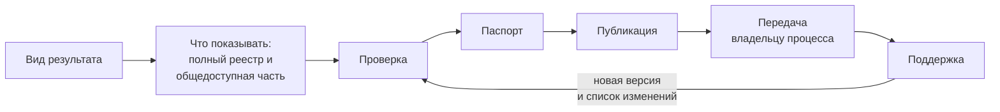
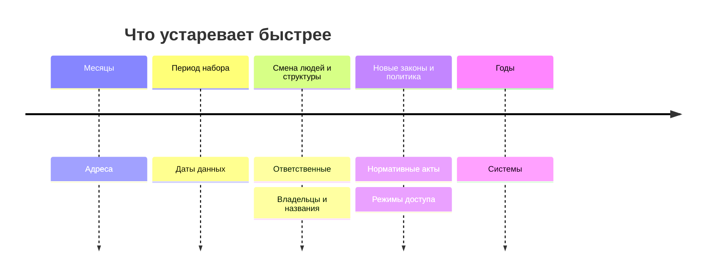

# Результат и поддержка

Инвентаризация заканчивается не отчётом, а результатом, которым пользуются: каталогом данных, целевой информационной системой, озером данных или картой данных. Все они строятся из одного реестра, а если показать можно не всё, общедоступную часть получают из полного реестра выборкой записей и полей. Публикуют данными — с паспортом, лицензией, версией и датой у каждой записи. После публикации у результата должен быть владелец процесса и план обновления, а если поддерживать результат никто не будет, его честно публикуют как снимок на дату.

Сведения проверены 25 октября 2026 года, если не указано иное.

## Коротко

| Что сделать | Что получается | Готово, когда |
|-------------|----------------|---------------|
| **[Выбрать вид результата](#виды-результата)** | Каталог, целевая система, озеро данных, карта или их сочетание | Известно, кто пользуется результатом и что ему нужно из реестра |
| **[Решить, что показывать](#полный-реестр-и-общедоступная-часть)** | Правило: какие записи и поля входят в общедоступную часть | Правило утверждено; общедоступную часть строит выборка, а не ручная копия |
| **[Проверить](#проверка)** | Исправленный реестр, подтверждения владельцев | Проверки программой проходят без ошибок; замечания экспертов и владельцев разобраны |
| **[Составить паспорт](#паспорт)** | Цель, границы, методы, охват, состав, пробелы, даты, версия | По паспорту понятно, чему в реестре можно верить и чего в нём нет |
| **[Опубликовать](#публикация)** | Файлы данных по постоянному адресу, отчёт из них | Результат открыт тем, кому предназначен; его можно скачать и проверить программой |
| **[Передать](#кто-отвечает-после-публикации)** | Владелец процесса, ответственные за записи, план обновления | Команда инвентаризации может уйти, а обновление не остановится |
| **[Поддерживать](#поддержка)** | Новые версии и список изменений | Проверки идут по плану; исчезнувшие записи помечены, а не удалены |



## Виды результата

Вид результата намечают на первом шаге вместе с целью: от него зависит, что записывать ([«Сформулировать цели и задачи»](./01-steps.md#1-сформулировать-цели-и-задачи)). На седьмом шаге результат собирают из реестра.

| Результат | Что из реестра нужно | Кто пользуется |
|-----------|----------------------|----------------|
| **Внутренний каталог данных** — подход «чем владеем» | Весь реестр, включая закрытые наборы, с ответственными и основаниями | Сотрудники, аналитики, ответственный за защиту данных |
| **Публичный каталог или портал открытых данных** — открытие данных | Общедоступная часть: открытые наборы с условиями и описанием по стандарту, часто и закрытые — с основанием и порядком получения | Граждане, компании, исследователи, журналисты |
| **Каталог для партнёров** — обмен данными с отраслью | Наборы, которые предоставляют, с условиями доступа и соглашениями | Банки, операторы связи, исследователи |
| **Целевая информационная система** — проактивные услуги, интеграция | Наборы до полей, со справочниками и источниками достоверных сведений | Архитекторы и разработчики |
| **Озеро данных** — аналитика, обучение моделей | Наборы с описаниями, схемами, отметками о качестве и условиями использования | Аналитики, команды моделей |
| **Карта данных** — подход «где найти нужное» | Вопросы, источники и доступность каждой пары, подробные записи ключевых источников ([«Карты данных»](../02-approaches/04-data-maps.md)) | Руководство, аналитики, исследователи |
| **Подборка наборов** — хакатон, конкурс, дата-лаборатория | Наборы с адресами выгрузки, условиями и коротким описанием | Участники — на время события |

- **Отчёт — не результат.** Отчёт, презентация и интеллект-карта — производные: их строят из реестра и указывают, из какой версии. Обратно не получается: из отчёта или картинки реестр восстанавливают только вручную.
- **Результаты сочетают.** Распространённая схема — непубличный каталог с полным реестром и публичный портал с его общедоступной частью. Так устроены инвентари федеральных ведомств США: у ведомства полный инвентарь, а общедоступную часть собирает каталог data.gov ([«Пример: инвентарь GSA»](#пример-инвентарь-gsa)).
- **Результат — там, где им пользуются.** Если аналитики ищут данные во внутреннем каталоге метаданных, реестр загружают туда, а не публикуют рядом отдельной таблицей ([«Четыре варианта»](../06-tools/01-from-spreadsheet-to-catalog.md#четыре-варианта)). Как выбрать платформу для публичного каталога и не дать ему умереть, разобрано в книге [«Каталоги данных»](https://datacatalogs.begtin.tech/).

Результат готов, когда им пользуются без составителя: по каталогу находят набор и понимают, как его получить; по карте отвечают на вопрос или видят пробел; по описанию до полей пишут техническое задание. Проверить это просто: дать результат тому, кто будет им пользоваться, и попросить найти ответ на два-три вопроса из списка ([«Цели и вопросы»](./02-goals-and-questions.md)).

## Полный реестр и общедоступная часть

Сам реестр — данные с режимом доступа. В нём бывают имена и телефоны сотрудников, описания закрытых систем, внутренние адреса, отметки о персональных данных. Поэтому у реестра часто две части: полная — для владельца и тех, кто работает с данными, и общедоступная — для всех. Общедоступную часть строит программа: выбирает записи и поля из полного реестра при каждом обновлении. Если вести её отдельной копией, через полгода две части разойдутся.

| Что | Полный реестр | Общедоступная часть |
|-----|---------------|---------------------|
| **Открытые наборы** | Да | Да, все поля |
| **Наборы с ограничениями** | Да | Да: описание, владелец, режим доступа и порядок получения |
| **Закрытые наборы** | Да | Обычно да: наименование, описание, владелец, режим доступа с основанием. Не показывают, только если тайна — сам факт существования набора |
| **Ответственный** | Имя, должность, телефон | Адрес для вопросов о данных, который не меняется при смене сотрудника |
| **Внутренние адреса, схемы закрытых систем** | Да | Нет |
| **Откуда известно, служебные пометки, вопросы к владельцам** | Да | Нет или только метод |

Так одна запись условного примера — регистр медицинских работников — выглядит в двух частях:

| Поле | Полный реестр | Общедоступная часть |
|------|---------------|---------------------|
| **Наименование и описание** | Федеральный регистр медицинских работников; одна запись — один работник: специальность, место работы, образование | То же |
| **Организация-владелец** | Министерство | То же |
| **Режим доступа** | `restricted` — органам власти по межведомственному запросу; причина — персональные данные | То же и порядок запроса |
| **Ответственный и контакты** | Имя, должность и телефон сотрудника, который ведёт регистр | Адрес отдела для вопросов о данных |
| **Система и оператор** | Ведомственная система здравоохранения, оператор — центр медицинской статистики, внутренний адрес системы | Название системы и оператор, без адреса |
| **Откуда известно** | Положение о министерстве, ответ на анкету с датой | Метод: анализ полномочий, опрос владельца |
| **Дата проверки** | 2026-10 | 2026-10 |

**Закрытое не убирают, а объясняют.** Запись о закрытом наборе говорит пользователю, что данные есть и как их запросить, а владельцу — что решение о закрытии принято и обосновано. Два примера:

- **США.** В общедоступной части инвентаря GSA у всех закрытых записей сказано, что набор не публикуется и куда обращаться, а почти у всех — и почему ([«Пример: инвентарь GSA»](#пример-инвентарь-gsa)).
- **Южная Корея.** data.go.kr публикует общий перечень данных, которые учреждения ещё не открыли, с годом открытия — 9987 строк в версии от 10 февраля 2026 года. Пользователь видит, что данные есть и когда их ждать.

Так же советуют американские методики и закон о полном инвентаре данных ведомства, руководство GovEx для городов и регламент ЕС об управлении данными ([«Зарубежные методики»](../05-frameworks/04-international-practice.md), [«Закрытые наборы — тоже в реестре»](./06-access.md#закрытые-наборы--тоже-в-реестре)).

**Описание набора — не сам набор.** Описание без данных обычно безопасно. Но перечень систем с версиями программ и внутренними адресами помогает атакующему, а примеры значений из набора с персональными данными — уже персональные данные. Какие записи и поля входят в общедоступную часть, записывают правилом выборки в паспорт; кто его утверждает — в разделе [«Кто отвечает после публикации»](#кто-отвечает-после-публикации).

## Проверка

Перед публикацией реестр проверяют по очереди — от дешёвой проверки к дорогой:

1. **Программа** — пустые ячейки, повторы идентификаторов и синонимов, коды из справочников, ссылки на владельцев и полномочия, даты, адреса ([«Проверки»](../06-tools/03-registry-as-data.md#проверки)). Публикуют, когда список ошибок пуст.
2. **Составитель** — всё, что не проверит программа, по [чек-листу](../09-appendices/04-checklists.md#перед-публикацией-реестра): владелец из документа, основание режима доступа, откуда известно, состав групп, решения по пробелам. Плюс 10–20 случайных записей, проверенных заново с нуля. Если в них нашлось больше одной-двух ошибок, ошибка, скорее всего, повторяется по всему реестру: ищут её причину, а не исправляют записи по одной.
3. **Юрист или ответственный за защиту данных** — общедоступную часть: нет ли в ней персональных данных, закрытых сведений, лишних полей. Итог — утверждённое правило выборки.

Эксперты и владельцы смотрят реестр раньше — на четвёртом шаге, и подтверждение владельца записывают в запись с датой ([«Шаг 4. Эксперты и владельцы»](./08-gaps-and-plan.md#шаг-4-эксперты-и-владельцы)). Перед публикацией проверяют, что все их замечания разобраны. Владелец задачи принимает результат по цели: есть ли у каждого вопроса источник или записанный пробел.

## Паспорт

Паспорт — описание самого реестра: что, когда, кем, как и зачем инвентаризировано. Без него через год не понять, чему в реестре можно верить. «Данных нет» могло значить «не искали», а «закрыто» — «проверяли из-за рубежа».

| Поле | Что писать |
|------|------------|
| **Название и описание** | Что за реестр или карта — одной-двумя фразами |
| **Цель и владелец задачи** | Ради чего инвентаризация, кто её поставил и принял ([«Как записать цель»](../01-basics/03-goals.md#как-записать-цель)) |
| **Подход и границы** | Подход; организации, территория, период, слои данных, глубина, что исключено ([«Границы»](./02-goals-and-questions.md#границы)) |
| **Методы и охват** | Какими методами искали; сколько адресатов опроса ответило; из какой сети проверяли адреса |
| **Состав** | Сколько записей по типам и режимам доступа; сколько вопросов и с каким покрытием |
| **Пробелы и ограничения** | Чего нет и почему; что не проверено |
| **Правило общедоступной части** | Какие записи и поля входят в неё, кто решил |
| **Составители и контакты** | Кто составил, куда писать об ошибках |
| **Владелец процесса и план обновления** | Кто отвечает за обновление; что, как часто и по каким событиям проверяют |
| **Даты и версия** | Когда проводилась инвентаризация, дата и номер этой версии, дата следующей проверки, ссылка на список изменений |
| **Лицензия, стандарт и файлы** | Лицензия на сам реестр; по какой схеме описаны записи; где лежат файлы данных |

Фрагмент паспорта условного примера в шаблоне [passport.yaml](pathname:///templates/passport.yaml):

```yaml
title: Данные о доступности медицинской помощи в регионах
goal: Найти источники для ответа на 15 вопросов руководства о доступности медицинской помощи в регионах и показать, каких данных нет
approach: где найти нужное
coverage:
  respondents: 8
  answered: 8
  network: адреса проверены из сети страны
contents:
  records: 31
  personal_data: 6
  questions_covered: {available: 10, partial: 4, gap: 1}
gaps:
  - Фактические сроки ожидания нельзя сравнить между регионами — даты записывают в трёх разных видах
public_part:
  rule: все записи, кроме временных рабочих файлов; у записей с персональными данными — без ответственного и внутренних адресов
  decided_by: юрист министерства; утвердил владелец задачи
process_owner: отдел медицинской статистики министерства
upkeep:
  - {what: адреса, how_often: monthly, who: программа, last: 2026-10, next: 2026-11}
  - {what: полная проверка, how_often: annual, who: владелец процесса и ответственные, last: 2026-10, next: 2027-10}
version: 2026-10
license: CC BY 4.0
```

Стандарты описания каталогов подходят для паспорта лишь отчасти: название, даты, лицензию и версию в них записать можно, а полей под цель, методы, охват и пробелы нет ([«Стандарты описания»](../05-frameworks/02-metadata-standards.md)). В файле `data.json` паспорта нет вовсе, поэтому паспорт хранят отдельным файлом рядом с реестром.

## Публикация

- **Данные, а не только отчёт.** CSV — для людей и таблиц, JSON или YAML — для программ, описания наборов — по стандарту описания ([«Стандарты описания»](../05-frameworks/02-metadata-standards.md)). Отчёт, картинки и страницы строят из этих файлов ([«Реестр как данные»](../06-tools/03-registry-as-data.md)).
- **Постоянный адрес.** Файл лежит по адресу, который не меняется от версии к версии: на него ссылаются и с него собирают каталоги. Если адрес всё же меняется, старый перенаправляют на новый. Прошлые версии лежат рядом, каждая по своему адресу.
- **Дата у реестра и у каждой записи.** Дата версии — в паспорте, дата проверки — в каждой записи. Дата изменения данных и дата проверки записи — разные даты: первую берут из самих данных, вторую ставит составитель, когда проверил запись.
- **Лицензия на сам реестр** — отдельно от условий использования наборов в нём: чтобы реестр можно было дополнять, сравнивать и перепубликовать. Подходят CC BY 4.0 и CC0. Текст этой книги распространяется по CC BY 4.0.
- **Канал для замечаний** — адрес или система задач, куда сообщать об ошибках и недостающих наборах. Замечание — повод проверить запись, а не основание её изменить.
- **Как цитировать** — если реестром будут пользоваться в исследованиях: автор, название, версия, дата, адрес. Пример — файл [CITATION.cff](https://github.com/ivbeg/data-inventory/blob/main/CITATION.cff) в репозитории этой книги.

Репозиторий git с файлами данных — простой способ получить постоянный адрес, версии и историю изменений бесплатно.

## Кто отвечает после публикации

Команда инвентаризации — проектная: после публикации она уходит. Если обязанности не передать, обновление остановится в тот же день. Ролей четыре:

| Роль | Кто | Что делает |
|------|-----|------------|
| **Владелец процесса** | Директор по данным, офис управления данными, отдел статистики или аналитики — лучше тот, кто сам пользуется результатом | Отвечает за план обновления, сводит изменения, запускает проверки, выпускает версии и ведёт список изменений, отвечает на замечания |
| **Ответственные за записи** | Сотрудники подразделений-владельцев — обычно те же, кто отвечал на анкету | Сообщают об изменениях своих наборов, когда они происходят; при плановой проверке получают выгрузку своих записей и отмечают, что изменилось |
| **Юрист или ответственный за защиту данных** | Вместе с владельцем данных решает, что показывать | Готовит правило выборки, которое утверждает владелец задачи, и проверяет общедоступную часть перед каждой версией |
| **Программа** | Скрипты проверок | Всё, что можно проверить без человека ([«Что проверять программой»](#что-проверять-программой)) |

- **В США роль закреплена законом:** требования к инвентарю ведомства выполняет его директор по данным (Chief Data Officer). Как ответственных назначают в других странах книги — в главе [«Зарубежные методики»](../05-frameworks/04-international-practice.md).
- **Передают не только файл:** паспорт, правило выборки, справочники значений, скрипты проверок, шаблоны, список пробелов с решениями и план обновления. Без скриптов и справочников следующий составитель начнёт заново.

## Поддержка

Реестр устаревает с первого дня. Реестру без даты проверки и плана обновления через год верят, и поэтому он вводит в заблуждение сильнее, чем его отсутствие ([«Инвентаризация не заканчивается»](../01-basics/04-principles.md#8-инвентаризация-не-заканчивается)). Поддержка — не повтор инвентаризации с нуля, а повтор поиска, описания и сопоставления для того, что изменилось ([«Когда возвращаются назад»](./01-steps.md#когда-возвращаются-назад)).

### Что устаревает



Чем быстрее устаревает сведение, тем чаще его проверяют: адреса и даты данных — программой раз в месяц или квартал, остальное — полной проверкой раз в год и по событиям.

| Что меняется | Пример | Как заметить |
|--------------|--------|--------------|
| **Адреса** | Сайт Министерства здравоохранения Казахстана с 2019 года трижды менял адрес ([«Что случилось с адресом»](../04-sources/06-legacy.md#что-случилось-с-адресом)) | Программа: есть ли домен, что отвечает сайт, куда перенаправляет |
| **Даты данных** | Записи обещают ежеквартальное обновление, а дата изменения у них старше года ([«Пример: инвентарь GSA»](#пример-инвентарь-gsa)) | Программа: дата изменения старше, чем обещает периодичность |
| **Ответственные** | Ответственный уволился — контакт ведёт в пустоту, а знание о его таблицах уходит вместе с ним | Сверка со справочником сотрудников, рассылка ответственным |
| **Владельцы и названия** | В 2018 году Минобрнауки России разделили на два министерства, в 2023 году ФСС и ПФР объединили в Социальный фонд ([«Кто отвечает за тему»](./03-owners-and-mandates.md#кто-отвечает-за-тему)) | Акты о структуре органов власти |
| **Нормативные акты** | В Казахстане с 12 июля 2026 года действует Цифровой кодекс, а нормы об информационных системах из прежнего закона исключены | Проверка статуса акта ([чек-лист](../09-appendices/04-checklists.md#перед-ссылкой-на-нормативный-акт)) |
| **Режимы доступа** | Портал data.gov.ru закрыли в марте 2023 года и вновь открыли 15 июля 2025 года | Повтор [порядка проверки](./06-access.md#порядок-проверки) |
| **Системы** | Систему выводят из эксплуатации, данные переносят в новую ([«Исчезнувшие системы и веб-архивы»](../04-sources/06-legacy.md)) | Госзакупки, планы информатизации, акты о системах |

### Когда проверять

- **По графику.** Полная проверка — не реже раза в год: адреса, владельцы, ответственные, режимы доступа, нормативные акты. Адреса и даты данных — чаще, раз в месяц или квартал: программа делает это почти бесплатно.
- **По событиям.** Реорганизация, новый закон или новая редакция, запуск или вывод системы, новое соглашение об обмене, уход ответственного. В США закон задаёт срок: набор, который ведомство создало или выявило, вносят в инвентарь не позднее чем через 90 дней.
- **Перед каждым важным использованием.** Перепроверяют записи, на которые опирается решение: режим доступа, дату данных, ответственного.
- **По замечанию.** Пользователь сообщил об ошибке или недостающем наборе.

### Что встроить в процессы

Самое дешёвое обновление происходит само, потому что встроено в работу организации:

| Событие | Что происходит с реестром |
|---------|---------------------------|
| Проектируют новую систему или доработку | Описание данных вносят в реестр до запуска: система появляется уже инвентаризированной ([«Спроектировать сбор от данных»](./01-steps.md#6-спроектировать-сбор-от-данных)) |
| Заключают контракт на создание, развитие или вывод системы | Запись системы обновляют по контракту |
| Выводят систему из эксплуатации | Запись получает статус «выведена из эксплуатации», преемника записывают и связывают с ней ([«Как отметить в реестре»](../04-sources/06-legacy.md#как-отметить-в-реестре)) |
| Реорганизуют подразделение или ведомство | Владельцем записей становится преемник, прежние названия уходят в синонимы |
| Публикуют набор открытых данных | Запись получает ссылку для выгрузки и новый режим доступа |
| Сотрудник уходит | Записи, за которые он отвечал, передают вместе с делами |

### Что проверять программой

- **Адреса:** есть ли домен, что отвечает сайт, куда перенаправляет.
- **Свежесть:** дата изменения данных старше, чем обещает периодичность.
- **Сверку с каталогами:** наборы, которые появились на портале открытых данных или в каталоге метаданных, а в реестре их нет, — и наоборот.
- **Сверку со справочниками:** владелец есть в действующем перечне органов власти, ответственный — в справочнике сотрудников.
- **Проверки перед публикацией** — при каждой версии.

Как устроить эти проверки, запускать их при каждой правке и проверять адреса — в главе [«Реестр как данные»](../06-tools/03-registry-as-data.md#проверки). Каталог метаданных сам замечает новые таблицы в подключённых базах, но не видит того, что лежит вне их ([«Чего каталог не видит»](../06-tools/01-from-spreadsheet-to-catalog.md#чего-каталог-не-видит)). Программа говорит, что адрес умер или дата устарела, но не говорит почему: переехал ли сайт, закрыли ли систему, забыли ли обновить дату — решает человек.

### Версии и список изменений

- **Записи не удаляют.** Исчезнувшему набору меняют статус — «выведена из эксплуатации» или «адрес не работает» — и добавляют дату и ссылку на копию в веб-архиве.
- **Версия — с датой.** Удобно называть версию месяцем выпуска — «2026-10». Прошлые версии не перезаписывают.
- **Список изменений — при каждой версии:** что изменилось, в какой записи, почему и откуда это известно, кто внёс. Без него тот, кто скачал прошлую версию, не узнает, что поменялось.

Несколько строк списка изменений условного примера — по шаблону [changes.csv](pathname:///templates/changes.csv):

```csv
version,date,record_id,change,field,old_value,new_value,reason,author
2027-04,2027-04-20,stat-doctors,changed,download_url,https://stat.example.org/old/doctors.csv,https://data.stat.example.org/doctors.csv,проверка адресов: старый адрес перенаправляет на новую витрину,владелец процесса
2027-04,2027-04-20,region-c-waiting-journal,status,status,active,retired,ответ ответственного: журнал перенесён в региональную систему; преемник — region-c-waiting-list,владелец процесса
2027-04,2027-04-20,region-c-waiting-list,new,,,,новая запись: листы ожидания в региональной системе; related — successor_of:region-c-waiting-journal,владелец процесса
2027-04,2027-04-20,med-workers-yearbook,changed,modified,2025-10-01,2026-10-01,вышел новый сборник,владелец процесса
2027-04,2027-04-20,region-b-waiting-list,changed,owner_person,заместитель начальника отдела,начальник отдела,ответ при плановой проверке: сменился ответственный,владелец процесса
```

Как хранить версии в git, называть выпуски и собирать список изменений из истории правок — в главе [«Реестр как данные»](../06-tools/03-registry-as-data.md#история-и-версии).

### Снимок или живой реестр

Не каждый результат нужно поддерживать. Подборка для хакатона нужна на месяц, карта для разового исследования — на время исследования. Такой результат публикуют как снимок: с датой и пометкой, что он не обновляется. Плохо не то, что результат устарел, а то, что по нему этого не видно.

## Как записать

Рядом с реестром ведут два файла: паспорт с правилом общедоступной части и планом обновления и список изменений. Шаблоны — [passport.yaml](pathname:///templates/passport.yaml) и [changes.csv](pathname:///templates/changes.csv), их поля — в приложении [«Шаблоны»](../09-appendices/03-templates.md#паспорт-и-список-изменений). План обновления в паспорте — по строке на проверку: что проверяют, как часто или по какому событию, кто, даты последней и следующей проверки. Список изменений — по строке на изменение: версия и дата, запись, поле с прежним и новым значением или «новая запись», почему и кто внёс.

## Пример: инвентарь GSA

Администрация общих служб США (GSA) публикует общедоступную часть своего инвентаря данных файлом `data.json` — так, как это требуют от федеральных ведомств ([«Инвентари данных федеральных ведомств США»](../05-frameworks/04-international-practice.md#инвентари-данных-федеральных-ведомств-сша)). 25 октября 2026 года в файле было 344 записи: 310 открытых, одна с ограничениями и 33 закрытые. Файл заявляет соответствие схеме DCAT-US 3.0, и официальная JSON-схема не нашла ошибок ни в одной записи. Чему учит этот инвентарь:

- **Закрытое объяснено.** У всех 33 закрытых записей сказано, что набор не публикуется и за подробностями надо обращаться к владельцу, а у 31 — ещё и почему. У 13 причина — коммерческая тайна и сведения, полученные от компаний, у остальных — «только для сотрудников GSA» или «закупка до заключения контракта». Пользователь видит не только то, что можно скачать, но и то, что существует и почему закрыто.
- **Адрес постоянный, переезд — с перенаправлением.** Файл опубликован по адресу `www.gsa.gov/data.json`, который перенаправляет на `open.gsa.gov/data.json`. Ссылки и сборщик каталога data.gov продолжают работать.
- **Обещанная периодичность не выдерживается.** 121 запись обещает ежеквартальное обновление, и у всех 121 дата изменения старше года; самая старая — 1 сентября 2015 года. Всего у 169 записей из 344 последнее изменение — 2018 год или раньше. При этом сам файл свежий: по заголовку веб-сервера его изменили 19 октября 2026 года. Либо данные не обновляют, либо не меняют дату в описании, — пользователю всё равно: обещанной периодичности он верить не может. Свежий файл ещё не значит свежие записи.
- **Паспорта нет.** На верхнем уровне файла — только тип и ссылка на схему: ни названия, ни даты, ни контакта. По файлу не понять, когда инвентарь проверяли и кто за него отвечает.
- **Соответствие схеме — нижняя планка.** Новыми полями схемы — ограничения доступа, измерения качества — не пользуется ни одна запись: режим доступа записан старым полем. В поле прав у открытых записей 139 раз стоит «N/A» и 83 раза — «true». У 23 распространений в 20 записях ссылка для выгрузки ведёт на страницу, а не на файл; 12 из них — страницы внутреннего портала. Лицензия CC0 записана тремя разными адресами, знак общественного достояния — двумя, а у 24 открытых записей лицензии нет. Схема проверяет, что поле есть, а не что в нём правда: справочники значений, проверка выборки глазами и дата проверки каждой записи нужны и тогда, когда файл формально соответствует стандарту.

## Условный пример: доступность медицинской помощи

**Где мы в примере.** Шаг 7, после плана ([«Пробелы и план»](./08-gaps-and-plan.md#пример)): 15 вопросов руководства о доступности медицинской помощи в регионах, 31 запись — 25 из реестра и шесть новых строк из анкет.

**Вид результата.** На первом шаге наметили карту данных для департамента, который готовит справки руководству: таблицу «вопрос — источник — статус» и список пробелов. По ходу добавились ещё два результата. Записи о данных министерства и его центра медицинской статистики ушли во внутренний каталог министерства. Общедоступную часть реестра министерство опубликовало на своей странице открытых данных как перечень данных о доступности медицинской помощи.

**Проверка.**

- Программа нашла три ошибки. У двух записей из анкет периодичность была записана свободным текстом — «раз в год» вместо `annual`. Таблицу одного региона записали дважды — по анкете и по итогам интервью.
- Из 15 случайных записей одна оказалась с неверной ссылкой для выгрузки: на сборник за прошлый год вместо текущего.
- Замечания эксперта и владельцев с четвёртого шага разобраны все. Юрист подготовил правило общедоступной части, владелец задачи его утвердил.

**Общедоступная часть.** В неё вошли 30 записей из 31. Журнал ожидания одного региона — таблицу на общем диске отдела — не включили: по плану его переносят в региональную систему, и публиковать описание временного файла незачем. У шести записей с персональными данными — регистра медицинских работников, учёта оказанной помощи фонда, листов ожидания трёх регионов и системы записи к врачу — показаны наименование, описание, владелец, режим доступа с основанием и порядок запроса, а вместо имён ответственных — адрес отдела для вопросов о данных ([как это выглядит](#полный-реестр-и-общедоступная-часть)).

**Паспорт.** Цель и 15 вопросов; границы с исключениями; четыре метода — анализ полномочий, поиск наборов, опрос владельцев и эксперты; охват опроса — восемь адресатов, ответили все. Состав — 31 запись, шесть из них с персональными данными. Покрытие вопросов: у десяти есть доступный источник, четыре закрыты частично, один — пробел. Среди частично закрытых — главный вопрос о фактических сроках ожидания: даты записывают во всех пяти регионах первой очереди, но в трёх разных видах ([фрагмент паспорта](#паспорт)).

**Передача.** Владелец процесса — отдел медицинской статистики министерства: он готовит справки и сам пользуется картой. Ответственные за записи — те же адресаты опроса. План обновления: адреса — раз в месяц программой, даты данных — раз в квартал, полная проверка — раз в год. Внеочередная проверка — при запуске единых листов ожидания в регионах, при реорганизации и при изменении нормативов сроков ожидания.

**Первое обновление через полгода.** Статистическое ведомство перенесло витрину данных на новый адрес — у трёх записей поменялись ссылки для выгрузки. Один регион перевёл журнал ожидания в региональную систему: запись таблицы получила статус «выведена из эксплуатации», а листы ожидания в системе — новую запись со связью с прежней. Вышел новый сборник центра — у агрегата новая дата изменения. В одном регионе сменился ответственный. В списке изменений семь строк, ни одна запись не удалена ([строки списка](#версии-и-список-изменений)). Пример показывает ход работы, а не то, как устроено здравоохранение в конкретной стране.

## Частые ошибки

- **Общедоступная часть — отдельная копия.** Через полгода две части расходятся. Её строят выборкой из полного реестра программой при каждой версии.
- **Имена и телефоны в общедоступной части.** Публикуются персональные данные сотрудников, а контакты устаревают с уходом людей. Показывают адрес подразделения для вопросов о данных.
- **Файл свежий, записи старые.** Файл пересобирают каждую неделю, а записи годами не проверяют. Дата проверки записи меняется, только когда запись проверили.

Сквозные ошибки — реестр только в отчёте или картинке, исчезнувшую строку удаляют, сдали и забыли — в главе [«Практики и антипаттерны»](../08-practices/01-practices-and-anti-patterns.md).

## Ограничения

- Реестр показывает, что найдено и проверено к дате, а не всё, что существует. Насколько ему можно верить, говорит паспорт — методы, охват и пробелы.
- Поддержка стоит денег и времени. Без владельца процесса и поддержки руководства её откладывают первой. Дешевле всего обходится то, что встроено в процессы и проверяется программой.
- Общедоступная часть — компромисс: чем больше полей скрыто, тем меньше от неё пользы, чем больше показано, тем выше риск. Правило выборки пересматривают, когда меняются законы.
- Результат проверки адресов зависит от сети: государственные сайты из-за рубежа часто не открываются, и «не ответил» ещё не значит «закрыто».

## Источники

- Главы [«Семь шагов»](./01-steps.md#7-собрать-и-опубликовать-результат) — седьмой шаг; [«Реестр как данные»](../06-tools/03-registry-as-data.md) — файлы, проверки, версии; [«Исчезнувшие системы и веб-архивы»](../04-sources/06-legacy.md) — как отмечать исчезнувшее; [«Стандарты описания»](../05-frameworks/02-metadata-standards.md) — описание каталога и версий в DCAT.
- Шаблоны паспорта и списка изменений — в приложении [«Шаблоны»](../09-appendices/03-templates.md#паспорт-и-список-изменений).
- [open.gsa.gov/data.json](https://open.gsa.gov/data.json) — общедоступная часть инвентаря GSA. Посчитано и проверено JSON-схемой DCAT-US 3.0.0 25 октября 2026 года: 344 записи, из них 33 закрытые и одна с ограничениями; 121 запись с ежеквартальной периодичностью; поля прав, ссылки для выгрузки и лицензии; дата изменения файла по заголовку веб-сервера — 19 октября 2026 года.
- [44 U.S. Code § 3511](https://www.law.cornell.edu/uscode/text/44/3511), пункт (a)(3) — срок 90 дней для новых наборов; [44 U.S. Code § 3520](https://www.law.cornell.edu/uscode/text/44/3520), подпункт (c)(5), — директор по данным ведомства. Проверено 25 октября 2026 года.
- [Перечень данных, которые предстоит открыть](https://www.data.go.kr/data/15127106/fileData.do) — data.go.kr, версия от 10 февраля 2026 года. Проверено 25 октября 2026 года.
