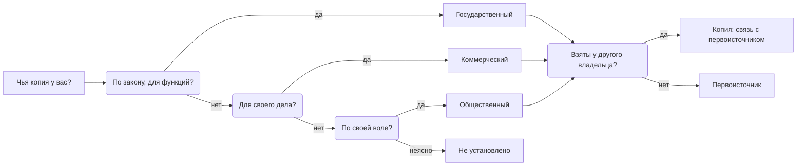
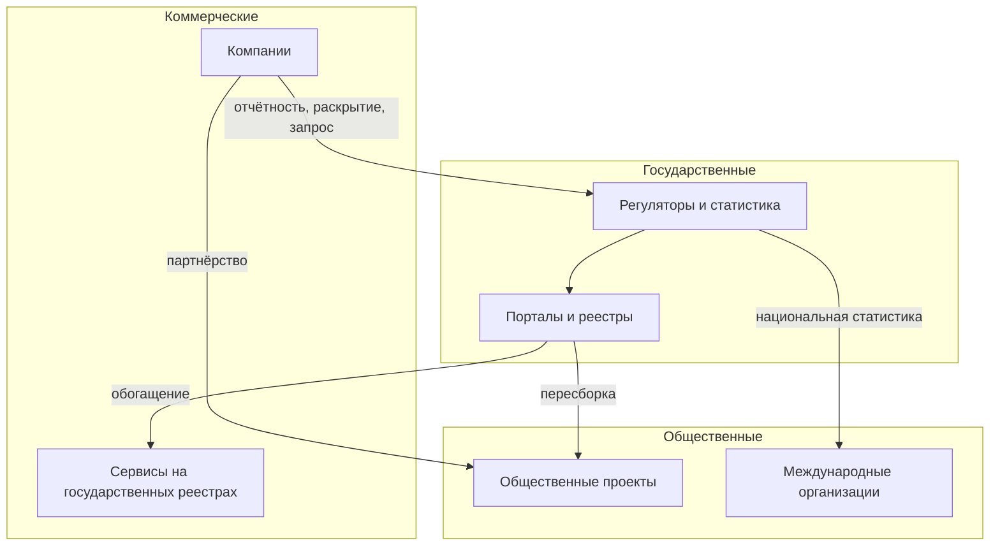

# Три слоя данных

Данные для любой задачи лежат в трёх слоях — государственном, общественном и коммерческом. Слой определяет не тему, а условия: кто собирает данные, на каком основании и как их получить. Одни и те же данные переходят из слоя в слой, поэтому у каждой копии ищут первоисточник. Какие слои входят в работу, записывают в [границах](../03-process/02-goals-and-questions.md#границы) на первом шаге.

Сведения проверены 25 октября 2026 года, если не указано иное.

## Коротко

| | Государственные | Общественные | Коммерческие |
|---|---|---|---|
| **Кто собирает** | Органы власти, подведомственные организации, фонды, регуляторы | Общественные проекты, сообщества, исследователи, международные организации | Банки, операторы связи, платёжные и отраслевые компании, бюро кредитных историй |
| **Основание** | Полномочие: закон, положение об органе, акт о системе | Решение самого проекта | Деятельность компании, договор с клиентами |
| **Доступ** | Открытые, с ограничениями и закрытые — основание в законе | Обычно открытые | По соглашению, подписке или за плату; часть компании публикуют сами |
| **Условия использования** | Часто не указаны | Свободные лицензии, у каждого проекта свои | Договор: цель, срок, запрет передачи и публикации |
| **Чем сильны** | Полнота по стране, юридическая сила, длинные ряды | Данные уже собраны, очищены и связаны | Свежесть и подробность там, где государство не измеряет |
| **Частые проблемы** | Устаревание, пропуски, разные справочники у ведомств | Никто не обязан поддерживать, ошибки пересборки | Выборка — только клиенты компании, закрытая методика, меняются условия |
| **Подробно** | [Государственные данные](./02-government.md) | [Общественные данные](./03-public.md) | [Коммерческие данные](./04-commercial.md) |

Оценки в таблице — обобщение, а не правило: бывает отличная государственная статистика и плохие коммерческие данные. Проверяют каждый набор ([«Качество данных»](../03-process/07-quality.md)).

## Как определить слой

Слой определяют по основанию сбора и по тому, у кого копия, которую вы получаете. Тема и форма собственности не решают: данные государственной компании о её деятельности — коммерческие, а система органа власти, которую ведёт подрядчик, — государственная. Вопросы задают по порядку: собирает ли держатель данные по закону при исполнении своих функций, для своего дела или по своей воле, — и получил ли он их от другого владельца.

**Первоисточник** — организация и ресурс, где данные появились: тот, кто их собрал или создал. **Копия** — те же данные у другого владельца, со своими условиями и своей датой обновления. Если копии одних данных лежат в разных слоях, это разные записи реестра ([«Что считать записью»](../03-process/05-registry.md#что-считать-записью)). Как найти первоисточник и что делать, если он не установлен, — в главе [«Общественные данные»](./03-public.md#первоисточник).

| Случай | Слой | Почему |
|--------|------|--------|
| **Система органа власти, которую ведёт подрядчик** | Государственный | Владелец — орган, подрядчик — оператор ([«Владелец, оператор, ответственный»](../03-process/03-owners-and-mandates.md#владелец-оператор-ответственный)) |
| **Отчётность компании регулятору** | Копия у регулятора — государственный, данные у компании — коммерческий | Регулятор собирает отчёт по закону; у компании данных больше, чем в отчёте |
| **Обязательное раскрытие информации** | У регулятора — государственный, у частного сервиса — коммерческий | Обязанность одна, владельцы копий разные: EDGAR у Комиссии по ценным бумагам и биржам США, e-disclosure.ru у «Интерфакса» |
| **Данные государственной компании о её деятельности** | Коммерческий | Компания ведёт их для своего дела и даёт на своих условиях |
| **Данные государственной компании при исполнении функций** | Государственный, если так решил закон | Так в Казахстане: закон относит такие данные квазигосударственного сектора к административным |
| **Общественный проект на государственных данных** | Общественный, первоисточник — государственный | «Госзатраты» собраны из данных о закупках с zakupki.gov.ru |
| **База международной организации** | Общественный, первоисточник — национальная статистика | World Development Indicators Всемирного банка собраны из официальных национальных источников |
| **Купленные или полученные по соглашению данные** | Коммерческий, владелец — поставщик | Данные лежат в своих системах, но права на них ограничены договором |

Пограничный случай записывают по правилу и с примечанием, почему выбран этот слой. Через год иначе не понять, ошибка это или решение.

## С чего начинать

1. **Записать в границах слои и условия:** какие слои входят, нужны ли международные данные для сравнения, можно ли платить за коммерческие.
2. **Государственные данные** — по [анализу полномочий](../03-process/03-owners-and-mandates.md): он даёт владельцев и то, что у них должно быть.
3. **Поиск наборов данных** — по всем слоям сразу: поисковики собирают описания из тысяч каталогов ([«Поиск наборов данных»](./05-dataset-search.md)).
4. **Общественные данные** — копии и пересборки государственных, которые бывают удобнее оригинала, и международные базы для сравнения. У каждой копии сразу ищут первоисточник.
5. **Коммерческие данные** — для того, чего не нашлось у государства, и для проверки государственных. Запрос компании отправляют, как только виден пробел: ответ может занять месяцы.

В подходе «чем владеем» начинают со своих систем, а затем ищут данные, полученные от других, — по договорам, закупкам и опросу владельцев ([«Опросные листы и интервью»](../03-process/04-questionnaires.md)).

## Как данные переходят между слоями

| Переход | Пример | Что записать |
|---------|--------|--------------|
| **Компания → государство: отчётность** | Через EDGAR компании подают документы по законам США о ценных бумагах — около 4700 в день | Набор у регулятора — государственный; основание — закон об отчётности |
| **Компания → государство: по запросу** | В ЕС с сентября 2025 года органы власти вправе запросить данные компаний при исключительной потребности | Основание, цель, срок использования и когда данные удалят |
| **Государство → общественный проект** | «Госзатраты» пересобирают данные о государственных контрактах | Копию — со связью с первоисточником |
| **Национальная статистика → международная организация** | Ряды World Development Indicators | Первоисточник — статистическая служба страны; у копии — методика организации |
| **Компания → общественный проект** | Economic Tracker группы Opportunity Insights публикует ряды из обезличенных данных компаний: траты по картам, вакансии, занятость | Условия партнёра: ряд живёт, пока живёт партнёрство |
| **Государство → компания** | Сервисы проверки контрагентов строятся на реестрах юридических лиц | Первоисточник — реестр; у сервиса — свои условия и дата |

Запрос данных у компаний в ЕС устроен по регламенту о данных (Data Act): его можно сделать при чрезвычайной ситуации или для задачи, прямо предусмотренной законом, например официальной статистики, если другие способы исчерпаны. Значит, коммерческий слой в ЕС частично доступен государству по закону, а не только по договору. Реквизиты регламента — в приложении [«Нормативная база»](../09-appendices/02-legal-framework.md#европейский-союз).

Что из этого следует:

- **Копия — не второй источник.** На карте данных вопрос связывают с каждым источником, который на него отвечает, — парой «вопрос — источник» ([«Из чего состоит карта»](../02-approaches/04-data-maps.md#из-чего-состоит-карта)). Если для вопроса о закупках записаны и «Госзатраты», и zakupki.gov.ru, пар две, а данные одни. Когда считают, сколько источников отвечает на вопрос, копию и первоисточник считают одним.
- **Копия бывает доступнее первоисточника.** Международные базы обычно открываются из любой страны, а национальные сайты из-за рубежа — не всегда. Но копия отстаёт и может исказить данные при пересборке. Поэтому в реестр вносят обе, и у каждой — своя дата.
- **Переход меняет условия.** Данные компаний открыты через исследовательский проект, пока компания делится ими: часть рядов Economic Tracker уже переведена в архив.

## Какой слой для каких вопросов

Типовые темы вопросов ([«Типовые вопросы»](../03-process/02-goals-and-questions.md#типовые-вопросы)) подсказывают, с какого слоя начинать и что добавят остальные.

| Тема | Где искать первым | Что добавляют другие слои |
|------|-------------------|---------------------------|
| **Статистика** | Национальная статистика, ведомственная отчётность | Международные базы — сравнение со странами; коммерческие ряды — оценки раньше официальных |
| **Организации** | Реестры юридических лиц, лицензий, аккредитаций | Раскрытие информации, биржи, сервисы проверки контрагентов, Wikidata |
| **Финансы** | Бюджетные данные, госзакупки | Общественные проекты удобнее оригинала; отчёты самих компаний |
| **Люди** | Регистры и учёт — почти всегда закрыты | Агрегаты компаний: перемещения у операторов связи, траты у банков |
| **Ресурсы** | Реестры объектов, кадастры, лицензии | Отчёты компаний, отраслевые аналитические сервисы |
| **Сравнение со странами** | Международные организации | Национальные службы — чтобы проверить ряд и методику |

Слой записывают у источника, а вопрос задают по существу. Вопрос «какие коммерческие сервисы собирают данные об отрасли?» спрашивает об источниках, а не о данных ([«Как проверить список»](../03-process/02-goals-and-questions.md#как-проверить-список)).

## Чего ждать от качества

Качество проверяют по одним и тем же признакам ([«Что проверять»](../03-process/07-quality.md#что-проверять)), но слабые места у слоёв разные. Готовьтесь к разочарованию в каждом.

- **Государственные.** Опубликованное устаревает, справочники ведомств расходятся, часть сведений есть только в агрегатах. В каталоге FAA catalog.data.faa.gov шесть наборов, и последний раз они менялись 10 ноября 2021 года. Первым проверяют дату изменения и последнюю дату внутри данных.
- **Общественные.** Проект перестаёт обновляться или исчезает, пересборка добавляет ошибки. У «Открытых НКО» заявлено ежедневное обновление, а данные не менялись с 16 августа 2023 года ([«Жив ли источник»](./03-public.md#жив-ли-источник)). Первым проверяют, кто ведёт проект и когда обновлял, и выборочно сверяют с первоисточником.
- **Коммерческие.** Выборка — клиенты компании, а не всё население, её состав меняется, методика закрыта, малые значения скрыты. В рядах трат по картам Economic Tracker есть разрывы: эмитенты карт входят в выборку и выходят из неё. Первым проверяют, кого покрывают данные и как менялась выборка.

Расхождение между слоями — находка, а не помеха. Коммерческие и общественные данные, которые расходятся с официальными, подсказывают, где у официальных пробелы, и наоборот.

## Слои в двух подходах

**«Где найти нужное».** Ищут во всех трёх слоях, а границы решают, в каких именно и на каких условиях: например, «государственные и международные; коммерческие — только бесплатные». Без этой строки коммерческие источники либо не ищут вовсе, либо в конце выясняется, что ответ есть, но стоит денег.

**«Чем владеем».** Опись идёт по своему слою — у министерства государственному, у компании коммерческому. Но два вида находок из других слоёв в неё тоже входят:

- **полученные данные** — купленные наборы, подписки, данные по соглашениям об обмене. Их описывают с владельцем-поставщиком, соглашением, сроком и тем, что с данными нельзя делать. Иначе лицензия истекает незаметно, а данные без права публикации однажды выкладывают в открытый доступ;
- **копии своих данных** у общественных проектов, международных организаций и компаний. Они показывают, кто пользуется данными и где расходятся версии ([«Чем владеем: внешние копии»](./03-public.md#чем-владеем-внешние-копии)).

Подробнее о подходах — в главе [«Два подхода»](../02-approaches/01-two-approaches.md).

## Как записать

- **Слой — у владельца, а не у каждой записи.** В листе «Владельцы» ([owners.csv](pathname:///templates/owners.csv)) у организации есть колонка слоя (`layer`): `government`, `public` или `commercial`. Запись реестра получает слой через организацию-владельца. Так по реестру видно, сколько наборов в каждом слое, и можно отфильтровать то, что входит в границы.
- **У пограничного случая — примечание**, почему выбран этот слой: «государственная компания, данные о собственной деятельности — коммерческий».
- **У копии — своя запись и связь с первоисточником** ([«Как записать копию»](./03-public.md#как-записать)).
- **У полученных данных — условия**: соглашение, его номер и дата, срок, ограничения на передачу и публикацию; режим доступа — «с ограничениями» с основанием ([«Шкала»](../03-process/06-access.md#шкала)).

## Пример: реестр воздушных судов США и его копии

**Где мы в примере.** Запись о реестре воздушных судов уже собрана в главе [«Реестр данных»](../03-process/05-registry.md#карточка-записи-faa). Поиск наборов нашёл её копии ([«Поиск наборов данных»](./05-dataset-search.md#пример-реестр-воздушных-судов-сша)). Здесь — как разнести их по слоям.

Вопрос — «Сколько гражданских воздушных судов зарегистрировано в США?». Нашлось три кандидата:

| Что нашли | Слой | Что сделали |
|-----------|------|-------------|
| Выгрузка реестра на registry.faa.gov: 317 999 записей на 23 октября 2026 года | Государственный: FAA ведёт реестр по закону | Первоисточник, запись `faa-aircraft-registry` |
| Набор «FAA Aircraft Registry» компании MORVS: 312 733 судна на 17 мая 2026 года | Коммерческий: компания пересобирает выгрузку для своего дела | Отдельная запись со связью с первоисточником: по ней нашли адрес выгрузки |
| «FAA Aircraft Registration Database 2021» на Kaggle | Общественный: копию выложил пользователь | Не записали: копия 2021 года, ею не пользуются |

В листе «Владельцы» — две строки: FAA со слоем `government` и MORVS со слоем `commercial`. В записи копии MORVS в связанных записях стоит `copy_of:faa-aircraft-registry`, а дата изменения — своя. На карте данных у вопроса два кандидата, но при подсчёте источников копию и первоисточник считают одним. Если выгрузка FAA станет недоступна, копия временно её заменит, и по записи видно, на какую дату.

## Частые ошибки

| Ошибка | Что происходит | Как исправить |
|--------|----------------|---------------|
| **Слой по форме собственности** | Данные государственной компании о её деятельности записаны государственными, и их ищут как обязательные к открытию | Слой — по основанию сбора и по тому, у кого копия |
| **Международная база вместо национальной** | Ряды пересчитаны по чужой методике и отстают от национальных | Для своей страны — национальная служба, международная база — для сравнения |
| **Коммерческие данные напоследок** | В конце выясняется, что у государства данных нет, а ответ компании придёт через месяцы | Решить в границах, входят ли коммерческие, и писать запрос, как только виден пробел |

Сквозные ошибки — копия вместо первоисточника, учёт только открытого — в главе [«Практики и антипаттерны»](../08-practices/01-practices-and-anti-patterns.md).

## Ограничения

- Три слоя — упрощение. Международные организации собирают в основном государственные данные стран, научные данные часто созданы на государственные деньги, а вузы и клиники бывают и государственными, и частными.
- Границу между слоями проводит закон страны: государственные компании и регуляторы в разных странах устроены по-разному.
- Условия коммерческих данных меняются в любой момент, а цены редко известны заранее.

## Источники

- Главы о каждом слое: [государственные](./02-government.md), [общественные](./03-public.md), [коммерческие](./04-commercial.md) данные; сравнение слоёв по странам — на странице [«Двенадцать стран в сравнении»](../07-countries/00-overview.md), подробности — в главах стран.
- [Regulation (EU) 2023/2854 (Data Act)](https://eur-lex.europa.eu/eli/reg/2023/2854/oj), глава V — запрос данных органами власти при исключительной потребности.
- [About EDGAR](https://www.sec.gov/submit-filings/about-edgar) — SEC.
- [World Development Indicators](https://datatopics.worldbank.org/world-development-indicators/) — Всемирный банк.
- [Economic Tracker](https://economictracker.org/) и [описание данных](https://github.com/OpportunityInsights/EconomicTracker/blob/main/docs/oi_tracker_data_documentation.md) — Opportunity Insights: поставщики рядов, архивные ряды, разрывы в данных о тратах по картам; обновлено 17 сентября 2026 года.
- [«Госзатраты»](https://clearspending.ru/) — проект «Информационной культуры», которой руководит автор книги.
- Реестр воздушных судов и его копии — по главам [«Реестр данных»](../03-process/05-registry.md#карточка-записи-faa) и [«Поиск наборов данных»](./05-dataset-search.md#пример-реестр-воздушных-судов-сша); каталог FAA — [catalog.data.faa.gov](https://catalog.data.faa.gov/).
