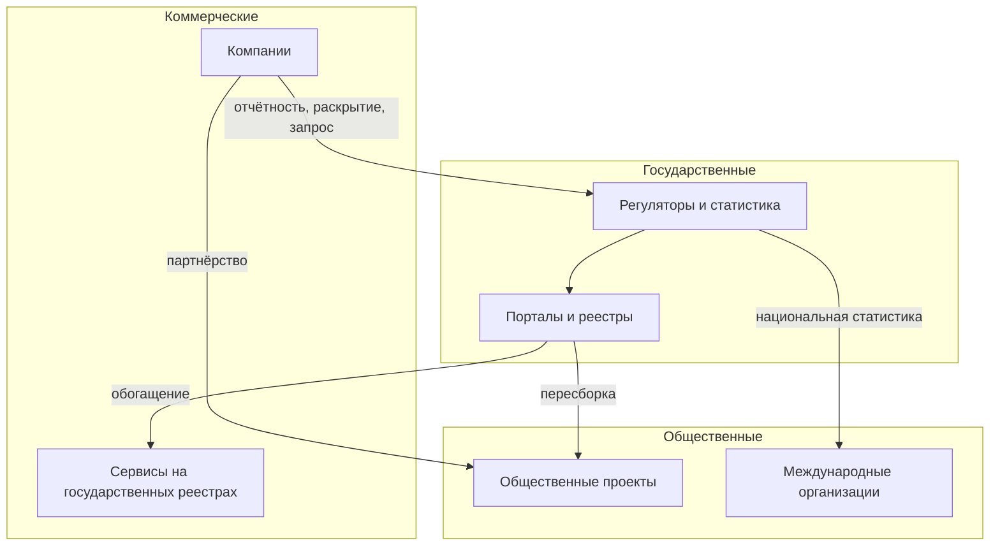

# Три слоя данных

Данные для любой задачи лежат в трёх слоях, и слой определяет не тему, а условия: кто собирает данные, на каком основании и как их получить. **Государственные** данные собирают органы власти и подведомственные организации по полномочию. Их больше всего, часть открыта, часть закрыта законом, качество неровное. **Общественные** собирают и открывают по своей воле сообщества, исследователи и международные организации: получить их просто, но поддерживать их никто не обязан. **Коммерческие** компании собирают для своего дела: часто они свежее и подробнее, но доступны по соглашению или за деньги. Одни и те же данные переходят из слоя в слой: отчётность компаний становится государственной статистикой, государственные реестры пересобирают общественные проекты. Поэтому у каждой копии ищут первоисточник. Инвентаризация «где найти нужное» проходит по всем трём слоям, «чем владеем» — по своему, вместе с тем, что организация получила от других. Какие слои входят в работу, записывают в [границах](../03-process/02-goals-and-questions.md#границы) на первом шаге.

## Коротко

| | Государственные | Общественные | Коммерческие |
|---|---|---|---|
| **Кто собирает** | Органы власти, подведомственные организации, фонды, регуляторы | Общественные проекты, сообщества, исследователи, международные организации | Банки, операторы связи, бюро кредитных историй, платёжные и отраслевые компании |
| **Основание** | Полномочие: закон, положение об органе, акт о системе | Решение самого проекта | Деятельность компании; договор с клиентами |
| **Доступ** | Открытые, с ограничениями и закрытые — основание в законе | Обычно открытые | По соглашению, подписке или за плату; часть компании публикуют сами |
| **Условия использования** | Часто не указаны; в США произведения федерального правительства не охраняются авторским правом (17 U.S.C. § 105) | Свободные лицензии, у каждого проекта свои: структурированные данные Wikidata — CC0 | Договор: цель, срок, запрет передачи и публикации |
| **Чем сильны** | Полнота по стране, юридическая сила, длинные ряды | Удобство: данные уже собраны, очищены и связаны | Свежесть и подробность там, где государство не измеряет |
| **Частые проблемы** | Устаревание, пропуски, разные справочники у ведомств | Нет обязательства поддерживать, ошибки пересборки | Выборка — только клиенты компании, закрытая методика, меняются условия |
| **Где искать** | Порталы открытых данных, статистика и формы сбора сведений, реестры информационных систем и описания систем с персональными данными, госзакупки, нормативные акты, официальные сайты | Общественные проекты, Wikidata и OpenStreetMap, научные репозитории, международные организации, подборки наборов | Раскрытие информации и отчётность компаний, банки и платёжные системы, операторы связи, онлайн-платформы, бюро кредитных историй, сервисы на государственных реестрах, отраслевые сервисы и маркетплейсы данных |
| **Методы** | Анализ полномочий, реестры систем, анализ контрактов, опросы, поиск по сайтам | Поиск проектов и каталогов, эксперты и сообщество | Сначала бесплатное — раскрытие и отчёты компаний; эксперты, ассоциации, реестры лицензий регуляторов, маркетплейсы данных, целевые запросы к компаниям |
| **Подробно** | [Государственные данные](./02-government.md) | [Общественные данные](./03-public.md) | [Коммерческие данные](./04-commercial.md) |

Оценки качества — обобщение, а не правило: бывает отличная государственная статистика и плохие коммерческие данные. Проверяют каждый набор ([«Качество данных»](../03-process/07-quality.md)). Методы для каждого слоя — в главе [«Семь методов»](../02-approaches/02-methods.md#какой-метод-для-каких-данных).

## Как определить слой

Слой определяют два вопроса: на каком основании собраны данные и у кого копия, которую вы получаете. Тема и форма собственности не решают.

- Данные, которые собирают по закону при исполнении государственных функций, — государственные, даже если систему ведёт подрядчик или компания.
- Данные, которые компания собирает для своего дела, — коммерческие, даже если компания государственная.
- Данные, которые собирают и открывают по своей воле, — общественные.

Если копии одних данных лежат в разных слоях, это разные записи: у каждой свой владелец, свои условия и своя дата обновления ([«Что считать записью»](../03-process/05-registry.md#что-считать-записью)).

| Случай | Слой | Почему |
|--------|------|--------|
| **Система органа власти, которую ведёт подрядчик** | Государственный | Владелец — орган, подрядчик — оператор ([«Владелец, оператор, ответственный»](../03-process/03-owners-and-mandates.md#владелец-оператор-ответственный)) |
| **Отчётность компании регулятору** | Копия у регулятора — государственный слой, данные у компании — коммерческий | Регулятор собирает отчёт по закону; у компании данных больше, чем в отчёте |
| **Данные государственной компании о её деятельности** | Коммерческий | Компания ведёт их для своего дела и даёт на своих условиях. На карте [«Нефть и газ»](../08-atlas/03-oil-and-gas.md) так записан сайт Транснефти |
| **Данные квазигосударственного сектора при исполнении функций** | Государственный, если так решил закон | В Казахстане административные цифровые данные формируют государственные органы, государственные юридические лица и квазигосударственный сектор при исполнении функций и оказании услуг (статья 18 Цифрового кодекса) |
| **Обязательное раскрытие информации компаниями** | Слой копии: у регулятора — государственный, у частного сервиса — коммерческий | Обязанность одна, а владельцы копий разные: система EDGAR у Комиссии по ценным бумагам и биржам США (SEC), e-disclosure.ru у «Интерфакса» |
| **Общественный проект на государственных данных** | Общественный, первоисточник — государственный | «Госзатраты» (clearspending.ru) собраны из данных о закупках с zakupki.gov.ru |
| **База международной организации** | Общественный, первоисточник — национальная статистика | World Development Indicators Всемирного банка — 1 400 рядов по 217 экономикам, собранных из официально признанных источников |
| **Данные, которые организация купила или получила по соглашению** | Коммерческий, владелец — поставщик | Данные лежат в своих системах, но права на них ограничены договором |

Пограничный случай записывают по правилу и с примечанием, почему выбран этот слой. Через год иначе не понять, ошибка это или решение.

## Как данные переходят между слоями

| Переход | Пример | Что записать |
|---------|--------|--------------|
| **Компания → государство: отчётность и раскрытие** | EDGAR — основная система, через которую компании подают документы по законам США о ценных бумагах: около 4 700 документов в день, доступ к базе бесплатный | Набор у регулятора — государственный; основание — закон об отчётности |
| **Компания → государство: по запросу** | Глава V регламента ЕС о данных (Data Act): органы власти могут потребовать данные компаний при исключительной потребности — подробнее под таблицей | Основание — статья регламента; цель, срок использования и когда данные удалят |
| **Государство → общественный проект** | «Госзатраты» на 25 октября 2026 года: 69,63 млн контрактов по 44-ФЗ, 94-ФЗ и 223-ФЗ; среди крупнейших контрактов прошлого месяца — заключённые в сентябре 2026 года | Копию со связью `copy_of:` с первоисточником |
| **Национальная статистика → международная организация** | Ряды World Development Indicators — национальные, региональные и глобальные оценки из официальных источников | Первоисточник — статистическая служба страны; у копии — методика международной организации |
| **Компания → общественный проект** | Economic Tracker исследовательской группы Opportunity Insights собирает открытые ряды из обезличенных данных компаний: траты по картам — Affinity Solutions, вакансии — Lightcast, занятость — Paychex | Условия партнёра: ряд живёт, пока живёт партнёрство |
| **Государство → компания** | Сервисы проверки контрагентов строятся на государственных реестрах юридических лиц и дополняют их отчётностью и судебными делами | Первоисточник — реестр; у сервиса — его условия и дата обновления |

**Запрос данных у компаний в ЕС.** С 12 сентября 2025 года по главе V регламента ЕС о данных (Data Act, 2023/2854) органы власти, Еврокомиссия, Европейский центральный банк и органы ЕС могут по обоснованному запросу получить данные компаний при исключительной потребности (статьи 14 и 15). Таких случаев два. Первый — ответ на чрезвычайную ситуацию. Второй — только для неперсональных данных: задача, прямо предусмотренная законом, например официальная статистика, если другие способы исчерпаны, включая покупку по рыночной цене. Микро- и малые предприятия от второго случая освобождены. Для инвентаризации это значит, что коммерческий слой в ЕС частично доступен государству по закону, а не только по договору.

Что из этого следует:

- **Копия — не второй источник.** На картах атласа clearspending.ru — единственный негосударственный источник, который есть на всех четырёх картах. Он отвечает на 7 вопросов, и в 6 из них рядом указан zakupki.gov.ru, из которого он собран. Источников на карте два, а данные одни. Когда считают, сколько источников отвечает на вопрос, копию с первоисточником считают одним.
- **Копия бывает доступнее первоисточника.** 25 октября 2026 года из сети, где проверялась книга, zakupki.gov.ru не ответил, а clearspending.ru открылся. Международные базы обычно открываются из любой страны, а национальные сайты из-за рубежа — не всегда. Но копия отстаёт и может исказить данные при пересборке. Поэтому в реестр вносят обе, и у каждой — своя дата.
- **Переход меняет условия.** Данные компаний становятся открытыми через исследовательский проект, пока компания делится ими. В Economic Tracker ряды Womply о малом бизнесе и ряд о времени вне дома по данным Google переведены в архив. Сами отчёты Google о мобильности (Community Mobility Reports) не обновляются с 15 октября 2022 года.

## Какой слой для каких вопросов

Типовые темы вопросов ([«Типовые вопросы»](../03-process/02-goals-and-questions.md#типовые-вопросы)) подсказывают, с какого слоя начинать и что добавят остальные.

| Тема | Где искать первым | Что добавляют другие слои |
|------|-------------------|---------------------------|
| **Статистика** | Национальная статистика, ведомственная отчётность | Международные базы — сравнение со странами; коммерческие ряды — оценки раньше официальных: траты по картам, вакансии |
| **Организации** | Государственные реестры юридических лиц, лицензий, аккредитаций | Раскрытие информации компаниями, биржи, сервисы проверки контрагентов, Wikidata |
| **Финансы** | Бюджетные данные, госзакупки | Общественные проекты удобнее оригинала; закупки и отчёты самих компаний |
| **Люди** | Регистры и учёт — почти всегда закрыты | Агрегаты компаний: перемещения у операторов связи, траты у банков; социальные сети |
| **Ресурсы** | Реестры объектов, кадастры, лицензии | Отчёты компаний, отраслевые аналитические сервисы |
| **Сравнение со странами** | Международные организации | Национальные службы — чтобы проверить ряд и методику |

Если вопрос можно задать только к одному слою, это стоит проверить. Вопрос «какие коммерческие сервисы собирают данные об отрасли?» спрашивает об источниках, а не о данных ([«Как проверить список»](../03-process/02-goals-and-questions.md#как-проверить-список)). Слой записывают у источника, а вопрос задают по существу.

## Чего ждать от качества

Качество проверяют по одним и тем же признакам ([«Что проверять»](../03-process/07-quality.md#что-проверять)), но слабые места у слоёв разные. Готовьтесь к разочарованию в каждом.

| Слой | Чего ждать | Пример | Что проверить первым |
|------|------------|--------|----------------------|
| **Государственные** | Опубликованное устаревает, справочники ведомств расходятся, часть сведений — только в агрегатах | 84% из 5826 наборов обновлённого data.gov.ru впервые опубликованы в 2019 году или раньше ([«Порталы открытых данных»](./02-government.md#порталы-открытых-данных)) | Дату последнего изменения и последнюю дату внутри данных |
| **Общественные** | Проект перестаёт обновляться или исчезает; ошибки пересборки | opennko.ru с карты «Государственные финансы» к октябрю 2026 года исчез вместе с доменом | Кто ведёт проект и когда обновлял; выборочно сверить с первоисточником |
| **Коммерческие** | Выборка — клиенты компании, а не всё население; состав выборки и подробность меняются; методика закрыта; малые значения скрыты | В данных о тратах по картам Economic Tracker есть разрывы: эмитенты карт входят в выборку и выходят из неё. С 5 июня 2022 года данные приходят раз в неделю, а не каждый день; Affinity Solutions не отдаёт срезы, где меньше пяти транзакций | Кого покрывают данные, как менялась выборка, есть ли описание методики |

Расхождение между слоями — находка, а не помеха. Коммерческие и общественные данные, которые расходятся с официальными, подсказывают, где у официальных пробелы, и наоборот.

## Слои в двух подходах

**«Где найти нужное».** Ищут во всех трёх слоях, а границы решают, в каких именно и на каких условиях: например, «государственные и международные; коммерческие — только бесплатные» ([«Границы»](../03-process/02-goals-and-questions.md#границы)). Без этой строки коммерческие источники либо не ищут вовсе, либо обнаруживают в конце, что ответ есть, но стоит денег.

**«Чем владеем».** Опись идёт по своему слою — у министерства государственному, у компании коммерческому. Но два вида находок из других слоёв в неё тоже входят:

- **Полученные данные.** Купленные наборы, подписки, данные по соглашениям об обмене лежат в своих системах, но права на них ограничены. Их описывают как остальные наборы, с владельцем-поставщиком, соглашением, сроком и тем, что с данными нельзя делать. Иначе срок лицензии истекает незаметно, а данные по договору без права публикации однажды выкладывают в открытый доступ.
- **Копии своих данных.** Общественные проекты, международные базы и коммерческие сервисы, которые пересобирают ваши данные, показывают, кто ими пользуется и где расходятся версии. Для цели «открыть данные» это ещё и мера спроса ([«Делиться данными»](../01-basics/02-goals.md#делиться-данными)).

Подробнее о подходах — в главе [«Два подхода»](../02-approaches/01-two-approaches.md).

## С чего начинать

1. **Записать в границах слои и условия:** какие входят, нужны ли международные для сравнения, можно ли платить за коммерческие.
2. **Государственные данные** — по [анализу полномочий](../03-process/03-owners-and-mandates.md): он даёт владельцев и то, что у них должно быть.
3. **Поиск наборов данных** — по всем слоям сразу: поисковики собирают описания из тысяч каталогов ([«Поиск наборов данных»](./05-dataset-search.md)).
4. **Общественные данные** — копии и пересборки государственных, которые бывают удобнее оригинала, и международные базы для сравнения. У каждой копии сразу ищут первоисточник.
5. **Коммерческие данные** — для того, чего не нашлось у государства, и для проверки государственных. Запрос компании пишут, когда понятно, чего не хватает: с нужной подробностью, периодом и условиями использования. Ответ может занять месяцы, поэтому запрос отправляют, как только виден пробел, а не в конце работы.

В подходе «чем владеем» начинают со своих систем, а затем ищут полученные от других данные — по договорам, закупкам и опросу владельцев ([«Опросные листы и интервью»](../03-process/04-questionnaires.md)).

## Слои на картах атласа

Четыре карты атласа составлены в 2018–2019 годах о России: 77 вопросов и 159 источников. Если разметить источники по слоям — по владельцу и по правилу из раздела [«Как определить слой»](#как-определить-слой), — получается так:

| Слой | Источников | Пары «вопрос — источник»: доступно / с ограничениями / не доступно |
|------|-----------:|--------------------------------------------------------------------|
| **Государственные** | 122 | 165 / 3 / 46 (ещё у 11 пар доступность не отмечена) |
| **Коммерческие** | 18 | 11 / 10 / 0 |
| **Общественные** — пять международных организаций и три российских общественных проекта | 8 | 15 / 0 / 0 |
| **Пограничные** | 11 | 10 / 0 / 3 |

Пограничные — источники, слой которых по владельцу не определить: Корпорация МСП — институт развития в форме акционерного общества, РИА Новости — государственное агентство новостей, КиберЛенинка и OpenOil — проекты, которые ведут компании, сайты олимпиад, а также группы сайтов и систем вузов и медицинских организаций, в которых вместе государственные и частные.

Что видно на картах:

- **Закрытое — у государства, за деньги — у компаний.** Из 49 пар «не доступно» 46 приходятся на государственные источники, ещё 3 — на группы систем вузов и медицинских организаций. Из 13 пар «с ограничениями» 10 — у коммерческих источников. Все пары общественных источников доступны.
- **Другие слои дополняют, а не заменяют.** Коммерческие или общественные источники есть у 20 вопросов из 77, только государственные — у 51. Без государственных источников остались 4 вопроса: сравнение здравоохранения России и мира (Всемирный банк, ВОЗ, ООН), транспортная инфраструктура нефти и газа (Транснефть) и два вопроса об источниках — о коммерческих сервисах и общественных проектах.
- **Слои зависят от отрасли.** На карте «Нефть и газ» 14 коммерческих источников из 37, и коммерческие или общественные источники есть у 9 вопросов из 16 ([«Пример: карта „Нефть и газ“»](../02-approaches/04-data-maps.md#пример-карта-нефть-и-газ)). На карте [«Государственные финансы»](../08-atlas/02-public-finance.md) коммерческих источников нет ни одного.
- **Копия рядом с первоисточником.** clearspending.ru и zakupki.gov.ru указаны вместе в 6 вопросах — подробнее в разделе [«Как данные переходят между слоями»](#как-данные-переходят-между-слоями).

Карты проверены в 2018–2019 годах, владельцы источников записаны по домену и по документам не сверены. Разметка показывает соотношение слоёв, а не точную картину отрасли сегодня.

## Три слоя в разных странах

| Страна | Государственные | Общественные | Коммерческие |
|--------|-----------------|--------------|--------------|
| **Казахстан** | Портал открытых данных data.egov.kz; базовые государственные базы данных — физические лица, юридические лица, регистр недвижимости, электронное лицензирование; Бюро национальной статистики stat.gov.kz; единая платформа закупок zakup.gov.kz (прежде goszakup.gov.kz); правовая система «Әділет» adilet.zan.kz | Экосистема Викимедиа (Wikidata, Википедия) и построенная на Википедии DBpedia; OpenStreetMap; порталы международных организаций — Всемирного банка, ООН, ВОЗ, ОЭСР, — оценки которых расходятся с национальными по методике: население Казахстана у Всемирного банка больше, чем у Бюро национальной статистики ([«Международные организации»](./03-public.md#международные-организации)); научные репозитории (re3data.org) | Первое кредитное бюро (1cb.kz), операторы фискальных данных — например, Kazakhtelecom OFD (oofd.kz), — банки, операторы связи, финтех. Государственные сведения компании получают через интеграционную платформу Smart Bridge: её каталог сервисов (sb.egov.kz) показывает, что отдают, — например, сведения о физических лицах по ИИН и о юридических лицах по БИН |
| **Россия** | data.gov.ru, Росстат и fedstat.ru, zakupki.gov.ru, egrul.nalog.ru | «Госзатраты» (clearspending.ru), Wikidata | e-disclosure.ru, Московская биржа, rlsnet.ru, отраслевые аналитические сервисы |
| **США** | data.gov, реестр воздушных судов FAA, EDGAR | Economic Tracker Opportunity Insights, научные репозитории | Affinity Solutions, Lightcast, Paychex — через Economic Tracker; Google Community Mobility Reports — архив с 2022 года |
| **Европейский союз** | data.europa.eu, Евростат, наборы высокой ценности | Zenodo — репозиторий научных данных, который ведёт ЦЕРН; Wikidata | Данные компаний по запросу органов власти по главе V регламента о данных |

Подробнее о Казахстане — в главе [«Казахстан»](../07-countries/01-kazakhstan.md#где-искать-данные), о России — в главе [«Россия»](../07-countries/02-russia.md).

## Как записать

**Слой — у владельца, а не у каждой записи.** В листе «Владельцы» ([owners.csv](pathname:///templates/owners.csv)) у организации есть колонка `layer`: `government`, `public` или `commercial`. Запись реестра получает слой через владельца — колонку `publisher`. В рабочей таблице карты данных та же колонка есть в листе источников ([sources.csv](pathname:///templates/sources.csv)). Так по реестру можно посчитать, сколько наборов в каком слое, и отфильтровать то, что входит в границы.

**У пограничного случая — примечание**, почему выбран этот слой: «государственная компания, данные о собственной деятельности — коммерческий».

**У копии — первоисточник.** Копию в другом слое записывают отдельной записью со своим владельцем и связью `copy_of:` в колонке `related` шаблона [registry.csv](pathname:///templates/registry.csv) ([«Расширенный состав»](../03-process/05-registry.md#расширенный-состав)). В листе источников карты для этого есть колонка `copy_of`: по ней копию и первоисточник при подсчёте источников вопроса считают одним. В шаблоне так записан clearspending.ru.

**У полученных данных — условия.** В условиях использования (`license`) — соглашение, его номер и дата, срок и ограничения на передачу и публикацию; в режиме доступа — «с ограничениями» с основанием ([«Шкала»](../03-process/06-access.md#шкала)). По сроку соглашения при обновлении видно, что продлевать.

## Частые ошибки

| Ошибка | Что происходит | Как исправить |
|--------|----------------|---------------|
| **Слой по форме собственности** | Данные государственной компании о её деятельности записаны государственными, и их ищут как обязательные к открытию | Слой — по основанию сбора и по тому, у кого копия |
| **Копия как второй источник** | Вопрос выглядит хорошо покрытым, а данные одни; копия отстаёт или исчезает | Связь `copy_of:` с первоисточником; при подсчёте — один источник |
| **Международная база вместо национальной** | Ряды пересчитаны по чужой методике и часто отстают от национальных | Для своей страны — национальная служба, международная база — для сравнения |
| **Общественный проект без проверки** | Ошибки пересборки переходят в реестр | Выборочно сверить с первоисточником, записать дату обновления проекта |
| **Коммерческие данные напоследок** | В конце выясняется, что у государства данных нет, а запрос компании может занять месяцы | Решить в границах, входят ли коммерческие, и писать запрос, как только виден пробел |
| **Коммерческие данные как всё население** | Выводы о стране по клиентам одного банка или оператора | Записать, кого покрывают данные; сверить с официальной статистикой |
| **Полученные данные вне описи** | Срок лицензии истекает незаметно, данные публикуют с нарушением договора | Описать полученные данные с поставщиком, соглашением и сроком |

## Ограничения

- Три слоя — упрощение. Международные организации собирают в основном государственные данные других стран, научные данные часто созданы на государственные деньги, а вузы и клиники бывают и государственными, и частными.
- Границу между слоями проводит закон страны: квазигосударственный сектор, государственные компании и регуляторы в разных странах устроены по-разному.
- Условия коммерческих данных меняются в любой момент, а цены редко известны заранее.
- Разметка атласа по слоям сделана по владельцам, записанным по домену; по документам владельцы не сверены ([«Владельцы и полномочия»](../03-process/03-owners-and-mandates.md)).

## Источники

- Главы о каждом слое: [государственные](./02-government.md), [общественные](./03-public.md), [коммерческие](./04-commercial.md) данные.
- Данные атласа: [общий список источников](https://github.com/ivbeg/data-inventory/blob/main/data/sources.yaml), [карты](https://github.com/ivbeg/data-inventory/tree/main/data/maps) и [результаты проверки адресов](https://github.com/ivbeg/data-inventory/blob/main/data/source-checks.yaml). Разметка источников по слоям и подсчёт пар — по файлам в октябре 2026 года.
- [Regulation (EU) 2023/2854 (Data Act)](https://eur-lex.europa.eu/eli/reg/2023/2854/oj), глава V — статьи 14–22, статья 50 — применяется с 12 сентября 2025 года. На 25 октября 2026 года регламент не изменялся: на EUR-Lex — исправления и предложение поправок COM(2025) 837. Перед ссылкой проверить редакцию.
- [About EDGAR](https://www.sec.gov/submit-filings/about-edgar) — SEC, на октябрь 2026 года.
- [World Development Indicators](https://datatopics.worldbank.org/world-development-indicators/) — Всемирный банк, на октябрь 2026 года.
- [Economic Tracker](https://economictracker.org/) — Opportunity Insights: траты по картам на 30 июня 2026 года; [описание данных](https://github.com/OpportunityInsights/EconomicTracker/blob/main/docs/oi_tracker_data_documentation.md) — источники рядов, архивные ряды, разрывы в данных Affinity Solutions; обновлено 17 сентября 2026 года.
- [COVID-19 Community Mobility Reports](https://www.google.com/covid19/mobility/) — Google: не обновляются с 15 октября 2022 года, исторические данные доступны.
- [Wikidata:Copyright](https://www.wikidata.org/wiki/Wikidata:Copyright) — структурированные данные под CC0; [17 U.S. Code § 105](https://www.law.cornell.edu/uscode/text/17/105) — произведения федерального правительства США.
- [«Госзатраты»](https://clearspending.ru/) — проект «Информационной культуры», которой руководит автор книги; число контрактов и даты — на 25 октября 2026 года.
- Цифровой кодекс Республики Казахстан от 09.01.2026 № 255-VIII, статья 18 ([«Казахстан»](../07-countries/01-kazakhstan.md#правовая-основа)).
- Проверка адресов 25 октября 2026 года из сети, где проверялась книга: открылись data.egov.kz, stat.gov.kz, sb.egov.kz (каталог сервисов Smart Bridge), 1cb.kz, oofd.kz, clearspending.ru, data.worldbank.org; goszakup.gov.kz перенаправлял на zakup.gov.kz; adilet.zan.kz (открывался 23 октября 2026 года), zakupki.gov.ru и data.gov.ru не ответили.
