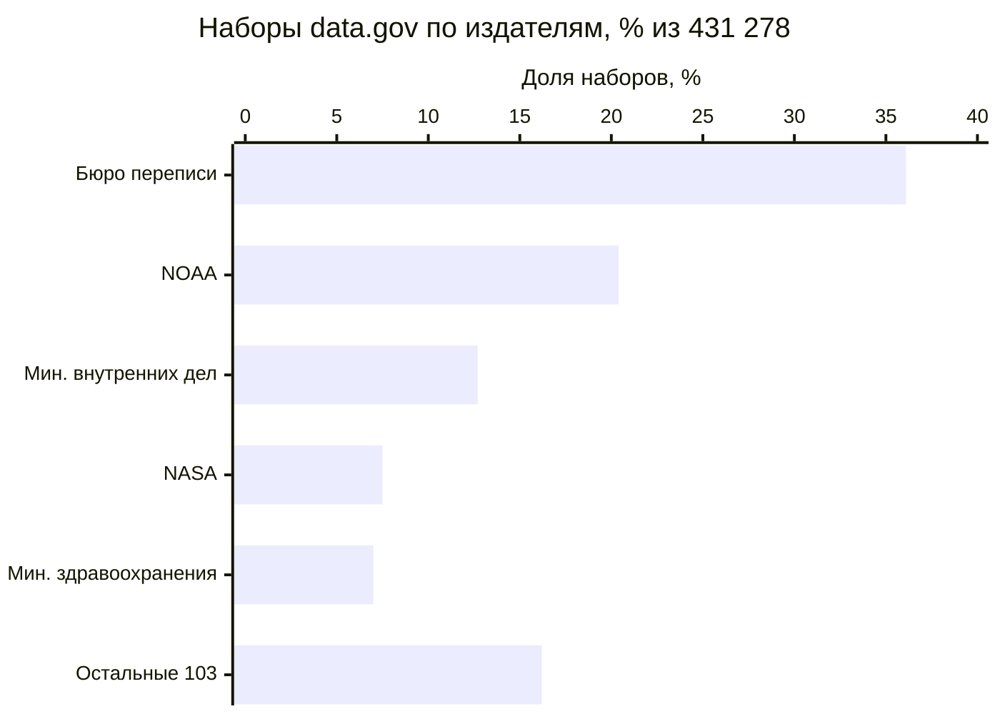
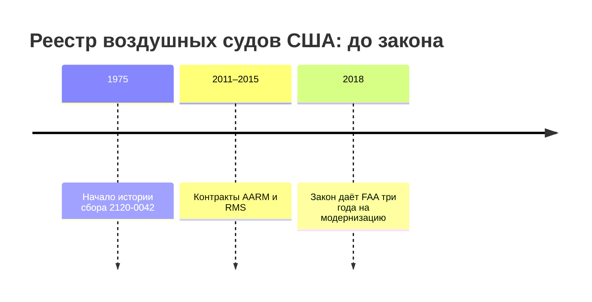
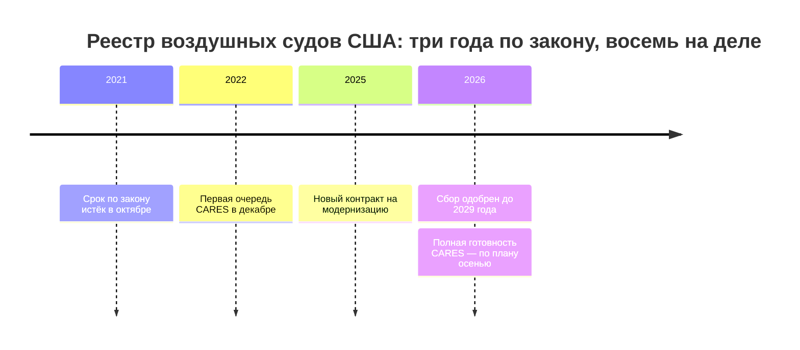

# Государственные данные

У государства данных больше всего, но опубликована малая часть, а остальное разбросано по сотням систем и ведомств. Ни один источник не показывает всего, поэтому государственные данные ищут сразу в шести источниках и сводят следы одного набора в одну запись. Опубликованный набор ведёт к системе, система — к контракту и акту, акт — к полномочию. Расхождения между источниками — находка: на федеральном портале США data.gov нет реестра воздушных судов, хотя FAA выгружает его целиком каждый день ([пример](#пример-реестр-воздушных-судов-сша)).

Сведения проверены 25 октября 2026 года, если не указано иное. Как устроены эти источники в Казахстане, России, Великобритании, Франции, Польше и Южной Корее, — на странице [«Шесть стран в сравнении»](../07-countries/00-overview.md) и в главах стран; здесь — метод и примеры США и ЕС.

## Коротко

| Источник | На какой вопрос отвечает | Что даёт | Чего не даёт |
|----------|--------------------------|----------|--------------|
| **[Порталы открытых данных](#порталы-открытых-данных)** | Что опубликовано | Наборы с описаниями, издателем и датами | Неопубликованное; свежесть не гарантирована |
| **[Статистика и формы сбора](#статистика-и-формы-сбора-сведений)** | Что государство собирает, с кого и как часто | Показатели, методики, состав сведений, периодичность | Записи; где лежат ответы |
| **[Реестры систем](#реестры-информационных-систем)** и **[описания систем с персональными данными](#описания-систем-с-персональными-данными)** | Какие системы есть и что в них | Системы, операторы, назначение, категории сведений, основания | Системы вне реестра; ссылки на данные |
| **[Госзакупки](#госзакупки)** | Что строили и что лежит в системе | Технические задания, состав данных, подрядчики, история модернизаций | Системы, созданные без закупок |
| **[Нормативные акты](#нормативные-акты)** | Почему данные есть и у кого | Полномочия, состав сведений, порядок доступа | Что на самом деле лежит в системе |
| **[Сайты и домены](#сайты-и-домены)** | Где у систем публичные части | Разделы, поддомены, выгрузки, следы закрытых систем | Системы без публичной части |

## Что считать государственными данными

Государственные данные собирают, создают или получают органы власти и организации, которые действуют за государство:

- **органы власти всех уровней** — центральные, региональные, местные, а также парламенты, суды, центральные банки;
- **подведомственные учреждения** — центры информатизации, научные институты, учреждения, которые ведут реестры за орган власти;
- **государственные компании** — если закон относит их данные к государственным;
- **подрядчики**, которые ведут данные по контракту. Владелец таких данных — заказчик, подрядчик — оператор ([«Владелец, оператор, ответственный»](../03-process/03-owners-and-mandates.md#владелец-оператор-ответственный)).

Где проходит граница, решает закон страны и границы самой работы. Европейская директива об открытых данных распространяется не только на органы власти, но и на часть публичных предприятий — коммунальных, транспортных, почтовых — и на данные исследований. На data.gov публикуют и штаты, округа, города, университеты: из 108 организаций портала федеральных 61, и у них 399 103 набора из 431 278. Какие уровни и организации входят в работу, записывают в [границах](../03-process/02-goals-and-questions.md#границы) до начала поиска.

| Что есть у государства | Пример | Где искать следы |
|------------------------|--------|------------------|
| **Регистры и реестры** | Реестр юридических лиц, кадастр, реестр лицензий | Акты, реестры систем, описания систем с персональными данными, сайты |
| **Учётные данные** | Заявления, решения, проверки, обращения | Регламенты услуг, описания систем, контракты |
| **Отчётность** | Сведения, которые организации и граждане сдают по формам | Формы сбора сведений, планы статистических работ |
| **Статистика** | Показатели по территориям и периодам | Статистические службы |
| **Наблюдения** | Погода, качество воздуха, недра, спутниковые снимки | Сайты служб, геопорталы, акты |
| **Сведения о самом государстве** | Бюджет, закупки, имущество, кадры, акты | Порталы бюджета и закупок, правовые системы |

Набор, найденный в одном источнике, почти всегда оставил следы в других. Регистр создан актом, ведётся в системе, заполняется по формам, построен по контракту и часто опубликован. Поэтому найденное в одном источнике проверяют по остальным, а каждый след записывают.

## Как использовать при инвентаризации

Порядок зависит от подхода. Это частный случай общего порядка методов ([«Как выбрать и сочетать методы»](../02-approaches/02-methods.md#как-выбрать-и-сочетать-методы)).

- **«Чем владеем» — опись ведомства:** полномочия → реестр систем и описания систем с персональными данными → формы сбора → контракты → сайт и поддомены → портал → анкета владельцам. Документы показывают, что должно быть и где, портал — что из этого открыто, анкета — что документы упустили ([«Заполнить заранее»](../03-process/04-questionnaires.md#заполнить-заранее)).
- **«Где найти нужное» — данные под задачу:** портал и [поиск наборов](./05-dataset-search.md) → статистика и формы сбора → от найденного к системе и владельцу → контракты и акты для закрытого. Сначала опубликованное — это быстро; потом — кто собирает нужное, чтобы спросить о закрытом.

## Порталы открытых данных

Портал показывает, что ведомства решили опубликовать, а не всё, что у них есть.

**Число наборов — не мера охвата.** На data.gov 431 278 наборов, но больше трети из них — файлы одного Бюро переписи: 147 134 набора выпустило одно его подразделение, которое делает географические файлы. Пять крупнейших издателей дали 84% портала, а у Бюро статистики труда — 31 набор. Число показывает, как ведомство делит данные на файлы, а не сколько данных у него есть.



*NOAA — Национальное управление океанических и атмосферных исследований. Данные программного интерфейса catalog.data.gov.*

Кто и сколько публикует, программный интерфейс портала показывает за минуту. Список издателей сравнивают с владельцами в границах: владелец без наборов на портале — вопрос к нему, а не вывод, что данных нет.

<details>
<summary>Проверить самому</summary>

```bash
# data.gov: сколько наборов на портале (поле results.datasets)
curl "https://catalog.data.gov/api/stats"
# data.gov: организации, их тип и число наборов
curl "https://catalog.data.gov/api/organizations"
# data.gov: издатели внутри организаций
curl "https://catalog.data.gov/api/publishers"
# data.europa.eu: сколько наборов
curl "https://data.europa.eu/api/hub/search/search?filter=dataset&limit=0"
```

Запросы к порталам других стран — в главах стран.

</details>

**Порталы собирают друг друга.** Европейский портал data.europa.eu содержит 1 858 143 набора из 213 каталогов: он забирает описания с национальных порталов, и один набор встречается в нескольких каталогах ([«Один набор под разными именами»](../03-process/05-registry.md#один-набор-под-разными-именами)).

**Перечень показывает обязательство.** Где ведомства публикуют наборы по утверждённым перечням, перечень — готовый список того, что ведомство обязалось открыть. С ним сравнивают портал: так, data.egov.kz показывает по каждому ведомству долю размещённых наборов от утверждённых. В каких странах есть перечни и перечни ещё не открытого, — на странице [«Шесть стран в сравнении»](../07-countries/00-overview.md).

**Порталы закрываются и меняют платформы.** Data.gov в 2025 году перешёл на новую платформу: прежний программный интерфейс catalog.data.gov/api/3/ отвечает ошибкой 404, и программы, написанные под него, приходится переписывать. Российский data.gov.ru закрывали почти на два с половиной года ([«Пример: data.gov.ru»](./06-legacy.md#пример-datagovru)).

Как читать набор на портале:

- **Издатель — подсказка, а не владелец.** Один владелец публикует под разными именами: у FAA на data.gov 15 наборов под тремя написаниями издателя. Владельца берут из положения или акта о системе ([«Где искать полномочия»](../03-process/03-owners-and-mandates.md#где-искать-полномочия)).
- **Дата страницы — не дата данных.** Смотрят дату изменения самих данных ([«Периодичность и даты»](../03-process/05-registry.md#периодичность-и-даты)).
- **От набора — к системе.** В описании и ссылках набора ищут название системы, адрес её публичной части, поддомен ([«От набора к владельцу»](./05-dataset-search.md#от-набора-к-владельцу)).
- **Чего нет на портале.** Набор, который ведомство обязано вести, но не опубликовало, либо закрыт, либо лежит в другом месте, либо не ведётся. Это выясняют, а не считают, что набора нет.

## Статистика и формы сбора сведений

Статистика даёт показатели по территориям и периодам и методики их расчёта, но не записи. Для инвентаризации важнее другое: государство учитывает, что собирает. Чтобы получать сведения от граждан и организаций, нужна утверждённая форма, а формы сведены в планы и перечни. Каждая форма — поток данных с владельцем, составом сведений и периодичностью. Если форму сдают, ответы где-то лежат, даже если системы для них нет.

Самый подробный открытый перечень — в США. Ведомство не вправе собирать сведения у граждан и организаций без одобрения Административно-бюджетного управления (OMB) и контрольного номера на форме, а одобрение даётся не больше чем на три года. Все действующие сборы — 10 736 — перечислены на reginfo.gov. У каждого есть формы, число ответов в год, ссылки на закон и пояснительная записка.


*Карточка сбора 2120-0042 «Aircraft Registration» на reginfo.gov: одобрен 19 февраля 2026 года, действует до 28 февраля 2029 года, 177 201 ответ в год. Снято 26 октября 2026 года.*

В ЕС отраслевые регламенты определяют, какие сведения страны сдают европейским организациям; в экологии их собирает база отчётных обязательств ROD Европейского агентства по окружающей среде. В других странах роль перечня играют план статистических работ, программа статистических обследований или перечень утверждённой статистики, а в Великобритании единой программы нет.

Как использовать:

- **Форма — кандидат в запись реестра.** Ответы на форму — набор. Его владелец — тот, кто форму собирает, а не тот, кто её утвердил ([«Как читать полномочия»](../03-process/03-owners-and-mandates.md#как-читать-полномочия)). Периодичность берут из формы, состав сведений — из её полей. Где лежат ответы — в системе, в таблицах или на бумаге, — спрашивают владельца.
- **План показывает, кто ведёт тему.** В подходе «где найти нужное» по плану статистических работ находят ведомство, которое считает нужные показатели, и спрашивают у него записи, из которых показатели собраны.
- **Число ответов показывает объём** — сколько записей прибавляется в наборе за год.
- **История сборов показывает прошлое.** У сбора на reginfo.gov видна история одобрений: у регистрации воздушных судов — с 1975 года. По ней видно, когда сбор начался, менялся и прекратился и кому искать преемника ([«Где искать преемника»](./06-legacy.md#где-искать-преемника)).
- **Статистика проверяет полноту.** Если в найденном наборе записей заметно меньше, чем показывает статистика, спрашивают почему ([«Качество данных»](../03-process/07-quality.md)).

## Реестры информационных систем

Реестр систем — лучший старт для подхода «чем владеем» в государстве: он перечисляет системы и операторов. Но он учитывает системы, а не наборы, и в него попадает не всё ([«Инвентаризация информационных систем»](../02-approaches/02-methods.md#2-инвентаризация-информационных-систем)).

Есть ли такой реестр и виден ли он снаружи, зависит от страны:

- **открыт или открыт частично** — в Казахстане архитектурный портал показывает системы центральных и местных органов, в Польше итоги учёта систем SIST публикуют открытыми данными;
- **ведётся, но снаружи закрыт** — в России учёт ведут в системе координации информатизации (ФГИС КИ). ФГИС — федеральная государственная информационная система: её создают для исполнения полномочий федерального органа власти. В Южной Корее открыта только сводка учёта ИТ-ресурсов;
- **открытого реестра нет** — в США, ЕС, Великобритании и Франции. Расходы федеральных ведомств США на ИТ и крупные ИТ-инвестиции показывает IT Dashboard, а сами системы находят по описаниям систем с персональными данными.

Сравнение — на странице [«Шесть стран в сравнении»](../07-countries/00-overview.md), подробности — в разделах «Реестры и платформы» глав стран.

### Описания систем с персональными данными

Законы о персональных данных требуют описывать системы, в которых хранятся сведения о людях, и часть этих описаний публична. Большинство государственных регистров — о людях, поэтому такие описания закрывают многие пробелы реестра систем.

В США ведомство публикует в Federal Register уведомление о каждой системе записей, где записи ищут по имени или номеру человека (System of Records Notice, SORN). В уведомлении — название и место системы, о ком записи и какие, кому их раскрывают, сколько хранят, кто отвечает и откуда берутся записи. На сайтах ведомств, кроме того, публикуют оценки влияния на приватность (Privacy Impact Assessment, PIA). Институты и органы ЕС ведут общедоступный реестр записей об обработке персональных данных: цели, категории данных и получателей, сроки удаления. Как это устроено в других странах, — в главах стран.

- **Описание даёт сразу несколько полей реестра:** систему и оператора, основание, наличие персональных данных, режим доступа. Одно описание бывает сразу на несколько систем: американское уведомление о регистрации воздушных судов охватывает четыре ([пример](#пример-реестр-воздушных-судов-сша)).
- **Описаны не все системы.** Описания есть только у систем со сведениями о людях: метеорология или геология в них не попадут. Системы безопасности и правопорядка часто освобождены от описания. Записи об обработке, которые органы стран ЕС ведут по GDPR, публиковать не обязаны: их показывают надзорному органу по запросу.
- **Описание отстаёт от системы.** У описания смотрят дату и сверяют его с контрактами.

## Госзакупки

Контракт на создание или развитие системы — самый подробный открытый документ о ней. Техническое задание описывает данные, которые система должна хранить, интеграции и перенос данных из прежней системы, а акты — что сделано. Контракты показывают и историю: прежние названия системы, предшественников, подрядчиков, у которых могли остаться копии данных.

Как искать:

- **По полному названию системы** и по её прежним названиям. Сокращение даёт шум: по слову CARES среди контрактов FAA первыми находятся субсидии на детские сады и уборка помещений, а не система регистрации воздушных судов.
- **По заказчику.** Подведомственные учреждения закупают системы за орган власти, поэтому смотрят и их контракты.
- **По подрядчикам** — ИТ-компаниям, которые уже работали с ведомством.
- **По кодам классификаторов**, которыми помечают ИТ-закупки: в ЕС — коды CPV раздела 72, в США — коды продукции и услуг группы D. Коды ставят неаккуратно, поэтому их сочетают с поиском по названиям.

Системы, которые учреждения создают сами по государственным заданиям, в закупках не видны: их ищут в отчётах о выполнении заданий. Порталы закупок — ещё и источник для вопросов о расходах и ценах ([«Какой слой для каких вопросов»](./01-three-layers.md#какой-слой-для-каких-вопросов)).

## Нормативные акты

Почти у каждой государственной системы и каждого регистра есть акт, который их создал: закон, постановление правительства, приказ ведомства. В нём записаны цель, оператор, состав сведений, порядок доступа, иногда срок. Акт говорит, что должно быть; было ли — проверяют по закупкам, описаниям систем и самим данным. Как найти полномочия владельца — в главе [«Владельцы и полномочия»](../03-process/03-owners-and-mandates.md#где-искать-полномочия). Об акте о системе важно три вещи:

- **акт называет систему и оператора** — их записывают в реестр с реквизитами акта ([«Расширенный состав»](../03-process/05-registry.md#расширенный-состав));
- **акт перечисляет состав сведений** — готовый список полей, с которым сверяют выгрузку;
- **акт задаёт порядок доступа** — основание для режима доступа ([«Порядок проверки»](../03-process/06-access.md#порядок-проверки)).

Перед ссылкой на акт проверяют, действует ли он и какая редакция последняя: при сверке фактов этой книги оказалось, что российское постановление о планах информатизации отменено ещё в 2020 году ([«Перед ссылкой на нормативный акт»](../09-appendices/04-checklists.md#перед-ссылкой-на-нормативный-акт)).

## Сайты и домены

Сайт ведомства — витрина: за разделами и поддоменами стоят системы. Поддомен остаётся следом системы, даже когда её данные закрыты: у российской системы координации информатизации на gis.gov.ru снаружи виден только вход для уполномоченных лиц. Такой поддомен — повод записать систему и спросить владельца о доступе, а не вычеркнуть её.

Списки доменов помогают найти публичные части систем, о которых сайт молчит. В США агентство кибербезопасности CISA ведёт открытый список доменов .gov: в нём 16 951 домен, из них 1 321 федеральный. В списке только домены второго уровня: faa.gov в нём есть, registry.faa.gov — нет. Поддомены ищут поиском по сайту, в веб-архиве и в журналах сертификатов (Certificate Transparency). Это открытые журналы, куда удостоверяющие центры записывают каждый выданный сертификат для HTTPS, а с ним и имя поддомена. Для России такой список ведёт «Информационная культура» ([реестр государственных доменов](https://github.com/infoculture/govdomains/)).

Адреса меняются: ведомства переезжают на новые домены, поддомены исчезают ([«Исчезнувшие системы и веб-архивы»](./06-legacy.md)). Многие государственные сайты не открываются из-за рубежа, поэтому их проверяют из сети страны и записывают, откуда проверяли.

## Как записать

Что каждый источник даёт в запись реестра:

| Источник | Поля реестра |
|----------|--------------|
| **Портал и сайт** | Наименование, описание, ссылка для выгрузки, формат, даты, условия использования; издатель — кандидат во владельцы |
| **Статистика и формы сбора** | Владелец — кто собирает; периодичность; состав сведений и схема — поля формы |
| **Реестр систем, описание системы с персональными данными** | Информационная система и оператор, полномочие и акт, персональные данные, режим доступа и его основание |
| **Контракт** | Схема и состав данных, оператор и подрядчик, предшественники и преемники системы |
| **Нормативный акт** | Полномочие, нормативный акт, состав сведений, основание режима доступа |

**Один набор — одна запись.** Следы одного набора в разных источниках сводят в одну запись: прежние названия и адреса — в синонимы, каждый источник — в поле «откуда известно» ([«Как записать, откуда известно»](../02-approaches/02-methods.md#как-записать-откуда-известно)). Запись, которую подтвердили два независимых источника, надёжна.

**Расхождения — находки.** Кроме расхождений между методами ([«Как методы проверяют друг друга»](../02-approaches/02-methods.md#как-методы-проверяют-друг-друга)), у государственных источников есть свои:

| Что видно | Что может значить | Что сделать |
|-----------|-------------------|-------------|
| Набор есть на сайте ведомства, на портале его нет | Не попал в каталог | Ссылку взять с сайта; пробел каталога записать |
| Форму сдают, набора нигде нет | Ответы на бумаге или в закрытой системе; их сводят только в статистику | Спросить владельца; до ответа режим доступа — «не установлено» |
| Акт требует систему, контрактов нет | Систему не создали, создало учреждение само или её ведут в таблицах | Отчёты учреждений о госзаданиях; вопрос владельцу |
| Документы называют разные системы, формы, сроки | Документы обновляют в разное время | Сверить по датам; записать все источники |

## Пример: реестр воздушных судов США

**Где мы в примере.** Полномочие FAA вести реестр найдено в главе [«Владельцы и полномочия»](../03-process/03-owners-and-mandates.md#от-полномочия-к-набору), запись о наборе собрана в главе [«Реестр данных»](../03-process/05-registry.md#карточка-записи-faa) — со страницы FAA и из выгрузки. Здесь — следы того же реестра в шести видах государственных источников.

| Источник | Что нашли | Что это дало записи |
|----------|-----------|---------------------|
| **Портал data.gov** | 15 наборов FAA под тремя написаниями издателя: карты, аэродромы, полосы, региональные офисы. Реестра воздушных судов нет | Пробел каталога: ссылку берут с сайта FAA |
| **Сайт и домен** | Ежедневная выгрузка всей базы на registry.faa.gov. В списке доменов .gov поддомена registry.faa.gov нет | Ссылка, формат, дата изменения |
| **Сбор сведений** | Сбор 2120-0042 на reginfo.gov: 177 201 ответ в год, из них 74 431 заявление о регистрации и 95 727 документов о праве собственности | Состав сведений по формам; источник записей — владельцы судов; прирост за год |
| **Описание системы** | Уведомление SORN DOT/FAA 801 от 9 августа 2023 года: четыре системы, среди них старая Civil Aviation Registry System и новая CARES. Публике раскрывают имя и адрес владельца | Системы и операторы, основания, персональные данные, преемник старой системы |
| **Госзакупки** | На USAspending.gov — AARM (2011–2012, около 5,3 млн долларов), RMS (2014–2015, около 3,1 млн) и модернизация силами Ernst & Young (сентябрь 2025 — март 2027, около 2,7 млн) | Прежние названия AARM и RMS, которых нет в описании системы; подрядчики |
| **Нормативные акты** | 49 U.S.C. § 44103 — регистрация воздушных судов; 14 CFR part 47 — порядок регистрации; закон 2018 года дал FAA три года на модернизацию реестра | Полномочие, акты и срок, с которым сверяют ход модернизации |

Описание системы добавляет подробности, которых нет больше нигде. Старая система работает в центре обработки данных FAA в Оклахома-Сити и на мейнфрейме ИТ-центра Министерства сельского хозяйства в Канзас-Сити. Записи о регистрации хранят постоянно, копию системы ежегодно передают в Национальный архив. По оценке влияния на приватность CARES станет основным юридически значимым хранилищем записей о регистрации.

Если сложить даты из шести источников, видно, как долго идёт модернизация:





Карточка записи в «Реестре данных» собрана для цели, где система не нужна. Если цель — опись систем ведомства, шесть источников дополняют её так:

| Поле | До: страница и выгрузка FAA | После шести источников |
|------|-----------------------------|------------------------|
| **Синонимы** | Aircraft Registration Database | Ещё Civil Aviation Registry System, AARM, RMS |
| **Описание** | Состав файлов выгрузки | Ещё источник записей — заявления владельцев судов, около 177 тыс. ответов в год |
| **Информационная система и оператор** | Не заполнены | Civil Aviation Registry System, FAA; часть инфраструктуры — у Министерства сельского хозяйства. Преемник — CARES |
| **Нормативный акт** | 49 U.S.C. § 44103 | Ещё 14 CFR part 47 и закон 2018 года о модернизации |
| **Откуда известно** | Анализ полномочий; страница выгрузки | Ещё data.gov, список доменов .gov, reginfo.gov, Federal Register, USAspending.gov, eCFR — у каждого дата |

**Итог.** Ни один источник не дал записи целиком, и источники расходятся. Портал о реестре не знает, а поисковики находят только его копии ([«Поиск наборов данных»](./05-dataset-search.md#пример-реестр-воздушных-судов-сша)). Описание системы называет четыре системы, но не основной сбор 2120-0042. Контракты называют AARM и RMS, которых нет в описании. Закон дал на модернизацию три года, а полную готовность новой системы планируют через восемь лет после закона. Каждое расхождение попало в запись, а не потерялось.

## Частые ошибки

| Ошибка | Что происходит | Как исправить |
|--------|----------------|---------------|
| **Число наборов — мера открытости** | 36% data.gov — файлы одного Бюро переписи, а у Бюро статистики труда 31 набор | Смотреть, что за наборы, а не сколько их |
| **Поиск закупок по одному слову** | Шум или пропуски: по CARES находятся детские сады | Полное и прежние названия, заказчики, проверка описания контракта |
| **Сайт проверен из-за рубежа** | «Сайт не работает», хотя он закрыт только для зарубежных адресов | Проверять из сети страны; записать сеть проверки |

Сквозные ошибки — портал вместо всех данных, издатель вместо владельца, удалённая строка исчезнувшего источника — в главе [«Практики и антипаттерны»](../08-practices/01-practices-and-anti-patterns.md).

## Ограничения

- Описания систем, формы и акты показывают то, что задумано и согласовано, а не то, что работает, и обновляются позже систем.
- Описания систем с персональными данными не покрывают системы без сведений о людях. Формы сбора не покрывают данные, которые государство создаёт само: наблюдения, решения, внутренний учёт.
- Открытость документов разная. В США описания систем и сборов сведений публикуют по закону; в других странах части этих источников нет или она закрыта, и тогда больше опираются на акты, закупки и опросы владельцев.
- Названия систем длинные и меняются при модернизации. В реестре хранят официальное, короткое и прежние названия — как AARM, RMS и CARES в примере.

## Источники

- Главы [«Владельцы и полномочия»](../03-process/03-owners-and-mandates.md), [«Семь методов»](../02-approaches/02-methods.md#2-инвентаризация-информационных-систем), [«Поиск наборов данных»](./05-dataset-search.md), [«Исчезнувшие системы и веб-архивы»](./06-legacy.md); источники по странам — страница [«Шесть стран в сравнении»](../07-countries/00-overview.md) и главы стран.
- [catalog.data.gov](https://catalog.data.gov/) — программный интерфейс: `/api/stats`, `/api/organizations`, `/api/publishers`; данные на 25 октября 2026 года, 20:59 по Гринвичу. [GSA/datagov-catalog](https://github.com/GSA/datagov-catalog) — каталог data.gov, заменивший каталог на CKAN в 2025 году.
- [data.europa.eu](https://data.europa.eu/) — программный интерфейс поиска; [data.egov.kz](https://data.egov.kz/) — показатели размещения наборов по утверждённым перечням.
- [Inventory of Currently Approved Information Collections](https://www.reginfo.gov/public/do/PRAReport?operation=11) — Office of Information and Regulatory Affairs; сбор [2120-0042 «Aircraft Registration»](https://www.reginfo.gov/public/do/PRAViewICR?ref_nbr=202411-2120-007) и его история — проверено и снято 26 октября 2026 года. Закон о сокращении бумажной работы (44 U.S.C. § 3507) — в приложении [«Нормативная база»](../09-appendices/02-legal-framework.md#сша).
- [DOT/FAA 801 Aviation Registration Records](https://www.federalregister.gov/documents/2023/08/09/2023-17073/privacy-act-of-1974-system-of-records) — Federal Register, 9 августа 2023 года, 88 FR 53951; [Civil Aviation Registration Electronic Services (CARES)](https://www.transportation.gov/resources/individuals/privacy/civil-aviation-registration-electronic-services-cares-0) — оценка влияния на приватность, страница обновлена 6 мая 2026 года. Закон о неприкосновенности частной жизни (5 U.S.C. § 552a) и регламент ЕС 2018/1725 — в приложении «Нормативная база».
- USAspending.gov — контракты [DTFAWA10A00228CALL0002](https://www.usaspending.gov/award/CONT_AWD_DTFAWA10A00228CALL0002_6920_DTFAWA10A00228_6920) (AARM), [DTFAWA10A00042CALL0006](https://www.usaspending.gov/award/CONT_AWD_DTFAWA10A00042CALL0006_6920_DTFAWA10A00042_6920) (RMS), [693KA925F00102](https://www.usaspending.gov/award/CONT_AWD_693KA925F00102_6920_693KA919D00004_6920) (Registry Modernization); суммы — обязательства по контрактам.
- [Public Law 115-254](https://www.congress.gov/115/plaws/publ254/PLAW-115publ254.htm) — FAA Reauthorization Act of 2018, раздел 546; [14 CFR part 47](https://www.ecfr.gov/current/title-14/chapter-I/subchapter-C/part-47) — Aircraft Registration; [Releasable Aircraft Database Download](https://www.faa.gov/licenses_certificates/aircraft_certification/aircraft_registry/releasable_aircraft_download) — FAA.
- [Directive (EU) 2019/1024](https://eur-lex.europa.eu/eli/dir/2019/1024/oj) — открытые данные и повторное использование информации публичного сектора; [Reporting Obligations Database](https://rod.eionet.europa.eu/) — Европейское агентство по окружающей среде.
- [cisagov/dotgov-data](https://github.com/cisagov/dotgov-data) — списки доменов .gov; [реестр государственных доменов России](https://github.com/infoculture/govdomains/) — «Информационная культура»; [IT Dashboard](https://www.itdashboard.gov/) — GSA и OMB.
