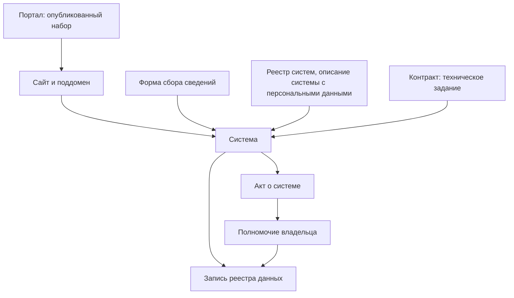

# Государственные данные

У государства данных больше всего, но опубликована малая часть, а остальное разбросано по сотням систем, ведомств и уровней власти. Ни один источник не показывает всего. Портал открытых данных показывает, что ведомства решили опубликовать; статистика и формы сбора сведений — что государство собирает, с кого и как часто; реестры систем и описания систем с персональными данными — где данные хранятся; госзакупки — что в системах лежит и кто их строил; нормативные акты — почему данные есть и у кого; сайты и домены — где у систем публичные части. Поэтому государственные данные ищут сразу в нескольких источниках, а следы одного набора сводят в одну запись реестра: опубликованный набор ведёт к системе, система — к контракту и акту, акт — к полномочию. Расхождения между источниками — находка, а не помеха: на федеральном портале США data.gov нет реестра воздушных судов, хотя FAA выгружает его целиком каждый день ([пример](#пример)).

## Коротко

| Источник | На какой вопрос отвечает | Что даёт | Чего не даёт |
|----------|--------------------------|----------|--------------|
| **[Порталы открытых данных](#порталы-открытых-данных)** | Что опубликовано | Наборы с описаниями, издателем и датами | Всё, что не опубликовано; свежесть не гарантирована |
| **[Статистика и формы сбора сведений](#статистика-и-формы-сбора-сведений)** | Что государство собирает, с кого и как часто | Показатели и методики; формы с составом сведений, периодичностью и тем, кто собирает | Записи; где хранятся ответы и открыты ли они |
| **[Реестры систем](#реестры-информационных-систем)** и **[описания систем с персональными данными](#описания-систем-с-персональными-данными)** | Какие системы есть и что в них | Системы, операторы, назначение, категории сведений, основания, сроки хранения | Системы вне реестра; наборы без систем; ссылки на данные |
| **[Госзакупки](#госзакупки)** | Что строили и что лежит в системе | Технические задания, состав данных, подрядчики, расходы, история модернизаций | Системы, созданные без закупок |
| **[Нормативные акты](#нормативные-акты)** | Почему данные есть и у кого | Полномочия, основания систем, состав сведений, порядок доступа, сроки | Что на самом деле лежит в системе |
| **[Сайты и домены](#сайты-и-домены)** | Где у систем публичные части | Разделы, поддомены, выгрузки, следы закрытых систем | Закрытые системы без публичной части |



## Где искать по странам

| Источник | Казахстан | Россия | США | Европейский союз |
|----------|-----------|--------|-----|------------------|
| **Порталы открытых данных** | data.egov.kz | data.gov.ru | data.gov | data.europa.eu и национальные порталы |
| **Статистика** | Бюро национальной статистики, stat.gov.kz | Росстат, rosstat.gov.ru; ЕМИСС, fedstat.ru | Статистические агентства: Бюро переписи (Census Bureau), Бюро статистики труда (BLS) и другие | Евростат и национальные статистические службы |
| **Формы сбора сведений** | Приказы ведомств «Об утверждении форм, предназначенных для сбора административных данных» на adilet.zan.kz | Федеральный план статистических работ, формы статистического наблюдения | Перечень одобренных сборов сведений на reginfo.gov | Отраслевые регламенты; в экологии — база отчётных обязательств ROD Европейского агентства по окружающей среде |
| **Учёт систем** | Архитектурный портал цифровых объектов государства govarch.kz; каталог сервисов Smart Bridge sb.egov.kz | Учёт систем и ИТ-активов в системе координации информатизации; реестр операторов персональных данных Роскомнадзора | Уведомления о системах записей с персональными данными (SORN) в Federal Register; оценки влияния на приватность (PIA) на сайтах ведомств; IT Dashboard | Реестры записей об обработке персональных данных институтов и органов ЕС |
| **Госзакупки** | zakup.gov.kz (прежде goszakup.gov.kz); коды единого номенклатурного справочника товаров, работ и услуг (ЕНС ТРУ) | zakupki.gov.ru; вид расходов 242, коды ОКПД2 | USAspending.gov; коды продукции и услуг (PSC) группы D — ИТ и связь | TED, ted.europa.eu; коды CPV раздела 72 — ИТ-услуги |
| **Нормативные акты** | adilet.zan.kz; проекты — legalacts.egov.kz | pravo.gov.ru | Свод законов (U.S. Code), Свод федеральных правил (eCFR), Federal Register | EUR-Lex |
| **Сайты и домены** | Сайты министерств — разделы портала gov.kz | Реестр государственных доменов «Информационной культуры» | Список доменов .gov агентства кибербезопасности CISA | Домены europa.eu |

| Источник | Великобритания | Франция | Польша | Южная Корея |
|----------|----------------|---------|--------|-------------|
| **Порталы открытых данных** | data.gov.uk — с 2026 года перестраивается в National Data Library | data.gouv.fr | dane.gov.pl | data.go.kr |
| **Статистика** | Управление национальной статистики (ONS), ons.gov.uk; список аккредитованных официальных статистик Службы регулирования статистики (OSR) | INSEE, insee.fr, и статистические службы министерств | Главное статистическое управление (GUS), stat.gov.pl | Министерство данных и статистики (до октября 2025 года — Статистическое управление); KOSIS, kosis.kr |
| **Формы сбора сведений** | Единой программы статистических работ нет | Ежегодные приказы о программе статистических обследований по заключениям Национального совета статистической информации (Cnis) | Ежегодная программа статистических обследований (PBSSP) — регламент Совета министров | Перечень утверждённой статистики на narastat.kr |
| **Учёт систем** | Открытого реестра нет; реестры информационных активов министерств; реестр соглашений об обмене данными по закону о цифровой экономике 2017 года; портфель крупных проектов; реестр плательщиков сбора за защиту данных | Открытого реестра нет; обзор крупных цифровых проектов государства (Panorama des grands projets numériques); журнал разрешений DataPass — обмены сведениями между администрациями; перечень формальностей в CNIL | Итоги инвентаризации систем SIST — открытые данные на dane.gov.pl; список ключевых публичных реестров на портале интероперабельности gov.pl/web/ia | Система учёта ИТ-ресурсов IRM, irm.go.kr; перечень файлов персональных данных государственных органов на privacy.go.kr |
| **Госзакупки** | Find a Tender, Contracts Finder | Основные данные контрактов DECP на data.gouv.fr; BOAMP; TED | Платформа e-Zamówienia, ezamowienia.gov.pl; TED | KONEPS, g2b.go.kr |
| **Нормативные акты** | legislation.gov.uk | legifrance.gouv.fr | isap.sejm.gov.pl, dziennikustaw.gov.pl; программный интерфейс api.sejm.gov.pl/eli | law.go.kr |

Подробнее о странах — в главах [«Казахстан»](../07-countries/01-kazakhstan.md), [«Россия»](../07-countries/02-russia.md), [«Великобритания»](../07-countries/03-united-kingdom.md), [«Франция»](../07-countries/04-france.md), [«Польша»](../07-countries/05-poland.md) и [«Южная Корея»](../07-countries/06-south-korea.md), их методики в сравнении — в главе [«Зарубежные методики»](../05-frameworks/04-international-practice.md), акты — в приложении [«Нормативная база»](../09-appendices/02-legal-framework.md).

## Что считать государственными данными

Государственные данные собирают, создают или получают органы власти и организации, которые действуют за государство:

- **органы власти всех уровней** — центральные, региональные, местные, а также парламенты, суды, центральные банки;
- **подведомственные учреждения** — центры информатизации, научные институты, учреждения, которые ведут реестры за орган власти ([«Кто отвечает за тему»](../03-process/03-owners-and-mandates.md#кто-отвечает-за-тему));
- **государственные компании** — в Казахстане их называют квазигосударственным сектором;
- **подрядчики** — если ведут данные по контракту с государством. Владелец таких данных — заказчик, подрядчик — оператор ([«Владелец, оператор, ответственный»](../03-process/03-owners-and-mandates.md#владелец-оператор-ответственный)).

Границу страны проводят по-разному. Цифровой кодекс Казахстана относит к административным цифровым данным те, что формируют государственные органы, государственные юридические лица и квазигосударственный сектор (статья 18), а портал data.egov.kz делит издателей на центральные государственные органы, местные исполнительные органы и организации квазигосударственного сектора. Европейская директива об открытых данных 2019/1024 распространяется на документы органов публичного сектора, на часть документов публичных предприятий — коммунальных, энергетических, транспортных, почтовых — и на данные исследований. На data.gov публикуют не только федеральные ведомства, но и штаты, округа, города и университеты: 25 октября 2026 года 61 из 108 организаций портала были федеральными, и им принадлежали 399 102 набора из 431 277. Какие уровни и организации входят в инвентаризацию, записывают в границах до начала поиска ([«Границы»](../03-process/02-goals-and-questions.md#границы)).

Что есть у государства:

| Вид | Что это | Где искать следы |
|-----|---------|------------------|
| **Регистры и реестры** | Учёт людей, организаций, объектов и прав: реестр юридических лиц, кадастр, реестр лицензий | Акты о реестрах, реестры систем, описания систем с персональными данными, сайты |
| **Учётные данные** | Заявления, решения, проверки, обращения — то, что остаётся от исполнения функций и оказания услуг | Регламенты услуг, описания систем, контракты |
| **Отчётность** | Сведения, которые организации и граждане сдают государству по формам | Формы сбора сведений, планы статистических работ |
| **Статистика** | Сводные показатели по территориям и периодам | Статистические службы, планы работ |
| **Наблюдения** | Измерения и съёмка: погода, качество воздуха, недра, спутниковые снимки | Сайты служб, геопорталы, акты |
| **Сведения о самом государстве** | Бюджет, закупки, имущество, кадры, акты | Порталы бюджета и закупок, правовые системы |

Набор, найденный в одном источнике, почти всегда оставил следы в других. Регистр создан актом, ведётся в системе, заполняется по формам, построен по контракту и часто опубликован. Поэтому найденное в одном источнике проверяют по остальным, а каждый след записывают в реестр. Какие данные государства ЕС обязаны публиковать в первую очередь, показывают шесть категорий наборов высокой ценности ([«Наборы высокой ценности»](../05-frameworks/02-metadata-standards.md#наборы-высокой-ценности)).

## Порталы открытых данных

Портал показывает, что ведомства решили опубликовать, а не всё, что у них есть. Даже большой портал не полон:

- **Число наборов — не мера охвата.** На data.gov 25 октября 2026 года было 431 277 наборов. 155 870 из них, 36%, опубликовало Бюро переписи США, а 147 134 — одно его подразделение, которое выпускает географические файлы. Пять крупнейших издателей — Бюро переписи, Национальное управление океанических и атмосферных исследований (NOAA), Министерство внутренних дел, NASA и Министерство здравоохранения — дали 84% портала. У Бюро статистики труда — 31 набор. Число показывает, как ведомство делит данные на файлы, а не сколько данных у него есть. На польском dane.gov.pl 25 октября 2026 года было 28 735 наборов, но около 81% из них — ежедневные цены застройщиков, которые с июля 2025 года публикуют по закону о защите покупателей жилья. На государственные органы и самоуправление пришлось около 4,9 тысячи наборов.
- **Порталы собирают друг друга.** Европейский портал data.europa.eu 25 октября 2026 года содержал 1 858 143 набора из 213 каталогов: он собирает описания с национальных порталов, и один набор встречается в нескольких каталогах ([«Один набор под разными именами»](../03-process/05-registry.md#один-набор-под-разными-именами)).
- **Перечень показывает обязательство.** В Казахстане ведомства публикуют наборы по утверждённым перечням, и data.egov.kz показывает по каждому ведомству долю размещённых наборов от утверждённых в перечне и долю актуальных. Перечень — готовый список того, что ведомство обязалось открыть: с ним сравнивают портал. В Польше министерства раз в полгода сдают график новых данных и отчитываются о его выполнении, а в Южной Корее data.go.kr публикует общий перечень данных, которые учреждения ещё не открыли, с годом открытия: 9987 строк в версии от 10 февраля 2026 года ([«Зарубежные методики»](../05-frameworks/04-international-practice.md#открытие-данных-в-польше)).
- **Порталы закрываются и переезжают.** Российский data.gov.ru закрыли в марте 2023 года «для переноса на новую платформу» и снова открыли 15 июля 2025 года, причём 84% из 5826 наборов обновлённого портала впервые опубликованы в 2019 году или раньше. Data.gov в 2025 году сменил платформу: прежний программный интерфейс по адресу catalog.data.gov/api/3/ 25 октября 2026 года отвечал ошибкой 404, и скрипты, написанные под него, приходится переписывать. Британский data.gov.uk с 2026 года перестраивают в National Data Library: Государственная цифровая служба в марте 2026 года писала, что не меньше 25% ссылок портала ведут на страницы с ошибками, а 25 октября 2026 года программный интерфейс портала насчитывал 59 559 наборов, а поиск на сайте — 47 349.

Как читать набор на портале:

- **Издатель — подсказка, а не владелец.** Один владелец публикует под разными именами: у FAA на data.gov 15 наборов под тремя написаниями издателя. Издателем бывает подведомственное учреждение или подрядчик. Владельца берут из положения или акта о системе ([«Где искать полномочия»](../03-process/03-owners-and-mandates.md#где-искать-полномочия)).
- **Дата страницы — не дата данных.** Смотрят дату изменения самих данных: набор 2019 года отвечает на вопрос о 2019 годе ([«Периодичность и даты»](../03-process/05-registry.md#периодичность-и-даты)).
- **От набора — к системе.** В описании и ссылках набора ищут, откуда он выгружен: название системы, адрес её публичной части, поддомен. Так находят систему, из которой на портал попала лишь малая часть ([«От набора к владельцу»](./05-dataset-search.md#от-набора-к-владельцу)).
- **Чего нет на портале.** Портал сравнивают с перечнями, формами сбора и полномочиями. Набор, который ведомство обязано вести, но не опубликовало, либо закрыт, либо лежит в другом месте, либо не ведётся — это выясняют, а не считают, что набора нет.

### Портал за минуту

У крупных порталов есть программные интерфейсы, и по ним за минуту видно, кто и сколько публикует:

```bash
# data.gov: сколько наборов на портале
curl "https://catalog.data.gov/api/stats"
# data.gov: организации и число наборов у каждой
curl "https://catalog.data.gov/api/organizations"
# data.gov: наборы одной организации по слову, до 100 за запрос
curl "https://catalog.data.gov/search?q=aircraft&org_slug=dot&per_page=100"
# data.europa.eu: сколько наборов
curl "https://data.europa.eu/api/hub/search/search?filter=dataset&limit=0"
# data.gouv.fr: сколько наборов (поле total) и сколько описаний с ограниченным доступом
curl "https://www.data.gouv.fr/api/1/datasets/?page_size=1"
curl "https://www.data.gouv.fr/api/1/datasets/?access_type=restricted&page_size=1"
# dane.gov.pl: сколько наборов и поставщиков (поле meta.count)
curl "https://api.dane.gov.pl/1.4/datasets?per_page=1"
curl "https://api.dane.gov.pl/1.4/institutions?per_page=1"
# data.gov.uk: сколько наборов (поле result.count); адрес перенаправляет, поэтому -L
curl -L "https://data.gov.uk/api/action/package_search?rows=0"
```

Запросы проверены 25 октября 2026 года. У корейского data.go.kr программный интерфейс тоже есть, но для него нужен бесплатный ключ; перечень всего каталога портал выкладывает ежемесячным файлом. Список издателей выгружают в рабочую таблицу и сравнивают с владельцами в границах: владелец без наборов на портале — вопрос к нему, а не вывод, что данных нет.

## Статистика и формы сбора сведений

Статистика даёт сводные показатели по территориям и периодам и методики их расчёта, но не записи. Для инвентаризации важнее другое: государство учитывает, что собирает. Чтобы получать сведения от граждан и организаций, нужна утверждённая форма, а формы сведены в планы и перечни. Каждая форма — поток данных с владельцем, составом сведений и периодичностью. Если форму сдают, ответы где-то лежат, даже если системы для них нет.

| Где | Что смотреть | Что там видно |
|-----|--------------|---------------|
| **Россия** | Федеральный план статистических работ, утверждённый распоряжением Правительства от 06.05.2008 № 671-р | Какую статистическую информацию формирует каждый субъект официального статистического учёта, с какой подробностью, как часто и к какому сроку. В редакции от 2 октября 2026 года в перечне 54 субъекта: Росстат, министерства и службы, Банк России, Судебный департамент при Верховном Суде. Например, у Минздрава России — сведения о ВИЧ-инфекции, злокачественных новообразованиях и туберкулёзе по субъектам федерации, ежегодно к 25 марта |
| **Казахстан** | Приказы ведомств «Об утверждении форм, предназначенных для сбора административных данных» на adilet.zan.kz | Формы, по которым ведомство собирает административные данные: состав, периодичность, кто сдаёт. С 12 июля 2026 года качество административных цифровых данных определяет орган государственной статистики (статья 18 Цифрового кодекса) |
| **США** | Перечень одобренных сборов сведений на reginfo.gov | Ведомство не вправе собирать сведения у граждан и организаций без одобрения Административно-бюджетного управления (OMB) и контрольного номера на форме; одобрение даётся не больше чем на три года (44 U.S.C. § 3507). 25 октября 2026 года действовали 10 736 сборов. У каждого — формы, число ответов в год, ссылки на закон и пояснительная записка |
| **Европейский союз** | Отраслевые регламенты; в экологии — база ROD | Какие сведения страны обязаны сдавать европейским и международным организациям |
| **Польша** | Программа статистических обследований публичной статистики (PBSSP) — ежегодный регламент Совета министров по статье 18 закона о публичной статистике; на 2026 год — Dz.U. 2025 poz. 1842 | 258 обследований на 919 страницах. У каждого — тема, кто проводит, периодичность, цель, охват, источники, кто передаёт данные и какие, обязателен ли ответ, сроки. Во второй части — наборы данных, которые министерства и агентства передают статистике из своих информационных систем: по сути, перечень административных источников |
| **Франция** | Ежегодные приказы о программе статистических обследований: на 2026 год — два приказа от 27 октября 2025 года, для предприятий и для домохозяйств и местных органов | Обследование попадает в программу после заключения Национального совета статистической информации (Cnis) о целесообразности и знака качества; обследования, ответ на которые обязателен, перечислены отдельно |
| **Южная Корея** | Перечень утверждённой статистики (승인통계) на narastat.kr и копия на data.go.kr | Новую статистику можно вести только после утверждения, и каждое утверждение объявляют публично (статья 18 закона о статистике). 25 октября 2026 года в перечне — 1376 статистик с ведомством, периодичностью и сроком публикации, выгрузка — в Excel и CSV |
| **Великобритания** | Список аккредитованных официальных статистик Службы регулирования статистики (OSR) | 699 позиций 68 производителей. Единой программы статистических работ и перечня сборов сведений нет: что собирает ведомство, ищут в его реестре информационных активов и публикациях |

Как использовать:

- **Форма — кандидат в запись реестра.** Ответы на форму — набор. Его владелец — тот, кто форму собирает, а не тот, кто её утвердил ([«Как читать полномочия»](../03-process/03-owners-and-mandates.md#как-читать-полномочия)). Периодичность берут из формы, состав сведений — из её полей. Где лежат ответы — в системе, в таблицах или на бумаге, — спрашивают владельца.
- **План показывает, кто ведёт тему.** В подходе «где найти нужное» по плану статистических работ находят ведомство, которое считает нужные показатели, и спрашивают у него записи, из которых показатели собраны.
- **Число ответов показывает объём.** На reginfo.gov у сбора указано, сколько ответов приходит в год: это оценка того, сколько записей прибавляется в наборе.
- **Исключённые строки хранят историю.** В российском плане строки упразднённых ведомств не удалены, а помечены «исключён» с реквизитами распоряжения: разделы ФМС России и ФСКН России исключены распоряжением от 07.02.2017 № 213-р. Так видно, когда сбор прекратился и кому искать преемника ([«Исчезнувшие системы и веб-архивы»](./06-legacy.md#как-отметить-в-реестре)).
- **Статистика проверяет полноту.** Если в найденном наборе записей заметно меньше, чем показывает статистика, спрашивают почему: набор неполный, или статистика считается по другим данным ([«Качество данных»](../03-process/07-quality.md)).

Статистические службы — Росстат и ЕМИСС (fedstat.ru) в России, Бюро национальной статистики в Казахстане — отвечают на вопросы любой отрасли, но только сводными цифрами.

## Реестры информационных систем

Реестр систем — лучший старт для подхода «чем владеем» в государстве: он перечисляет системы и операторов. Но реестр учитывает системы, а не наборы, и в него попадает не всё.

- **Казахстан.** Сведения о цифровых объектах и документацию к ним государственные органы, государственные юридические лица и квазигосударственный сектор размещают на архитектурном портале цифровых объектов государства (статья 71 Цифрового кодекса; до июля 2026 года — архитектурный портал «электронного правительства»). У портала govarch.kz есть открытая часть: 25 октября 2026 года в реестре были 162 системы центральных государственных органов и 55 — местных исполнительных органов, с владельцем, регистрационным номером и статусом. С 6 октября 2026 года на том же портале ведут каталог цифровых данных из паспортов данных цифровых объектов, но он доступен только организациям, которые его заполняют ([«Где учитывают системы»](../07-countries/01-kazakhstan.md#где-учитывают-системы)).
- **Россия.** Реестр ФГИС ведётся в системе координации информатизации: в октябре 2018 года в ней были сведения о 341 ФГИС 79 федеральных органов власти. С 1 сентября 2026 года государственные органы создают и «иные информационные системы» — для обеспечения своей деятельности, не государственные; их тоже учитывают в ФГИС КИ, вместе с ИТ-активами. Снаружи учёт не виден: gis.gov.ru открывает только вход для уполномоченных лиц ([«Россия»](../07-countries/02-russia.md#фгис-ки)).
- **Южная Корея.** Учреждения обязаны вести сведения о своих ИТ-ресурсах (статья 54 закона об электронном правительстве) и вносят их в общегосударственную систему IRM, а метаданные баз данных — в центральную систему метаданных. По сводке Министерства внутренних дел и безопасности от 3 сентября 2026 года, за 2025 год в IRM 2196 учреждений, 15 618 информационных систем и 14 866 ИТ-проектов; сводку публикуют в открытом разделе IRM и на data.go.kr, а записи о самих системах доступны только служащим ([«IRM: учёт информационных ресурсов»](../07-countries/06-south-korea.md#irm-учёт-информационных-ресурсов)).
- **Польша.** Министерство цифровизации учитывает системы и реестры органов в системе инвентаризации SIST — с 6 сентября 2025 года по закону об информатизации, не реже раза в год — и публикует итоги открытыми данными на dane.gov.pl: в выпуске на 19 декабря 2025 года — 820 систем 108 органов с основанием, статусом и преемником ([«SIST»](../07-countries/05-poland.md#sist)). На портале интероперабельности и архитектуры gov.pl/web/ia опубликованы списки ключевых публичных реестров — 145 записей с уровнем важности — и ключевых публичных ИТ-систем — 137 записей; часть описаний устарела. С 23 февраля 2027 года держатели публичных реестров публикуют их метаданные в репозитории интероперабельности, но для работающих реестров закон даёт сроки до 2029–2031 годов ([«Репозиторий интероперабельности»](../07-countries/05-poland.md#репозиторий-интероперабельности)).
- **Франция и Великобритания.** Открытого реестра систем нет. Во Франции крупные цифровые проекты государства перечисляет обзор Panorama des grands projets numériques: в 22-м выпуске от 1 декабря 2025 года — 59 проектов; обмены сведениями между администрациями видны в журнале разрешений DataPass ([«Франция»](../07-countries/04-france.md#крупные-проекты-и-заключения-dinum)). В Великобритании системы ищут по реестрам информационных активов министерств, портфелю крупных проектов и реестру соглашений об обмене данными ([«Великобритания»](../07-countries/03-united-kingdom.md#крупные-проекты-и-устаревшие-системы)).
- **США и ЕС.** Открытого реестра систем нет. Расходы федеральных ведомств США на ИТ и крупные ИТ-инвестиции показывает IT Dashboard (itdashboard.gov): за 2025 финансовый год — 102,3 млрд долларов; с апреля 2026 года сайт сокращают до данных, которые требует закон. Сами системы находят по описаниям систем с персональными данными.

### Описания систем с персональными данными

Законы о персональных данных требуют описывать системы, в которых хранятся сведения о людях, и часть этих описаний публична. Большинство государственных регистров — о людях, поэтому такие описания закрывают многие пробелы реестра систем.

| Где | Что публикуют | Что в описании |
|-----|---------------|----------------|
| **США** | Уведомление о системе записей (System of Records Notice, SORN) в Federal Register — для каждой системы, где записи ищут по имени или номеру человека (5 U.S.C. § 552a(a)(5) и (e)(4)). Оценки влияния на приватность (Privacy Impact Assessment, PIA) — на сайтах ведомств | Название и место системы, о ком записи и какие, кому их раскрывают, как и сколько хранят, ответственный, источники записей |
| **Россия** | Реестр операторов персональных данных Роскомнадзора (статья 22 закона № 152-ФЗ). Сведения реестра общедоступны, кроме сведений о средствах защиты | Цели обработки, для каждой цели — категории данных и субъектов и правовое основание; где находится база данных; кто по договору обрабатывает данные в государственных и муниципальных системах |
| **Европейский союз** | Реестры записей об обработке персональных данных институтов и органов ЕС: регламент 2018/1725 требует вести их централизованно и делать общедоступными (статья 31) | Цели, категории данных и получателей, сроки удаления |
| **Южная Корея** | Государственное учреждение регистрирует каждый файл персональных данных в Комиссии по защите персональных данных (статья 32 закона о защите персональных данных). Перечень зарегистрированных файлов ищут и выгружают на портале privacy.go.kr | При регистрации — название файла, основание и цель, состав сведений, способ обработки, срок хранения, кому данные передают регулярно; в перечне на портале — учреждение, подразделение, сфера и название файла |
| **Франция** | Перечень формальностей, поданных в CNIL после 25 мая 2018 года, — набор на data.gouv.fr: 27 277 записей на 19 октября 2026 года; архив деклараций 1979–2018 годов | Упрощённые декларации, разрешения на исследования и другие формальности: кто и что обрабатывает |
| **Великобритания** | Реестр плательщиков сбора за защиту данных — больше миллиона организаций, выгружается целиком | Название и адрес организации, регистрационный номер, контакт ответственного за защиту данных. Описаний обработки в реестре нет |

- **Описание даёт сразу несколько полей реестра:** систему и оператора, основание, наличие персональных данных, режим доступа. Одно описание бывает сразу на несколько систем: американское уведомление о регистрации воздушных судов охватывает четыре ([пример](#пример)).
- **Не все системы описаны.** Описания есть только у систем со сведениями о людях: метеорология или геология в них не попадут. В России без уведомления можно, например, обрабатывать данные в государственных системах, созданных для защиты безопасности государства и общественного порядка. Записи об обработке, которые органы власти стран ЕС ведут по статье 30 GDPR, публиковать не обязаны: их предоставляют надзорному органу по запросу. Так же устроено в Великобритании. Во Франции, по разъяснению CNIL, государственный орган обязан выдать свой реестр обработок любому, кто его запросит, — это административный документ, — скрыв сведения, раскрывать которые нельзя. В Южной Корее не регистрируют файлы о национальной безопасности, расследованиях преступлений, налоговых и таможенных правонарушениях, а также засекреченные.
- **Описание отстаёт от системы.** Его обновляют при изменениях, но не сразу: у описания смотрят дату и сверяют его с контрактами.

## Госзакупки

Контракт на создание или развитие системы — самый подробный открытый документ о ней: техническое задание описывает данные, которые система должна хранить, интеграции и перенос данных из прежней системы, а акты — что сделано. Контракты показывают и историю: прежние названия системы, предшественников, подрядчиков, у которых могли остаться копии данных.

Как искать:

- **По кодам.** ИТ-закупки помечают кодами классификаторов: в России — вид расходов 242 и коды ОКПД2 (например, 62.01.11 — услуги по проектированию и разработке информационных технологий для прикладных задач), в Казахстане — коды ЕНС ТРУ, в США — коды продукции и услуг группы D, в ЕС — коды CPV раздела 72. Коды ставят неаккуратно: в России, по наблюдениям 2018–2019 годов, большая часть ИТ-расходов шла по виду 244 «Прочая закупка» ([«Расходы на ИТ в госзакупках»](../07-countries/02-russia.md#расходы-на-ит-в-госзакупках)).
- **По полному названию системы** и по её прежним названиям. Сокращение даёт шум: по слову CARES среди контрактов FAA первыми находятся субсидии на детские сады и уборка помещений, а не система регистрации воздушных судов.
- **По заказчику.** Подведомственные учреждения закупают системы за орган власти, поэтому смотрят и их контракты.
- **По подрядчикам** — ИТ-компаниям, которые уже работали с ведомством.

Системы, которые учреждения создают сами по государственным заданиям, в закупках не видны: их ищут в отчётах о выполнении заданий.

Закупки говорят не только о системах, но и о расходах, поставщиках и ценах. Поэтому порталы закупок — zakupki.gov.ru в России, zakup.gov.kz в Казахстане — источник не только для поиска систем, но и для вопросов о финансах в подходе «где найти нужное» ([«Какой слой для каких вопросов»](./01-three-layers.md#какой-слой-для-каких-вопросов)).

## Нормативные акты

Почти у каждой государственной системы и каждого регистра есть акт, который их создал: закон, постановление правительства, приказ ведомства. В нём записаны цель, оператор, состав сведений, порядок доступа, иногда срок. Акт говорит, что должно быть; было ли — проверяют по закупкам, описаниям систем и самим данным. Закон США 2018 года дал FAA три года на модернизацию реестра гражданской авиации, а полную готовность новой системы регистрации планируют на осень 2026 года ([пример](#пример)).

Как найти и прочитать полномочия владельца — в главе [«Владельцы и полномочия»](../03-process/03-owners-and-mandates.md#где-искать-полномочия). Об акте о системе здесь важно три вещи:

- **Акт называет систему и оператора** — их записывают в реестр с номером, датой и редакцией акта ([«Расширенный состав»](../03-process/05-registry.md#расширенный-состав)).
- **Акт перечисляет состав сведений** — это готовый список полей, с которым сверяют выгрузку.
- **Акт задаёт порядок доступа** — основание для режима доступа ([«Порядок проверки»](../03-process/06-access.md#порядок-проверки)).

Перед ссылкой на акт проверяют, действует ли он и какая редакция последняя: при сверке фактов этой книги в октябре 2026 года оказалось, что российское постановление о планах информатизации отменено ещё в 2020 году ([«Перед ссылкой на нормативный акт»](../09-appendices/04-checklists.md#перед-ссылкой-на-нормативный-акт)).

## Сайты и домены

Сайт ведомства — витрина: за разделами и поддоменами стоят системы. Поддомен остаётся следом системы, даже когда её данные закрыты: у системы координации информатизации на gis.gov.ru снаружи виден только вход для уполномоченных лиц ([«Реестры информационных систем»](#реестры-информационных-систем)). Такой поддомен — повод записать систему и спросить владельца о доступе, а не вычеркнуть её.

Списки доменов помогают найти публичные части систем, о которых сайт молчит:

- **Россия** — [реестр государственных доменов](https://github.com/infoculture/govdomains/) «Информационной культуры».
- **США** — [список доменов .gov](https://github.com/cisagov/dotgov-data) агентства кибербезопасности CISA: 25 октября 2026 года в нём 16 951 домен, из них 1 321 федеральный. В списке только домены второго уровня: faa.gov в нём есть, registry.faa.gov — нет. Поддомены ищут поиском по сайту, в журналах сертификатов (Certificate Transparency) и в веб-архиве.
- **Казахстан** — сайты министерств — разделы портала gov.kz, а публичные части систем живут на своих доменах и поддоменах, например data.egov.kz и legalacts.egov.kz.

Адреса меняются: ведомства переезжают на новые домены, поддомены исчезают ([«Исчезнувшие системы и веб-архивы»](./06-legacy.md)). Единая платформа закупок Казахстана переехала с goszakup.gov.kz на zakup.gov.kz, а сайты министерств — на общую платформу gov.kz, и прежних доменов вроде mz.gov.kz больше нет ([«Wikidata, Википедия и OpenStreetMap»](./03-public.md#wikidata-википедия-и-openstreetmap)). Многие государственные сайты не открываются из-за рубежа, поэтому их проверяют из сети страны и записывают, откуда проверяли.

## Как использовать при инвентаризации

Порядок зависит от подхода:

| Подход | Порядок | Почему так |
|--------|---------|------------|
| **«Чем владеем»** — опись ведомства | Полномочия → реестр систем и описания систем с персональными данными → формы сбора → контракты → сайт и поддомены → портал → анкета владельцам | Документы показывают, что должно быть и где; портал — что из этого открыто; анкета — что документы упустили ([«Заполнить заранее»](../03-process/04-questionnaires.md#заполнить-заранее)) |
| **«Где найти нужное»** — данные под задачу | Портал и [поиск наборов](./05-dataset-search.md) → статистика и план работ → формы сбора → от найденного к системе и владельцу → контракты и акты для закрытого | Сначала опубликованное — это быстро; потом — кто собирает нужное, чтобы спросить о закрытом |

Это частный случай общего [порядка методов](../02-approaches/02-methods.md#порядок-который-работает).

Что каждый источник даёт в реестр:

| Источник | Поля реестра |
|----------|--------------|
| **Портал и сайт** | Наименование, описание, ссылка для выгрузки, формат, даты, условия использования; издатель — кандидат во владельцы |
| **Статистика и формы сбора** | Владелец — кто собирает; периодичность; состав сведений и схема — поля формы |
| **Реестр систем, описание системы с персональными данными** | Информационная система и оператор, полномочие и нормативный акт, персональные данные, режим доступа и его основание |
| **Контракт** | Схема и состав данных из технического задания, оператор и подрядчик, связанные записи — предшественники и преемники системы |
| **Нормативный акт** | Полномочие, нормативный акт, состав сведений, основание режима доступа |

**Один набор — одна запись.** Следы одного набора в разных источниках сводят в одну запись: прежние названия и адреса — в синонимы, каждый источник — в поле «откуда известно» ([«Как записать, откуда известно»](../02-approaches/02-methods.md#как-записать-откуда-известно)). Запись, которую подтвердили два независимых источника, надёжна.

**Расхождения — находки.** Кроме расхождений между методами ([«Как методы проверяют друг друга»](../02-approaches/02-methods.md#как-методы-проверяют-друг-друга)), у государственных источников есть свои:

| Что видно | Что может значить | Что сделать |
|-----------|-------------------|-------------|
| Набор есть на сайте ведомства, на портале его нет | Не попал в каталог | Ссылку взять с сайта; пробел каталога записать |
| Форму сдают, набора нигде нет | Ответы лежат на бумаге или в закрытой системе; их сводят только в статистику | Спросить владельца; до ответа режим доступа — «не установлено» |
| Акт требует систему или реестр, контрактов нет | Систему не создали; создало учреждение по госзаданию; ведут в таблицах | Отчёты учреждений о госзаданиях; вопрос владельцу |
| Документы о системе называют разные системы, формы, сроки | Документы обновляют в разное время | Сверить по датам; записать все источники |

## Пример

Реестр воздушных судов США уже встречался в книге: в главе [«Владельцы и полномочия»](../03-process/03-owners-and-mandates.md#от-полномочия-к-набору) — как полномочие по 49 U.S.C. § 44103, в главе [«Реестр данных»](../03-process/05-registry.md#пример-записи) — как запись, собранная со страницы FAA и из выгрузки. Здесь — его следы в шести видах государственных источников. Всё проверено 25 октября 2026 года.

| Источник | Что нашли | Что это дало записи |
|----------|-----------|---------------------|
| **Портал data.gov** | 15 наборов FAA под тремя написаниями издателя: аэронавигационные карты, аэродромы, взлётно-посадочные полосы, региональные офисы. Реестра воздушных судов нет | Пробел каталога: ссылку для выгрузки берут с сайта FAA |
| **Сайт и домен** | Выгрузка всей базы на registry.faa.gov, обновляется ежедневно. В списке доменов .gov есть faa.gov, поддомена registry.faa.gov нет | Ссылка для выгрузки, формат, дата изменения |
| **Сбор сведений** | Сбор 2120-0042 «Aircraft Registration» на reginfo.gov одобрен 19 февраля 2026 года до 28 февраля 2029 года. В год — 177 201 ответ, из них 74 431 заявление о регистрации (форма AC 8050-1) и 95 727 документов о праве собственности. История сбора — с 1975 года | Состав сведений по формам; источник записей — владельцы судов; сколько записей прибавляется в год |
| **Описания системы** | Уведомление SORN DOT/FAA 801 «Aviation Registration Records» в Federal Register от 9 августа 2023 года охватывает четыре системы: Civil Aviation Registry System, новую систему регистрации CARES в облаке, FAADroneZone для беспилотников и программу альтернативных бортовых адресов, по которым судно труднее опознать. Старая система работает в центре обработки данных FAA в Оклахома-Сити и на мейнфрейме в ИТ-центре Министерства сельского хозяйства в Канзас-Сити. Основания — 11 статей 49 U.S.C., в том числе § 44103, и части 45, 47–49 14 CFR. Публике раскрывают имя и адрес владельца, регистрационный номер и тип судна. Записи о регистрации хранят постоянно, копию системы ежегодно передают в Национальный архив. Оценка влияния на приватность CARES, обновлённая в 2026 году: первая очередь работает с декабря 2022 года, полная готовность — по плану осенью 2026 года; CARES станет основным юридически значимым хранилищем записей о регистрации | Системы и операторы — часть инфраструктуры у другого ведомства; основания; персональные данные и режим доступа; преемник старой системы |
| **Госзакупки** | На USAspending.gov — проектирование и поддержка приложений модернизации реестров пилотов и воздушных судов (AARM) в 2011–2012 годах, около 5,3 млн долларов; система модернизации реестра (RMS) в 2014–2015 годах, около 3,1 млн; модернизация реестра силами Ernst & Young с сентября 2025 по март 2027 года, около 2,7 млн | История: названия AARM и RMS, которых нет в описании системы; подрядчики |
| **Нормативные акты** | 49 U.S.C. § 44103 — регистрация воздушных судов; часть 47 «Aircraft Registration» 14 CFR — порядок регистрации; закон о переутверждении FAA 2018 года (Public Law 115-254, раздел 546) — завершить модернизацию реестра в течение трёх лет после 5 октября 2018 года | Полномочие и акты; срок, с которым сверяют ход модернизации |

**Итог.** Ни один источник не дал записи целиком, и источники расходятся. Портал о реестре не знает, а поисковики по наборам данных находят только его копии ([«Поиск наборов данных»](./05-dataset-search.md#реестр-воздушных-судов-сша)). Описание системы называет четыре системы и два номера сборов сведений, но не основной сбор 2120-0042. Контракты называют AARM и RMS, которых нет в описании. Закон дал на модернизацию три года, а полную готовность новой системы планируют через восемь лет после закона. Каждое расхождение попадает в запись: AARM, RMS и CARES — в синонимы и связанные записи, CARES — как преемник старой системы, все шесть источников с датами — в поле «откуда известно». Пример показывает ход работы на открытых американских документах. В Казахстане и России те же шаги проходят по архитектурному порталу, реестру ФГИС, реестру операторов персональных данных, плану статистических работ, приказам о формах и порталам закупок.

## Частые ошибки

| Ошибка | Что происходит | Как исправить |
|--------|----------------|---------------|
| **Портал — это все данные ведомства** | Наборы вне портала не ищут | Сравнить портал с перечнями, формами сбора, реестром систем и сайтом |
| **Число наборов — мера открытости** | 36% data.gov — файлы одного Бюро переписи, а у Бюро статистики труда 31 набор | Смотреть, что за наборы, а не сколько их |
| **Издатель с портала записан владельцем** | Один владелец — под тремя именами; подрядчик — как владелец | Владельца — из положения или акта о системе |
| **Только реестр систем** | Не видны системы вне реестра и наборы без систем | Добавить описания систем с персональными данными, формы сбора, контракты |
| **Поиск закупок по одному слову** | Шум или пропуски: по CARES находятся детские сады | Полное и прежние названия, коды, заказчики, проверка описания контракта |
| **Ссылка на акт без проверки редакции** | В реестре — отменённый акт или прежний оператор | [Проверить статус и редакцию](../09-appendices/04-checklists.md#перед-ссылкой-на-нормативный-акт) |
| **Сайт проверен из-за рубежа** | «Сайт не работает», хотя он закрыт только для зарубежных адресов | Проверять из сети страны; записать сеть проверки |
| **Исчезнувший адрес удалён из реестра** | Пропадает история и преемник | Пометить запись и сохранить копию в веб-архиве ([«Как отметить в реестре»](./06-legacy.md#как-отметить-в-реестре)) |

## Ограничения

- Государственные сайты многих стран не открываются из-за рубежа: проверять их нужно из сети этой страны. При подготовке главы 25 октября 2026 года из сети проверки не открылись adilet.zan.kz, rosstat.gov.ru, data.gov.ru, портал персональных данных Роскомнадзора pd.rkn.gov.ru, французская правовая система legifrance.gouv.fr, польская isap.sejm.gov.pl и платформа закупок ezamowienia.gov.pl.
- Опубликованное устаревает и не всегда помечено как устаревшее.
- Описания систем, формы и акты показывают то, что задумано и согласовано, а не то, что работает, и обновляются позже систем.
- Описания систем с персональными данными не покрывают системы без сведений о людях. Формы сбора не покрывают данные, которые государство создаёт само: наблюдения, решения, внутренний учёт.
- Открытость документов разная. В США описания систем и сборов сведений публикуют по закону; в других странах части этих источников нет или она закрыта, и тогда больше опираются на акты, закупки и опросы владельцев.
- Названия систем длинные и меняются при модернизации. В реестре данных хранят официальное название, короткое и прежние — как AARM, RMS и CARES в примере.

## Источники

- Главы [«Владельцы и полномочия»](../03-process/03-owners-and-mandates.md) — полномочия и владельцы; [«Семь методов»](../02-approaches/02-methods.md#2-инвентаризация-информационных-систем) — реестры систем и кабинетные исследования среди других методов; [«Поиск наборов данных»](./05-dataset-search.md) и [«Исчезнувшие системы и веб-архивы»](./06-legacy.md); страновые главы [«Казахстан»](../07-countries/01-kazakhstan.md) и [«Россия»](../07-countries/02-russia.md).
- Бегтин И. Каталоги данных — глава [«Жизненный цикл каталога»](https://github.com/ivbeg/data-catalogs-book/blob/main/docs/09-practices/03-lifecycle.md) о data.gov.ru.
- [catalog.data.gov](https://catalog.data.gov/) — программный интерфейс: `/api/stats`, `/api/organizations`, `/api/publishers`, `/search`; данные на 25 октября 2026 года. [GSA/datagov-catalog](https://github.com/GSA/datagov-catalog) — новый каталог data.gov, заменивший каталог на CKAN в 2025 году.
- [data.europa.eu](https://data.europa.eu/) — программный интерфейс поиска, 25 октября 2026 года; [data.egov.kz](https://data.egov.kz/) — показатели размещения наборов по утверждённым перечням, 25 октября 2026 года.
- Распоряжение Правительства РФ от 06.05.2008 № 671-р «Об утверждении Федерального плана статистических работ» — [текст в редакции от 02.10.2026](https://legalacts.ru/doc/rasporjazhenie-pravitelstva-rf-ot-06052008-n-671-r/) на legalacts.ru, раздел II — перечень субъектов официального статистического учёта. Проверено 25 октября 2026 года.
- [Inventory of Currently Approved Information Collections](https://www.reginfo.gov/public/do/PRAReport?operation=11) — Office of Information and Regulatory Affairs, 25 октября 2026 года; сбор [2120-0042 «Aircraft Registration»](https://www.reginfo.gov/public/do/PRAViewICR?ref_nbr=202411-2120-007) и его история; [44 U.S. Code § 3507](https://www.law.cornell.edu/uscode/text/44/3507), подразделы (a) и (g).
- [5 U.S. Code § 552a](https://www.law.cornell.edu/uscode/text/5/552a), подразделы (a)(5) и (e)(4); [DOT/FAA 801 Aviation Registration Records](https://www.federalregister.gov/documents/2023/08/09/2023-17073/privacy-act-of-1974-system-of-records) — Federal Register, 9 августа 2023 года, 88 FR 53951; [Civil Aviation Registration Electronic Services (CARES)](https://www.transportation.gov/resources/individuals/privacy/civil-aviation-registration-electronic-services-cares-0) — оценка влияния на приватность, страница обновлена 6 мая 2026 года.
- USAspending.gov — контракты [DTFAWA10A00228CALL0002](https://www.usaspending.gov/award/CONT_AWD_DTFAWA10A00228CALL0002_6920_DTFAWA10A00228_6920) (AARM), [DTFAWA10A00042CALL0006](https://www.usaspending.gov/award/CONT_AWD_DTFAWA10A00042CALL0006_6920_DTFAWA10A00042_6920) (RMS), [693KA925F00102](https://www.usaspending.gov/award/CONT_AWD_693KA925F00102_6920_693KA919D00004_6920) (Registry Modernization); суммы — обязательства по контрактам на 25 октября 2026 года.
- [Public Law 115-254](https://www.congress.gov/115/plaws/publ254/PLAW-115publ254.htm) — FAA Reauthorization Act of 2018, раздел 546; [14 CFR part 47](https://www.ecfr.gov/current/title-14/chapter-I/subchapter-C/part-47) — Aircraft Registration; [Releasable Aircraft Database Download](https://www.faa.gov/licenses_certificates/aircraft_certification/aircraft_registry/releasable_aircraft_download) — FAA.
- Федеральный закон от 27.07.2006 № 152-ФЗ «О персональных данных», [статья 22](https://www.consultant.ru/document/cons_doc_LAW_61801/d996966e22e1320c9de1ab82d9f6be12c3d9d765/), части 2–4, в редакции от 26.07.2026. Проверено 25 октября 2026 года.
- [Regulation (EU) 2018/1725](https://eur-lex.europa.eu/eli/reg/2018/1725/oj) — обработка персональных данных институтами и органами ЕС, статья 31; [Directive (EU) 2019/1024](https://eur-lex.europa.eu/eli/dir/2019/1024/oj) — открытые данные и повторное использование информации публичного сектора, статья 1.
- [cisagov/dotgov-data](https://github.com/cisagov/dotgov-data) — списки доменов .gov, 25 октября 2026 года; [реестр государственных доменов России](https://github.com/infoculture/govdomains/) — «Информационная культура».
- [IT Dashboard](https://www.itdashboard.gov/) — GSA и OMB, 25 октября 2026 года; [Reporting Obligations Database](https://rod.eionet.europa.eu/) — Европейское агентство по окружающей среде.
- Порталы, 25 октября 2026 года: программные интерфейсы [data.gouv.fr](https://www.data.gouv.fr/api/1/datasets/?page_size=1), [api.dane.gov.pl](https://api.dane.gov.pl/1.4/datasets) — типы поставщиков по полю `institution_type`, [data.gov.uk](https://data.gov.uk/api/action/package_search?rows=0); [What's changing on data.gov.uk and why](https://dataingovernment.blog.gov.uk/2026/03/25/whats-changing-on-data-gov-uk-and-why/) — GDS, 25 марта 2026 года; [About](https://www.data.gov.uk/about/) и [Roadmap](https://www.data.gov.uk/roadmap) — data.gov.uk как National Data Library; [каталог data.go.kr](https://www.data.go.kr/data/15062804/fileData.do) — ежемесячный файл и [перечень данных, которые предстоит открыть](https://www.data.go.kr/data/15127106/fileData.do); поправка о ценах застройщиков в Польше — [Dz.U. 2025 poz. 758](https://api.sejm.gov.pl/eli/acts/DU/2025/758).
- Статистика, 25 октября 2026 года: программа статистических обследований Польши на 2026 год — [Dz.U. 2025 poz. 1842](https://api.sejm.gov.pl/eli/acts/DU/2025/1842); [программа обследований 2026 года](https://www.cnis.fr/arretes-au-journal-officiel-du-programme-denquetes/enquetes-2026) — Cnis; [перечень утверждённой статистики](https://www.narastat.kr/pms/pub/scs/css/selectConfmStatsList.do) — Министерство данных и статистики Республики Корея, и [закон о статистике](https://www.law.go.kr/법령/통계법), статья 18; [List of accredited official statistics](https://osr.statisticsauthority.gov.uk/accredited-official-statistics/) — OSR.
- Учёт систем и персональных данных, 25 октября 2026 года: [сводка учёта ИТ-ресурсов за 2025 год](https://www.mois.go.kr/frt/bbs/type010/commonSelectBoardArticle.do?bbsId=BBSMSTR_000000000008&nttId=129225) — Министерство внутренних дел и безопасности Республики Корея, 3 сентября 2026 года; [Kluczowe rejestry publiczne](https://www.gov.pl/web/ia/kluczowe-rejestry-publiczne) — портал интероперабельности и архитектуры Польши; [Panorama des grands projets numériques de l'État](https://www.data.gouv.fr/datasets/panorama-des-grands-projets-numeriques-de-letat) — DINUM; [закон Республики Корея о защите персональных данных](https://www.law.go.kr/법령/개인정보보호법), статья 32, в редакции закона № 21445 от 10.03.2026, и [перечень файлов персональных данных](https://www.privacy.go.kr/front/wcp/dcl/per/personalInfoFileSrhList.do) на privacy.go.kr; [формальности, поданные в CNIL с 25 мая 2018 года](https://www.data.gouv.fr/datasets/traitements-de-donnees-personnelles-declares-a-la-cnil-depuis-le-25-mai-2018); [RGPD : le registre des activités de traitement](https://www.cnil.fr/fr/RGPD-le-registre-des-activites-de-traitement) — CNIL; [Register of fee payers](https://ico.org.uk/about-the-ico/what-we-do/register-of-fee-payers/) — надзорный орган Великобритании по информации.
- Порталы закупок и статистики Великобритании, Франции, Польши и Южной Кореи — [Find a Tender](https://www.find-tender.service.gov.uk/), [Contracts Finder](https://www.contractsfinder.service.gov.uk/), [BOAMP](https://www.boamp.fr/), [e-Zamówienia](https://ezamowienia.gov.pl/), [KONEPS](https://www.g2b.go.kr/), [KOSIS](https://kosis.kr/), [INSEE](https://www.insee.fr/), [ONS](https://www.ons.gov.uk/), [GUS](https://stat.gov.pl/), [IRM](https://www.irm.go.kr/): 25 октября 2026 года открылись все, кроме ezamowienia.gov.pl (ответ 403).
