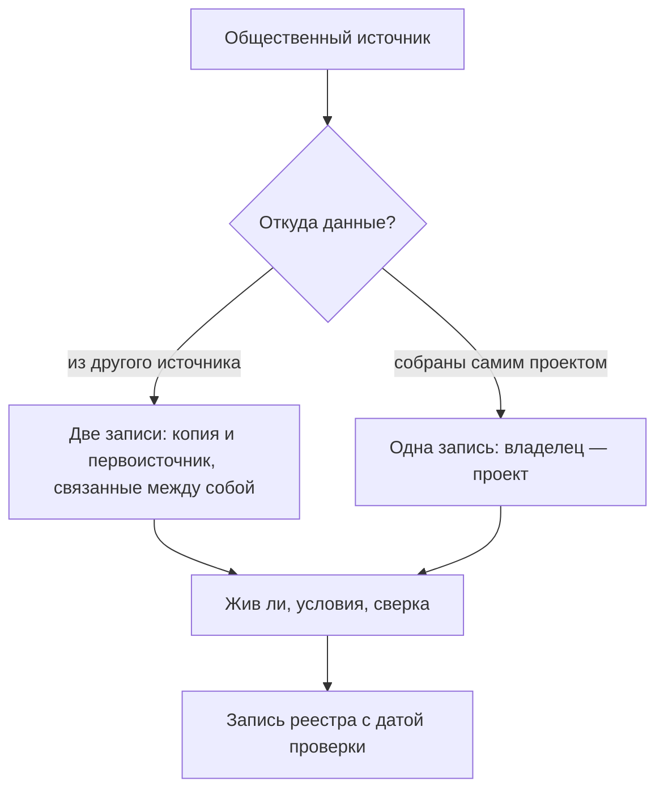

# Общественные данные

Общественные данные ведут не органы власти и не компании ради дохода, а некоммерческие организации, сообщества, исследователи и международные организации. Для инвентаризации у них четыре роли: путь к первоисточнику, замена недоступного, проверка официальных данных и справочник организаций и связей. Почти всегда это не первоисточник: общественный проект пересобирает государственные данные, международная организация — сведения национальных служб, Wikidata — сведения из других источников. Поэтому общественный источник записывают в реестр как копию — со своим владельцем, условиями и фактической датой обновления — и рядом записывают первоисточник. Обязанности поддерживать данные у общественного источника нет: проекты останавливаются, а заявленная периодичность расходится с настоящей. В подходе «где найти нужное» общественные источники закрывают пробелы, которые не закрыло государство, и проверяют найденное. В подходе «чем владеем» они показывают, кто уже пересобирает данные организации снаружи и где эти данные расходятся с её собственными.

## Коротко

| Что сделать | Что получается | Готово, когда |
|-------------|----------------|---------------|
| **[Просмотреть пять видов источников](#что-сюда-относится)** | Список общественных источников по вопросам | По каждому вопросу просмотрены общественные проекты, Wikidata и OpenStreetMap, научные репозитории, международные организации и подборки |
| **[Найти первоисточник](#первоисточник)** | Пары «копия — первоисточник» | У каждой копии первоисточник записан или помечен как не установленный |
| **[Проверить, жив ли источник](#жив-ли-источник)** | Фактическая дата обновления, кто ведёт источник и на какие средства | Дата взята из данных, а не из заявленной периодичности и не из подвала сайта |
| **[Прочитать условия](#условия-использования)** | Условия копии и первоисточника | Записаны оба; «не указаны» не прочитано как «свободно» |
| **[Сверить с официальными данными](#сверка-с-официальными-данными)** | Расхождения с причинами | У каждого расхождения есть причина или вопрос владельцу |
| **[Записать в реестр](#как-записать)** | Запись копии со связью с первоисточником | Владелец — проект, а не государственный орган, чьи данные он пересобрал |



## Что сюда относится

Общественный слой определяют по тому, кто ведёт данные и обязан ли он их вести, а не по тому, открыты ли они. Набор министерства на портале открытых данных — государственные данные. Та же таблица, которую исследователь выложил в научный репозиторий, — общественные: у неё другой владелец, другие условия и своя судьба. Подробнее о слоях — в главе [«Три слоя данных»](./01-three-layers.md).

| Вид | Кто ведёт | Что даёт | Чего не даёт | Примеры |
|-----|-----------|----------|--------------|---------|
| **Общественные проекты** | Некоммерческие организации, журналисты данных, исследовательские центры, сообщества разработчиков | Государственные данные из многих источников — очищенные, связанные по идентификаторам, с историей и выгрузками; часто доступнее оригинала | Статуса первоисточника; гарантии, что проект продолжится | «Госзатраты» и «Открытые НКО» (Россия), реестр данных о закупках Open Contracting Partnership; на границе с коммерческим слоем — OpenSanctions |
| **Открытые совместные проекты** | Участники-добровольцы | Справочные сведения об организациях, местах и людях, связи между ними, прежние названия и адреса; объекты на карте | Полноты и официального статуса: править может любой участник | Wikidata, Википедия, OpenStreetMap; рядом — DBpedia, отдельный проект, который извлекает данные из Википедии |
| **Научные репозитории** | Университеты, научные фонды, исследовательские группы | Наборы к исследованиям с методикой и постоянным идентификатором (DOI); данные, собранные вручную, по запросам или оцифрованные | Регулярного обновления: набор обычно снимок на дату статьи | Каталог репозиториев re3data.org, Zenodo, Harvard Dataverse, Figshare |
| **Международные организации** | Межгосударственные организации и их агентства | Сопоставимые показатели по странам, методики, ссылки на национальные источники | Записей, оперативности, подробности ниже страны или региона | Всемирный банк, ВОЗ, ООН, ОЭСР, МВФ, JODI |
| **Подборки и витрины** | Сообщества, исследовательские группы, платформы компаний | Списки наборов по темам; показатели, сведённые из разных источников в графики | Своих данных у подборки нет; у витрины — чужие данные под чужими условиями | Awesome Public Datasets, Our World in Data, наборы на Kaggle и Hugging Face |

Есть пограничные случаи. Международные организации — межгосударственные, и данные им дают государства. Но для инвентаризации они ведут себя как общественный источник: у них свои методики и свои сроки, и за данные конкретной страны они не отвечают. На платформах вроде Kaggle и Hugging Face владелец платформы — компания, а набор выложил пользователь. Владелец набора — тот, кто его собрал, а не платформа и не загрузивший. Бывают и проекты, которые открывают данные для некоммерческого использования, а компаниям продают лицензии, как OpenSanctions: для реестра важнее не слой, а условия — их и записывают.

## В атласе

На четырёх картах [атласа](../08-atlas/01-how-to-read.md) 2018–2019 годов из 159 источников общественных — девять:

- пять международных организаций — ООН, Всемирный банк, ВОЗ, Международное энергетическое агентство и JODI;
- четыре общественных проекта — clearspending.ru, openngo.ru, opennko.ru и openoil.net.

Они участвуют в 17 из 274 пар «вопрос — источник» и в 12 из 77 вопросов. Карты составлены для подхода «где найти нужное», и общественные источники на них не главные, но в двух местах без них не обойтись:

- **clearspending.ru — один из четырёх источников, которые есть на всех четырёх картах**, и единственный негосударственный среди них. Остальные три — zakupki.gov.ru, gks.ru и fedstat.ru. «Госзатраты» пересобирают контракты из zakupki.gov.ru, поэтому копия и первоисточник встречаются на картах парой.
- **На вопрос о сравнении здравоохранения России с другими странами** отвечают только международные организации — Всемирный банк, ВОЗ и ООН.

Что стало с ними к октябрю 2026 года:

- **clearspending.ru работает**; среди крупнейших контрактов на главной — заключённые в сентябре 2026 года. При этом zakupki.gov.ru из сети, из которой проверяли адреса атласа, не ответил: копия оказалась доступнее первоисточника ([«Адреса источников в октябре 2026 года»](../08-atlas/01-how-to-read.md#адреса-источников-в-октябре-2026-года)).
- **openngo.ru работает, но данные не обновляются**: на странице открытых данных проекта периодичность — «ежедневно», а дата последнего обновления — 16 августа 2023 года.
- **opennko.ru домена нет**, и в Internet Archive нет ни одной копии этого адреса. Возможно, на исходной карте опечатка в адресе openngo.ru; это нужно проверить по исходному файлу карты.
- **iea.org** при проверке адресов атласа ответил ошибкой 403, а **openoil.net**, который тогда открылся, 25 октября 2026 года ответил так же. Ошибка 403 часто означает защиту от программ, а не закрытие сайта: такие адреса проверяют вручную в браузере. Сайты «Хаба открытых данных» и «Данных НКО» тоже не отдают страницы программе, пока браузер не пройдёт проверку.

## Где искать

### Общественные проекты

Общественный проект делают те, кому государственные данные нужны для работы: некоммерческие организации, журналисты, исследовательские центры. Проект собирает данные из нескольких государственных источников, чистит их, связывает по идентификаторам — например, по ИНН организации, — хранит историю и выкладывает выгрузки и программный интерфейс. Поэтому у проекта часто то, чего нет у первоисточника: история, которую государственный сайт не хранит, связи между реестрами разных ведомств и доступ из-за рубежа.

Примеры на 25 октября 2026 года:

- **«Госзатраты»** (clearspending.ru) — 69,63 млн контрактов по законам № 44-ФЗ, № 94-ФЗ и № 223-ФЗ, 244 тыс. заказчиков и 1,51 млн поставщиков. Проект ведёт с 2014 года АНО «Информационная культура»; с 2019 по 2023 год развитие было приостановлено, но данные о бюджетных расходах продолжали обновляться, а в декабре 2023 года вышла новая версия.
- **«Открытые НКО»** (openngo.ru) — профили 823 238 некоммерческих организаций, собранные из разных источников, с выгрузкой в JSON Lines.
- **«Хаб открытых данных»** (hubofdata.ru) — каталог на CKAN: 8226 наборов, сгруппированных по 35 организациям-первоисточникам. Больше всего наборов у Федеральной службы статистики — 3361, Национального цифрового архива — 1936 и Банка России — 721. Это копии и обработки их данных, которые выложили участники проекта, а не наборы, которые опубликовали Росстат и Банк России.
- **OpenSanctions** — санкционные списки, перечни публичных должностных лиц и связанные с ними сведения из 476 источников; 3,9 млн объектов, последнее изменение — 24 октября 2026 года.
- **Реестр данных Open Contracting Partnership** (data.open-contracting.org) — 135 наборов о государственных закупках в стандарте OCDS больше чем от 100 публикаторов. Партнёрство собирает их, сводит в одном виде и описывает у каждого известные проблемы качества. Казахстана и России в реестре нет, из соседей есть Киргизия, Молдова и Украина (Prozorro).

Первые три проекта ведёт «Информационная культура» — организация, которой руководит автор книги. Они в главе потому, что есть на картах атласа и на них видны и сильные, и слабые стороны общественных проектов.

**Как искать.** По теме и стране со словами «данные», «open data», «API», «GitHub» — проекты часто выкладывают код и выгрузки в открытые репозитории. У экспертов и журналистов данных: проекты знают те, кто ими пользуется ([«Опросы экспертов»](../02-approaches/02-methods.md#6-опросы-экспертов)). В поисковиках по наборам данных: каталоги проектов на CKAN и похожих платформах они видят наравне с государственными ([«Поиск наборов данных»](./05-dataset-search.md)). И от государственного источника: кто ссылается на набор, кто его цитирует, у кого в описании он указан как источник.

### Wikidata, Википедия и OpenStreetMap

**Wikidata** — база знаний фонда Викимедиа: больше 123 млн объектов на 25 октября 2026 года, данные — под CC0, без условий. У каждого объекта постоянный идентификатор вида Q232 (это Казахстан) и свойства: официальный сайт (P856), дата основания (P571), дата упразднения (P576), преемник (P1366), вышестоящая организация (P749), страна (P17). Для инвентаризации Wikidata полезна как черновик перечня организаций — владельцев для главы [«Владельцы и полномочия»](../03-process/03-owners-and-mandates.md), — как история реорганизаций и как список прежних адресов для поиска в веб-архиве ([«Исчезнувшие системы и веб-архивы»](./06-legacy.md)).

Запрос к [службе запросов Wikidata](https://query.wikidata.org/) на языке SPARQL — министерства Казахстана с сайтами и датами:

```text
SELECT ?org ?orgLabel ?site ?start ?end WHERE {
  ?org wdt:P31/wdt:P279* wd:Q192350 ;   # министерство или его подвид
       wdt:P17 wd:Q232 .                # страна — Казахстан
  OPTIONAL { ?org wdt:P856 ?site }      # официальный сайт
  OPTIONAL { ?org wdt:P571 ?start }     # дата основания
  OPTIONAL { ?org wdt:P576 ?end }       # дата упразднения
  SERVICE wikibase:label { bd:serviceParam wikibase:language "ru,kk,en". }
}
ORDER BY ?orgLabel
```

25 октября 2026 года запрос вернул 38 министерств, у 23 из них нет даты упразднения. Это хороший черновик: в списке есть упразднённые министерства с датами, а значит, видна история реорганизаций. Но черновик, а не перечень:

- **«Нет даты упразднения» не значит «действует».** Без даты упразднения в списке одновременно Министерство культуры и спорта, созданное в 2014 году, и Министерство туризма и спорта — хотя бы одна из записей устарела.
- **Адреса устарели.** У Министерства здравоохранения и Министерства труда и социальной защиты населения записаны домены mz.gov.kz и mzsr.gov.kz, которых больше нет; у Министерства энергетики — energo.gov.kz, у которого нет адреса. Сайты министерств переехали на единую платформу gov.kz. Ещё у четырёх министерств сайт в Wikidata не записан.

Поэтому перечень из Wikidata сверяют с официальным составом правительства и положениями о министерствах, а прежние адреса из него используют для поиска в веб-архиве.

**Википедия** полезна списками и таблицами со ссылками: ссылка ведёт к первоисточнику, который и записывают. Текст Википедии — под CC BY-SA 4.0. DBpedia, которая извлекает данные из Википедии, — отдельный проект вне Викимедиа.

**OpenStreetMap** — карта, которую составляют участники: школы, больницы, остановки, дороги — с координатами. Данные — под лицензией ODbL. Для вопросов о доступности — сколько ехать до больницы, где нет школы — это часто единственный открытый источник координат. Полнота зависит от того, сколько участников в регионе, поэтому число объектов сверяют с государственными реестрами, а не считают по карте.

### Научные репозитории

В научных репозиториях лежат данные, на которых построены исследования: опросы, оцифрованные архивы, данные, полученные по запросам, ряды, собранные вручную. Каталог [re3data.org](https://www.re3data.org/) описывает 3539 репозиториев на 25 октября 2026 года и помогает найти профильный по дисциплине. Универсальные репозитории — Zenodo, Harvard Dataverse, Figshare, Dryad; искать по многим сразу — в OpenAIRE и поисковиках по наборам данных ([«Поиск наборов данных»](./05-dataset-search.md)).

Научный набор ценен описанием: в нём сказано, как данные собраны, и часто — откуда. Если исследователь получил данные по запросу у ведомства, значит, у ведомства они есть, и это находка для анализа полномочий. Если он оцифровал статистические сборники — набор отвечает на вопросы о прошлом, на которые государственные порталы не отвечают. Такие наборы лежат и в каталогах общественных проектов: на «Хабе открытых данных» последним — 16 октября 2026 года — обновлён набор об урожаях в Волоколамском уезде и Московской губернии за 1870–1914 годы. Но научный набор — снимок: после выхода статьи его обычно не обновляют.

### Международные организации

Всемирный банк, ВОЗ, ООН, ОЭСР, МВФ, Международная организация труда, ФАО, база торговли UN Comtrade, база JODI по нефти и газу собирают показатели у национальных служб и приводят их к общим определениям. Поэтому их данные сопоставимы между странами — и поэтому расходятся с национальными. В метаданных показателя записано, откуда он взят: это путь к первоисточнику.

У Всемирного банка это видно через открытый программный интерфейс:

```bash
# Население Казахстана по данным Всемирного банка и дата обновления базы
curl "https://api.worldbank.org/v2/country/KAZ/indicator/SP.POP.TOTL?format=json&per_page=3"
# Откуда Всемирный банк берёт этот показатель
curl "https://api.worldbank.org/v2/indicator/SP.POP.TOTL?format=json"
```

25 октября 2026 года первый запрос показал, что база World Development Indicators обновлена 8 октября 2026 года, а население Казахстана в 2025 году — 20 843 754 человека. Второй — что это оценка на середину года по всем, кто живёт в стране, независимо от гражданства, а источники — прогноз населения ООН World Population Prospects, национальные статистические службы и Евростат. Бюро национальной статистики Казахстана насчитало на 1 января 2026 года 20 495 975 человек — публикация от 13 февраля 2026 года. Международная оценка на середину 2025 года на 347 779 человек, или на 1,7%, больше национальной на более позднюю дату. Причина — в разных методиках, а не обязательно в ошибке одной из сторон. Для вопроса о Казахстане первоисточник — Бюро; для сравнения Казахстана с другими странами — Всемирный банк, с пометкой о методике.

Международные базы обновляются с задержкой: показатель за год появляется через несколько месяцев или лет после национального. Подробность — страна, реже регион; записей нет.

### Подборки и витрины

**Awesome Public Datasets** — список открытых наборов по темам на GitHub; последнее изменение — 22 октября 2026 года. Лицензия MIT относится к списку, а не к наборам: условия каждого набора — у его владельца.

**Our World in Data** сводит показатели из многих источников в графики. Свои данные и графики проект выпускает под CC BY, а данные из других источников — под условиями этих источников; источник указан у каждого показателя.

**Kaggle и Hugging Face** хранят наборы, которые выложили пользователи. Загрузивший — не всегда тот, кто собрал данные, и лицензию на странице набора выбирает он. Набор с такой платформы записывают только после того, как найден первоисточник.

## Как использовать при инвентаризации

### Первоисточник

Сначала выясняют, откуда у источника данные. Ответ ищут на странице «О проекте» или «Источники», в метаданных показателя, в описании набора, в самих данных — по идентификаторам и ссылкам. Возможных итогов три:

- **данные из другого источника** — заводят две записи, копию и первоисточник, и связывают их ([«Что считать записью»](../03-process/05-registry.md#что-считать-записью));
- **данные собраны самим проектом** — опрос, оцифровка, полевые наблюдения, правки участников — одна запись, владелец — проект;
- **не установлено** — копию записывают с пометкой и ищут первоисточник дальше: копия без первоисточника — пробел, а не ответ.

Если первоисточник закрыт, недоступен из вашей сети или не хранит историю, копия временно его заменяет. В записи копии это пишут прямо: какой вопрос она закрывает, чем отличается от первоисточника и на какую дату.

### Жив ли источник

| Что проверить | Где смотреть | Пример на октябрь 2026 года |
|---------------|--------------|-----------------------------|
| **Дату последнего обновления данных** | В описании набора, в программном интерфейсе (у CKAN — поле `metadata_modified`), в самих данных | У набора «Открытых НКО» периодичность — «ежедневно», последнее обновление — 16 августа 2023 года |
| **Живость каталога целиком** | Даты последних изменений нескольких наборов | На «Данных НКО» (ngodata.ru) 153 набора, последнее изменение — 16 августа 2023 года; на «Хабе открытых данных» — 16 октября 2026 года |
| **Кто ведёт и на какие средства** | «О проекте», контакты, отчёты организации | Развитие «Госзатрат» приостанавливали с 2019 по 2023 год, но часть данных обновлялась |
| **Историю** | Веб-архив, история изменений в репозитории, список изменений | Главная clearspending.ru есть в Internet Archive с 1 марта 2014 года ([«Веб-архив за минуту»](./06-legacy.md#веб-архив-за-минуту)) |
| **Методику и источники** | Страница источников, метаданные показателя | У показателя Всемирного банка источники перечислены в метаданных |
| **Выгрузку** | Полные выгрузки, программный интерфейс | «Госзатраты» выкладывают выгрузки заказчиков, поставщиков и бюджета, а контракты — через поиск и программный интерфейс |

Заявленная периодичность — обещание, а не факт. Записывают обе: заявленную и ту, что видна по данным ([«Периодичность и даты»](../03-process/05-registry.md#периодичность-и-даты)).

### Условия использования

У копии два набора условий: проекта и первоисточника. Проект может выложить данные под открытой лицензией, но это не отменяет условий первоисточника — и наоборот.

| Источник | Условия на октябрь 2026 года | Что это значит |
|----------|------------------------------|----------------|
| **Wikidata** | CC0 | Можно без ссылки на Wikidata; но факты в ней взяты из других источников, и в реестре ссылаются на них |
| **Википедия** | CC BY-SA 4.0 | Со ссылкой; производное — под той же лицензией |
| **OpenStreetMap** | ODbL | Со ссылкой; производную базу данных распространяют под той же лицензией |
| **World Development Indicators** | CC BY 4.0 | Со ссылкой на Всемирный банк |
| **data.who.int** | CC BY 4.0 с обязательной оговоркой о разрешении споров | Со ссылкой; споры — примирение, затем арбитраж |
| **Our World in Data** | CC BY для своих данных | Чужие данные — под условиями их источников |
| **OpenSanctions** | CC BY-NC 4.0 | Некоммерческое использование — со ссылкой; коммерческое — по платной лицензии |
| **Awesome Public Datasets** | MIT | Только для списка, не для наборов в нём |
| **Наборы на Kaggle, Hugging Face, Zenodo** | У каждого свои | Лицензию выбирает загрузивший; сверяют с условиями первоисточника |

Если условий на странице нет, записывают «не указаны» и уточняют у проекта: «не указаны» не значит «свободно» ([«Условия использования и владелец»](../03-process/05-registry.md#условия-использования-и-владелец)).

### Сверка с официальными данными

Расхождение копии с первоисточником — находка, а не помеха. Причины бывают пяти видов:

- **разные определения** — оценка на середину года и численность на 1 января, как у Всемирного банка и Бюро национальной статистики Казахстана;
- **разные даты** — копия отстаёт или, наоборот, хранит то, что первоисточник уже удалил;
- **очистка** — проект убрал дубли, исправил коды, объединил записи одной организации;
- **ошибки** — у проекта или у первоисточника;
- **разный охват** — проект собрал не всё или добавил то, чего у первоисточника нет.

Если расхождение не объясняется определениями и датами, это повод проверить качество первоисточника ([«Типичные находки»](../03-process/07-quality.md#типичные-находки)) и задать вопрос его владельцу.

## Как записать

Общественный источник записывают по тем же правилам, что и любой другой ([«Реестр данных»](../03-process/05-registry.md)). Особенности копии:

- **тип записи** — `dataset`, если это набор, и `site`, если пока известен только сайт проекта;
- **организация-владелец** — организация, которая ведёт проект, а не орган власти, чьи данные он пересобрал ([«Владелец, оператор, ответственный»](../03-process/03-owners-and-mandates.md#владелец-оператор-ответственный));
- **связанные записи** — `copy_of:` и идентификатор записи первоисточника;
- **периодичность** — заявленная, а фактическая — в отметке о качестве;
- **дата изменения** — из данных или их описания, а не из подвала сайта;
- **условия использования** — проекта и, отдельно, первоисточника;
- **откуда известно** — метод и где нашли: поиск, эксперт, ссылка из государственного источника ([«Как записать, откуда известно»](../02-approaches/02-methods.md#как-записать-откуда-известно)).

Так выглядит запись набора «Открытых НКО», собранная со страницы открытых данных проекта 25 октября 2026 года:

| Атрибут | Значение |
|---------|----------|
| Идентификатор | `openngo-dump` |
| Наименование | Данные о российских НКО — выгрузка проекта «Открытые НКО» |
| Описание | Профили некоммерческих организаций, собранные из разных источников; на сайте — 823 238 организаций. Выгрузка разбита на части по 20 тыс. записей |
| Тип записи | `dataset` |
| Организация-владелец | АНО «Информационная культура» — по странице открытых данных проекта |
| Ответственный | не установлено — на странице только общий адрес проекта |
| Периодичность обновления | `daily` — заявлено на странице |
| Дата публикации | 2019-01-24 |
| Дата последнего изменения | 2023-08-16 |
| Режим доступа | `open` — выгрузка без регистрации, проверено 25 октября 2026 года |
| Формат распространения | ZIP с файлами JSON Lines; программный интерфейс — JSON |
| Отметка о контроле качества | 2026-10-25: при заявленной ежедневной периодичности данные не обновлялись больше трёх лет; для вопросов о текущем состоянии НКО — брать первоисточники |
| Условия использования | условия использования проекта — openngo.ru/terms; у первоисточников — свои |
| Связанные записи | первоисточники не установлены: по странице открытых данных, они описаны в разделе «О проекте»; записи о них ещё не заведены |
| Откуда известно | карта атласа «Государственные финансы», вопрос 12; страница открытых данных проекта |
| Дата проверки | 2026-10-25 |

Запись не скрывает главного: набор живой по форме и остановленный по содержанию. Без отметки о качестве в реестре осталось бы «обновляется ежедневно».

## Пример

Продолжение условного примера из глав [«Цели и вопросы»](../03-process/02-goals-and-questions.md#пример) и [«Опросные листы и интервью»](../03-process/04-questionnaires.md#пример): 15 вопросов руководства о доступности медицинской помощи в регионах. По границам международные источники нужны для сравнения с другими странами, коммерческие исключены. Государственные источники найдены; общественные просматривают для трёх вопросов, на которые государство ответило плохо или не ответило.

| Вопрос | Что нашли | Проверка | Итог |
|--------|-----------|----------|------|
| Сколько врачей на 10 тыс. жителей в сравнении с другими странами? | Показатель ВОЗ | Определение: ВОЗ считает практикующих врачей, а национальная статистика — всех, кто занимает врачебные должности; ряд ВОЗ заканчивается на два года раньше национального | Для сравнения стран — ВОЗ с пометкой об определении; для регионов — национальная статистика |
| Как далеко жителям сёл ехать до больницы? | Больницы и дороги в OpenStreetMap | Больниц на карте на треть меньше, чем в государственном реестре медицинских организаций; в двух регионах из пяти почти нет сельских объектов | Координаты — из OpenStreetMap, перечень — из реестра; объекты, которых нет на карте, привязывают по адресам. В реестре — две связанные записи |
| Сколько ждут плановую госпитализацию? | Научный набор: опрос пациентов о сроках ожидания с методикой, выложен в университетский репозиторий три года назад | Опрос в трёх регионах из пяти, один раз; в описании сказано, что часть данных авторы получили по запросу у регионального органа здравоохранения | Записан как снимок с датой. Региональный орган добавлен в список адресатов: у него есть данные, которых не нашли другими методами |

**Итог.** Общественные источники закрыли два пробела частично: сравнение стран — с другой методикой, расстояния до больниц — с неполной картой. Главный вопрос о сроках ожидания они не закрыли, но привели к новому владельцу данных. Все три находки записаны с владельцем, условиями и датой, а показатель ВОЗ — ещё и со ссылкой на национальный первоисточник. Пример показывает ход работы, а не то, как устроено здравоохранение в конкретной стране.

## Частые ошибки

| Ошибка | Что происходит | Как исправить |
|--------|----------------|---------------|
| **Копия вместо первоисточника** | Проект закрывается — в реестре остаётся набор, которого нет, и неизвестно, где искать дальше | Две записи, копия и первоисточник, со связью `copy_of:` |
| **Владелец — государство** | В реестре орган власти «владеет» набором, о котором не знает; вопросы уходят не тому. Каталоги проектов к этому подталкивают: на «Хабе открытых данных» копии данных Росстата записаны на организацию «Федеральная служба статистики» | Владелец копии — проект, первоисточник — отдельной записью |
| **Заявленная периодичность как факт** | «Ежедневно» в реестре у набора, который не обновлялся три года | Дата изменения из данных; расхождение — в отметку о качестве |
| **Wikidata как перечень** | Упразднённые организации и мёртвые адреса попадают в список владельцев | Wikidata — черновик; перечень сверяют с официальным составом |
| **Международные данные как национальные** | Две цифры одного показателя без объяснения; спор о том, какая верна | Записать определение и дату; для вопроса о стране брать национальный первоисточник |
| **Лицензия платформы как лицензия данных** | Набор с Kaggle «под CC0», хотя собран из данных с другими условиями | Найти первоисточник и записать оба условия |
| **Совет сообщества как запись** | В реестре источник со слов участника форума, которого никто не открывал | Подсказку подтверждают адресом, документом или выгрузкой |

## Ограничения

- У общественного источника нет обязанности поддерживать данные: проект может остановиться в любой момент, а сайт — остаться и показывать старые данные как новые.
- Проект пересобирает данные со своими ошибками: очистка и связывание добавляют свои ошибки к ошибкам первоисточника.
- Международные базы обновляются с задержкой, приводят данные к своим определениям и не дают подробности ниже страны или региона.
- Wikidata и OpenStreetMap неполны и неравномерны: о столицах и крупных организациях сведений больше, чем о сёлах и малых учреждениях.
- Научный набор описывает одно исследование на одну дату.
- Сообщество знает многое, но его советы — подсказка, где искать, а не запись реестра.

## Источники

- Главы [«Три слоя данных»](./01-three-layers.md), [«Поиск наборов данных»](./05-dataset-search.md), [«Исчезнувшие системы и веб-архивы»](./06-legacy.md); [«Реестр данных»](../03-process/05-registry.md#что-считать-записью) — копия и первоисточник; [«Семь методов»](../02-approaches/02-methods.md#какой-метод-для-каких-данных) — методы для общественного слоя.
- Источники атласа и проверка их адресов — `data/sources.yaml`, `data/maps/` и `data/source-checks.yaml` в [репозитории книги](https://github.com/ivbeg/data-inventory/tree/main/data); подсчёт — 25 октября 2026 года. Копии opennko.ru в Internet Archive проверены 25 октября 2026 года.
- [«Госзатраты»](https://clearspending.ru/) — главная, [о проекте](https://clearspending.ru/page/about), [открытые данные](https://clearspending.ru/opendata); [«Открытые НКО»](https://openngo.ru/) и их [открытые данные](https://openngo.ru/opendata/); [«Хаб открытых данных»](https://hubofdata.ru/) и [«Данные НКО»](https://ngodata.ru/) — по программному интерфейсу CKAN. Проекты «Информационной культуры» — организации, которой руководит автор книги. Проверено 25 октября 2026 года.
- [OpenSanctions](https://www.opensanctions.org/datasets/default/) — состав и дата обновления; [условия использования](https://www.opensanctions.org/licensing/). Проверено 25 октября 2026 года.
- [OCP Data Registry](https://data.open-contracting.org/) — Open Contracting Partnership. Проверено 25 октября 2026 года.
- [Wikidata](https://www.wikidata.org/) и [Wikidata Query Service](https://query.wikidata.org/) — запрос о министерствах Казахстана и число объектов; адреса министерств проверены в DNS 25 октября 2026 года.
- [OpenStreetMap: авторские права и лицензия](https://www.openstreetmap.org/copyright).
- [re3data.org](https://www.re3data.org/) — число репозиториев на 25 октября 2026 года.
- [World Development Indicators](https://datacatalog.worldbank.org/search/dataset/0037712/World-Development-Indicators) — Всемирный банк: лицензия CC BY 4.0; [API](https://datahelpdesk.worldbank.org/knowledgebase/articles/889392) — запросы 25 октября 2026 года.
- [Численность населения Республики Казахстан по полу и типу местности на 1 января 2026 года](https://stat.gov.kz/ru/industries/social-statistics/demography/publications/475780/) — Бюро национальной статистики Агентства по стратегическому планированию и реформам Республики Казахстан, 13 февраля 2026 года. Проверено 25 октября 2026 года.
- [WHO Data](https://data.who.int/) — условия использования наборов на страницах показателей. Проверено 25 октября 2026 года.
- [Our World in Data: FAQs](https://ourworldindata.org/faqs) — условия использования. Проверено 25 октября 2026 года.
- [Awesome Public Datasets](https://github.com/awesomedata/awesome-public-datasets) — лицензия и дата последнего изменения по GitHub, 25 октября 2026 года.
