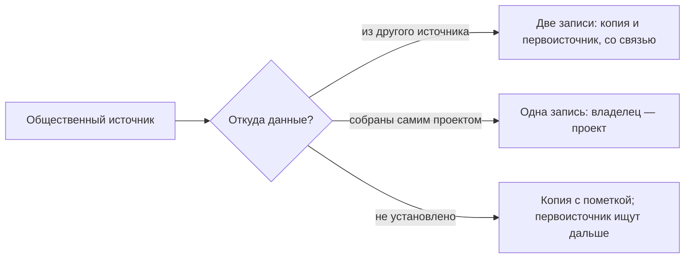

# Общественные данные

Общественные данные ведут не органы власти и не компании ради дохода, а некоммерческие организации, сообщества, исследователи и международные организации. Почти всегда это копия: проект пересобирает государственные данные, международная организация — сведения национальных служб. Поэтому общественный источник записывают как копию — со своим владельцем, условиями и фактической датой обновления, — а рядом записывают первоисточник. Обязанности поддерживать данные у проекта нет: проекты останавливаются, а заявленная периодичность расходится с настоящей.

Сведения проверены 25 октября 2026 года, если не указано иное.

## Коротко

| Что сделать | Что получается | Готово, когда |
|-------------|----------------|---------------|
| **[Просмотреть пять видов источников](#что-сюда-относится)** | Список общественных источников по вопросам | По каждому вопросу просмотрены проекты, Wikidata и OpenStreetMap, научные репозитории, международные организации и подборки |
| **[Найти первоисточник](#первоисточник)** | Пары «копия — первоисточник» | У каждой копии первоисточник записан или помечен как не установленный |
| **[Проверить, жив ли источник](#жив-ли-источник)** | Фактическая дата обновления, кто ведёт источник | Дата взята из данных, а не из заявленной периодичности |
| **[Прочитать условия](#условия-использования)** | Условия копии и первоисточника | Записаны оба; «не указаны» не прочитано как «свободно» |
| **[Сверить с официальными данными](#сверка-с-официальными-данными)** | Расхождения с причинами | У каждого расхождения есть причина или вопрос владельцу |
| **[Записать в реестр](#как-записать)** | Запись копии со связью с первоисточником | Владелец — проект, а не орган власти, чьи данные он пересобрал |

## Что сюда относится

Общественный слой определяют по тому, кто ведёт данные и обязан ли он их вести, а не по тому, открыты ли они. Набор министерства на портале — государственные данные. Та же таблица в научном репозитории — общественные: у неё другой владелец, другие условия и своя судьба ([«Как определить слой»](./01-three-layers.md#как-определить-слой)).

| Вид | Кто ведёт | Примеры |
|-----|-----------|---------|
| **[Общественные проекты](#общественные-проекты)** | Некоммерческие организации, журналисты данных, исследовательские центры | «Госзатраты», «Открытые НКО», реестр данных о закупках Open Contracting Partnership, OpenSanctions |
| **[Открытые совместные проекты](#wikidata-википедия-и-openstreetmap)** | Участники-добровольцы | Wikidata, Википедия, OpenStreetMap |
| **[Научные репозитории](#научные-репозитории)** | Университеты, научные фонды, исследовательские группы | Zenodo, Harvard Dataverse, Figshare; каталог репозиториев re3data.org |
| **[Международные организации](#международные-организации)** | Межгосударственные организации и их агентства | Всемирный банк, ВОЗ, ООН, ОЭСР, МВФ |
| **[Подборки и витрины](#подборки-и-витрины)** | Сообщества, исследователи, платформы компаний | Awesome Public Datasets, Our World in Data, Kaggle, Hugging Face |

Есть пограничные случаи. Международные организации — межгосударственные, но для инвентаризации ведут себя как общественный источник: у них свои методики и сроки, а за данные конкретной страны они не отвечают. На Kaggle и Hugging Face владелец платформы — компания, набор выложил пользователь, а владелец набора — тот, кто его собрал. Бывают проекты, которые открывают данные для некоммерческого использования, а компаниям продают лицензии, как OpenSanctions: для реестра важнее не слой, а условия.

## Что даёт и чего не даёт

У общественного слоя четыре роли:

- **путь к первоисточнику** — в описании проекта или показателя сказано, откуда данные; научный набор называет ведомство, у которого авторы получили данные;
- **замена недоступного** — история, которую государственный сайт не хранит, связи между реестрами разных ведомств, доступ из-за рубежа, координаты в OpenStreetMap;
- **проверка официальных данных** — сравнение со странами у международных организаций, независимый подсчёт у проекта;
- **справочник организаций и связей** — Wikidata хранит прежние названия, даты упразднения, преемников и прежние адреса.

Чего общественный слой не даёт:

- статуса первоисточника и юридической силы;
- гарантии, что проект продолжится и будет обновляться;
- полноты: Wikidata и OpenStreetMap неравномерны, научный набор — снимок одного исследования;
- подробности ниже страны или региона у международных организаций;
- своих данных у подборок — только ссылки на чужие.

## Где искать

### Общественные проекты

Общественный проект делают те, кому государственные данные нужны для работы. Проект собирает данные из нескольких государственных источников, чистит их, связывает по идентификаторам — например, по ИНН организации, — хранит историю и выкладывает выгрузки и программный интерфейс. Поэтому у проекта часто есть то, чего нет у первоисточника: история, связи и доступ из-за рубежа.

- **«Госзатраты»** (clearspending.ru) — 69,63 млн государственных контрактов по законам № 44-ФЗ, № 94-ФЗ и № 223-ФЗ, 244 тыс. заказчиков и 1,51 млн поставщиков. Проект работает с 2014 года. С 2019 по 2023 год его развитие было приостановлено, но данные о бюджетных расходах продолжали обновляться, а в декабре 2023 года вышла новая версия. На нём видны и сильная, и слабая сторона общественных проектов: долгая жизнь и зависимость от того, есть ли у проекта ресурсы.
- **«Открытые НКО»** (openngo.ru) — профили 823 238 некоммерческих организаций из разных источников, с выгрузкой. Данные перестали обновляться ([«Жив ли источник»](#жив-ли-источник)).
- **«Хаб открытых данных»** (hubofdata.ru) — каталог: 8226 наборов, сгруппированных по 35 организациям-первоисточникам. Больше всего наборов у Федеральной службы статистики — 3361. Это копии и обработки, которые выложили участники проекта, а не наборы, которые опубликовал Росстат.
- **OpenSanctions** — санкционные списки, перечни публичных должностных лиц и связанные сведения из 476 источников; 3,9 млн объектов, последнее изменение — 24 октября 2026 года.
- **Реестр данных Open Contracting Partnership** (data.open-contracting.org) — 135 наборов о государственных закупках в стандарте OCDS от более чем 100 публикаторов, с описанием известных проблем качества у каждого.

Первые три проекта ведёт «Информационная культура» — организация, которой руководит автор книги.

**Как искать.** Ищут по теме и стране со словами «данные», «open data», «API», «GitHub»: проекты часто выкладывают код и выгрузки в открытые репозитории. Спрашивают экспертов и журналистов данных ([«Опросы экспертов»](../02-approaches/02-methods.md#6-опросы-экспертов)). Ищут в поисковиках по наборам данных: каталоги проектов они видят наравне с государственными ([«Поиск наборов данных»](./05-dataset-search.md)). И идут от государственного источника: кто ссылается на набор, у кого в описании он указан как источник.

### Wikidata, Википедия и OpenStreetMap

**Wikidata** — база знаний фонда Викимедиа: больше 123 млн объектов, данные — под CC0, без условий. У каждого объекта постоянный идентификатор вида Q232 (это Казахстан) и свойства: официальный сайт, дата основания, дата упразднения, преемник, вышестоящая организация, страна. Для инвентаризации Wikidata полезна как черновик перечня организаций-владельцев, как история реорганизаций и как список прежних адресов для поиска в веб-архиве ([«Исчезнувшие системы и веб-архивы»](./06-legacy.md)).

Чтобы получить такой список, к Wikidata пишут запрос на языке SPARQL. Запрос описывает, какие объекты и свойства нужны, а служба запросов возвращает таблицу. Программировать не нужно: готовый запрос открывают в браузере и нажимают «Выполнить». Запрос «министерства Казахстана с сайтами и датами» 26 октября 2026 года вернул 38 министерств, у 23 из них нет даты упразднения. Фрагмент ответа:

| Министерство | Сайт в Wikidata | Создано | Упразднено |
|--------------|-----------------|---------|------------|
| Министерство здравоохранения Республики Казахстан | mz.gov.kz | 1992-06-28 | — |
| Министерство труда и социальной защиты населения | mzsr.gov.kz | 1996-11-01 | — |
| Министерство энергетики Республики Казахстан | energo.gov.kz | 2014-08-06 | — |
| Министерство культуры и спорта Республики Казахстан | mk.gov.kz, mks.gov.kz, gov.kz | 2014-08-06 | — |
| Министерство туризма и спорта Казахстана | gov.kz | — | — |
| Министерство образования и науки Казахстана | edu.gov.kz, gov.kz | 1999-10-13 | 2022-06-11 |

<details>
<summary>Проверить самому</summary>

[Открыть запрос в службе запросов Wikidata](https://query.wikidata.org/#SELECT%20%3Forg%20%3ForgLabel%20%3Fsite%20%3Fstart%20%3Fend%20WHERE%20%7B%0A%20%20%3Forg%20wdt%3AP31%2Fwdt%3AP279%2A%20wd%3AQ192350%20%3B%0A%20%20%20%20%20%20%20wdt%3AP17%20wd%3AQ232%20.%0A%20%20OPTIONAL%20%7B%20%3Forg%20wdt%3AP856%20%3Fsite%20%7D%0A%20%20OPTIONAL%20%7B%20%3Forg%20wdt%3AP571%20%3Fstart%20%7D%0A%20%20OPTIONAL%20%7B%20%3Forg%20wdt%3AP576%20%3Fend%20%7D%0A%20%20SERVICE%20wikibase%3Alabel%20%7B%20bd%3AserviceParam%20wikibase%3Alanguage%20%22ru%2Ckk%2Cen%22.%20%7D%0A%7D%0AORDER%20BY%20%3ForgLabel) и нажать «Выполнить». Текст запроса:

```text
SELECT ?org ?orgLabel ?site ?start ?end WHERE {
  ?org wdt:P31/wdt:P279* wd:Q192350 ;   # министерство или его подвид
       wdt:P17 wd:Q232 .                # страна — Казахстан
  OPTIONAL { ?org wdt:P856 ?site }      # официальный сайт
  OPTIONAL { ?org wdt:P571 ?start }     # дата основания
  OPTIONAL { ?org wdt:P576 ?end }       # дата упразднения
  SERVICE wikibase:label { bd:serviceParam wikibase:language "ru,kk,en". }
}
ORDER BY ?orgLabel
```

У министерства с несколькими сайтами служба возвращает по строке на сайт; в таблице выше они сведены.

</details>

В списке видна история реорганизаций, но это черновик, а не перечень:

- **«Нет даты упразднения» не значит «действует».** Без даты упразднения в списке одновременно Министерство культуры и спорта и Министерство туризма и спорта — хотя бы одна из записей устарела.
- **Адреса устарели.** Доменов mz.gov.kz и mzsr.gov.kz больше нет, у домена energo.gov.kz нет адреса в DNS: сайты министерств переехали на единую платформу gov.kz. Ещё у четырёх министерств сайт не записан.

Поэтому перечень из Wikidata сверяют с официальным составом правительства, а прежние адреса из него используют для поиска в веб-архиве.

**Википедия** полезна списками и таблицами со ссылками: ссылка ведёт к первоисточнику, который и записывают. Текст Википедии — под CC BY-SA 4.0.

**OpenStreetMap** — карта, которую составляют участники: школы, больницы, остановки, дороги — с координатами, под лицензией ODbL. Для вопросов о доступности — сколько ехать до больницы, где нет школы — это часто единственный открытый источник координат. Полнота зависит от того, сколько участников в регионе, поэтому число объектов сверяют с государственными реестрами.

### Научные репозитории

В научных репозиториях лежат данные исследований: опросы, оцифрованные архивы, данные, полученные по запросам. Профильный репозиторий по дисциплине помогает найти каталог [re3data.org](https://www.re3data.org/) — 3539 репозиториев, а по многим репозиториям сразу ищут в OpenAIRE и поисковиках по наборам данных.

Научный набор ценен описанием: в нём сказано, как данные собраны и часто откуда. Если исследователь получил данные по запросу у ведомства, значит, у ведомства они есть — это находка для анализа полномочий. Но научный набор — снимок: после выхода статьи его обычно не обновляют.

### Международные организации

Всемирный банк, ВОЗ, ООН, ОЭСР, МВФ, Международная организация труда, ФАО, база торговли UN Comtrade собирают показатели у национальных служб и приводят их к общим определениям. Поэтому их данные сопоставимы между странами — и поэтому расходятся с национальными. В метаданных показателя записано, откуда он взят: это путь к первоисточнику.

У Всемирного банка это видно и на странице показателя ([население Казахстана на data.worldbank.org](https://data.worldbank.org/indicator/SP.POP.TOTL?locations=KZ)), и через открытый программный интерфейс. База World Development Indicators обновлена 8 октября 2026 года. Население Казахстана в 2025 году по ней — 20 843 754 человека. Это оценка на середину года по всем, кто живёт в стране, независимо от гражданства; источники — прогноз населения ООН, национальные статистические службы и Евростат. Бюро национальной статистики Казахстана насчитало на 1 января 2026 года 20 495 975 человек. Международная оценка на середину 2025 года на 347 779 человек, или на 1,7%, больше национальной на более позднюю дату.

Причина — в разных методиках, а не обязательно в ошибке одной из сторон. Для вопроса о Казахстане первоисточник — Бюро; для сравнения Казахстана с другими странами — Всемирный банк, с пометкой о методике. Международные базы к тому же обновляются с задержкой: показатель за год появляется через месяцы или годы после национального.

<details>
<summary>Проверить самому</summary>

```bash
# Население Казахстана по данным Всемирного банка и дата обновления базы (поле lastupdated)
curl "https://api.worldbank.org/v2/country/KAZ/indicator/SP.POP.TOTL?format=json&per_page=3"
# Откуда Всемирный банк берёт этот показатель (поля sourceNote и sourceOrganization)
curl "https://api.worldbank.org/v2/indicator/SP.POP.TOTL?format=json"
```

</details>

### Подборки и витрины

Подборка вроде Awesome Public Datasets — список чужих наборов: её лицензия относится к списку, а не к наборам. Our World in Data сводит показатели из многих источников в графики и у каждого указывает источник. Kaggle и Hugging Face хранят наборы пользователей: загрузивший — не всегда тот, кто собрал данные, и лицензию выбирает он. Набор с такой платформы записывают только после того, как найден первоисточник.

## Как использовать при инвентаризации

### Первоисточник

**Первоисточник** — организация и ресурс, где данные появились: тот, кто их собрал или создал. **Копия** — те же данные у другого владельца: общественного проекта, международной организации, компании или платформы. У копии свой владелец, свои условия и своя дата обновления, поэтому копию и первоисточник записывают двумя записями и связывают. При подсчёте источников вопроса их считают одним ([«Как данные переходят между слоями»](./01-three-layers.md#как-данные-переходят-между-слоями)).

Откуда у источника данные, ищут на странице «О проекте» или «Источники», в метаданных показателя, в описании набора, в самих данных — по идентификаторам и ссылкам. Итогов три:



- **Данные из другого источника** — заводят две записи и связывают их ([«Что считать записью»](../03-process/05-registry.md#что-считать-записью)).
- **Данные собраны самим проектом** — опрос, оцифровка, полевые наблюдения, правки участников. Одна запись, владелец — проект.
- **Не установлено** — копию записывают с пометкой и ищут первоисточник дальше: копия без первоисточника — пробел, а не ответ.

Если первоисточник закрыт, недоступен из вашей сети или не хранит историю, копия временно его заменяет. В записи копии это пишут прямо: какой вопрос она закрывает, чем отличается от первоисточника и на какую дату.

### Жив ли источник

Заявленная периодичность — обещание, а не факт. Лучше всего это видно на странице открытых данных «Открытых НКО»: в одной таблице стоят «Дата последнего обновления данных: 16.08.2023» и «Периодичность обновления: ежедневно».


*Страница открытых данных «Открытых НКО» (openngo.ru/opendata), фрагмент: строки таблицы между владельцем и датами пропущены. Снято 26 октября 2026 года.*

| Что проверить | Где смотреть | Пример |
|---------------|--------------|--------|
| **Дату последнего обновления данных** | В описании набора, в программном интерфейсе, в самих данных | «Открытые НКО»: последнее обновление — 16 августа 2023 года |
| **Живость каталога целиком** | Даты последних изменений нескольких наборов | «Данные НКО» (ngodata.ru): 153 набора, последнее изменение — 16 августа 2023 года; «Хаб открытых данных» — 16 октября 2026 года |
| **Кто ведёт и на какие средства** | «О проекте», контакты, отчёты организации | Развитие «Госзатрат» приостанавливали, но часть данных обновлялась |
| **Историю** | Веб-архив, история изменений в репозитории | У Awesome Public Datasets — история изменений на GitHub ([«Веб-архив за минуту»](./06-legacy.md#веб-архив-за-минуту)) |
| **Методику и источники** | Страница источников, метаданные показателя | У показателя Всемирного банка источники перечислены в метаданных |

Записывают обе периодичности: заявленную и ту, что видна по данным ([«Периодичность и даты»](../03-process/05-registry.md#периодичность-и-даты)). Ошибка при проверке адреса программой — ещё не признак, что источник умер. Ответ 403 часто означает защиту от программ: сайты «Хаба открытых данных» и «Данных НКО» не отдают страницы программе, пока браузер не пройдёт проверку. Такие адреса проверяют вручную в браузере.

### Условия использования

У копии два набора условий: проекта и первоисточника. Проект может выложить данные под открытой лицензией, но это не отменяет условий первоисточника — и наоборот.

| Источник | Условия | Что это значит |
|----------|---------|----------------|
| **Wikidata** | CC0 | Можно без ссылки на Wikidata; но факты взяты из других источников, и в реестре ссылаются на них |
| **Википедия** | CC BY-SA 4.0 | Со ссылкой; производное — под той же лицензией |
| **OpenStreetMap** | ODbL | Со ссылкой; производную базу данных распространяют под той же лицензией |
| **World Development Indicators** | CC BY 4.0 | Со ссылкой на Всемирный банк |
| **Our World in Data** | CC BY для своих данных | Чужие данные — под условиями их источников |
| **OpenSanctions** | CC BY-NC 4.0 | Некоммерческое использование — со ссылкой; коммерческое — по платной лицензии |
| **Наборы на Kaggle, Hugging Face, Zenodo** | У каждого свои | Лицензию выбирает загрузивший; сверяют с условиями первоисточника |

Если условий на странице нет, записывают «не указаны» и уточняют у проекта: «не указаны» не значит «свободно» ([«Условия использования и владелец»](../03-process/05-registry.md#условия-использования-и-владелец)).

### Сверка с официальными данными

Расхождение копии с первоисточником — находка, а не помеха. Причины бывают пяти видов:

- **разные определения** — оценка на середину года и численность на 1 января, как у Всемирного банка и Бюро национальной статистики Казахстана;
- **разные даты** — копия отстаёт или, наоборот, хранит то, что первоисточник уже удалил;
- **очистка** — проект убрал дубли, исправил коды, объединил записи одной организации;
- **ошибки** — у проекта или у первоисточника;
- **разный охват** — проект собрал не всё или добавил то, чего у первоисточника нет.

Если расхождение не объясняется определениями и датами, это повод проверить качество первоисточника ([«Что проверять»](../03-process/07-quality.md#что-проверять)) и задать вопрос его владельцу.

### Чем владеем: внешние копии

В описи своих данных общественный слой появляется как внешние копии. Проекты, международные организации и компании пересобирают данные организации, и по ним видно, кто этими данными пользуется и где расходятся версии. Ищут копии так:

- **поиском по своему названию и домену** — в поисковиках по наборам данных, на GitHub, Kaggle и Hugging Face ([«Поиск в двух подходах»](./05-dataset-search.md#поиск-в-двух-подходах));
- **по ссылкам на свои наборы** — кто указывает организацию как источник в описании набора или показателя;
- **в метаданных международных показателей** — какие ряды международная организация берёт у вашей службы;
- **у экспертов и пользователей** — журналисты и исследователи знают, где удобнее брать ваши данные.

Найденную копию записывают со связью с вашим набором и сверяют: если в копии больше истории или меньше ошибок, это повод улучшить свой набор. Для цели «открыть данные» число копий — ещё и мера спроса.

## Как записать

Общественный источник записывают по тем же правилам, что и любой другой ([«Реестр данных»](../03-process/05-registry.md)). Особенности копии:

- **организация-владелец** — тот, кто ведёт проект, а не орган власти, чьи данные он пересобрал; в листе «Владельцы» у него слой `public`;
- **связанные записи** — связь с записью первоисточника: `copy_of:` и её идентификатор; в листе источников карты данных для этого есть колонка `copy_of`;
- **периодичность** — заявленная, а фактическая — в отметке о качестве;
- **дата изменения** — из данных или их описания, а не из подвала сайта;
- **условия использования** — проекта и, отдельно, первоисточника;
- **откуда известно** — метод и где нашли ([«Как записать, откуда известно»](../02-approaches/02-methods.md#как-записать-откуда-известно)).

Так выглядит запись набора «Открытых НКО», собранная со страницы открытых данных проекта:

| Атрибут | Значение |
|---------|----------|
| Идентификатор | `openngo-dump` |
| Наименование | Данные о российских НКО — выгрузка проекта «Открытые НКО» |
| Описание | Профили некоммерческих организаций из разных источников; на сайте — 823 238 организаций. Выгрузка разбита на части по 20 тыс. записей |
| Тип записи | набор |
| Организация-владелец | АНО «Информационная культура» — по странице открытых данных |
| Ответственный | не установлено — на странице только общий адрес проекта |
| Периодичность обновления | ежедневно — заявлено на странице |
| Дата публикации | 2019-01-24 |
| Дата последнего изменения | 2023-08-16 |
| Режим доступа | открытые данные — выгрузка без регистрации |
| Формат распространения | ZIP с файлами JSON Lines; программный интерфейс — JSON |
| Отметка о контроле качества | 2026-10-25: при заявленной ежедневной периодичности данные не обновлялись больше трёх лет; для вопросов о текущем состоянии НКО брать первоисточники |
| Условия использования | условия проекта — openngo.ru/terms; у первоисточников — свои |
| Связанные записи | первоисточник не установлен: источники описаны в разделе «О проекте», записи о них ещё не заведены |
| Откуда известно | поиск по теме — открытые данные о НКО; страница открытых данных проекта |
| Дата проверки | 2026-10-25 |

Запись не скрывает главного: набор живой по форме и остановленный по содержанию. Без отметки о качестве в реестре осталось бы «обновляется ежедневно».

## Пример

**Где мы в примере.** Условный пример о доступности медицинской помощи: 15 вопросов руководства сформулированы в главе [«Цели и вопросы»](../03-process/02-goals-and-questions.md#пример), государственные источники найдены анализом полномочий и опросом владельцев ([«Опросные листы и интервью»](../03-process/04-questionnaires.md#пример)). По границам международные источники нужны для сравнения с другими странами, коммерческие исключены. Общественные источники просматривают для трёх вопросов, на которые государство ответило плохо или не ответило.

| Вопрос | Что нашли | Проверка | Итог |
|--------|-----------|----------|------|
| Сколько врачей на 10 тыс. жителей в сравнении с другими странами? | Показатель ВОЗ | ВОЗ считает практикующих врачей, а национальная статистика — всех на врачебных должностях; ряд ВОЗ заканчивается на два года раньше | Для сравнения стран — ВОЗ с пометкой об определении; для регионов — национальная статистика |
| Как далеко жителям сёл ехать до больницы? | Больницы и дороги в OpenStreetMap | Больниц на карте на треть меньше, чем в государственном реестре; в двух регионах из пяти почти нет сельских объектов | Координаты — из OpenStreetMap, перечень — из государственного реестра. На карте у вопроса две связи «вопрос — источник» |
| Сколько ждут плановую госпитализацию? | Научный набор: опрос пациентов в университетском репозитории, выложен три года назад | Опрос в трёх регионах из пяти, один раз; часть данных авторы получили у регионального органа здравоохранения | На карте — как снимок с датой. Региональный орган добавлен в список адресатов |

**Итог.** Находки сыграли три из четырёх ролей общественного слоя. Показатель ВОЗ проверил национальную статистику и дал сравнение стран — с другой методикой. OpenStreetMap заменил недоступное: координат больниц у государства нет. Научный набор вопроса о сроках ожидания не закрыл, но привёл к первоисточнику — региональному органу, у которого есть данные. OpenStreetMap и научный набор вошли в карту данных связями «вопрос — источник» с владельцем, условиями и датой, а не записями реестра. Пример показывает ход работы, а не то, как устроено здравоохранение в конкретной стране.

## Частые ошибки

| Ошибка | Что происходит | Как исправить |
|--------|----------------|---------------|
| **Заявленная периодичность как факт** | «Ежедневно» в реестре у набора, который не обновлялся три года | Дата изменения из данных; расхождение — в отметку о качестве |
| **Wikidata как перечень** | Упразднённые организации и мёртвые адреса попадают в список владельцев | Wikidata — черновик; перечень сверяют с официальным составом |
| **Лицензия платформы как лицензия данных** | Набор с Kaggle «под CC0», хотя собран из данных с другими условиями | Найти первоисточник и записать оба условия |

Сквозные ошибки — копия вместо первоисточника, издатель вместо владельца — в главе [«Практики и антипаттерны»](../08-practices/01-practices-and-anti-patterns.md).

## Ограничения

- Проект может остановиться в любой момент, а сайт — остаться и показывать старые данные как новые.
- Очистка и связывание добавляют свои ошибки к ошибкам первоисточника.
- Wikidata и OpenStreetMap неполны и неравномерны: о столицах и крупных организациях сведений больше, чем о сёлах и малых учреждениях.
- Сообщество знает многое, но его советы — подсказка, где искать, а не запись реестра: подсказку подтверждают адресом, документом или выгрузкой.

## Источники

- Главы [«Три слоя данных»](./01-three-layers.md), [«Поиск наборов данных»](./05-dataset-search.md), [«Исчезнувшие системы и веб-архивы»](./06-legacy.md); [«Реестр данных»](../03-process/05-registry.md#что-считать-записью) — что считать записью.
- [«Госзатраты»](https://clearspending.ru/) — главная, [о проекте](https://clearspending.ru/page/about), [открытые данные](https://clearspending.ru/opendata); [«Открытые НКО»](https://openngo.ru/) и их [открытые данные](https://openngo.ru/opendata/) — снято 26 октября 2026 года; [«Хаб открытых данных»](https://hubofdata.ru/) и [«Данные НКО»](https://ngodata.ru/) — по программному интерфейсу каталогов. Проекты «Информационной культуры» — организации, которой руководит автор книги.
- [OpenSanctions](https://www.opensanctions.org/datasets/default/) — состав и дата обновления; [условия использования](https://www.opensanctions.org/licensing/).
- [OCP Data Registry](https://data.open-contracting.org/) — Open Contracting Partnership.
- [Wikidata](https://www.wikidata.org/) и [Wikidata Query Service](https://query.wikidata.org/) — запрос о министерствах Казахстана повторён 26 октября 2026 года; адреса министерств проверены в DNS 25 октября 2026 года.
- [OpenStreetMap: авторские права и лицензия](https://www.openstreetmap.org/copyright); [re3data.org](https://www.re3data.org/) — число репозиториев.
- [World Development Indicators](https://datacatalog.worldbank.org/search/dataset/0037712/World-Development-Indicators) — Всемирный банк, лицензия CC BY 4.0; [API](https://datahelpdesk.worldbank.org/knowledgebase/articles/889392) — запросы повторены 26 октября 2026 года.
- [Численность населения Республики Казахстан на 1 января 2026 года](https://stat.gov.kz/ru/industries/social-statistics/demography/publications/475780/) — Бюро национальной статистики Агентства по стратегическому планированию и реформам Республики Казахстан, 13 февраля 2026 года.
- [Our World in Data: FAQs](https://ourworldindata.org/faqs) — условия использования; [Awesome Public Datasets](https://github.com/awesomedata/awesome-public-datasets) — лицензия и история изменений.
