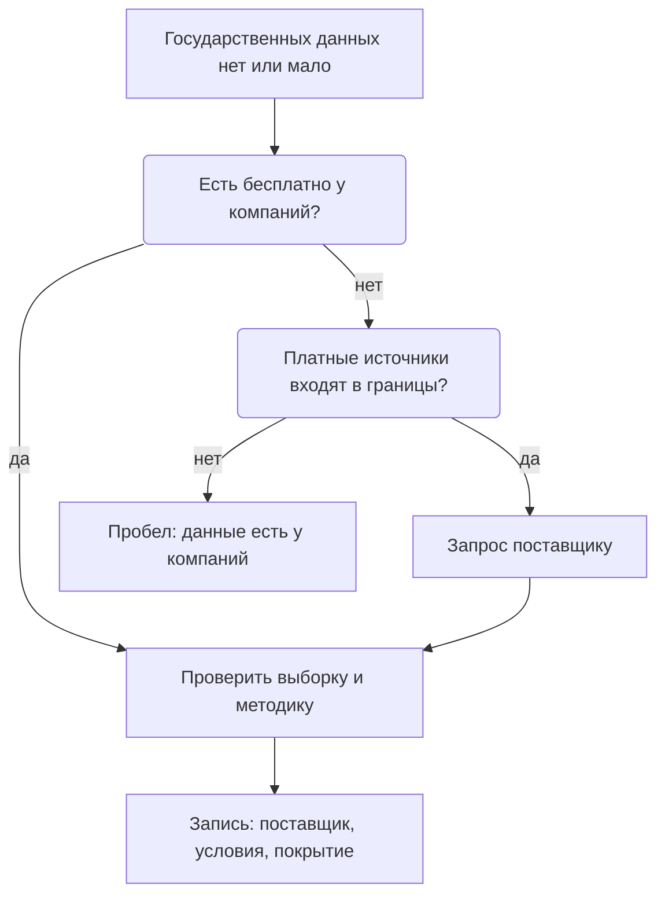

# Коммерческие данные

Коммерческие данные компании собирают для своего дела: платежи и чеки, цены, перемещения абонентов, кредиты, вакансии, отчётность. Часто они свежее и подробнее государственных, но главное в них — условия и выборка: данные принадлежат компании и описывают её клиентов, а не всё население. Поэтому коммерческий источник записывают с поставщиком, соглашением и сроком, с тем, кого покрывают данные, и сверяют с официальной статистикой. Начинают с бесплатного: многое компании публикуют о себе сами.

Сведения проверены 25 октября 2026 года, если не указано иное.

## Коротко

| Что сделать | Что получается | Готово, когда |
|-------------|----------------|---------------|
| **[Решить в границах](#границы-и-порядок)** | Строка о коммерческом слое в границах | Записано, входят ли коммерческие источники, можно ли платить и кто одобряет расходы |
| **[Начать с бесплатного](#сначала-бесплатное)** | Раскрытие, отчёты, индексы и открытые данные компаний по вопросам | По каждому пробелу проверено, нет ли бесплатного источника |
| **[Найти поставщиков](#как-найти-поставщика)** | Компании, у которых могут быть данные, и откуда о них известно | У каждого пробела два-три кандидата или пометка, что поставщиков не нашли |
| **[Спросить поставщика](#что-спросить-у-поставщика)** | Ответы на десять вопросов и образец данных | Известны выборка, подробность, методика, условия и цена |
| **[Проверить пригодность](#годится-ли-для-задачи)** | Годится, годится с оговорками или не годится | Образец сверен с официальными данными; разрывы, выбросы и нули найдены |
| **[Записать условия и сроки](#как-записать)** | Запись с поставщиком, соглашением, сроком и ограничениями | Срок соглашения внесён в план обновления |

## Что сюда относится

Коммерческий слой определяют по тому, для чего собраны данные и у кого копия. Данные, которые компания собирает для своего дела, — коммерческие, даже если компания государственная или публикует их бесплатно. Отчёт той же компании у регулятора — уже государственный слой: регулятор собирает его по закону ([«Как определить слой»](./01-three-layers.md#как-определить-слой)).

| Вид | Кто ведёт | Примеры |
|-----|-----------|---------|
| **[Раскрытие информации и отчётность](#раскрытие-информации-и-отчётность)** | Компании с ценными бумагами на бирже, биржи, сервисы раскрытия | EDGAR, e-disclosure.ru «Интерфакса» |
| **[Платежи, чеки и цены](#платежи-чеки-и-цены)** | Банки, платёжные системы, процессинг топливных карт, операторы фискальных данных, бюро кредитных историй | Траты по картам Affinity Solutions, индекс цен на топливо «Петрол Плюс» |
| **[Операторы связи и геоданные](#операторы-связи-и-геоданные)** | Операторы мобильной связи, сервисы карт и навигации | Проект Евростата Multi-MNO |
| **[Онлайн-платформы](#онлайн-платформы)** | Сайты вакансий, объявлений и торговли | Индекс вакансий Indeed Hiring Lab |
| **[Сервисы на государственных реестрах](#сервисы-на-государственных-реестрах)** | Сервисы проверки контрагентов, агрегаторы реестров | OpenCorporates |
| **[Отраслевые сервисы и маркетплейсы](#отраслевые-сервисы-и-маркетплейсы-данных)** | Информационные агентства, аналитические компании, площадки данных | Bloomberg, Reuters, AWS Data Exchange, Datarade |

Есть пограничные случаи. Оператор фискальных данных собирает чеки как компания, но передаёт их налоговой службе: у одних и тех же чеков два владельца, и копия у налоговой — государственная. Сервисы на государственных реестрах — коммерческие копии государственных данных со своими условиями, а первоисточник — реестр. Бесплатный индекс, который компания выкладывает сама, остаётся коммерческим: компания может его остановить.

## Что даёт и чего не даёт

У коммерческого слоя четыре роли:

- **замена там, где государственных данных нет.** Траты по картам в Economic Tracker показывают потребление по неделям и регионам, а перемещения абонентов у операторов связи — туристические потоки;
- **оценка раньше официальной.** Indeed каждую неделю обновляет дневной индекс вакансий — сайты вакансий видят спрос раньше статистики;
- **проверка государственных данных.** Цены на АЗС по транзакциям топливных карт в индексе «Петрол Плюс» сверяют с официальной статистикой цен;
- **сведения о самих компаниях.** Отчётность, владельцы и сделки в раскрытии информации — через EDGAR в США.

Чего коммерческий слой не даёт:

- всего населения — только клиентов компании, и только безналичные операции у банков;
- стабильной выборки: клиенты приходят и уходят, и ряды ломаются без предупреждения;
- открытой методики: её раскрывают частично и могут пересчитать историю;
- гарантии условий: бесплатное закрывают тем же решением, каким открыли.

## Где искать

### Раскрытие информации и отчётность

Компании, чьи ценные бумаги обращаются на бирже, — эмитенты — обязаны публиковать отчётность, существенные события, сведения о владельцах и крупных сделках. Это самый дешёвый путь к данным компаний: бесплатно, по закону и с датами. Копия у регулятора — государственный слой, у частного сервиса раскрытия — коммерческий.

**США.** Через систему EDGAR компании подают документы в Комиссию по ценным бумагам и биржам (SEC). У каждой компании в EDGAR постоянный номер — CIK (Central Index Key): по нему находят все её документы, даже если компания сменила название. Страница компании открывается в браузере без регистрации.


*Страница ExxonMobil в EDGAR (sec.gov/edgar/browse/?CIK=34088): сведения о компании, последние документы, годовые и квартальные отчёты. Снято 26 октября 2026 года.*

На странице видно, что у ExxonMobil 3557 документов с 4 марта 1994 года. Годовой отчёт (форма 10-K) за 2025 год подан 18 февраля 2026 года, последний квартальный (10-Q) — 3 августа 2026 года. Прежнее название — Exxon Corp, до 30 ноября 1999 года: его записывают в синонимы.

Сами числа отчётности компании подают в формате XBRL. В нём каждое число помечено тегом — именем показателя из общего словаря, таксономии. В США это таксономия US GAAP, а выручку, например, помечают тегом `Revenues`. У ExxonMobil в отчётности 438 показателей, выручка за 2025 год — 332,2 млрд долларов. Программный интерфейс SEC отдаёт эти показатели без ключа, обычно меньше чем через минуту после подачи документа.

Главная ловушка — один показатель под разными тегами. Выручку за 2025 год под тегом `Revenues` отчитали 2255 компаний, под тегом `RevenueFromContractWithCustomerExcludingAssessedTax` — 2710, под обоими — 578. Подсчёт по одному тегу теряет половину компаний. Это та же проблема, что с наборами под разными именами в реестре ([«Один набор под разными именами»](../03-process/05-registry.md#один-набор-под-разными-именами)).

<details>
<summary>Проверить самому</summary>

SEC просит указывать в запросе, кто вы, и делать не больше 10 запросов в секунду.

```bash
# Все документы ExxonMobil в EDGAR: формы, даты подачи, номера
curl -H "User-Agent: Имя Фамилия you@example.org" "https://data.sec.gov/submissions/CIK0000034088.json"
# Все показатели из отчётности компании в формате XBRL
curl -H "User-Agent: Имя Фамилия you@example.org" "https://data.sec.gov/api/xbrl/companyfacts/CIK0000034088.json"
# Один показатель за 2025 год у всех компаний, которые его отчитали
curl -H "User-Agent: Имя Фамилия you@example.org" "https://data.sec.gov/api/xbrl/frames/us-gaap/Revenues/USD/CY2025.json"
```

</details>

**В других странах** раскрытие устроено по-своему. В России эмитенты раскрывают информацию через распространителей вроде e-disclosure.ru, но с 2022 года им разрешено не раскрывать часть сведений: отсутствие сведений бывает разрешённым законом умолчанием, а не отсутствием данных. Реквизиты актов — в приложении [«Нормативная база»](../09-appendices/02-legal-framework.md#россия). Казахстанские источники — раскрытие на бирже, депозитарий финансовой отчётности, кредитное бюро, операторы фискальных данных, сервисы проверки контрагентов — перечислены в главе [«Казахстан»](../07-countries/01-kazakhstan.md#коммерческие).

**Компании без обязанности раскрывать** публикуют годовые отчёты, отчёты об устойчивом развитии, сведения на сайтах и закупки на своих торговых площадках.

### Платежи, чеки и цены

Банки, платёжные системы, процессинговые компании и операторы фискальных данных видят каждую безналичную операцию своих клиентов. Из этого получаются агрегаты — сводные показатели по дням, отраслям и регионам без сведений о конкретных людях. Они выходят раньше и подробнее официальной статистики. Ограничения у всех одни: в данных только клиенты компании и только безналичные платежи, а состав выборки меняется.

- **Траты по картам.** Economic Tracker исследовательской группы Opportunity Insights публикует ряды трат по картам из данных Affinity Solutions. В описании данных прямо сказано, что эмитенты карт входят в выборку и выходят из неё, а срезы, где меньше пяти транзакций, не выдают.
- **Цены на топливо.** Индекс «Петрол Плюс» компании «Передовые платежные решения», которая выпускает топливные карты, считает средние розничные цены по транзакциям на АЗС в 81 регионе. Что показала его проверка — в разделе [«Годится ли для задачи»](#годится-ли-для-задачи).
- **Чеки.** Операторы фискальных данных принимают чеки онлайн-касс и передают их налоговой службе. Агрегаты по чекам поэтому сначала ищут у налоговой и статистики, а у оператора спрашивают то, чего у государства нет.
- **Кредиты.** Бюро кредитных историй хранят истории заёмщиков, но сведения о конкретных людях защищены законом. У бюро ищут отчёты и агрегаты: кредитную нагрузку и просрочку по регионам и группам заёмщиков.

### Операторы связи и геоданные

Операторы мобильной связи знают, где находятся телефоны их абонентов. Из этого строят агрегаты: сколько людей находится в районе днём и ночью, сколько приезжает и откуда. Для вопросов о туризме, транспорте и доступности услуг это часто единственный быстрый источник.

Даже статистикам такие данные даются с трудом. По заказу Евростата в 2023–2025 годах шёл проект Multi-MNO — общую открытую методику и программу, которая превращает данные нескольких операторов в статистические показатели; методику проверяли на данных операторов Испании, Италии, Бельгии и Люксембурга. Выводы для инвентаризации: договариваться приходится с каждым оператором отдельно, данные одного оператора покрывают только его абонентов, а методика у каждого своя, пока общей нет.

Открытые ряды о мобильности, которые компании выпускали в пандемию, закончились: Apple перестала обновлять свои отчёты 14 апреля 2022 года и убрала их с сайта, отчёты Google не обновляются с 15 октября 2022 года.

### Онлайн-платформы

Сайты вакансий, объявлений и торговли видят спрос и цены раньше статистики. Indeed Hiring Lab выкладывает индекс вакансий на GitHub под лицензией CC BY 4.0: ряды по десяти странам и еврозоне, по отраслям и регионам, с еженедельным обновлением. Индекс считают от 1 февраля 2020 года, принятого за 100: в США 16 октября 2026 года — 103,8, годом раньше — 101,0. В ноябре 2024 года компания сменила метод сезонной корректировки и пересчитала историю. Индекс описывает объявления на одной платформе, а не все вакансии страны.

Данные социальных сетей получают на условиях платформы, а сведения о людях в них защищает закон о персональных данных.

### Сервисы на государственных реестрах

Сервисы проверки контрагентов собирают сведения о компаниях из государственных реестров, судов, закупок и санкционных списков, связывают их и хранят историю. Это коммерческие копии государственных данных: удобнее первоисточника, но со своими условиями и своей датой обновления.

**OpenCorporates** показывает 222 884 745 компаний из реестров больше чем 140 юрисдикций. Данные — под лицензией ODbL. Но бесплатный доступ по условиям использования — для личного использования и для журналистов, некоммерческих организаций и исследователей в общественных интересах. Компании, государственные органы и регуляторы в их число не входят. Для министерства, которое ведёт инвентаризацию, статус OpenCorporates — «с ограничениями», хотя лицензия открытая ([«Чему ставить статус»](../03-process/06-access.md#чему-ставить-статус)).

В реестр записывают и копию, и первоисточник — реестр юридических лиц, суды, закупки — и связывают их ([«Первоисточник»](./03-public.md#первоисточник)). Покупают то, чего государство не даёт в нужном виде: историю, связи, полную выгрузку.

### Отраслевые сервисы и маркетплейсы данных

**Отраслевые аналитические сервисы** — информационные и ценовые агентства, исследовательские компании — продают цены, оценки рынков и прогнозы по подписке. Условия и цены обычно не публикуют, методики раскрывают частично, а производные данные без разрешения публиковать нельзя. Их записывают с условиями подписки и тем, что из данных можно показать в отчёте.

**Маркетплейсы данных** — каталоги коммерческих продуктов данных, своего рода поиск наборов для коммерческого слоя. AWS Data Exchange — больше 3500 наборов от больше чем 300 поставщиков, из них больше 1000 бесплатных. Datarade — больше 2700 поставщиков, у многих продуктов есть бесплатный образец. Описание в маркетплейсе написал продавец: выборку, подробность и методику проверяют по образцу и вопросам поставщику.

## Как использовать при инвентаризации

### Границы и порядок

Входят ли коммерческие данные в работу, решают на первом шаге и записывают в [границах](../03-process/02-goals-and-questions.md#границы): например, «коммерческие — только бесплатные» или «платные — по согласованию с владельцем задачи, не дороже заложенной суммы». Порядок — от бесплатного к платному:



Коммерческие источники ищут для вопросов, где государственных данных нет, мало или они запаздывают, и для проверки государственных ([«С чего начинать»](./01-three-layers.md#с-чего-начинать)). Запрос компании отправляют, как только виден пробел: переговоры и соглашение занимают месяцы.

### Сначала бесплатное

Большая часть коммерческого слоя, которая нужна инвентаризации, бесплатна:

- **раскрытие информации** — отчётность, события, владельцы, сделки;
- **отчёты, сайты и закупки компаний** — годовые отчёты, отчёты об устойчивом развитии, торговые площадки;
- **индексы и открытые данные компаний** — индекс вакансий Indeed, индекс цен на топливо;
- **исследования на данных компаний** — ряды, которые исследователи опубликовали по соглашению с компаниями, как Economic Tracker;
- **бесплатные наборы и образцы маркетплейсов**;
- **государственные копии** — отчётность у регулятора, чеки у налоговой службы ([«Государственные данные»](./02-government.md)).

У бесплатного те же вопросы, что у платного: кого покрывают данные, как давно обновлялись, на каких условиях можно использовать.

### Как найти поставщика

- **Эксперты и профильные ассоциации** знают, кто какие данные собирает и на каких условиях делится ([«Опросы экспертов»](../02-approaches/02-methods.md#6-опросы-экспертов)).
- **Реестры лицензий регуляторов** дают перечень компаний отрасли: банков, операторов связи, бюро кредитных историй, операторов фискальных данных.
- **Исследования и описания методик** называют поставщиков, чьи данные уже использовали: в описании Economic Tracker перечислены Affinity Solutions, Lightcast и Paychex.
- **Маркетплейсы данных** показывают, кто продаёт данные по теме, и дают образцы.
- **Госзакупки** показывают, какие подписки и данные уже покупают органы власти ([«Госзакупки»](./02-government.md#госзакупки)).
- **Сайты компаний** — разделы для исследователей, продукты данных, программы обмена данными.

### Что спросить у поставщика

Компания отвечать не обязана, поэтому о её данных спрашивают как покупатель ([«Запрос владельцу»](../03-process/06-access.md#запрос-владельцу)). Каждый ответ ложится в поле реестра.

| Вопрос | Зачем | Поле реестра |
|--------|-------|--------------|
| **Кого покрывают данные?** Доля рынка, регионы, какие клиенты | Выводы о стране по клиентам одной компании — главная ошибка | Описание; отметка о качестве |
| **С какого периода и с какими разрывами?** | Изменения выборки ломают ряды | Описание; отметка о качестве |
| **Какая подробность?** Территория, период, срезы, наименьший размер ячейки | Малые значения обычно скрыты, и маленькие территории выпадают | Описание; условия доступа |
| **Как часто и с какой задержкой?** | Ради свежести коммерческие данные и берут | Периодичность |
| **Какая методика и как она менялась?** Пересматривают ли историю | Пересмотр меняет уже полученные числа | Схема данных; отметка о качестве |
| **Свои это данные или перепродажа?** | У перепродавца первоисточник другой | Связанные записи |
| **Как данные обезличены?** | От этого зависят хранение, доступ внутри организации и публикация | Персональные данные |
| **На каких условиях?** Цель, срок, передача, публикация производных, что делать с данными после договора | Нарушить договор проще всего тем, о чём не спросили | Условия использования; условия доступа |
| **Сколько стоит и сколько ждать?** | Цена и срок решают, стоит ли добиваться данных | Условия доступа |
| **Можно ли получить образец?** | Пригодность проверяют на данных, а не на описании | Отметка о качестве |

### Годится ли для задачи

Коммерческие данные проверяют так же, как любые другие ([«Годится ли для задачи»](../03-process/07-quality.md#годится-ли-для-задачи)), но первыми — выборку, разрывы в рядах, выбросы и пустые значения, пересмотры методики. Готовьтесь к разочарованию: красивый график на сайте компании ещё не означает данных, на которые можно опереться.

Так выглядит проверка страницы индекса «Петрол Плюс» с ценами по 81 региону:

- **Выбросы.** Медиана цены АИ-92 по регионам — 65,2 рубля за литр. В десяти регионах АИ-92 дороже 80 рублей, а в Дагестане и Тыве — 125. Часть разницы может быть настоящей — в отдалённых регионах топливо дороже, — но такие значения требуют вопроса компании, а не переноса в отчёт.
- **Невозможные соотношения.** В Чувашии АИ-95 стоит 119,9 рубля при АИ-92 за 63,55, в Марий Эл и Якутии АИ-95 дешевле АИ-92.
- **Пропуск, записанный нулём.** В Ненецком автономном округе цена АИ-95 — 0.
- **Выборка.** Цены, как сказано на странице, считают «по нескольким АЗС в каждом регионе», а число АЗС на одной странице указано по-разному: больше 17 000 и больше 20 000.

Итог для вопроса о розничных ценах по стране — «годится с оговорками»: средняя по стране и крупным регионам пригодна для быстрой оценки, данные по малым регионам — нет, и всё сверяют с официальной статистикой цен. Для EDGAR такая проверка находит разные теги одного показателя, для индекса Indeed — пересчёт истории. И то и другое записывают в отметку о качестве.

### Условия и сроки

Для данных компаний основание доступа — соглашение или лицензия поставщика, а не закон ([«Условия доступа»](../03-process/06-access.md#условия-доступа)). Записывают:

- **номер и дату соглашения или ссылку на условия** — и для бесплатного источника: условия меняются, и важно, какие действовали на дату получения;
- **срок** — когда истекает подписка или соглашение и что после этого делать с данными: удалить, хранить без обновления, продлить;
- **для кого** — кто в организации может работать с данными; у OpenCorporates от этого зависит, бесплатен ли доступ;
- **что можно публиковать** — сами данные, производные показатели, графики, ничего;
- **кому можно передавать** — подрядчикам, подведомственным организациям, партнёрам.

Данные без права публикации не попадают в общедоступную часть реестра, но сама запись о них может туда попасть — с пометкой, что данные получены по соглашению ([«Полный реестр и общедоступная часть»](../03-process/09-result-and-upkeep.md#полный-реестр-и-общедоступная-часть)).

### Сверка с официальными данными

Коммерческие данные почти всегда расходятся с официальными, и расхождение — находка. Причины — охват (клиенты компании, а не всё население), определения (безналичные траты и оборот розничной торговли), задержка (дневной ряд против месячного), изменения выборки и методики и ошибки вроде нулей вместо цен. Если расхождение не объясняется охватом и определениями, это повод проверить и официальный ряд: коммерческие данные часто свежее и показывают пробелы государственных.

### Чем владеем

В описи своих данных коммерческий слой появляется в двух видах.

**Полученные данные.** Купленные наборы, подписки, данные по соглашениям об обмене находят по договорам и закупкам, по расходам на подписки, по опросу владельцев ([«Опросные листы и интервью»](../03-process/04-questionnaires.md)). В записи — поставщик как владелец, соглашение, срок и ограничения ([«Слои в двух подходах»](./01-three-layers.md#слои-в-двух-подходах)).

**Собственные данные компании.** Если инвентаризацию ведёт компания, коммерческий слой — её собственный. Один набор у неё часто живёт в трёх формах: полный — в своих системах, отчёт — у регулятора, публичная часть — в раскрытии или на сайте. Опись показывает все три и то, где они расходятся. Для цели «делиться данными» это ещё и перечень того, что можно предложить партнёрам и государству, — и того, что государство вправе потребовать по закону ([«Как данные переходят между слоями»](./01-three-layers.md#как-данные-переходят-между-слоями)).

## Как записать

Коммерческий источник записывают по тем же правилам, что и любой другой ([«Реестр данных»](../03-process/05-registry.md)). Особенности:

- **организация-владелец** — поставщик, а не организация, которая данные купила; в листе «Владельцы» у него слой `commercial`;
- **связанные записи** — у перепродавца или сервиса на государственных реестрах связь с записью первоисточника;
- **режим доступа** — по проверенному: «с ограничениями» у платного и по соглашению, «неструктурированные сведения» у бесплатной страницы без выгрузки, «открытые данные» у бесплатного набора целиком без регистрации; причина ограничения — договор или лицензия ([«Как записать»](../03-process/06-access.md#как-записать));
- **условия доступа** — кто, как, за сколько и с какой задержкой получает данные;
- **условия использования** — соглашение или ссылка на условия, срок, ограничения на передачу и публикацию;
- **отметка о качестве** — кого покрывают данные, разрывы, выбросы, пересмотры;
- **откуда известно** — эксперт, ассоциация, маркетплейс, исследование, закупка ([«Как записать, откуда известно»](../02-approaches/02-methods.md#как-записать-откуда-известно)).

Так выглядит запись индекса «Петрол Плюс», собранная со страницы индекса:

| Атрибут | Значение |
|---------|----------|
| Идентификатор | `petrolplus-fuel-index` |
| Наименование | Индекс розничных цен на топливо «Петрол Плюс» |
| Описание | Средние розничные цены АИ-92, АИ-95 и дизельного топлива по 81 региону России и в среднем по стране, по транзакциям по топливным картам; на странице — динамика за три года |
| Тип записи | набор |
| Организация-владелец | ООО «ППР» («Передовые платежные решения») — по подвалу сайта; слой — коммерческий |
| Ответственный | не установлено — на странице только адрес для коммерческих запросов |
| Периодичность обновления | ежедневно — заявлено на странице |
| Дата публикации | не установлено |
| Дата последнего изменения | 2026-10-25 — «актуальные данные на 25 октября 2026» |
| Режим доступа | неструктурированные сведения — таблица и графики на странице, выгрузки и программного интерфейса не нашли |
| Формат распространения | HTML-страница |
| Отметка о контроле качества | 2026-10-25: годится с оговорками — для страны и крупных регионов, со сверкой с официальной статистикой; выбросы, невозможные соотношения и ноль вместо цены |
| Условия использования | не указаны — на странице только знак авторского права |
| Связанные записи | не копия: первоисточник — транзакции самой компании; официальная статистика цен для сверки — записи ещё нет |
| Откуда известно | поиск по теме — розничные цены на топливо по регионам; страница индекса |
| Дата проверки | 2026-10-25 |

Данные открыты бесплатно, но только страницей без выгрузки, а качество у них неровное. Без отметки о качестве в реестре осталось бы «ежедневные цены по всем регионам».

## Пример

**Где мы в примере.** Условный пример о доступности медицинской помощи: вопросы — в главе [«Цели и вопросы»](../03-process/02-goals-and-questions.md#пример), доступ к найденному — в главе [«Доступ и ограничения»](../03-process/06-access.md#пример), общественные источники — в главе [«Общественные данные»](./03-public.md#пример). В границах коммерческих источников не было, частная медицина отложена на следующую очередь. Посмотрев список пробелов, владелец задачи разрешил коммерческие источники для трёх вопросов: бесплатные — без согласования, платные — по согласованию и в пределах заложенной суммы. Строку в границах исправили.

| Вопрос | Что нашли у компаний | Проверка | Итог |
|--------|---------------------|----------|------|
| Сколько ждут приёма у специалиста? | Сервис онлайн-записи к врачу: свободное время приёма по клиникам, ежедневно | В нём в основном частные клиники крупных городов; поликлиники подключены в двух регионах из пяти | Не годится: охват не тот, а частная медицина вне границ. Кандидат для следующей очереди |
| Как далеко жителям сёл ехать до больницы? | Оператор связи: агрегаты поездок из сёл в районные центры | Только абоненты оператора — от трети до половины жителей; ячейки меньше 30 человек скрыты; подготовка — три месяца | Взяли для двух пилотных регионов как проверку расчёта по OpenStreetMap. Публиковать данные мельче района нельзя — это в условиях |
| Какие медицинские организации имеют лицензию? | Платная копия реестра лицензий у агрегатора — полная выгрузка | Выборочная сверка 30 записей с сайтом надзорного органа: две лицензии в копии уже прекращены | Подписка на год. В реестре — две связанные записи; срок подписки — в плане обновления |

**Итог.** Коммерческие источники закрыли один пробел частично и дали удобную копию к уже найденному первоисточнику. Главный вопрос о сроках ожидания они не закрыли, но показали, где есть данные для следующей очереди. Все три находки записаны с поставщиком, условиями, сроком и тем, кого покрывают данные. Пример показывает ход работы, а не то, как устроено здравоохранение в конкретной стране.

## Частые ошибки

| Ошибка | Что происходит | Как исправить |
|--------|----------------|---------------|
| **Клиенты как всё население** | Выводы о стране по клиентам одного банка или абонентам одного оператора | Записать, кого покрывают данные; сверить с официальной статистикой |
| **Бесплатное — навсегда** | Ряд, на котором построен отчёт, перестаёт обновляться, как отчёты о мобильности Google и Apple | Записать условия на дату получения; держать второй источник для проверки |
| **Открытая лицензия — свободный доступ** | Министерство пользуется бесплатным доступом OpenCorporates, хотя государственные органы в число бесплатных пользователей не входят | Читать не только лицензию, но и условия доступа для своего типа пользователя |

Сквозные ошибки — перепродавец вместо первоисточника, покупатель вместо владельца, нули и выбросы без проверки — в главе [«Практики и антипаттерны»](../08-practices/01-practices-and-anti-patterns.md).

## Ограничения

- Условия могут измениться в любой момент — и у платных, и у бесплатных данных.
- Агрегаты по малым территориям и группам часто недоступны: чтобы не раскрыть конкретных людей, малые значения скрывают.
- Коммерческие данные бывают дороже, чем ожидается в начале проекта, а цены редко известны заранее.
- Обязательное раскрытие зависит от закона страны: где закон разрешает умолчание, раскрытие неполно.

## Источники

- Главы [«Три слоя данных»](./01-three-layers.md), [«Государственные данные»](./02-government.md), [«Общественные данные»](./03-public.md), [«Поиск наборов данных»](./05-dataset-search.md); [«Доступ и ограничения»](../03-process/06-access.md#условия-доступа); [«Качество данных»](../03-process/07-quality.md).
- [EDGAR — ExxonMobil](https://www.sec.gov/edgar/browse/?CIK=34088) — страница компании, снято 26 октября 2026 года; [EDGAR Application Programming Interfaces](https://www.sec.gov/search-filings/edgar-application-programming-interfaces) и [Accessing EDGAR Data](https://www.sec.gov/search-filings/edgar-search-assistance/accessing-edgar-data) — SEC: интерфейсы без ключей, не больше 10 запросов в секунду; запросы о показателях за 2025 год — 25 октября 2026 года.
- Раскрытие информации в России — реквизиты актов в приложении [«Нормативная база»](../09-appendices/02-legal-framework.md#россия); [Правительство РФ определило перечень закрываемой корпоративной информации](https://www.interfax.ru/russia/910189) — «Интерфакс», 5 июля 2023 года.
- [Индекс цен на топливо](https://www.petrolplus.ru/fuelindex/) — «Петрол Плюс», данные на 25 октября 2026 года; подсчёт по таблице средних цен по регионам.
- [Economic Tracker](https://economictracker.org/) и [описание данных](https://github.com/OpportunityInsights/EconomicTracker/blob/main/docs/oi_tracker_data_documentation.md) — Opportunity Insights.
- [Multi-MNO project](https://cros.ec.europa.eu/multi-mno-project) — Евростат: сроки, участники, операторы; код — [eurostat/multimno](https://github.com/eurostat/multimno).
- Apple Mobility Trends Reports — не обновляются с 14 апреля 2022 года, по [копии набора в AWS Marketplace](https://aws.amazon.com/marketplace/pp/prodview-ucdg4nudicxzi); [COVID-19 Community Mobility Reports](https://www.google.com/covid19/mobility/) — Google.
- [Indeed Hiring Lab: job_postings_tracker](https://github.com/hiring-lab/job_postings_tracker) — лицензия, страны, метод сезонной корректировки, значения индекса.
- [OpenCorporates](https://opencorporates.com/) — число компаний на главной; [условия использования](https://opencorporates.com/terms-of-use-2/).
- [AWS Data Exchange](https://aws.amazon.com/data-exchange/) и [Datarade](https://datarade.ai/) — число наборов и поставщиков на главных страницах.
