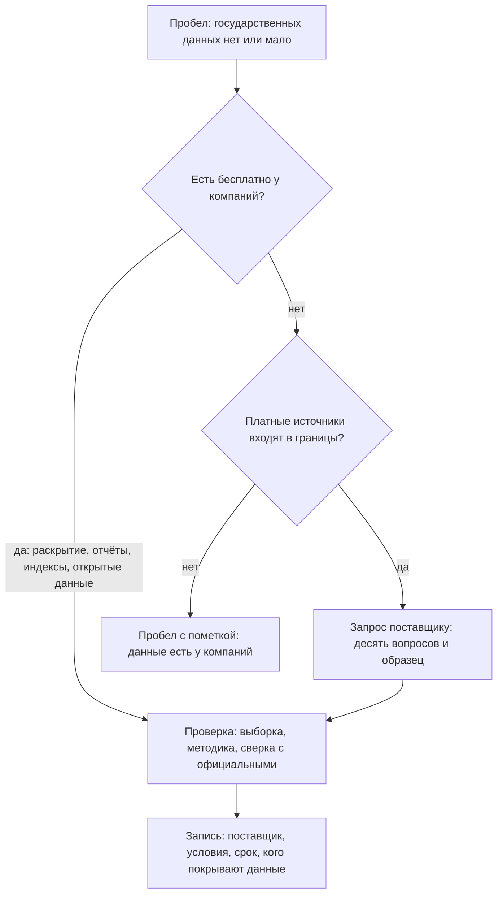

# Коммерческие данные

Коммерческие данные компании собирают для своего дела: платежи и чеки, цены, перемещения абонентов, кредиты, вакансии, отчётность. Многое из этого государство не измеряет или измеряет реже и позже. Для инвентаризации у коммерческого слоя четыре роли: замена там, где государственных данных нет; оценка раньше официальной — ежедневные и еженедельные ряды вместо годовых; проверка государственных данных; сведения о самих компаниях — отчётность и раскрытие информации. Главное в коммерческих данных — условия. Данные принадлежат компании: платные получают по договору, а бесплатные открыты по решению компании и тем же решением закрываются. Второе — выборка: данные описывают клиентов компании, а не всё население. Поэтому коммерческий источник записывают с поставщиком, соглашением и сроком, с тем, кого покрывают данные, и сверяют с официальной статистикой. Начинают с бесплатного: многое компании публикуют о себе сами — отчёты, сайты, закупки, раскрытие информации. В подходе «где найти нужное» коммерческие данные закрывают пробелы, которые не закрыло государство. В подходе «чем владеем» это купленные и полученные по соглашениям данные в своих системах, а для компании — весь её собственный слой.

## Коротко

| Что сделать | Что получается | Готово, когда |
|-------------|----------------|---------------|
| **[Решить в границах](#границы-и-порядок)** | Строка о коммерческом слое в границах | Записано, входят ли коммерческие источники, можно ли платить и кто одобряет расходы |
| **[Начать с бесплатного](#сначала-бесплатное)** | Раскрытие, отчёты, индексы и открытые данные компаний по вопросам | По каждому пробелу проверено, нет ли бесплатного источника |
| **[Найти поставщиков](#как-найти-поставщика)** | Список компаний, у которых могут быть данные, с тем, откуда о них известно | У каждого пробела два-три кандидата или пометка, что поставщиков не нашли |
| **[Спросить поставщика](#что-спросить-у-поставщика)** | Ответы на десять вопросов и образец данных | Известны выборка, подробность, методика, условия и цена |
| **[Проверить пригодность](#годится-ли-для-задачи)** | Итог: годится, годится с оговорками, не годится | Образец сверен с официальными данными; разрывы, выбросы и нули найдены |
| **[Записать условия и сроки](#как-записать)** | Запись с поставщиком, соглашением, сроком и ограничениями | Срок соглашения внесён в план обновления |



## Что сюда относится

Коммерческий слой определяют по тому, для чего собраны данные и у кого копия. Данные, которые компания собирает для своего дела, — коммерческие, даже если компания государственная или публикует их бесплатно. Отчёт той же компании у регулятора — уже государственный слой: регулятор собирает его по закону. Правило для спорных случаев — в главе [«Три слоя данных»](./01-three-layers.md#как-определить-слой).

| Вид | Кто ведёт | Что даёт | Чего не даёт | Примеры |
|-----|-----------|----------|--------------|---------|
| **Раскрытие информации и отчётность** | Компании с ценными бумагами на бирже, биржи, сервисы раскрытия; копии — у регуляторов | Отчётность, существенные события, владельцев и сделки — бесплатно, по закону, с датами | Операционных данных подробнее отчёта; того, что закон разрешил не раскрывать | EDGAR (копия у SEC), e-disclosure.ru «Интерфакса», раздел раскрытия на kase.kz, депозитарий финансовой отчётности dfo.kz |
| **Платежи, чеки и цены** | Банки, платёжные системы, процессинг топливных карт, операторы фискальных данных | Траты, цены и обороты по дням, отраслям и регионам — раньше официальной статистики | Всего населения: только клиенты компании и только безналичные платежи | Траты по картам Affinity Solutions в Economic Tracker, индекс цен на топливо «Петрол Плюс», Kazakhtelecom OFD |
| **Операторы связи и геоданные** | Операторы мобильной связи, сервисы карт и навигации | Присутствие и перемещения населения, туристические потоки, время в пути — в агрегатах | Записей; общей методики: у каждого оператора своя | Проект Евростата Multi-MNO; отчёты о мобильности Google — архив с 2022 года |
| **Онлайн-платформы** | Сайты вакансий, объявлений и торговли, социальные сети | Вакансии, цены объявлений, спрос — по дням и городам | Сделок: объявление — не сделка; людей вне платформы | Индекс вакансий Indeed Hiring Lab |
| **Кредитные бюро** | Бюро кредитных историй | Кредитную нагрузку и просрочку — в отчётах и агрегатах | Сведений о конкретных заёмщиках: их защищает закон | Первое кредитное бюро (1cb.kz) |
| **Сервисы на государственных реестрах** | Сервисы проверки контрагентов, агрегаторы реестров | Сведения о компаниях из многих реестров — связанные, с историей и поиском | Статуса первоисточника; полного бесплатного доступа | OpenCorporates, Adata (adata.kz) |
| **Отраслевые аналитические сервисы** | Информационные агентства, аналитические и исследовательские компании | Цены, рынки, оценки, прогнозы — по подписке | Первичных данных и методики; права публиковать | Bloomberg, Reuters, GlobalData, «РБК Магазин исследований» |
| **Каталоги и маркетплейсы данных** | Облачные платформы и площадки данных | Перечни продуктов данных с описаниями, образцами и ценами | Своих данных; проверки качества | AWS Data Exchange, Datarade |

Есть пограничные случаи. Данные государственной компании о её деятельности — коммерческие: компания ведёт их для своего дела и даёт на своих условиях. Оператор фискальных данных собирает чеки как компания, но передаёт их налоговой службе: у одних и тех же чеков два владельца, и копия у налоговой — государственная. Сервисы на государственных реестрах — коммерческие копии государственных данных: у них свой владелец и свои условия, а первоисточник — реестр. Бесплатный индекс или набор, который компания выкладывает сама, остаётся коммерческим: решение о нём принимает компания, и она же может его остановить.

## Где искать

### Раскрытие информации и отчётность

Компании, чьи ценные бумаги обращаются на бирже, обязаны публиковать отчётность, существенные события, сведения о владельцах и крупных сделках. Это самый дешёвый путь к данным компаний: бесплатно, по закону и с датами. Копия у регулятора — государственный слой, у частного сервиса раскрытия — коммерческий ([«Как определить слой»](./01-three-layers.md#как-определить-слой)).

**США.** Через систему EDGAR компании подают документы в Комиссию по ценным бумагам и биржам (SEC). Программный интерфейс data.sec.gov работает без ключей; просьба SEC — указывать в запросе, кто вы, и делать не больше 10 запросов в секунду:

```bash
# Все документы ExxonMobil в EDGAR: формы, даты подачи, номера
curl -H "User-Agent: Имя Фамилия you@example.org" "https://data.sec.gov/submissions/CIK0000034088.json"
# Все показатели из отчётности компании в формате XBRL
curl -H "User-Agent: Имя Фамилия you@example.org" "https://data.sec.gov/api/xbrl/companyfacts/CIK0000034088.json"
# Один показатель за 2025 год у всех компаний, которые его отчитали
curl -H "User-Agent: Имя Фамилия you@example.org" "https://data.sec.gov/api/xbrl/frames/us-gaap/Revenues/USD/CY2025.json"
```

25 октября 2026 года у ExxonMobil в EDGAR было 3557 документов с 1994 года. Годовой отчёт (форма 10-K) за 2025 год подан 18 февраля 2026 года, последний квартальный (10-Q) — 3 августа 2026 года. В отчётности — 438 показателей по таксономии US GAAP, выручка за 2025 год — 332,2 млрд долларов. Данные появляются в программном интерфейсе обычно меньше чем через минуту после подачи документа, а полные архивы submissions.zip и companyfacts.zip пересобираются каждую ночь.

Третий запрос показывает главную ловушку. Выручку за 2025 год под тегом `Revenues` отчитали 2255 компаний, под тегом `RevenueFromContractWithCustomerExcludingAssessedTax` — 2710, под обоими — 578. Один показатель записан под разными именами, и подсчёт по одному тегу теряет половину компаний. Это та же проблема, что с наборами под разными именами в реестре ([«Один набор под разными именами»](../03-process/05-registry.md#один-набор-под-разными-именами)).

**Россия.** Эмитенты раскрывают информацию по статье 30 Федерального закона от 22.04.1996 № 39-ФЗ «О рынке ценных бумаг» (в редакции от 04.08.2026) и положению Банка России от 27.03.2020 № 714-П — на страницах распространителей информации на рынке ценных бумаг. Один из них — Центр раскрытия корпоративной информации «Интерфакса» (e-disclosure.ru). С 2022 года раскрытие сузили. Постановление Правительства от 12.03.2022 № 351 разрешало не раскрывать любые сведения, включая отчётность, до 1 июля 2023 года. Постановление от 04.07.2023 № 1102 полного закрытия не допускает, но позволяет не раскрывать сведения о дочерних обществах, сделках, контрагентах и другие — компаниям под санкциями и в ряде других случаев. В декабре 2024 года порядок его применения разъясняли Банк России и Минфин; действующую редакцию на октябрь 2026 года из сети проверки сверить не удалось. Для инвентаризации это значит: отсутствие сведений в раскрытии российской компании — не всегда отсутствие данных, иногда это разрешённое законом умолчание.

**Казахстан.** Раскрытие эмитентов — в разделе «Раскрытие информации компаниями» на сайте Казахстанской фондовой биржи kase.kz. Финансовую отчётность организаций публичного интереса собирает депозитарий финансовой отчётности dfo.kz; разработчик сервиса — АО «Информационно-учетный центр».

**Компании без обязанности раскрывать** публикуют годовые отчёты, отчёты об устойчивом развитии, сведения на сайтах и закупки на своих торговых площадках.

### Платежи, чеки и цены

Банки, платёжные системы, процессинговые компании и операторы фискальных данных видят каждую безналичную операцию своих клиентов. Из этого получаются ряды о тратах и ценах по дням и регионам — раньше и подробнее официальной статистики. Ограничения у всех одни: в данных только клиенты компании и только безналичные платежи, а состав выборки меняется.

- **Траты по картам.** Economic Tracker исследовательской группы Opportunity Insights публикует ряды трат по картам, собранные из данных Affinity Solutions. В описании данных прямо сказано, что эмитенты карт входят в выборку и выходят из неё, а срезы, где меньше пяти транзакций, не выдают ([«Чего ждать от качества»](./01-three-layers.md#чего-ждать-от-качества)).
- **Цены на топливо.** Индекс «Петрол Плюс» компании «Передовые платежные решения», которая выпускает топливные карты, считает средние розничные цены по транзакциям на АЗС. Методику, по словам компании, разработали вместе с Российской экономической школой. 25 октября 2026 года на странице индекса — цены по 81 региону и динамика за три года. Что показала проверка этой страницы — в разделе [«Годится ли для задачи»](#годится-ли-для-задачи).
- **Чеки.** Операторы фискальных данных принимают чеки онлайн-касс и передают их налоговой службе. Kazakhtelecom OFD (oofd.kz) так и описывает свою работу: получение информации с касс, фиксирование, обработка и перенаправление данных в налоговую. Агрегаты по чекам поэтому сначала ищут у налоговой службы и статистики — это государственная копия, — а у оператора спрашивают то, чего у государства нет.
- **Кредиты.** Бюро кредитных историй — например, Первое кредитное бюро в Казахстане (1cb.kz) — хранят кредитные истории, но сведения о конкретных заёмщиках защищены законом. Для инвентаризации у бюро ищут отчёты и агрегаты: кредитную нагрузку и просрочку по регионам и группам заёмщиков.

### Операторы связи и геоданные

Операторы мобильной связи знают, где находятся телефоны их абонентов. Из этого строят агрегаты: сколько людей находится в районе днём и ночью, сколько приезжает и откуда, как меняется население по сезонам. Для вопросов о туризме, транспорте и доступности услуг это часто единственный быстрый источник.

Даже статистикам такие данные даются с трудом. Евростат в январе 2023 года заказал проект Multi-MNO — общую открытую методику и программу, которая превращает данные нескольких операторов в статистические показатели. Проект закончился в июне 2025 года; его вели GOPA, компании Nommon и Positium и статистические службы Италии и Нидерландов, а методику проверяли на данных Orange Spain, Vodafone Italy, Orange Belgium и POST Luxembourg. Код выложен на GitHub (eurostat/multimno) под лицензией EUPL-1.2. Для инвентаризации отсюда три вывода: договариваться приходится с каждым оператором отдельно; данные одного оператора покрывают только его абонентов; методика у каждого оператора своя, пока общей нет.

Открытые ряды о мобильности, которые компании выпускали в пандемию, закончились. Apple перестала обновлять отчёты о мобильности (Mobility Trends Reports) 14 апреля 2022 года, и они больше не доступны на её сайте. Отчёты Google (Community Mobility Reports) не обновляются с 15 октября 2022 года, исторические данные остались ([«Как данные переходят между слоями»](./01-three-layers.md#как-данные-переходят-между-слоями)).

### Онлайн-платформы

Сайты вакансий, объявлений и торговли видят спрос и цены раньше статистики. Indeed Hiring Lab выкладывает индекс вакансий на GitHub (hiring-lab/job_postings_tracker) под лицензией CC BY 4.0: ряды по десяти странам — Австралии, Великобритании, Германии, Ирландии, Испании, Италии, Канаде, Нидерландам, США, Франции — и еврозоне, по отраслям и регионам. Данные дневные, обновляются раз в неделю: последнее обновление — 21 октября 2026 года, последняя дата в данных — 16 октября 2026 года. Индекс считают от 1 февраля 2020 года, принятого за 100: в США 16 октября 2026 года — 103,8, годом раньше — 101,0. В ноябре 2024 года компания сменила метод сезонной корректировки и пересчитала историю. Индекс описывает объявления на одной платформе, а не все вакансии страны. Казахстана и России в нём нет.

Данные социальных сетей получают на условиях платформы, а сведения о людях в них защищает закон о персональных данных.

### Сервисы на государственных реестрах

Сервисы проверки контрагентов собирают сведения о компаниях из государственных реестров, судов, закупок и санкционных списков, связывают их и хранят историю. Это коммерческие копии государственных данных: удобнее первоисточника, но со своими условиями и своей датой обновления.

- **OpenCorporates** 25 октября 2026 года показывает 222 884 745 компаний из реестров больше чем 140 юрисдикций. Данные — под лицензией ODbL со ссылкой «from OpenCorporates». Но бесплатный доступ по условиям использования — для личного использования и для журналистов, некоммерческих организаций и исследователей, которые ведут исследования в общественных интересах. Финансовые организации, компании, государственные органы и регуляторы в число таких пользователей не входят. Для министерства, которое ведёт инвентаризацию, статус OpenCorporates — «с ограничениями», хотя лицензия открытая ([«Для кого статус»](../03-process/06-access.md#чему-ставить-статус)).
- **Adata** (adata.kz) в Казахстане ищет и проверяет компании по БИН: суды, санкционные списки, закупки, налоговый рейтинг. Проверка контрагентов — от 2000 тенге в день. Какие государственные базы стоят за разделами, на главной странице не сказано: первоисточники придётся устанавливать самим.

Правило для обоих: в реестр записывают и копию, и первоисточник — реестр юридических лиц, суды, закупки — и связывают их ([«Первоисточник»](./03-public.md#первоисточник)). Покупают то, чего государство не даёт в нужном виде: историю, связи, полную выгрузку.

### Отраслевые сервисы и маркетплейсы данных

**Отраслевые аналитические сервисы** — информационные агентства, ценовые агентства, исследовательские компании — продают цены, оценки рынков и прогнозы по подписке. Условия и цены обычно не публикуют, методики раскрывают частично, а производные данные без разрешения публиковать нельзя. Их записывают с условиями подписки и тем, что из данных можно показать в отчёте.

**Маркетплейсы данных** — каталоги коммерческих продуктов данных, своего рода поиск наборов для коммерческого слоя ([«Поиск наборов данных»](./05-dataset-search.md)). На 25 октября 2026 года:

- **AWS Data Exchange** — больше 3500 наборов от больше чем 300 поставщиков, из них больше 1000 бесплатных; данные выдают файлами, таблицами и через программный интерфейс.
- **Datarade** — больше 2700 поставщиков и больше 560 категорий данных; у многих продуктов есть бесплатный образец.

Описание в маркетплейсе написал продавец. Оно подсказывает, кто торгует нужными данными, но выборку, подробность и методику проверяют по образцу и вопросам поставщику.

## Как использовать при инвентаризации

### Границы и порядок

Входят ли коммерческие данные в работу, решают на первом шаге и записывают в [границах](../03-process/02-goals-and-questions.md#границы): например, «коммерческие — только бесплатные» или «платные — по согласованию с владельцем задачи, не дороже заложенной суммы». Без этой строки коммерческие источники либо не ищут вовсе, либо в конце выясняется, что ответ есть, но стоит денег.

Порядок — от бесплатного к платному. Коммерческие источники ищут для тех вопросов, где государственных данных нет, мало или они запаздывают, и для проверки государственных ([«С чего начинать»](./01-three-layers.md#с-чего-начинать)). Запрос компании отправляют, как только виден пробел: переговоры и соглашение занимают месяцы.

### Сначала бесплатное

Большая часть коммерческого слоя, которая нужна инвентаризации, бесплатна:

- **раскрытие информации** — отчётность, события, владельцы, сделки;
- **отчёты, сайты и закупки компаний** — годовые отчёты, отчёты об устойчивом развитии, торговые площадки;
- **индексы и открытые данные компаний** — индекс вакансий Indeed, индекс цен на топливо;
- **исследования на данных компаний** — ряды, которые исследователи опубликовали по соглашению с компаниями, как Economic Tracker;
- **бесплатные наборы и образцы маркетплейсов**;
- **государственные копии** — отчётность у регулятора, чеки у налоговой службы: их ищут у государства ([«Государственные данные»](./02-government.md)).

У бесплатного те же вопросы, что у платного: кого покрывают данные, как давно обновлялись, на каких условиях можно использовать.

### Как найти поставщика

- **Эксперты и профильные ассоциации** знают, кто какие данные собирает и на каких условиях делится ([«Опросы экспертов»](../02-approaches/02-methods.md#6-опросы-экспертов)).
- **Реестры лицензий регуляторов** дают перечень компаний отрасли: банков, операторов связи, бюро кредитных историй, операторов фискальных данных ([«Владельцы и полномочия»](../03-process/03-owners-and-mandates.md#кто-отвечает-за-тему)).
- **Исследования и описания методик** называют поставщиков, чьи данные уже использовали. В описании Economic Tracker перечислены Affinity Solutions, Lightcast и Paychex, в отчётах Евростата — операторы связи.
- **Маркетплейсы данных** показывают, кто продаёт данные по теме, и дают образцы.
- **Госзакупки** показывают, какие подписки и данные уже покупают органы власти ([«Госзакупки»](./02-government.md#госзакупки)). В подходе «чем владеем» это ещё и список полученных данных, которые нужно описать.
- **Сайты компаний** — разделы для исследователей, продукты данных, программы обмена данными.

### Что спросить у поставщика

Компания отвечать не обязана, поэтому о её данных спрашивают как покупатель ([«Вопрос чужому владельцу»](../03-process/04-questionnaires.md#вопрос-чужому-владельцу)). Каждый ответ ложится в поле реестра.

| Вопрос | Зачем | Поле реестра |
|--------|-------|--------------|
| **Кого покрывают данные?** Доля рынка, регионы, какие клиенты | Выводы о стране по клиентам одной компании — главная ошибка | Описание; отметка о качестве |
| **С какого периода и с какими разрывами?** | Изменения выборки ломают ряды | Описание; отметка о качестве |
| **Какая подробность?** Территория, период, срезы, наименьший размер ячейки | Малые значения обычно скрыты, и маленькие территории выпадают | Описание; условия доступа |
| **Как часто и с какой задержкой?** | Ради свежести коммерческие данные и берут | Периодичность |
| **Какая методика и как она менялась?** Пересматривают ли историю | Пересмотр меняет уже полученные числа | Схема данных; отметка о качестве |
| **Свои это данные или перепродажа?** | У перепродавца первоисточник другой | Связанные записи (`copy_of:`) |
| **Как данные обезличены?** | От этого зависят хранение, доступ внутри организации и публикация | Персональные данные |
| **На каких условиях?** Цель, срок, передача, публикация производных, что делать с данными после окончания договора | Нарушить договор проще всего тем, о чём не спросили | Условия использования; условия доступа |
| **Сколько стоит и сколько ждать?** | Цена и срок решают, стоит ли добиваться данных | Условия доступа |
| **Можно ли получить образец?** | Пригодность проверяют на данных, а не на описании | Отметка о качестве |

### Годится ли для задачи

Коммерческие данные проверяют так же, как любые другие ([«Годится ли для задачи»](../03-process/07-quality.md#годится-ли-для-задачи)), но первыми — четыре вещи: выборку, разрывы в рядах, выбросы и пустые значения, пересмотры методики. Готовьтесь к разочарованию: красивый график на сайте компании ещё не означает данных, на которые можно опереться.

Страница индекса «Петрол Плюс» 25 октября 2026 года:

- **Выбросы.** Медиана цены АИ-92 по 81 региону — 65,2 рубля за литр. В десяти регионах АИ-92 дороже 80 рублей, а в Дагестане и Тыве — 125. Часть разницы может быть настоящей — в отдалённых регионах топливо дороже, — но такие значения требуют вопроса компании, а не переноса в отчёт.
- **Невозможные соотношения.** В Чувашии АИ-95 стоит 119,9 рубля при АИ-92 за 63,55, в Марий Эл и Якутии АИ-95 дешевле АИ-92.
- **Пропуск, записанный нулём.** В Ненецком автономном округе цена АИ-95 — 0.
- **Выборка.** Цены, как сказано на странице, считают «по нескольким АЗС в каждом регионе», а число АЗС на одной странице указано по-разному: больше 17 000 в одном месте и больше 20 000 в другом.

Итог для вопроса о розничных ценах по стране — «годится с оговорками»: средняя по стране и крупным регионам пригодна для быстрой оценки, данные по малым регионам — нет, и всё сверяют с официальной статистикой цен. Для EDGAR похожая проверка нашла бы разные теги одного показателя, для индекса Indeed — пересчёт истории в ноябре 2024 года. И то и другое записывают в отметку о качестве.

### Условия и сроки

Для данных компаний основание доступа — соглашение или лицензия поставщика, а не закон ([«Доступ и ограничения»](../03-process/06-access.md#условия-доступа)). Записывают:

- **номер и дату соглашения или ссылку на условия** — для бесплатного источника тоже: условия меняются, и важно, какие действовали на дату получения;
- **срок** — когда истекает подписка или соглашение и что после этого делать с данными: удалить, хранить без обновления, продлить;
- **для кого** — кто в организации может работать с данными; у OpenCorporates от этого зависит, бесплатен ли доступ вообще;
- **что можно публиковать** — сами данные, производные показатели, графики, ничего;
- **кому можно передавать** — подрядчикам, подведомственным организациям, партнёрам.

Данные без права публикации не попадают в общедоступную часть реестра, но сама запись о них может туда попасть — с пометкой, что данные получены по соглашению ([«Полный реестр и общедоступная часть»](../03-process/09-result-and-upkeep.md#полный-реестр-и-общедоступная-часть)).

### Сверка с официальными данными

Коммерческие данные почти всегда расходятся с официальными, и расхождение — находка. Причины обычно такие:

- **охват** — клиенты компании или пользователи платформы, а не всё население;
- **определения** — безналичные траты по картам и оборот розничной торговли, объявления о вакансиях и вакансии по отчётности работодателей;
- **даты и задержка** — коммерческий ряд дневной, официальный месячный или годовой;
- **изменения выборки и методики** — разрывы и пересчёт истории;
- **ошибки** — выбросы и нули, как у индекса цен на топливо.

Если коммерческий ряд расходится с официальным и это не объясняется охватом и определениями, это повод проверить и официальный ряд: коммерческие данные часто свежее и показывают пробелы государственных.

## Подход «чем владеем»

В описи своих данных коммерческий слой появляется в двух видах.

**Полученные данные.** Купленные наборы, подписки, данные по соглашениям об обмене лежат в своих системах, но права на них ограничены. Их находят по договорам и закупкам, по расходам на подписки, по опросу владельцев ([«Опросные листы и интервью»](../03-process/04-questionnaires.md)). В записи — поставщик как владелец, соглашение, срок и ограничения ([«Слои в двух подходах»](./01-three-layers.md#слои-в-двух-подходах)). Иначе срок подписки истекает незаметно, а данные без права публикации однажды выкладывают в открытый доступ.

**Собственные данные компании.** Если инвентаризацию ведёт компания, коммерческий слой — её собственный. Один и тот же набор у неё часто живёт в трёх формах: полный — в своих системах, отчёт — у регулятора, публичная часть — в раскрытии или на сайте. Опись показывает все три и то, где они расходятся. Для цели «обмен данными» это ещё и перечень того, что можно предложить партнёрам и государству на условиях, — и того, что можно потребовать по закону: в ЕС органы власти при исключительной потребности вправе запросить данные компаний по главе V регламента о данных ([«Как данные переходят между слоями»](./01-three-layers.md#как-данные-переходят-между-слоями), [«Делиться данными»](../01-basics/03-goals.md#делиться-данными)).

## Как записать

Коммерческий источник записывают по тем же правилам, что и любой другой ([«Реестр данных»](../03-process/05-registry.md)). Особенности:

- **организация-владелец** — поставщик, а не организация, которая данные купила; в листе «Владельцы» у него слой `commercial` ([«Как записать»](./01-three-layers.md#как-записать));
- **связанные записи** — у перепродавца или сервиса на государственных реестрах `copy_of:` и запись первоисточника;
- **режим доступа** — по проверенному: `restricted` у платного и по соглашению, `unstructured` у бесплатной страницы без выгрузки, `open` у бесплатного набора целиком без регистрации; причина ограничения — `third_party`, если её задаёт договор или лицензия ([«Как записать»](../03-process/06-access.md#как-записать));
- **условия доступа** — кто, как, за сколько и с какой задержкой получает данные;
- **условия использования** — номер и дата соглашения или ссылка на условия, срок, ограничения на передачу и публикацию;
- **отметка о качестве** — кого покрывают данные, разрывы, выбросы, пересмотры;
- **откуда известно** — эксперт, ассоциация, маркетплейс, исследование, закупка ([«Как записать, откуда известно»](../02-approaches/02-methods.md#как-записать-откуда-известно)).

Так выглядит запись индекса «Петрол Плюс», собранная со страницы индекса 25 октября 2026 года:

| Атрибут | Значение |
|---------|----------|
| Идентификатор | `petrolplus-fuel-index` |
| Наименование | Индекс розничных цен на топливо «Петрол Плюс» |
| Описание | Средние розничные цены АИ-92, АИ-95 и дизельного топлива по 81 региону России и в среднем по стране, по транзакциям по топливным картам; на странице — динамика за три года |
| Тип записи | `dataset` |
| Организация-владелец | ООО «ППР» («Передовые платежные решения») — по подвалу сайта; слой `commercial` |
| Ответственный | не установлено — на странице только адрес для коммерческих запросов |
| Периодичность обновления | `daily` — заявлено на странице |
| Дата публикации | не установлено |
| Дата последнего изменения | 2026-10-25 — «актуальные данные на 25 октября 2026» |
| Режим доступа | `unstructured` — таблица и графики на странице, выгрузки и программного интерфейса не нашли; проверено 25 октября 2026 года |
| Формат распространения | HTML-страница |
| Отметка о контроле качества | 2026-10-25: медиана АИ-92 — 65,2 рубля; в 10 регионах из 81 дороже 80 рублей, в Дагестане и Тыве — 125; в Ненецком автономном округе АИ-95 — 0; число АЗС на странице — 17 000 и 20 000. Годится с оговорками — для страны и крупных регионов, со сверкой с официальной статистикой цен |
| Условия использования | не указаны — на странице только знак авторского права |
| Связанные записи | не копия: первоисточник — транзакции самой компании; официальная статистика цен для сверки — записи ещё нет |
| Откуда известно | поиск по теме — розничные цены на топливо по регионам; страница индекса |
| Дата проверки | 2026-10-25 |

Запись показывает две вещи: данные открыты бесплатно, но только страницей без выгрузки, а качество у них неровное. Без отметки о качестве в реестре осталось бы «ежедневные цены по всем регионам».

## Пример

Продолжение условного примера из глав [«Цели и вопросы»](../03-process/02-goals-and-questions.md#пример), [«Доступ и ограничения»](../03-process/06-access.md#пример) и [«Общественные данные»](./03-public.md#пример): 15 вопросов руководства о доступности медицинской помощи в регионах. В границах коммерческих источников не было, частная медицина отложена на следующую очередь. После сопоставления вопросов с данными владелец задачи посмотрел список пробелов и разрешил коммерческие источники для трёх вопросов: бесплатные — без согласования, платные — по согласованию и в пределах заложенной суммы. Строку в границах исправили.

| Вопрос | Что нашли у компаний | Проверка | Итог |
|--------|---------------------|----------|------|
| Сколько ждут приёма у специалиста? | Сервис онлайн-записи к врачу: свободное время приёма по клиникам, ежедневно | По ответу сервиса, в нём в основном частные клиники крупных городов; государственные поликлиники подключены в двух регионах из пяти | Не годится для главного вопроса: охват не тот, а частная медицина вне границ. Записан как кандидат для следующей очереди |
| Как далеко жителям сёл ехать до больницы? | Оператор связи: агрегаты поездок из сёл в районные центры | Данные только по абонентам оператора — по его словам, от трети до половины жителей в разных регионах; ячейки меньше 30 человек скрыты, малые сёла выпадают; цена и срок подготовки — три месяца | Взяли для двух пилотных регионов как проверку расчёта по OpenStreetMap. Соглашение запрещает публиковать данные мельче района — это записано в условиях |
| Какие медицинские организации имеют лицензию? | Платная копия реестра лицензий у агрегатора — полная выгрузка вместо поиска по одной записи на сайте надзорного органа | Выборочная сверка 30 записей с сайтом надзорного органа: две лицензии в копии уже прекращены | Подписка на год: удобно для сопоставления, но первоисточник — реестр надзорного органа. В реестре — две записи со связью `copy_of:`; срок подписки — в плане обновления |

**Итог.** Коммерческие источники закрыли один пробел частично и дали удобную копию к уже найденному первоисточнику. Главный вопрос о сроках ожидания они не закрыли, но показали, где есть данные для следующей очереди. Все три находки записаны с поставщиком, условиями, сроком и тем, кого покрывают данные. Пример показывает ход работы, а не то, как устроено здравоохранение в конкретной стране.

## Частые ошибки

| Ошибка | Что происходит | Как исправить |
|--------|----------------|---------------|
| **Клиенты как всё население** | Выводы о стране по клиентам одного банка или абонентам одного оператора | Записать, кого покрывают данные; сверить с официальной статистикой |
| **Бесплатное — навсегда** | Ряд, на котором построен отчёт, перестаёт обновляться: отчёты о мобильности Google и Apple закончились в 2022 году | Записать условия на дату получения; держать государственный или второй источник для проверки |
| **Адрес открывается — источник тот же** | По старому адресу работает другой продукт или нет нужных данных, а проверка видит только, что сайт открылся | При обновлении проверять, что по адресу отвечает на вопрос, а не только что сайт открылся |
| **Владелец — покупатель** | В реестре «наш набор», и его публикуют, хотя права ограничены договором | Владелец — поставщик; соглашение и срок — в условиях использования |
| **Открытая лицензия — свободный доступ** | Министерство пользуется бесплатным доступом OpenCorporates, хотя по условиям государственные органы в число бесплатных пользователей не входят | Читать не только лицензию, но и условия доступа — для своего типа пользователя |
| **Один показатель — одно имя** | Подсчёт по одному тегу XBRL теряет половину компаний | Найти все имена показателя и записать их в описание |
| **Ноль как значение** | Цена 0 попадает в среднюю | Проверить нули и выбросы на образце до использования |
| **Перепродавец как первоисточник** | Копия реестра у агрегатора отстаёт, а в отчёте — его данные как официальные | Две записи со связью `copy_of:`; выборочная сверка с первоисточником |
| **Запрос в конце работы** | Ответ компании приходит через несколько месяцев, когда отчёт уже сдан | Отправлять запрос, как только виден пробел |

## Ограничения

- Данные принадлежат компании, и условия могут измениться в любой момент — и у платных, и у бесплатных.
- Агрегаты по малым территориям и группам часто недоступны: чтобы не раскрыть конкретных людей, малые значения скрывают, и маленькие территории выпадают из данных.
- Выборка — клиенты компании; её состав меняется, и ряды ломаются без предупреждения.
- Методики закрыты или раскрыты частично, а историю могут пересчитать.
- Стоимость: коммерческие данные бывают дороже, чем ожидается в начале проекта, а цены редко известны заранее.
- Обязательное раскрытие зависит от закона: в России с 2022 года эмитенты вправе раскрывать меньше.

## Источники

- Главы [«Три слоя данных»](./01-three-layers.md), [«Государственные данные»](./02-government.md), [«Общественные данные»](./03-public.md), [«Поиск наборов данных»](./05-dataset-search.md); [«Доступ и ограничения»](../03-process/06-access.md#условия-доступа) — условия соглашений как основание доступа; [«Качество данных»](../03-process/07-quality.md).
- [EDGAR Application Programming Interfaces](https://www.sec.gov/search-filings/edgar-application-programming-interfaces) и [Accessing EDGAR Data](https://www.sec.gov/search-filings/edgar-search-assistance/accessing-edgar-data) — SEC: интерфейсы без ключей, не больше 10 запросов в секунду. Запросы к data.sec.gov о ExxonMobil и показателях за 2025 год — 25 октября 2026 года.
- Федеральный закон от 22.04.1996 № 39-ФЗ «О рынке ценных бумаг», статья 30, в редакции от 04.08.2026; положение Банка России от 27.03.2020 № 714-П — по [КонсультантПлюс](https://www.consultant.ru/law/podborki/raskrytie_informacii_jemitentami/), 25 октября 2026 года. [Правительство РФ определило перечень закрываемой корпоративной информации](https://www.interfax.ru/russia/910189) — «Интерфакс», 5 июля 2023 года: постановления № 351 и № 1102. Письмо Банка России № ИН-02-28/64 и Минфина России № 05-01-06/132332 от 27.12.2024. Действующая редакция постановления № 1102 на октябрь 2026 года не сверена.
- [kase.kz](https://kase.kz/ru/) — Казахстанская фондовая биржа; [dfo.kz](https://dfo.kz/) — депозитарий финансовой отчётности. Проверено 25 октября 2026 года.
- [Индекс цен на топливо](https://www.petrolplus.ru/fuelindex/) — «Петрол Плюс», данные на 25 октября 2026 года; подсчёт по таблице средних цен по регионам.
- [Kazakhtelecom OFD](https://oofd.kz/) — описание работы оператора фискальных данных; [Первое кредитное бюро](https://1cb.kz/). Проверено 25 октября 2026 года.
- [Economic Tracker](https://economictracker.org/) и [описание данных](https://github.com/OpportunityInsights/EconomicTracker/blob/main/docs/oi_tracker_data_documentation.md) — Opportunity Insights: поставщики рядов, разрывы в данных Affinity Solutions.
- [Multi-MNO project](https://cros.ec.europa.eu/multi-mno-project) — Евростат: сроки, участники, операторы; код — [eurostat/multimno](https://github.com/eurostat/multimno), лицензия EUPL-1.2. Проверено 25 октября 2026 года.
- Apple Mobility Trends Reports — не обновляются с 14 апреля 2022 года, по [копии набора в AWS Marketplace](https://aws.amazon.com/marketplace/pp/prodview-ucdg4nudicxzi) и каталогу MIDAS; [COVID-19 Community Mobility Reports](https://www.google.com/covid19/mobility/) — Google, не обновляются с 15 октября 2022 года.
- [Indeed Hiring Lab: job_postings_tracker](https://github.com/hiring-lab/job_postings_tracker) — лицензия CC BY 4.0, страны, метод сезонной корректировки; даты обновления и значения индекса — по GitHub, 25 октября 2026 года.
- [OpenCorporates](https://opencorporates.com/) — число компаний на главной 25 октября 2026 года; [условия использования](https://opencorporates.com/terms-of-use-2/) — ODbL, кто входит в число бесплатных пользователей. [Adata](https://adata.kz/) — разделы и цены на главной, 25 октября 2026 года.
- [AWS Data Exchange](https://aws.amazon.com/data-exchange/) и [Datarade](https://datarade.ai/) — число наборов и поставщиков на главных страницах, 25 октября 2026 года.
