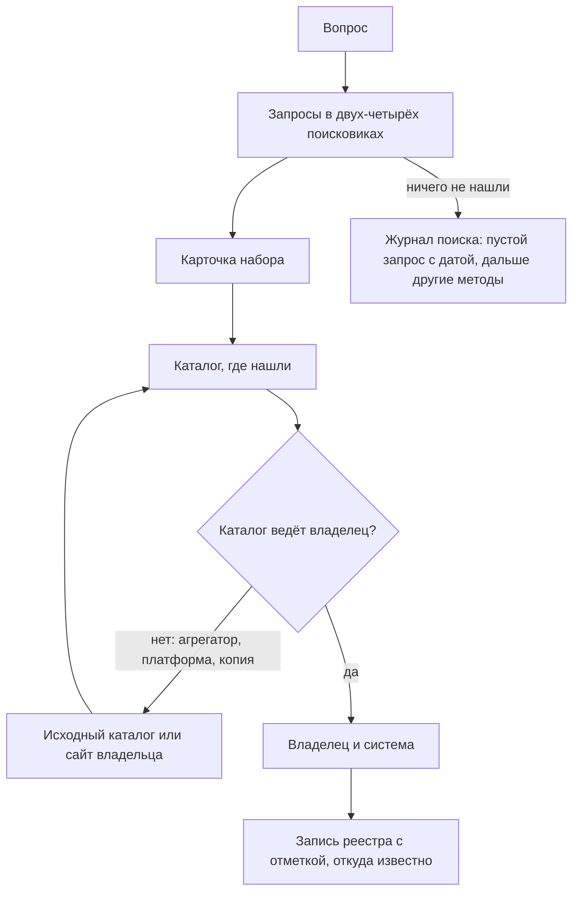

# Поиск наборов данных

Поисковик по наборам данных ищет не по данным, а по их описаниям, которые он собрал из тысяч каталогов: порталов открытых данных, геопорталов, научных репозиториев, баз статистики. Поэтому он за минуты находит опубликованное и не видит остального: неопубликованного, каталогов без программного интерфейса и наборов, которые лежат на сайтах вне каталогов. Найденная карточка — не запись реестра, а след, и часто это след копии. На запрос о реестре воздушных судов США ни Dateno, ни Google Dataset Search не показали в первых результатах ни одной страницы FAA, зато показали копии, которые к ней ведут ([пример](#реестр-воздушных-судов-сша)). От карточки идут к каталогу, от каталога — к издателю, от издателя — к владельцу и системе. Пустой результат тоже записывают — с запросами, поисковиками и датой. В подходе «где найти нужное» поиск наборов — первый и самый быстрый метод для опубликованного. В подходе «чем владеем» — проверка того, что из своих данных видно снаружи, под какими именами и кто их копирует.

## Коротко

| Что сделать | Что получается | Готово, когда |
|-------------|----------------|---------------|
| **[Выбрать поисковики](#инструменты)** | Два-четыре поисковика под слой, тему и страну | Есть универсальный поисковик, профильный и национальный портал; известно, каких каталогов страны нет в индексе ([«По странам»](#по-странам)) |
| **[Составить запросы](#запрос)** | Запросы по каждому вопросу | Запросы на языке страны и по-английски, с официальными названиями, владельцами и фильтром страны |
| **[Отобрать кандидатов](#карточка-набора)** | Кандидаты с каталогом, издателем и датой | Просмотрены первые 20–30 результатов каждого запроса, дубли сведены |
| **[Найти первоисточник и владельца](#от-набора-к-владельцу)** | Пары «копия — первоисточник», владелец, система | У каждого кандидата записано, копия это или первоисточник |
| **Проверить набор** | Дата, доступ, качество | Дата взята из данных, ссылка открывается, файлы скачиваются ([«Быстрая проверка»](../03-process/07-quality.md#быстрая-проверка)) |
| **[Записать](#как-записать)** | Записи реестра и журнал поиска | В журнале — и находки, и пустые запросы с датой |



## Как устроены поисковики

Поисковик по наборам данных хранит описания наборов — метаданные: название, описание, издателя, даты, формат, ссылки на файлы. Самих данных у него обычно нет. Описания он собирает двумя способами:

- **Через программный интерфейс каталога.** Платформы каталогов — CKAN, ArcGIS, GeoNetwork, OpenDataSoft, Socrata и другие — отдают описания по стандартным протоколам: программный интерфейс CKAN, файлы DCAT и DCAT-US, OAI-PMH у научных репозиториев, CSW у геопорталов, SDMX у статистики. Так собирают описания Dateno, OpenAIRE и data.europa.eu.
- **По разметке страниц.** Google Dataset Search обходит веб и берёт страницы, на которых набор описан по словарю schema.org (тип `Dataset`) или DCAT. Обязательны только название и описание длиной от 50 до 5000 знаков.

Из этого следует шесть вещей, которые нужно знать до первого запроса.

1. **Поисковик видит только каталоги, которые знает и может прочитать.** Реестр каталогов Dateno на 15 октября 2026 года описывает 43 614 каталогов в 225 странах и территориях. Программный интерфейс или другой способ забрать описания известен у 28 471 из них — у 65%, а у каталогов показателей — только у 37%: статистические службы чаще показывают таблицы на сайте, чем отдают описания программам. Сам Dateno 25 октября 2026 года собирал наборы из 5236 источников. Каталог без интерфейса, закрытый для зарубежных адресов или защищённый от программ, в поиск не попадает, даже если о нём известно.
2. **Число наборов — не мера охвата.** В Dateno 25 октября 2026 года было 22 014 356 наборов. 10,3 млн из них, почти половина, — ряды Европейского центрального банка, ещё 3,7 млн — показатели Всемирного банка. Одни каталоги делят данные на миллионы рядов, другие кладут всё в один файл — так же, как издатели на data.gov ([«Порталы открытых данных»](./02-government.md#порталы-открытых-данных)).
3. **Поиск не лучше описаний.** Поисковик ищет по названию и описанию, а не по содержимому файлов. В 2020 году Google разобрал 31 млн наборов своего индекса с 4600 доменов: лицензия была указана у 34%, сведения о том, как скачать данные, — у 44%. Набор с названием «Итоговая таблица 2019» и пустым описанием почти не найти.
4. **Разметку ставит кто угодно.** Объявить страницу набором данных может любой сайт, и Google Dataset Search берёт её в индекс. Поэтому в выдаче много страниц компаний, которые пересобирают государственные данные, и даже рекламных страниц с таблицами. Копия с хорошим описанием стоит выше первоисточника с плохим или без разметки.
5. **Один набор лежит во многих каталогах.** Описания собирают друг у друга: национальный портал — у ведомств, data.europa.eu — у национальных порталов, агрегаторы и поисковики — у всех. По запросу `aircraft site:faa.gov` Google Dataset Search 25 октября 2026 года нашёл один набор FAA — аэронавигационные карты — и девять мест, где лежит его описание: каталог FAA, портал Министерства транспорта, data.gov, агрегатор AmeriGEOSS и пять копий на портале Вирджинии. Google склеивает такие копии в одну карточку, другие поисковики — не всегда. DataCite показывает каждую версию набора на Zenodo отдельно: у каждой свой DOI.
6. **Копия живёт дольше оригинала.** Агрегатор забирает описание и не всегда удаляет его, когда исходный каталог его удалил. В поиске остаются карточки наборов, которых у владельца уже нет, — с прежними адресами, датами и издателями ([пример](#реестр-воздушных-судов-сша)).

## Что даёт и чего не даёт

| Даёт | Не даёт |
|------|---------|
| Опубликованные наборы из тысяч каталогов за один запрос | Неопубликованное: системы, рабочие таблицы, закрытые наборы — если их описаний нет в открытых каталогах |
| Каталог и издателя — начало пути к владельцу | Владельца: издателем в карточке бывает агрегатор, подрядчик или компания, сделавшая копию |
| Копии и пересборки, о которых владелец не знает | Гарантии, что первоисточник вообще есть в выдаче |
| Даты, форматы, ссылки на файлы | Проверки: описание бывает старше данных, данные — старше описания, ссылка — мёртвой |
| Описания закрытых наборов из инвентарей, которые ведомства публикуют, — следы систем | Содержимого файлов: поиск идёт по описаниям |
| Наборы на других языках и в других странах — аналоги для [поиска по аналогии](../02-approaches/02-methods.md#7-поиск-по-аналогии) | Полноты по стране: национальные каталоги часто вне индекса |

## Инструменты

| Вид | Примеры | Что даёт | Чего не даёт |
|-----|---------|----------|--------------|
| **Универсальные поисковики** | Dateno, Google Dataset Search | Наборы из каталогов всех видов или со всех размеченных страниц | Полноты по странам; у Google — фильтра по стране и программного интерфейса |
| **Научные агрегаторы** | OpenAIRE Explore, DataCite Commons, B2FIND | Наборы к исследованиям с DOI, связи с публикациями, авторами и грантами | Государственных данных вне науки; версии одного набора — отдельными записями |
| **Каталоги репозиториев** | re3data.org | Профильный репозиторий по дисциплине | Самих наборов |
| **Порталы-агрегаторы** | data.europa.eu, data.gov, Humanitarian Data Exchange (HDX) | Наборы органов власти, регионов, городов; гуманитарные данные по странам | Данных за пределами своей территории или темы |
| **Статистика** | DBnomics; базы Всемирного банка, ООН, МВФ | Ряды показателей статистических служб и международных организаций в одном виде | Записей; свежести копии |
| **Геоданные** | GeoSeer, STAC Index, геопорталы INSPIRE | Картографические сервисы, слои, каталоги спутниковых снимков | Табличных данных |
| **Отраслевые** | IATI d-portal — помощь развитию; Transitland — расписания транспорта; eChemPortal — химические вещества; реестр данных о закупках OCP ([«Общественные проекты»](./03-public.md#общественные-проекты)) | Наборы одной отрасли в общем стандарте | Того, что за пределами стандарта |
| **Платформы машинного обучения** | Kaggle, Hugging Face, Registry of Open Data on AWS | Наборы пользователей и компаний, готовые к обработке | Первоисточника: загрузивший — не всегда тот, кто собрал ([«Подборки и витрины»](./03-public.md#подборки-и-витрины)) |
| **Реестры каталогов** | Реестр каталогов Dateno, re3data.org | Сами каталоги: адрес, владелец, платформа, программный интерфейс, охват | Наборов |
| **Обычный поисковик** | Google, Яндекс, Bing с операторами | Файлы и страницы вне каталогов | Фильтров по формату данных, владельцу, дате изменения данных |

Объём на 25 октября 2026 года:

- **Dateno** — 22 014 356 наборов из 5236 источников, 235 стран. Это проект автора книги.
- **Google Dataset Search** текущий объём не публикует; в августе 2020 года в индексе был 31 млн наборов с 4600 доменов.
- **OpenAIRE** — 108 млн записей о данных исследований из 157 тыс. источников.
- **DataCite** — 77 556 664 DOI с типом «набор данных».
- **re3data.org** — 3539 репозиториев.
- **data.europa.eu** — 1 858 143 набора из 213 каталогов; **data.gov** — 431 277 наборов ([«Порталы открытых данных»](./02-government.md#порталы-открытых-данных)).
- **HDX** — 28 233 набора, из них 124 о Казахстане.
- **DBnomics** — 47 421 набор 94 поставщиков. Среди поставщиков есть Росстат, но это пять наборов, обновлённых в 2022 году: копию тоже проверяют на свежесть.
- **Реестр каталогов Dateno** — 43 614 каталогов на 15 октября 2026 года, под лицензией CC BY 4.0, в виде файлов в репозитории на GitHub.

**Как пользоваться главными инструментами.**

- **Dateno** фильтрует по стране, типу каталога, типу владельца — центральная или региональная власть, международная организация, бизнес, наука, — формату, теме и источнику. В карточке видно, в каком каталоге найден набор, а если файлов нет, так и написано. Программный интерфейс — по ключу.
- **Google Dataset Search** фильтрует по дате обновления, формату, условиям использования, теме и бесплатности, понимает оператор `site:`. Копии одного набора собирает в одну карточку со списком мест. Фильтра по стране и программного интерфейса нет.
- **OpenAIRE и DataCite** отдают результаты по программному интерфейсу без ключа ([«Поиск через программный интерфейс»](#поиск-через-программный-интерфейс)).
- **Реестр каталогов** нужен, чтобы понять, чего поисковик не видит: каталоги страны из реестра сравнивают с источниками в индексе, а каталоги вне индекса просматривают вручную. Владелец каталога может предложить его в Dateno и разметить страницы наборов для Google.
- **Обычный поисковик** находит файлы на сайтах без каталога. В Google работают операторы `site:` — домен, `filetype:` — тип файла, `inurl:` — слово в адресе: `site:gov.kz filetype:xlsx численность населения`. В Яндексе тип файла задают оператором `mime:`.

## По странам

Чего не видит поисковик, зависит от страны. Так выглядят четыре юрисдикции книги в реестре каталогов Dateno на 15 октября 2026 года и в индексе Dateno на 25 октября:

| | Каталогов в реестре | С программным интерфейсом | В индексе Dateno | Что делать |
|-|---------------------|---------------------------|------------------|------------|
| **Казахстан** | 130: 91 геопортал, 23 каталога показателей, 8 научных репозиториев, 6 порталов открытых данных | 60 — 46%; у 20 из 23 каталогов показателей интерфейс не найден | 14 155 наборов из 13 источников. 7958 из них — от Всемирного банка, ВОЗ, Банка международных расчётов и МОТ, остальные — с региональных геопорталов и геосерверов. data.egov.kz, stat.gov.kz и taldau.stat.gov.kz в индексе нет | Национальные каталоги — напрямую и из казахстанской сети; запросы на русском и казахском |
| **Россия** | 1004: 571 портал открытых данных — 482 из них разделы сайтов местного самоуправления, 421 на платформе «Госвеб»; 280 геопорталов; 75 научных репозиториев; 58 каталогов показателей | 251 — 25%; у разделов на «Госвебе» интерфейса нет | 96 575 наборов из 31 источника. 58 282 из них — из одного репозитория научной организации, 8101 — с «Хаба открытых данных». data.gov.ru, открытых данных Росстата и ЕМИСС в индексе нет | Национальные каталоги — напрямую и из российской сети; копии — у общественных проектов ([«Общественные данные»](./03-public.md#общественные-проекты)) |
| **США** | 8067: 5046 геопорталов, 2018 научных репозиториев, 565 порталов открытых данных, 332 каталога показателей | 6527 — 81% | 981 060 наборов | data.gov и файлы `data.json` ведомств; поисковики — для штатов, городов и науки |
| **Европейский союз** (общеевропейские каталоги) | 450: 168 геопорталов, 117 научных репозиториев, 57 порталов открытых данных, 43 каталога показателей, 37 поисковиков | 331 — 74% | 4 655 237 наборов из 86 источников; 4 168 060 из них — ряды Европейского центрального банка | data.europa.eu и национальные порталы на языке страны |

Казахстан и Россия видны поисковикам хуже всего, и по ним же поисковики чаще всего выдают чужое. Наборы о Казахстане в Dateno больше чем наполовину — показатели международных организаций, а не данные казахстанских ведомств. Портал открытых данных России data.gov.ru в реестре каталогов отмечен как каталог без программного интерфейса. Государственные сайты обеих стран часто не открываются из-за рубежа ([«Ограничения»](./02-government.md#ограничения)), и поисковик, который собирает описания из другой страны, их не видит. Поэтому по Казахстану и России поисковик — подсказка, а национальный портал, статистическую службу и сайты ведомств просматривают напрямую ([«Где искать по странам»](./02-government.md#где-искать-по-странам)).

## Как искать

### Запрос

- **По теме — на языке страны и по-английски.** Описание набора бывает на одном языке, а интерфейс каталога — на другом. Казахстанский набор описан по-русски или по-казахски, европейский — на языке страны, а data.europa.eu показывает описания в машинном переводе.
- **Официальными названиями.** Название реестра, системы, формы сбора, показателя — как в акте или на сайте владельца: «Releasable Aircraft Database», «Aircraft Registration System», а не «база самолётов». Названия берут из анализа полномочий и реестров систем ([«Владельцы и полномочия»](../03-process/03-owners-and-mandates.md#от-полномочия-к-набору)).
- **По владельцу.** Полное и короткое название, прежние названия, домен с оператором `site:`.
- **Синонимы и соседние понятия.** «Реестр», «регистр», «перечень», «база данных»; «register», «registry», «database», «list». По «aircraft register» в data.europa.eu первыми выходят реестры воздушных судов Словакии, Болгарии и Швеции — а это готовые аналоги ([«Поиск по аналогии»](../02-approaches/02-methods.md#7-поиск-по-аналогии)).
- **Без лишних слов.** Поисковики наборов обычно показывают совпадение хотя бы части слов и сортируют по степени совпадения. Длинный запрос не сужает выдачу, а размывает.

### Фильтры

Страну, тип каталога, владельца и формат задают фильтром, а не словом в запросе. Слово «Казахстан» в запросе «численность населения Казахстан» Dateno 25 октября 2026 года понял как одно из слов: в выдаче было 17 897 наборов о России и 128 о Казахстане. С фильтром «страна — Казахстан» остаются только наборы о Казахстане.

### Карточка набора

У каждого кандидата смотрят:

| Что | Зачем |
|-----|-------|
| **Каталог, где нашли** | Агрегатор, платформа или каталог владельца — от этого зависит, копия ли перед вами |
| **Издатель и автор** | Кандидат во владельцы, но не владелец: копия часто называет автором первоисточник |
| **Даты описания и данных** | Дата карточки, дата описания в каталоге и дата самих данных — три разные даты |
| **Ссылки на файлы** | Есть ли что скачать; «файлов нет» бывает у описаний закрытых наборов и систем |
| **Описание и источники** | Откуда данные, как часто обновляются, ссылка на первоисточник |
| **Другие места** | Где ещё лежит это описание: у Google — в карточке, у остальных — по одинаковому названию |

Просматривают первые 20–30 результатов каждого запроса. Число найденного — «более 10 000», «100+» — ничего не говорит: в него входят наборы, совпавшие с запросом лишь отчасти.

### Поиск через программный интерфейс

Если вопросов много, запросы отправляют программой и складывают ответы в таблицу кандидатов. Запросы проверены 25 октября 2026 года:

```bash
# OpenAIRE: наборы данных исследований, без ключа
curl "https://api.openaire.eu/graph/v1/researchProducts?search=aircraft%20registry&type=dataset&pageSize=20"
# DataCite: DOI с типом «набор данных», без ключа
curl -g "https://api.datacite.org/dois?query=aircraft%20registry&resource-type-id=dataset&page[size]=20"
# data.europa.eu: наборы с европейских порталов
curl "https://data.europa.eu/api/hub/search/search?q=aircraft%20register&filter=dataset&limit=20"
# HDX: наборы о Казахстане по слову
curl "https://data.humdata.org/api/3/action/package_search?q=health&fq=groups:kaz&rows=20"
# Dateno: нужен ключ с сайта поисковика
curl "https://api.dateno.io/search/0.2/query?q=aircraft%20registry&apikey=КЛЮЧ"
```

У Google Dataset Search программного интерфейса нет. Запросы через языковую модель и протокол MCP работают так же — по описаниям в каталоге, — и их результаты проверяют теми же шагами ([«Что уже умеют инструменты»](../02-approaches/03-ai.md#что-уже-умеют-инструменты)).

## От набора к владельцу

Поиск заканчивается не карточкой, а первоисточником, владельцем и системой.

1. **Открыть каталог, где нашли набор.** Если это агрегатор — data.europa.eu, AmeriGEOSS, поисковик, — найти исходный каталог: его название и адрес есть в карточке или в описании.
2. **Решить, копия ли это.** Признаки копии: каталог — платформа или агрегатор; издатель не совпадает с автором; в описании сказано «источник — …»; дата старше, чем у оригинала; название переведено или сокращено. У копии ищут первоисточник по ссылке в описании, а если ссылки нет — по названию у вероятного владельца ([«Первоисточник»](./03-public.md#первоисточник)).
3. **От первоисточника — к владельцу.** Издатель на портале — подсказка, а не владелец: владельца берут из положения или акта о системе ([«Как читать набор на портале»](./02-government.md#порталы-открытых-данных)).
4. **От владельца — к системе.** В описании и ссылках набора ищут название системы, адрес её публичной части, поддомен, идентификатор ИТ-инвестиции. По ним систему находят в реестрах систем, закупках и актах ([«Реестры информационных систем»](./02-government.md#реестры-информационных-систем)).
5. **Проверить набор.** Дату изменения — по данным, режим доступа — по [порядку проверки](../03-process/06-access.md#порядок-проверки), качество — [быстрой проверкой](../03-process/07-quality.md#быстрая-проверка).

## Пример поиска

### Реестр воздушных судов США

Реестр уже встречался в книге: в главе [«Реестр данных»](../03-process/05-registry.md#пример-записи) — как запись, собранная со страницы FAA и из выгрузки, в главе [«Государственные данные»](./02-government.md#пример) — как набор, которого нет на data.gov. Здесь — что о нём знают поисковики. Всё проверено 25 октября 2026 года.

| Где искали | Что нашли |
|------------|-----------|
| **Dateno**, «FAA aircraft registry» | В первой десятке — три копии на Kaggle, в том числе «FAA Aircraft Registration Database 2021», реестр воздушных судов острова Мэн из базы журналистов-расследователей OCCRP Aleph, наборы FAA об аэропортах и регионах; «FAA Regions» — дважды, с data.gov и из агрегатора. Выгрузки с registry.faa.gov нет |
| **Dateno**, «aircraft registration» | Первым — «Aircraft Registration System»: описание системы без файлов из агрегатора AmeriGEOSS, издатель — «US Migrating». Ниже — ещё одна копия на Kaggle: «296 000 уникальных номеров» |
| **Google Dataset Search**, «FAA aircraft registry» | «100+» наборов. В первых 20 нет ни одного с faa.gov или data.gov: наборы компаний, копии на Hugging Face, производный набор в Mendeley Data. Первая карточка — «FAA Aircraft Registry» компании MORVS, обновлена 17 мая 2026 года: автором и поставщиком названо FAA, в описании — 312 733 судна, «еженедельное обновление» и ссылка на выгрузку registry.faa.gov |
| **OpenAIRE и DataCite**, «aircraft registry» | 18 и 9 наборов: научные наборы об авиации и полётах, реестра среди них нет. В DataCite все девять — на Zenodo, и версии одного набора идут отдельными DOI |
| **Каталоги владельца** | В каталоге FAA catalog.data.faa.gov шесть наборов — все аэронавигационные карты, последнее изменение 10 ноября 2021 года. На портале Министерства транспорта data.transportation.gov по «aircraft registration» — ничего |

Карточка «Aircraft Registration System» оказалась самой интересной находкой. В AmeriGEOSS у неё три копии, созданные 21 и 30 ноября и 1 декабря 2025 года. У одной сохранились поля исходной записи: режим доступа `non-public`, идентификатор 852.0, дата изменения 19 декабря 2018 года. Исходная запись была на data.gov: страница есть в Internet Archive с 6 июня 2015 года по 18 июня 2023 года, а 25 октября 2026 года поиск по data.gov её не находит, хотя закрытые записи других ведомств там есть. По последней копии в веб-архиве:

- издатель — FAA; дата первой публикации — 23 августа 1958 года, день подписания закона о федеральной авиации, дата изменения — 19 декабря 2018 года;
- режим доступа — закрытый: «описание доступно публике, сами данные закрыты по соображениям приватности или безопасности»;
- запись пришла на data.gov из файла `data.json` портала Министерства транспорта;
- у записи есть идентификатор ИТ-инвестиции 021-615337796 — ключ для поиска системы на IT Dashboard.

Это общедоступная часть корпоративного инвентаря данных Министерства транспорта: закрытый набор описан, чтобы о нём знали ([«Инвентари данных федеральных ведомств США»](../05-frameworks/04-international-practice.md#инвентари-данных-федеральных-ведомств-сша)). Владелец запись убрал, а агрегатор хранит её тремя копиями.

**Итог.** Первоисточника — ежедневной выгрузки FAA — ни один поисковик в первых результатах не показал: её нет ни в каталоге FAA, ни на портале министерства, ни на data.gov, а страница выгрузки на faa.gov не размечена как набор данных. Но к первоисточнику привели два следа. Копия MORVS дала адрес выгрузки — за один шаг. Карточка закрытой записи дала название системы, режим доступа и идентификатор ИТ-инвестиции — то, чего нет на странице выгрузки. В реестр попадают не карточки, а находки: адрес выгрузки — в запись `faa-aircraft-registry`, «Aircraft Registration System» — в информационную систему и синонимы, поисковики и даты — в поле «откуда известно». Копии записывают, только если ими пользуются, — с `copy_of:` и своей датой: в копии MORVS 312 733 судна на 17 мая 2026 года, а в выгрузке FAA от 23 октября — 317 999 записей ([«Качество данных»](../03-process/07-quality.md#пример-проверки)). Реестры Словакии, Болгарии и Швеции, наоборот, лежат на порталах и находятся первыми ([«Запрос»](#запрос)).

### Население Казахстана

Вопрос — численность населения Казахстана; первоисточник — Бюро национальной статистики ([«Международные организации»](./03-public.md#международные-организации)). Проверено 25 октября 2026 года.

| Где искали | Что нашли |
|------------|-----------|
| **Google Dataset Search**, «численность населения Казахстан» | «100+». В первых 20 нет stat.gov.kz: сайты рейтингов и новостей, сервисы статистики, агрегаторы показателей. У одной карточки последнее обновление — февраль 2018 года. Первая карточка называет автором Бюро национальной статистики, но выложена другим сайтом |
| **Google Dataset Search**, «Kazakhstan population» | Statista, Trading Economics, Macrotrends, CEIC, HDX — ни Бюро, ни Всемирного банка в первых 20 |
| **Dateno**, тот же запрос по-русски | Выдача о России: 17 897 наборов против 128 о Казахстане |
| **Dateno**, фильтр «страна — Казахстан» | 14 155 наборов из 13 источников; 7958 — от международных организаций: Всемирного банка — 5548, ВОЗ — 1533, Банка международных расчётов — 721, МОТ — 156. Каталогов Бюро и портала data.egov.kz в индексе нет |

**Итог.** Поисковики привели к копиям и к международным оценкам, но не к первоисточнику. Для вопроса о Казахстане данные берут у Бюро — на stat.gov.kz и в taldau.stat.gov.kz, напрямую. Для сравнения со странами — у Всемирного банка, с пометкой о методике: его оценка на середину 2025 года на 1,7% выше численности по Бюро на 1 января 2026 года ([«Международные организации»](./03-public.md#международные-организации)). Копии на сайтах рейтингов и сервисах статистики в реестр не попадают: методика у них не указана, а первоисточник найден.

## Поиск в двух подходах

**«Где найти нужное».** Поиск идёт по каждому вопросу сразу после того, как вопросы согласованы ([«Цели и вопросы»](../03-process/02-goals-and-questions.md)). Это первый метод вместе с кабинетными исследованиями ([«Порядок, который работает»](../02-approaches/02-methods.md#порядок-который-работает)). Минимум — один универсальный поисковик, национальный портал страны и профильный каталог: научный, статистический или геопортал. Пустой результат — тоже ответ: вопрос уходит к экспертам, в анализ полномочий и в список пробелов.

**«Чем владеем».** Организация ищет себя — по полному и короткому названию, прежним названиям, домену:

- **что из своего уже опубликовано** и под какими именами — эти записи сверяют с реестром ([«Один набор под разными именами»](../03-process/05-registry.md#один-набор-под-разными-именами));
- **кто копирует** — общественные проекты, компании, платформы машинного обучения: это мера спроса и место, где расходятся версии ([«Слои в двух подходах»](./01-three-layers.md#слои-в-двух-подходах));
- **что устарело** — карточки удалённых наборов на агрегаторах, как запись о реестре воздушных судов, которую data.gov убрал, а агрегатор хранит;
- **видят ли поисковики ваш каталог** — есть ли он в реестре каталогов, отдаёт ли описания по DCAT или программному интерфейсу, размечены ли страницы по schema.org. Общедоступная часть реестра, которую не находят поисковики, опубликована только наполовину ([«Публикация»](../03-process/09-result-and-upkeep.md#публикация)).

## Как записать

**Находка.** В реестр записывают первоисточник, а не карточку поисковика: адрес карточки может смениться, когда поисковик перестроит индекс. В поле «откуда известно» — поисковик, запрос и дата: `поиск: Dateno, «aircraft registration», 2026-10-25`. Издатель из карточки — кандидат во владельцы, владельца подтверждают документом. Копию, если ею пользуются, записывают отдельно со связью `copy_of:` ([«Как записать»](./03-public.md#как-записать)).

**Журнал поиска.** Запросы ведут в отдельном листе — [searches.csv](pathname:///templates/searches.csv), по строке на запрос:

| Колонка | Что в ней |
|---------|-----------|
| `id` | Идентификатор запроса |
| `question_n` | Номер вопроса из листа вопросов; пусто, если поиск не под вопрос |
| `engine` | Поисковик или каталог |
| `query` | Запрос дословно |
| `lang` | Язык запроса |
| `filters` | Фильтры: страна, тип каталога, формат |
| `date` | Дата запроса |
| `viewed` | Сколько результатов просмотрено |
| `result` | `original` — найден первоисточник, `copy` — только копии, `lead` — след: система, владелец, каталог, `none` — ничего |
| `found` | Идентификаторы записей реестра или источников, через «;» |
| `note` | Что нашли и что делать дальше |

Журнал нужен трижды. При проверке видно, где искали и где нет. При обновлении запросы повторяют и сравнивают выдачу. Пустой результат с датой и запросами показывает, что набор искали и не нашли, а не забыли поискать. Строки-примеры в шаблоне — поиски из этой главы.

## Пример

Продолжение условного примера из глав [«Цели и вопросы»](../03-process/02-goals-and-questions.md#пример) и [«Общественные данные»](./03-public.md#пример): 15 вопросов руководства о доступности медицинской помощи в регионах. Поиск наборов шёл первым методом, вместе с кабинетными исследованиями; на него ушло два дня.

| Вопрос | Где и как искали | Что нашли | Итог |
|--------|------------------|-----------|------|
| Число медицинских организаций по видам, регионам и годам | Dateno с фильтром страны; национальный портал; запросы на языке страны и по-английски | Реестр медицинских организаций на портале открытых данных, ежемесячная выгрузка. Копия на платформе машинного обучения 2021 года с переведёнными названиями колонок | Записан первоисточник. Копию не записали: она старше и без нужных полей |
| Число врачей по специальностям и регионам | Dateno, Google Dataset Search, OpenAIRE | Показатель ВОЗ — его уже нашли среди общественных источников. Научный набор о врачах в сельских районах трёх регионов | ВОЗ — для сравнения со странами. Научный набор — снимок с датой; авторы получили данные у министерства, и это записано как след |
| Коечный фонд по регионам и годам | Dateno, Google Dataset Search | Три копии на агрегаторах статистики, без методики и без ссылки на источник. Сам ряд нашёлся кабинетным исследованием на сайте статистической службы: её каталог показателей в индексе поисковиков отсутствует | Первоисточник — с сайта службы; в журнале — `copy` и пометка, что каталог службы вне индекса |
| Сроки ожидания медицинской помощи | Четыре поисковика, 12 запросов на двух языках: «сроки ожидания», «лист ожидания», «waiting time», «waiting list» с фильтром страны | Ничего, кроме научного набора, найденного раньше | В журнале — 12 строк `none` с датой. Вопрос ушёл в опрос владельцев и экспертов |
| Расходы бюджетов регионов на здравоохранение | Dateno; национальный портал | Наборы об исполнении бюджетов у министерства финансов и их копия у общественного проекта | Первоисточник и копия, связанные `copy_of:` |

**Итог.** По пяти вопросам поиск дал девять кандидатов: четыре первоисточника и пять копий; ещё один первоисточник — ряд коечного фонда — нашёлся кабинетным исследованием. У двух копий первоисточник указан в описании, у трёх копий ряда коечного фонда — нет. По главному вопросу — о сроках ожидания — пусто, и это записано так же подробно, как находки: через полгода, при обновлении, те же 12 запросов повторят и сравнят выдачу. Пример показывает ход работы, а не то, как устроено здравоохранение в конкретной стране.

## Частые ошибки

| Ошибка | Что происходит | Как исправить |
|--------|----------------|---------------|
| **Карточка поисковика вместо записи** | В реестре — адрес карточки; поисковик перестроил индекс, ссылка ведёт в никуда | Записать адрес у первоисточника; поисковик — в поле «откуда известно» |
| **Копия вместо первоисточника** | Набор с Kaggle 2021 года вместо ежедневной выгрузки FAA | Найти первоисточник по описанию копии; копию — отдельно, с `copy_of:` |
| **Автор из карточки — владелец** | Копия называет автором FAA или Бюро национальной статистики, а сделала её компания или сайт рейтингов | Владельца — по акту и сайту владельца ([«Владельцы и полномочия»](../03-process/03-owners-and-mandates.md)) |
| **«Не нашли — значит, нет»** | Каталог вне индекса; набор на сайте без каталога; набор закрыт | Проверить по реестру каталогов, есть ли каталоги страны в индексе; искать другими методами |
| **Слово вместо фильтра** | По «численность населения Казахстан» — выдача о России | Фильтр страны, официальные названия |
| **Один язык** | Набор, описанный по-русски или по-казахски, не найден английским запросом | Запросы на языке страны и по-английски |
| **Число результатов как мера** | «Нашлось больше 10 000» читают как 10 000 подходящих наборов | Смотреть первые 20–30 результатов и сводить дубли |
| **Найден — значит, открыт** | «Aircraft Registration System» записан как открытый набор, хотя это описание закрытого, без файлов | Режим доступа — по [порядку проверки](../03-process/06-access.md#порядок-проверки) |
| **Поиск без журнала** | Через полгода неизвестно, что искали и где; пустые запросы повторяют вслепую | Журнал поиска с датой и результатом каждого запроса |

## Ограничения

- Поисковики видят только опубликованное и только каталоги, которые знают и могут прочитать. По Казахстану и России большинство национальных каталогов вне индекса Dateno.
- Поиск идёт по описаниям: набор с плохим описанием не находится, а копия с хорошим стоит выше первоисточника.
- Выдача меняется: индексы перестраивают, каталоги добавляют и теряют. Поэтому результаты записывают с датой и запросы повторяют при обновлении реестра.
- Агрегаторы хранят описания, которые владелец уже удалил: карточка — не доказательство, что набор есть сейчас.
- Поисковики — чужие сервисы со своими правилами. Google не публикует, сколько наборов в индексе, и не даёт программного интерфейса; программный интерфейс Dateno — по ключу.
- Поиск не отвечает на вопросы о неопубликованном. Для него нужны анализ полномочий, реестры систем и опросы ([«Семь методов»](../02-approaches/02-methods.md)).

## Источники

- Главы [«Семь методов»](../02-approaches/02-methods.md#4-специализированный-поиск) — специализированный поиск среди других методов; [«Государственные данные»](./02-government.md) — порталы и реестр воздушных судов в государственных источниках; [«Общественные данные»](./03-public.md) — копии, первоисточники, подборки; [«Исчезнувшие системы и веб-архивы»](./06-legacy.md).
- Бегтин И. [Каталоги данных](https://datacatalogs.begtin.tech/) — как устроены каталоги, по которым ищут поисковики, и почему одни находятся легко, а другие нет.
- [Dateno](https://dateno.io/) — число наборов, источников и стран, фильтры и выдача по запросам главы, 25 октября 2026 года; [программный интерфейс](https://api.dateno.io/). Dateno — проект автора книги.
- [datenoio/dataportals-registry](https://github.com/datenoio/dataportals-registry) — реестр каталогов Dateno, выпуск v1.27.0 от 15 октября 2026 года; подсчёт по файлу `data/datasets/full.parquet` — 25 октября 2026 года.
- [Google Dataset Search](https://datasetsearch.research.google.com/) — выдача по запросам главы, 25 октября 2026 года; [Dataset structured data](https://developers.google.com/search/docs/appearance/structured-data/dataset) — Google Search Central, обновлено 8 сентября 2026 года.
- Noy N., Benjelloun O. [An Analysis of Online Datasets Using Dataset Search (Published, in Part, as a Dataset)](https://research.google/blog/an-analysis-of-online-datasets-using-dataset-search-published-in-part-as-a-dataset/) — Google Research, 25 августа 2020 года.
- [OpenAIRE Explore](https://explore.openaire.eu/) и [OpenAIRE Graph API](https://graph.openaire.eu/docs/apis/graph-api/); [DataCite REST API](https://support.datacite.org/docs/api) и [DataCite Commons](https://commons.datacite.org/) — число записей и запросы 25 октября 2026 года.
- [re3data.org](https://www.re3data.org/); [data.europa.eu](https://data.europa.eu/) — программный интерфейс поиска; [Humanitarian Data Exchange](https://data.humdata.org/) — программный интерфейс CKAN; [DBnomics](https://db.nomics.world/) — программный интерфейс, поставщики и наборы. Проверено 25 октября 2026 года.
- AmeriGEOSS Community Platform DataHub — [копии записи «Aircraft Registration System»](https://data.amerigeoss.org/dataset/?q=%22Aircraft+Registration+System%22) по программному интерфейсу CKAN; [Aircraft Registration System](https://web.archive.org/web/20230618003256/https://catalog.data.gov/dataset/aircraft-registration-system) — копия страницы data.gov в Internet Archive от 18 июня 2023 года. Проверено 25 октября 2026 года.
- [catalog.data.faa.gov](https://catalog.data.faa.gov/) — каталог FAA по программному интерфейсу CKAN; [data.transportation.gov](https://data.transportation.gov/) — по программному интерфейсу каталога Socrata; [Releasable Aircraft Database Download](https://www.faa.gov/licenses_certificates/aircraft_certification/aircraft_registry/releasable_aircraft_download) — FAA. Проверено 25 октября 2026 года.
