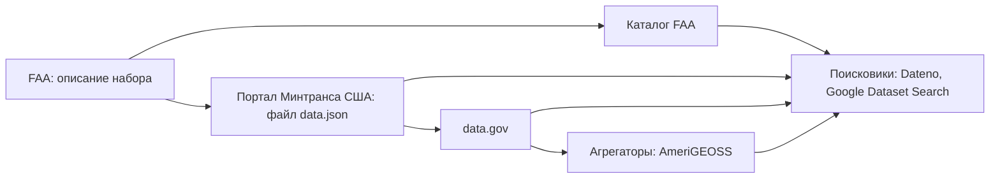

# Поиск наборов данных

Поисковик по наборам данных ищет не по самим данным, а по их описаниям, собранным из тысяч каталогов. Поэтому он за минуты находит опубликованное и не видит остального. Найденная карточка — не запись реестра, а след, и часто это след копии: от неё идут к каталогу, издателю, владельцу и системе. Пустой результат тоже записывают — с запросами, поисковиками и датой.

Сведения проверены 25 октября 2026 года, если не указано иное.

## Коротко

| Что сделать | Что получается | Готово, когда |
|-------------|----------------|---------------|
| **[Выбрать поисковики](#инструменты)** | Два-четыре поисковика под слой, тему и страну | Есть универсальный поисковик, профильный и национальный портал; известно, каких каталогов страны нет в индексе ([«По странам»](#по-странам)) |
| **[Составить запросы](#запрос)** | Запросы по каждому вопросу | Запросы на языке страны и по-английски, с официальными названиями и фильтром страны |
| **[Отобрать кандидатов](#карточка-набора)** | Кандидаты с каталогом, издателем и датой | Просмотрены первые 20–30 результатов каждого запроса, дубли сведены |
| **[Найти первоисточник и владельца](#от-набора-к-владельцу)** | Пары «копия — первоисточник», владелец, система | У каждого кандидата записано, копия это или первоисточник |
| **Проверить набор** | Дата, доступ, качество | Дата взята из данных, файлы скачиваются ([«Быстрая проверка»](../03-process/07-quality.md#быстрая-проверка)) |
| **[Записать](#как-записать)** | Записи реестра и журнал поиска | В журнале — и находки, и пустые запросы с датой |

## Как устроены поисковики

Поисковик хранит описания наборов — метаданные: название, описание, издателя, даты, формат, ссылки на файлы. Самих данных у него обычно нет. Описания он собирает двумя способами:

- **через программный интерфейс каталога.** У каждой платформы каталогов и у каждого вида каталогов — порталов, научных репозиториев, геопорталов, баз статистики — свой стандартный способ отдать описания программе ([«Стандарты описания»](../05-frameworks/02-metadata-standards.md)). Так собирают описания Dateno, OpenAIRE и data.europa.eu;
- **по разметке страниц.** Google Dataset Search обходит веб и берёт страницы, на которых набор описан по словарю schema.org или DCAT. Обязательны только название и описание.

Описания переходят из каталога в каталог, и поисковик видит каждую копию. Так путешествует описание набора FAA:



*Стрелка — куда переходит описание. Запись о системе регистрации воздушных судов попала на data.gov из файла data.json портала Министерства транспорта, а её копии остались в AmeriGEOSS ([пример](#пример-реестр-воздушных-судов-сша)).*

Из этого следует шесть вещей, которые нужно знать до первого запроса.

1. **Поисковик видит только каталоги, которые знает и может прочитать.** Реестр каталогов Dateno на 15 октября 2026 года описывает 43 614 каталогов в 225 странах и территориях. Способ забрать описания программой известен у 65% из них, а у каталогов показателей — только у 37%: статистические службы чаще показывают таблицы на сайте, чем отдают описания. Сам Dateno собирал наборы из 5236 источников. Каталог без интерфейса, закрытый для зарубежных адресов или защищённый от программ, в поиск не попадает.
2. **Число наборов — не мера охвата.** В Dateno 22 014 356 наборов, но 10,3 млн из них — ряды Европейского центрального банка, ещё 3,7 млн — показатели Всемирного банка. Одни каталоги делят данные на миллионы рядов, другие кладут всё в один файл — как издатели на data.gov ([«Порталы открытых данных»](./02-government.md#порталы-открытых-данных)).
3. **Поиск не лучше описаний.** Поисковик ищет по названию и описанию, а не по содержимому файлов. В 2020 году Google разобрал 31 млн наборов своего индекса с 4600 доменов: лицензия была указана у 34%, сведения о том, как скачать данные, — у 44%. Набор с названием «Итоговая таблица 2019» и пустым описанием почти не найти.
4. **Разметку ставит кто угодно.** Объявить страницу набором данных может любой сайт. Поэтому в выдаче много страниц компаний, которые пересобирают государственные данные, и даже рекламных страниц с таблицами. Копия с хорошим описанием стоит выше первоисточника с плохим.
5. **Один набор лежит во многих каталогах.** Google Dataset Search склеивает копии одного описания в одну карточку со списком мест, другие поисковики — не всегда ([«Карточка набора»](#карточка-набора)).
6. **Копия живёт дольше оригинала.** Агрегатор забирает описание и не всегда удаляет его, когда исходный каталог его удалил. В поиске остаются карточки наборов, которых у владельца уже нет.

## Что даёт и чего не даёт

Поиск наборов даёт:

- опубликованные наборы из тысяч каталогов за один запрос;
- каталог и издателя — начало пути к владельцу;
- копии и пересборки, о которых владелец не знает;
- даты, форматы, ссылки на файлы;
- описания закрытых наборов из инвентарей, которые публикуют ведомства, — следы систем;
- наборы на других языках и в других странах — аналоги для [поиска по аналогии](../02-approaches/02-methods.md#7-поиск-по-аналогии).

Поиск наборов не даёт:

- неопубликованного: систем, рабочих таблиц, закрытых наборов без описаний в открытых каталогах;
- владельца: издателем в карточке бывает агрегатор, подрядчик или компания, сделавшая копию;
- гарантии, что первоисточник вообще есть в выдаче;
- проверки: описание бывает старше данных, данные — старше описания, ссылка — мёртвой;
- содержимого файлов и полноты по стране: национальные каталоги часто вне индекса.

## Инструменты

| Вид | Примеры | Что даёт | Чего не даёт |
|-----|---------|----------|--------------|
| **Универсальные поисковики** | Dateno, Google Dataset Search | Наборы из каталогов всех видов или со всех размеченных страниц | Полноты по странам; у Google — фильтра по стране и программного интерфейса |
| **Научные агрегаторы** | OpenAIRE Explore, DataCite Commons, B2FIND | Наборы к исследованиям с постоянными идентификаторами DOI, связи с публикациями и авторами | Государственных данных вне науки |
| **Порталы-агрегаторы** | data.europa.eu, data.gov, Humanitarian Data Exchange (HDX) | Наборы органов власти, регионов, городов; гуманитарные данные по странам | Данных за пределами своей территории или темы |
| **Статистика** | DBnomics; базы Всемирного банка, ООН, МВФ | Ряды статистических служб и международных организаций в одном виде | Записей; свежести копии |
| **Геоданные** | GeoSeer, STAC Index, геопорталы INSPIRE | Картографические сервисы, слои, каталоги снимков | Табличных данных |
| **Отраслевые** | IATI d-portal, Transitland, реестр данных о закупках OCP | Наборы одной отрасли в общем стандарте | Того, что за пределами стандарта |
| **Платформы машинного обучения** | Kaggle, Hugging Face, Registry of Open Data on AWS | Наборы пользователей и компаний, готовые к обработке | Первоисточника: загрузивший — не всегда тот, кто собрал |
| **Реестры каталогов** | Реестр каталогов Dateno, re3data.org | Сами каталоги: адрес, владелец, платформа, программный интерфейс | Наборов |
| **Обычный поисковик** | Google, Яндекс, Bing с операторами | Файлы и страницы вне каталогов | Фильтров по формату, владельцу, дате данных |

Объём других инструментов: OpenAIRE — 108 млн записей о данных исследований из 157 тыс. источников; DataCite — 77 556 664 DOI с типом «набор данных»; re3data.org — 3539 репозиториев; HDX — 28 233 набора. DBnomics собирает 47 421 набор 94 поставщиков, среди них Росстат, но от Росстата там пять наборов, обновлённых в 2022 году: копию тоже проверяют на свежесть. Google Dataset Search объём индекса не публикует. Dateno — проект автора книги.

**Как пользоваться главными инструментами.**

- **Dateno** фильтрует по стране, типу каталога, типу владельца — центральная или региональная власть, международная организация, бизнес, наука, — формату, теме и источнику. В карточке видно, в каком каталоге найден набор, а если файлов нет, так и написано. Программный интерфейс — по ключу.
- **Google Dataset Search** фильтрует по дате обновления, формату, условиям использования, теме и бесплатности, понимает оператор `site:`. Копии одного набора собирает в одну карточку со списком мест. Фильтра по стране и программного интерфейса нет.
- **OpenAIRE и DataCite** отдают результаты по программному интерфейсу без ключа.
- **Обычный поисковик** находит файлы на сайтах без каталога. В Google работают операторы `site:` — домен, `filetype:` — тип файла, `inurl:` — слово в адресе: `site:gov.kz filetype:xlsx численность населения`. В Яндексе тип файла задают оператором `mime:`.

## По странам

Чего не видит поисковик, зависит от страны. Так выглядят четыре юрисдикции в реестре каталогов Dateno на 15 октября 2026 года и в индексе Dateno на 25 октября:

| Страна | Каталоги в реестре | Что в индексе | Что делать |
|--------|--------------------|---------------|------------|
| **Казахстан** | 130, способ забрать описания известен у 46% | 14 155 наборов из 13 источников, больше половины — от международных организаций. data.egov.kz, stat.gov.kz и «Талдау» нет | Национальные каталоги — напрямую и из сети страны |
| **Россия** | 1004, известен у 25%: у 421 раздела сайтов местного самоуправления на «Госвебе» интерфейса нет | 96 575 наборов из 31 источника; data.gov.ru, открытых данных Росстата и ЕМИСС нет | Национальные каталоги — напрямую; копии — у [общественных проектов](./03-public.md#общественные-проекты) |
| **США** | 8067, известен у 81% | 981 060 наборов | data.gov и файлы data.json ведомств; поисковики — для штатов, городов и науки |
| **ЕС** (общеевропейские каталоги) | 450, известен у 74% | 4 655 237 наборов, из них 4 168 060 — ряды Европейского центрального банка | data.europa.eu и национальные порталы на языке страны |

По Казахстану и России поисковик — подсказка, а национальный портал, статистическую службу и сайты ведомств просматривают напрямую. Государственные сайты обеих стран часто не открываются из-за рубежа, и поисковик, который собирает описания из другой страны, их не видит.

**Как проверить свою страну.** Без программирования это видно на странице страны в реестре каталогов Dateno, например [dateno.io/registry/country/KZ](https://dateno.io/registry/country/KZ/): у каждого каталога отмечено, есть ли он в индексе. Для Казахстана там видно, что портал открытых данных, stat.gov.kz и «Талдау» не проиндексированы. Сравнить полный список каталогов страны с источниками индекса — работа аналитика: реестр выложен файлами на GitHub, а список источников индекса даёт фильтр «Источник» в поиске Dateno. Каталоги вне индекса просматривают вручную, а их владелец может предложить каталог в Dateno и разметить страницы наборов для Google.

## Как искать

### Запрос

- **По теме — на языке страны и по-английски.** Казахстанский набор описан по-русски или по-казахски, европейский — на языке страны, а data.europa.eu показывает описания в машинном переводе.
- **Официальными названиями.** Название реестра, системы, формы сбора, показателя — как в акте или на сайте владельца: «Releasable Aircraft Database», «Aircraft Registration System», а не «база самолётов». Названия берут из анализа полномочий и реестров систем ([«От полномочия к набору»](../03-process/03-owners-and-mandates.md#от-полномочия-к-набору)).
- **По владельцу.** Полное и короткое название, прежние названия, домен с оператором `site:`.
- **Синонимы и соседние понятия.** «Реестр», «регистр», «перечень», «база данных»; «register», «registry», «database», «list». По [«aircraft register» в data.europa.eu](https://data.europa.eu/data/datasets?query=aircraft%20register) первыми выходят реестры воздушных судов европейских стран — готовые аналоги ([«Поиск по аналогии»](../02-approaches/02-methods.md#7-поиск-по-аналогии)).
- **Без лишних слов.** Поисковики наборов показывают совпадение хотя бы части слов. Длинный запрос не сужает выдачу, а размывает.

Простые запросы открываются прямо из браузера: [«FAA aircraft registry» в Dateno](https://dateno.io/search?q=FAA%20aircraft%20registry), [«aircraft registration» в Dateno](https://dateno.io/search?q=aircraft%20registration), [«FAA aircraft registry» в Google Dataset Search](https://datasetsearch.research.google.com/search?query=FAA%20aircraft%20registry). Выдача меняется, поэтому в журнал записывают то, что увидели, с датой.

### Фильтры

Страну, тип каталога, владельца и формат задают фильтром, а не словом в запросе. Слово «Казахстан» в запросе «численность населения Казахстан» Dateno понимает как одно из слов: без фильтра в выдаче 17 897 наборов о России и 128 о Казахстане. С фильтром «страна — Казахстан» остаются 128 наборов о Казахстане. Но и среди них первые — экономические показатели аналитической платформы и слои геопортала Астаны, а не данные Бюро национальной статистики, каталогов которого в индексе нет.


*Dateno, запрос «численность населения Казахстан» с фильтром страны. Снято 26 октября 2026 года.*

### Карточка набора

У каждого кандидата смотрят:

| Что | Зачем |
|-----|-------|
| **Каталог, где нашли** | Агрегатор, платформа или каталог владельца — от этого зависит, копия ли перед вами |
| **Издатель и автор** | Кандидат во владельцы, но не владелец: копия часто называет автором первоисточник |
| **Даты описания и данных** | Дата карточки, дата описания в каталоге и дата самих данных — три разные даты |
| **Ссылки на файлы** | Есть ли что скачать; «файлов нет» бывает у описаний закрытых наборов и систем |
| **Описание и источники** | Откуда данные, как часто обновляются, ссылка на первоисточник |
| **Другие места** | Где ещё лежит это описание: у Google — в карточке, у остальных — по одинаковому названию |


*Карточка «Aircraft Registration System» в Dateno: файлов нет, издатель — «US Migrating», каталог — агрегатор AmeriGEOSS. Снято 26 октября 2026 года.*

Карточка Google Dataset Search показывает все места, где лежит одно описание. По запросу «FAA aeronautical charts» нашлось 37 наборов, и у набора «Sectional VFR Charts» девять мест: каталог FAA, портал Министерства транспорта, data.gov, AmeriGEOSS и пять копий на портале открытых данных Вирджинии.


*Google Dataset Search, запрос «FAA aeronautical charts», карточка набора «Sectional VFR Charts». Снято 26 октября 2026 года.*

Просматривают первые 20–30 результатов каждого запроса. Число найденного — «более 10 000», «100+» — ничего не говорит: в него входят наборы, совпавшие с запросом лишь отчасти.

### Поиск через программный интерфейс

Если вопросов много, запросы отправляют программой и складывают ответы в таблицу кандидатов. У OpenAIRE, DataCite, data.europa.eu и HDX ключ не нужен, у Dateno — нужен. У Google Dataset Search программного интерфейса нет. Запросы через языковую модель работают так же — по описаниям в каталоге, — и их результаты проверяют теми же шагами ([как каталоги открывают для ИИ-агентов](../06-tools/01-from-spreadsheet-to-catalog.md#что-выбрать)).

<details>
<summary>Проверить самому</summary>

```bash
# OpenAIRE: наборы данных исследований, без ключа
curl "https://api.openaire.eu/graph/v1/researchProducts?search=aircraft%20registry&type=dataset&pageSize=20"
# DataCite: DOI с типом «набор данных», без ключа
curl -g "https://api.datacite.org/dois?query=aircraft%20registry&resource-type-id=dataset&page[size]=20"
# data.europa.eu: наборы с европейских порталов
curl "https://data.europa.eu/api/hub/search/search?q=aircraft%20register&filter=dataset&limit=20"
# HDX: наборы о Казахстане по слову
curl "https://data.humdata.org/api/3/action/package_search?q=health&fq=groups:kaz&rows=20"
# Dateno: нужен ключ с сайта поисковика
curl "https://api.dateno.io/search/0.2/query?q=aircraft%20registry&apikey=КЛЮЧ"
```

</details>

## От набора к владельцу

Поиск заканчивается не карточкой, а первоисточником, владельцем и системой.

1. **Открыть каталог, где нашли набор.** Если это агрегатор — data.europa.eu, AmeriGEOSS, поисковик, — найти исходный каталог: его название и адрес есть в карточке или в описании.
2. **Решить, копия ли это.** Признаки копии: каталог — платформа или агрегатор; издатель не совпадает с автором; в описании сказано «источник — …»; дата старше, чем у оригинала; название переведено или сокращено. У копии ищут первоисточник по ссылке в описании, а если ссылки нет — по названию у вероятного владельца ([«Первоисточник»](./03-public.md#первоисточник)).
3. **От первоисточника — к владельцу.** Издатель на портале — подсказка, а не владелец: владельца берут из положения или акта о системе ([«Порталы открытых данных»](./02-government.md#порталы-открытых-данных)).
4. **От владельца — к системе.** В описании и ссылках набора ищут название системы, адрес её публичной части, поддомен, идентификатор ИТ-инвестиции. По ним систему находят в реестрах систем, закупках и актах ([«Реестры информационных систем»](./02-government.md#реестры-информационных-систем)).
5. **Проверить набор.** Дату изменения — по данным, режим доступа — по [порядку проверки](../03-process/06-access.md#порядок-проверки), качество — [быстрой проверкой](../03-process/07-quality.md#быстрая-проверка).

## Поиск в двух подходах

**«Где найти нужное».** Поиск идёт по каждому вопросу сразу после того, как вопросы согласованы. Это первый метод вместе с кабинетными исследованиями ([«Как выбрать и сочетать методы»](../02-approaches/02-methods.md#как-выбрать-и-сочетать-методы)). Минимум — один универсальный поисковик, национальный портал страны и профильный каталог: научный, статистический или геопортал. Пустой результат — тоже ответ: вопрос уходит к экспертам, в анализ полномочий и в список пробелов.

**«Чем владеем».** Организация ищет себя — по полному и короткому названию, прежним названиям, домену:

- **что из своего уже опубликовано** и под какими именами — эти записи сверяют с реестром ([«Один набор под разными именами»](../03-process/05-registry.md#один-набор-под-разными-именами));
- **кто копирует** — общественные проекты, компании, платформы машинного обучения ([«Чем владеем: внешние копии»](./03-public.md#чем-владеем-внешние-копии));
- **что устарело** — карточки удалённых наборов на агрегаторах;
- **видят ли поисковики ваш каталог** — есть ли он в реестре каталогов, отдаёт ли описания программе, размечены ли страницы по schema.org. Общедоступная часть реестра, которую не находят поисковики, опубликована только наполовину ([«Публикация»](../03-process/09-result-and-upkeep.md#публикация)).

## Как записать

**Находка.** В реестр записывают первоисточник, а не карточку поисковика: адрес карточки может смениться, когда поисковик перестроит индекс. В поле «откуда известно» — поисковик, запрос и дата: `поиск: Dateno, «aircraft registration», 2026-10-25`. Издатель из карточки — кандидат во владельцы, владельца подтверждают документом. Копию, если ею пользуются, записывают отдельно со связью с первоисточником ([«Как записать»](./03-public.md#как-записать)).

**Журнал поиска.** Запросы ведут в отдельном листе — [searches.csv](pathname:///templates/searches.csv), по строке на запрос: поисковик, запрос дословно, язык, фильтры, дата, сколько результатов просмотрено, итог и что делать дальше. Три строки из шаблона:

| Поисковик и запрос | Дата, просмотрено | Итог | Что нашли и что дальше |
|--------------------|-------------------|------|------------------------|
| Dateno, «aircraft registration» | 2026-10-25, 20 | след (`lead`) | Описание системы Aircraft Registration System без файлов в AmeriGEOSS — копия закрытой записи, удалённой с data.gov; название системы — в синонимы |
| Google Dataset Search, «FAA aircraft registry» | 2026-10-25, 20 | след (`lead`) | Ни одной карточки FAA; у копии MORVS — адрес выгрузки registry.faa.gov |
| Dateno, «сроки ожидания медицинской помощи», страна — условная | 2026-10-01, 30 | ничего (`none`) | Условный пример; вопрос — в опрос владельцев и экспертов |

Итог записывают одним из четырёх значений: найден первоисточник (`original`), только копии (`copy`), след — система, владелец, каталог (`lead`), ничего (`none`). Журнал нужен трижды. При проверке видно, где искали и где нет. При обновлении запросы повторяют и сравнивают выдачу. Пустой результат с датой показывает, что набор искали и не нашли, а не забыли поискать.

## Пример: реестр воздушных судов США

**Где мы в примере.** Запись о реестре собрана в главе [«Реестр данных»](../03-process/05-registry.md#карточка-записи-faa) со страницы FAA и из выгрузки, а в главе [«Государственные данные»](./02-government.md#пример-реестр-воздушных-судов-сша) выяснилось, что на data.gov его нет. Здесь — что о нём знают поисковики.

| Где искали | Что нашли |
|------------|-----------|
| **Dateno**, «FAA aircraft registry» | В первой десятке — копии на Kaggle, в том числе «FAA Aircraft Registration Database 2021», а также реестр воздушных судов острова Мэн и наборы FAA об аэропортах и регионах. Выгрузки с registry.faa.gov нет |
| **Dateno**, «aircraft registration» | Первым — «Aircraft Registration System»: описание системы без файлов из агрегатора AmeriGEOSS, издатель — «US Migrating» |
| **Google Dataset Search**, «FAA aircraft registry» | В первых 20 нет наборов с faa.gov или data.gov: наборы компаний, копии на Hugging Face. Первая карточка — «FAA Aircraft Registry» компании MORVS от 17 мая 2026 года: 312 733 судна и ссылка на выгрузку |
| **OpenAIRE и DataCite**, «aircraft registry» | 18 и 9 научных наборов об авиации и полётах, реестра среди них нет |
| **Каталоги владельца** | В каталоге FAA шесть наборов — все аэронавигационные карты, последнее изменение 10 ноября 2021 года. На портале Министерства транспорта по «aircraft registration» — ничего |

Карточка «Aircraft Registration System» оказалась самой интересной находкой. В AmeriGEOSS у неё три копии, созданные в ноябре и декабре 2025 года. У одной сохранились поля исходной записи: режим доступа «закрыто», дата изменения 19 декабря 2018 года. Исходная запись была на data.gov: страница есть в Internet Archive с 6 июня 2015 по 18 июня 2023 года, а сейчас поиск по data.gov её не находит. По последней копии в веб-архиве:

- издатель — FAA; дата первой публикации — 23 августа 1958 года, день подписания закона о федеральной авиации;
- режим доступа — закрытый: «описание доступно публике, сами данные закрыты по соображениям приватности или безопасности»;
- запись пришла на data.gov из файла data.json портала Министерства транспорта;
- у записи есть идентификатор ИТ-инвестиции 021-615337796 — ключ для поиска системы на IT Dashboard.

Это общедоступная часть инвентаря данных Министерства транспорта: закрытый набор описан, чтобы о нём знали ([«Инвентари данных федеральных ведомств США»](../05-frameworks/04-international-practice.md#инвентари-данных-федеральных-ведомств-сша)). Владелец запись убрал, а агрегатор хранит её тремя копиями.

**Итог.** Первоисточника — ежедневной выгрузки FAA — ни один поисковик в первых результатах не показал. Её нет ни в каталоге FAA, ни на портале министерства, ни на data.gov, а страница выгрузки не размечена как набор данных. Но к первоисточнику привели два следа. Копия MORVS дала адрес выгрузки за один шаг. Карточка закрытой записи дала название системы, режим доступа и идентификатор ИТ-инвестиции — то, чего нет на странице выгрузки. В реестр попадают находки, а не карточки: адрес выгрузки — в запись `faa-aircraft-registry`, «Aircraft Registration System» — в информационную систему и синонимы, поисковики и даты — в поле «откуда известно». Копию MORVS записали со своей датой ([«Пример: реестр воздушных судов США и его копии»](./01-three-layers.md#пример-реестр-воздушных-судов-сша-и-его-копии)).

## Условный пример: доступность медицинской помощи

**Где мы в примере.** 15 вопросов руководства сформулированы в главе [«Цели и вопросы»](../03-process/02-goals-and-questions.md#пример). Поиск наборов шёл первым методом, вместе с кабинетными исследованиями, и занял два дня; общественные находки разобраны в главе [«Общественные данные»](./03-public.md#пример).

| Вопрос | Где искали | Что нашли | Итог |
|--------|------------|-----------|------|
| Число медицинских организаций по видам, регионам и годам | Dateno с фильтром страны; национальный портал; два языка | Реестр медицинских организаций на портале, ежемесячная выгрузка. Копия на платформе машинного обучения 2021 года | Записан первоисточник. Копию не записали: она старше и без нужных полей |
| Число врачей по специальностям и регионам | Dateno, Google Dataset Search, OpenAIRE | Показатель ВОЗ. Научный набор о врачах в сельских районах трёх регионов | ВОЗ — для сравнения стран. Научный набор — снимок; авторы получили данные у министерства, это записано как след |
| Коечный фонд по регионам и годам | Dateno, Google Dataset Search | Три копии на агрегаторах статистики без методики. Сам ряд нашёлся на сайте статистической службы: её каталог вне индекса | Первоисточник — с сайта службы; в журнале — «только копии» и пометка о каталоге вне индекса |
| Сроки ожидания медицинской помощи | Четыре поисковика, 12 запросов на двух языках с фильтром страны | Ничего, кроме научного набора, найденного раньше | В журнале — 12 строк «ничего» с датой. Вопрос ушёл в опрос владельцев и экспертов |
| Расходы бюджетов регионов на здравоохранение | Dateno; национальный портал | Наборы об исполнении бюджетов у министерства финансов и их копия у общественного проекта | На карте — первоисточник и связанная с ним копия; записями реестра не стали |

**Итог.** По пяти вопросам поиск дал девять кандидатов: четыре первоисточника и пять копий; ещё один первоисточник нашёлся кабинетным исследованием. По главному вопросу — о сроках ожидания — пусто, и это записано так же подробно, как находки: через полгода те же 12 запросов повторят и сравнят выдачу. Пример показывает ход работы, а не то, как устроено здравоохранение в конкретной стране.

## Частые ошибки

| Ошибка | Что происходит | Как исправить |
|--------|----------------|---------------|
| **Слово вместо фильтра** | Страна, названная словом в запросе, не сужает выдачу: в ней наборы о соседних странах | Фильтр страны, официальные названия |
| **«Не нашли — значит, нет»** | Каталог вне индекса; набор на сайте без каталога; набор закрыт | Проверить, есть ли каталоги страны в индексе; искать другими методами |
| **Найден — значит, открыт** | «Aircraft Registration System» записан как открытый набор, хотя это описание закрытого, без файлов | Режим доступа — по [порядку проверки](../03-process/06-access.md#порядок-проверки) |

Сквозные ошибки — копия вместо первоисточника, издатель вместо владельца — в главе [«Практики и антипаттерны»](../08-practices/01-practices-and-anti-patterns.md).

## Ограничения

- Поисковики видят только опубликованное и только каталоги, которые знают и могут прочитать.
- Выдача меняется: индексы перестраивают, каталоги добавляют и теряют. Результаты записывают с датой, запросы повторяют при обновлении реестра.
- Агрегаторы хранят описания, которые владелец уже удалил: карточка — не доказательство, что набор есть сейчас.
- Поисковики — чужие сервисы со своими правилами: Google не публикует объём индекса и не даёт программного интерфейса, программный интерфейс Dateno — по ключу.
- Поиск не отвечает на вопросы о неопубликованном. Для него нужны анализ полномочий, реестры систем и опросы ([«Семь методов»](../02-approaches/02-methods.md)).

## Источники

- Главы [«Семь методов»](../02-approaches/02-methods.md#4-поиск-по-каталогам-данных) — поиск по каталогам среди других методов; [«Государственные данные»](./02-government.md), [«Общественные данные»](./03-public.md), [«Исчезнувшие системы и веб-архивы»](./06-legacy.md).
- Бегтин И. [Каталоги данных](https://datacatalogs.begtin.tech/) — как устроены каталоги, по которым ищут поисковики.
- [Dateno](https://dateno.io/) — число наборов и источников, фильтры и выдача по запросам главы, 25 октября 2026 года; снимки выдачи и карточки — 26 октября 2026 года; [программный интерфейс](https://api.dateno.io/); [реестр каталогов по странам](https://dateno.io/registry/countries/). Dateno — проект автора книги.
- [datenoio/dataportals-registry](https://github.com/datenoio/dataportals-registry) — реестр каталогов Dateno, выпуск v1.27.0 от 15 октября 2026 года; подсчёт по файлу `data/datasets/full.parquet`.
- [Google Dataset Search](https://datasetsearch.research.google.com/) — выдача по запросам главы, 25 октября 2026 года; карточка «Sectional VFR Charts» — 26 октября 2026 года (запрос `aircraft site:faa.gov`, по которому 25 октября нашёлся тот же набор FAA, 26 октября не дал результатов); [Dataset structured data](https://developers.google.com/search/docs/appearance/structured-data/dataset) — Google Search Central.
- Noy N., Benjelloun O. [An Analysis of Online Datasets Using Dataset Search (Published, in Part, as a Dataset)](https://research.google/blog/an-analysis-of-online-datasets-using-dataset-search-published-in-part-as-a-dataset/) — Google Research, 25 августа 2020 года.
- [OpenAIRE Explore](https://explore.openaire.eu/), [OpenAIRE Graph API](https://graph.openaire.eu/docs/apis/graph-api/), [DataCite REST API](https://support.datacite.org/docs/api), [DataCite Commons](https://commons.datacite.org/), [re3data.org](https://www.re3data.org/), [data.europa.eu](https://data.europa.eu/), [Humanitarian Data Exchange](https://data.humdata.org/), [DBnomics](https://db.nomics.world/).
- AmeriGEOSS Community Platform DataHub — [копии записи «Aircraft Registration System»](https://data.amerigeoss.org/dataset/?q=%22Aircraft+Registration+System%22); [Aircraft Registration System](https://web.archive.org/web/20230618003256/https://catalog.data.gov/dataset/aircraft-registration-system) — копия страницы data.gov в Internet Archive от 18 июня 2023 года.
- [catalog.data.faa.gov](https://catalog.data.faa.gov/) — каталог FAA; [data.transportation.gov](https://data.transportation.gov/) — портал Министерства транспорта; [Releasable Aircraft Database Download](https://www.faa.gov/licenses_certificates/aircraft_certification/aircraft_registry/releasable_aircraft_download) — FAA.
