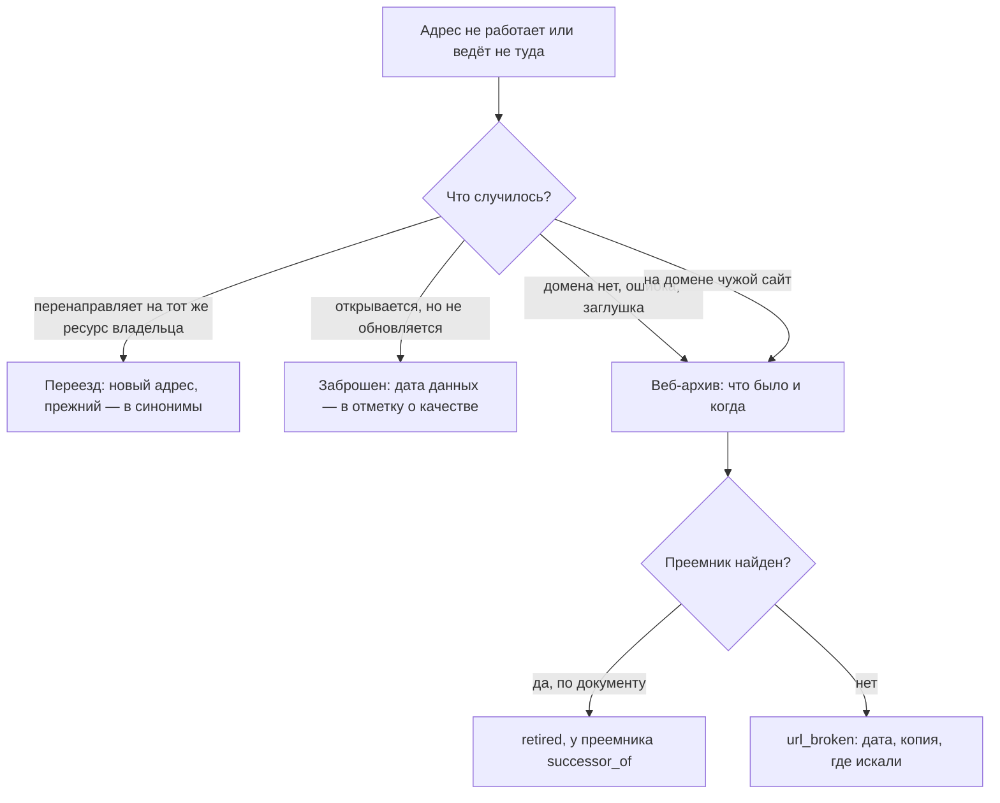

# Исчезнувшие системы и веб-архивы

Системы закрывают, переименовывают и переносят, домены забывают продлить, а задачи, ради которых собирали данные, остаются. Данные при этом редко исчезают совсем: они переезжают к преемнику, остаются в архиве организации, в веб-архиве или у тех, кто успел сделать копию. Поэтому исчезнувший адрес — не повод удалить запись, а начало поиска: выяснить, что случилось, найти копию и преемника и записать всё это в реестр со статусом и датой. Веб-архив показывает, что система была, когда работала и что показывала, но хранит страницы, а не базы данных за ними: того, что было за формой поиска и паролем, в нём почти никогда нет. В подходе «где найти нужное» речь о чужих источниках, которые пропали между составлением карты и её обновлением. В подходе «чем владеем» — о своих системах: в России, Казахстане и США при выводе системы из эксплуатации решают, что будет с её данными, и документ об этом — главный источник для записи реестра.

## Коротко

| Что сделать | Что получается | Готово, когда |
|-------------|----------------|---------------|
| **[Понять, что случилось с адресом](#что-случилось-с-адресом)** | Вид исчезновения: переезд, закрытие, заброшенность, потерянный домен | Адрес проверен с www и без, перенаправление прослежено до конечной страницы; записаны дата и сеть проверки |
| **[Найти копии](#веб-архивы)** | Первая и последняя копии в веб-архивах | Даты найдены или записано, что копий нет и в каких архивах искали |
| **[Проверить, что сохранилось](#что-сохраняет-архив)** | Список сохранённых страниц и файлов данных | Копия открыта: в ней содержимое, а не заглушка или пустая оболочка |
| **[Найти преемника](#где-искать-преемника)** | Запись преемника со связью с прежней | Преемник подтверждён документом или записан как не установленный — с тем, где искали |
| **[Отметить в реестре](#как-отметить-в-реестре)** | Статус, дата, ссылка на копию, связь с преемником | Запись не удалена; ссылок на потерянный домен в общедоступной части нет |



## Что случилось с адресом

Нерабочий адрес — симптом, а не диагноз. За одним и тем же «сайт не открывается» бывает переезд, закрытие системы, заброшенный сайт или домен, который перешёл к другому владельцу. От вида зависит, что искать дальше и что записать.

| Вид | Что видно | Пример | Что делать |
|-----|-----------|-----------------------------|------------|
| **Переезд** | Перенаправление на новый адрес того же владельца, на ту же страницу | europeandataportal.eu → data.europa.eu: 21 апреля 2021 года два портала открытых данных ЕС объединили в один | Проверить, что на новом месте тот же ресурс; новый адрес — в запись, прежний — в синонимы |
| **Переезд с потерей адреса** | Все страницы перенаправляют на главную нового сайта | Таблица статистического ведомства из условного примера ниже ([«Пример»](#пример)) | Искать сам сервис на новом сайте: поиском по сайту и по названию из копии в веб-архиве |
| **Цепочка переездов** | Новый адрес тоже перенаправляет | Сайт Министерства здравоохранения Казахстана: mz.gov.kz → dsm.gov.kz в октябре 2019 года → gov.egov.kz в феврале 2020 года → www.gov.kz, где в октябре 2026 года адреса страниц ведомств снова сменились | Записать конечный адрес и все прежние: по прежним ищут в веб-архиве и в старых документах |
| **Закрытие** | Домена нет, ошибка 404 или заглушка | Реестр государственных информационных систем Камчатского края исчез вместе с доменом ([«Региональные реестры»](../07-countries/02-russia.md#региональные-реестры)) | Веб-архив, затем преемник по документам |
| **Закрытие с перезапуском** | Адрес тот же, ресурс другой | data.gov.ru закрыт в марте 2023 года и открыт заново 15 июля 2025 года с другим составом ([«Пример: data.gov.ru»](#пример-datagovru)) | Две записи — прежняя версия и новая — со связью между ними |
| **Заброшенность** | Сайт открывается, данные не обновляются | На последней копии stat.edu.ru в веб-архиве — от 21 сентября 2021 года — в подвале стояло «2002–2008»; у «Открытых НКО» данные последний раз обновлены 16 августа 2023 года ([«Жив ли источник»](./03-public.md#жив-ли-источник)) | Дату последнего обновления данных — в отметку о качестве |
| **Потерянный домен** | На домене чужой сайт или перенаправление на чужой | Справочник медицинских организаций из условного примера ниже ([«Пример»](#пример)) | Не ссылаться на новый сайт; ссылку заменить копией в веб-архиве; искать, куда ушла система |

### Как проверить адрес

Порядок — от надёжного к тому, что зависит от сети:

1. **Есть ли домен.** Ответ системы доменных имён «домена нет» (NXDOMAIN) одинаков из любой страны. Адрес с www проверяют и без www: бывает, что пропал только поддомен www, а сайт работает, — тогда исправляют адрес в записи.
2. **Что отвечает сайт и куда перенаправляет** — до конечного адреса, а не до первого перенаправления. «Не ответил», ошибка 403 и ошибка сертификата зависят от сети: государственные сайты перепроверяют из сети страны ([«Порядок проверки»](../03-process/06-access.md#порядок-проверки)).
3. **Чей сайт на конечном адресе** — тот же владелец и тот же ресурс или чужой сайт. Дату регистрации домена показывает служба WHOIS: если домен зарегистрирован недавно, а ссылка на него стоит в документах десятилетней давности, у домена новый владелец.
4. **Что на странице.** Заглушка «сайт на реконструкции», страница защиты от программ, пустой шаблон без данных — это не работающий ресурс. Дату обновления берут из данных, а не из подвала сайта.
5. **Записать** результат, дату и сеть, из которой проверяли.

```bash
# Есть ли домен: в ответе «status: NXDOMAIN» — домена нет
dig example.ru
# Куда перенаправляет адрес — все шаги до конечной страницы
curl -sL -o /dev/null -D - https://europeandataportal.eu | grep -i '^location'
# Когда зарегистрирован домен .ru или .рф
whois -h whois.tcinet.ru example.ru | grep created
```

Первые два шага для многих адресов сразу делает программа ([«Проверка адресов»](../06-tools/03-registry-as-data.md#проверка-адресов)); третий и четвёртый — человек.

## Где искать

Искать нужно две вещи: копию — чтобы понять, что было, — и преемника — чтобы понять, где данные теперь. Копии хранят веб-архивы и независимые архивы данных, преемника называют документы владельца.

### Веб-архивы

| Архив | Что хранит | Чем полезен | Ограничения |
|-------|------------|-------------|-------------|
| **Internet Archive** (Wayback Machine) | Копии страниц всего веба с 1996 года; в октябре 2025 года их стало больше триллиона | Даты копий любого адреса через открытый интерфейс CDX ([«Веб-архив за минуту»](#веб-архив-за-минуту)); сохранение страницы по запросу | Сохраняет не всё и не каждый день; данных за формами и паролем нет |
| **End of Term Web Archive** (США) | Сайты федерального правительства при каждой смене администрации: 2008, 2012, 2016, 2020 и 2024 годы | Снимок государственных сайтов на дату смены власти. В феврале 2025 года сбор 2024–2025 годов, пройденный на две трети, превысил 500 ТБ и 100 млн уникальных страниц | Снимок раз в четыре года; в 2025 году начат сбор вне этого цикла |
| **Data.gov Archive** (Library Innovation Lab Гарвардской школы права) | Не страницы, а сами наборы с data.gov: 311 604 набора, около 17,9 ТБ, собраны с ноября 2024 по январь 2025 года | Файлы наборов с метаданными, а не только описание | Только то, что было на data.gov, и на дату сбора |
| **UK Government Web Archive** (Национальный архив Великобритании) | Сайты, изображения, видео и страницы в соцсетях правительства Великобритании с 1996 года | Поиск по адресу и по тексту среди государственных сайтов одной страны | Только правительство Великобритании |
| **EU Web Archive** (Бюро публикаций ЕС) | Сайты институтов, агентств и органов ЕС на домене europa.eu | Копии во всех языковых версиях | Не сохраняет базы данных, динамическое содержимое, сайты за паролем и файлы для скачивания — так сказано в руководстве Бюро |
| **Национальный цифровой архив** (ruarxive.org, Россия) | Сайты, каналы и данные, которым грозит исчезновение: 13,9 ТБ, 3322 ресурса и 182 коллекции по спискам файлов хранилища 2023–2025 годов | Полные копии сайтов и выгрузки данных, в том числе портала data.gov.ru на начало 2022 года | Сохраняет выборочно: по заявкам и решению проекта |
| **Common Crawl** | Обходы веба почти каждый месяц: в 2026 году — десять индексов, последний — CC-MAIN-2026-43, обход с 5 по 18 октября | Тот же интерфейс CDX; копии страниц для обработки программами | Выборка страниц сайта, а не весь сайт |

Национальный цифровой архив — проект АНО «Информационная культура», которой руководит автор книги; сайт проекта работает с мая 2018 года. Копии казахстанских государственных сайтов искали в Internet Archive: так восстановлена цепочка адресов Министерства здравоохранения в таблице выше.

Искать стоит в нескольких архивах сразу: копия, которой нет в одном, бывает в другом. Служба Memento TimeTravel ищет по многим архивам одним запросом, archive.today сохраняет страницы по запросу — но из сети проверки 25 октября 2026 года ни та, ни другая не ответили. Национальные веб-архивы ведут библиотеки и архивы многих стран; многие из них — участники Международного консорциума по сохранению интернета (IIPC), список участников — на [netpreserve.org](https://netpreserve.org/about-us/members/).

### Где искать преемника

Копия показывает, что было. Где данные теперь, говорят документы владельца:

| Источник | Что в нём | Где искать |
|----------|-----------|------------|
| **Акт о выводе из эксплуатации** | Основание, мероприятия, порядок и сроки хранения данных, доступ к ним, как сообщают пользователям | Россия: правовой акт государственного органа о выводе системы (пункты 21–22 требований, утверждённых постановлением Правительства № 676). Казахстан: решение собственника или владельца, согласованное с уполномоченным органом (статья 89 Цифрового кодекса) |
| **Реестр систем** | Статус системы и сведения о ней на дату | Казахстан: архитектурный портал цифровых объектов государства, где при прекращении эксплуатации меняют сведения об объекте (статья 89); Россия: ФГИС КИ; США: IT Dashboard ([«Реестры информационных систем»](./02-government.md#реестры-информационных-систем)) |
| **Госзакупки** | Контракты на вывод из эксплуатации, миграцию и перенос данных — в них названы и прежняя система, и новая | Поиск по словам «вывод из эксплуатации», «миграция данных», «перенос данных», «архивирование» и по названию системы ([«Госзакупки»](./02-government.md#госзакупки)) |
| **Акты о новой системе** | Положение о новой системе с той же целью; отмена положения о прежней | Правовые базы; искать по названию функции, а не системы ([«Нормативные акты»](./02-government.md#нормативные-акты)) |
| **Заявления владельца** | Новости о закрытии, перезапуске, переносе на новую платформу | Сайт владельца и его копии в веб-архиве, отраслевые СМИ: о закрытии data.gov.ru Минэкономразвития рассказало «Коммерсанту» 24 марта 2023 года |
| **Wikidata** | Дата упразднения (P576), преемник (P1366), прежние официальные сайты (P856) | [Wikidata Query Service](https://query.wikidata.org/); пример запроса — в главе [«Общественные данные»](./03-public.md#wikidata-википедия-и-openstreetmap) |
| **Планы и реестры прошлых лет** | Системы, которых уже нет, и что с ними собирались сделать | Планы информатизации и программы цифровой трансформации; копии реестров в веб-архиве |
| **Люди** | Сотрудники, подрядчики и пользователи, которые работали с системой; у них часто остаются выгрузки | Интервью ([«Опросы экспертов»](../02-approaches/02-methods.md#6-опросы-экспертов)) |

Преемник по назначению — не всегда преемник по содержанию. Новая система может собирать меньше, с другой подробностью или только с даты запуска, как новый data.gov.ru ([«Пример: data.gov.ru»](#пример-datagovru)). Поэтому преемника записывают отдельной записью со связью и сравнивают состав.

## Веб-архив за минуту

У Internet Archive есть открытый интерфейс CDX: он отвечает, когда адрес сохранялся, что ответил сервер и какого типа был файл.

```bash
# Первая и последняя копии главной страницы с ответом 200
curl "https://web.archive.org/cdx/search/cdx?url=stat.edu.ru&fl=timestamp,statuscode&filter=statuscode:200&limit=1"
curl "https://web.archive.org/cdx/search/cdx?url=stat.edu.ru&fl=timestamp,statuscode&filter=statuscode:200&limit=-1"
# Все сохранённые адреса домена с типом файла — по строке на адрес
curl "https://web.archive.org/cdx/search/cdx?url=stat.edu.ru&matchType=domain&fl=original,mimetype,timestamp&filter=statuscode:200&collapse=urlkey" > stat-edu-ru.txt
# Сколько среди них таблиц Excel
grep -ci '\.xls ' stat-edu-ru.txt
# Скачать сохранённый файл как есть, без панели Wayback Machine: id_ после даты
curl -L -o i_1.xls "https://web.archive.org/web/20060808080944id_/http://stat.edu.ru:80/xls/i_1.xls"
```

Запросы 25 октября 2026 года показали, что **stat.edu.ru** — портал «Статистика российского образования» ФГУ ГНИИ ИТТ «Информика» — сохранялся с 24 мая 2003 по 21 сентября 2021 года. В архиве 4617 его адресов с ответом 200, среди них 26 таблиц Excel, 69 документов Word и 28 файлов PDF; таблицы сохранены в 2005–2006 годах. Скачанный файл — настоящая таблица Excel, созданная 23 декабря 2005 года.

Последняя копия говорит, что сайт ещё работал на эту дату, а не когда он закрылся; первая — что к этой дате он уже работал. Перед тем как сослаться на источник, его страницу стоит сохранить самому — адресом вида `https://web.archive.org/save/https://example.org/page`. Тогда у записи реестра будет копия на дату проверки.

## Что сохраняет архив

| Что | Есть ли в веб-архиве | Пример |
|-----|----------------------|--------|
| **Страницы о системе**: описание, новости, контакты, документы | Обычно есть: по ним видно, что система была, кто её вёл и когда она работала | Копии главной data.gov.ru до 4 июня 2022 года — с содержимым портала |
| **Файлы по прямым ссылкам**: таблицы, PDF, архивы | Часто, если файл небольшой и на него вела ссылка | 26 таблиц Excel stat.edu.ru |
| **Данные за формой поиска и паролем** | Почти никогда | Базы данных и сайты за паролем EU Web Archive по своему руководству не сохраняет |
| **Страницы, которые рисует скрипт** | Оболочка без данных: данные приходят через программный интерфейс, а его ответы архив обычно не сохраняет | Копии главной data.gov.ru 2025–2026 годов — заголовок и скрипты, без наборов |
| **Страница защиты от программ вместо сайта** | Сохраняется с ответом 200, как настоящая | Копии главной data.gov.ru с августа 2022 года по 2023 год |
| **Большие выгрузки и базы целиком** | Редко; их сохраняют специальные проекты | Data.gov Archive; копия data.gov.ru в Национальном цифровом архиве |

Ответ 200 в указателе архива значит только, что сервер что-то вернул. Прежде чем записать «копия есть», копию открывают и смотрят, что в ней.

## Как использовать при инвентаризации

### Где найти нужное

Исчезнувший источник на карте — пробел, пока не доказано обратное:

1. Проверить адрес и определить вид исчезновения ([«Что случилось с адресом»](#что-случилось-с-адресом)).
2. Найти первую и последнюю копии и открыть их: что это было, кто вёл, какие данные показывал.
3. Проверить, что сохранилось: только страницы или и файлы данных.
4. Искать преемника по документам и по функции: кто теперь отвечает за ту же задачу ([«Кто отвечает за тему»](../03-process/03-owners-and-mandates.md#кто-отвечает-за-тему)).
5. Решить, чем закрыть вопрос. Преемник отвечает на вопросы о настоящем, копия — о прошлом, и только с пометкой: за какие годы, с какой подробностью, чего не сохранилось. Если нет ни того, ни другого — это пробел с датой.

### Чем владеем

Свои исчезнувшие системы находят по документам и опросам, а не по веб-архивам: у многих внутренних систем публичной части не было.

- **Выведенная система остаётся в реестре.** Запись получает статус, дату и реквизиты решения о выводе, а в описании — где теперь данные: перенесены, переданы на хранение, уничтожены. В анкете это отдельный вопрос: «система выведена — где её данные?» ([«Что спрашивать»](../03-process/04-questionnaires.md#что-спрашивать)).
- **При выводе системы решают судьбу данных.** В России правовой акт о выводе государственной системы включает порядок, сроки и режим хранения её информационных ресурсов, порядок доступа к ним и то, как сообщают пользователям; сроки хранения не могут быть меньше, чем для таких же документов на бумаге (пункты 22 и 24 требований, утверждённых постановлением Правительства № 676). В Казахстане цифровые записи, техническую документацию и исходные коды цифрового объекта «цифрового правительства» архивируют (статья 90 Цифрового кодекса). В США ведомство до вывода системы планирует перенос записей в новую, если их срок хранения дольше жизни прежней (36 CFR § 1236.14).
- **Резервная копия — не архив.** По 36 CFR § 1236.20(c) резервные копии не заменяют систему хранения записей: в них трудно что-то найти, и их перезаписывают. В реестр пишут, где лежат данные и сколько их хранят, а не «есть резервная копия».
- **Свои адреса тоже стареют.** Прежние адреса сервисов должны вести на их новые места, а не на главную страницу. Домены, которые стоят в документах и на картах, продлевают и после переезда: иначе их займут, и ссылки из документов поведут на чужой сайт.
- **Вывод системы — событие для реестра.** Решение о выводе встраивают в процесс обновления, как запуск новой системы ([«Что встроить в процессы»](../03-process/09-result-and-upkeep.md#что-встроить-в-процессы)).

## Как отметить в реестре

Запись не удаляют: исчезновение — тоже сведение о данных. Статус берут из справочника ([«Справочники значений»](../03-process/05-registry.md#справочники-значений)):

| Что случилось | `status` | Что ещё записать |
|---------------|----------|------------------|
| **Переехал** | `active` | Новый адрес — в ссылку, прежний — в синонимы (`aliases`); дата проверки |
| **Заброшен** | `active` | Дату последнего обновления данных — в отметку о качестве: «открывается, данные не обновлялись с такой-то даты» |
| **Выведен из эксплуатации**, известно когда и чем заменён | `retired` | Дату и документ о выводе, где теперь данные; у преемника — связь `successor_of:` с идентификатором прежней записи |
| **Адрес не работает**, что случилось — не установлено | `url_broken` | Дату и сеть проверки, результат — «домена нет», «ошибка 404», где искали преемника |
| **Потерянный домен** | `url_broken` или `retired`, если известно, что система закрыта | Прежний адрес — в синонимы с пометкой «домен занят сторонним сайтом»; ссылка для выгрузки — «нет», копия — в `archive_url` |

У исчезнувшей записи в колонке `archive_url` — ссылка на последнюю копию, на которой источник ещё работал; дата копии видна в самом адресе. У действующей записи там может стоять копия на дату проверки или первая копия, если по ней определили дату публикации ([«Периодичность и даты»](../03-process/05-registry.md#периодичность-и-даты)). Связь `successor_of:` пишут у преемника; обратную, от прежней записи к преемнику, программа находит сама.

## Пример: data.gov.ru

На национальном портале открытых данных России data.gov.ru видны все виды следов сразу: закрытие, обманчивые копии в архиве, независимая копия данных и преемник с тем же адресом, но другим составом.

| Когда | Что произошло | Откуда известно |
|-------|---------------|-----------------|
| 16 мая 2014 года | Первая копия главной страницы в Internet Archive | Интерфейс CDX |
| 2 февраля 2022 года | На портале больше 24 тыс. наборов, около 14 ГБ в сжатом виде; полная копия портала сохранена и выложена в хранилище Национального цифрового архива | Разбор автора книги от 16 июля 2025 года |
| 4 июня 2022 года | Последняя копия главной страницы с содержимым портала | Интерфейс CDX; копия открыта |
| С 3 августа 2022 года | Копии главной с ответом 200 — страница защиты от программ, а не портал | Копии открыты |
| 24 марта 2023 года | Минэкономразвития сообщило о временном закрытии портала: инвентаризация существующих данных, перенос на платформу «Гостех», срок — не меньше четырёх–шести месяцев | «Коммерсантъ» |
| 4 июля 2025 года | По данным разработчиков, пользователям доступно 4940 наборов; перенос занял почти два с половиной года | ppt.ru, 7 июля 2025 года |
| 15 июля 2025 года | Портал открыт заново: по разбору автора книги, в программном интерфейсе чуть меньше 5826 наборов, около 100 МБ в сжатом виде, и 84% из них впервые опубликованы в 2019 году или раньше | Разбор автора книги от 16 июля 2025 года |
| 2025–2026 годы | Копии главной — оболочка приложения: заголовок и скрипты, без наборов | Копии открыты |
| 25 октября 2026 года | Из сети проверки портал не открылся | Проверка адреса |

В реестре это две записи. Фрагменты, собранные 25 октября 2026 года:

| Атрибут | Прежняя версия | Новая версия |
|---------|----------------|--------------|
| Идентификатор | `data-gov-ru-v1` | `data-gov-ru` |
| Наименование | Портал открытых данных Российской Федерации — версия, закрытая в 2023 году | Портал открытых данных Российской Федерации |
| Организация-владелец | Минэкономразвития России | Минэкономразвития России |
| Статус | `retired` — закрыт в марте 2023 года для переноса на «Гостех» | `active` — открыт 15 июля 2025 года |
| Ссылка для выгрузки | нет — портал закрыт; полная копия на 2 февраля 2022 года — в хранилище Национального цифрового архива | не проверена — из сети проверки портал не открылся |
| Копия в веб-архиве | `https://web.archive.org/web/20220604235419/https://data.gov.ru/` — последняя копия с содержимым | копии 2025–2026 годов без наборов: для проверки состава не годятся |
| Отметка о качестве | на 2 февраля 2022 года — больше 24 тыс. наборов, около 14 ГБ в сжатом виде | на июль 2025 года — меньше 6 тыс. наборов, около 100 МБ в сжатом виде; 84% впервые опубликованы в 2019 году или раньше |
| Связанные записи | — связь записана у преемника | `successor_of:data-gov-ru-v1` |
| Откуда известно | «Коммерсантъ», 24.03.2023; копии в Internet Archive; копия в Национальном цифровом архиве | ppt.ru, 07.07.2025; разбор автора книги, 16.07.2025 |
| Дата проверки | 2026-10-25 | 2026-10-25 |

Пример показывает три вещи. Копии с ответом 200 не доказывают, что портал работал: последняя копия с его содержимым сделана больше чем за девять месяцев до объявления о закрытии. Преемник по адресу и названию — не преемник по содержанию: на вопросы о данных до 2022 года отвечает копия в Национальном цифровом архиве, а не новый портал. И независимая копия, сделанная вовремя, — единственное место, где прежние данные остались целиком. Копию портала 2022 года сделал, а разбор нового портала написал автор книги; Национальный цифровой архив — проект «Информационной культуры». Пример в главе потому, что даты в нём сверены по Internet Archive и публикациям в СМИ, а не только по разбору автора.

## Пример

Продолжение условного примера из главы [«Результат и поддержка»](../03-process/09-result-and-upkeep.md#пример): реестр о доступности медицинской помощи — 31 запись, адреса программа проверяет раз в месяц. За год после первого обновления проверка нашла следы исчезновения у четырёх записей.

| Что нашла проверка | Что выяснили | Что записали |
|--------------------|--------------|--------------|
| У региональной системы записи к врачу нет домена | Приказ региона о выводе системы из эксплуатации: запись к врачу перешла в общую медицинскую систему региона, данные прежней системы оператор хранит пять лет и выдаёт по запросу | Прежняя запись — `retired` с реквизитами приказа и местом хранения данных; новая — со связью `successor_of:`; в отметке о качестве — с какой даты ряды идут в новой системе |
| Ссылка на таблицу статистического ведомства ведёт на главную страницу его нового сайта | В последней копии прежней страницы в веб-архиве — название таблицы; по нему таблица найдена на новом сайте под другим названием | `active`, новая ссылка; прежний адрес и прежнее название — в синонимы |
| Адрес справочника медицинских организаций одного региона открывается, но на нём онлайн-казино | Домен зарегистрирован заново два месяца назад. Справочник перенесли на портал региона без перенаправления; нашли его по названию из копии в веб-архиве | `active`, новая ссылка; прежний адрес — в синонимы с пометкой «домен занят сторонним сайтом» и убран из общедоступной части |
| Ссылка на научный набор об опросе пациентов не открывается | Университет перенёс репозиторий на новую платформу; постоянный идентификатор набора (DOI) ведёт на новый адрес | `active`, ссылка — по DOI, а не по адресу страницы |

**Итог.** Изменились четыре записи из 31, ни одна не удалена. Одна система выведена из эксплуатации, и её данные не пропали: приказ о выводе назвал, где они хранятся и как их получить. Три адреса сменились, и только у одного было перенаправление; два других нашлись по копиям в веб-архиве и по постоянному идентификатору. В список изменений добавлено семь строк: смена статуса, новая запись преемника, три новые ссылки и два дополненных списка синонимов ([«Версии и список изменений»](../03-process/09-result-and-upkeep.md#версии-и-список-изменений)). Пример показывает ход работы, а не то, как устроено здравоохранение в конкретной стране.

## Частые ошибки

| Ошибка | Что происходит | Как исправить |
|--------|----------------|---------------|
| **Строку удалили** | Пропадает знание, что данные были, и где их искать ([«Строку удаляют, когда источник исчез»](../08-practices/01-practices-and-anti-patterns.md#строку-удаляют-когда-источник-исчез)) | Статус, дата, копия, связь с преемником |
| **Перенаправление приняли за переезд** | В записи — главная страница нового сайта или чужой сайт вместо ресурса | Проследить перенаправление до конечной страницы и проверить владельца; искать сам ресурс |
| **«Открывается» — значит «работает»** | В реестре ссылка на онлайн-казино на домене, который зарегистрировали заново | Смотреть, что на странице, и дату регистрации домена |
| **«Домена нет» по адресу с www** | Живой источник записан исчезнувшим | Проверять адрес и без www |
| **Ответ 200 в архиве приняли за копию сайта** | «Копия есть» у страницы защиты от программ, как у data.gov.ru с августа 2022 года | Открыть копию и посмотреть, что в ней |
| **Копию страницы приняли за копию данных** | От архива ждут данные, а там страница входа или оболочка без данных, как у копий data.gov.ru 2025–2026 годов | Проверить, какие файлы сохранились; данные искать у преемника и в независимых копиях |
| **Последнюю копию приняли за дату закрытия** | В реестре неверная дата вывода | Писать «работал не позже чем до такой-то даты» и искать дату в документах |
| **Преемника признали по названию** | Новую версию с тем же адресом записали как прежнюю и не заметили, что часть данных пропала | Две записи со связью; сравнить состав |
| **Резервную копию приняли за архив** | Данные выведенной системы «есть», пока копию не перезапишут | Записать, где и сколько хранятся данные |
| **Ссылка без копии** | Через год нечем проверить, что было по ссылке | Сохранять страницу в веб-архив при каждой проверке |

## Ограничения

- Веб-архив хранит страницы, а не базы данных за ними: формы поиска, программные интерфейсы и сайты за паролем в нём обычно не работают.
- Отсутствие копии не значит, что сайта не было: архивы сохраняют выборочно.
- Даты копий — границы, а не даты событий: первая копия говорит, что сайт уже работал, последняя — что ещё работал.
- Системы без публичной части по веб-архивам не найти — только по документам и опросам.
- Акты о выводе из эксплуатации публикуют не всегда: ведомственный приказ бывает непубличным.
- Архивы и государственные сайты открываются не из любой сети: из сети проверки 25 октября 2026 года не ответили Memento TimeTravel, archive.today и data.gov.ru.
- Независимая копия — копия: у неё свой владелец и свои условия, а первоисточник — прежний владелец данных ([«Первоисточник»](./03-public.md#первоисточник)).

## Источники

- Главы [«Реестр данных»](../03-process/05-registry.md#справочники-значений) — статусы и связи записей; [«Результат и поддержка»](../03-process/09-result-and-upkeep.md#что-устаревает) — что устаревает и что проверять программой; [«Общественные данные»](./03-public.md#жив-ли-источник) — жив ли источник; [«Государственные данные»](./02-government.md#сайты-и-домены) — сайты и домены.
- [Wayback CDX Server API](https://github.com/internetarchive/wayback/tree/master/wayback-cdx-server) — описание интерфейса Internet Archive. Запросы о stat.edu.ru, data.gov.ru, mz.gov.kz, dsm.gov.kz и gov.kz — 25 октября 2026 года.
- [One Trillion Web Pages Archived](https://blog.archive.org/2025/10/31/one-trillion-web-pages-archived-internet-archive-celebrates-a-civilization-scale-milestone/) — Internet Archive, 31 октября 2025 года.
- [End of Term Web Archive](https://eotarchive.org/) — годы сборов и сбор 2025 года; [Update on the 2024/2025 End of Term Web Archive](https://blog.archive.org/2025/02/06/update-on-the-2024-2025-end-of-term-web-archive/) — Internet Archive, 6 февраля 2025 года.
- [Data.gov Archive](https://lil.law.harvard.edu/data-gov-archive) — Library Innovation Lab, Harvard Law School; [коллекция на Source Cooperative](https://source.coop/harvard-lil/gov-data). Проверено 25 октября 2026 года.
- [UK Government Web Archive](https://webarchive.nationalarchives.gov.uk/) — The National Archives. Проверено 25 октября 2026 года.
- [EU web archive: archiving](https://op.europa.eu/en/web/webguide/archiving) — руководство Бюро публикаций ЕС: что архив сохраняет и чего не сохраняет. Проверено 25 октября 2026 года.
- [Data.europa.eu](https://www.fokus.fraunhofer.de/en/dps/projects/data-europa-eu) — Fraunhofer FOKUS: портал открыт 21 апреля 2021 года вместо двух прежних; перенаправление с europeandataportal.eu проверено 25 октября 2026 года.
- [Национальный цифровой архив](https://ruarxive.org/) — объём по спискам файлов хранилища; первая копия сайта в Internet Archive — 11 мая 2018 года. Проект АНО «Информационная культура», которой руководит автор книги. Проверено 25 октября 2026 года.
- [Common Crawl Index Server](https://index.commoncrawl.org/) — список индексов. Проверено 25 октября 2026 года.
- [IIPC: Members](https://netpreserve.org/about-us/members/) — участники Международного консорциума по сохранению интернета.
- [«Портал открытых данных временно закрыт»](https://www.kommersant.ru/doc/5889649) — «Коммерсантъ», 24 марта 2023 года.
- [«Минэкономразвития готовит перезапуск портала data.gov.ru»](https://ppt.ru/news/tsifrovye-servisy/minekonomrazvitiya-gotovit-perezapusk-portala-data-gov-ru) — ppt.ru, 7 июля 2025 года.
- [«Обновлённый портал Data.gov.ru»](https://begtin.substack.com/p/datagovru) — разбор автора книги, 16 июля 2025 года.
- [Постановление Правительства РФ от 06.07.2015 № 676](https://legalacts.ru/doc/postanovlenie-pravitelstva-rf-ot-06072015-n-676/) — требования к выводу государственных информационных систем из эксплуатации и хранению их данных, раздел VI, пункты 20–25; в редакции от 01.07.2026 по тексту legalacts.ru: pravo.gov.ru из сети проверки не открылся. Проверено 25 октября 2026 года.
- [Цифровой кодекс Республики Казахстан](https://zakon.uchet.kz/rus/docs/K2600000255) от 09.01.2026 № 255-VIII — статьи 89 и 90, по тексту zakon.uchet.kz с изменениями на 23.07.2026: adilet.zan.kz из сети проверки не открылся. Проверено 25 октября 2026 года.
- [36 CFR part 1236](https://www.ecfr.gov/current/title-36/chapter-XII/subchapter-B/part-1236) — управление электронными записями федеральных ведомств США, §§ 1236.14 и 1236.20; eCFR. Проверено 25 октября 2026 года.
