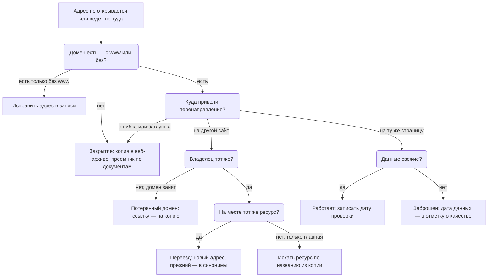
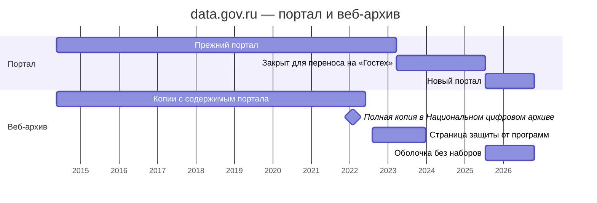

# Исчезнувшие системы и веб-архивы

Системы закрывают, переименовывают и переносят, домены забывают продлить, а данные при этом редко исчезают совсем: они переезжают к преемнику, остаются в архиве организации, в веб-архиве или у тех, кто успел сделать копию. Поэтому исчезнувший адрес — не повод удалить запись, а начало поиска: выяснить, что случилось, найти копию и преемника и записать всё это со статусом и датой. Веб-архив показывает, что система была, когда работала и что показывала, но хранит страницы, а не базы данных за ними.

Сведения проверены 25 октября 2026 года, если не указано иное.

## Коротко

| Что сделать | Что получается | Готово, когда |
|-------------|----------------|---------------|
| **[Понять, что случилось с адресом](#что-случилось-с-адресом)** | Вид исчезновения: переезд, закрытие, заброшенность, потерянный домен | Адрес проверен с www и без, перенаправление прослежено до конца; записаны дата и сеть проверки |
| **[Найти копии](#веб-архивы)** | Первая и последняя копии в веб-архивах | Даты найдены или записано, что копий нет и где искали |
| **[Проверить, что сохранилось](#что-сохраняет-архив)** | Список сохранённых страниц и файлов данных | Копия открыта: в ней содержимое, а не заглушка |
| **[Найти преемника](#где-искать-преемника)** | Запись преемника со связью с прежней | Преемник подтверждён документом или записан как не установленный |
| **[Отметить в реестре](#как-отметить-в-реестре)** | Статус, дата, ссылка на копию, связь с преемником | Запись не удалена; ссылок на потерянный домен в общедоступной части нет |

## Что случилось с адресом

Нерабочий адрес — симптом, а не диагноз. За одним и тем же «сайт не открывается» бывает переезд, закрытие системы, заброшенный сайт или домен, который перешёл к другому владельцу. От вида зависит, что искать дальше и что записать.

| Вид | Что видно | Что делать |
|-----|-----------|------------|
| **Переезд** | Перенаправление на ту же страницу у того же владельца: europeandataportal.eu ведёт на data.europa.eu | Проверить, что на новом месте тот же ресурс; новый адрес — в запись, прежний — в синонимы |
| **Переезд с потерей адреса** | Все страницы ведут на главную нового сайта | Искать ресурс на новом сайте поиском и по названию из копии в веб-архиве |
| **Цепочка переездов** | Новый адрес тоже перенаправляет: сайт Минздрава Казахстана сменил mz.gov.kz, dsm.gov.kz, gov.egov.kz и www.gov.kz | Записать конечный адрес и все прежние: по ним ищут в веб-архиве |
| **Закрытие** | Домена нет, ошибка 404 или заглушка | Веб-архив, затем преемник по документам |
| **Закрытие с перезапуском** | Адрес тот же, ресурс другой, как у data.gov.ru ([пример](#пример-datagovru)) | Две записи — прежняя и новая версия — со связью |
| **Заброшенность** | Сайт открывается, данные не обновляются | Дату последнего обновления данных — в отметку о качестве |
| **Потерянный домен** | На домене чужой сайт | Не ссылаться на него; ссылку заменить копией в веб-архиве; искать, куда ушла система |

### Как проверить адрес

Проверка идёт по шагам, от надёжного к тому, что зависит от сети. Всё можно сделать в браузере.



1. **Есть ли домен.** Адрес открывают в браузере с www и без. Если браузер пишет, что не может найти адрес сервера (в Chrome — код DNS_PROBE_FINISHED_NXDOMAIN), домена нет: система доменных имён (DNS), которая переводит имя сайта в адрес сервера, отвечает «такого имени нет» (NXDOMAIN). Этот ответ одинаков из любой страны. Бывает, что пропал только поддомен www, а сайт работает, — тогда исправляют адрес в записи.
2. **Куда привели перенаправления.** После загрузки адресная строка показывает конечный адрес. «Не ответил», ошибка 403 и ошибка сертификата зависят от сети: государственные сайты перепроверяют из сети страны ([«Порядок проверки»](../03-process/06-access.md#порядок-проверки)).
3. **Чей сайт на конечном адресе.** Когда и кем зарегистрирован домен, показывает веб-служба WHOIS: для доменов .ru и .рф — [cctld.ru](https://cctld.ru/service/whois/), для международных зон вроде .com и .org — [ICANN Lookup](https://lookup.icann.org/). Если домен зарегистрирован недавно, а ссылка на него стоит в документах десятилетней давности, у домена новый владелец.
4. **Что на странице.** Заглушка «сайт на реконструкции», страница защиты от программ, пустой шаблон без данных — это не работающий ресурс. Дату обновления берут из данных, а не из подвала сайта.
5. **Записать** результат, дату и сеть, из которой проверяли.

Первые два шага для многих адресов сразу делает программа ([«Проверка адресов»](../06-tools/03-registry-as-data.md#проверка-адресов)); третий и четвёртый — человек.

<details>
<summary>Проверить самому</summary>

```bash
# Есть ли домен: в ответе «status: NXDOMAIN» — домена нет
dig example.ru
# Куда перенаправляет адрес — все шаги до конечной страницы
curl -sL -o /dev/null -D - https://europeandataportal.eu | grep -i '^location'
# Когда зарегистрирован домен .ru или .рф
whois -h whois.tcinet.ru example.ru | grep created
```

</details>

## Где искать

Искать нужно две вещи: копию — чтобы понять, что было, — и преемника — чтобы понять, где данные теперь. Копии хранят веб-архивы и независимые архивы данных, преемника называют документы владельца.

### Веб-архивы

| Архив | Что хранит | Чем полезен и чем ограничен |
|-------|------------|-----------------------------|
| **Internet Archive** (Wayback Machine) | Копии страниц всего веба с 1996 года — больше триллиона | Даты копий любого адреса, сохранение страницы по запросу; сохраняет не всё и не каждый день |
| **End of Term Web Archive** (США) | Сайты федерального правительства при каждой смене администрации с 2008 года | Снимок государственных сайтов на дату смены власти — раз в четыре года |
| **Data.gov Archive** (Гарвардская школа права) | Сами наборы с data.gov: 311 604 набора, около 17,9 ТБ, собраны в ноябре 2024 — январе 2025 года | Файлы с метаданными, а не только описание; только то, что было на data.gov на дату сбора |
| **UK Government Web Archive** | Сайты и страницы в соцсетях правительства Великобритании с 1996 года | Поиск по адресу и тексту; только одна страна |
| **EU Web Archive** | Сайты институтов и органов ЕС | По собственному руководству не сохраняет базы данных, сайты за паролем и файлы для скачивания |
| **Национальный цифровой архив** (ruarxive.org) | Сайты и данные, которым грозит исчезновение: 3322 ресурса, 13,9 ТБ | Полные копии сайтов и выгрузки, в том числе data.gov.ru на начало 2022 года; сохраняет выборочно |
| **Common Crawl** | Обходы веба почти каждый месяц | Копии для обработки программами; выборка страниц, а не весь сайт |

Национальный цифровой архив — проект «Информационной культуры», которой руководит автор книги. Искать стоит в нескольких архивах сразу: копия, которой нет в одном, бывает в другом. Национальные веб-архивы ведут библиотеки и архивы многих стран; многие из них — участники Международного консорциума по сохранению интернета ([список участников](https://netpreserve.org/about-us/members/)).

### Веб-архив за минуту

В Wayback Machine (web.archive.org) вводят адрес сайта. Вкладка «Calendar» показывает, сколько раз и когда адрес сохраняли: по годам — полоса с частотой копий, ниже — дни, когда копии есть. Так выглядит портал «Статистика российского образования» stat.edu.ru, который вела «Информика»:


*Календарь копий stat.edu.ru в Wayback Machine. Снято 26 октября 2026 года.*

Календарь считает все копии, в том числе ошибки сервера. Последняя копия с ответом сервера 200, то есть с настоящей страницей, сделана 21 сентября 2021 года; две копии после неё — ошибки. Первая — 24 мая 2003 года.

Вкладка «URLs» показывает все сохранённые адреса сайта, а поле фильтра оставляет нужный тип файла. По фильтру `.xls` у stat.edu.ru нашлось 26 таблиц Excel из 4668 сохранённых адресов. Колонки «From» и «To» показывают первую и последнюю копию, «Uniques» — сколько разных версий файла сохранено.


*Сохранённые адреса stat.edu.ru с фильтром «.xls» в Wayback Machine, фрагмент списка. Снято 26 октября 2026 года.*

Таблицы впервые сохранены в 2005–2006 годах, а позже архив сохранял их без изменений: у каждой одна версия. Скачанный из архива файл — настоящая таблица Excel, созданная 23 декабря 2005 года. Чтобы скачать файл как есть, без панели Wayback Machine, в адрес копии после даты добавляют `id_`.

Тот же указатель копий доступен программам — это интерфейс CDX. Он отвечает списком копий адреса с датами, ответом сервера и типом файла и нужен, когда адресов много. Перед тем как сослаться на источник, его страницу стоит сохранить самому — кнопкой «Save Page Now» на web.archive.org. Тогда у записи реестра будет копия на дату проверки.

<details>
<summary>Проверить самому</summary>

```bash
# Первая и последняя копии главной страницы с ответом 200
curl "https://web.archive.org/cdx/search/cdx?url=stat.edu.ru&fl=timestamp,statuscode&filter=statuscode:200&limit=1"
curl "https://web.archive.org/cdx/search/cdx?url=stat.edu.ru&fl=timestamp,statuscode&filter=statuscode:200&limit=-1"
# Все сохранённые адреса домена с ответом 200 и типом файла — по строке на адрес
curl "https://web.archive.org/cdx/search/cdx?url=stat.edu.ru&matchType=domain&fl=original,mimetype,timestamp&filter=statuscode:200&collapse=urlkey" > stat-edu-ru.txt
# Сколько среди них таблиц Excel
grep -ci '\.xls ' stat-edu-ru.txt
# Скачать сохранённый файл как есть: id_ после даты
curl -L -o i_1.xls "https://web.archive.org/web/20060808080944id_/http://stat.edu.ru:80/xls/i_1.xls"
# Сохранить страницу в веб-архив
curl "https://web.archive.org/save/https://example.org/page"
```

С ответом 200 указатель CDX даёт 4617 адресов stat.edu.ru: 26 таблиц Excel, 69 документов Word и 28 файлов PDF.

</details>

Последняя копия говорит, что сайт ещё работал на эту дату, а не когда он закрылся; первая — что к этой дате он уже работал.

### Что сохраняет архив

| Что | Есть ли в веб-архиве | Пример |
|-----|----------------------|--------|
| **Страницы о системе**: описание, новости, контакты, документы | Обычно есть: по ним видно, что система была, кто её вёл и когда она работала | Копии главной data.gov.ru до 4 июня 2022 года |
| **Файлы по прямым ссылкам**: таблицы, PDF, архивы | Часто, если файл небольшой и на него вела ссылка | 26 таблиц Excel stat.edu.ru |
| **Данные за формой поиска и паролем** | Почти никогда | EU Web Archive по своему руководству их не сохраняет |
| **Страницы, которые рисует скрипт** | Оболочка без данных: данные приходят через программный интерфейс, а его ответы архив обычно не сохраняет | Копии главной data.gov.ru 2025–2026 годов |
| **Страница защиты от программ** | Сохраняется с ответом 200, как настоящая | Копии главной data.gov.ru с августа 2022 по 2023 год |
| **Большие выгрузки и базы целиком** | Редко; их сохраняют специальные проекты | Data.gov Archive; копия data.gov.ru в Национальном цифровом архиве |

Ответ 200 в указателе архива значит только, что сервер что-то вернул. Прежде чем записать «копия есть», копию открывают и смотрят, что в ней.

### Где искать преемника

Копия показывает, что было. Где данные теперь, говорят документы владельца:

| Источник | Что в нём | Где искать |
|----------|-----------|------------|
| **Акт о выводе из эксплуатации** | Основание, порядок и сроки хранения данных, доступ к ним, как сообщают пользователям | В России — правовой акт органа о выводе системы, в Казахстане — решение владельца, согласованное с уполномоченным органом ([«Нормативная база»](../09-appendices/02-legal-framework.md)) |
| **Реестр систем** | Статус системы и сведения о ней на дату | Реестры и учёт систем стран ([«Реестры информационных систем»](./02-government.md#реестры-информационных-систем)) |
| **Госзакупки** | Контракты на вывод из эксплуатации, миграцию и перенос данных — в них названы прежняя система и новая | Поиск по словам «вывод из эксплуатации», «миграция данных», «перенос данных» и по названию системы ([«Госзакупки»](./02-government.md#госзакупки)) |
| **Акты о новой системе** | Положение о новой системе с той же целью; отмена положения о прежней | Правовые базы; искать по названию функции, а не системы |
| **Заявления владельца** | Новости о закрытии, перезапуске, переносе | Сайт владельца и его копии в веб-архиве, отраслевые СМИ |
| **Wikidata** | Дата упразднения, преемник, прежние официальные сайты | Служба запросов Wikidata ([«Wikidata, Википедия и OpenStreetMap»](./03-public.md#wikidata-википедия-и-openstreetmap)) |
| **Планы и реестры прошлых лет** | Системы, которых уже нет, и что с ними собирались сделать | Планы информатизации; копии реестров в веб-архиве |
| **Люди** | Сотрудники, подрядчики и пользователи; у них часто остаются выгрузки | Интервью ([«Опросы экспертов»](../02-approaches/02-methods.md#6-опросы-экспертов)) |

Преемник по назначению — не всегда преемник по содержанию. Новая система может собирать меньше, с другой подробностью или только с даты запуска, как новый data.gov.ru. Поэтому преемника записывают отдельной записью со связью и сравнивают состав.

## Как использовать при инвентаризации

### Где найти нужное

Исчезнувший источник на карте — пробел, пока не доказано обратное:

1. Проверить адрес и определить вид исчезновения ([«Как проверить адрес»](#как-проверить-адрес)).
2. Найти первую и последнюю копии и открыть их: что это было, кто вёл, какие данные показывал.
3. Проверить, что сохранилось: только страницы или и файлы данных.
4. Искать преемника по документам и по функции: кто теперь отвечает за ту же задачу ([«Кто отвечает за тему»](../03-process/03-owners-and-mandates.md#кто-отвечает-за-тему)).
5. Решить, чем закрыть вопрос. Преемник отвечает на вопросы о настоящем, копия — о прошлом, и только с пометкой: за какие годы, с какой подробностью, чего не сохранилось. Если нет ни того, ни другого — это пробел с датой.

### Чем владеем

Свои исчезнувшие системы находят по документам и опросам, а не по веб-архивам: у многих внутренних систем публичной части не было.

- **Выведенная система остаётся в реестре.** Запись получает статус, дату и реквизиты решения о выводе, а в описании — где теперь данные: перенесены, переданы на хранение, уничтожены. В анкете это отдельный вопрос: «система выведена — где её данные?» ([«Что спрашивать»](../03-process/04-questionnaires.md#что-спрашивать)).
- **При выводе системы решают судьбу данных.** В России, Казахстане и США это требование правил. В России акт о выводе государственной системы называет порядок, сроки и режим хранения её данных и доступ к ним. В Казахстане цифровые записи, документацию и исходные коды выведенного объекта архивируют. В США ведомство до вывода системы планирует перенос записей в новую, если их хранят дольше, чем живёт прежняя. Реквизиты — в приложении [«Нормативная база»](../09-appendices/02-legal-framework.md).
- **Резервная копия — не архив.** В ней трудно что-то найти, и её перезаписывают. В реестр пишут, где лежат данные и сколько их хранят, а не «есть резервная копия».
- **Свои адреса тоже стареют.** Прежние адреса сервисов должны вести на их новые места, а не на главную страницу. Домены, которые стоят в документах, продлевают и после переезда: иначе их займут, и ссылки поведут на чужой сайт.
- **Вывод системы — событие для реестра.** Решение о выводе встраивают в процесс обновления, как запуск новой системы ([«Что встроить в процессы»](../03-process/09-result-and-upkeep.md#что-встроить-в-процессы)).

## Как отметить в реестре

Запись не удаляют: исчезновение — тоже сведение о данных. Статус записи (`status`) берут из справочника ([«Справочники значений»](../03-process/05-registry.md#справочники-значений)):

| Что случилось | Статус | Что ещё записать |
|---------------|--------|------------------|
| **Переехал** | действует (`active`) | Новый адрес — в ссылку, прежний — в синонимы; дата проверки |
| **Заброшен** | действует | В отметку о качестве: «открывается, данные не обновлялись с такой-то даты» |
| **Выведен из эксплуатации**, известно когда и чем заменён | выведен (`retired`) | Дату и документ о выводе, где теперь данные; у преемника — связь с прежней записью (`successor_of:`) |
| **Адрес не работает**, что случилось — не установлено | адрес не работает (`url_broken`) | Дату и сеть проверки, результат — «домена нет», «ошибка 404», где искали преемника |
| **Потерянный домен** | адрес не работает или выведен, если известно, что система закрыта | Прежний адрес — в синонимы с пометкой «домен занят сторонним сайтом»; ссылка для выгрузки — «нет», копия — в поле копии в веб-архиве |

В поле копии в веб-архиве (`archive_url`) у исчезнувшей записи — ссылка на последнюю копию, на которой источник ещё работал; дата копии видна в самом адресе. У действующей записи там может стоять копия на дату проверки. Связь с преемником пишут у преемника; обратную связь программа находит сама.

## Пример: data.gov.ru

На национальном портале открытых данных России data.gov.ru видны все виды следов сразу: закрытие, обманчивые копии в архиве, независимая копия данных и преемник с тем же адресом, но другим составом. Шкала в две дорожки показывает, что происходило с порталом и что в это время видно в веб-архиве.



*Начало полос — первая копия в Internet Archive (16 мая 2014 года); конец 2023 года и июль 2025 года на дорожке архива — приблизительно, по годам копий.*

Откуда даты. Копии — по указателю CDX и открытым копиям в Internet Archive. О временном закрытии портала для инвентаризации данных и переноса на платформу «Гостех» Минэкономразвития сообщило «Коммерсанту» 24 марта 2023 года; срок назывался «не меньше четырёх–шести месяцев». На 4 июля 2025 года, по данным разработчиков, пользователям было доступно 4940 наборов (ppt.ru). Состав старого и нового портала — по разбору автора книги от 16 июля 2025 года: 2 февраля 2022 года на портале было больше 24 тыс. наборов, около 14 ГБ в сжатом виде; после перезапуска 15 июля 2025 года — около 5,8 тыс. наборов, около 100 МБ, и 84% из них впервые опубликованы в 2019 году или раньше. 25 октября 2026 года из сети проверки портал не открылся.

В реестре это две записи:

| Атрибут | Прежняя версия | Новая версия |
|---------|----------------|--------------|
| Идентификатор | `data-gov-ru-v1` | `data-gov-ru` |
| Наименование | Портал открытых данных Российской Федерации — версия, закрытая в 2023 году | Портал открытых данных Российской Федерации |
| Организация-владелец | Минэкономразвития России | Минэкономразвития России |
| Статус | выведен — закрыт в марте 2023 года для переноса на «Гостех» | действует — открыт 15 июля 2025 года |
| Ссылка для выгрузки | нет; полная копия на 2 февраля 2022 года — в хранилище Национального цифрового архива | не проверена — из сети проверки портал не открылся |
| Копия в веб-архиве | `https://web.archive.org/web/20220604235419/https://data.gov.ru/` — последняя копия с содержимым | копии 2025–2026 годов без наборов: для проверки состава не годятся |
| Отметка о качестве | на 2 февраля 2022 года — больше 24 тыс. наборов, около 14 ГБ | на июль 2025 года — меньше 6 тыс. наборов, около 100 МБ; 84% впервые опубликованы в 2019 году или раньше |
| Связанные записи | — связь записана у преемника | преемник `data-gov-ru-v1` |
| Откуда известно | «Коммерсантъ», 24.03.2023; копии в Internet Archive; копия в Национальном цифровом архиве | ppt.ru, 07.07.2025; разбор автора книги, 16.07.2025 |
| Дата проверки | 2026-10-25 | 2026-10-25 |

Пример показывает три вещи. Копии с ответом 200 не доказывают, что портал работал: последняя копия с его содержимым сделана больше чем за девять месяцев до объявления о закрытии. Преемник по адресу и названию — не преемник по содержанию: на вопросы о данных до 2022 года отвечает копия в Национальном цифровом архиве, а не новый портал. И независимая копия, сделанная вовремя, — единственное место, где прежние данные остались целиком. Копию портала 2022 года сделал, а разбор нового портала написал автор книги; поэтому даты в примере сверены по Internet Archive и публикациям в СМИ, а не только по разбору.

## Условный пример: доступность медицинской помощи

**Где мы в примере.** Реестр о доступности медицинской помощи опубликован и поддерживается ([«Результат и поддержка»](../03-process/09-result-and-upkeep.md#условный-пример-доступность-медицинской-помощи)): 31 запись, адреса программа проверяет раз в месяц. За год проверка нашла следы исчезновения у четырёх записей.

| Что нашла проверка | Что выяснили | Что записали |
|--------------------|--------------|--------------|
| У региональной системы записи к врачу нет домена | Приказ региона о выводе системы: запись к врачу перешла в общую медицинскую систему региона, данные прежней оператор хранит пять лет и выдаёт по запросу | Прежняя запись — «выведен» с реквизитами приказа; новая — со связью с прежней; в отметке о качестве — с какой даты ряды идут в новой системе |
| Ссылка на таблицу статистического ведомства ведёт на главную его нового сайта | В последней копии прежней страницы — название таблицы; по нему таблица нашлась на новом сайте под другим названием | «Действует», новая ссылка; прежний адрес и название — в синонимы |
| Адрес справочника медицинских организаций одного региона открывается, но на нём онлайн-казино | Домен зарегистрирован заново два месяца назад. Справочник перенесли на портал региона без перенаправления; нашли его по названию из копии в веб-архиве | «Действует», новая ссылка; прежний адрес — в синонимы с пометкой «домен занят сторонним сайтом» и убран из общедоступной части |
| Ссылка на научный набор об опросе пациентов не открывается | Университет перенёс репозиторий; постоянный идентификатор набора (DOI) ведёт на новый адрес | «Действует», ссылка — по DOI, а не по адресу страницы |

**Итог.** Изменились четыре записи из 31, ни одна не удалена. Выведенная система данных не потеряла: приказ о выводе назвал, где они хранятся и как их получить. Три адреса сменились, и только у одного было перенаправление; два других нашлись по копиям в веб-архиве и по постоянному идентификатору. В список изменений добавлено семь строк ([«Версии и список изменений»](../03-process/09-result-and-upkeep.md#версии-и-список-изменений)). Пример показывает ход работы, а не то, как устроено здравоохранение в конкретной стране.

## Частые ошибки

| Ошибка | Что происходит | Как исправить |
|--------|----------------|---------------|
| **Перенаправление приняли за переезд** | В записи — главная страница нового сайта или чужой сайт вместо ресурса | Проследить перенаправление до конца и проверить владельца; искать сам ресурс |
| **Ответ 200 в архиве приняли за копию сайта** | «Копия есть» у страницы защиты от программ, как у data.gov.ru с августа 2022 года | Открыть копию и посмотреть, что в ней |
| **Последнюю копию приняли за дату закрытия** | В реестре неверная дата вывода | Писать «работал не позже чем до такой-то даты» и искать дату в документах |

Сквозная ошибка — удалить строку, когда источник исчез, — в главе [«Практики и антипаттерны»](../08-practices/01-practices-and-anti-patterns.md#строку-удаляют-когда-источник-исчез).

## Ограничения

- Отсутствие копии не значит, что сайта не было: архивы сохраняют выборочно.
- Системы без публичной части по веб-архивам не найти — только по документам и опросам.
- Акты о выводе из эксплуатации публикуют не всегда: ведомственный приказ бывает непубличным.
- Архивы и государственные сайты открываются не из любой сети: из сети проверки 25 октября 2026 года не ответили служба поиска по многим архивам Memento TimeTravel, archive.today и data.gov.ru.
- Независимая копия — копия: у неё свой владелец и свои условия, а первоисточник — прежний владелец данных ([«Первоисточник»](./03-public.md#первоисточник)).

## Источники

- Главы [«Реестр данных»](../03-process/05-registry.md#справочники-значений) — статусы и связи записей; [«Результат и поддержка»](../03-process/09-result-and-upkeep.md#что-устаревает) — что устаревает; [«Общественные данные»](./03-public.md#жив-ли-источник) — жив ли источник; [«Государственные данные»](./02-government.md#сайты-и-домены) — сайты и домены.
- [Wayback Machine](https://web.archive.org/web/*/stat.edu.ru*) — календарь и список адресов stat.edu.ru, сняты 26 октября 2026 года; [Wayback CDX Server API](https://github.com/internetarchive/wayback/tree/master/wayback-cdx-server) — описание интерфейса. Запросы о stat.edu.ru, data.gov.ru, mz.gov.kz, dsm.gov.kz и gov.kz — 25 октября 2026 года.
- [One Trillion Web Pages Archived](https://blog.archive.org/2025/10/31/one-trillion-web-pages-archived-internet-archive-celebrates-a-civilization-scale-milestone/) — Internet Archive, 31 октября 2025 года.
- [End of Term Web Archive](https://eotarchive.org/); [Data.gov Archive](https://lil.law.harvard.edu/data-gov-archive) — Library Innovation Lab, Harvard Law School; [UK Government Web Archive](https://webarchive.nationalarchives.gov.uk/) — The National Archives; [EU web archive: archiving](https://op.europa.eu/en/web/webguide/archiving) — руководство Бюро публикаций ЕС; [Common Crawl Index Server](https://index.commoncrawl.org/).
- [Национальный цифровой архив](https://ruarxive.org/) — объём по спискам файлов хранилища 2023–2025 годов. Проект АНО «Информационная культура», которой руководит автор книги.
- [Data.europa.eu](https://www.fokus.fraunhofer.de/en/dps/projects/data-europa-eu) — Fraunhofer FOKUS: портал открыт 21 апреля 2021 года вместо двух прежних; перенаправление с europeandataportal.eu.
- Веб-службы WHOIS: [cctld.ru](https://cctld.ru/service/whois/) — Координационный центр доменов .RU/.РФ; [ICANN Lookup](https://lookup.icann.org/). Проверено 26 октября 2026 года.
- [«Портал открытых данных временно закрыт»](https://www.kommersant.ru/doc/5889649) — «Коммерсантъ», 24 марта 2023 года; [«Минэкономразвития готовит перезапуск портала data.gov.ru»](https://ppt.ru/news/tsifrovye-servisy/minekonomrazvitiya-gotovit-perezapusk-portala-data-gov-ru) — ppt.ru, 7 июля 2025 года; [«Обновлённый портал Data.gov.ru»](https://begtin.substack.com/p/datagovru) — разбор автора книги, 16 июля 2025 года.
- Требования к выводу систем из эксплуатации в России, Казахстане и США — реквизиты в приложении [«Нормативная база»](../09-appendices/02-legal-framework.md).
