# DAMA-DMBOK и управление метаданными

Инвентаризация — первый шаг управления метаданными: запись реестра и есть метаданные набора, только собранные вручную и один раз. DAMA-DMBOK, свод знаний по управлению данными, отвечает на следующий вопрос — как держать такие описания в порядке постоянно: кто за них отвечает, какие процессы встроить и как измерить результат. С чего начать, как найти данные, о которых никто не знает, и где искать данные у других, свод не говорит. Поэтому из DMBOK берут язык, роли и модель постоянного управления, а метод инвентаризации — из этой книги.

Сведения проверены 25 октября 2026 года, если не указано иное.

## Коротко

| Тема | Что берём из DMBOK | Чего в DMBOK нет — откуда берём |
|------|--------------------|---------------------------------|
| **Состав данных** | Одиннадцать областей — список для проверки, не пропустила ли опись целый класс данных ([ниже](#одиннадцать-областей)) | Метода поиска неизвестных данных: полномочий, закупок, веб-архивов — [«Семь методов»](../02-approaches/02-methods.md) |
| **Описание** | Виды метаданных, действия и метрики управления метаданными ([ниже](#инвентаризация-как-управление-метаданными)) | Минимального состава записи — [«Реестр данных»](../03-process/05-registry.md#минимальный-состав) и [«Стандарты описания»](./02-metadata-standards.md) |
| **Роли** | Владелец данных, распорядители, директор по данным ([ниже](#роли)) | Владельцев, заданных законом, как в государстве, — [«Владельцы и полномочия»](../03-process/03-owners-and-mandates.md) |
| **Начало** | Оценка зрелости: с чего начинать организации ([ниже](#оценка-зрелости)) | Начала с задачи: свод начинает со стратегии — [«Цели и вопросы»](../03-process/02-goals-and-questions.md) |
| **Чужие данные** | — | Подхода «где найти нужное»: свод — о данных своей организации — [«Два подхода»](../02-approaches/01-two-approaches.md) и часть [«Где искать данные»](../04-sources/01-three-layers.md) |
| **Поддержка** | Постоянное управление: описание встроено в жизненный цикл систем ([ниже](#от-разовой-описи-к-постоянному-управлению)) | — |

## Что это за свод

- **Кто выпускает.** DAMA-DMBOK (Data Management Body of Knowledge) выпускает международная ассоциация специалистов по управлению данными DAMA International. Действует исправленное второе издание 2024 года (DMBOK2R): каркас и области те же, что во втором издании 2017 года, исправлены ошибки и несогласованности. Третье издание в работе с 2025 года, дата выхода не объявлена.
- **Как устроен.** Одиннадцать областей знаний: в центре — управление данными (Data Governance), вокруг — остальные десять; эта схема называется колесом DAMA. Для каждой области есть контекстная диаграмма: цели, входы, действия, участники, результаты, инструменты и метрики. При инвентаризации диаграмма служит готовым списком: кто поставляет сведения, кто ими пользуется и что считать результатом.
- **Что это не.** Свод описывает постоянную работу организации с данными, а не шаги проекта. Методикой инвентаризации он не является.
- **Где взять.** Книга платная, второе издание переведено на русский. Колесо и контекстные диаграммы DAMA выложила бесплатно на [странице свода](https://dama.org/cpages/dmbok2r-wheels) — на английском, под лицензией CC BY-ND 4.0, которая запрещает переводить и обрезать изображения. По своду сдают экзамен на сертификат специалиста по управлению данными CDMP (Certified Data Management Professional).

*Колесо DAMA: в центре — управление данными, вокруг — десять областей, от архитектуры до качества данных. © 2024 DAMA International, [CC BY-ND 4.0](https://creativecommons.org/licenses/by-nd/4.0/); источник — DAMA-DMBOK2R, 2024.*

## Одиннадцать областей

Колесо — не порядок работ, а карта ответственности: у каждой области свои данные, участники и документы. При инвентаризации по каждой области спрашивают, какие наборы и системы к ней относятся и попали ли они в реестр.

| Область | Что даёт инвентаризации |
|---------|-------------------------|
| **Управление данными** (Data Governance) — в центре: полномочия, политика, роли, бизнес-глоссарий | Владелец и ответственный у каждой записи; кто утверждает реестр и отвечает за него после проекта ([«Кто отвечает после публикации»](../03-process/09-result-and-upkeep.md#кто-отвечает-после-публикации)) |
| **Архитектура данных** — потребности в данных и планы систем | Что есть, где лежит и как связано с процессами ([ниже](#архитектура-данных)) |
| **Моделирование и проектирование** — модели данных | Схема и поля — расширенный состав записи ([«Расширенный состав»](../03-process/05-registry.md#расширенный-состав)) |
| **Хранение и операции** — базы данных, копии, сроки хранения | Системы и операторы; вывод из эксплуатации и преемники ([«Исчезнувшие системы и веб-архивы»](../04-sources/06-legacy.md)) |
| **Безопасность** — конфиденциальность и права доступа | Режим доступа, причина ограничения, персональные данные ([«Доступ и ограничения»](../03-process/06-access.md)) |
| **Интеграция и интероперабельность** — обмен между системами и организациями | Обмен данными — частая цель описи; программные интерфейсы и выгрузки — ссылка для выгрузки и формат |
| **Документы и контент** — данные вне баз | Таблицы, бумажные журналы и файлы — тоже наборы, их легко пропустить ([«Что инвентаризируют»](../01-basics/02-what-is-inventoried.md)) |
| **Справочные и мастер-данные** — справочники значений и сведения об основных объектах: людях, организациях, имуществе | Эталонные реестры и расхождения между ведомствами; справочники значений самого реестра ([«Справочники значений»](../03-process/05-registry.md#справочники-значений)) |
| **Хранилища и бизнес-аналитика** — хранилища, витрины, отчётность | Хранилище — копия: у неё свой владелец и первоисточник |
| **Метаданные** — описания, которые позволяют вести, защищать и проверять другие данные | Реестр данных и есть метаданные ([ниже](#инвентаризация-как-управление-метаданными)) |
| **Качество данных** — требования, измерение, исправление | Быстрая проверка — часть описи; правила и постоянный контроль — уже управление качеством ([«Качество данных»](../03-process/07-quality.md)) |

Ближе всего к инвентаризации три области: управление данными, метаданные и архитектура. Остальные дают поля записи и вопросы для проверки полноты.

**Измерения качества.** Своего обязательного списка признаков качества в DMBOK нет, но отделения DAMA предлагают два. DAMA UK (2013) называет шесть основных измерений: полноту, уникальность, своевременность, валидность, точность и согласованность — короткий список для быстрой проверки. DAMA NL (2020) собрала 60 измерений с определениями и советует выбирать из них в четыре шага: какие важны для этой категории данных, помогает ли измерение цели, какие важнее, чем и как их измерять. В ревизии 2024 года к измерениям в своде добавлена актуальность значений (currency).

## Инвентаризация как управление метаданными

**Метаданные** — данные о данных: что это за набор, чей он, где лежит, как часто обновляется, кому и на каких условиях доступен. Запись реестра — это метаданные одного набора, а весь реестр — хранилище метаданных, которое ведут вручную. В DMBOK цели управления метаданными — общее понимание деловых терминов и происхождения данных, сбор метаданных из разных источников, единый доступ к ним и их качество. Инвентаризация проходит те же действия один раз и вручную, управление метаданными повторяет их постоянно и автоматизирует сбор.

| Действие DMBOK | Шаг инвентаризации |
|----------------|--------------------|
| **1. Определить стратегию метаданных:** зачем организации описания данных и для кого | Цель и вопросы ([«Цели и вопросы»](../03-process/02-goals-and-questions.md)) |
| **2. Понять требования** деловых и технических пользователей: кто будет искать и что | Вопросы к реестру и вид результата ([«Вопросы к реестру»](../03-process/02-goals-and-questions.md#вопросы-к-реестру)) |
| **3. Определить архитектуру метаданных:** состав описания, стандарт, где хранить | 14 атрибутов, стандарт описания, таблица или каталог ([«От таблицы до каталога метаданных»](../06-tools/01-from-spreadsheet-to-catalog.md)) |
| **4. Создавать и вести метаданные:** собрать из систем и от людей, свести, опубликовать | Методы, опросы, общедоступная часть реестра ([«Семь методов»](../02-approaches/02-methods.md)) |
| **5. Запрашивать и анализировать:** поиск, происхождение данных, последствия изменений | Карта данных, отчёт, пробелы ([«Результат и поддержка»](../03-process/09-result-and-upkeep.md)) |

**Происхождение данных** (data lineage) — путь значения от источника до отчёта. В условном примере книги численность врачей по регионам в ежегодном сборнике центра медицинской статистики посчитана по федеральному регистру медицинских работников, а регистр заполняют медицинские организации из своих кадровых систем. Реестр знает этот путь на уровне наборов — связью «сборник — агрегат регистра» ([«Что считать записью»](../03-process/05-registry.md#что-считать-записью)). DMBOK понимает происхождение глубже — на уровне полей и преобразований: какая колонка регистра дала какую графу сборника и по какой формуле. Отсюда и **анализ последствий изменений** (impact analysis): если в регистре переименуют специальность, какие отчёты сломаются. Этих двух результатов разовая инвентаризация обычно не даёт: для них нужны описания полей и потоков.

Зато метрики DMBOK переносятся на реестр прямо: охват метаданными — доля систем с описанием, качество метаданных — доля записей со всеми 14 атрибутами, активность — давность последней проверки. Контекстная диаграмма области «Управление метаданными» со всеми входами, действиями и метриками — на [странице DAMA](https://dama.org/cpages/dmbok2r-wheels).

### Виды метаданных

DMBOK делит метаданные на три вида: **деловые** (business) — смысл и ответственность, **технические** (technical) — где и как хранится, **операционные** (operational) — как данные живут: обновление, изменения, проверки, доступ. Вот запись реестра воздушных судов FAA ([«Карточка записи FAA»](../03-process/05-registry.md#карточка-записи-faa)), разложенная по этим видам:

```mermaid
flowchart TB
  ID["Идентификатор: faa-aircraft-registry"]
  subgraph B["Деловые — заполняют люди"]
    b1["Наименование: Releasable Aircraft Database"] ~~~ b2["Описание: одна строка — одно судно"] ~~~ b3["Владелец: FAA"] ~~~ b4["Ответственный: Aircraft Registration Branch"] ~~~ b5["Условия: не указаны; 17 U.S.C. § 105"] ~~~ b6["Полномочие: 49 U.S.C. § 44103"]
  end
  subgraph T["Технические — каталог соберёт сам"]
    t1["Ссылка: ReleasableAircraft.zip"] ~~~ t2["Формат: ZIP, 7 текстовых файлов"] ~~~ t3["Схема: описание полей ardata.pdf"]
  end
  subgraph O["Операционные — каталог и люди"]
    o1["Периодичность: ежедневно"] ~~~ o2["Изменено: 23 октября 2026"] ~~~ o3["Режим доступа: открытые данные"] ~~~ o4["Качество: год выпуска пуст у 22%"] ~~~ o5["Запись проверена: 25 октября 2026"]
  end
  ID --- B
  ID --- T
  ID --- O
  classDef biz fill:#dbeafe,stroke:#2563eb,color:#111
  classDef tech fill:#dcfce7,stroke:#16a34a,color:#111
  classDef ops fill:#ffedd5,stroke:#ea580c,color:#111
  class b1,b2,b3,b4,b5,b6 biz
  class t1,t2,t3 tech
  class o1,o2,o3,o4,o5 ops
```

Идентификатор служебный и связывает все три вида. Раскладка — авторская: DMBOK описывает виды метаданных, но не поля реестра.

Главный вывод: технические метаданные каталог со временем соберёт из подключённых баз сам, а деловые — владельца, полномочие, описание, условия — из баз не извлечь. Именно их инвентаризация оставляет надолго. Операционные делятся: дату изменения каталог увидит, а режим доступа с основанием и отметку о качестве ставят люди.

### Чего не видит каталог метаданных

Каталог метаданных собирает описания только из подключённых систем и не знает владельца, основания и режима доступа, поэтому инвентаризацию он не заменяет. Как каталог сверяют с реестром — в главе [«От таблицы до каталога метаданных»](../06-tools/01-from-spreadsheet-to-catalog.md#чего-каталог-не-видит).

## Архитектура данных

В DMBOK архитектура данных — это выявление потребностей организации в данных и планы, по которым под них строят и меняют системы: модель данных организации, потоки, цепочки ценности, дорожная карта. Первое её действие — оценить существующее — без инвентаризации не выполнить. Обратная связь тоже есть: архитектура описывает, что должно быть, реестр — что есть. Расхождения между ними — задачи, так же как расхождения между полномочиями и найденными наборами ([«От полномочия к набору»](../03-process/03-owners-and-mandates.md#от-полномочия-к-набору)).

| Материал архитектуры | Откуда в реестре |
|----------------------|------------------|
| **Предметные области** | Записи, сгруппированные по объектам: люди, организации, имущество, финансы |
| **Матрица «наборы — процессы»** | Полномочие: какая функция порождает набор |
| **Матрица «наборы — системы»** | Информационная система: один набор в нескольких системах — дубли и кандидаты в эталонный источник |
| **Потоки данных** | Связанные записи: первоисточник у копии, полный набор у агрегата, преемник у выведенной системы |

## Роли

В DMBOK решения о данных принимает не ИТ, а бизнес. В ревизии 2024 года **владелец данных** определён явно: это представитель бизнеса, который отвечает за решения о данных своей области. **Распорядитель данных** (data steward) — сотрудник, который отвечает за смысл, правила или ведение данных повседневно.

| Роль в DMBOK | Что делает для реестра | Роль в книге |
|--------------|------------------------|--------------|
| **Директор по данным** (Chief Data Officer) — руководит управлением данными | Утверждает реестр, отвечает за план обновления | Владелец процесса |
| **Руководящий комитет, совет по данным** | Разбирает споры о владельце, режиме доступа, эталонном источнике | — |
| **Владелец данных** (data owner) — обычно руководитель подразделения, чья это функция | Подтверждает запись, решает, кому давать данные | Владелец (подразделение) |
| **Деловой распорядитель** (business data steward) — знает смысл и правила данных | Описание, определения, условия, отметка о качестве | Ответственный |
| **Технический распорядитель** (technical data steward) — ведёт данные в системах | Система, формат, ссылка, структура | Оператор и ответственный за систему |
| **Координирующий распорядитель** (coordinating data steward) | Сводит записи подразделений, следит за одинаковой подробностью | Координатор ([«Кому отправлять»](../03-process/04-questionnaires.md#кому-отправлять)) |

Расхождение в словах: в книге владелец — организация, в DMBOK — человек внутри организации. В подходе «где найти нужное» нужен первый, в подходе «чем владеем» — оба ([«Владелец, оператор, ответственный»](../03-process/03-owners-and-mandates.md#владелец-оператор-ответственный)). Те же роли закрепляют законы и политики стран: в США за инвентарь ведомства отвечает директор по данным, в Великобритании за актив и его запись — владелец информационного актива ([«Зарубежные методики»](./04-international-practice.md#коротко)).

## Оценка зрелости

Оценка зрелости в DMBOK — способ сравнить практики организации с уровнями зрелости, описать текущее состояние и составить дорожную карту улучшений. Сбор сведений для неё — уже частичная инвентаризация: без перечня данных, систем и ответственных оценивать нечего. В обратную сторону оценка подсказывает, с чего начинать опись:

| Что есть в организации | С чего начинать |
|------------------------|-----------------|
| Ни владельцев, ни описаний | Таблица с 14 атрибутами, анализ полномочий и опрос владельцев; цель — первый реестр и назначенные ответственные |
| Ответственные есть, описания разбросаны по документам | Свести в один реестр, ввести справочники значений и план обновления |
| Работает каталог метаданных | Сверить каталог с реестром; добавить деловые метаданные, бумажные, закрытые и внешние данные |
| Управление данными — постоянная функция | Описание при создании системы, метрики охвата, плановые проверки |

Это шкала книги, а не уровни DMBOK. Есть и другие модели оценки, например DCAM ассоциации EDM Council: в третьей версии 2025 года появился компонент «знание деловых данных» (Business Data Knowledge).

## От разовой описи к постоянному управлению

Разовая инвентаризация — снимок на дату. Управление метаданными — процесс, который обновляет описания вместе с системами.

| Что | Разовая инвентаризация | Постоянное управление метаданными |
|-----|------------------------|-----------------------------------|
| **Кто ведёт** | Проектная команда | Владелец процесса и распорядители в подразделениях |
| **Откуда сведения** | Документы, сайты, опросы, выгрузки | Технические — из систем автоматически, деловые — от людей |
| **Подробность** | Наборы и системы | До таблиц, полей и потоков |
| **Когда обновляется** | Раз в год-два, проектом | При каждом изменении системы и по графику |
| **Результат** | Реестр и отчёт | Каталог метаданных, бизнес-глоссарий, происхождение данных |

Переход делают в пять шагов:

1. **Закрепить реестр как основу каталога.** Идентификаторы записей при переходе не меняются, иначе ссылки и история потеряются ([«Реестр как данные»](../06-tools/03-registry-as-data.md)).
2. **Передать роли.** Владельцев и распорядителей записывают в положения о подразделениях или в приказ, а не в отчёт о проекте. Если подразделений десятки, записи ведут они сами по общим правилам, а центр собирает и проверяет их программой — это федеративная модель ([«Data Mesh»](./03-data-mesh.md#федеративное-управление)).
3. **Встроить описание в жизненный цикл системы.** Новая система получает запись до ввода в эксплуатацию, изменение структуры обновляет запись, вывод из эксплуатации меняет статус и называет преемника ([«Что встроить в процессы»](../03-process/09-result-and-upkeep.md#что-встроить-в-процессы)).
4. **Подключить автоматический сбор технических метаданных** и регулярно сверять каталог с реестром.
5. **Измерять:** долю систем с описанием, долю записей с владельцем и всеми атрибутами, давность последней проверки, число расхождений каталога и реестра.

## Пример: казахстанские требования по управлению цифровыми данными

Требования по управлению цифровыми данными, которые Правительство Казахстана утвердило в сентябре 2026 года, — пример того, как разовая опись становится постоянным управлением метаданными по закону. Ссылки на DMBOK в них нет, но почти каждой их норме есть соответствие в своде. Что требуют сами требования и как с ними работать при описи, — в главе [«Казахстан»](../07-countries/01-kazakhstan.md#каталог-цифровых-данных), как паспорт данных соотносится с 14 атрибутами реестра, — в разделе [«Сопоставление с реестром»](./02-metadata-standards.md#сопоставление-с-реестром).

| Что в требованиях | Что соответствует в DMBOK |
|-------------------|---------------------------|
| **Каталог цифровых данных** — перечень видов данных и связей между ними, обновляют при каждом изменении структуры или источников | Хранилище метаданных |
| **Паспорт цифровых данных** цифрового объекта; у новых систем — до ввода в эксплуатацию | Создание и ведение метаданных, описание в жизненном цикле системы |
| **Описание неоцифрованных данных** — бумажных, в электронных таблицах | Документы и контент |
| **Функциональные, технические и операционные метаданные** | Деловые, технические и операционные метаданные |
| **Ответственный за управление цифровыми данными в отрасли и менеджер по данным** | Владелец данных и распорядитель |
| **Концептуальная модель данных предметной области** по паспортам с ежемесячной проверкой | Модель данных организации — архитектура данных |
| **Десять критериев качества** | Измерения качества данных |
| **Отказ от данных** со сменой сведений в каталоге | Жизненный цикл данных |

## Ограничения

- **Свод платный и объёмный.** Бесплатно доступны колесо и контекстные диаграммы. Переведено ли на русский исправленное издание 2024 года, не проверялось.
- **Свод меняется.** Третье издание может изменить состав и названия областей.
- **Сопоставления авторские.** Раскладка атрибутов реестра по видам метаданных, действий свода по шагам инвентаризации и казахстанских требований по областям DMBOK — авторская: ни свод, ни требования таких соответствий не дают.
- **Состав ревизии 2024 года и проекта третьего издания** приведён по страницам DAMA и контекстным диаграммам, а не по полному тексту книги.

## Источники

- DAMA International. The DAMA Guide to the Data Management Body of Knowledge (DAMA-DMBOK2R). 2nd ed., revised. Sedona, AZ: Technics Publications, 2024 — [страница свода](https://dama.org/learning-resources/dama-data-management-body-of-knowledge-dmbok/); главы и форматы — [Technics Publications](https://technicspub.com/dmbok2/): PDF — $79,95, печатная книга — $99,95 на октябрь 2026 года.
- Earley S., Henderson D., Sebastian-Coleman L. (ред.). DAMA-DMBOK: Data Management Body of Knowledge. 2nd ed. Technics Publications, 2017 — десять функций первого издания 2009 года стали одиннадцатью областями и 17 главами. Переводы второго издания — на испанский, французский, итальянский, португальский, турецкий, арабский и нидерландский языки. Русский перевод: DAMA-DMBOK. Свод знаний по управлению данными. Второе издание / пер. с англ. Г. И. Агафонова. — М.: Олимп-Бизнес. — 830 с. — ISBN 978-5-9693-0404-8.
- DAMA International. [The DAMA-DMBOK 2.0 Revision](https://dama.org/dama-dmbok-revision/) — что изменилось в 2024 году: явное определение владельца данных; «программа управления данными» переименована в «функцию»; критически важные элементы данных (critical data elements); актуальность значений (currency) среди измерений качества; этика и управление ИИ в главе об управлении данными.
- DAMA International. [DAMA-DMBOK 3.0 Project](https://dama.org/dama-dmbok-3-0-project/) — проект начат 25 июня 2025 года: добавить ИИ, облачные технологии и современные платформы данных; текст пишут 11 редакторов направлений с главным редактором и техническим писателем, рецензируют 7 обладателей высшей ступени сертификата CDMP; DAMA изучает и цифровую платформу для свода. Дата выхода на странице проекта не объявлена.
- DAMA International. [Колесо и контекстные диаграммы DMBOK2R](https://dama.org/cpages/dmbok2r-wheels), лицензия CC BY-ND 4.0: колесо, диаграммы «Управление данными и распоряжение данными», «Архитектура данных», «Управление метаданными», «Оценка зрелости управления данными».
- DAMA UK. The Six Primary Dimensions for Data Quality Assessment, 2013; DAMA NL. How to Select the Right Dimensions of Data Quality, 2020 — по главе [«Качество данных»](../03-process/07-quality.md).
- Постановление Правительства Республики Казахстан от 22 сентября 2026 года № 830 «Об утверждении требований по управлению цифровыми данными» — [текст и статус](https://zakon.uchet.kz/rus/docs/P2600000830): действующий. Пункты 6, 8, 9, 11, 12, 20, 27, 29, 79–83, приложения 1 и 2.
- EDM Council. [Announcing DCAM v3: Meet the new standard for your data](https://edmcouncil.org/announcement/announcing-dcam-v3-meet-the-new-standard-for-your-data/), 30 июня 2025 года.
- Главы [«Принципы»](../01-basics/04-principles.md#принципы-в-других-методиках) — принципы DMBOK рядом с принципами книги; [«Стандарты описания»](./02-metadata-standards.md) — DCAT и DCAT-US; [«Data Mesh»](./03-data-mesh.md) — владение данными у доменов.
