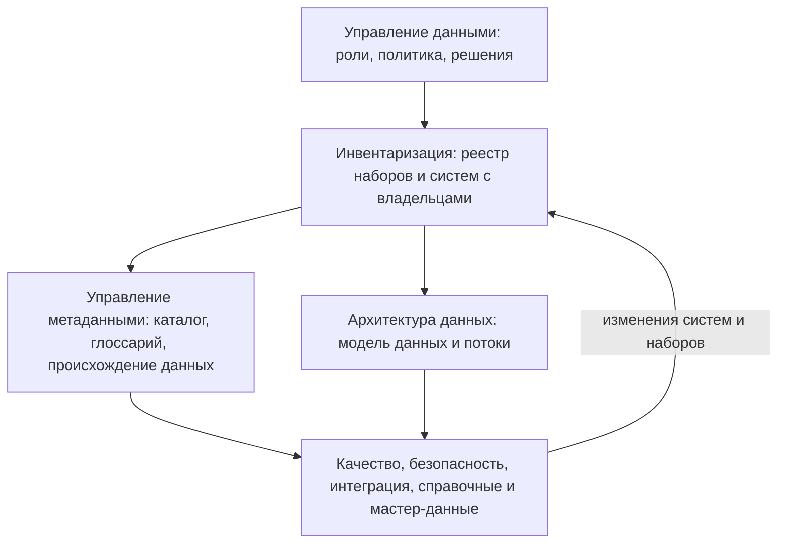

# DAMA-DMBOK и управление метаданными

DAMA-DMBOK (Data Management Body of Knowledge) — свод знаний по управлению данными, который выпускает международная ассоциация DAMA International. Он делит управление данными на одиннадцать областей с управлением данными (Data Governance) в центре и для каждой описывает цели, действия, участников и результаты. Отдельной области «инвентаризация» в своде нет: инвентаризация — первый шаг управления метаданными и исходный материал для архитектуры данных. DMBOK отвечает на вопрос, как поддерживать описания данных постоянно: кто за них отвечает, какие процессы встроить, как измерить результат. С чего начать, как найти данные, о которых никто не знает, и где искать данные у других, свод не говорит — для этого методы этой книги. Поэтому из DMBOK берут язык, роли и модель постоянного управления, а метод инвентаризации — отсюда.

## Коротко

| Что взять из DMBOK | Зачем при инвентаризации | Где подробнее |
|--------------------|--------------------------|---------------|
| **Одиннадцать областей** | Проверить, что опись не пропустила целый класс данных: документы, справочники, хранилища | [Одиннадцать областей](#одиннадцать-областей) |
| **Управление метаданными** | Реестр становится ядром каталога метаданных, его атрибуты раскладываются по видам метаданных | [Инвентаризация как управление метаданными](#инвентаризация-как-управление-метаданными) |
| **Архитектура данных** | Из реестра строят модель данных организации и потоки между системами | [Архитектура данных](#архитектура-данных) |
| **Роли** | Владелец данных и распорядители подтверждают записи и обновляют их после проекта | [Роли](#роли) |
| **Оценка зрелости** | Выбрать, с чего начинать, и показать руководству, что изменилось | [Оценка зрелости](#оценка-зрелости) |
| **Постоянное управление** | Встроить описание данных в жизненный цикл систем, чтобы реестр не устаревал | [От разовой описи к постоянному управлению](#от-разовой-описи-к-постоянному-управлению) |

## Что это за свод

**Издания.**

- **Первое издание** — 2009 год: десять функций управления данными.
- **Второе издание (DMBOK2)** — 2017 год: одиннадцать областей знаний и 17 глав. Кроме глав об областях в нём есть этика обращения с данными, большие данные и наука о данных, оценка зрелости, организация и роли, управление организационными изменениями.
- **Исправленное второе издание (DMBOK2R)** — 2024 год. DAMA называет его сопровождающим выпуском: каркас, области и их определения не менялись, исправлены ошибки и несогласованности. Для инвентаризации важны четыре правки: владелец данных определён явно — это представитель бизнеса, который отвечает за решения о данных своей области; «программа управления данными» переименована в «функцию», то есть в постоянную работу, а не проект; в текст включены критически важные элементы данных (critical data elements); к измерениям качества добавлена актуальность значений (currency). В главу об управлении данными добавлены этика и управление ИИ.
- **DMBOK 3.0** — проект начат 25 июня 2025 года. Цель — добавить ИИ, облачные технологии и современные платформы данных и сохранить основы. Текст пишут 11 редакторов направлений с главным редактором и техническим писателем, рецензируют 7 обладателей высшей ступени сертификата CDMP, черновики обсуждает сообщество. DAMA также изучает цифровую платформу для свода. На 25 октября 2026 года дата выхода на странице проекта не объявлена.

**Где взять.** Книга платная: у издательства Technics Publications PDF стоит $79,95, печатная — $99,95 (на октябрь 2026 года). Второе издание переведено на испанский, французский, итальянский, португальский, турецкий, арабский и нидерландский языки; русский перевод выпустило издательство «Олимп-Бизнес». Колесо и контекстные диаграммы областей DAMA выложила бесплатно под лицензией CC BY-ND 4.0. По своду сдают экзамен на сертификат специалиста по управлению данными CDMP (Certified Data Management Professional).

**Как устроен.** Колесо показывает области вокруг управления данными. Для каждой области есть контекстная диаграмма: определение, цели, входы, действия, результаты, поставщики, участники, потребители, методы, инструменты и метрики. Действия помечены буквами: планирование (P), разработка (D), контроль (C) и эксплуатация (O). При инвентаризации диаграмма служит готовым списком: кто поставляет сведения, кто ими пользуется и что считать результатом.

*Изображение: © 2024 DAMA International, [CC BY-ND 4.0](https://creativecommons.org/licenses/by-nd/4.0/). Источник — DAMA-DMBOK2R, 2024.*

## Одиннадцать областей

Колесо — не порядок работ, а карта ответственности: у каждой области свои данные, участники и документы. При инвентаризации его используют как список для проверки полноты: по каждой области спрашивают, какие наборы и системы к ней относятся и попали ли они в реестр.

| Область | Что это | Что даёт инвентаризации | Где в книге |
|---------|---------|-------------------------|-------------|
| **Управление данными** (Data Governance) — в центре | Полномочия, контроль и совместные решения о данных: стратегия, политика, роли, бизнес-глоссарий | Владелец и ответственный у каждой записи; кто утверждает реестр и отвечает за него после проекта | [«Владельцы и полномочия»](../03-process/03-owners-and-mandates.md), [«Кто отвечает после публикации»](../03-process/09-result-and-upkeep.md#кто-отвечает-после-публикации) |
| **Архитектура данных** | Потребности организации в данных и планы, по которым под них строят системы: модель данных, потоки, цепочки ценности | Что есть, где лежит и как связано с процессами. Архитектура — план, реестр — факт | [Архитектура данных](#архитектура-данных) |
| **Моделирование и проектирование данных** | Модели данных: понятийная, логическая, физическая | Схема и поля — расширенный состав записи | [«Расширенный состав»](../03-process/05-registry.md#расширенный-состав) |
| **Хранение данных и операции** | Базы данных, их эксплуатация, резервные копии, сроки хранения | Информационные системы и операторы; вывод из эксплуатации и преемники | [«Исчезнувшие системы и веб-архивы»](../04-sources/06-legacy.md) |
| **Безопасность данных** | Конфиденциальность, права доступа, защита | Режим доступа, причина ограничения, персональные данные | [«Доступ и ограничения»](../03-process/06-access.md) |
| **Интеграция и интероперабельность** | Перемещение данных и обмен ими между системами и организациями | Обмен данными — частая цель инвентаризации; программные интерфейсы и выгрузки — ссылка для выгрузки и формат | [«Зачем: цели»](../01-basics/03-goals.md#делиться-данными) |
| **Документы и контент** | Данные вне баз: документы, файлы, записи | Таблицы, бумажные журналы и файлы — тоже наборы, их легко пропустить | [«Что инвентаризируют»](../01-basics/02-what-is-inventoried.md) |
| **Справочные и мастер-данные** | Справочники значений и сведения об основных объектах — людях, организациях, имуществе | Эталонные реестры и расхождения между ведомствами; справочники значений самого реестра | [«Как читать полномочия»](../03-process/03-owners-and-mandates.md#как-читать-полномочия), [«Справочники значений»](../03-process/05-registry.md#справочники-значений) |
| **Хранилища данных и бизнес-аналитика** | Хранилища, витрины, отчётность | Аналитика — цель подхода «где найти нужное»; хранилище — копия, у неё свой владелец и первоисточник | [«Где найти нужное»](../02-approaches/01-two-approaches.md#где-найти-нужное) |
| **Метаданные** | Планирование, внедрение и контроль того, что позволяет обрабатывать, вести, интегрировать, защищать, проверять и регулировать другие данные | Реестр данных и есть метаданные | [Инвентаризация как управление метаданными](#инвентаризация-как-управление-метаданными) |
| **Качество данных** | Требования к качеству, измерение, исправление | Быстрая проверка — часть инвентаризации; правила и постоянный контроль — уже управление качеством | [«Качество данных»](../03-process/07-quality.md) |

Ближе всего к инвентаризации три области: управление данными, метаданные и архитектура. Остальные дают поля записи и вопросы для проверки полноты. Глава об этике в колесо не входит, но пригодится, когда реестр готовят для обмена персональными данными или обучения моделей.

## Инвентаризация как управление метаданными

В DMBOK цели управления метаданными — общее понимание деловых терминов и происхождения данных, сбор метаданных из разных источников, единый способ доступа к ним и качество, согласованность, актуальность и защищённость самих метаданных. Инвентаризация проходит те же действия один раз и вручную, управление метаданными повторяет их постоянно и автоматизирует сбор.

| Действие DMBOK | Что это значит | Шаг инвентаризации |
|----------------|----------------|--------------------|
| **1. Определить стратегию метаданных** (P) | Зачем организации описания данных и для кого | Цель и вопросы ([«Цели и вопросы»](../03-process/02-goals-and-questions.md)) |
| **2. Понять требования** (P) — деловых и технических пользователей | Кто будет искать и что хочет найти | Вопросы к реестру и вид результата ([«Вопросы к реестру»](../03-process/02-goals-and-questions.md#вопросы-к-реестру)) |
| **3. Определить архитектуру метаданных** (P): метамодель, стандарты, хранилища метаданных | Состав записи, стандарт описания, где хранится | 14 атрибутов и расширенный состав, DCAT, таблица или каталог ([«Реестр данных»](../03-process/05-registry.md), [«Стандарты описания»](./02-metadata-standards.md), [«От таблицы до каталога метаданных»](../06-tools/01-from-spreadsheet-to-catalog.md)) |
| **4. Создавать и вести метаданные** (O): интегрировать, распространять | Собрать описания из систем и от людей, свести и опубликовать | Методы, опросы, общедоступная часть реестра ([«Семь методов»](../02-approaches/02-methods.md)) |
| **5. Запрашивать, анализировать, строить отчёты** (O) | Поиск, происхождение данных, анализ последствий изменений | Карта данных, отчёт, пробелы ([«Результат и поддержка»](../03-process/09-result-and-upkeep.md)) |

Два результата свода инвентаризация обычно не даёт: происхождение данных (data lineage) и анализ последствий изменений (impact analysis). Для них нужны описания на уровне полей и потоков, а не наборов. Зато метрики DMBOK — охват метаданными, качество метаданных и активность хранилища метаданных — переносятся на реестр прямо: доля систем с описанием, доля записей со всеми 14 атрибутами, давность последней проверки.

*Изображение: © 2024 DAMA International, [CC BY-ND 4.0](https://creativecommons.org/licenses/by-nd/4.0/). Источник — DAMA-DMBOK2R, 2024.*

### Виды метаданных

DMBOK делит метаданные на деловые (business), технические (technical) и операционные (operational). Если разложить по ним 14 атрибутов реестра, видно, какую часть описания потом соберёт каталог, а какую — только люди.

| Вид | Что описывает | Атрибуты реестра | Кто заполняет в каталоге |
|-----|---------------|------------------|--------------------------|
| **Деловые** | Смысл и ответственность: что это, чьё, на каких условиях | Наименование, описание, ответственный и контакты, условия использования, организация-владелец; из расширенного состава — полномочие, нормативный акт, персональные данные | Люди: владелец и распорядители |
| **Технические** | Где и как хранится | Ссылка для выгрузки, формат; из расширенного состава — система, оператор, схема и поля | Каталог сам, из подключённых систем |
| **Операционные** | Как данные живут: обновление, изменения, проверки, доступ | Периодичность обновления, даты публикации и изменения, отметка о контроле качества, режим доступа; дата проверки записи, история изменений | Частично каталог, частично люди |

Идентификатор служебный и связывает все три вида. Раскладка — авторская: DMBOK описывает виды метаданных, но не поля реестра ([«Минимальный состав»](../03-process/05-registry.md#минимальный-состав)).

Главный вывод: технические метаданные каталог со временем соберёт сам, а деловые — владелец, полномочие, описание, условия — из баз данных не извлечь. Это и есть то, что инвентаризация оставляет надолго. В Казахстане требования по управлению цифровыми данными делят метаданные так же: функциональные, технические и операционные (пункт 6, [пример ниже](#пример-казахстанские-требования-по-управлению-цифровыми-данными)).

### Чего не видит каталог метаданных

Каталоги метаданных — OpenMetadata, DataHub, Apache Atlas и коммерческие — собирают описания из подключённых баз и хранилищ ([«От таблицы до каталога метаданных»](../06-tools/01-from-spreadsheet-to-catalog.md#четыре-уровня)). Поэтому они не заменяют инвентаризацию:

- **Видят только подключённое.** Бумажные журналы, таблицы на общих дисках, данные у подрядчиков, внешние и чужие данные в каталог сами не попадут.
- **Не знают владельца и основания.** Схема базы не говорит, по какому полномочию собраны данные и кто решает, кому их давать.
- **Права доступа в базе — не режим доступа.** Режим доступа определяет закон и решение владельца, а не настройки учётных записей ([«Доступ и ограничения»](../03-process/06-access.md)).
- **Не отвечают на вопрос задачи.** Каталог описывает свои таблицы, а не то, где найти данные для ответа на вопрос.

Порядок поэтому такой: сначала реестр по методам инвентаризации, потом подключение каталога, дальше — регулярная сверка. Таблицы в каталоге без записи в реестре — неописанные наборы, записи реестра без таблиц в каталоге — неподключённые системы, бумажные и внешние данные.

## Архитектура данных

В DMBOK архитектура данных — это выявление потребностей организации в данных и проектирование и поддержка генеральных планов под них. Действия: описать архитектуру данных организации — оценить существующие спецификации и составить дорожную карту; учитывать требования организации в проектах; связать архитектуру данных с архитектурой предприятия. Результаты — проект архитектуры, потоки данных, цепочки ценности данных, модель данных организации и дорожная карта.

Первое действие без инвентаризации не выполнить: нельзя оценить существующее, не зная, какие данные и системы есть. Обратная связь тоже есть: архитектура описывает, что должно быть, реестр — что есть. Расхождения между ними — задачи, так же как расхождения между полномочиями и найденными наборами ([«От полномочия к набору»](../03-process/03-owners-and-mandates.md#от-полномочия-к-набору)).

Что из реестра берут для архитектуры:

| Материал архитектуры | Откуда в реестре |
|----------------------|------------------|
| **Предметные области** | Записи, сгруппированные по объектам: люди, организации, имущество, финансы |
| **Матрица «наборы — процессы»** | Поле «полномочие»: какая функция порождает набор |
| **Матрица «наборы — системы»** | Поле «информационная система»: один набор в нескольких системах — дубли и кандидаты в эталонный источник |
| **Потоки данных** | Связанные записи: первоисточник у копии, полный набор у агрегата, преемник у выведенной системы |

В Казахстане эта связь записана в требованиях: архитектуру цифровых данных формируют на основе каталога — паспортов цифровых данных и описаний неоцифрованных данных (пункт 26), а концептуальную модель данных предметной области строят по паспортам и проверяют ежемесячно (пункт 27).

## Роли

В DMBOK решения о данных принимают не ИТ, а бизнес. Участники управления данными — руководящие комитеты, директор по данным (CDO), распорядители данных (data stewards) нескольких уровней и органы управления данными; владельцы данных поставляют сведения и решения. В ревизии 2024 года владелец данных определён как представитель бизнеса, который отвечает за решения о данных своей области.

| Роль в DMBOK | Кто это | Что делает для реестра | Роль в книге |
|--------------|---------|------------------------|--------------|
| **Директор по данным** (Chief Data Officer) | Руководит управлением данными | Утверждает реестр, отвечает за план обновления | Владелец процесса |
| **Руководящий комитет, совет по данным** | Решает вопросы между подразделениями | Разбирает споры о владельце, режиме доступа, эталонном источнике | — |
| **Владелец данных** (data owner) | Представитель бизнеса, который отвечает за решения о данных своей области, — обычно руководитель подразделения, чья это функция | Подтверждает запись, решает, кому давать данные | Владелец (подразделение) |
| **Деловой распорядитель** (business data steward) | Знает смысл и правила данных своей области | Описание, определения, условия, отметка о качестве | Ответственный |
| **Технический распорядитель** (technical data steward) | Ведёт данные в системах | Система, формат, ссылка, структура | Оператор и ответственный за систему |
| **Координирующий распорядитель** (coordinating data steward) | Сводит работу распорядителей разных областей | Сводит записи подразделений, следит за одинаковой подробностью | Координатор ([«Кому отправлять»](../03-process/04-questionnaires.md#кому-отправлять)) |

Расхождение в словах: в книге владелец — организация, в DMBOK — человек внутри организации. В подходе «где найти нужное» нужен первый, в подходе «чем владеем» — оба ([«Владелец, оператор, ответственный»](../03-process/03-owners-and-mandates.md#владелец-оператор-ответственный)).

Те же роли закрепляют законы. В США требования к инвентарю ведомства выполняет директор по данным (44 U.S.C. § 3520(c)(5)), в Великобритании за актив и его запись отвечает владелец информационного актива ([«Зарубежные методики»](./04-international-practice.md#реестры-информационных-активов-великобритании)). В Казахстане организация определяет лицо, ответственное за управление цифровыми данными в отрасли, и менеджера по данным; среди обязанностей менеджера — координация заполнения паспортов данных и проверка проектной документации новых систем (пункт 8 требований).

## Оценка зрелости

В DMBOK оценка зрелости — способ сравнить практики организации с уровнями зрелости, чтобы описать текущее состояние и возможности улучшения. Действия: спланировать оценку (цели, модель, границы, порядок работы, информирование), собрать сведения и оценить, доложить результаты, составить дорожную карту улучшений, повторить оценку. Среди инструментов свод называет хранилища метаданных и средства профилирования данных.

Сбор сведений для оценки — уже частичная инвентаризация: без перечня данных, систем и ответственных оценивать нечего. В обратную сторону оценка подсказывает, как вести инвентаризацию:

| Что есть в организации | С чего начинать |
|------------------------|-----------------|
| Ни владельцев, ни описаний | Таблица с 14 атрибутами, анализ полномочий и опрос владельцев; цель — первый реестр и назначенные ответственные |
| Ответственные есть, описания разбросаны по документам | Свести в один реестр, ввести справочники значений и план обновления |
| Работает каталог метаданных | Сверить каталог с реестром; добавить деловые метаданные, бумажные, закрытые и внешние данные |
| Управление данными — постоянная функция | Описание при создании системы, метрики охвата, плановые проверки |

Это шкала книги, а не уровни DMBOK. Кроме свода есть другие модели оценки, например DCAM ассоциации EDM Council: третья версия вышла 30 июня 2025 года и добавила компонент «знание деловых данных» (Business Data Knowledge).

## От разовой описи к постоянному управлению

Разовая инвентаризация — снимок на дату. Управление метаданными — процесс, который обновляет описания вместе с системами. Различия:

| | Разовая инвентаризация | Постоянное управление метаданными |
|-|------------------------|-----------------------------------|
| **Кто ведёт** | Проектная команда | Владелец процесса и распорядители в подразделениях |
| **Откуда сведения** | Документы, сайты, опросы, выгрузки | Технические — из самих систем автоматически, деловые — от людей |
| **Подробность** | Наборы и системы | До таблиц, полей и потоков |
| **Когда обновляется** | Раз в год-два, проектом | При каждом изменении системы и по графику |
| **Что проверяют** | Полноту и доступ на дату | Охват, качество метаданных, давность проверки |
| **Результат** | Реестр и отчёт | Каталог метаданных, бизнес-глоссарий, происхождение данных |

Переход делают в пять шагов:

1. **Закрепить реестр как основу каталога.** Идентификаторы записей не меняются при переходе, иначе ссылки и история потеряются ([«Реестр как данные»](../06-tools/03-registry-as-data.md)).
2. **Передать роли.** Владельцев и распорядителей записывают в положения о подразделениях или в приказ, а не в отчёт о проекте ([«Кто отвечает после публикации»](../03-process/09-result-and-upkeep.md#кто-отвечает-после-публикации)). Если подразделений десятки, записи ведут они сами по общим правилам, а центр собирает их и проверяет программой — это федеративная модель из Data Mesh ([«Федеративное управление»](./03-data-mesh.md#федеративное-управление)).
3. **Встроить описание в жизненный цикл системы.** Новая система получает запись до ввода в эксплуатацию, изменение структуры обновляет запись, вывод из эксплуатации меняет статус и называет преемника ([«Что встроить в процессы»](../03-process/09-result-and-upkeep.md#что-встроить-в-процессы)).
4. **Подключить автоматический сбор технических метаданных** и регулярно сверять каталог с реестром.
5. **Измерять.** Доля систем с описанием, доля записей с владельцем и всеми атрибутами, давность последней проверки, число расхождений каталога и реестра.

## Пример: казахстанские требования по управлению цифровыми данными

Постановление Правительства Республики Казахстан от 22 сентября 2026 года № 830 утвердило требования по управлению цифровыми данными (пункт 3 статьи 16 Цифрового кодекса) и отменило прежние требования по управлению данными — постановление от 7 ноября 2024 года № 925. Требования распространяются на государственные органы, государственные юридические лица и квазигосударственный сектор, кроме специальных государственных органов (пункт 2). Ссылки на DMBOK в тексте нет, но устройство близкое: виды метаданных, справочные и мастер-данные, жизненный цикл, роли, качество и архитектура данных. Инвентаризация в них — обязательная и постоянная.

| Что в требованиях | Пункт | Что соответствует в DMBOK | Где в книге |
|-------------------|-------|---------------------------|-------------|
| **Каталог цифровых данных** — систематизированный перечень сведений о видах цифровых данных и связях между ними; его актуализируют при каждом изменении структуры или источников данных | 9, 11 | Хранилище метаданных | [«Реестр данных»](../03-process/05-registry.md) |
| **Паспорт цифровых данных** цифрового объекта: организация формирует его на архитектурном портале, согласуют менеджер по данным и архитектурно-координационный центр; у новых систем — до ввода в промышленную эксплуатацию | 12, приложение 1 | Создание и ведение метаданных | [«Минимальный состав»](../03-process/05-registry.md#минимальный-состав) |
| **Описание неоцифрованных данных** — данные в бумажном виде, электронных таблицах, реестрах | 20, приложение 2 | Документы и контент | [«Что инвентаризируют»](../01-basics/02-what-is-inventoried.md) |
| **Виды метаданных** — функциональные, технические, операционные | 6 | Деловые, технические, операционные | [Виды метаданных](#виды-метаданных) |
| **Менеджер по данным** | 8 | Распорядитель данных | [Роли](#роли) |
| **Концептуальная модель данных предметной области** по паспортам, проверка ежемесячно, 5-го числа | 27 | Модель данных организации | [Архитектура данных](#архитектура-данных) |
| **Десять критериев качества** — точность, полнота, взаимосвязанность, сопоставимость, актуальность, уникальность, достоверность, своевременность, ясность, доступность | 29 | Качество данных | [«Качество данных»](../03-process/07-quality.md) |
| **Отказ от данных** меняет сведения в каталоге, данные архивируют или уничтожают | 79–83 | Жизненный цикл данных | [«Исчезнувшие системы и веб-архивы»](../04-sources/06-legacy.md) |

**Паспорт и 14 атрибутов.** Единица паспорта — цифровой объект, то есть система с её таблицами и полями, а не набор. В общей части паспорта есть организация, цифровой объект, доступность (ограниченный доступ или без ограничений), периодичность, график и порядок обновления, перечни нормативных актов о создании объекта, сборе данных и доступе, класс данных и дата паспорта. Структуру описывают до столбцов, с машинными именами полей: `table_name`, `column_name`, `column_type`, признак мастер-данных `isMD`.

- **Сверх 14 атрибутов:** источник данных по нормативному акту и фактический — то же сравнение «что положено — что найдено», что в главе [«Владельцы и полномочия»](../03-process/03-owners-and-mandates.md#от-полномочия-к-набору); пользователи по нормативному акту; объект описания; уровень межведомственного использования; способ ведения — бумажный, электронный или смешанный.
- **Нет в общей части:** ответственного и его контактов, ссылки для выгрузки, формата, условий использования и отметки о контроле качества. Качество оценивают отдельно, по критериям пункта 29.

Требования показывают, как инвентаризация становится постоянным управлением метаданными: каталог обязателен, обновление привязано к изменениям систем, роли назначены, качество проверяется по своим правилам. Доступ к каталогу бесплатный для организаций, а сведения о видах данных, основанные на общедоступной информации, бесплатно получают и граждане, и компании (пункт 19). Как это работает на практике, на октябрь 2026 года не проверялось. Где ещё в Казахстане учитывают системы — в главе [«Казахстан»](../07-countries/01-kazakhstan.md#где-учитывают-системы).

## Чего в DMBOK нет

- **Подхода «где найти нужное».** Свод — о данных своей организации. Как найти данные у других ведомств, общественных проектов и компаний, сравнить источники и понять, годятся ли они для задачи, — в частях [«Подходы и методы»](../02-approaches/01-two-approaches.md) и [«Где искать данные»](../04-sources/01-three-layers.md).
- **Метода поиска неизвестных данных.** Анализ полномочий, госзакупки, веб-архивы и поиск по аналогии в своде не описаны ([«Семь методов»](../02-approaches/02-methods.md)).
- **Минимального состава записи.** DMBOK описывает виды метаданных и действия, а не обязательные поля. Состав записи — 14 атрибутов и стандарты описания ([«Стандарты описания»](./02-metadata-standards.md)).
- **Государственной специфики.** Свод исходит из одной организации, где руководство может назначить владельцев приказом. В государстве владельцев много, их полномочия заданы законами, а режим доступа и публикацию определяет закон.
- **Начала с задачи.** DMBOK начинается со стратегии управления данными, инвентаризация — с конкретной цели и вопросов ([«Принципы»](../01-basics/04-principles.md#1-цели-определяют-всё)). Если управления данными в организации ещё нет, сначала нужен результат под задачу, а стратегия появляется потом.

## Ограничения

- **Свод платный и объёмный.** Бесплатно доступны колесо и контекстные диаграммы. Переведено ли на русский исправленное издание 2024 года, не проверялось.
- **Свод меняется.** DMBOK 3.0 может изменить состав и названия областей; на октябрь 2026 года его текст не опубликован.
- **Сопоставления авторские.** Раскладка атрибутов реестра по видам метаданных, действий свода по шагам инвентаризации и казахстанских требований по областям DMBOK — авторская: ни свод, ни требования таких соответствий не дают.
- **Состав ревизии 2024 года и проекта 3.0** приведён по страницам DAMA на 25 октября 2026 года и по контекстным диаграммам, а не по полному тексту книги.

## Источники

- DAMA International. The DAMA Guide to the Data Management Body of Knowledge (DAMA-DMBOK2R). 2nd ed., revised. Sedona, AZ: Technics Publications, 2024 — [страница свода](https://dama.org/learning-resources/dama-data-management-body-of-knowledge-dmbok/); главы, форматы и цены — [Technics Publications](https://technicspub.com/dmbok2/), проверено 25 октября 2026 года.
- Earley S., Henderson D., Sebastian-Coleman L. (ред.). DAMA-DMBOK: Data Management Body of Knowledge. 2nd ed. Technics Publications, 2017. Русский перевод: DAMA-DMBOK. Свод знаний по управлению данными. Второе издание / пер. с англ. Г. И. Агафонова. — М.: Олимп-Бизнес. — 830 с. — ISBN 978-5-9693-0404-8.
- DAMA International. [The DAMA-DMBOK 2.0 Revision](https://dama.org/dama-dmbok-revision/) — что изменилось в 2024 году, проверено 25 октября 2026 года.
- DAMA International. [DAMA-DMBOK 3.0 Project](https://dama.org/dama-dmbok-3-0-project/) — цели, начало 25 июня 2025 года, редакция и рецензенты; проверено 25 октября 2026 года.
- DAMA International. [Колесо и контекстные диаграммы DMBOK2R](https://dama.org/cpages/dmbok2r-wheels), лицензия CC BY-ND 4.0: колесо, диаграммы «Управление данными и распоряжение данными», «Архитектура данных», «Управление метаданными», «Оценка зрелости управления данными».
- Постановление Правительства Республики Казахстан от 22 сентября 2026 года № 830 «Об утверждении требований по управлению цифровыми данными» — [текст и статус](https://zakon.uchet.kz/rus/docs/P2600000830): действующий, проверено 25 октября 2026 года. Пункты 2, 6, 8, 9, 11, 12, 19, 20, 26, 27, 29, 79–83, приложения 1 и 2.
- EDM Council. [Announcing DCAM v3: Meet the new standard for your data](https://edmcouncil.org/announcement/announcing-dcam-v3-meet-the-new-standard-for-your-data/), 30 июня 2025 года.
- Главы [«Принципы»](../01-basics/04-principles.md#принципы-в-других-методиках) — принципы DMBOK рядом с принципами книги; [«Качество данных»](../03-process/07-quality.md#рамки-и-стандарты-качества) — измерения качества DAMA UK и DAMA NL; [«Стандарты описания»](./02-metadata-standards.md) — DCAT и DCAT-US; [«Data Mesh»](./03-data-mesh.md) — владение данными у доменов.
