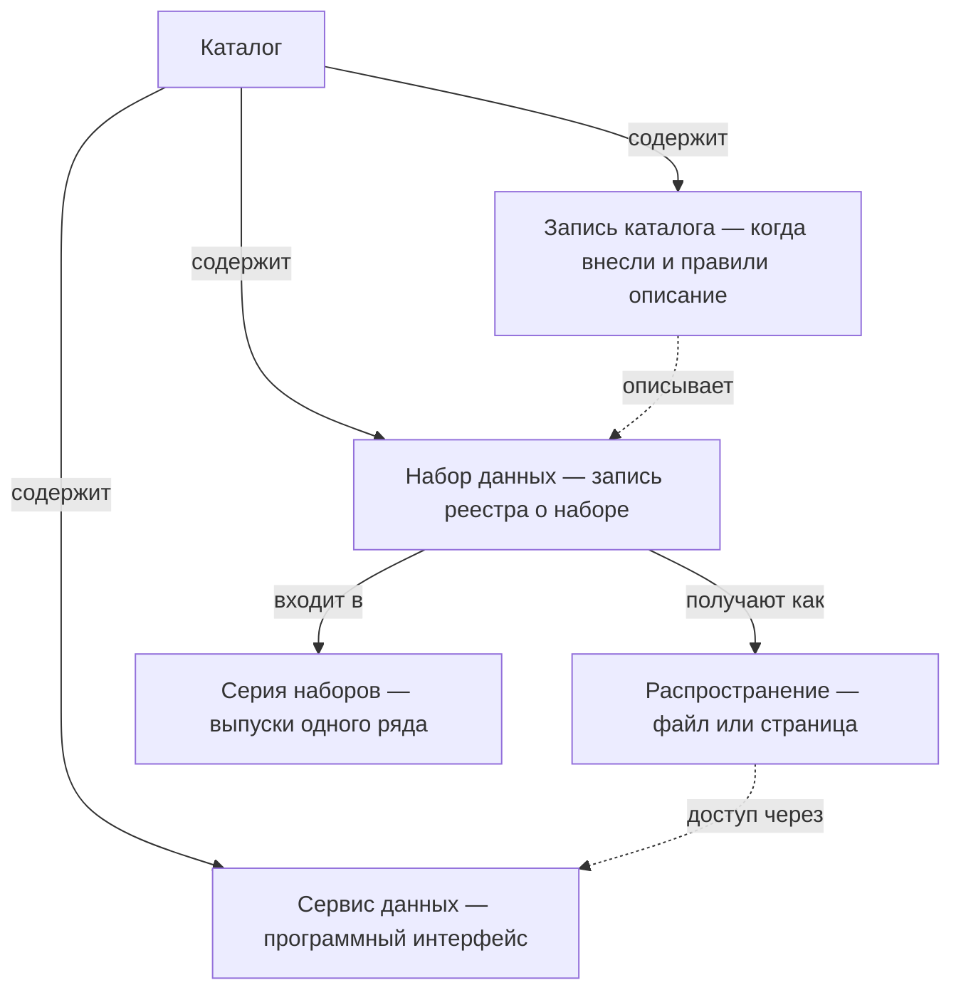

# Стандарты описания

Реестр не переписывают под стандарт описания: его колонки и справочники один раз сопоставляют со стандартом, и общедоступную часть выгружает программа при каждой версии реестра. Ни один стандарт не вмещает реестр целиком — информационную систему, полномочие, дату проверки и честное «не установлено» держат своими полями. Основа почти всех стандартов — словарь DCAT; в ЕС его уточняет профиль DCAT-AP, в США — DCAT-US 3.0. Ближе всех к инвентаризации DCAT-US 3.0: в нём есть ограничения доступа с основанием, полномочие, роли организаций и измерения качества.

Сведения проверены 25 октября 2026 года, если не указано иное. Версии стандартов и даты их выпуска — в «Источниках».

## Коротко

| Что сделать | Что получается | Готово, когда |
|-------------|----------------|---------------|
| **[Выбрать стандарт](#что-выбрать)** | Основной стандарт и профиль под цель и страну, отраслевые — для отдельных наборов | Стандарт и его версия записаны в паспорте реестра ([«Паспорт»](../03-process/09-result-and-upkeep.md#паспорт)) |
| **[Сопоставить колонки](#сопоставление-с-реестром)** | Таблица «колонка реестра — свойство стандарта» | У каждой колонки есть свойство или пометка «своё поле, не выгружается» |
| **[Сопоставить справочники](#справочники-и-словари)** | Коды реестра переведены в значения словарей стандарта | Каждый код переводится однозначно; для «не установлено» записано, что делать при выгрузке |
| **[Решить, как показать закрытое](#закрытые-наборы-в-стандартах)** | Правило для закрытых наборов и наборов с ограничениями | Ясно, какие свойства закрытого набора выгружают, а какие нет |
| **[Отметить наборы высокой ценности](#наборы-высокой-ценности)** | Категория у наборов из перечня ЕС | У каждого такого набора есть категория и ссылка на регламент |
| **[Решить, что делать с остальным](#что-в-стандарт-не-помещается)** | Свои поля и правило их выгрузки | Ни одно своё поле не попадает в выгрузку случайно |
| **[Выгрузить и проверить](#как-выгрузить-и-проверить)** | Файл по стандарту и отчёт валидатора | Валидатор не находит ошибок, а выборка записей проверена глазами |

:::tip[Как читать машинные описания]

- **Префикс** — короткое имя словаря перед свойством. `dct:title` — свойство «название» из словаря Dublin Core, `dcat:downloadURL` — «ссылка для выгрузки» из DCAT. Другие префиксы главы: `dqv:` — словарь качества, `prov:` — происхождение, `adms:` — статусы и коды, `dcatap:` — европейский профиль. В файле DCAT-US префиксы у полей обычно опускают: `title`, `downloadURL`.
- **JSON** — текстовый формат, в котором описание записано парами «поле: значение»; вложенные объекты заключают в фигурные скобки, списки — в квадратные. **JSON-LD** — тот же JSON с пометками, из какого словаря поле: служебные поля `@context` и `@type`.
- **RDF** — способ записать описание как набор утверждений «объект — свойство — значение». Его хранят в форматах Turtle, RDF/XML или JSON-LD. Так устроены описания DCAT-AP.
- **Валидатор** — программа, которая проверяет описание по правилам профиля: есть ли обязательные свойства, верны ли коды и даты. Правила для RDF пишут на языке SHACL, для JSON — JSON-схемой.
- **ISO 8601** — международный формат дат: `2026-10-25`. Длительность пишут с буквой P: `P1D` — день, `P1M` — месяц, `P1Y` — год. `R/P1D` значит «повторяется каждый день».
- **vCard** — стандарт электронной визитной карточки: `fn` — имя или название, `hasEmail` — адрес почты.

:::

## Словарь, профиль и формат

Словом «стандарт» называют четыре разные вещи. Путаница между ними — частая причина споров вроде «DCAT или DCAT-AP»: это не соперники, а словарь и правила его применения.

| Что | Что задаёт | Примеры |
|-----|------------|---------|
| **Словарь** | Классы и свойства с определениями. Ничего не делает обязательным | DCAT, Dublin Core, schema.org, словарь качества DQV |
| **Профиль применения** | Какие свойства обязательны, сколько у них значений и из каких словарей значений их брать. Описания проверяют по профилю | DCAT-AP, DCAT-US 3.0, DCAT-AP HVD |
| **Словари значений** | Списки кодов для частоты обновления, режима доступа, типа файла, темы, лицензии | Словари Бюро публикаций ЕС, коды ISO 19115, списки Национального архива США |
| **Формат записи** | Как описание лежит в файле или на странице | RDF у DCAT-AP; файл `data.json` у DCAT-US; разметка JSON-LD на странице набора у schema.org |

**Модель DCAT.** У всех профилей DCAT она одна, и понятия книги в ней узнаются:



В описаниях эти классы называются `dcat:Catalog`, `dcat:Dataset`, `dcat:DataService`, `dcat:CatalogRecord`, `dcat:Distribution` и `dcat:DatasetSeries`. Владелец набора в DCAT — публикатор (`dct:publisher`), ответственный — контактная точка (`dcat:contactPoint`). Ресурса и информационной системы в смысле книги в DCAT нет: описывают наборы, выделенные из них. Класс `dcat:Resource` в DCAT значит другое — это общий родитель набора, сервиса и каталога, напрямую его не используют.

Из модели следуют два правила для реестра:

- **Описывают набор, а не файл.** Один набор в CSV и через программный интерфейс — одна запись с двумя распространениями, а не две записи.
- **Дата изменения записи — не дата изменения данных.** В DCAT это свойства разных объектов: у набора — когда изменились данные, у записи каталога — когда изменилось описание. В реестре это тоже разные колонки: дата последнего изменения и дата проверки.

## Основные стандарты

| Стандарт | Что обязательно | Где применяется |
|----------|-----------------|-----------------|
| **DCAT** (Data Catalog Vocabulary) — словарь W3C, Консорциума Всемирной паутины, который принимает веб-стандарты | Ничего: это словарь | Основа профилей. В третьей версии появились серии наборов, версии, статус, контрольные суммы файлов |
| **DCAT-AP** — профиль DCAT для порталов Европы; ведёт SEMIC, центр Еврокомиссии по семантической совместимости | У набора — название и описание; у распространения — адрес доступа; у каталога — ещё публикатор | Порталы стран ЕС и европейский портал data.europa.eu; проверка — формы SHACL |
| **DCAT-US 3.0** — профиль DCAT 3 для США; ведут data.gov и Администрация общих служб (GSA) с Советом директоров по данным и Административно-бюджетным управлением при президенте (OMB) | У набора — название, описание, идентификатор и контакт с адресом почты | Полные инвентари данных федеральных ведомств; проверка — JSON-схема |
| **DCAT-US v1.1** — схема Project Open Data 2014 года, формат файла `data.json` | Название, описание, ключевые слова, дата изменения, публикатор, контакт, идентификатор, режим доступа; федеральным ведомствам — коды ведомства и программы | Файлы `data.json` ведомств до перехода на 3.0; data.gov собирает обе версии |
| **schema.org**, тип `Dataset` | В словаре — ничего; Google требует название и описание от 50 до 5000 знаков | Разметка на странице набора для Google Dataset Search и других поисковиков ([«Как устроены поисковики»](../04-sources/05-dataset-search.md#как-устроены-поисковики)) |
| **Dublin Core** — словарь DCMI, он же ISO 15836 | Ничего: это словарь | Из него DCAT берёт название, описание, даты, лицензию, публикатора — свойства с префиксом `dct:` |

Обязательный минимум каталожных профилей мал: в DCAT-AP набору достаточно названия и описания, в DCAT-US 3.0 — ещё идентификатора и контакта. Минимум рассчитан на то, чтобы набор нашли, а не на то, чтобы им можно было воспользоваться. Поэтому реестр шире любого обязательного минимума ([«С чем сверить состав»](#сопоставление-с-реестром)).

### DCAT-US 3.0 и полные инвентари США

Две версии DCAT-US легко спутать: обе лежат в файле `www.[ведомство].gov/data.json`, и обе собирает каталог data.gov.

- **DCAT-US v1.1** — схема Project Open Data: по ней ведомства описывают наборы с 2013 года, версия 1.1 вышла в 2014 году. Поля в ней простые — строки и списки; режим доступа — одно поле из трёх значений, качество — «да» или «нет».
- **DCAT-US 3.0** — профиль DCAT 3, опубликован 1 мая 2026 года. Поля в нём — объекты с типами, как в JSON-LD. Меморандум OMB M-25-05 требует вести по нему полный инвентарь данных ведомства и перевести на него инвентари до 30 сентября 2026 года ([«Инвентари данных федеральных ведомств США»](./04-international-practice.md#инвентари-данных-федеральных-ведомств-сша)).

Для инвентаризации в версии 3.0 важны поля, которых нет ни в v1.1, ни в каталожных профилях ЕС:

- **ограничение доступа** (`accessRestriction`) — статус из списка Национального архива США: `Unrestricted`, `Restricted - Partly`, `Restricted - Fully`, `Restricted - Possibly`, `Undetermined` — и основание из второго списка на 60 значений, среди них исключения закона о свободе информации (FOIA). «Не установлено» здесь — законное значение `Undetermined`;
- **маркировка и ограничения использования** (`cuiRestriction`, `useRestriction`) — для контролируемой несекретной информации, с тем, кто её назначил;
- **деятельность, которая создала набор** (`wasGeneratedBy`) — место для полномочия;
- **организации с ролями** (`qualifiedAttribution`) — так рядом с владельцем записывают оператора или распорядителя;
- **измерения качества** (`hasQualityMeasurement`) — метрика, признак качества, значение;
- **дата внесения в каталог** (`inventoried`) отдельно от даты публикации и **статус** (`status`): действует, устарел, в разработке, снят;
- **словарь данных** (`describedBy`) — описание полей.

Полей версии 1.1 `accessLevel`, `bureauCode` и `programCode` в основной схеме 3.0 нет, но схема их не отвергает, а руководство по переходу велит сохранять `accessLevel`, пока OMB не выпустит новое руководство. Поля `dataQuality` в 3.0 нет: качество описывают измерениями.

## Отраслевые стандарты

У многих отраслей свои стандарты описания — старше и подробнее DCAT. Заполнять их самой инвентаризации не нужно: достаточно записать, по какому стандарту владелец описывает набор (`dct:conformsTo`), и дать ссылку на его описание. Зато отраслевые описания — готовый источник сведений для реестра: в записи ISO 19115 на геопортале уже есть организации с ролями, контакт, частота обновления и ограничения доступа.

| Область | Стандарт | Что взять в реестр |
|---------|----------|--------------------|
| **Геоданные** | ISO 19115, в ЕС — правила INSPIRE, в Великобритании — UK GEMINI; для снимков и файлов с координатами — STAC | Владельца и оператора с ролями, частоту, ограничения, адрес сервиса или каталога снимков |
| **Статистика** | SDMX (ISO 17369) — ряды, показатели, разрезы, классификаторы; DDI — анкеты и переменные обследований | Показатели и разрезы — в схему; описание переменных, которого требует закон США о полном инвентаре |
| **Научные данные** | DataCite — DOI, авторы, издатель, связи с публикациями и грантами | DOI — вторым идентификатором, связи — в связанные записи |
| **Машинное обучение** | Croissant (MLCommons) и расширение Croissant RAI — как собирали и размечали, смещения, персональные данные | Схему, персональные данные, ограничения; описания Croissant отдают Hugging Face, Kaggle и OpenML |
| **Структура таблиц** | Table Schema из Frictionless Data Package, CSV on the Web (W3C) | Схему данных; по ней же проверяют файл ([«Инструменты»](../03-process/07-quality.md#инструменты)) |
| **Элементы данных** | ISO/IEC 11179 — реестры метаданных: элементы данных, их определения и области значений | Общий словарь полей; так устроен корейский общий словарь стандартных терминов |

Для отраслей есть и свои профили DCAT-AP: GeoDCAT-AP — геоданные, StatDCAT-AP — статистика, mobilityDCAT-AP — национальные точки доступа к транспортным данным ЕС, BRegDCAT-AP — базовые регистры государства. Договор поставщика данных с потребителями описывает стандарт контракта данных ODCS ([«Контракт данных»](./03-data-mesh.md#контракт-данных)).

## Национальные профили и схемы

Профили стран уточняют DCAT-AP или DCAT под свои порталы и законы. Порталы и числа стран — в главах части «Страновые практики».

| Страна | Что задаёт описание | Что важно для реестра |
|--------|---------------------|-----------------------|
| **Польша** | Профиль DCAT-AP-PL 2022 года, ещё до DCAT-AP 3; dane.gov.pl отдаёт каталог в DCAT | Выдача постраничная и обрывается на 10 000 записей; европейский портал собирает около 10 тысяч наборов dane.gov.pl через его программный интерфейс, а не по DCAT-AP |
| **Франция** | Своего профиля нет; data.gouv.fr отдаёт каталог в DCAT-AP | У наборов высокой ценности уже есть ссылка на регламент и категория. Для каталогов местных органов — упрощённая схема «Catalogue simplifié» OpenDataFrance: 20 полей, только опубликованное |
| **Великобритания** | Профиль метаданных критически важных активов данных на основе DCAT и Dublin Core; для геоданных — UK GEMINI | Гриф (`securityClassification`), которого нет в DCAT; «unknown» вместо пустого поля |
| **Южная Корея** | Стандартные метаданные data.go.kr по schema.org и DCAT | Названия полей баз данных — из общего словаря стандартных терминов |
| **Казахстан** | Своего профиля нет; состав описания задают правила размещения на портале открытых данных | Название, описание и ключевые слова на казахском и русском, ответственный с телефоном и почтой, владелец, поля с типами; поля для лицензии нет |
| **Россия** | Паспорт набора по Методическим рекомендациям по публикации открытых данных, версия 4.0 | 17 атрибутов в файле `meta.csv`, с версии 4.0 — ещё XML и JSON; лицензии и режима доступа нет: паспорт описывает только опубликованное |

Российские рекомендации утверждены протоколом правительственной комиссии, а не нормативным актом, и DCAT в них не упоминается. Международные стандарты описания в России приняты национальными стандартами — Дублинское ядро, метаданные геоданных по ISO 19115 и реестры метаданных по ISO/IEC 11179. Реквизиты документов — в приложении [«Нормативная база»](../09-appendices/02-legal-framework.md).

## Что выбрать

| Ситуация | Что выбрать |
|----------|-------------|
| **Внутренний реестр** | Свои колонки и таблица их сопоставления с DCAT. Если нужен готовый профиль под закрытые наборы — DCAT-US 3.0: в нём больше всего полей для ограничений, ролей и качества |
| **Публичный каталог в ЕС** | DCAT-AP или национальный профиль; для наборов высокой ценности — DCAT-AP HVD, для геоданных — GeoDCAT-AP поверх описаний INSPIRE |
| **Федеральное ведомство США** | DCAT-US 3.0 — обязателен по M-25-05 |
| **Страна без своего профиля** | DCAT-AP как образец: такие описания понимают европейские порталы, агрегаторы и поисковики. Например, казахстанскому порталу data.egov.kz переход на DCAT-AP сделал бы описания совместимыми с европейскими и международными каталогами |
| **Чтобы набор находили поисковики** | Разметка schema.org на странице набора — из той же записи реестра, что и выгрузка в каталог |
| **Геоданные, статистика, наука, машинное обучение** | Отраслевой стандарт владельца и ссылка на него в `dct:conformsTo`; в реестре — 14 атрибутов и ссылка на отраслевое описание |
| **Приоритеты открытия** | Категории наборов высокой ценности ЕС — даже вне ЕС |

Стандарт выбирают под то, куда уйдёт общедоступная часть. Сам реестр от выбора почти не зависит: колонки те же, меняется таблица сопоставления.

## Сопоставление с реестром

Сопоставление всех колонок шаблона [registry.csv](pathname:///templates/registry.csv) с DCAT-AP 3, DCAT-US 3.0 и файлом `data.json` по DCAT-US v1.1 — в файле [dcat-mapping.csv](pathname:///templates/dcat-mapping.csv). В нём строка на каждую колонку, на каждое значение справочника — периодичность, режим доступа, причина ограничения, статус — и на поля паспорта реестра. Программа выгрузки может читать этот файл. Вот строки, где стандарты расходятся сильнее всего:

| Колонка реестра | DCAT-AP 3 | DCAT-US 3.0 | data.json (v1.1) |
|-----------------|-----------|-------------|------------------|
| **Режим доступа** (`access_level`) | `dct:accessRights` | `accessRestriction` — статус и основание | `accessLevel` — можно ли открыть |
| **Ссылка для выгрузки** (`download_url`) | `dcat:downloadURL`; страница — `dcat:accessURL` | `downloadURL`; страница — `accessURL` | То же, что в 3.0 |
| **Отметка о качестве** (`quality_check`) | Словарь DQV | `hasQualityMeasurement` | `dataQuality` — «да» или «нет» |
| **Полномочие** (`mandate`) | `prov:wasGeneratedBy` | `wasGeneratedBy` | — |
| **Нормативный акт** (`legal_act`) | `dcatap:applicableLegislation` | — | — |
| **Информационная система** (`information_system`) | — | — | `primaryITInvestmentUII` — номер ИТ-инвестиции |

**Нормативный акт.** `dcatap:applicableLegislation` — самое близкое к основанию набора, что есть в каталожных стандартах ЕС: по определению DCAT-AP это законодательство, которое предписывает создавать набор или управлять им. Свойство необязательное, но для наборов высокой ценности обязательное. Значение — адрес акта, в ЕС — адрес по схеме ELI (European Legislation Identifier, европейский идентификатор законодательства). Поэтому нормативный акт в реестре стоит хранить не только номером и датой, но и адресом официального текста.

**Отметка о качестве.** В DCAT отдельного свойства для неё нет: результаты проверок описывают словарём качества W3C DQV — измерение, метрика, результат измерения и примечание о качестве. Обязательного списка измерений в DQV нет, его берут из рамки, которой пользуются ([«Качество данных»](../03-process/07-quality.md)). В `data.json` по v1.1 поле `dataQuality` отвечает только «да» или «нет»: соответствует ли набор руководству ведомства по качеству информации. Чисел и итога для задачи в нём нет, поэтому во внутреннем реестре его дополняют своей отметкой.

**С чем сверить состав.** 14 атрибутов реестра — не стандарт, а рабочий минимум инвентаризации. Полезно сравнить его с тем, что требуют каталоги и законы:

| Состав | Чего из 14 атрибутов не требует | Что требует сверх них |
|--------|---------------------------------|-----------------------|
| **DCAT-AP** — каталоги ЕС | Всего, кроме названия и описания: остальное рекомендуемое или необязательное, у распространения хватает адреса доступа | — |
| **DCAT-US v1.1** — `data.json` | Ссылки и лицензии — «если применимо»; периодичности, даты публикации, качества | Ключевых слов, кодов ведомства и программы; пояснения об ограничениях, если набор открыт не полностью |
| **Полный инвентарь ведомства США** — 44 U.S.C. § 3511 | Периодичности, формата, даты публикации, качества, контакта | Названий и определений всех переменных, местонахождения данных; статус раскрытия можно отметить как ещё не определённый ([состав](./04-international-practice.md#инвентари-данных-федеральных-ведомств-сша)) |
| **Паспорт цифровых данных** — Казахстан | Ответственного и контактов, ссылки для выгрузки, формата, условий использования, отметки о качестве; отдельного наименования и описания набора нет: паспорт описывает систему с таблицами | Источников данных по нормативному акту и фактических, пользователей по акту, структуры до столбцов с признаком мастер-данных ([«Казахстан»](../07-countries/01-kazakhstan.md#каталог-цифровых-данных)) |

Каталожные стандарты требуют минимум, чтобы найти опубликованное. У закона США, который требует учесть все данные ведомства, в том числе закрытые, с 14 атрибутами больше общего: владелец, статус доступа, способ получить данные, дата обновления и ограничения использования. Отметки о качестве нет ни в одном обязательном составе — её добавляет инвентаризация: без неё набор найден, но неясно, можно ли ему верить. Казахстанский паспорт ближе к расширенному составу: он описывает систему до столбцов и, как анализ полномочий, сравнивает источники по нормативному акту с фактическими.

**Паспорт реестра** — описание самого реестра ([«Паспорт»](../03-process/09-result-and-upkeep.md#паспорт)). В DCAT его описывают как каталог, теми же свойствами, что и набор: название и описание, составители и контакт (`dct:creator`, `dcat:contactPoint`), даты, лицензия, стандарт и файлы (`dct:conformsTo`, `dcat:distribution`). С третьей версии DCAT у каталога есть и версии (`dcat:version`, `dcat:previousVersion`). Границы реестра лишь частично ложатся в охват по территории и времени, а полей под цель, методы, охват, пробелы и правило общедоступной части в стандарте нет — их держат в паспорте своими полями. В файле `data.json` паспорта нет вовсе: в инвентаре GSA по DCAT-US 3.0 на верхнем уровне файла только тип и ссылка на схему. Поэтому паспорт хранят отдельным файлом рядом с реестром.

## Справочники и словари

Коды справочников реестра ([«Справочники значений»](../03-process/05-registry.md#справочники-значений)) переводят в значения словарей стандарта — таблица перевода в том же файле [dcat-mapping.csv](pathname:///templates/dcat-mapping.csv). Значения словарей ЕС — адреса, например `http://publications.europa.eu/resource/authority/frequency/DAILY`.

- **Свои справочники шире.** «Открытые данные» и «неструктурированные сведения» в DCAT-AP — оба `PUBLIC`, а в DCAT-US — `Unrestricted`. Различают их только во внутреннем реестре: от этого зависит, можно ли обработать набор программой.
- **«Не указаны» — не значение.** Если лицензии нет, свойство не выгружают, а что известно об условиях, пишут в поле прав (`dct:rights` или `rights`). Подставить CC0 — значит выдать догадку за условие владельца.
- **Словари меняются.** В версии словаря режимов доступа ЕС от 23 сентября 2026 года `RESTRICTED`, `CONFIDENTIAL` и `SENSITIVE` — частные случаи `NON_PUBLIC`, а `NORMAL` помечен устаревшим; профиль DCAT-AP перечисляет три значения — `PUBLIC`, `RESTRICTED`, `NON_PUBLIC`. Версию словаря записывают рядом с таблицей сопоставления.
- **Статусы доступа переводят по смыслу, а не по слову.** Поле режима доступа в `data.json` говорит, можно ли открыть набор, а не открыт ли он. Для наборов с ограничениями и закрытых в поле прав обязательно пояснение — подробно в разделе [«Закрытые наборы в стандартах»](#закрытые-наборы-в-стандартах).

## Закрытые наборы в стандартах

Каталожные стандарты придуманы для опубликованного, но закрытые наборы в них описать можно. Для подхода «чем владеем» это главное: описание закрытого набора показывает, что данные есть, у кого и почему их не дают ([«Полный реестр и общедоступная часть»](../03-process/09-result-and-upkeep.md#полный-реестр-и-общедоступная-часть)). Стандарты различают три уровня доступа, шкала книги — пять ([«Шкала»](../03-process/06-access.md#шкала)):

| Статус в реестре | DCAT-AP | DCAT-US 3.0 | data.json (v1.1) |
|------------------|---------|-------------|------------------|
| **Открытые данные** | `PUBLIC` | `Unrestricted` | `public` |
| **Неструктурированные сведения** | `PUBLIC` | `Unrestricted` | `public` |
| **С ограничениями** | `RESTRICTED` | `Restricted - Partly` | `restricted public` |
| **Закрыто** | `NON_PUBLIC` | `Restricted - Fully` с основанием | `non-public`, а если закрывать не на что — `public` |
| **Не установлено** | Соответствия нет: запись не выгружают | `Undetermined` | Соответствия нет |

Главное различие — в том, что описывает статус. Шкала книги описывает, что есть сейчас: можно ли получить данные на дату проверки. Поле режима доступа в `data.json` (`accessLevel`) описывает, можно ли сделать набор общедоступным, независимо от того, опубликован ли он. Поэтому неопубликованный набор, который закрывать не на что, в инвентаре ведомства США — `public`, а в реестре по шкале книги — «закрыто» с причиной «нормы нет». Для наборов `restricted public` и `non-public` нужно пояснение в поле прав. Закон о полном инвентаре допускает и «не установлено»: ведомство может отметить, что ещё не решило, может ли набор стать общедоступным.

Отсюда вывод для реестра: причина ограничения нужна не только для отчёта, из неё строится поле стандарта. Набор, закрытый без нормы, — `public` в `data.json`; набор, который норма закрывает целиком, — `non-public`; набор с условиями выдачи — `restricted public`, а пояснение в поле прав берут из подтверждения и условий.

Как это устроено в разных местах:

- **США.** Закон о полном инвентаре требует учесть все данные ведомства, в том числе закрытые, и публиковать инвентарь, убрав из него только то, что можно скрыть по закону о свободе информации ([«Инвентари данных федеральных ведомств США»](./04-international-practice.md#инвентари-данных-федеральных-ведомств-сша)).
- **ЕС.** По регламенту об управлении данными (Data Governance Act) страны держат перечни защищённых данных государственных органов, а европейский реестр защищённых данных на data.europa.eu собирает их в обычном DCAT-AP. У набора обязательны название, описание, публикатор, распространение и режим доступа — только `NON_PUBLIC` или `RESTRICTED`: открытые наборы туда не включают. У распространения обязательны формат, размер, адрес доступа и условия.
- **Польша.** С 2027 года держатель публичного реестра публикует в репозитории интероперабельности его метаданные — в том числе правовое основание, структуры данных и условия доступа ([«Репозиторий интероперабельности»](../07-countries/05-poland.md#репозиторий-интероперабельности)).

Описание закрытого набора — тоже данные с режимом доступа. Состав полей, внутренние адреса и примеры значений иногда закрывают вместе с набором: что из записи уходит в общедоступную часть, решают по правилу выборки, записанному в паспорте.

## Наборы высокой ценности

Наборы высокой ценности (high-value datasets) — данные, которые государственные органы ЕС обязаны отдавать в первую очередь. Перечень задаёт исполнительный регламент Комиссии (ЕС) 2023/138 к директиве об открытых данных; он применяется с 9 июня 2024 года. Реквизиты и статьи — в приложении [«Нормативная база»](../09-appendices/02-legal-framework.md).

- **Шесть категорий:** геопространственные данные; наблюдение Земли и окружающая среда; метеорологические данные; статистика; компании и владение компаниями; мобильность. У каждой категории регламент перечисляет наборы и сведения, которые в них должны быть.
- **Как отдавать:** бесплатно, в машиночитаемом виде, через программный интерфейс, а для части наборов — ещё и массовой выгрузкой; на условиях CC0, CC BY 4.0 или равноценной открытой лицензии.
- **Что требует от описания:** отметить наборы как наборы высокой ценности в их метаданных. DCAT регламент не называет.
- **Как отмечать:** по профилю DCAT-AP HVD. У набора обязательны ссылка на регламент в `dcatap:applicableLegislation` — `http://data.europa.eu/eli/reg_impl/2023/138/oj` — и категория в `dcatap:hvdCategory`. Набор должен быть доступен через сервис данных, у которого есть описание, адрес точки доступа и контакт.
- **Отчётность:** страны раз в два года отчитываются, передавая такие описания на data.europa.eu.

Для инвентаризации перечень полезен в двух ролях. В ЕС это обязанность: чтобы её выполнить, надо знать, какие из своих наборов попадают в категории, поэтому в реестр добавляют колонку с категорией. Вне ЕС это готовый список приоритетов и шесть групп вопросов для открытия данных ([«Цели и вопросы»](../03-process/02-goals-and-questions.md)).

## Что в стандарт не помещается

| Что в реестре | Почему не помещается | Что делать |
|---------------|----------------------|------------|
| **Информационная система и оператор** | Класса для системы нет; оператора можно указать только ролью организации | Систему держат своим полем, оператора выгружают как организацию с ролью, если это нужно пользователю |
| **Полномочие** | Деятельность в стандарте — это название, а не ссылка на лист «Полномочия» | Название полномочия — в деятельность, идентификатор — в реестре |
| **Персональные данные** | Отдельного свойства нет | Своё поле; в выгрузку — основание ограничения |
| **«Не установлено»** | Незаполненное свойство в стандарте просто отсутствует: «не нашли» не отличить от «не бывает» | Свойство не выгружают; коды «не установлено» — там, где словарь их допускает; догадки в описание не дописывают |
| **Дата проверки и откуда известно** | У набора таких свойств нет; у записи каталога есть только дата изменения описания | Своими полями; при выгрузке — дата изменения записи |
| **Копия в веб-архиве** | Свойства нет | Своё поле |
| **Связи с вопросами и итог «годится ли»** | Стандарты описывают набор, а не задачу | Лист связей реестра ([«Реестр как данные»](../06-tools/03-registry-as-data.md)) |

Свои поля остаются в реестре. Если каталог принимает дополнительные поля — RDF допускает свой префикс, схема DCAT-US 3.0 не запрещает лишние ключи, — их можно выгрузить, но агрегаторы и поисковики их не прочитают.

## Как выгрузить и проверить

1. **Записать сопоставление файлом:** колонка реестра, свойство стандарта, словарь значений и его версия, правило для «не установлено» и пустых. Образец — [dcat-mapping.csv](pathname:///templates/dcat-mapping.csv). Таблицу хранят рядом с реестром, программа выгрузки читает её.
2. **Выбрать записи и поля общедоступной части** по правилу из паспорта.
3. **Выгружать программой при каждой версии реестра**, а не руками: DCAT-AP — RDF в Turtle или JSON-LD, DCAT-US — файл `data.json`, schema.org — разметка на странице набора. На портале CKAN — открытой программе для порталов данных — эту работу делает расширение ckanext-dcat; оно отдаёт и описания Croissant.
4. **Проверить валидатором.** У DCAT-AP — формы SHACL и валидатор Interoperability Test Bed Еврокомиссии; у DCAT-US 3.0 — JSON-схема в репозитории GSA и валидатор сборщика data.gov. Валидатор находит пропущенные обязательные свойства, неверные коды и даты.
5. **Посмотреть глазами выборку записей.** Валидатор проверяет форму, а не смысл. Инвентарь GSA 25 октября 2026 года заявлял соответствие DCAT-US 3.0, и официальная схема не нашла ошибок ни в одной из 344 записей. Но в поле прав у открытых записей 139 раз стояло «N/A», а часть ссылок для выгрузки вела на страницы, а не на файлы. Проверка схемой — нижняя планка; весь разбор этого инвентаря — в главе [«Результат и поддержка»](../03-process/09-result-and-upkeep.md#пример-инвентарь-gsa).
6. **Проверить, что увидел агрегатор.** Агрегатор берёт не больше, чем отдаёт каталог: польский пример — в разделе [«Национальные профили и схемы»](#национальные-профили-и-схемы).
7. **Записать стандарт и версию** в паспорт реестра и пересматривать сопоставление при новой версии стандарта или словаря.

**Оценка метаданных data.europa.eu** (Metadata Quality Assessment) публично оценивает каждый каталог, который собирает европейский портал. Она считает, заполнены ли свойства и отвечают ли адреса, по четырём измерениям: находимость, доступность, совместимость и возможность повторного использования; высшая оценка — 7,5. Каталог dane.gov.pl в октябре 2026 года получил 5,23: описания и названия есть у всех наборов, а лицензия не нашлась ни у одного распространения. Даже вне ЕС такую оценку полезно читать как список того, что о вашем каталоге видит чужая программа.

## Пример записи в DCAT-US 3.0

Где мы в примере: запись реестра воздушных судов США из главы [«Реестр данных»](../03-process/05-registry.md#карточка-записи-faa) проверена в главе [«Качество данных»](../03-process/07-quality.md#пример-проверки) и выгружается в общедоступную часть по DCAT-US 3.0. Слева — колонки строки реестра, справа — поля описания DCAT-US 3.0, в которые они уходят; последняя строка — что осталось только в реестре.

| Колонки реестра | Поля DCAT-US 3.0 |
|-----------------|------------------|
| Идентификатор, наименование, описание, организация-владелец | `identifier`, `title`, `description`, `publisher` |
| Ответственный и контакты | `contactPoint` — без адреса почты |
| Периодичность, дата изменения | `accrualPeriodicity`, `modified`, `inventoried` |
| Режим доступа: открытые данные | `accessLevel`, `accessRestriction` |
| Условия использования: не указаны | `rights`: лицензии нет |
| Полномочие, нормативный акт | `wasGeneratedBy` |
| Отметка о контроле качества | `hasQualityMeasurement` |
| Ссылка для выгрузки, формат, схема данных | `distribution`, `describedBy` |
| Дата публикации, персональные данные, синонимы, копия в веб-архиве, откуда известно, дата проверки | только в реестре |

Сокращённая запись — без описания, измерения качества и словаря данных:

```json
{
  "@type": "dcat:Dataset",
  "identifier": "faa-aircraft-registry",
  "title": "Releasable Aircraft Database",
  "publisher": {"@type": "org:Organization", "name": "Federal Aviation Administration"},
  "contactPoint": {"@type": "vcard:Kind", "fn": "Aircraft Registration Branch (AFS-750)", "tel": "+1 866 762-9434"},
  "accrualPeriodicity": "daily",
  "accessLevel": "public",
  "accessRestriction": [{"restrictionStatus": "Unrestricted"}],
  "rights": ["No licence stated on the download page; works of the U.S. Government are not subject to copyright (17 U.S.C. 105)"],
  "modified": "2026-10-23",
  "wasGeneratedBy": [{"@type": "prov:Activity", "label": "Aircraft registration under 49 U.S.C. 44103"}],
  "distribution": [{
    "@type": "dcat:Distribution",
    "downloadURL": "https://registry.faa.gov/database/ReleasableAircraft.zip",
    "packageFormat": "application/zip",
    "mediaType": "text/csv"
  }],
  "inventoried": "2026-10-25"
}
```

<details>
<summary>Полная запись</summary>

```json
{
  "@type": "dcat:Dataset",
  "identifier": "faa-aircraft-registry",
  "title": "Releasable Aircraft Database",
  "description": "Civil aircraft registered in the United States. One row of the master file is one aircraft: N-number, serial number, model, year manufactured, owner and address, registration and airworthiness dates. Names and addresses withheld at the owner's request under 49 U.S.C. 44114(b) are not included.",
  "publisher": {
    "@type": "org:Organization",
    "name": "Federal Aviation Administration",
    "subOrganizationOf": [
      {"@type": "org:Organization", "name": "U.S. Department of Transportation"}
    ]
  },
  "contactPoint": {
    "@type": "vcard:Kind",
    "fn": "Aircraft Registration Branch (AFS-750)",
    "tel": "+1 866 762-9434"
  },
  "accrualPeriodicity": "daily",
  "accessLevel": "public",
  "accessRestriction": [
    {"restrictionStatus": "Unrestricted", "restrictionNote": "Whole database as one archive, no registration"}
  ],
  "rights": [
    "No licence stated on the download page; works of the U.S. Government are not subject to copyright (17 U.S.C. 105)"
  ],
  "modified": "2026-10-23",
  "wasGeneratedBy": [
    {"@type": "prov:Activity", "label": "Aircraft registration under 49 U.S.C. 44103"}
  ],
  "hasQualityMeasurement": [
    {
      "@type": "dqv:QualityMeasurement",
      "isMeasurementOf": {
        "@type": "dqv:Metric",
        "inDimension": "https://www.w3.org/TR/vocab-dqv/#dqv:completeness",
        "expectedDataType": "xsd:decimal",
        "definition": "Share of empty values in YEAR MFR"
      },
      "value": "22.4",
      "unitMeasure": "percent"
    }
  ],
  "distribution": [
    {
      "@type": "dcat:Distribution",
      "downloadURL": "https://registry.faa.gov/database/ReleasableAircraft.zip",
      "packageFormat": "application/zip",
      "mediaType": "text/csv",
      "format": "ZIP: 7 comma-delimited text files",
      "describedBy": {
        "@type": "dcat:Distribution",
        "downloadURL": "https://registry.faa.gov/database/ardata.pdf",
        "mediaType": "application/pdf"
      }
    }
  ],
  "inventoried": "2026-10-25"
}
```

</details>

Официальная JSON-схема DCAT-US 3.0 находит в записи одну ошибку: у контакта нет обязательного адреса почты. Адрес на странице выгрузки FAA — для сообщений о сбоях сайта, а не для вопросов о данных. Подставлять его нельзя: в каталог уйдёт адрес, по которому на вопрос о данных не ответят. Правильный ход — запросить у владельца рабочий адрес подразделения и до ответа запись не публиковать. Стандарт здесь работает как проверка реестра: он показал пробел, который в таблице выглядел заполненным.

Что ещё пришлось решить при выгрузке:

- **Дата публикации не установлена** — поля нет. Первая копия страницы в веб-архиве от 12 августа 2005 года — граница «не позже», а не дата публикации.
- **Лицензии нет** — поля лицензии нет, что известно об условиях — в поле прав.
- **Архив с текстовыми файлами** — формат архива отдельно, тип файлов внутри отдельно; описание полей — в словаре данных.
- **Полномочие** — в деятельность текстом: у неё в DCAT-US есть только название и категория, идентификатор из листа «Полномочия» туда не положить.
- **Отметка о качестве** — в стандарт уходит одно измерение, а вопрос владельцу о записях без имени остаётся в реестре.
- **Дата внесения в каталог** — день, когда запись впервые внесли в реестр; повторная проверка её не меняет.

Синониму «Aircraft Registration Database» поля в DCAT-US 3.0 нет: другой идентификатор (`otherIdentifier`) — для кодов вроде DOI, а не для других названий. Закрытую запись «Aircraft Registration System» из инвентаря Министерства транспорта, которую нашли поисковики ([«Реестр воздушных судов США»](../04-sources/05-dataset-search.md#пример-реестр-воздушных-судов-сша)), с этой записью связало бы поле источника (`source`): выгрузка получена из данных системы.

## Частые ошибки

- **Спорят, какой стандарт лучше, вместо того чтобы сопоставить колонки.** Реестр от выбора почти не зависит; таблица сопоставления меняется за день.
- **Путают версии DCAT-US.** Файл `data.json` бывает и по v1.1, и по 3.0, а сборщик ждёт ту версию, с которой зарегистрирован источник. Описание по одной версии, отправленное как другая, отклоняют целиком ([«Федеративный инвентарь США»](./03-data-mesh.md#федеративный-инвентарь-сша)).
- **Сопоставляют один раз.** Профили и словари выходят новыми версиями. Версию стандарта и словарей записывают в паспорт и пересматривают раз в год.

Сквозные ошибки — значения по умолчанию вместо «не установлено», страница вместо выгрузки, весь реестр в публичном каталоге — в главе [«Практики и антипаттерны»](../08-practices/01-practices-and-anti-patterns.md).

## Ограничения

- Стандарты описывают опубликованное и то, что можно найти. Системы, полномочия, пробелы и то, что найти не удалось, остаются в реестре своими полями.
- Национальные профили отстают от европейского: польский профиль вышел ещё до DCAT-AP 3.
- Отраслевые стандарты не сводятся в один: их связывают ссылками, а не переписывают в DCAT.
- Стандарт не говорит, годятся ли данные для задачи: это решает проверка самих данных ([«Качество данных»](../03-process/07-quality.md)).
- Таблица сопоставления — авторская: стандарты публикуют свои таблицы переходов между версиями, но не сопоставление с реестром книги.

## Источники

- [Data Catalog Vocabulary (DCAT) — Version 3](https://www.w3.org/TR/vocab-dcat-3/) — W3C Recommendation, 22 августа 2024 года: классы и свойства, `dcat:hadRole`, `prov:wasGeneratedBy`, `adms:status`, `dcat:packageFormat`, запись каталога.
- [DCAT-AP 3.0.1](https://semiceu.github.io/DCAT-AP/releases/3.0.1/) — SEMIC Recommendation от 27 октября 2025 года, версия 3.0.0 — 18 июня 2024 года: обязательные свойства, `dcatap:applicableLegislation`, словари; [список выпусков](https://interoperable-europe.ec.europa.eu/collection/semic-support-centre/solution/dcat-application-profile-data-portals-europe/releases); [валидатор DCAT-AP](https://www.itb.ec.europa.eu/shacl/dcat-ap/upload) — Interoperability Test Bed.
- [DCAT-AP for High Value Datasets 3.0.0](https://semiceu.github.io/DCAT-AP/releases/3.0.0-hvd/) — SEMIC, 25 октября 2024 года.
- Отраслевые профили: [GeoDCAT-AP 3.1.0](https://semiceu.github.io/GeoDCAT-AP/releases/3.1.0/) — 16 февраля 2026 года; [StatDCAT-AP](https://semiceu.github.io/StatDCAT-AP/drafts/3.0.0/) — выпуск 1.0.1 2019 года, проект 3.0.0 2026 года; [mobilityDCAT-AP](https://w3id.org/mobilitydcat-ap) 3.0.0 — NAPCORE, 19 октября 2026 года; [BRegDCAT-AP](https://interoperable-europe.ec.europa.eu/collection/access-base-registries/solution/bregdcat-ap/releases) 2.1.0 — 2021 года, обновлён 20 июня 2024 года.
- Словари Бюро публикаций ЕС — [Access Right](http://publications.europa.eu/resource/authority/access-right) и [Frequency](http://publications.europa.eu/resource/authority/frequency), версии 20260923-0; запрос к SPARQL-точке Бюро публикаций 25 октября 2026 года.
- [DCAT-US Schema v3.0](https://resources.data.gov/resources/dcat-us3/) от 1 мая 2026 года и [поля набора](https://resources.data.gov/standards/catalog/dcat-us-3/dataset/) — resources.data.gov, проверено 26 октября 2026 года; [JSON-схема 3.0.0](https://github.com/GSA/dcat-us) — GSA; [руководство по переходу](https://resources.data.gov/resources/dcat-us-3-migration/); [новость о публикации](https://www.councils.gov/news-events/news/dcat-us-schema-30-is-published/) — Совет директоров по данным; [DCAT-US v1.1](https://resources.data.gov/resources/dcat-us/) — схема Project Open Data от 6 ноября 2014 года, поля `accessLevel`, `rights`, `dataQuality`, `primaryITInvestmentUII`, `systemOfRecords`, проверено 26 октября 2026 года; [валидатор](https://harvest.data.gov/validate/).
- [OMB M-25-05](https://www.whitehouse.gov/wp-content/uploads/2025/01/M-25-05-Phase-2-Implementation-of-the-Foundations-for-Evidence-Based-Policymaking-Act-of-2018-Open-Government-Data-Access-and-Management-Guidance.pdf) от 15 января 2025 года — раздел 4(a), сроки в приложении.
- Списки Национального архива США: [Access Restriction Status](https://www.archives.gov/research/catalog/lcdrg/authority-lists/access-restriction-status) и [Specific Access Restriction](https://www.archives.gov/research/catalog/lcdrg/authority-lists/specific-access-restriction).
- [Data Quality Vocabulary](https://www.w3.org/TR/vocab-dqv/) — W3C Working Group Note, 15 декабря 2016 года. Поле `dataQuality` в DCAT-US v1.1 ссылается на руководства ведомств по закону о качестве информации — раздел 515 Public Law 106-554 и руководство OMB 2002 года (67 FR 8452).
- [open.gsa.gov/data.json](https://open.gsa.gov/data.json) — инвентарь GSA: записи посчитаны и проверены JSON-схемой DCAT-US 3.0.0 25 октября 2026 года.
- [Commission Implementing Regulation (EU) 2023/138](https://eur-lex.europa.eu/eli/reg_impl/2023/138/oj) от 21 декабря 2022 года, опубликован 20 января 2023 года, — наборы высокой ценности: статьи 3–6 и приложение; [директива (ЕС) 2019/1024](https://eur-lex.europa.eu/eli/dir/2019/1024/oj), статья 14.
- data.europa.eu: [оценка метаданных](https://data.europa.eu/mqa/) — оценка каталога dane.gov.pl от 18 октября 2026 года; [реестр защищённых данных](https://data.europa.eu/data/datasets?superCatalog=erpd) и [рекомендации по сбору описаний](https://data.europa.eu/sites/default/files/course/v1.3_ERPD_Technical%20recommendations%20for%20member%20states_Harvesting%20guidelines.pdf), версия 1.3 от 29 августа 2023 года.
- Национальные профили: [DCAT-AP-PL 2.1.0](https://dane.gov.pl/dcat-ap-pl/) от 31 мая 2022 года и [каталог dane.gov.pl в DCAT](https://api.dane.gov.pl/catalog.jsonld) — 28 792 записи, выдача обрывается на 500-й странице по 20 записей; [каталог data.gouv.fr в DCAT-AP](https://www.data.gouv.fr/api/1/site/catalog.jsonld), [отметка наборов высокой ценности](https://guides.data.gouv.fr/autres-ressources-utiles/donnees-de-forte-valeur-modalites-de-rapportage) и [схема scdl/catalogue](https://schema.data.gouv.fr/scdl/catalogue/) — OpenDataFrance; [Record metadata to describe critical data assets](https://www.gov.uk/government/publications/record-metadata-to-describe-critical-data-assets) — GDS, 16 апреля 2026 года; [UK GEMINI 2.3](https://www.agi.org.uk/uk-gemini/) — AGI; [пример страницы набора data.go.kr](https://www.data.go.kr/data/15127106/fileData.do) со стандартными метаданными.
- Казахстан: [Правила размещения информации на интернет-портале открытых данных](https://adilet.zan.kz/rus/docs/V2500035957) — приказ Министра культуры и информации от 07.04.2025 № 143-НҚ в редакции приказа от 29.05.2026 № 251-НҚ, действует с 12 июля 2026 года; adilet.zan.kz из сети, где проверялась книга, не открылся, тексты сверены по копии ИЗПИ на [zakon.uchet.kz](https://zakon.uchet.kz/rus/docs/V2600038823). Описание набора data.egov.kz отдаёт без ключа — [пример для gbd_ul](https://data.egov.kz/datasets/getmeta?index=gbd_ul&version=v1).
- Россия: Методические рекомендации по публикации открытых данных, версия 4.0 — приложение № 3 к протоколу президиума Правительственной комиссии по цифровому развитию от 12 декабря 2024 года № 49пр, [копия на сайте ФНС России](https://data.nalog.ru/html/sites/www.new.nalog.ru/files/opendata/metodOD4_0.doc); версия 3.0 — протокол Правительственной комиссии по координации деятельности Открытого Правительства от 29.05.2014 № 4. ГОСТ Р 7.0.10-2019 (ISO 15836-1:2017), ГОСТ Р 57668-2017 (ISO 19115-1), ГОСТ Р ИСО/МЭК 11179-1-2010 — «действует» по [каталогу gostinfo.ru](https://www.gostinfo.ru/InformationOfStandardization/Details/1759).
- Основные и отраслевые стандарты, проверено 25 октября 2026 года: [schema.org](https://schema.org/docs/releases.html) — выпуск 30.1 от 16 сентября 2026 года; [структурированные данные Dataset](https://developers.google.com/search/docs/appearance/structured-data/dataset) — Google; [DCMI Metadata Terms](https://www.dublincore.org/specifications/dublin-core/dcmi-terms/) — 20 января 2020 года, ISO 15836-1:2017 и 15836-2:2019; [ISO 19115-1:2014](https://www.iso.org/standard/53798.html) с изменениями 2018 и 2020 годов и [ISO 19115-3:2023](https://www.iso.org/standard/80874.html), правила INSPIRE — регламент 1205/2008; [STAC 1.1.0](https://github.com/radiantearth/stac-spec/releases) — 11 сентября 2024 года; [SDMX 3.1](https://sdmx.org/standards-2/) — май 2025 года; [DDI](https://ddialliance.org/) — Codebook 2.6 (апрель 2026 года), Lifecycle 3.3, DDI-CDI 1.0 (январь 2025 года); [DataCite Metadata Schema 4.7](https://schema.datacite.org/) — 3 марта 2026 года; [Croissant 1.1](https://docs.mlcommons.org/croissant/docs/croissant-spec-1.1.html) — 29 января 2026 года, и [Croissant RAI 1.0](https://docs.mlcommons.org/croissant/docs/croissant-rai-spec.html); [Data Package v2](https://datapackage.org/) — 26 июня 2024 года; [CSV on the Web](https://www.w3.org/TR/tabular-metadata/) — 17 декабря 2015 года; [ISO/IEC 11179-3:2023](https://www.iso.org/standard/78915.html), части 1 и 31 — 2023 года; [Open Data Contract Standard](https://github.com/bitol-io/open-data-contract-standard/releases). ckanext-dcat отдаёт описания Croissant с версии 2.3.0.
- Подробно о стандартах описания и их поддержке платформами — в книге [«Каталоги данных»](https://datacatalogs.begtin.tech/).
