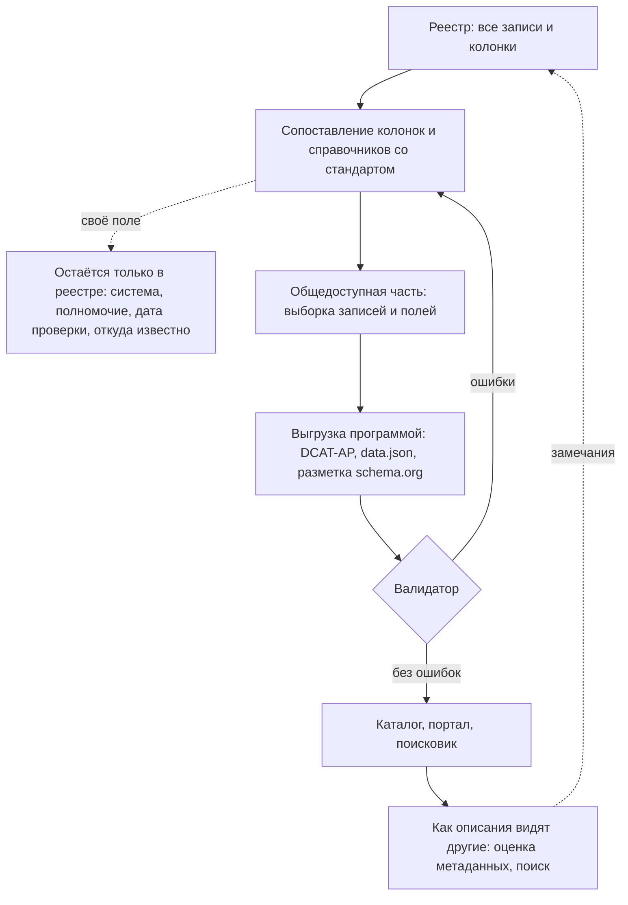

# Стандарты описания

Стандарт описания — общий язык, на котором записи реестра понимают каталоги, порталы и поисковики. Для инвентаризации важно не столько выбрать стандарт, сколько в первый день сопоставить с ним колонки реестра и справочники значений: тогда общедоступную часть выгружают программой при каждой версии реестра, а не переписывают руками. Основа почти всех стандартов — словарь DCAT 3 консорциума W3C. В ЕС его уточняет профиль DCAT-AP 3.0.1, в США — DCAT-US 3.0: по ней федеральные ведомства к 30 сентября 2026 года перевели полные инвентари данных. Для поисковиков нужна разметка schema.org, у отраслей свои стандарты: ISO 19115 для геоданных, SDMX и DDI для статистики, DataCite для научных данных, Croissant для машинного обучения. Ни один стандарт не вмещает реестр целиком: информационную систему, полномочие, персональные данные, дату проверки и честное «не установлено» держат своими полями. Ближе всех к инвентаризации DCAT-US 3.0 — в ней есть ограничения доступа с основанием, деятельность, ради которой набор создан, роли организаций и измерения качества. Наборы высокой ценности ЕС — не стандарт, а перечень того, что публикуют в первую очередь, с обязанностью отметить такие наборы в описании.

## Коротко

| Что сделать | Что получается | Готово, когда |
|-------------|----------------|---------------|
| **[Выбрать стандарт](#что-выбрать)** | Основной стандарт и профиль под цель и страну, отраслевые — для отдельных наборов | Стандарт и его версия записаны в паспорте реестра ([«Паспорт»](../03-process/08-result-and-upkeep.md#паспорт)) |
| **[Сопоставить колонки](#сопоставление-с-реестром)** | Таблица «колонка реестра — свойство стандарта» | У каждой колонки есть свойство или пометка «своё поле, не выгружается» |
| **[Сопоставить справочники](#справочники-и-словари)** | Коды реестра переведены в значения словарей стандарта | Каждый код переводится однозначно; для `unknown` записано, что делать при выгрузке |
| **[Решить, как показать закрытое](#закрытые-наборы-в-стандартах)** | Правило для закрытых наборов и наборов с ограничениями | Ясно, какие свойства закрытого набора выгружают, а какие нет |
| **[Решить, что делать с остальным](#что-в-стандарт-не-помещается)** | Свои поля и правило их выгрузки | Ни одно своё поле не попадает в выгрузку случайно |
| **[Выгрузить и проверить](#как-выгрузить-и-проверить)** | Файл по стандарту и отчёт валидатора | Валидатор не находит ошибок, а выборка записей проверена глазами |
| **[Отметить наборы высокой ценности](#наборы-высокой-ценности)** | Категория у наборов, которые попадают в перечень ЕС | У каждого набора из перечня есть категория и ссылка на регламент |



## Словарь, профиль и формат

Словом «стандарт» называют четыре разные вещи. Путаница между ними — частая причина споров вроде «DCAT или DCAT-AP»: это не соперники, а словарь и правила его применения.

| Что | Что задаёт | Примеры |
|-----|------------|---------|
| **Словарь** | Классы и свойства с определениями. Ничего не делает обязательным | DCAT 3, Dublin Core, schema.org, словарь качества DQV |
| **Профиль применения** | Какие свойства обязательны и рекомендуемы, сколько у них значений и из каких словарей значений их брать. Описания проверяют по профилю | DCAT-AP, DCAT-US 3.0, DCAT-AP-PL, DCAT-AP HVD |
| **Словари значений** | Списки кодов для частоты обновления, режима доступа, типа файла, темы, лицензии | Словари Бюро публикаций ЕС, коды ISO 19115, списки Национального архива США (NARA) |
| **Формат записи** | Как описание лежит в файле или на странице | RDF в Turtle, RDF/XML или JSON-LD — у DCAT-AP; JSON-файл `data.json` — у DCAT-US; разметка JSON-LD на странице набора — у schema.org |

Модель у всех профилей DCAT одна. **Каталог** содержит **наборы** и **сервисы данных**. У набора есть **распространения** — файлы или страницы, через которые его получают; программный интерфейс описывают сервисом данных. Выпуски одного ряда объединяют **серией**. Когда набор внесли в каталог и когда правили его описание, хранит **запись каталога** (`dcat:CatalogRecord`). Как эти классы соотносятся с понятиями книги — в разделе [«Как это называется в стандартах и законах»](../01-basics/04-what-is-inventoried.md#как-это-называется-в-стандартах-и-законах).

Из модели следуют два правила для реестра:

- **Описывают набор, а не файл.** Один набор в CSV и через программный интерфейс — одна запись с двумя формами, а не две записи.
- **Дата изменения записи — не дата изменения данных.** В DCAT это свойства разных объектов: `dct:modified` у набора — когда изменились данные, у записи каталога — когда изменилось описание. В реестре это тоже разные колонки: `modified` и `checked`.

## Основные стандарты

| Стандарт | Чей, версия | Что обязательно | Формат | Где применяется |
|----------|-------------|-----------------|--------|-----------------|
| **DCAT 3** (Data Catalog Vocabulary) | W3C, рекомендация от 22 августа 2024 года | Ничего: это словарь | Любой формат RDF | Основа профилей. Нового в третьей версии — серии наборов, версии, статус, контрольные суммы файлов |
| **DCAT-AP 3.0.1** | SEMIC, Еврокомиссия, 27 октября 2025 года; версия 3.0.0 — 18 июня 2024 года | У каталога — название, описание, публикатор; у набора — название и описание; у распространения — адрес доступа; у сервиса — название и адрес точки доступа | RDF; проверка — формы SHACL | Порталы стран ЕС и data.europa.eu: 1 858 143 набора на 25 октября 2026 года |
| **DCAT-US 3.0** | data.gov (GSA) вместе с Советом директоров по данным и OMB, 1 мая 2026 года | У набора — название, описание, идентификатор и контакт с адресом почты | JSON, файл `www.[ведомство].gov/data.json`; проверка — JSON-схема | Полные инвентари данных федеральных ведомств США и каталог data.gov: 431 278 наборов на 25 октября 2026 года |
| **DCAT-US v1.1** | Бывшая схема Project Open Data, 6 ноября 2014 года | Название, описание, ключевые слова, дата изменения, публикатор, контакт, идентификатор, режим доступа; федеральным ведомствам — ещё коды ведомства и программы | JSON, `data.json` | data.gov собирает такие файлы, пока идёт переход на 3.0 |
| **schema.org**, тип `Dataset` | Сообщество schema.org, выпуск 30.1 от 16 сентября 2026 года | В словаре — ничего; Google требует название и описание от 50 до 5000 знаков | Разметка JSON-LD на странице набора | Google Dataset Search и другие поисковики ([«Как устроены поисковики»](../04-sources/05-dataset-search.md#как-устроены-поисковики)) |
| **Dublin Core** | DCMI Metadata Terms, 20 января 2020 года; ISO 15836-1:2017 и 15836-2:2019 | Ничего: это словарь | Любой | Из него DCAT берёт название, описание, даты, лицензию, публикатора — свойства с префиксом `dct:` |

Обязательный минимум каталожных профилей мал: в DCAT-AP набору достаточно названия и описания, в DCAT-US 3.0 — ещё идентификатора и контакта. Минимум рассчитан на то, чтобы набор нашли, а не на то, чтобы им можно было пользоваться. Поэтому реестр шире любого обязательного минимума; сверка 14 атрибутов с DCAT-AP, DCAT-US и законом США — в разделе [«С чем сверить состав»](../03-process/05-registry.md#с-чем-сверить-состав).

### DCAT-US 3.0 и полные инвентари США

Меморандум OMB M-25-05 от 15 января 2025 года требует, чтобы полный инвентарь данных ведомства соответствовал схеме описания, утверждённой OMB, а схема — американскому профилю DCAT 3; если схема меняется, инвентарь обновляют в течение года. Срок перевести инвентари на DCAT-US 3.0 и учесть в них все активы данных — 30 сентября 2026 года. Инвентарь публикуют по адресу `www.[ведомство].gov/data.json`, его собирает федеральный каталог данных ([«Инвентари данных федеральных ведомств США»](./04-international-practice.md#инвентари-данных-федеральных-ведомств-сша)).

Для инвентаризации в версии 3.0 важны поля, которых нет в каталожных профилях ЕС:

- **`accessRestriction`** — ограничение доступа. Статус берут из списка Национального архива США: `Unrestricted`, `Restricted - Partly`, `Restricted - Fully`, `Restricted - Possibly`, `Undetermined`. Основание — из второго списка Национального архива на 60 значений, среди них исключения закона о свободе информации — от FOIA (b)(1), национальная безопасность, до (b)(9). «Не установлено» здесь — законное значение `Undetermined`.
- **`cuiRestriction`** и **`useRestriction`** — маркировка контролируемой несекретной информации с указанием, кто её назначил, и ограничения использования.
- **`wasGeneratedBy`** — деятельность, которая создала набор или даёт контекст его созданию. Это место для полномочия.
- **`qualifiedAttribution`** — организации с ролями: так рядом с владельцем записывают оператора или распорядителя.
- **`hasQualityMeasurement`** — измерения качества по словарю DQV: метрика, к какому признаку она относится, значение.
- **`inventoried`** — когда набор внесли в каталог, отдельно от даты публикации; **`status`** — действует, устарел, в разработке, снят.
- **`describedBy`** — словарь данных, то есть описание полей.

Полей версии 1.1 `accessLevel`, `bureauCode` и `programCode` в основной схеме 3.0 нет, но схема их не отвергает, а руководство по переходу велит сохранять `accessLevel`, пока OMB не выпустит новое руководство. Поля `dataQuality` — «да» или «нет» — в 3.0 нет: качество описывают измерениями.

## Отраслевые стандарты

У многих отраслей свои стандарты описания — старше и подробнее DCAT. Инвентаризации не нужно заполнять их самой: достаточно записать, по какому стандарту владелец описывает набор (`dct:conformsTo`), и дать ссылку на его описание. Зато отраслевые описания — готовый источник сведений для реестра: в записи ISO 19115 на геопортале уже есть организации с ролями, контакт, частота обновления и ограничения доступа.

| Область | Стандарт | Что описывает | Что взять в реестр |
|---------|----------|---------------|--------------------|
| **Геоданные** | ISO 19115-1:2014 с изменениями 2018 и 2020 годов, XML по ISO 19115-3:2023; в ЕС — правила INSPIRE (регламент 1205/2008), в Великобритании — UK GEMINI 2.3; связка с DCAT — GeoDCAT-AP 3.1.0 (16 февраля 2026 года) | Слой или сервис, охват, система координат, организации с ролями, ограничения, частота обновления | Владельца и оператора с ролями, частоту, ограничения, адрес сервиса |
| **Спутниковые и пространственно-временные данные** | STAC 1.1.0 (11 сентября 2024 года) | Каталоги снимков и других файлов с координатами и временем | Адрес каталога STAC как опубликованную форму |
| **Статистика** | SDMX 3.1 (май 2025 года), он же ISO 17369; DDI — Codebook 2.6 (апрель 2026 года), Lifecycle 3.3, DDI-CDI 1.0 (январь 2025 года); профиль StatDCAT-AP — выпуск 1.0.1 (2019), проект 3.0.0 (2026) | Ряды, показатели, разрезы и классификаторы — в SDMX; анкеты и переменные обследований — в DDI | Показатели, разрезы и классификаторы — в схему; описание переменных, которого требует закон США о полном инвентаре |
| **Научные данные** | DataCite Metadata Schema 4.7 (3 марта 2026 года) | DOI, авторы, издатель, год, тип ресурса, связи с публикациями и грантами | DOI — вторым идентификатором, связи — в связанные записи |
| **Машинное обучение** | Croissant 1.1 (MLCommons, 29 января 2026 года) и расширение Croissant RAI 1.0 | Файлы, записи и поля, разбиение на обучающую и проверочную части; в RAI — как собирали и размечали, смещения, ограничения, персональные данные | Схему, персональные данные, ограничения. Описания Croissant отдают Hugging Face, Kaggle и OpenML |
| **Структура таблиц** | Table Schema из Frictionless Data Package v2 (26 июня 2024 года); CSV on the Web — рекомендации W3C от 17 декабря 2015 года | Поля, типы, обязательность, ключи, справочники | Расширенный атрибут «схема»; по нему же проверяют файл ([«Инструменты»](../03-process/07-quality.md#инструменты)) |
| **Мобильность** | mobilityDCAT-AP 3.0.0 (NAPCORE, 19 октября 2026 года) | Национальные точки доступа к транспортным данным ЕС | Адрес точки доступа и её каталог как источник |
| **Базовые регистры** | BRegDCAT-AP 2.1.0 (2021, обновлён 20 июня 2024 года) | Базовые регистры государства — для реестров таких регистров | Образец описания регистров для подхода «чем владеем» |
| **Элементы данных** | ISO/IEC 11179 — реестры метаданных: части 1 и 3 — 2023 года, элементы данных и области значений — часть 31:2023 | Элементы данных, их определения, области значений, классификаторы | Общий словарь полей. Похоже устроен корейский общий словарь стандартных терминов ([«Публичные данные Южной Кореи»](./04-international-practice.md#публичные-данные-южной-кореи)) |
| **Контракты данных** | Open Data Contract Standard 3.2.0 (Bitol, 8 сентября 2026 года) | Договор поставщика данных с потребителями: схема, правила качества, уровень обслуживания, поддержка | Схему, качество и уровень обслуживания — для внутреннего реестра в модели Data Mesh ([«Data Mesh»](./03-data-mesh.md)) |

## Национальные профили и схемы

Профили стран уточняют DCAT-AP или DCAT под свои порталы и законы. На 25 октября 2026 года:

- **Польша** — DCAT-AP-PL 2.1.0 от 31 мая 2022 года. dane.gov.pl отдаёт каталог в DCAT по адресу `api.dane.gov.pl/catalog.jsonld`, а также в форматах `.xml` и `.ttl`: в нём 28 792 записи по 20 на странице, но последней выдача объявляет пятисотую страницу — это 10 000 записей. На data.europa.eu из dane.gov.pl — 9990 наборов, и собирает их европейский портал не по DCAT-AP, а через программный интерфейс dane.gov.pl. Свойств наборов высокой ценности в выгрузке нет.
- **Франция** — data.gouv.fr отдаёт каталог в DCAT-AP: `catalog.rdf`, `api/1/site/catalog.jsonld`, `api/1/site/catalog.ttl` — 74 652 записи по 100 на странице, data.europa.eu собирает их по DCAT-AP. У наборов высокой ценности в выгрузке уже есть ссылка на регламент 2023/138 и категория, а на самом портале их отмечают ключевым словом «hvd» и словом категории. Отдельного национального профиля DCAT-AP не нашлось. Для каталогов местных органов есть упрощённая схема «Catalogue simplifié» из общего набора схем местных данных OpenDataFrance — 20 полей, только для опубликованных наборов.
- **Великобритания** — профиль метаданных критически важных активов данных правительства на основе DCAT и Dublin Core (2026): в нём есть гриф (`securityClassification`), которого нет в DCAT. Для геоданных — UK GEMINI 2.3.
- **Южная Корея** — data.go.kr показывает у каждого набора стандартные метаданные по schema.org и DCAT; названия полей в базах данных государственных организаций берут из общего словаря стандартных терминов.
- **Казахстан** — своего профиля DCAT нет, выгрузки каталога data.egov.kz в DCAT не нашлось. Состав описания задают Правила размещения информации на интернет-портале открытых данных — приказ Министра культуры и информации от 7 апреля 2025 года № 143-НҚ в редакции приказа от 29 мая 2026 года № 251-НҚ, действует с 12 июля 2026 года. Обязательны название, описание и ключевые слова на казахском и русском языках, ответственный с телефоном и почтой; к ним — владелец и описание полей с типами. Поля для лицензии в правилах нет, а периодичность портал показывает своим полем — типом актуализации. Описание набора data.egov.kz отдаёт без ключа: `data.egov.kz/datasets/getmeta?index=<код набора>&version=v1`; сами данные — через программный интерфейс `api/v4`, с ключом.
- **Россия** — паспорт набора по Методическим рекомендациям по публикации открытых данных, версия 4.0: приложение № 3 к протоколу президиума Правительственной комиссии по цифровому развитию от 12 декабря 2024 года № 49пр. В паспорте 17 атрибутов — от идентификатора, владельца и ответственного с телефоном и почтой до даты актуальности и ссылок на версии данных и структуры — и версия рекомендаций. Паспорт публикуют файлом `meta.csv`, с версии 4.0 — ещё и в XML и JSON; коды полей те же, что в версии 3.0 2014 года. Лицензии и режима доступа в паспорте нет: он описывает только опубликованные открытые данные. Рекомендации — не нормативный акт, их утвердили протоколом комиссии. DCAT в рекомендациях не упоминается. Международные стандарты приняты национальными: «Дублинское ядро» — ГОСТ Р 7.0.10-2019 по ISO 15836-1:2017, метаданные геоданных — ГОСТ Р 57668-2017 по ISO 19115-1, реестры метаданных — ГОСТ Р ИСО/МЭК 11179-1-2010.

## Наборы высокой ценности

Наборы высокой ценности (high-value datasets) — данные, которые государственные органы ЕС обязаны отдавать в первую очередь. Перечень задаёт исполнительный регламент Комиссии (ЕС) 2023/138 от 21 декабря 2022 года, опубликованный 20 января 2023 года, по директиве об открытых данных 2019/1024. Регламент применяется через 16 месяцев после вступления в силу (статья 6) — с 9 июня 2024 года.

- **Шесть категорий:** геопространственные данные; наблюдение Земли и окружающая среда; метеорологические данные; статистика; компании и владение компаниями; мобильность. В приложении к регламенту у каждой категории перечислены наборы и сведения, которые в них должны быть.
- **Как отдавать:** в машиночитаемом виде и через программный интерфейс, а где требует приложение — ещё и массовой выгрузкой (статья 3); на условиях CC0 или CC BY 4.0 либо равноценной или менее строгой открытой лицензии (статья 4). Бесплатность требует сама директива (статья 14).
- **Что требует от описания:** отметить наборы как наборы высокой ценности в их метаданных (статья 3) и в отчётах ссылаться на метаданные по существующим стандартам — например, в едином реестре или каталоге открытых данных (статья 5). DCAT регламент не называет.
- **Как отмечать:** по профилю DCAT-AP HVD 3.0.0 от 25 октября 2024 года. У набора обязательны ссылка на регламент в `dcatap:applicableLegislation` — `http://data.europa.eu/eli/reg_impl/2023/138/oj` — и категория в `dcatap:hvdCategory`. Набор должен быть доступен через сервис данных, у которого есть описание, адрес точки доступа и контакт.
- **Отчётность:** первый отчёт стран — через два года после вступления регламента в силу, дальше — каждые два года по запросу Комиссии. Страны отчитываются, передавая описания по DCAT-AP HVD на data.europa.eu: 25 октября 2026 года там было 28 334 набора с отметкой высокой ценности.

Для инвентаризации перечень полезен в двух ролях. В ЕС это обязанность: чтобы её выполнить, надо знать, какие из своих наборов попадают в категории, поэтому в реестр добавляют колонку с категорией. Вне ЕС это готовый список приоритетов и шесть групп вопросов для открытия данных ([«Цели и вопросы»](../03-process/02-goals-and-questions.md)).

## Что выбрать

| Ситуация | Что выбрать |
|----------|-------------|
| **Внутренний реестр** | Свои колонки и таблица их сопоставления с DCAT 3. Если нужен готовый профиль под закрытые наборы — DCAT-US 3.0: в ней больше всего полей для ограничений, ролей и качества |
| **Публичный каталог в ЕС** | DCAT-AP 3.0.1 или национальный профиль; для наборов высокой ценности — DCAT-AP HVD, для геоданных — GeoDCAT-AP поверх описаний INSPIRE |
| **Федеральное ведомство США** | DCAT-US 3.0 — обязательна по M-25-05 |
| **Страна без своего профиля** | DCAT-AP как образец: такие описания понимают европейские порталы, агрегаторы и поисковики. Например, казахстанскому порталу data.egov.kz переход на DCAT-AP сделал бы описания совместимыми с европейскими и международными каталогами |
| **Чтобы набор находили поисковики** | Разметка schema.org на странице набора — из той же записи реестра, что и выгрузка в каталог |
| **Геоданные, статистика, наука, машинное обучение** | Отраслевой стандарт владельца и ссылка на него в `dct:conformsTo`; в реестре — 14 атрибутов и ссылка на отраслевое описание |
| **Приоритеты открытия** | Категории наборов высокой ценности ЕС — даже вне ЕС |

Стандарт выбирают под то, куда уйдёт общедоступная часть. Сам реестр от выбора почти не зависит: колонки те же, меняется таблица сопоставления.

## Сопоставление с реестром

Колонки — из шаблона [registry.csv](pathname:///templates/registry.csv) ([«Шаблоны»](../10-appendices/03-templates.md#реестр-данных)), 14 обязательных атрибутов — в порядке главы [«Реестр данных»](../03-process/05-registry.md#минимальный-состав).

| Атрибут реестра, колонка | DCAT-AP 3.0.1 | DCAT-US 3.0 | schema.org |
|--------------------------|---------------|-------------|------------|
| **Идентификатор**, `id` | `dct:identifier` | `identifier` | `identifier` |
| **Наименование**, `title` | `dct:title` | `title` | `name` |
| **Описание**, `description` | `dct:description` | `description` | `description` |
| **Ответственный и контакты**, `owner_person`, `owner_contacts` | `dcat:contactPoint` — карточка vCard | `contactPoint`: имя `fn` и обязательный адрес почты `hasEmail` | — |
| **Периодичность обновления**, `update_frequency` | `dct:accrualPeriodicity` — словарь Frequency | `accrualPeriodicity` — код ISO 19115 или период ISO 8601 вида `R/P1D` | — |
| **Режим доступа**, `access_level` и `access_restriction` | `dct:accessRights` — словарь Access Right; пояснение — `dct:rights` | `accessRestriction` — статус и основание по спискам Национального архива; `accessRights` — текстом; `accessLevel` — пока требует OMB | `isAccessibleForFree` — только платно или нет |
| **Ссылка для выгрузки**, `download_url` | `dcat:downloadURL` у распространения; страница или форма запроса — `dcat:accessURL` | `distribution` → `downloadURL`; страница — `accessURL` | `distribution` → `contentUrl` |
| **Формат распространения**, `format` | `dct:format` — словарь File Type; `dcat:mediaType` — тип IANA; у архивов — `dcat:packageFormat` | `format` — текстом, `mediaType`, `packageFormat` | `distribution` → `encodingFormat` |
| **Дата публикации**, `issued` | `dct:issued` | `issued` | `datePublished` |
| **Дата последнего изменения**, `modified` | `dct:modified` | `modified` | `dateModified` |
| **Отметка о контроле качества**, `quality_check` | Отдельного свойства нет — словарь DQV: `dqv:hasQualityMeasurement`, `dqv:hasQualityAnnotation` | `hasQualityMeasurement` | — |
| **Условия использования**, `license` | `dct:license` — словарь Licence рекомендуется; остальное — `dct:rights` | `license`; остальное — `rights`, `useRestriction` | `license` |
| **Организация-владелец**, `publisher` | `dct:publisher` | `publisher` | `publisher` |

Расширенный состав сопоставляется хуже: стандарты описывают опубликованное, а не то, как оно устроено внутри государства.

| Расширенный атрибут, колонка | DCAT-AP 3.0.1 | DCAT-US 3.0 |
|------------------------------|---------------|-------------|
| **Схема и структура**, `schema` | `dct:conformsTo` — стандарт или схема, которой следуют данные | `describedBy` — словарь данных; `conformsTo` |
| **Информационная система**, `information_system` | — | — |
| **Оператор**, `operator` | `prov:qualifiedAttribution` с ролью `dcat:hadRole`; роли берут из словаря, например из кодов ролей ISO 19115 | `qualifiedAttribution` с ролью `hadRole` |
| **Полномочие**, `mandate` | `prov:wasGeneratedBy` — деятельность, которая создала набор или даёт контекст его созданию | `wasGeneratedBy` — деятельность с названием |
| **Нормативный акт**, `legal_act` | `dcatap:applicableLegislation` — акт, который предписывает создавать набор или управлять им, адресом в ELI | Отдельного поля нет; акт, который ограничивает доступ, — основание в `accessRestriction` |
| **Персональные данные**, `personal_data` | — | Отдельного поля нет; основание ограничения FOIA (b)(6), маркировка в `cuiRestriction` |
| **Связанные записи**, `related` | `dct:source` — из чего получен набор, `dct:relation`, `dcat:qualifiedRelation`, `dct:replaces` | `source`, `relation`, `qualifiedRelation`, `replaces` |
| **Синонимы**, `aliases` | — ; другие коды — `adms:identifier` | — ; другие коды — `otherIdentifier`. В schema.org — `alternateName` |
| **Тип записи**, `type` | В каталоге только наборы, серии и сервисы: записи о системах, сайтах и группах не выгружают | То же |
| **Статус записи**, `status` | `adms:status` у распространения — словарь Distribution Status | `status` |
| **Копия в веб-архиве**, `archive_url` | — | — |
| **Дата проверки**, `checked`; **откуда известно**, `known_from` | Запись каталога: `dct:modified` — когда изменили описание; откуда известно — нет | `inventoried` — когда набор внесли в каталог; дата проверки и откуда известно — нет |
| **Темы и ключевые слова** | `dcat:theme` — если темы указаны, хотя бы одна из словаря Data Theme, в нём 13 тем; `dcat:keyword` | `theme`, `keyword` |
| **Категория высокой ценности** | `dcatap:hvdCategory` — по профилю DCAT-AP HVD | — |

`dcatap:applicableLegislation` — самое близкое к основанию набора, что есть в каталожных стандартах ЕС: по определению DCAT-AP это законодательство, которое предписывает создавать набор или управлять им. Свойство необязательное, но для наборов высокой ценности обязательное, и data.gouv.fr его уже заполняет. Значение — адрес акта, в ЕС — адрес ELI. Поэтому нормативный акт в реестре стоит хранить не только номером и датой, но и адресом официального текста.

## Справочники и словари

Коды справочников реестра ([«Справочники значений»](../03-process/05-registry.md#справочники-значений)) переводят в значения словарей стандарта. Значения словарей ЕС — адреса: например, `http://publications.europa.eu/resource/authority/frequency/DAILY`.

| Поле и коды реестра | DCAT-AP — словари Бюро публикаций ЕС | DCAT-US 3.0 |
|---------------------|--------------------------------------|-------------|
| **Периодичность:** `continuous`, `daily`, `weekly`, `monthly`, `quarterly`, `annual`, `irregular`, `never`, `unknown` | Frequency: `CONT`, `DAILY`, `WEEKLY`, `MONTHLY`, `QUARTERLY`, `ANNUAL`, `IRREG`, `NEVER`, `UNKNOWN` | Коды ISO 19115: `continual`, `daily`, `weekly`, `monthly`, `quarterly`, `annually`, `irregular`, `notPlanned`, `unknown` — или период ISO 8601: `R/P1D`, `R/P1M`, `R/P1Y` |
| **Режим доступа:** `open`, `unstructured` | `PUBLIC` | `Unrestricted`; в `accessLevel` — `public` |
| `restricted` | `RESTRICTED` | Ближе всего `Restricted - Partly`, условия — в `restrictionNote`; в `accessLevel` — `restricted public` |
| `closed` | `NON_PUBLIC` | `Restricted - Fully`; в `accessLevel` — `non-public` |
| `unknown` | Соответствия нет: запись не выгружают, пока доступ не установлен | `Undetermined` |
| **Причина ограничения:** `personal_data`, `state_secret`, `confidential` | Списка нет: пояснение — текстом в `dct:rights` | Основание в `accessRestriction`: ближе всего FOIA (b)(6), (b)(1) и (b)(4); остальные — `Other` с пояснением |
| **Формат** | File Type: `CSV`, `JSON`, `ZIP`; тип IANA — `text/csv` | `mediaType` — тип IANA, `format` — текстом |
| **Условия использования** | Licence, например `CC_BY_4_0` | Адрес лицензии |
| **Статус записи:** `active`, `retired` | Distribution Status: `COMPLETED`, `DEPRECATED`, `WITHDRAWN` | `status`: completed, deprecated, withdrawn |

- **Свои справочники шире.** «Открытые данные» и «неструктурированные сведения» в DCAT-AP — оба `PUBLIC`, а в DCAT-US — `Unrestricted`. Различают их только во внутреннем реестре: от этого зависит, можно ли обработать набор машиной.
- **«Не указаны» — не значение.** Если лицензии нет, свойство не выгружают, а что известно об условиях, пишут в `dct:rights` или `rights`. Подставить CC0 — значит выдать догадку за условие владельца.
- **Словари меняются.** В версии словаря режимов доступа от 23 сентября 2026 года `RESTRICTED`, `CONFIDENTIAL` и `SENSITIVE` — частные случаи `NON_PUBLIC`, а `NORMAL` помечен устаревшим; профиль DCAT-AP 3.0.1 перечисляет три значения — `PUBLIC`, `RESTRICTED`, `NON_PUBLIC`. Версию словаря записывают рядом с таблицей сопоставления.
- **Как переводить закрытое без нормы**, разобрано в главе [«Доступ и ограничения»](../03-process/06-access.md#шкала-и-стандарты): в DCAT-US v1.1 такой набор — `public`, потому что `accessLevel` описывает, можно ли набор открыть, а не открыт ли он.

## Закрытые наборы в стандартах

Каталожные стандарты придуманы для опубликованного, но закрытые наборы в них описать можно. Для подхода «чем владеем» это главное: описание закрытого набора показывает, что данные есть, у кого и почему их не дают ([«Полный реестр и общедоступная часть»](../03-process/08-result-and-upkeep.md#полный-реестр-и-общедоступная-часть)).

- **США.** В DCAT-US v1.1 — `accessLevel` со значением `non-public` и пояснение в `rights`; в 3.0 — ещё и `accessRestriction` со статусом и основанием из списка Национального архива. Закон о полном инвентаре требует учесть все данные ведомства, в том числе закрытые ([«Инвентари данных федеральных ведомств США»](./04-international-practice.md#инвентари-данных-федеральных-ведомств-сша)).
- **ЕС.** В DCAT-AP — `dct:accessRights` со значениями `NON_PUBLIC` или `RESTRICTED`. По регламенту об управлении данными (Data Governance Act, 2022/868) страны держат единые информационные пункты с перечнем защищённых данных государственных органов. Их собирает европейский реестр защищённых данных на data.europa.eu: 25 октября 2026 года — 15 стран и около 11,4 тысячи описаний, из них 7411 — Норвегии, 1436 — Нидерландов и 223 — Франции. Описания идут в обычном DCAT-AP. По рекомендациям для стран (версия 1.3 от 29 августа 2023 года) у набора обязательны название, описание, публикатор, распространение и режим доступа — только `NON_PUBLIC` или `RESTRICTED`, открытые наборы туда не включают. У распространения обязательны формат, размер, адрес доступа и условия (`dct:rights`).
- **Великобритания.** В профиле критически важных активов данных есть гриф — `securityClassification` ([«Реестры информационных активов Великобритании»](./04-international-practice.md#реестры-информационных-активов-великобритании)).
- **Польша.** С 23 февраля 2027 года держатель публичного реестра публикует в репозитории интероперабельности его метаданные — в том числе правовое основание, структуры данных и условия доступа. Для реестров, которые уже работают и не меняются, закон даёт сроки до 2029–2031 годов ([«Репозиторий интероперабельности»](../07-countries/05-poland.md#репозиторий-интероперабельности)).

Описание закрытого набора — тоже данные с режимом доступа. Состав полей, внутренние адреса и примеры значений иногда закрывают вместе с набором: что из записи уходит в общедоступную часть, решают по правилу выборки, записанному в паспорте.

## Что в стандарт не помещается

| Что в реестре | Почему не помещается | Что делать |
|---------------|----------------------|------------|
| **Информационная система и оператор** | Классов для системы нет; оператора можно указать только ролью организации | Систему держат своим полем, оператора выгружают через `qualifiedAttribution`, если это нужно пользователю |
| **Полномочие** | `wasGeneratedBy` принимает деятельность с названием, но не связь с листом «Полномочия» | Название полномочия — в деятельность, идентификатор — в реестре |
| **Персональные данные** | Отдельного свойства нет | Своё поле; в выгрузку — основание ограничения |
| **«Не установлено»** | Незаполненное свойство в стандарте просто отсутствует: «не нашли» не отличить от «не бывает» | Свойство не выгружают; коды `unknown` и `Undetermined` — там, где словарь их допускает; догадки в описание не дописывают |
| **Дата проверки и откуда известно** | У набора таких свойств нет; у записи каталога есть только дата изменения описания | Своими полями; при выгрузке — дата изменения записи |
| **Копия в веб-архиве** | Свойства нет | Своё поле |
| **Связи с вопросами карты и итог «годится ли»** | Стандарты описывают набор, а не задачу | Лист «Связи» ([«Рабочая таблица»](../06-tools/02-mindmaps-and-boards.md#рабочая-таблица)) |

Свои поля остаются в реестре. Если каталог принимает дополнительные поля — RDF допускает свой префикс, схема DCAT-US 3.0 не запрещает лишние ключи, — их можно выгрузить, но агрегаторы и поисковики их не прочитают.

## Как выгрузить и проверить

1. **Записать сопоставление файлом:** колонка реестра, свойство стандарта, словарь значений и его версия, правило для `unknown` и пустых. Таблицу хранят рядом с реестром, программа выгрузки читает её.
2. **Выбрать записи и поля общедоступной части** по правилу из паспорта ([«Полный реестр и общедоступная часть»](../03-process/08-result-and-upkeep.md#полный-реестр-и-общедоступная-часть)).
3. **Выгружать программой при каждой версии реестра**, а не руками: DCAT-AP — RDF в Turtle или JSON-LD, DCAT-US — файл `data.json`, schema.org — разметка на странице набора. В CKAN эту работу делает расширение ckanext-dcat; с версии 2.3.0 оно отдаёт и описания Croissant.
4. **Проверить валидатором.** У DCAT-AP — формы SHACL и валидатор Interoperability Test Bed Еврокомиссии; у DCAT-US 3.0 — JSON-схема 3.0.0 в репозитории GSA/dcat-us и валидатор harvest.data.gov. Валидатор находит пропущенные обязательные свойства, неверные коды и даты.
5. **Посмотреть глазами выборку записей.** Валидатор проверяет форму, а не смысл: «N/A» в поле прав доступа и страница вместо файла в ссылке для выгрузки проходят любую схему ([«Пример инвентаря GSA»](#пример-инвентаря-gsa)).
6. **Проверить, что увидел агрегатор.** Агрегатор берёт не больше, чем отдаёт каталог: польский пример — выше, в разделе [«Национальные профили и схемы»](#национальные-профили-и-схемы).
7. **Записать стандарт и версию** в паспорт реестра (`dct:conformsTo`) и пересматривать сопоставление при новой версии стандарта или словаря.

**Оценка метаданных data.europa.eu** (Metadata Quality Assessment, MQA) публично оценивает каждый каталог, который собирает европейский портал. Она считает, заполнены ли свойства и отвечают ли адреса, по четырём измерениям: находимость, доступность, интероперабельность, возможность повторного использования. Обязательное свойство весит 1, рекомендуемое — 0,5, необязательное — 0,25, высшая оценка — 7,5. Каталог dane.gov.pl 18 октября 2026 года получил 5,23 из 7,5: описания и названия есть у всех наборов, а лицензия не нашлась ни у одного распространения. Соответствие формам SHACL портал проверяет отдельно, в оценку оно не входит. Даже вне ЕС оценку полезно читать как список того, что о вашем каталоге видит чужая программа.

## Пример записи в DCAT-US 3.0

Запись реестра воздушных судов США `faa-aircraft-registry` из главы [«Реестр данных»](../03-process/05-registry.md#пример-записи), выгруженная по DCAT-US 3.0:

```json
{
  "@type": "dcat:Dataset",
  "identifier": "faa-aircraft-registry",
  "title": "Releasable Aircraft Database",
  "description": "Civil aircraft registered in the United States. One row of the master file is one aircraft: N-number, serial number, model, year manufactured, owner and address, registration and airworthiness dates. Names and addresses withheld at the owner's request under 49 U.S.C. 44114(b) are not included.",
  "publisher": {
    "@type": "org:Organization",
    "name": "Federal Aviation Administration",
    "subOrganizationOf": [
      {"@type": "org:Organization", "name": "U.S. Department of Transportation"}
    ]
  },
  "contactPoint": {
    "@type": "vcard:Kind",
    "fn": "Aircraft Registration Branch (AFS-750)",
    "tel": "+1 866 762-9434"
  },
  "accrualPeriodicity": "daily",
  "accessLevel": "public",
  "accessRestriction": [
    {"restrictionStatus": "Unrestricted", "restrictionNote": "Whole database as one archive, no registration"}
  ],
  "rights": [
    "No licence stated on the download page; works of the U.S. Government are not subject to copyright (17 U.S.C. 105)"
  ],
  "modified": "2026-10-23",
  "wasGeneratedBy": [
    {"@type": "prov:Activity", "label": "Aircraft registration under 49 U.S.C. 44103"}
  ],
  "hasQualityMeasurement": [
    {
      "@type": "dqv:QualityMeasurement",
      "isMeasurementOf": {
        "@type": "dqv:Metric",
        "inDimension": "https://www.w3.org/TR/vocab-dqv/#dqv:completeness",
        "expectedDataType": "xsd:decimal",
        "definition": "Share of empty values in YEAR MFR"
      },
      "value": "22.4",
      "unitMeasure": "percent"
    }
  ],
  "distribution": [
    {
      "@type": "dcat:Distribution",
      "downloadURL": "https://registry.faa.gov/database/ReleasableAircraft.zip",
      "packageFormat": "application/zip",
      "mediaType": "text/csv",
      "format": "ZIP: 7 comma-delimited text files",
      "describedBy": {
        "@type": "dcat:Distribution",
        "downloadURL": "https://registry.faa.gov/database/ardata.pdf",
        "mediaType": "application/pdf"
      }
    }
  ],
  "inventoried": "2026-10-25"
}
```

Официальная JSON-схема DCAT-US 3.0.0 находит в записи одну ошибку: у `contactPoint` нет обязательного адреса почты `hasEmail`. Адрес на странице выгрузки FAA — для сообщений о сбоях сайта, а не для вопросов о данных. Подставлять его нельзя: в каталог уйдёт адрес, по которому на вопрос о данных не ответят. Правильный ход — запросить у владельца рабочий адрес подразделения и до ответа запись не публиковать. Стандарт здесь работает как проверка реестра: он показал пробел, который в таблице выглядел заполненным.

Что ещё пришлось решить при выгрузке:

- **Дата публикации не установлена** — `issued` нет. Первая копия страницы в веб-архиве от 12 августа 2005 года — граница «не позже», а не дата публикации.
- **Лицензии нет** — `license` нет, что известно об условиях — в `rights`.
- **Архив с текстовыми файлами** — `packageFormat` для ZIP и `mediaType` для файлов внутри; описание полей — в `describedBy`.
- **Полномочие** — в `wasGeneratedBy` текстом: у деятельности в DCAT-US есть только название и категория, идентификатор из листа «Полномочия» туда не положить.
- **Отметка о качестве** — в стандарт уходит одно измерение, а вопрос владельцу о записях без имени остаётся в реестре.
- **`inventoried`** — день, когда запись впервые внесли в реестр; повторная проверка его не меняет.
- **`accessLevel`** — оставлен по руководству о переходе на 3.0.

В реестре остались: персональные данные (`yes`), идентификатор полномочия, синоним «Aircraft Registration Database», копия в веб-архиве, откуда известно и дата проверки. Поля для синонима в DCAT-US 3.0 нет: `otherIdentifier` — для кодов вроде DOI, а не для других названий. Закрытую запись «Aircraft Registration System» из инвентаря Министерства транспорта, которую нашли поисковики ([«Реестр воздушных судов США»](../04-sources/05-dataset-search.md#реестр-воздушных-судов-сша)), с этой записью связало бы поле `source`: выгрузка получена из данных системы.

## Пример инвентаря GSA

Общедоступная часть инвентаря Администрации общих служб США — файл `open.gsa.gov/data.json` ([«Полный реестр и общедоступная часть»](../03-process/08-result-and-upkeep.md#полный-реестр-и-общедоступная-часть)). 25 октября 2026 года в нём было 344 записи, файл заявляет соответствие DCAT-US 3.0, и официальная JSON-схема 3.0.0 не нашла ошибок ни в одной записи. Но:

- **Новыми полями 3.0 не пользуется ни одна запись:** нет ограничений доступа `accessRestriction`, измерений качества, даты внесения в каталог. Режим доступа — в поле v1.1 `accessLevel` у всех 344 записей, а `accessRights` повторяет его словами: «public» у 310 записей, у закрытых — фраза «не подлежит публикации, обращайтесь к публикатору».
- **Поле прав заполнено мусором.** В `rights` у открытых записей 139 раз стоит «N/A» и 83 раза — «true», хотя поле нужно для пояснения ограничений.
- **Ссылка для выгрузки ведёт на страницу.** У 23 распространений в 20 записях `downloadURL` указывает на страницу с типом `text/html`, а не на файл; 12 из них — страницы внутреннего портала d2d.gsa.gov.
- **Одна лицензия записана по-разному.** CC0 — в трёх написаниях адреса, знак общественного достояния — в двух; у 24 открытых записей лицензии нет.
- **Описание не значит свежесть.** У 169 записей из 344 последняя дата изменения — 2018 год или раньше, у 19 — 2025 или 2026 год.

Вывод для реестра: проверка схемой — нижняя планка. Справочники значений, проверка выборки глазами и дата проверки каждой записи нужны и тогда, когда файл формально соответствует стандарту.

## Частые ошибки

- **Спорят, какой стандарт лучше, вместо того чтобы сопоставить колонки.** Реестр от выбора почти не зависит; таблица сопоставления меняется за день.
- **Подставляют значение по умолчанию вместо «не установлено».** CC0 вместо «условия не указаны», дату первой копии в веб-архиве вместо даты публикации, почту приёмной вместо адреса ответственного. Валидатор такие записи пропустит, пользователь — нет.
- **Ставят страницу вместо выгрузки.** `downloadURL` — прямой адрес файла; страница набора или форма запроса — `accessURL`.
- **Пишут свободный текст в поля со словарём.** «N/A» и «true» в поле прав, режим доступа фразой — в GSA.
- **Считают соответствие схеме качеством описания.** Схема проверяет, что поле есть, а не что в нём правда.
- **Выгружают весь реестр.** ФИО и телефоны сотрудников, внутренние системы, отметки о персональных данных уходят в публичный каталог. Для контакта выгружают рабочий адрес подразделения, отвечающего за данные, а не личную почту.
- **Описывают каждый файл отдельным набором.** Выпуски ряда — серия или история изменений, форматы одного набора — распространения ([«Набор данных: где провести границу»](../01-basics/04-what-is-inventoried.md#набор-данных-где-провести-границу)).
- **Сопоставляют один раз.** DCAT-AP сменил 3.0.0 на 3.0.1, DCAT-US — 1.1 на 3.0, словари ЕС выходят новыми версиями. Версию стандарта и словарей записывают в паспорт и пересматривают раз в год.

## Ограничения

- Стандарты описывают опубликованное и то, что можно найти. Инвентаризация шире: системы, полномочия, пробелы и то, что найти не удалось, остаются в реестре своими полями.
- Обязательный минимум профилей мал: описание по стандарту ещё не значит, что набором можно воспользоваться.
- Профили и словари меняются, а национальные профили отстают от европейского: польский DCAT-AP-PL 2.1.0 вышел в 2022 году, до DCAT-AP 3.
- Отраслевые стандарты не сводятся в один: их связывают ссылками, а не переписывают в DCAT.
- Стандарт не говорит, годятся ли данные для задачи: это решает проверка самих данных ([«Качество данных»](../03-process/07-quality.md)).

## Источники

- [Data Catalog Vocabulary (DCAT) — Version 3](https://www.w3.org/TR/vocab-dcat-3/) — W3C Recommendation, 22 августа 2024 года: классы и свойства, `dcat:hadRole`, `prov:wasGeneratedBy`, `adms:status`, `dcat:packageFormat`, запись каталога.
- [DCAT-AP 3.0.1](https://semiceu.github.io/DCAT-AP/releases/3.0.1/) — SEMIC Recommendation от 27 октября 2025 года: обязательные свойства, `dcatap:applicableLegislation`, словари; [список выпусков](https://interoperable-europe.ec.europa.eu/collection/semic-support-centre/solution/dcat-application-profile-data-portals-europe/releases); [валидатор DCAT-AP](https://www.itb.ec.europa.eu/shacl/dcat-ap/upload) — Interoperability Test Bed.
- [DCAT-AP for High Value Datasets 3.0.0](https://semiceu.github.io/DCAT-AP/releases/3.0.0-hvd/) — SEMIC, 25 октября 2024 года.
- [GeoDCAT-AP 3.1.0](https://semiceu.github.io/GeoDCAT-AP/releases/3.1.0/), [StatDCAT-AP](https://semiceu.github.io/StatDCAT-AP/drafts/3.0.0/) — проект 3.0.0, [mobilityDCAT-AP](https://w3id.org/mobilitydcat-ap), [BRegDCAT-AP](https://interoperable-europe.ec.europa.eu/collection/access-base-registries/solution/bregdcat-ap/releases). Проверено 25 октября 2026 года.
- Словари Бюро публикаций ЕС — [Access Right](http://publications.europa.eu/resource/authority/access-right) и [Frequency](http://publications.europa.eu/resource/authority/frequency), версии 20260923-0; запрос к SPARQL-точке Бюро публикаций 25 октября 2026 года.
- [DCAT-US Schema v3.0](https://resources.data.gov/resources/dcat-us3/) и [поля набора](https://resources.data.gov/standards/catalog/dcat-us-3/dataset/) — resources.data.gov; [JSON-схема 3.0.0](https://github.com/GSA/dcat-us) — GSA; [руководство по переходу](https://resources.data.gov/resources/dcat-us-3-migration/); [новость о публикации](https://www.councils.gov/news-events/news/dcat-us-schema-30-is-published/) — Совет директоров по данным; [DCAT-US v1.1](https://resources.data.gov/resources/dcat-us/); [валидатор](https://harvest.data.gov/validate/). Проверено 25 октября 2026 года.
- [OMB M-25-05](https://www.whitehouse.gov/wp-content/uploads/2025/01/M-25-05-Phase-2-Implementation-of-the-Foundations-for-Evidence-Based-Policymaking-Act-of-2018-Open-Government-Data-Access-and-Management-Guidance.pdf) от 15 января 2025 года — раздел 4(a), сроки в приложении.
- Списки Национального архива США: [Access Restriction Status](https://www.archives.gov/research/catalog/lcdrg/authority-lists/access-restriction-status) и [Specific Access Restriction](https://www.archives.gov/research/catalog/lcdrg/authority-lists/specific-access-restriction).
- [open.gsa.gov/data.json](https://open.gsa.gov/data.json) — инвентарь GSA: записи посчитаны и проверены JSON-схемой DCAT-US 3.0.0 25 октября 2026 года. Число наборов на [catalog.data.gov](https://catalog.data.gov/) — там же и тогда же.
- [Commission Implementing Regulation (EU) 2023/138](https://eur-lex.europa.eu/eli/reg_impl/2023/138/oj) — наборы высокой ценности: статьи 3–6 и приложение; [директива (ЕС) 2019/1024](https://eur-lex.europa.eu/eli/dir/2019/1024/oj), статья 14.
- data.europa.eu: [поиск наборов](https://data.europa.eu/data/datasets) и его программный интерфейс — число наборов, наборов высокой ценности и наборов dane.gov.pl; [оценка метаданных](https://data.europa.eu/mqa/) — оценка каталога dane.gov.pl от 18 октября 2026 года; [реестр защищённых данных](https://data.europa.eu/data/datasets?superCatalog=erpd) и [рекомендации по сбору описаний](https://data.europa.eu/sites/default/files/course/v1.3_ERPD_Technical%20recommendations%20for%20member%20states_Harvesting%20guidelines.pdf), версия 1.3. Проверено 25 октября 2026 года.
- Национальные профили, проверено 25 октября 2026 года: [DCAT-AP-PL](https://dane.gov.pl/dcat-ap-pl/) и [каталог dane.gov.pl в DCAT](https://api.dane.gov.pl/catalog.jsonld); [каталог data.gouv.fr в DCAT-AP](https://www.data.gouv.fr/api/1/site/catalog.jsonld), [отметка наборов высокой ценности](https://guides.data.gouv.fr/autres-ressources-utiles/donnees-de-forte-valeur-modalites-de-rapportage) и [схема scdl/catalogue](https://schema.data.gouv.fr/scdl/catalogue/) — OpenDataFrance; [Record metadata to describe critical data assets](https://www.gov.uk/government/publications/record-metadata-to-describe-critical-data-assets) — GDS, 16 апреля 2026 года; [UK GEMINI](https://www.agi.org.uk/uk-gemini/) — AGI; [пример страницы набора data.go.kr](https://www.data.go.kr/data/15127106/fileData.do) со стандартными метаданными.
- Казахстан: [Правила размещения информации на интернет-портале открытых данных](https://adilet.zan.kz/rus/docs/V2500035957) — приказ от 07.04.2025 № 143-НҚ в редакции приказа от 29.05.2026 № 251-НҚ; adilet.zan.kz из сети, где проверялась книга, не открылся, тексты сверены по копии ИЗПИ на [zakon.uchet.kz](https://zakon.uchet.kz/rus/docs/V2600038823). data.egov.kz — [описание набора gbd_ul](https://data.egov.kz/datasets/getmeta?index=gbd_ul&version=v1) и [примеры запросов к программному интерфейсу](https://data.egov.kz/pages/samples). Проверено 25 октября 2026 года.
- Россия: Методические рекомендации по публикации открытых данных, версия 4.0 — [копия на сайте ФНС России](https://data.nalog.ru/html/sites/www.new.nalog.ru/files/opendata/metodOD4_0.doc), [раздел открытых данных Росстата](https://rosstat.gov.ru/folder/12794); версия 3.0 — протокол Правительственной комиссии по координации деятельности Открытого Правительства от 29.05.2014 № 4. Статус ГОСТ Р 7.0.10-2019, ГОСТ Р 57668-2017 и ГОСТ Р ИСО/МЭК 11179-1-2010 — «действует» по [каталогу gostinfo.ru](https://www.gostinfo.ru/InformationOfStandardization/Details/1759). Проверено 25 октября 2026 года.
- Отраслевые стандарты, проверено 25 октября 2026 года: [schema.org](https://schema.org/docs/releases.html), [структурированные данные Dataset](https://developers.google.com/search/docs/appearance/structured-data/dataset) — Google; [DCMI Metadata Terms](https://www.dublincore.org/specifications/dublin-core/dcmi-terms/); [ISO 19115-1](https://www.iso.org/standard/53798.html) и [ISO 19115-3](https://www.iso.org/standard/80874.html); [STAC](https://github.com/radiantearth/stac-spec/releases); [SDMX](https://sdmx.org/standards-2/); [DDI](https://ddialliance.org/); [DataCite Metadata Schema 4.7](https://schema.datacite.org/); [Croissant 1.1](https://docs.mlcommons.org/croissant/docs/croissant-spec-1.1.html) и [Croissant RAI](https://docs.mlcommons.org/croissant/docs/croissant-rai-spec.html); [Data Package](https://datapackage.org/); [CSV on the Web](https://www.w3.org/TR/tabular-metadata/); [ISO/IEC 11179-3:2023](https://www.iso.org/standard/78915.html); [Open Data Contract Standard](https://github.com/bitol-io/open-data-contract-standard/releases).
- Подробно о стандартах описания и их поддержке платформами — в книге [«Каталоги данных»](https://datacatalogs.begtin.tech/).
