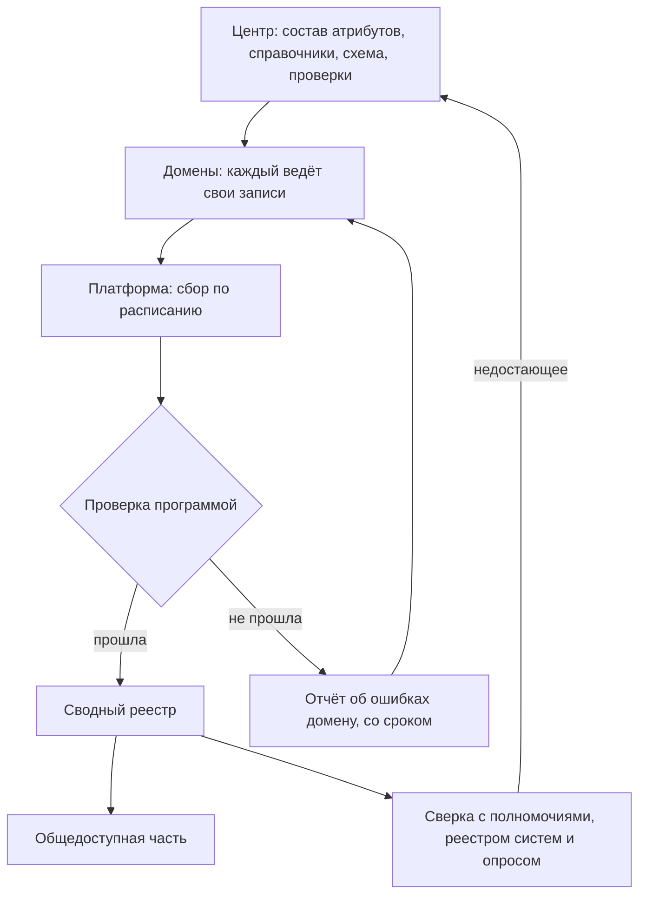

# Data Mesh

Data Mesh — подход к работе с данными, который в 2019 году предложила Жамак Дегани из Thoughtworks. Данные ведут и описывают те, кто их создаёт и лучше всех знает, — команды предметных областей, доменов. Центр не описывает всё сам, а задаёт общие правила, даёт платформу и проверяет, соблюдаются ли правила. Для инвентаризации отсюда следует модель **федеративного реестра**: каждое ведомство или подразделение описывает свои данные по общему составу атрибутов, платформа собирает описания в одно место и проверяет их программой, а ошибки уходят к тому, кто их может исправить. У государства домены уже есть — это ведомства с их полномочиями. Не хватает обычно другого: общего стандарта описания, платформы сбора и того, кто разбирает ошибки. Так data.gov собирает общедоступные части инвентарей 59 федеральных организаций США из 78 файлов `data.json` и проверяет каждую запись по схеме. Проверка работает, но одной её мало: инвентарь Бюро статистики труда отклоняется целиком каждый день с 15 июля 2026 года ([пример](#федеративный-инвентарь-сша)). И главное ограничение: каталог продуктов данных — не реестр. Он показывает то, что домены решили выпустить, а инвентаризация — всё, что есть, в том числе закрытое и неудобное.

## Коротко

| Что сделать | Что получается | Готово, когда |
|-------------|----------------|---------------|
| **[Разделить на домены](#домены)** | Список доменов с владельцами | Домены выделены по функциям и полномочиям, а не по системам; у каждого набора один домен |
| **[Назначить ответственных в доменах](#федеративное-управление)** | Ответственный за записи в каждом домене и владелец процесса в центре | Названы люди, а не подразделения; известно, кому уходят ошибки |
| **[Утвердить общие правила](#федеративное-управление)** | Состав атрибутов, справочники значений, правила идентификаторов, стандарт описания | Правила записаны как схема, которую можно проверить программой |
| **[Настроить сбор](#платформа)** | Каждый домен публикует свои записи по постоянному адресу; платформа забирает их по расписанию | Сводный реестр собирается без ручного копирования |
| **[Проверять программой](#проверки-программой)** | Отчёт об ошибках по каждому домену | Ошибка видна домену, у неё есть срок исправления; запись с ошибкой не теряется молча |
| **[Сверить с другими методами](#data-mesh-в-двух-подходах)** | Список того, чего нет в описаниях доменов | Перечни доменов сверены с полномочиями, реестром систем и опросом; недостающее записано |



## Откуда подход

Дегани описала Data Mesh в двух статьях на сайте Мартина Фаулера — 20 мая 2019 года и 3 декабря 2020 года — и в книге «Data Mesh: Delivering Data-Driven Value at Scale» (O'Reilly, 2022). Она разбирала, почему не работают централизованные хранилища и озёра данных в крупных компаниях:

- **одна центральная команда** отвечает за данные всех подразделений, но не знает их предметной области;
- **конвейеры разделены по техническим этапам** — загрузка, очистка, публикация, — поэтому любой новый набор требует правок во всей цепочке;
- **инженеры данных оторваны** и от тех, кто данные создаёт, и от тех, кто ими пользуется.

Ответ — разделить ответственность по предметным областям, как это давно делают с программами, и сделать данные продуктом с владельцем. Подход описывает прежде всего **аналитические данные** — то, чем делятся для анализа и решений, — а не базы учётных систем.

Как подход приняли:

- **Компании.** В PayPal на Data Mesh строили платформу данных; шаблон контракта данных оттуда стал открытым стандартом ODCS ([«Контракт данных»](#контракт-данных)).
- **Стандарты и инструменты.** Появились открытые стандарты контракта и продукта данных, ODCS и ODPS, проект профиля DCAT для продуктов данных DPROD, домены и продукты данных в каталогах метаданных DataHub и OpenMetadata ([«Платформа»](#платформа)).
- **Скепсис.** В кривой зрелости технологий управления данными Gartner (Hype Cycle for Data Management) 2022 года, по пересказам, Data Mesh отнесён к технологиям, которые устареют раньше, чем выйдут на плато продуктивности. Сам отчёт платный.

Для инвентаризации важна не архитектура хранилищ, а организационная половина подхода: кто описывает данные, по каким правилам и как правила проверяют.

## Четыре принципа

| Принцип | Что значит у Дегани | Что взять инвентаризации | Чего не брать |
|---------|---------------------|--------------------------|---------------|
| **Владение данными у доменов** (domain-oriented decentralized data ownership) | Данные ведёт и отвечает за них команда предметной области, которая их создаёт | Записи реестра ведут владельцы наборов, а не проектная команда; домен — по функции и полномочию ([«Владельцы и полномочия»](../03-process/03-owners-and-mandates.md)) | Отдать домену право решать, что записывать: тогда в реестре окажется только удобное |
| **Данные как продукт** (data as a product) | У набора есть владелец продукта, пользователи, документация, интерфейс и обязательства по качеству и сроку | Запись реестра описывает набор так, чтобы им мог воспользоваться чужой: описание, схема, условия, ответственный, отметка о качестве ([«Продукт данных»](#продукт-данных)) | Описывать только «продукты»: внутренние таблицы, архивы и закрытые наборы — тоже записи |
| **Платформа самообслуживания** (self-serve data infrastructure as a platform) | Общая инфраструктура, на которой домены сами выпускают продукты; в ней же поиск по всем продуктам | Описание набора появляется при его выпуске, а реестр собирается программой, а не вручную ([«Платформа»](#платформа)) | Думать, что платформа заменяет инвентаризацию: она видит только то, что через неё выпустили |
| **Федеративное вычислительное управление** (federated computational governance) | Общие правила принимают вместе домены и владельцы платформы, а исполняет их программа | Общий состав атрибутов, справочники, идентификаторы и проверки программой для всех доменов ([«Федеративное управление»](#федеративное-управление)) | Правила без проверки или проверку без того, кто разбирает ошибки |

## Домены

Домен — предметная область со своими понятиями, людьми и данными: регистрация воздушных судов, кадры здравоохранения, платежи. В компании домен — направление бизнеса, в государстве — функция, закреплённая полномочием. Обычно это ведомство или его подразделение, но не всегда: одну функцию делят уровни власти, а одно ведомство ведёт несколько функций ([«Кто отвечает за тему»](../03-process/03-owners-and-mandates.md#кто-отвечает-за-тему)).

**Как разделить.**

- **По функции, а не по системе.** Одна система обслуживает несколько функций, одна функция живёт в нескольких системах. Домен «по системе» перестаёт существовать при её замене.
- **По полномочию, а не по ИТ-подразделению.** ИТ-подразделение — обычно оператор: знает, где лежат данные, но не решает, кому их давать ([«Владелец, оператор, ответственный»](../03-process/03-owners-and-mandates.md#владелец-оператор-ответственный)).
- **Сквозные сущности — общими правилами.** Люди, организации, адреса, территории есть во всех доменах. Дегани называет такие понятия полисемами: в каждом домене они значат своё, но связывать записи между доменами нужно по общему идентификатору. Его задаёт федеративное управление, а в государстве — эталонные регистры. В Казахстане это национальные регистры: если данные в них есть, государственные цифровые объекты берут их оттуда (статья 19 Цифрового кодекса; [«Правовая основа»](../07-countries/01-kazakhstan.md#правовая-основа)).
- **При реорганизации домен переходит к преемнику**, а не исчезает: записи меняют владельца, прежние названия уходят в синонимы.

**Три вида данных домена.** Дегани различает данные, выровненные по источнику, агрегированные и выровненные по потребителю. Их же различают стандарт ODPS (поле `type`: `sourceAligned`, `aggregate`, `consumerAligned`) и каталог OpenMetadata (тип домена). В реестре этим видам соответствуют знакомые записи:

| Вид | Что это | Пример | Запись в реестре |
|-----|---------|--------|------------------|
| **От источника** (source-aligned) | Факты учётной деятельности домена в том виде, в каком их создаёт система | Реестр воздушных судов FAA: одна строка — одно судно | Набор со связью с системой и полномочием |
| **Агрегированные** (aggregate) | Сводка данных одного или нескольких доменов | Численность врачей по специальностям и регионам из регистра медицинских работников | Набор со связью `aggregate_of:` ([«Что считать записью»](../03-process/05-registry.md#что-считать-записью)) |
| **Под потребителя** (consumer-aligned) | Выборка и пересборка под одну задачу или одного пользователя | Витрина для справок руководству о доступности медицинской помощи | Набор с владельцем-потребителем; часто временный |

Чем ближе данные к источнику, тем они долговечнее и тем важнее их описать. Данные под потребителя появляются и исчезают с задачей: их записывают, если ими пользуются другие, и помечают как производные.

## Продукт данных

Продукт данных — набор данных вместе со всем, что нужно чужому, чтобы им воспользоваться: описанием, схемой, интерфейсом доступа, владельцем и обязательствами по качеству и срокам. В статье 2020 года Дегани перечисляет, из чего он состоит: код — конвейеры, интерфейсы, правила доступа; данные и метаданные — сами данные, описание смысла и структуры, показатели качества, политики доступа; инфраструктура, на которой всё работает. У продукта есть **владелец продукта**: он отвечает за качество, за то, как быстро пользователи получают данные, и за то, довольны ли они.

**Восемь свойств.** В книге 2022 года продукт данных должен быть обнаружимым, адресуемым, понятным, заслуживающим доверия, доступным штатными средствами, совместимым, ценным сам по себе и защищённым. Почти каждое свойство — это атрибут реестра:

| Свойство | Что это | Чем это в реестре |
|----------|---------|-------------------|
| **Обнаружимый** (discoverable) | Его можно найти, не зная заранее | Запись в реестре или каталоге; синонимы ([«Один набор под разными именами»](../03-process/05-registry.md#один-набор-под-разными-именами)) |
| **Адресуемый** (addressable) | У него постоянный адрес, который не меняется с версиями | Идентификатор и ссылка для выгрузки ([«Идентификатор и наименование»](../03-process/05-registry.md#идентификатор-и-наименование)) |
| **Понятный** (understandable) | Смысл и структура описаны | Описание и схема |
| **Заслуживающий доверия** (trustworthy and truthful) | Известно, насколько данные точны и свежи и откуда они | Отметка о контроле качества, дата изменения, уровень обслуживания, происхождение ([«Качество данных»](../03-process/07-quality.md#как-записать-в-реестр)) |
| **Доступный штатными средствами** (natively accessible) | Его получают в привычной форме: файлом, запросом, через интерфейс | Формат и ссылка для выгрузки |
| **Совместимый** (interoperable and composable) | Его можно соединять с другими продуктами | Стандарт описания, справочники значений, общие идентификаторы ([«Справочники значений»](../03-process/05-registry.md#справочники-значений)) |
| **Ценный сам по себе** (valuable on its own) | Им пользуются без других продуктов | Связь с вопросами и целями — лист «Связи» ([«Цели и вопросы»](../03-process/02-goals-and-questions.md)) |
| **Защищённый** (secure) | Доступ — по правилам, общим для всех | Режим доступа, причина ограничения, условия доступа ([«Доступ и ограничения»](../03-process/06-access.md)) |

**Продукт и запись реестра — не одно и то же.**

- Каждый продукт данных должен быть в реестре. Обратное неверно: в реестре есть таблицы на общих дисках, архивы, системы без выгрузок, закрытые наборы, чужие данные. Никто не сделает из них продукт, но знать о них нужно ([«Учитывают всё, в том числе закрытое»](../01-basics/03-principles.md#2-учитывают-всё-в-том-числе-закрытое)).
- Один продукт бывает несколькими наборами: основной файл и справочники, как в выгрузке FAA, или ряды за разные годы. Граница — по правилу из главы «Что инвентаризируют»: если у частей разный владелец, режим доступа или периодичность, это разные записи ([«Набор данных: где провести границу»](../01-basics/04-what-is-inventoried.md#набор-данных-где-провести-границу)).
- Продукт описывают те, кто его выпускает, и описывают как обещание. Реестр записывает и факт: когда данные на самом деле менялись и что показала проверка.

**Продукт цифровых данных в Казахстане.** Цифровой кодекс РК относит продукты цифровых данных к цифровым объектам (статья 20) и посвящает им отдельную главу. Продукт цифровых данных — «агрегированный, формализованный результат обработки цифровых данных», пригодный для использования, обмена и оборота (статья 30). Структуру, качество и метаданные таких продуктов государственных органов и квазигосударственного сектора регулируют требования по управлению данными — с 6 октября 2026 года это требования по управлению цифровыми данными, утверждённые постановлением Правительства № 830 ([«DAMA-DMBOK»](./01-dama-dmbok.md#пример-казахстанские-требования-по-управлению-цифровыми-данными)). Продукт на платформе обмена не должен позволять идентифицировать людей и должен включать метаданные о составе, структуре, назначении и условиях использования. Владельцы платформ обмена ведут перечень продуктов (статья 31). От продукта Data Mesh он отличается: это агрегат для обмена и оборота, в том числе на условиях владельца, а продукт Data Mesh может содержать и записи о людях — с правилами доступа. Для инвентаризации продукты цифровых данных — часть реестра, а перечни продуктов на платформах — один из источников записей.

## Контракт данных

Контракт данных (data contract) — не государственный контракт, а машиночитаемое описание того, что поставщик данных обещает пользователям: схема, правила качества, сроки и частота обновления, владелец и каналы поддержки, условия доступа. Контракт хранят рядом с кодом продукта и проверяют программой при каждом выпуске: если данные нарушают контракт, выпуск останавливают или предупреждают пользователей.

**Стандарты.**

- **ODCS** (Open Data Contract Standard) — открытый стандарт контракта данных в YAML. Вырос из шаблона контракта данных, на котором PayPal строила Data Mesh. С версии 2.2 его ведёт некоммерческая группа AIDA, а с 30 ноября 2023 года — проект Bitol в фонде Linux Foundation AI & Data. Версия 3.0.0 вышла в октябре 2024 года, 3.1.0 — в декабре 2025 года, 3.2.0 — 8 сентября 2026 года; лицензия — Apache 2.0. В стандарте 15 разделов: основное, схема, качество, уровень обслуживания, поддержка, команда, роли доступа, серверы, цена и другие.
- **ODPS** (Open Data Product Standard) — стандарт описания продукта данных из того же проекта Bitol: версия 1.0.0 — 24 сентября 2025 года, 1.1.0 — 8 сентября 2026 года. У продукта есть входные и выходные порты, и каждый порт ссылается на свой контракт ODCS. С версии 1.1.0 у продукта есть тип — от источника, агрегированный или под потребителя.
- **DPROD** (Data Product Ontology) — «профиль словаря DCAT» для продуктов данных. Его разрабатывает рабочая группа EKGF, а документ оформлен как спецификация Object Management Group. Продукт данных описан как ресурс каталога, его входные и выходные порты — как сервисы данных `dcat:DataService`, а вся сеть продуктов — как каталог `dcat:Catalog`. На октябрь 2026 года спецификация в разработке. Для реестра, описанного по DCAT ([«Стандарты описания»](./02-metadata-standards.md)), это самый короткий путь к продуктам данных.

### Пример контракта

FAA контракт данных для своего реестра воздушных судов не публикует. Ниже — как мог бы выглядеть контракт для выгрузки, которая уже описана в книге как запись реестра ([«Пример записи»](../03-process/05-registry.md#пример-записи)) и проверена ([«Пример проверки»](../03-process/07-quality.md#пример-проверки)). Контракт проходит проверку по JSON-схеме ODCS 3.2.0:

```yaml
apiVersion: v3.2.0
kind: DataContract
id: faa-aircraft-registry
name: Releasable Aircraft Database
version: 1.0.0
status: active
domain: aircraft-registration
tenant: FAA
description:
  purpose: Общедоступная часть реестра гражданских воздушных судов США
  limitations: Без имён и адресов владельцев, которые попросили их скрыть, — 49 U.S.C. § 44114(b)
authoritativeDefinitions:
  - type: businessDefinition
    url: https://registry.faa.gov/database/ardata.pdf
servers:
  - server: registry-faa-gov
    type: custom
    location: https://registry.faa.gov/database/ReleasableAircraft.zip
    format: csv
schema:
  - name: master
    physicalName: MASTER.txt
    logicalType: object
    description: Одна строка — одно воздушное судно
    quality:
      - metric: rowCount
        mustBeGreaterThan: 300000
    properties:
      - name: n_number
        physicalName: N-NUMBER
        logicalType: string
        primaryKey: true
        required: true
        quality:
          - metric: duplicateValues
            mustBe: 0
      - name: year_mfr
        physicalName: YEAR MFR
        logicalType: string
        quality:
          - metric: missingValues
            arguments:
              missingValues: [null, '', '0000']
            mustBeLessThan: 25
            unit: percent
slaProperties:
  - property: frequency
    value: 1
    unit: d
  - property: latency
    value: 2
    unit: d
support:
  - channel: справочная реестра, +1 866 762-9434
    tool: other
```

Правила качества в контракте — те же проверки, что в главе «Качество данных», записанные так, чтобы их выполняла программа: в основном файле больше 300 тыс. записей, регистрационные номера не повторяются, год выпуска пуст или равен «0000» меньше чем у 25% записей. 25 октября 2026 года выгрузка эти правила проходила: 317 999 записей, повторов нет, год выпуска пуст у 22,4% записей и равен «0000» ещё у 150. Уровень обслуживания в примере — обновление раз в сутки и задержка не больше двух суток: в архиве, скачанном в воскресенье, лежали файлы от пятницы.

**Контракт и запись реестра.**

| Раздел контракта ODCS | Атрибут реестра | DCAT |
|-----------------------|-----------------|------|
| `id`, `name` | Идентификатор, наименование | `dct:identifier`, `dct:title` |
| `description` | Описание; `limitations` — в условия использования и ограничения | `dct:description` |
| `domain` | Домен | — |
| `tenant` | Организация-владелец | `dct:publisher` |
| `team`, `support` | Ответственный и контакты | `dcat:contactPoint` |
| `slaProperties` с `frequency` | Периодичность обновления; остальные свойства — уровень обслуживания | `dct:accrualPeriodicity` |
| `servers` | Ссылка для выгрузки, формат | `dcat:distribution`, `dcat:downloadURL`, `dct:format` |
| `schema`, `authoritativeDefinitions` | Схема, описание полей | — |
| `quality` | Правила для отметки о контроле качества | словарь DQV |
| `roles`, `classification` у полей | Режим доступа, условия доступа, персональные данные | `dct:accessRights` |
| `status` | Статус записи | — |

Чего в контракте нет: полномочия и нормативного акта — их можно указать ссылкой в `authoritativeDefinitions`, но стандарт этого не требует; дат публикации и последнего изменения данных; того, откуда известно о наборе; итога проверки. Контракт говорит, что обещано, реестр — что есть на самом деле. Если в организации контракты уже ведут, первые записи реестра собирают из них программой. Если не ведут, реестр — первый шаг к ним: записи с описанием, схемой и отметкой о качестве превращаются в контракты почти без новой работы.

## Платформа

Платформу самообслуживания Дегани делит на три плоскости:

- **инфраструктура** — хранилища, вычисления, управление доступом;
- **опыт разработчика продуктов** — то, чем домен выпускает продукт, не зная деталей инфраструктуры; общие правила применяются здесь автоматически;
- **надзор за сетью продуктов** (mesh supervision plane) — поиск продуктов для задачи, общие правила, связи между продуктами.

Инвентаризация живёт в третьей плоскости. Её главное отличие от обычной описи: описание появляется при выпуске продукта, а не когда до него дошла инвентаризация. Пока продукт выпускают через платформу, реестр не отстаёт. Но только пока: то, что выпустили в обход, платформа не видит.

**Каталоги метаданных.** На октябрь 2026 года домены и продукты данных есть в обоих каталогах с открытым кодом, о которых говорится в книге ([«От таблицы до каталога метаданных»](../06-tools/01-from-spreadsheet-to-catalog.md)):

- **DataHub** (версия 1.8.0 от 22 октября 2026 года): продукт данных объединяет таблицы, потоки, представления и панели и принадлежит одному домену. Продукт можно описать файлом YAML, хранить в репозитории и загружать командой `datahub dataproduct upsert`.
- **OpenMetadata** (версия 2.0.6 от 21 октября 2026 года): домены трёх типов — `Source-aligned`, `Consumer-aligned`, `Aggregate` — и продукты данных внутри домена.

Оба каталога собирают описания таблиц из подключённых баз сами. Вне подключённых систем они не видят ничего — ни таблиц на общих дисках, ни бумажных журналов, ни чужих данных — и не знают об основаниях и полномочиях ([«Что проверять программой»](../03-process/08-result-and-upkeep.md#что-проверять-программой)).

**Платформа у государства** — это не обязательно каталог метаданных. Это портал открытых данных со сборщиком описаний, как data.gov и data.europa.eu; учёт систем и каталог данных, в которые ведомства вносят сведения сами, как архитектурный портал цифровых объектов государства govarch.kz в Казахстане; интеграционная и аналитическая платформы — в Казахстане Smart Bridge и Smart Data Ukimet ([«Платформы»](../07-countries/01-kazakhstan.md#платформы)). Реестр данных, связанный с ними, становится частью архитектуры, а не отдельной таблицей.

## Федеративное управление

Федеративное управление — это договор о том, что решает центр и что решают домены.

| Решает центр (вместе с доменами) | Решает домен |
|----------------------------------|--------------|
| Состав атрибутов записи и какие из них обязательны | Что выпускать как продукт и что описывать подробнее минимума |
| Справочники значений: периодичность, режим доступа, причины ограничения, типы записей | Схема своих данных и их периодичность |
| Правила идентификаторов: формат, префикс домена, уникальность во всём реестре | Кто в домене ответственный за записи |
| Общие идентификаторы сквозных сущностей — людей, организаций, территорий | Описание, условия использования, уровень обслуживания своих продуктов |
| Уровни чувствительности и правило общедоступной части | Как исправить ошибку, найденную проверкой |
| Проверки программой и сроки исправления ошибок | Когда сообщить об изменении — в пределах общих сроков |

Правила принимает не центр в одиночку, а группа из ответственных доменов и владельца платформы: так правило, неудобное домену, обсуждают до утверждения, а не обходят после.

### Проверки программой

«Вычислительным» Дегани называет управление, в котором правила исполняет программа. Для реестра это значит: каждая запись при сборе проходит проверки, и запись с ошибкой не исчезает молча, а возвращается домену с объяснением. Что проверяют:

- **форму записи** — по схеме: обязательные поля, типы, форматы дат по ISO 8601, значения из справочников;
- **уникальность** идентификатора во всём реестре, а не только в домене;
- **ссылки** — открываются ли адреса для выгрузки и описания полей;
- **правдоподобие** — дата изменения не раньше даты публикации, дата изменения не старше, чем обещает периодичность;
- **связи** — владелец есть в справочнике организаций, полномочие — в листе полномочий, у копии есть первоисточник.

Схема ловит только форму. Правдоподобие и связи проверяют отдельными правилами — схема их не видит ([пример](#федеративный-инвентарь-сша)). Так устроены и проверки атласа этой книги: скрипт останавливает сборку, если у источника нет идентификатора или карта ссылается на неописанный источник ([«Проверки»](../06-tools/03-registry-as-data.md#проверки)).

## Федеративный инвентарь США

Американская модель — федеративный реестр задолго до слова Data Mesh. С 2013 года каждое федеральное ведомство ведёт свой инвентарь данных и публикует его общедоступную часть файлом `data.json` по схеме DCAT-US; с 2019 года это требование закона ([«Инвентари данных федеральных ведомств США»](./04-international-practice.md#инвентари-данных-федеральных-ведомств-сша)). Домены — ведомства, общий контракт — схема DCAT-US, платформа — сборщик data.gov, вычислительное управление — проверка каждой записи по схеме при сборе. Сборщик data.gov открыт: на октябрь 2026 года у него есть программный интерфейс без ключа, где видны все источники, задания и ошибки. Так эта модель выглядела 25 октября 2026 года.

**Источники.** В сборщике 801 источник. 732 из них — у 61 федеральной организации: 649 папок с файлами описаний — почти все с геоданными по ISO 19115 — и 83 файла каталога. Одному Бюро переписи принадлежат 576 источников. 78 файлов каталога описаны по DCAT-US: 53 — по версии 1.1, 25 — по версии 3.0. 48 из 78 сборщик забирает раз в сутки.

**Последний сбор.** 78 файлов DCAT-US публикуют 59 организаций. В последних заданиях по ним — с 26 сентября по 25 октября 2026 года — было 153 363 записи. 1330 из них, 0,87%, проверка отклонила. Ошибки нашлись в 19 файлах, 56 файлов прошли без единой ошибки. Ещё три файла не прочитаны вовсе: задание закончилось ошибкой.

**Какие ошибки.** Запись с несколькими ошибками попадает в несколько строк таблицы.

| Что не так | Записей | Где больше всего | Пример |
|------------|---------|------------------|--------|
| **Повтор идентификатора** | 634 | healthdata.gov Министерства здравоохранения — 337, data.nasa.gov — 281 | У двух записей файла одинаковый `identifier`: вторую отклоняют |
| **Нет обязательного поля** | 245 | Корпорация «Вызовы тысячелетия» (MCC) — 126 записей без `keyword`; Бюро безопасности и экологического надзора (BSEE) — 79 без `modified`; BLS — 31 без `accessLevel` | Поле обязательно в DCAT-US 1.1, а домен его не заполняет |
| **Дата не по ISO 8601** | 150 | healthdata.gov — 113, Комиссия по ядерному регулированию (NRC) — 36 | `01/04/2023` вместо `2023-01-04`; период `01/2012-12/2015` и `N/A` вместо периода |
| **Периодичность не из справочника** | 114 | healthdata.gov — 111 | `Annual R/P1Y` и `Survey has ended.` вместо `R/P1Y` и `irregular` |
| **Ссылка не того вида** | 128 | Геологическая служба (USGS) — 40, healthdata.gov — 38, BLS — 31 | Пустой `downloadURL`; страница набора объектом вместо адреса |
| **Другие поля не по схеме** | 258 | USGS, healthdata.gov, BLS | Описание, условия использования, темы, территория |

**Инвентарь, отклонённый сто раз подряд.** Бюро статистики труда (BLS) публикует 31 запись. Источник зарегистрирован в сборщике со схемой DCAT-US 1.1, а записи в файле описаны свойствами DCAT-US 3.0: режим доступа — в `accessRights`, а не в обязательном для версии 1.1 `accessLevel`; страница набора и вышестоящая организация — объектом и списком, а не строкой и объектом. С 15 июля по 24 октября 2026 года сборщик забирал файл 100 раз и каждый раз отклонял все 31 запись. Последний сбор без ошибок — 26 марта 2026 года. Ошибка не в данных и даже не в описаниях, а в договорённости: домен описывает записи по одной версии контракта, а платформа ждёт другую.

**Что из этого следует.**

- **Проверка программой работает в масштабе.** Полтораста тысяч записей почти шестидесяти организаций проверяются без людей, большинство файлов — каждый день, и доля отклонённых записей меньше процента.
- **Ошибки сосредоточены у немногих доменов.** Три файла — healthdata.gov, data.nasa.gov и файл USGS — дали три четверти отклонённых записей, пять файлов — 90%. У MCC отклонено 126 записей из 312, у BSEE — 80 из 94: для этих доменов проверка — не мелочь, а потеря большей части инвентаря на портале.
- **Без того, кто разбирает ошибки, проверка бесполезна.** У источника BLS в сборщике указаны адреса ведомства для уведомлений, но за три месяца ошибку не исправили ни в файле, ни в настройке источника. Нужен срок и тот, кто следит за сроком, — владелец процесса ([«Кто отвечает после публикации»](../03-process/08-result-and-upkeep.md#кто-отвечает-после-публикации)).
- **Каталог показывает прошлое как настоящее.** Отклонённые записи не обновляются, но и не исчезают: в каталоге data.gov у BLS по-прежнему 31 набор — в том виде, в каком их собрали в последний успешный раз. Пользователь не видит, что описания не обновлялись с весны.
- **Схема ловит форму, а не смысл.** В той же записи BLS об обследовании использования времени дата публикации — 19 июня 2019 года, а дата изменения — 19 июня 2009 года, на десять лет раньше. Такую ошибку схема не заметит и в исправленном файле: нужна проверка правдоподобия.
- **На data.gov — только общедоступная часть.** Сведения о закрытом ведомства публикуют по своему решению: у GSA в `data.json` 33 закрытые записи из 344. Полный инвентарь по-прежнему у домена ([«Полный реестр и общедоступная часть»](../03-process/08-result-and-upkeep.md#полный-реестр-и-общедоступная-часть)).

## Data Mesh в государстве

Федеративные модели есть и в других странах книги, хотя слово Data Mesh в документах встречается редко.

| Где | Домен | Общие правила | Платформа | Что видно |
|-----|-------|---------------|-----------|-----------|
| **США** | Федеральное ведомство; ответственный — директор по данным (44 U.S.C. § 3520(c)(5)) | Схема DCAT-US; общедоступная часть — по `accessLevel` или `accessRights` | Сборщик data.gov с проверкой по схеме | Записи 59 организаций из 78 файлов, ошибки проверки открыты ([выше](#федеративный-инвентарь-сша)) |
| **Великобритания** | Министерство; владелец каждого информационного актива (IAO) | Политика управления активами данных GDS 2026 года: метаданные критически важных активов — по общему профилю на основе DCAT и Dublin Core, у каждого — названный владелец и план качества | Каталоги министерств; ежегодный отчёт в GDS | Реестры информационных активов министерств, часть — устаревшие ([«Реестры информационных активов Великобритании»](./04-international-practice.md#реестры-информационных-активов-великобритании)) |
| **Европейский союз** | Национальный и региональный портал; в пространствах данных — каждый участник | DCAT-AP; в пространствах данных — протокол Dataspace Protocol: каталог участника на словарях DCAT и ODRL, предложение — с условиями использования | data.europa.eu собирает описания из 213 каталогов; в пространствах данных — коннекторы участников | 1 858 143 набора на 25 октября 2026 года ([«Поиск наборов данных»](../04-sources/05-dataset-search.md#инструменты)) |
| **Казахстан** | Государственный орган, государственное юридическое лицо, квазигосударственный сектор; в организации — ответственный за управление цифровыми данными и менеджер по данным | Требования по управлению цифровыми данными — постановление Правительства от 22.09.2026 № 830 (пункт 3 статьи 16 Цифрового кодекса): паспорт цифровых данных каждого цифрового объекта, согласование с архитектурно-координационным центром | Архитектурный портал цифровых объектов государства govarch.kz: сведения и паспорта вносят сами организации (статья 71), из паспортов складывается каталог цифровых данных | В открытой части портала — реестр систем; каталог цифровых данных и паспорта видят только зарегистрированные организации ([«Каталог цифровых данных»](../07-countries/01-kazakhstan.md#каталог-цифровых-данных)) |

Общее у всех: домен определён законом или политикой, а не выбран архитекторами; правила описания общие; описания сводят в одно место. Различаются главным для инвентаризации — видны ли ошибки и пробелы. В США видно, чьи записи отклонены и почему; в Великобритании по опубликованным реестрам видно, какие давно не обновлялись; в Казахстане снаружи виден реестр систем, а каталог цифровых данных и паспорта — только организациям, которые их ведут.

Пространства данных ЕС — та же идея на уровне организаций, а не подразделений. Каждый участник держит данные у себя и показывает каталог своих предложений; каталог по протоколу Dataspace Protocol использует словари DCAT и ODRL. Действующая версия протокола — 2025-1, её ведёт Eclipse Dataspace Working Group; версии до 2024-1 включительно вела International Data Spaces Association. В подходе «где найти нужное» такой каталог — готовый источник записей: владелец, описание и условия использования в нём уже есть.

## Data Mesh в двух подходах

**«Чем владеем».** Федеративный реестр — способ поддерживать опись, а не провести её. Первую инвентаризацию удобнее делать централизованно: одна команда, одни правила, сверка всеми методами ([«Семь методов»](../02-approaches/02-methods.md)). Потом записи передают доменам, и каждый ведёт свои. Центр:

- сверяет описания доменов с полномочиями, реестром систем и закупками: домен описывает то, что выпускает, а не всё, что есть;
- ищет записи, которые не принадлежат ни одному домену, — общие диски, архивы, наследие упразднённых подразделений;
- следит, чтобы закрытое не выпадало: домену проще не описывать закрытый набор, чем объяснять, почему он закрыт ([«Закрытые наборы — тоже в реестре»](../03-process/06-access.md#закрытые-наборы--тоже-в-реестре)).

**«Где найти нужное».** Каталог продуктов данных чужой организации — источник с владельцем, описанием, контрактом и условиями. Его записи переносят в свой реестр со ссылкой на каталог в поле «откуда известно». Контракт — ответ на половину вопросов поставщику: схема, периодичность, качество, каналы поддержки ([«Что спросить у поставщика»](../04-sources/04-commercial.md#что-спросить-у-поставщика)). Если каталог продуктов закрыт, о нём спрашивают владельца: часто продукт есть, но его описание видно только внутри.

## Когда подходит

| Признак | Федеративный реестр | Центральная опись |
|---------|---------------------|-------------------|
| **Сколько доменов и наборов** | Десятки доменов, тысячи наборов: центральная команда не успевает | Одна организация, сотни наборов |
| **Цель** | Постоянная поддержка реестра, обмен данными, каталог для всей организации | Разовая инвентаризация под задачу, карта данных ([«Зачем: цели»](../01-basics/02-goals.md)) |
| **Люди в доменах** | В каждом домене есть ответственный за данные со временем на это | Ответственных нет, данные знают отдельные сотрудники |
| **Общие правила** | Состав атрибутов и справочники утверждены, есть схема для проверки | Состав ещё ищут |
| **Платформа** | Есть каталог, портал со сборщиком или учёт систем, куда домены пишут сами | Таблица у одной команды |
| **Кто разбирает ошибки** | Владелец процесса с полномочием требовать исправлений | Тот же, кто ведёт опись |
| **Подход** | «Чем владеем» — опись своих данных | «Где найти нужное» по чужим данным: чужие домены записи не ведут |

На практике сочетают: центральная опись для первой инвентаризации и для чужих данных, федеративное ведение — для своих после неё. Признак, что переходить рано: у доменов нет ответственных, или первые выгрузки «своих записей» возвращаются без ответа.

## Как записать

**Колонки.** В шаблоне реестра [registry.csv](pathname:///templates/registry.csv) для федеративного ведения две колонки:

- `domain` — домен, который ведёт запись: его идентификатор из справочника доменов. По нему собирают выгрузку для ответственного и отчёт об ошибках. Домен и организация-владелец не всегда совпадают: у одного ведомства несколько доменов, а запись о чужом наборе ведёт центр;
- `data_contract` — ссылка на контракт данных или соглашение об уровне обслуживания; «нет», если контракта нет.

Продукт данных записывают как набор с типом `dataset`, а продукт из нескольких наборов — несколькими записями со связями или группой ([«Что считать записью»](../03-process/05-registry.md#что-считать-записью)). Отдельный тип «продукт» не нужен: продукт — свойство набора, а не новая сущность.

**Идентификаторы.** Чтобы домены не выдали одинаковых идентификаторов, их начинают с кода домена или организации: `faa-aircraft-registry`, `region-01-waiting-list`. Проверка уникальности идёт по всему реестру.

**Справочник доменов** — идентификатор, название, организация, полномочие, ответственный, дата передачи записей. Его удобно держать в листе владельцев [owners.csv](pathname:///templates/owners.csv): домен — строка подразделения с заполненными колонками `parent` и `unit`, а идентификатор строки идёт в `domain` реестра.

**Отчёт об ошибках** — строка на ошибку: идентификатор записи, домен, правило, что не так, дата, срок исправления, статус. Без срока и статуса это не отчёт, а журнал.

## Пример

Продолжение условного примера из глав [«Реестр данных»](../03-process/05-registry.md#пример) и [«Результат и поддержка»](../03-process/08-result-and-upkeep.md#пример): 15 вопросов руководства о доступности медицинской помощи в регионах, 31 запись, первое обновление прошло. Министерство решило не держать реестр у отдела медицинской статистики, а передать записи тем, кто ведёт данные.

**Домены.** Выделили пять: министерство — организации и кадры; центр медицинской статистики — сборники; фонд медицинского страхования — учёт оказанной помощи; регионы первой очереди — листы ожидания и запись к врачу, каждый регион — свой домен. Записи о чужих данных — статистического ведомства и международных организаций — оставили у отдела: их ведёт центр, а не домен.

**Правила.** Отдел утвердил вместе с доменами схему записи: 14 обязательных атрибутов, `domain`, справочники значений, идентификаторы с префиксом домена. Записи каждый домен ведёт в своём файле; отдел собирает их раз в неделю и проверяет программой.

**Первый сбор.**

- Два региона назвали свои листы ожидания одинаково — `waiting-list`. Проверка уникальности отклонила обе записи; идентификаторы получили префиксы регионов.
- Один регион записал даты как «01.03.2026». Схема требует ISO 8601 — запись вернули.
- Фонд не ответил за две недели. Его записи остались в реестре со старой датой проверки и пометкой «домен не подтвердил»; вопрос ушёл заместителю министра, курирующему фонд.
- Проверка правдоподобия нашла запись, у которой дата изменения на год раньше даты публикации: перепутали поля.

**Продукт.** Центр медицинской статистики сделал из таблиц ежегодного сборника продукт данных: файл CSV вместо PDF, описание полей, контракт с правилом «сумма по регионам равна итогу по стране» и обещанием выпуска до 1 июля. Режим доступа записи сменился с «неструктурированные сведения» на «открытые», в `data_contract` — ссылка на контракт.

**Итог.** Через месяц домены вели 26 из 31 записи, отдел — пять записей о чужих данных. Сверка с полномочиями при плановой проверке нашла таблицу на общем диске министерства, которую не описал ни один домен: учёт жалоб на сроки ожидания. Её записали и передали домену министерства. Пример показывает ход работы, а не то, как устроено здравоохранение в конкретной стране.

## Частые ошибки

| Ошибка | Что происходит | Как исправить |
|--------|----------------|---------------|
| **Домены по системам** | Система заменена — домен исчез, записи без хозяина | Домены по функциям и полномочиям |
| **Домен — ИТ-подразделение** | Записи ведёт оператор, который не знает смысла данных и не решает о доступе | Домен — подразделение-владелец, ИТ — оператор |
| **Каталог продуктов вместо реестра** | В реестре только выпущенное, закрытое и неудобное выпало | Сверять описания доменов с полномочиями, реестром систем и опросом |
| **Передать записи до первой описи** | Каждый домен описывает по-своему и не всё | Сначала центральная опись и общие правила, потом передача |
| **Правила без проверки** | Схема утверждена, но каждый домен понимает её по-своему | Проверки программой при каждом сборе |
| **Проверка без владельца ошибок** | Ошибки копятся месяцами, как у BLS на data.gov | Отчёт домену со сроком; владелец процесса следит за сроками |
| **Отклонённая запись исчезает или застывает** | Пользователь видит старое описание как текущее | Помечать записи с непрошедшей проверкой и дату последней успешной |
| **Только проверка формы** | Даты в правильном формате, но изменение на десять лет раньше публикации | Добавить проверки правдоподобия и связей |
| **Одинаковые идентификаторы у доменов** | При сборе записи затирают друг друга | Префикс домена и проверка уникальности по всему реестру |
| **Контракт вместо факта** | В реестре — обещанная периодичность, а данные не менялись два года | Дата изменения — из данных, отметка о качестве — по проверке |

## Ограничения

- Data Mesh — подход для крупных организаций с сильными ИТ-командами в подразделениях. В небольшой организации или ведомстве без таких команд федеративный реестр превращается в рассылку таблиц.
- Подход описывает аналитические данные, которыми делятся. Учётные системы, документы и бумажные журналы остаются за его пределами — а для инвентаризации они важны.
- Домен описывает то, что выпускает. Полноту даёт только сверка с другими методами, и её делает центр.
- Без общих правил и проверки федеративная модель превращается в разрозненные реестры с разными полями. Без того, кто разбирает ошибки, — в реестр с застывшими записями.
- Доменам нужны люди и время. Если у ведомства нет ответственного за данные, его записи устареют первыми.
- Стандарты продуктов и контрактов молоды: третья версия ODCS за два года выходила трижды, ODPS вышел в 2025 году, DPROD в разработке. Реестр лучше держать по DCAT и сопоставлять с ними, чем строить на одном из них.
- Сведения о сборщике data.gov — на 25 октября 2026 года; ошибки последних заданий меняются каждый день.

## Источники

- Dehghani Z. [How to Move Beyond a Monolithic Data Lake to a Distributed Data Mesh](https://martinfowler.com/articles/data-monolith-to-mesh.html) — martinfowler.com, 20 мая 2019 года; [Data Mesh Principles and Logical Architecture](https://martinfowler.com/articles/data-mesh-principles.html) — 3 декабря 2020 года: четыре принципа, три плоскости платформы, состав продукта данных, примеры общих правил.
- Dehghani Z. **Data Mesh: Delivering Data-Driven Value at Scale**. O'Reilly, 2022, ISBN 978-1-492-09239-1. Восемь свойств продукта данных — по пересказам книги: сама книга из сети проверки не открылась.
- Gartner. Hype Cycle for Data Management, 2022 — отчёт платный; оценка Data Mesh приведена по пересказам: [Atlan](https://atlan.com/gartner-data-mesh/), [ChaosSearch](https://www.chaossearch.io/blog/data-management-hype-cycle-report-gartner).
- Bitol, LF AI & Data. [Open Data Contract Standard](https://bitol-io.github.io/open-data-contract-standard/latest/) — [репозиторий](https://github.com/bitol-io/open-data-contract-standard), выпуск v3.2.0 от 8 сентября 2026 года, история стандарта и JSON-схема `odcs-json-schema-v3.2.0.json`; пример контракта главы проверен по ней 25 октября 2026 года. [Open Data Product Standard](https://bitol-io.github.io/open-data-product-standard/latest/) — [репозиторий](https://github.com/bitol-io/open-data-product-standard), выпуски v1.0.0 от 24 сентября 2025 года и v1.1.0 от 8 сентября 2026 года.
- EKGF. [Data Product Ontology (DPROD)](https://ekgf.org/dprod/spec/develop) — спецификация в разработке, на 25 октября 2026 года.
- Eclipse Dataspace Working Group. [Dataspace Protocol 2025-1](https://eclipse-dataspace-protocol-base.github.io/DataspaceProtocol/2025-1-err2/) — редакция 2025-1-err2 от 11 сентября 2026 года; протокол каталога — [catalog.protocol.md](https://github.com/eclipse-dataspace-protocol-base/DataspaceProtocol/blob/2025-1-err2/specifications/catalog/catalog.protocol.md).
- [DataHub — Data Products](https://docs.datahub.com/docs/dataproducts), выпуск v1.8.0 от 22 октября 2026 года; [OpenMetadata — Domains & Data Products](https://docs.open-metadata.org/latest/how-to-guides/data-governance/domains-&-data-products) и [схема домена](https://github.com/open-metadata/OpenMetadata/blob/main/openmetadata-spec/src/main/resources/json/schema/entity/domains/domain.json), выпуск 2.0.6 от 21 октября 2026 года.
- Сборщик data.gov — [программный интерфейс](https://harvest.data.gov/openapi/docs): источники `/api/v1/harvest_sources/`, задания `/api/v1/harvest_jobs/`, ошибки `/api/v1/harvest_record_errors/`, исходные записи `/api/v1/harvest_record/{id}/raw`; [catalog.data.gov/api/organizations](https://catalog.data.gov/api/organizations) — организации и источники. Посчитано 25 октября 2026 года. Код сборщика и проверки по DCAT-US 1.1 и 3.0 — [GSA/datagov-harvester](https://github.com/GSA/datagov-harvester).
- [Цифровой кодекс Республики Казахстан](https://prg.kz/m/amp/document/38546537) от 09.01.2026 № 255-VIII, статьи 19, 20, 30, 31 — по копии на prg.kz, 25 октября 2026 года; adilet.zan.kz из сети проверки не открылся. Статьи 16 и 71, постановление Правительства РК от 22.09.2026 № 830 и открытая часть govarch.kz — по главам [«Казахстан»](../07-countries/01-kazakhstan.md) и [«DAMA-DMBOK»](./01-dama-dmbok.md).
- Главы книги: [«Владельцы и полномочия»](../03-process/03-owners-and-mandates.md), [«Реестр данных»](../03-process/05-registry.md), [«Результат и поддержка»](../03-process/08-result-and-upkeep.md), [«Стандарты описания»](./02-metadata-standards.md), [«Зарубежные методики»](./04-international-practice.md).
