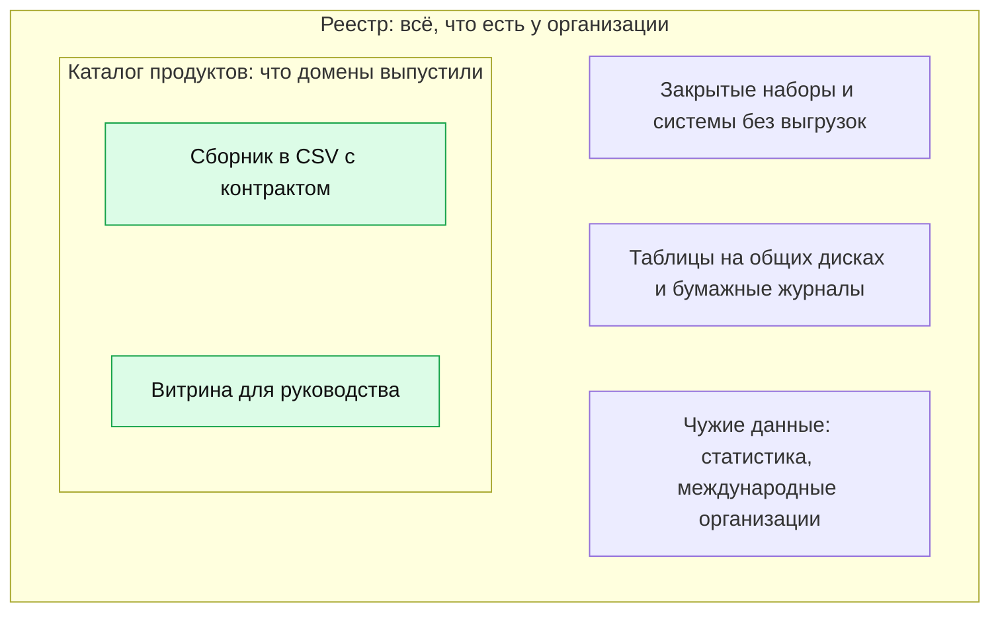

# Data Mesh

Data Mesh — подход, в котором данные ведут и описывают команды предметных областей, доменов, а центр задаёт общие правила, даёт платформу и проверяет, соблюдаются ли правила. Для инвентаризации из него следует модель **федеративного реестра**: каждое ведомство или подразделение описывает свои данные по общему составу атрибутов, платформа собирает описания и проверяет их программой, а ошибки уходят к тому, кто может их исправить. У государства домены уже есть — это ведомства с их полномочиями; не хватает обычно общего стандарта описания, платформы сбора и того, кто разбирает ошибки. Главное ограничение: каталог продуктов данных — не реестр, он показывает то, что домены решили выпустить, а инвентаризация — всё, что есть.

Сведения проверены 25 октября 2026 года, если не указано иное.

## Коротко

| Что сделать | Что получается | Готово, когда |
|-------------|----------------|---------------|
| **[Разделить на домены](#домены)** | Список доменов с владельцами | Домены выделены по функциям и полномочиям, а не по системам; у каждого набора один домен |
| **[Назначить ответственных в доменах](#федеративное-управление)** | Ответственный за записи в каждом домене и владелец процесса в центре | Названы люди, а не подразделения; известно, кому уходят ошибки |
| **[Утвердить общие правила](#федеративное-управление)** | Состав атрибутов, справочники значений, правила идентификаторов, стандарт описания | Правила записаны как схема, которую можно проверить программой |
| **[Настроить сбор](#платформа)** | Каждый домен публикует свои записи по постоянному адресу; платформа забирает их по расписанию | Сводный реестр собирается без ручного копирования |
| **[Проверять программой](#проверки-программой)** | Отчёт об ошибках по каждому домену | Ошибка видна домену, у неё есть срок исправления; запись с ошибкой не теряется молча |
| **[Сверить с другими методами](#data-mesh-в-двух-подходах)** | Список того, чего нет в описаниях доменов | Перечни доменов сверены с полномочиями, реестром систем и опросом; недостающее записано |

## Откуда подход

Data Mesh предложила Жамак Дегани из консалтинговой компании Thoughtworks в статьях 2019 и 2020 годов как ответ на перегруженные центральные хранилища и озёра данных крупных компаний. **Озеро данных** — общее хранилище, куда данные из разных систем складывают как есть, без общей схемы. Подход описывает прежде всего аналитические данные, которыми делятся для анализа и решений, а для инвентаризации важна его организационная половина: кто описывает данные, по каким правилам и как правила проверяют.

## Четыре принципа

| Принцип | Что взять инвентаризации | Чего не брать |
|---------|--------------------------|---------------|
| **Владение данными у доменов:** данные ведёт и отвечает за них команда предметной области, которая их создаёт | Записи реестра ведут владельцы наборов, а не проектная команда; домен — по функции и полномочию ([«Владельцы и полномочия»](../03-process/03-owners-and-mandates.md)) | Отдать домену право решать, что записывать: тогда в реестре окажется только удобное |
| **Данные как продукт:** у набора есть владелец продукта, пользователи, документация и обязательства по качеству и срокам | Запись описывает набор так, чтобы им мог воспользоваться чужой: описание, схема, условия, ответственный, отметка о качестве ([ниже](#продукт-данных)) | Описывать только «продукты»: внутренние таблицы, архивы и закрытые наборы — тоже записи |
| **Платформа самообслуживания:** общая инфраструктура, на которой домены сами выпускают продукты | Описание появляется при выпуске набора, а реестр собирается программой ([ниже](#платформа)) | Думать, что платформа заменяет инвентаризацию |
| **Федеративное вычислительное управление:** общие правила принимают вместе домены и владельцы платформы, а исполняет их программа | Общий состав атрибутов, справочники, идентификаторы и проверки программой для всех доменов ([ниже](#федеративное-управление)) | Правила без проверки или проверку без того, кто разбирает ошибки |

## Data Mesh в двух подходах

**«Чем владеем».** Федеративный реестр — способ поддерживать опись, а не провести её. Первую инвентаризацию удобнее делать централизованно: одна команда, одни правила, сверка всеми методами ([«Семь методов»](../02-approaches/02-methods.md)). Потом записи передают доменам, и каждый ведёт свои. Центр при этом:

- сверяет описания доменов с полномочиями, реестром систем и закупками: домен описывает то, что выпускает, а не всё, что есть;
- ищет записи, которые не принадлежат ни одному домену, — общие диски, архивы, наследие упразднённых подразделений;
- следит, чтобы закрытое не выпадало: домену проще не описывать закрытый набор, чем объяснять, почему он закрыт ([«Закрытые наборы — тоже в реестре»](../03-process/06-access.md#закрытые-наборы--тоже-в-реестре)).

**«Где найти нужное».** Каталог продуктов данных чужой организации — источник с владельцем, описанием, контрактом и условиями. Его записи переносят в свой реестр со ссылкой на каталог в поле «откуда известно». Контракт отвечает на половину вопросов поставщику: схема, периодичность, качество, каналы поддержки ([«Что спросить у поставщика»](../04-sources/04-commercial.md#что-спросить-у-поставщика)). Если каталог продуктов закрыт, о нём спрашивают владельца: часто продукт есть, но его описание видно только внутри.

## Когда подходит

| Признак | Федеративный реестр | Центральная опись |
|---------|---------------------|-------------------|
| **Сколько доменов и наборов** | Десятки доменов, тысячи наборов: центральная команда не успевает | Одна организация, сотни наборов |
| **Цель** | Постоянная поддержка реестра, обмен данными, каталог для всей организации | Разовая инвентаризация под задачу, карта данных ([«Зачем: цели»](../01-basics/03-goals.md)) |
| **Люди в доменах** | В каждом домене есть ответственный за данные со временем на это | Ответственных нет, данные знают отдельные сотрудники |
| **Общие правила** | Состав атрибутов и справочники утверждены, есть схема для проверки | Состав ещё ищут |
| **Платформа** | Есть каталог, портал со сборщиком или учёт систем, куда домены пишут сами | Таблица у одной команды |
| **Кто разбирает ошибки** | Владелец процесса с полномочием требовать исправлений | Тот же, кто ведёт опись |
| **Подход** | «Чем владеем» — опись своих данных | «Где найти нужное»: чужие домены записей для вас не ведут |

На практике сочетают: центральная опись для первой инвентаризации и для чужих данных, федеративное ведение — для своих после неё. Признак, что переходить рано: у доменов нет ответственных, или первые выгрузки «своих записей» возвращаются без ответа.

## Домены

Домен — предметная область со своими понятиями, людьми и данными: регистрация воздушных судов, кадры здравоохранения, платежи. В компании домен — направление бизнеса, в государстве — функция, закреплённая полномочием. Обычно это ведомство или его подразделение, но не всегда: одну функцию делят уровни власти, а одно ведомство ведёт несколько функций ([«Кто отвечает за тему»](../03-process/03-owners-and-mandates.md#кто-отвечает-за-тему)).

**Как разделить.**

- **По функции, а не по системе.** Одна система обслуживает несколько функций, одна функция живёт в нескольких системах. Домен «по системе» перестаёт существовать при её замене.
- **По полномочию, а не по ИТ-подразделению.** ИТ-подразделение — обычно оператор: знает, где лежат данные, но не решает, кому их давать ([«Владелец, оператор, ответственный»](../03-process/03-owners-and-mandates.md#владелец-оператор-ответственный)).
- **Сквозные сущности — общими правилами.** Люди, организации, адреса, территории есть во всех доменах, и в каждом значат своё. Связывать записи между доменами нужно по общему идентификатору; его задаёт федеративное управление, а в государстве — эталонные регистры, в Казахстане — национальные регистры ([«Национальные регистры»](../07-countries/01-kazakhstan.md#национальные-регистры)).
- **При реорганизации домен переходит к преемнику**, а не исчезает: записи меняют владельца, прежние названия уходят в синонимы.

**Три вида данных домена.** Их различают Дегани, стандарт продукта данных ODPS и каталог OpenMetadata, а в реестре им соответствуют знакомые записи:

- **от источника** (source-aligned) — факты учётной деятельности домена в том виде, в каком их создаёт система, например реестр воздушных судов FAA. В реестре — набор со связью с системой и полномочием;
- **агрегированные** (aggregate) — сводка данных одного или нескольких доменов, например численность врачей по специальностям и регионам из регистра медицинских работников. В реестре — набор со связью «агрегат» ([«Что считать записью»](../03-process/05-registry.md#что-считать-записью));
- **под потребителя** (consumer-aligned) — выборка под одну задачу, например витрина для справок руководству о доступности медицинской помощи. В реестре — набор с владельцем-потребителем, часто временный.

Чем ближе данные к источнику, тем они долговечнее и тем важнее их описать. Данные под потребителя появляются и исчезают с задачей: их записывают, если ими пользуются другие, и помечают как производные.

## Продукт данных

Продукт данных — набор данных вместе со всем, что нужно чужому, чтобы им воспользоваться: описанием, схемой, интерфейсом доступа, владельцем и обязательствами по качеству и срокам. В него входят и данные, и метаданные, и код — **конвейеры** (программы, которые по шагам забирают, чистят и выкладывают данные), интерфейсы и правила доступа. У продукта есть **владелец продукта**: он отвечает за качество, за то, как быстро пользователи получают данные, и за то, довольны ли они.

Свойства, которых Дегани ждёт от продукта, почти все — атрибуты реестра:

- **обнаружимый** (discoverable) — запись в реестре или каталоге и синонимы ([«Один набор под разными именами»](../03-process/05-registry.md#один-набор-под-разными-именами));
- **адресуемый** (addressable) — постоянный идентификатор и ссылка для выгрузки;
- **понятный без помощи** (self-describing) — описание и схема;
- **заслуживающий доверия** (trustworthy) — отметка о качестве, дата изменения, происхождение ([«Как записать в реестр»](../03-process/07-quality.md#как-записать-в-реестр));
- **защищённый** (secure) — режим доступа, причина ограничения, условия доступа ([«Доступ и ограничения»](../03-process/06-access.md)).

**Каталог продуктов и реестр — не одно и то же.** Каждый продукт данных должен быть в реестре, но обратное неверно:



- Из закрытого, общих дисков, бумаги и чужих данных никто не сделает продукт, но знать о них нужно ([«Учитывают всё, в том числе закрытое»](../01-basics/04-principles.md#2-учитывают-всё-в-том-числе-закрытое)).
- Один продукт бывает несколькими наборами: основной файл и справочники или ряды за разные годы. Если у частей разный владелец, режим доступа или периодичность, это разные записи ([«Набор данных: где провести границу»](../01-basics/02-what-is-inventoried.md#набор-данных-где-провести-границу)).
- Продукт описывают те, кто его выпускает, и описывают как обещание. Реестр записывает и факт: когда данные на самом деле менялись и что показала проверка.

В Казахстане Цифровой кодекс ввёл своё понятие — продукт цифровых данных: обезличенный агрегат для обмена и оборота, перечни таких продуктов ведут владельцы платформ обмена. Для описи эти перечни — один из источников записей ([«Казахстан»](../07-countries/01-kazakhstan.md#правовая-основа)).

## Контракт данных

Контракт данных (data contract) — не государственный контракт, а машиночитаемое описание того, что поставщик данных обещает пользователям: схема, правила качества, сроки и частота обновления, владелец и каналы поддержки, условия доступа. Часть контракта — **уровень обслуживания** (service level): как часто обновляются данные, с какой задержкой и как быстро отвечают на вопросы. Контракт хранят рядом с кодом продукта и проверяют программой при каждом выпуске: если данные нарушают контракт, выпуск останавливают или предупреждают пользователей.

Обычно контракт пишут в **YAML** — текстовом формате для настроек и описаний: поля «ключ: значение», вложенность — отступами, элементы списка — с дефиса. Открытых стандартов три:

- **ODCS** (Open Data Contract Standard) — стандарт контракта данных. Вырос из шаблона, на котором платёжная компания PayPal строила Data Mesh; теперь его ведёт проект Bitol фонда Linux Foundation AI & Data. Разделы — основное, схема, качество, уровень обслуживания, поддержка, команда, роли доступа, серверы, цена и другие.
- **ODPS** (Open Data Product Standard) — стандарт описания продукта данных из того же проекта Bitol. У продукта есть входные и выходные порты, каждый ссылается на свой контракт ODCS, и тип — от источника, агрегированный или под потребителя.
- **DPROD** (Data Product Ontology) — профиль словаря DCAT для продуктов данных, в разработке. Продукт описан как ресурс каталога, его порты — как сервисы данных, вся сеть продуктов — как каталог. Для реестра, описанного по DCAT ([«Стандарты описания»](./02-metadata-standards.md)), это самый короткий путь к продуктам данных.

### Контракт для реестра FAA

FAA контракт данных для своего реестра воздушных судов не публикует. Как мог бы выглядеть контракт для выгрузки, которая уже описана как запись реестра ([«Карточка записи FAA»](../03-process/05-registry.md#карточка-записи-faa)) и проверена ([«Пример проверки»](../03-process/07-quality.md#пример-проверки)), — ниже. В нём три правила качества — те же проверки, что в главе «Качество данных», но записанные так, чтобы их выполняла программа. Правила такие: в основном файле больше 300 тыс. записей, регистрационные номера не повторяются, год выпуска пуст или равен «0000» меньше чем у 25% записей. 25 октября 2026 года выгрузка эти правила проходила: 317 999 записей, повторов нет, год выпуска пуст у 22,4% записей. Уровень обслуживания — обновление раз в сутки.

<details>
<summary>Контракт в YAML по стандарту ODCS</summary>

```yaml
apiVersion: v3.2.0
kind: DataContract
id: faa-aircraft-registry
name: Releasable Aircraft Database
version: 1.0.0
status: active
domain: aircraft-registration
tenant: FAA
servers:
  - server: registry-faa-gov
    type: custom
    location: https://registry.faa.gov/database/ReleasableAircraft.zip
    format: csv
schema:
  - name: MASTER.txt
    quality:
      - metric: rowCount
        mustBeGreaterThan: 300000
    properties:
      - name: N-NUMBER
        primaryKey: true
        quality:
          - metric: duplicateValues
            mustBe: 0
      - name: YEAR MFR
        quality:
          - metric: missingValues
            arguments:
              missingValues: [null, '', '0000']
            mustBeLessThan: 25
            unit: percent
slaProperties:
  - property: frequency
    value: 1
    unit: d
```

Контракт проходит проверку по JSON-схеме ODCS 3.2.0.

</details>

**Контракт и запись реестра.**

| Раздел контракта | Атрибут реестра |
|------------------|-----------------|
| `id`, `name`, `description` | Идентификатор, наименование, описание |
| `domain`, `tenant` | Домен, организация-владелец |
| `team`, `support` | Ответственный и контакты |
| `slaProperties` | Периодичность обновления; остальное — уровень обслуживания |
| `servers` | Ссылка для выгрузки, формат |
| `schema`, `quality` | Схема; правила для отметки о контроле качества |
| `roles`, классификация полей | Режим доступа, условия доступа, персональные данные |

Чего в контракте нет: полномочия и нормативного акта — их можно указать ссылкой, но стандарт этого не требует; дат публикации и изменения данных; того, откуда известно о наборе; итога проверки. Контракт говорит, что обещано, реестр — что есть на самом деле. Если в организации контракты уже ведут, первые записи реестра собирают из них программой. Если не ведут, реестр — первый шаг к ним: записи с описанием, схемой и отметкой о качестве превращаются в контракты почти без новой работы.

## Платформа

Платформу самообслуживания Дегани делит на три плоскости:

- **инфраструктура** — хранилища, вычисления, управление доступом;
- **опыт разработчика продуктов** — то, чем домен выпускает продукт, не зная деталей инфраструктуры; общие правила применяются здесь автоматически;
- **надзор за сетью продуктов** — поиск продуктов для задачи, общие правила, связи между продуктами.

Инвентаризация живёт в третьей плоскости. Её главное отличие от обычной описи: описание появляется при выпуске продукта, а не когда до него дошла инвентаризация. Поэтому реестр не отстаёт — но только по тому, что выпущено через платформу ([«Чего каталог не видит»](../06-tools/01-from-spreadsheet-to-catalog.md#чего-каталог-не-видит)).

**Каталоги метаданных.** Домены и продукты данных есть в обоих каталогах с открытым кодом, о которых говорится в книге. В DataHub продукт объединяет таблицы, потоки и панели одного домена, и его можно описать файлом YAML и хранить в репозитории. В OpenMetadata домены трёх типов — от источника, агрегированные и под потребителя — с продуктами внутри.

**Платформа у государства** — не обязательно каталог метаданных. Это портал открытых данных со сборщиком описаний, как data.gov и data.europa.eu; учёт систем и каталог данных, в которые ведомства вносят сведения сами, как архитектурный портал цифровых объектов государства в Казахстане; интеграционная и аналитическая платформы ([«Платформы»](../07-countries/01-kazakhstan.md#платформы)). Реестр данных, связанный с ними, становится частью архитектуры, а не отдельной таблицей.

## Федеративное управление

Федеративное управление — это договор о том, что решает центр и что решают домены.

| Решает центр (вместе с доменами) | Решает домен |
|----------------------------------|--------------|
| Состав атрибутов записи и какие из них обязательны | Что выпускать как продукт и что описывать подробнее минимума |
| Справочники значений: периодичность, режим доступа, причины ограничения, типы записей | Схема своих данных и их периодичность |
| Правила идентификаторов: формат, префикс домена, уникальность во всём реестре | Кто в домене ответственный за записи |
| Общие идентификаторы сквозных сущностей — людей, организаций, территорий | Описание, условия использования, уровень обслуживания своих продуктов |
| Уровни чувствительности и правило общедоступной части | Как исправить ошибку, найденную проверкой |
| Проверки программой и сроки исправления ошибок | Когда сообщить об изменении — в пределах общих сроков |

Правила принимает не центр в одиночку, а группа из ответственных доменов и владельца платформы: так правило, неудобное домену, обсуждают до утверждения, а не обходят после.

### Проверки программой

«Вычислительным» Дегани называет управление, в котором правила исполняет программа. Для реестра это значит: каждая запись при сборе проходит проверки, и запись с ошибкой не исчезает молча, а возвращается домену с объяснением. Что проверяют:

- **форму записи** — по схеме: обязательные поля, типы, даты по ISO 8601 (вида 2026-10-25), значения из справочников;
- **уникальность** идентификатора во всём реестре, а не только в домене;
- **ссылки** — открываются ли адреса для выгрузки и описания полей;
- **правдоподобие** — дата изменения не раньше даты публикации и не старше, чем обещает периодичность;
- **связи** — владелец есть в справочнике организаций, полномочие — в листе полномочий, у копии есть первоисточник.

Схема ловит только форму. Правдоподобие и связи проверяют отдельными правилами ([пример](#федеративный-инвентарь-сша)). Как записать такие правила программой — в главе [«Реестр как данные»](../06-tools/03-registry-as-data.md#проверки).

## Федеративный инвентарь США

Американская модель — федеративный реестр задолго до слова Data Mesh. Каждое федеральное ведомство ведёт свой инвентарь данных и публикует его файлом `data.json` — описаниями наборов в формате JSON ([«Стандарты описания»](./02-metadata-standards.md), врезка «Как читать машинные описания»). Как это устроено по закону, — в главе [«Зарубежные методики»](./04-international-practice.md#инвентари-данных-федеральных-ведомств-сша). Домены — ведомства, общий контракт — схема DCAT-US, платформа — сборщик data.gov, вычислительное управление — проверка каждой записи по схеме при сборе. Сборщик открыт: у него есть программный интерфейс без ключа, где видны все источники, задания и ошибки.

**Масштаб.** 25 октября 2026 года сборщик забирал описания по DCAT-US из 78 файлов `data.json`: 53 — по версии 1.1, 25 — по версии 3.0. В последних заданиях по ним было около 153 тыс. записей, проверка отклонила 0,87% из них. Ошибки обычные: повтор идентификатора, пропущенное обязательное поле, дата не по ISO 8601, периодичность не из справочника, страница вместо ссылки на файл.

**Инвентарь, отклонённый сто раз подряд.** Бюро статистики труда (BLS) публикует 31 запись. Источник зарегистрирован в сборщике со схемой DCAT-US 1.1, а записи в файле описаны по DCAT-US 3.0. Режим доступа в них — в новом поле, а не в обязательном для версии 1.1 `accessLevel`, вышестоящая организация — объектом, а не строкой. С 15 июля по 24 октября 2026 года сборщик забирал файл 100 раз и каждый раз отклонял все 31 запись; последний сбор без ошибок — 26 марта 2026 года. Ошибка не в данных и даже не в описаниях, а в договорённости: домен описывает записи по одной версии контракта, а платформа ждёт другую.

**Что из этого следует.**

- **Проверка программой работает в масштабе.** Записи почти шестидесяти организаций проверяются без людей, большинство файлов — каждый день. Ошибки сосредоточены у немногих доменов: три файла дали три четверти отклонённых записей.
- **Без того, кто разбирает ошибки, проверка бесполезна.** У источника BLS указаны адреса ведомства для уведомлений, но за три месяца ошибку не исправили ни в файле, ни в настройке источника. Нужен срок и тот, кто следит за сроком, — владелец процесса ([«Кто отвечает после публикации»](../03-process/09-result-and-upkeep.md#кто-отвечает-после-публикации)).
- **Каталог показывает прошлое как настоящее.** Отклонённые записи не обновляются, но и не исчезают: в каталоге data.gov у BLS по-прежнему 31 набор в том виде, в каком их собрали в последний успешный раз. Пользователь не видит, что описания не обновлялись с весны.
- **Схема ловит форму, а не смысл.** В записи BLS об обследовании использования времени дата публикации — 19 июня 2019 года, а дата изменения — 19 июня 2009 года, на десять лет раньше. Такую ошибку схема не заметит и в исправленном файле: нужна проверка правдоподобия.
- **На data.gov — только общедоступная часть.** Полный инвентарь по-прежнему у домена ([«Полный реестр и общедоступная часть»](../03-process/09-result-and-upkeep.md#полный-реестр-и-общедоступная-часть)).

## Data Mesh в государстве

Федеративные модели есть и в других странах книги, хотя слово Data Mesh в документах встречается редко.

| Где | Домен и общие правила | Что видно снаружи |
|-----|-----------------------|-------------------|
| **США** | Ведомство с директором по данным; схема DCAT-US, сборщик data.gov с проверкой | Записи ведомств и ошибки проверки ([выше](#федеративный-инвентарь-сша)) |
| **Великобритания** | Министерство, у информационного актива — владелец; общая политика и ежегодный отчёт в Государственную цифровую службу | Часть реестров информационных активов, многие устарели ([«Великобритания»](../07-countries/03-united-kingdom.md#реестры-информационных-активов)) |
| **Европейский союз** | Национальные и региональные порталы; профиль DCAT-AP, сбор на data.europa.eu | Описания наборов из подключённых каталогов ([«Поиск наборов данных»](../04-sources/05-dataset-search.md#инструменты)) |
| **Казахстан** | Государственный орган и квазигосударственная организация с менеджером по данным; паспорта данных на архитектурном портале | Реестр систем; каталог данных и паспорта — только зарегистрированным организациям ([«Каталог цифровых данных»](../07-countries/01-kazakhstan.md#каталог-цифровых-данных)) |

Общее у всех: домен определён законом или политикой, а не выбран архитекторами; правила описания общие; описания сводят в одно место. Различаются главным для инвентаризации — видны ли ошибки и пробелы. В США видно, чьи записи отклонены и почему; в Великобритании по опубликованным реестрам видно, какие давно не обновлялись; в Казахстане снаружи виден реестр систем, а каталог данных — только организациям, которые его ведут.

Пространства данных ЕС — та же идея на уровне организаций, а не подразделений. Каждый участник держит данные у себя и показывает каталог своих предложений по протоколу Dataspace Protocol, на словарях DCAT и ODRL — словаре условий использования. В подходе «где найти нужное» такой каталог — готовый источник записей: владелец, описание и условия использования в нём уже есть.

## Как записать

**Колонки.** В шаблоне реестра [registry.csv](pathname:///templates/registry.csv) для федеративного ведения две колонки:

- **домен** (`domain`) — идентификатор домена, который ведёт запись, из справочника доменов. По нему собирают выгрузку для ответственного и отчёт об ошибках. Домен и организация-владелец не всегда совпадают: у одного ведомства несколько доменов, а запись о чужом наборе ведёт центр;
- **контракт данных** (`data_contract`) — ссылка на контракт или соглашение об уровне обслуживания; «нет», если контракта нет.

Продукт данных записывают как набор, а продукт из нескольких наборов — несколькими записями со связями или группой ([«Что считать записью»](../03-process/05-registry.md#что-считать-записью)). Отдельный тип «продукт» не нужен: продукт — свойство набора, а не новая сущность.

**Идентификаторы.** Чтобы домены не выдали одинаковых идентификаторов, их начинают с кода домена или организации: `faa-aircraft-registry`, `region-c-waiting-list`. Уникальность проверяют по всему реестру.

**Справочник доменов** — идентификатор, название, организация, полномочие, ответственный, дата передачи записей. Его удобно держать в листе владельцев [owners.csv](pathname:///templates/owners.csv): домен — строка подразделения, а её идентификатор идёт в колонку домена реестра.

**Отчёт об ошибках** — строка на ошибку: идентификатор записи, домен, правило, что не так, дата, срок исправления, статус. Без срока и статуса это не отчёт, а журнал.

## Пример

Где мы в примере: условный пример о доступности медицинской помощи в регионах после седьмого шага ([«Результат и поддержка»](../03-process/09-result-and-upkeep.md#условный-пример-доступность-медицинской-помощи)) — 15 вопросов руководства, 31 запись. Министерство решило не держать реестр у отдела медицинской статистики, а передать записи тем, кто ведёт данные.

**Домены.** Выделили пять — по владельцам из главы [«Владельцы и полномочия»](../03-process/03-owners-and-mandates.md#пример), кроме статистического ведомства: министерство — организации и кадры; центр медицинской статистики — сборники; надзорный орган — реестр лицензий; фонд медицинского страхования — учёт оказанной помощи; органы управления здравоохранением регионов первой очереди — листы ожидания и запись к врачу. Регионы, как и в списке владельцев, — один домен на всех. Записи о чужих данных — статистического ведомства и международных организаций — оставили у отдела: своего домена у них в министерстве нет.

**Правила.** Отдел утвердил вместе с доменами схему записи: 14 обязательных атрибутов, домен, справочники значений, идентификаторы с префиксом домена. Каждый домен, а в домене регионов — каждый регион, ведёт записи в своём файле; отдел собирает их раз в неделю и проверяет программой.

**Первый сбор.**

- Два региона назвали свои листы ожидания одинаково — `waiting-list`. Проверка уникальности отклонила обе записи; идентификаторы получили префиксы регионов.
- Один регион записал даты как «01.03.2026». Схема требует ISO 8601 — запись вернули.
- Фонд не ответил за две недели. Его записи остались в реестре со старой датой проверки и пометкой «домен не подтвердил»; вопрос ушёл заместителю министра, курирующему фонд.
- Проверка правдоподобия нашла запись, у которой дата изменения на год раньше даты публикации: перепутали поля.

**Продукт.** Центр медицинской статистики сделал из таблиц ежегодного сборника продукт данных: файл CSV вместо PDF, описание полей, контракт с правилом «сумма по регионам равна итогу по стране» и обещанием выпуска до 1 июля. Режим доступа записи сменился с «неструктурированные сведения» на «открытые данные», в колонке контракта — ссылка на контракт.

**Итог.** Через месяц домены вели 26 из 31 записи, отдел — пять записей о чужих данных. Позже, на плановой проверке, сверка с полномочиями нашла таблицу на общем диске министерства, которую не описал ни один домен: учёт жалоб на сроки ожидания. Её записали и передали домену министерства. Пример показывает ход работы, а не то, как устроено здравоохранение в конкретной стране.

## Частые ошибки

- **Домены по системам или по ИТ-подразделению.** Система заменена — домен исчез, записи без хозяина; записи ведёт оператор, который не знает смысла данных и не решает о доступе. Домен — подразделение-владелец функции.
- **Передать записи до первой описи.** Каждый домен описывает по-своему и не всё. Сначала центральная опись и общие правила, потом передача.
- **Отклонённая запись застывает.** Пользователь видит старое описание как текущее, как у BLS на data.gov. Записи, не прошедшие проверку, помечают и показывают дату последней успешной.

Сквозные ошибки — опись только открытого, строки, которые удаляют, когда источник исчез, реестр, сданный и забытый, — в главе [«Практики и антипаттерны»](../08-practices/01-practices-and-anti-patterns.md).

## Ограничения

- Data Mesh — подход для крупных организаций с сильными ИТ-командами в подразделениях. В небольшой организации или ведомстве без таких команд федеративный реестр превращается в рассылку таблиц.
- Подход описывает аналитические данные, которыми делятся. Учётные системы, документы и бумажные журналы остаются за его пределами — а для инвентаризации они важны.
- Домен описывает то, что выпускает. Полноту даёт только сверка с другими методами, и её делает центр.
- Стандарты продуктов и контрактов молоды и часто меняются. Реестр лучше держать по DCAT и сопоставлять с ними, чем строить на одном из них.
- Сведения о сборщике data.gov — на 25 октября 2026 года; ошибки последних заданий меняются каждый день.

## Источники

- Dehghani Z. [How to Move Beyond a Monolithic Data Lake to a Distributed Data Mesh](https://martinfowler.com/articles/data-monolith-to-mesh.html) — martinfowler.com, 20 мая 2019 года: свойства продукта данных — discoverable, addressable, trustworthy and truthful, self-describing semantics and syntax, inter-operable, secure; проверено 26 октября 2026 года. [Data Mesh Principles and Logical Architecture](https://martinfowler.com/articles/data-mesh-principles.html) — 3 декабря 2020 года: четыре принципа, три плоскости платформы, состав продукта данных, примеры общих правил.
- Dehghani Z. **Data Mesh: Delivering Data-Driven Value at Scale**. O'Reilly, 2022, ISBN 978-1-492-09239-1. В книге свойств продукта восемь; сама книга из сети проверки не открылась.
- Gartner. Hype Cycle for Data Management, 2022 — по пересказам ([Atlan](https://atlan.com/gartner-data-mesh/), [ChaosSearch](https://www.chaossearch.io/blog/data-management-hype-cycle-report-gartner)), Data Mesh отнесён к технологиям, которые устареют раньше, чем выйдут на плато продуктивности; сам отчёт платный.
- Bitol, LF AI & Data. [Open Data Contract Standard](https://bitol-io.github.io/open-data-contract-standard/latest/) — [репозиторий](https://github.com/bitol-io/open-data-contract-standard): с версии 2.2 стандарт вела группа AIDA, с 30 ноября 2023 года — проект Bitol; версии 3.0.0 — октябрь 2024 года, 3.1.0 — декабрь 2025 года, 3.2.0 — 8 сентября 2026 года; лицензия Apache 2.0; 15 разделов. Контракт главы проверен по JSON-схеме `odcs-json-schema-v3.2.0.json` 26 октября 2026 года. [Open Data Product Standard](https://bitol-io.github.io/open-data-product-standard/latest/) — [репозиторий](https://github.com/bitol-io/open-data-product-standard), выпуски v1.0.0 от 24 сентября 2025 года и v1.1.0 от 8 сентября 2026 года; тип продукта — с версии 1.1.0.
- EKGF. [Data Product Ontology (DPROD)](https://ekgf.org/dprod/spec/develop) — спецификация в разработке, оформлена как спецификация Object Management Group; на 25 октября 2026 года.
- Eclipse Dataspace Working Group. [Dataspace Protocol 2025-1](https://eclipse-dataspace-protocol-base.github.io/DataspaceProtocol/2025-1-err2/) — редакция 2025-1-err2 от 11 сентября 2026 года; версии до 2024-1 включительно вела International Data Spaces Association; протокол каталога — [catalog.protocol.md](https://github.com/eclipse-dataspace-protocol-base/DataspaceProtocol/blob/2025-1-err2/specifications/catalog/catalog.protocol.md).
- [DataHub — Data Products](https://docs.datahub.com/docs/dataproducts), выпуск v1.8.0 от 22 октября 2026 года, команда `datahub dataproduct upsert`; [OpenMetadata — Domains & Data Products](https://docs.open-metadata.org/latest/how-to-guides/data-governance/domains-&-data-products) и [схема домена](https://github.com/open-metadata/OpenMetadata/blob/main/openmetadata-spec/src/main/resources/json/schema/entity/domains/domain.json), выпуск 2.0.6 от 21 октября 2026 года.
- Сборщик data.gov — [программный интерфейс](https://harvest.data.gov/openapi/docs): источники `/api/v1/harvest_sources/`, задания `/api/v1/harvest_jobs/`, ошибки `/api/v1/harvest_record_errors/`, исходные записи `/api/v1/harvest_record/{id}/raw`; [catalog.data.gov/api/organizations](https://catalog.data.gov/api/organizations) — организации и источники. Посчитано 25 октября 2026 года: 801 источник, из них 78 файлов DCAT-US (53 — версии 1.1, 25 — версии 3.0) 59 организаций; в заданиях с 26 сентября по 25 октября 2026 года — 153 363 записи, отклонено 1330; больше всего отклонённых — у healthdata.gov, data.nasa.gov и USGS. Код сборщика и проверки по DCAT-US 1.1 и 3.0 — [GSA/datagov-harvester](https://github.com/GSA/datagov-harvester).
- [Цифровой кодекс Республики Казахстан](https://prg.kz/m/amp/document/38546537) от 09.01.2026 № 255-VIII, статьи 19, 20, 30, 31 — по копии на prg.kz, 25 октября 2026 года; adilet.zan.kz из сети проверки не открылся.
- Главы книги: [«Владельцы и полномочия»](../03-process/03-owners-and-mandates.md), [«Реестр данных»](../03-process/05-registry.md), [«Результат и поддержка»](../03-process/09-result-and-upkeep.md), [«Стандарты описания»](./02-metadata-standards.md), [«Зарубежные методики»](./04-international-practice.md).
