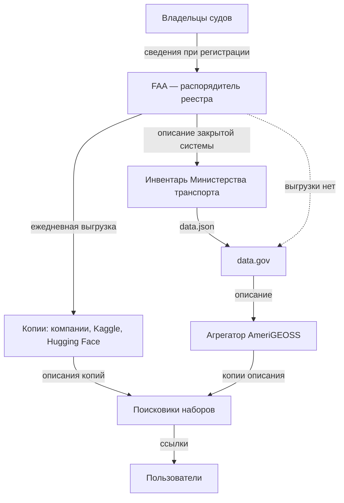

# Зарубежные методики

Готовые методики инвентаризации сходятся в трёх решениях: опись ведут постоянно, у каждой записи есть названный ответственный, а полный реестр отделён от того, что показывают всем. Расходятся они в главном для полноты — проверяет ли кто-то снаружи, что опись ничего не пропустила: так устроены только перечни Южной Кореи и, для статистики, оценка ODIN. Из американской модели стоит взять состав записи и разделение полного и общедоступного инвентаря, из корейской — внешнюю проверку и перечень ещё не открытого, из эстонской — регистрацию базы данных до её запуска, из финской — опубликованное описание ресурсов для запросов, из GovEx и ODI — порядок работы и картирование связей. Канада и Германия показывают обратное: инвентарь ради открытия данных и каталог «всех данных» без закона перестали вести, а описи, привязанные к праву на доступ или к регистрам, живут. Законы, реестры и платформы стран — в главах части «Страновые практики».

Сведения проверены 25 и 26 октября 2026 года, об Эстонии, Финляндии, Канаде, Китае, Японии и Германии — 28 октября 2026 года, если не указано иное.

## Коротко

| Методика | Что взять | Подробнее |
|----------|-----------|-----------|
| **США** | Полный инвентарь всех данных ведомства по закону, состав записи, заданный законом, отдельную общедоступную часть и сбор с проверкой по схеме | [Ниже](#инвентари-данных-федеральных-ведомств-сша) |
| **Великобритания** | Названного владельца у каждого актива, реестр в каждом министерстве, короткий список критически важных активов с общими метаданными и планом качества | [Ниже](#реестры-информационных-активов-великобритании), [«Великобритания»](../07-countries/03-united-kingdom.md) |
| **Франция** | Перечень по закону с ежегодным обновлением, список эталонных данных, администратора данных в министерстве, отраслевые описи с интервью | [Ниже](#политика-данных-франции), [«Франция»](../07-countries/04-france.md) |
| **Польша** | Постоянную программу с полугодовыми графиками и отчётами, уполномоченного в министерстве, опись реестров несколькими методами | [Ниже](#открытие-данных-в-польше), [«Польша»](../07-countries/05-poland.md) |
| **Южная Корея** | Внешнюю проверку перечней на пропуски со сроками, перечень ещё не открытого, ежегодную оценку с баллами, общий словарь терминов | [Ниже](#публичные-данные-южной-кореи), [«Южная Корея»](../07-countries/06-south-korea.md) |
| **Эстония** | Регистрацию каждой базы данных в открытом каталоге до запуска, проверку «не собирают ли это уже», согласование с ведомствами, описание до элемента данных | [Ниже](#каталог-riha-в-эстонии) |
| **Финляндия** | Модель управления информацией в каждом органе по закону, опубликованное описание ресурсов для запросов, совет, который проверяет исполнение | [Ниже](#модель-управления-информацией-в-финляндии) |
| **Канада** | Ежегодное описание фондов учреждения по закону о доступе — классы документов и банки персональных данных — и урок брошенного инвентаря открытых данных | [Ниже](#info-source-и-инвентарь-открытых-данных-канады) |
| **Китай** | Единый каталог данных всех органов по закону, режим обмена с основанием для закрытого, сроки обновления и ответственность | [Ниже](#каталоги-государственных-данных-китая) |
| **Япония** | Открытые реестры файлов документов и файлов персональной информации всех министерств с общим поиском | [Ниже](#реестры-документов-и-персональных-данных-японии) |
| **Германия** | Открытую карту регистров с правовыми основаниями и выгрузкой — и урок закрытого каталога Datenatlas | [Ниже](#карта-регистров-и-datenatlas-в-германии) |
| **ODIN** | Готовый список категорий и раздельную оценку: есть ли данные и открыты ли они | [Ниже](#open-data-inventory-odin) |
| **GovEx** | Пять шагов, связного в каждом подразделении и координатора, закрытое в инвентаре с пояснением | [Ниже](#govex-data-inventory) |
| **ODI** | Карту участников и обменов: кто у кого берёт данные и где связь рвётся | [Ниже](#картирование-экосистем-данных-odi) |

## Методики в сравнении

Как устроена опись:

| Методика | Обязанность | Единица учёта | Кто ведёт |
|----------|-------------|---------------|-----------|
| **США** | Закон с 2019 года, политика — с 2013 года | Актив данных: набор или группа наборов | Ведомство; отвечает директор по данным |
| **Великобритания** | Политика; список активов для повторного использования — по регламенту 2015 года | Информационный актив | Министерство; у актива — владелец |
| **Франция** | Закон: перечень документов и публикация баз данных | Документ, база данных | Администрация; в министерстве — администратор данных |
| **Польша** | Закон: программа открытия данных, учёт систем | Ресурс, реестр, система | Министерство; уполномоченный по открытости данных |
| **Южная Корея** | Закон с 2013 года | Публичные данные учреждения | Учреждение; ответственный за предоставление данных |
| **Эстония** | Закон и постановление о RIHA 2008 года | База данных, информационная система | Владелец базы; согласуют пять ведомств, управление данными координирует Статистическое управление |
| **Финляндия** | Закон с 2020 года | Информационный ресурс, процесс, система | Орган; исполнение оценивает Совет по управлению информацией |
| **Канада** | Закон о доступе — описание фондов; директива 2014 года — инвентарь данных | Класс документов, банк персональных данных; набор данных | Учреждение; требования к публикации задаёт Секретариат Казначейского совета |
| **Китай** | Положение Госсовета 2025 года; каталоги — с 2016 года | Ресурс данных с элементами данных | Ведомство и регион; сводит уполномоченный орган Госсовета |
| **Япония** | Законы о документах и о персональной информации | Файл документов, файл персональной информации | Министерство; сводки — Канцелярия кабинета и Комиссия по защите персональной информации |
| **Германия** | Закон об идентификационном номере 2021 года — обзор регистров | Регистр | Федеральное административное ведомство вместе с Федеральным статистическим ведомством |
| **ODIN** | Нет: внешняя оценка | Категория данных и показатель | Open Data Watch, с отзывом статистической службы |
| **GovEx** | Нет: руководство для городов | Набор данных | Подразделения, сводит координатор |
| **ODI** | Нет: метод картирования | Участник и обмен между участниками | Команда проекта, часто на семинаре |

Что видно и что проверяют:

| Методика | Проверка на пропуски извне | Публичная часть | Перечень неоткрытого | Отдельный учёт систем |
|----------|----------------------------|-----------------|----------------------|-------------|
| **США** | Нет: сборщик проверяет форму | Да | В самом инвентаре | Нет открытого |
| **Великобритания** | Нет | Частично | Пометка в реестре | Нет |
| **Франция** | Нет | Да, перечень | Частично | Крупные проекты |
| **Польша** | Нет | Частично | Графики у координатора | Да |
| **Южная Корея** | Да, министерство | Да | Да, с годом | Да |
| **Эстония** | Нет: согласование до создания, а не поиск пропусков | Да, каталог RIHA | Нет: закрытые базы в каталоге вместе с открытыми | В том же каталоге |
| **Финляндия** | Частично: совет проверяет, опубликовано ли описание | Да, описание для запросов | Нет | В модели управления информацией |
| **Канада** | Нет | Да: Info Source; инвентарь открытых данных не обновляется | Нет: в инвентаре только то, что можно открыть | Нет |
| **Китай** | Частично: каталог проверяет уполномоченный орган, пропуски находят ревизии | Нет: каталог — для обмена внутри государства | Да: «не передаётся» с нормой закона | Запись связывают с информационной системой |
| **Япония** | Нет | Да, оба реестра | Нет: закрытое в реестры не вносят | Реестр систем закрыт |
| **Германия** | Нет | Да, карта регистров | Отметка у регистра: открыт полностью, частично или нет | Нет: в карте — базы и интерфейсы регистра |
| **ODIN** | Да, это и есть оценка | Да, оценки | Нет | Нет |
| **GovEx** | Нет | По решению органа управления данными | В самом инвентаре | Нет |
| **ODI** | Отзывы участников | По желанию | Нет | Нет |

Внешнюю проверку на пропуски у национальных описей делает только Корея; финский совет проверяет, опубликовано ли описание, но не что в нём. Перечень ещё не открытого Корея ведёт отдельным списком, а США и GovEx — внутри самого инвентаря: закрытые наборы описаны вместе с открытыми. Канада закрытое из опубликованного инвентаря убрала: в нём только наборы, которые можно открыть. Китай записывает закрытое в каталог вместе с нормой, которая запрещает передачу, а Япония закрытые сведения в реестры не вносит. Учёт систем отдельно от учёта данных ведут Польша и Корея; в Эстонии базы данных и системы — в одном каталоге, в Финляндии — в одной модели управления информацией; в США систему можно найти по полям записи — номеру ИТ-инвестиции и ссылке на уведомление о системе с персональными данными ([«Сопоставление с реестром»](./02-metadata-standards.md#сопоставление-с-реестром)).

## Инвентари данных федеральных ведомств США

У США нет своей главы в книге, поэтому американская модель описана здесь целиком — как ниже модели Эстонии, Финляндии, Канады, Китая, Японии и Германии. Поля описания — в главе [«Стандарты описания»](./02-metadata-standards.md#dcat-us-30-и-полные-инвентари-сша), сбор и проверка на data.gov — в главе [«Data Mesh»](./03-data-mesh.md#федеративный-инвентарь-сша).

**Как складывалась.**

- **2013** — меморандум Административно-бюджетного управления при президенте (OMB) M-13-13 требует от федеральных ведомств вести **корпоративный инвентарь данных** (Enterprise Data Inventory) и публиковать его общедоступную часть файлом `data.json` — описаниями наборов в формате JSON ([«Стандарты описания»](./02-metadata-standards.md), врезка «Как читать машинные описания»). Файл составляют по схеме Project Open Data, теперь она называется DCAT-US v1.1. Руководство к меморандуму описывает три направления: расширять инвентарь по классам данных, обогащать описания, открывать то, что можно открыть. План инвентаризации и первый инвентарь ведомства сдавали к 30 ноября 2013 года. Все данные всех подразделений нужно было учесть, насколько возможно, к 30 ноября 2014 года; инвентарь обновляли и отчитывались о нём ежеквартально. Ведомство должно было завести и канал обратной связи: пользователи помогают решить, что открывать в первую очередь.
- **2019** — закон OPEN Government Data Act (раздел II закона Foundations for Evidence-Based Policymaking Act of 2018, подписан 14 января 2019 года) делает инвентарь обязанностью: каждое ведомство ведёт **полный инвентарь данных** (comprehensive data inventory). Тот же закон требует включать в стратегический план ведомства план получения доказательств (learning agenda). Это список вопросов, на которые ведомство хочет получить ответы для решений, и список данных, которые для этого нужно собрать, использовать или приобрести (5 U.S.C. § 312). По сути это цель и вопросы описи, закреплённые законом ([«Цели и вопросы»](../03-process/02-goals-and-questions.md)).
- **2025** — меморандум OMB M-25-05 даёт руководство по полным инвентарям: схема DCAT-US 3.0, все активы данных и публикация инвентаря — до 30 сентября 2026 года.

**Что учитывают.** Все активы данных, которые ведомство создаёт, собирает, контролирует или хранит, кроме систем национальной безопасности. Актив данных (data asset) — набор или группа наборов, которые можно объединить по общему признаку; случайная подборка не считается. База, купленная по контракту, — тоже актив ведомства, даже если её содержимое принадлежит компании. Актив, который есть у нескольких ведомств, каждое записывает в свой инвентарь.

**Состав записи по закону** (44 U.S.C. § 3511(a)(2)(A)):

- описание; названия и определения всех переменных; название;
- решения ведомства: открытые ли это государственные данные, закрыт ли актив от раскрытия по закону о свободе информации целиком или частично, можно ли включить его в федеральный каталог, подпадает ли он под требования открытого формата и открытой лицензии. В каждом пункте законны ответы «не можем определить» и «ещё не решили»;
- дата внесения в инвентарь и дата последнего обновления данных;
- как получить данные или запросить доступ, ограничения использования и доступа, где данные хранятся;
- какие ведомства ведут и обновляют актив и кто его владелец.

Новый актив вносят не позже 90 дней после того, как его создали или нашли, а весь инвентарь обновляют постоянно и не реже раза в год. Подразделения могут вести свои инвентари и сводить их в один инвентарь ведомства.

**Кто отвечает.** Требования к инвентарю выполняет директор по данным (Chief Data Officer) ведомства (44 U.S.C. § 3520(c)(5)). Описания для data.gov ведомства могут готовить в закрытой системе inventory.data.gov.

**Полный и общедоступный инвентарь.** Ещё Project Open Data требовал включать в общедоступную часть как минимум все открытые наборы и разрешал включать остальные — например, наборы с ограничениями, чтобы о них знали и знали, как их получить. У закрытого набора в описании объясняют, почему его нельзя открыть, а решение принимают вместе с юристами ведомства. Закон пошёл дальше: в инвентаре публикуют всё, что нельзя скрыть по закону о свободе информации (44 U.S.C. § 3511(a)(2)(C)). Решая, открывать ли набор, ведомство учитывает риск сопоставления: набор сам по себе безопасен, но вместе с другими доступными сведениями раскрывает людей или уязвимости (§ 3511(a)(2)(E)). По M-25-05 инвентарь публикуют по адресу `www.[ведомство].gov/data.json`, откуда его забирает федеральный каталог data.gov; убранные сведения отмечают в плане открытых данных ведомства — какой элемент и по какому исключению. Закрытый набор при этом остаётся в инвентаре и виден как запись. Как это выглядит в инвентаре Администрации общих служб (GSA), разобрано в главе [«Результат и поддержка»](../03-process/09-result-and-upkeep.md#пример-инвентарь-gsa).

**Слабые места.**

- **Руководство запоздало на шесть лет.** Счётная палата США (GAO) в октябре 2020 и декабре 2021 года отмечала, что OMB не выпустило предписанное законом руководство по полным инвентарям. Оно вышло только с меморандумом M-25-05 в январе 2025 года.
- **Неясно, обновляются ли инвентари.** В 2020 году все 24 крупнейших ведомства публиковали инвентари на своих сайтах и в федеральном каталоге, но сведений о том, насколько регулярно они их обновляют, по оценке GAO, мало. В 2021 году у одного из четырёх проверенных ведомств — AmeriCorps — полного инвентаря не было.
- **Форма вместо содержания.** Сборщик проверяет записи по схеме, но не смысл: инвентарь GSA формально соответствует DCAT-US 3.0 и при этом не пользуется новыми полями этой версии ([«Пример: инвентарь GSA»](../03-process/09-result-and-upkeep.md#пример-инвентарь-gsa)). Инвентарь Бюро статистики труда месяцами отклоняется целиком из-за спора о версии схемы ([«Федеративный инвентарь США»](./03-data-mesh.md#федеративный-инвентарь-сша)).

Главное в американской модели: один инвентарь на всё ведомство, состав записи задан законом, закрытое учитывают вместе с открытым, а общедоступную часть собирают в общий каталог.

## Реестры информационных активов Великобритании

Опись в британских министерствах выросла не из открытых данных, а из информационной безопасности и управления документами. Поэтому её единица — информационный актив, а у каждого актива есть владелец-руководитель, который вносит его в реестр министерства. С 2026 года поверх реестров ведут короткий список критически важных активов данных: у каждого — общий профиль метаданных, названный владелец данных и план действий по качеству. Слабое место видно по опубликованным реестрам: без владельца процесса они устаревают. Взять — владельца-руководителя у каждого актива и короткий список главного поверх полной описи; как устроены реестры и где их искать, — в главе [«Великобритания»](../07-countries/03-united-kingdom.md#реестры-информационных-активов).

## Политика данных Франции

Во Франции закон обязывает каждую администрацию вести и ежегодно публиковать перечень основных документов с публичной информацией. Там же — обязанность публиковать базы данных и список из девяти баз эталонных данных, на которые ссылаются остальные. В каждом министерстве есть администратор данных, алгоритмов и исходных кодов. Отраслевые описи 2021 года службы Etalab показывают подход «где найти нужное»: кабинетное исследование и интервью, на которых держатели подтверждают найденные базы. Слабое место — то же, что в Великобритании: перечни устаревают. Как с этими перечнями работать — в главе [«Франция»](../07-countries/04-france.md#реестры-и-платформы).

## Открытие данных в Польше

В Польше опись встроена в постоянную программу открытия данных: в каждом министерстве есть уполномоченный по открытости данных, раз в полгода министерство сдаёт график новых данных, раз в год — отчёт. Опись реестров государства собрали несколькими методами — обзором законов, учётом систем, анкетой и разбором ИТ-проектов, — а учёт систем и реестров с 2025 года закреплён законом. Взять — график с отчётом вместо разовой описи и сочетание методов для перечня реестров; подробности — в главе [«Польша»](../07-countries/05-poland.md#sist).

## Публичные данные Южной Кореи

В Корее учреждение по закону регистрирует перечень своих публичных данных на портале data.go.kr, а министерство проверяет перечни на пропуски и требует в установленный срок дорегистрировать недостающее. Рядом публикуют перечень того, что ещё не открыто, с годом открытия. Метаданные баз данных ведут до столбца с именами из общего словаря терминов, системы учитывают отдельно, а управление данными учреждений ежегодно оценивают баллами. Это ближе всего к полному инвентарю США, но с внешней проверкой и отдельным учётом систем. Как с этим работать при описи — в главе [«Южная Корея»](../07-countries/06-south-korea.md#как-провести-инвентаризацию).

## Каталог RIHA в Эстонии

Эстония учитывает базы данных государства до того, как они начинают работать. Каждую базу данных (andmekogu) по закону о публичной информации регистрируют в RIHA — системе учёта государственной информационной системы, а пользоваться незарегистрированной базой запрещено. В RIHA записывают все базы, кроме баз с государственной тайной, — и открытые, и закрытые. Каталог [riha.ee](https://www.riha.ee) открыт без входа: на 28 октября 2026 года в нём 1373 записи о базах данных и системах 446 организаций, из них 1096 — в работе.

- **Согласование до создания.** Сначала владелец проверяет, не собирают ли эти сведения уже в другой базе, — опись работает против дублей. Затем документацию новой базы за 20 рабочих дней согласуют пять ведомств: Управление информационной системы (RIA) смотрит состав данных и их источники, Инспекция по защите данных — ограничения доступа и персональные данные, Статистическое управление — состав данных, Управление земли и пространственного развития — пространственные данные, Национальный архив — выгрузку архивных документов. Без согласования базу не создают.
- **Что записывают.** Основание и цель, владельца, документацию и положение о базе, персональные данные, сроки хранения, класс защиты, классификаторы, объекты данных с описаниями, архивные данные; в отдельных разделах — сервисы, классификаторы и семантические описания. Ведомство держит свои записи актуальными, а ошибку в записи исправляет за три рабочих дня.
- **Описание данных.** С 2019 года управление данными государства координирует Статистическое управление. Его руководство по описанию данных 2023 года построено на DCAT-AP и доводит описание до элемента данных ([«Стандарты описания»](./02-metadata-standards.md)). В 2025 году управление вместе с 19 ведомствами провело 276 проектов описания. Сервисы обмена между системами видны в открытом каталоге шины X-tee.

**Слабые места.**

- **Регистрация не значит, что запись живёт.** Из 1096 записей о работающих базах и системах 545 последний раз обновляли до 2021 года — подсчёт по программному интерфейсу RIHA. Статистическое управление в отчёте за 2025 год пишет, что RIHA мало что дал ведомствам, и переносит описания в новый портал данных andmed.eesti.ee.
- **Не все базы доходят до каталога.** Государственный контроль (Riigikontroll) в 2017 году насчитал у волостей и городов не меньше 925 баз данных; регистрацию в RIHA прошли 175, 81% не были зарегистрированы.

Главное в эстонской модели: регистрация — условие работы базы, а не отчёт после запуска, и все базы государства, открытые и закрытые, видны в одном открытом каталоге. На запрос информации ведомство отвечает за пять рабочих дней, срок продлевают до 15.

## Модель управления информацией в Финляндии

В Финляндии опись — обязанность каждого органа по закону об управлении информацией в государственном управлении, который действует с 2020 года. Орган ведёт модель управления информацией (tiedonhallintamalli) и публикует описание своих ресурсов для тех, кто хочет запросить документы.

- **Что в модели.** Процессы с ответственными органами и связями между ними; информационные ресурсы (tietovarannot) — их связи с процессами и системами и сведения из записей об обработке персональных данных; архивирование — с 1 июля 2026 года; системы, их интерфейсы и способы передачи данных; меры безопасности. Модель составляли в течение года после вступления закона в силу и обновляют перед каждым крупным изменением или новой системой. Публиковать саму модель закон не требует.
- **Что публикуют.** Описание для доступа к документам (asiakirjajulkisuuskuvaus): какие системы хранят сведения, кто решает о выдаче и куда писать запрос, какие наборы есть по группам данных, по каким признакам искать документы, что доступно через открытый интерфейс. Статистическое управление Финляндии описывает так 11 информационных ресурсов — от персонала и финансов до сведений о людях, организациях и застроенной среде — и у каждого отмечает, есть ли открытый интерфейс.
- **Кто проверяет.** Совет по управлению информацией при Министерстве финансов оценивает, как ведомства и муниципалитеты исполняют закон, и получает для этого сведения несмотря на тайну. Наказывать он не может — только «обратить внимание» органа на нарушения; отчёт об оценке — раз в два года. В 2022 году совет нашёл, что у 131 муниципалитета описания на сайте нет или его не удалось найти.
- **Общие карта и словари.** Министерство финансов ведёт карту управления информацией государственного управления — задачи, органы, информационные ресурсы и передачи данных. Общие словари, классификаторы и модели данных собраны на платформе интероперабельности Агентства цифровизации и сведений о населении.

Слабое место — то же, что у реестров активов Великобритании: модель внутренняя, снаружи видно только описание для запросов, а совет проверяет, опубликовано ли оно, а не полноту. Взять — опись как часть права на доступ: описание ресурсов публикуют, чтобы по нему писали запросы. На запрос орган отвечает не позже двух недель, а если документов много или в них есть закрытые части — не позже месяца.

## Info Source и инвентарь открытых данных Канады

В Канаде две описи с разной судьбой: описание фондов по закону о доступе к информации выходит каждый год, а инвентарь данных, заведённый ради открытия данных, перестали вести.

- **Info Source.** По закону о доступе к информации правительство не реже раза в год публикует описание каждого учреждения: его организацию, программы и все классы документов (classes of records). По закону о защите персональных данных к ним добавляют банки персональных данных (personal information banks) — с целью, категориями людей, допустимыми использованиями и сроками хранения. С 2019 года каждое учреждение публикует свою страницу Info Source на своём сайте по требованиям Секретариата Казначейского совета (TBS). Запись строится по цепочке «программа → деятельность → класс документов», так что опись сразу связана с полномочием ([«Где искать полномочия»](../03-process/03-owners-and-mandates.md#где-искать-полномочия)). Единица учёта — класс документов, а не набор данных.
- **Инвентарь открытых данных.** Директива об открытом правительстве 2014 года требует от ведомства вести полный инвентарь данных и информационных ресурсов, ценных для его работы, чтобы решить, что можно открыть и в каком порядке. Ведомственные инвентари впервые опубликовали на open.canada.ca в марте 2017 года; в сводном файле 11 460 записей 57 организаций. Поля — название, описание, издатель, дата, язык, объём, можно ли открыть, дата открытия, ссылка на портал. Наборы, само название которых раскрывает секретные или персональные сведения, в инвентарь не включали.
- **Что вышло.** Все 11 460 опубликованных записей отмечены как «можно открыть»: закрытого в открытой части нет, хотя руководство TBS требовало вносить и наборы, которые открыть нельзя. Внутренний аудит Министерства природных ресурсов в 2021 году нашёл, что его инвентарь неполон: за 2018–2019 финансовый год в нём были сведения только одного подразделения. Теперь TBS прямо пишет, что инвентарь больше не ведут и не обновляют; файл последний раз обновлялся 9 апреля 2024 года. Политика в области услуг и цифровых технологий 2020 года требует управлять информацией и данными как стратегическим активом, но регулярную опись советует только руководство к ней, а директора по данным руководитель назначает по желанию.

Урок для описи: инвентарь, привязанный только к открытию данных, перестают вести, когда открытие перестаёт быть приоритетом, а описание фондов, привязанное к праву на доступ, обновляют каждый год ([«Инвентаризация не заканчивается»](../01-basics/04-principles.md#8-инвентаризация-не-заканчивается)). Взять — связь «программа → класс документов» и ежегодное обновление по закону. На запрос по закону о доступе учреждение отвечает за 30 дней; срок продлевают на разумный период, продление больше чем на 30 дней — с уведомлением Уполномоченного по информации, а пропущенный срок считается отказом.

## Каталоги государственных данных Китая

Китай описывает данные государства единой системой каталогов: каждое ведомство и каждый регион составляет каталог своих данных, а уполномоченный орган Госсовета сводит их в общегосударственный. С 1 августа 2025 года это требование положения об обмене государственными данными, а до него — временных мер 2016 года. Каталог служит обмену между органами, а не открытию данных для всех.

- **Что в записи.** Название, элементы данных, поставщик, формат, частота обновления, режим обмена — «без условий», «с условиями» или «не передаётся», — способ обмена, условия использования, класс и уровень данных. До составления каталога ведомство оценивает риски для тайны и персональных данных; государственные и служебные секреты в каталог не входят.
- **Закрытое — с основанием.** Для режима «не передаётся» в каталоге указывают причину и норму закона, постановления или решения Госсовета, которая запрещает передачу; добавлять свои условия, мешающие обмену, нельзя. Так закрытая часть видна внутри государства как запись с основанием ([«Учитывают всё, в том числе закрытое»](../01-basics/04-principles.md#2-учитывают-всё-в-том-числе-закрытое)).
- **Сроки и ответственность.** После изменения закона или функций органа каталог обновляют за 10 рабочих дней, уполномоченный орган проверяет и объявляет его. За несоставленный или необновлённый каталог — предписание, затем взыскание с руководителей.
- **Масштаб.** В 2022 году в каталогах было больше 3 млн записей и 20 млн элементов данных; цель — «одна книга учёта» всех государственных данных страны. С 1 марта 2025 года работает и национальная платформа регистрации общественных ресурсов данных Национального управления данных. Регистрация на ней обязательна только для данных, которые орган передал оператору для выпуска продуктов на данных, для остальных — по желанию; о каждой регистрации платформа публикует объявление.

**Слабые места.**

- **Каталоги неполны.** Сам документ Госсовета 2022 года признаёт, что состав государственных данных неясен, а каталоги неполны и составлены не по правилам. Государственное ревизионное управление в отчёте за 2024 год по 18 провинциям и городам нашло, что в девяти из них информационные системы 1091 органа не описаны в каталогах, а каталоги 9717 органов не соответствуют правилам: не связаны с информационными системами или не указывают условий обмена.
- **Снаружи каталога не видно.** Общегосударственного портала открытых данных нет — адреса data.gov.cn не существует; открытые данные публикуют порталы провинций и городов, в 2022 году они были у 21 провинции.

Главное в китайской модели: состав записи, режим обмена с основанием для закрытого, сроки обновления и ответственность заданы одним актом, но опись работает на обмен внутри государства. На запрос о раскрытии государственной информации орган отвечает за 20 рабочих дней, продление — ещё до 20.

## Реестры документов и персональных данных Японии

В Японии полной описи данных нет, но есть две обязательные открытые описи с разной единицей учёта: реестр файлов документов по закону об управлении публичными документами и реестр файлов персональной информации по закону о её защите. Оба реестра публикуются в сети, и по каждому есть общий поиск по всем министерствам на портале e-Gov.

- **Реестр файлов документов** (行政文書ファイル管理簿). Министерство вносит в него каждый файл документов: классификацию, название, срок хранения и дату его окончания, что делать по окончании — передать в Национальный архив или уничтожить, — место хранения, носитель и ответственного. Файлы со сроком хранения меньше года не вносят, закрытые по закону о доступе сведения в реестр не пишут. На конец марта 2025 года у министерств и ведомств было 20 126 525 файлов.
- **Реестр файлов персональной информации** (個人情報ファイル簿). Перед созданием файла орган уведомляет Комиссию по защите персональной информации, а в реестр вносит цель, состав сведений и чьи они, способ сбора, получателей и куда обращаться. Не регистрируют файлы о национальной безопасности и дипломатии, о расследованиях и уголовном преследовании, кадровые файлы и файлы меньше чем о тысяче людей. На конец марта 2025 года у административных органов было 93 173 таких файла.
- **Системы и базовые реестры.** Каждой государственной информационной системе Цифровое агентство присваивает идентификатор, а министерство ведёт реестр своих систем с обрабатываемыми сведениями. Этот реестр закрыт, публикуются расходы по системам. С 2025 года закон о цифровых процедурах требует плана базовых реестров — сведений о юридических лицах, недвижимости, адресах и других, на которые опираются остальные системы.

Открытые данные министерства в принципе публикуют все — по основным принципам 2017 года, последняя редакция которых принята в 2024 году. На data.e-gov.go.jp на 28 октября 2026 года — 18 828 наборов 25 организаций.

**Слабые места.**

- **Не все системы в учёте.** Счётная палата Японии в 2025 году нашла 137 систем в 23 органах без идентификатора; меры безопасности у них слабее, чем у учтённых.
- **Реестр документов держится на исполнителях.** В 2024 финансовом году министерства сообщили о 202 потерянных и 134 ошибочно уничтоженных файлах, проверки находили ошибки в реестрах. Правку документов Министерства финансов по делу «Моритомо гакуэн» в 2018 году реестр не предотвратил: после неё правительство приняло меры по усилению управления документами.

Главное в японской модели: опись ведут файлами, привязанными к сроку хранения и к праву на доступ, а не к данным, и делают её поиском по всем министерствам. Взять — общий поиск по реестрам всех органов и обязательную запись о файле персональной информации до его создания. На запрос о раскрытии орган отвечает за 30 дней, продление — до 30 дней; если документов очень много — по значительной части за 60 дней.

## Карта регистров и Datenatlas в Германии

Германия открыто описывает не все данные, а регистры. По закону об идентификационном номере 2021 года Федеральное административное ведомство (BVA) составляет обзор всех регистров — карту регистров ([Registerlandkarte](https://registerlandkarte.de)). На 28 октября 2026 года в ней 300 регистров; карта выгружается в CSV и XML и через программный интерфейс по лицензии CC BY 4.0. Каталог всех данных федеральных органов — Datenatlas — закрыли через год работы.

- **Что о регистре.** Название, описание и цель, правовые основания и уровень, объекты сведений и их признаки, держатель, связанные услуги, открыт ли регистр полностью, частично или нет, базы данных, интерфейсы и стандарты. Карта строится на платформе сведений об административных данных (VIP) Федерального статистического ведомства. По закону о федеральной статистике органы по запросу передают ведомству метаданные своих данных — происхождение, структуру, содержание — и сообщают об их изменениях, а сведения платформы публикуются. Ведомство пользуется ими, чтобы не собирать для статистики то, что уже есть в администрации.
- **Зачем.** Модернизация регистров: налоговый номер становится общим идентификатором в 50 регистрах, а сведения передаются через общую техническую систему «однократно» (NOOTS); договор о ней между Федерацией и землями действует с 1 февраля 2026 года. Срок модернизации — конец 2028 года.
- **Открытые данные.** Федеральные органы по закону об электронном правительстве публикуют необработанные данные и передают метаданные в GovData; права требовать данные закон не даёт.
- **Datenatlas.** Стратегия данных 2021 года поручила проанализировать данные федеральной администрации и свести их в Datenatlas — каталог метаданных для сотрудников федеральных органов. Его разрабатывала Федеральная типография по заказу Министерства финансов вместе с лабораториями данных министерств. Первая рабочая версия вышла к концу 2024 года, 31 декабря 2025 года каталог отключили; расходы за 2022–2026 годы — 26,2 млн евро. Министерство цифровых технологий и модернизации государства обещает учесть полученный опыт в будущих проектах.

**Слабые места.**

- **Данные вне регистров не описаны.** Федеральная счётная палата в 2022 году опросила 155 федеральных органов и учреждений: у 81% не было каталога данных, у 15% — частичный, полный — у 4%.
- **Норма об указателях — рекомендация.** Закон о свободе информации с 2006 года говорит, что органам следует вести указатели своих собраний информации и их целей и публиковать их, но обязательной эта норма не стала, отчётов о её исполнении найти не удалось.

Главное в германской модели: опись живёт, пока у неё есть задача и закон, — карта регистров нужна модернизации регистров и статистике. Каталог «всех данных» без такой опоры закрыли ([«Инвентаризация не заканчивается»](../01-basics/04-principles.md#8-инвентаризация-не-заканчивается)). Взять — открытую карту регистров с правовыми основаниями и выгрузкой. По закону о свободе информации доступ следует предоставить в течение месяца.

## Open Data Inventory (ODIN)

Open Data Inventory — оценка, которую некоммерческая организация Open Data Watch проводит раз в два года: насколько полно и открыто национальные статистические службы публикуют официальную статистику. Это инвентаризация со стороны пользователя — подход «где найти нужное» для статистики.

- **Что смотрят.** Сайт статистической службы и официальные сайты, на которые с него есть ссылка. Данные международных организаций не считаются: оценивают, что публикует сама страна.
- **По какому списку.** 22 категории в трёх группах — социальная, экономическая и финансовая, экологическая статистика; в выпуске 2022/23 года в них 65 показателей.
- **Как оценивают.** У каждой категории пять признаков охвата: есть ли показатели и нужные разрезы, данные за последние пять и десять лет, по регионам первого и второго уровня. И пять признаков открытости: машиночитаемый формат, непатентованный формат, метаданные, способы выгрузки — массовая выгрузка, программный интерфейс, выбор данных — и открытая лицензия.
- **Как проверяют.** Статистической службе отправляют список найденных наборов и дают месяц на поправки.

В выпуске 2024/25 года оценены 198 стран. Что взять для инвентаризации: готовый список категорий как список вопросов, раздельный счёт «есть ли данные» и «открыты ли они» и проверку снаружи с отзывом владельца ([«Цели и вопросы»](../03-process/02-goals-and-questions.md)).

## GovEx Data Inventory

Руководство Центра государственного совершенства (GovEx) Университета Джонса Хопкинса — практический образец описи для города. Оно предлагает пять шагов:

1. **Назначить, кто руководит:** директора по данным, орган управления данными или рабочую группу, в том числе с представителями жителей.
2. **Определить границы и план:** обязательные метаданные, сроки, указания исполнителям, показатели.
3. **Описать данные по плану.** Связные (liaisons) в каждом департаменте описывают его данные, ведущий менеджер сводит описания в инвентарь города в машиночитаемом виде — таблице, CSV или JSON.
4. **Проверить инвентарь и решить, какая часть будет публичной.** Решает орган управления данными.
5. **Расставить приоритеты публикации** — по стратегическим целям, нуждам подразделений и спросу жителей.

Типичные поля — название, содержание, периодичность обновления, лицензия, владелец или ответственный, персональные данные, источник. Чувствительные наборы руководство советует не исключать, а описывать с пояснением, в чём их чувствительность: Филадельфия включает в инвентарь и наборы, которые никогда не опубликуют. Инвентаризацию GovEx называет непрерывным процессом: некоторые города обязаны обновлять инвентарь ежегодно. Как находить данные, руководство не объясняет: их описывают сами подразделения. Что взять: связного в каждом подразделении и координатора ([«Кому отправлять»](../03-process/04-questionnaires.md#кому-отправлять)), план с обязательными полями и сроками, закрытое в инвентаре с пояснением.

## Картирование экосистем данных ODI

Метод британской некоммерческой организации Open Data Institute (ODI) показывает, как данные переходят между организациями и кто от этого выигрывает. Карта экосистемы — схема участников и обменов между ними. Инструмент ODI предлагает четыре шага на большом листе или доске:

1. **Нанести участников** — на три круга вокруг себя, организации с набором или задачи. Типичные роли: распорядитель данных, который их собирает и даёт доступ, участники, пополняющие набор, посредники и агрегаторы, создатели продуктов на данных, выгодоприобретатели, регуляторы.
2. **Нанести «формальные» обмены** — какие данные, от кого, к кому, а также деньги, услуги, лицензии и сертификаты.
3. **Нанести «мягкие» обмены** — знания, советы, обратную связь — пунктиром.
4. **Найти возможности** — где поток можно улучшить, какие данные открыть, кого привлечь.

Черновик рисуют за один-два часа и дорабатывают в два-три круга отзывов участников. Для инвентаризации карта полезна тем, что показывает первоисточник и копии, чужих владельцев и места, где поток рвётся. Вот карта для реестра воздушных судов США по находкам главы [«Поиск наборов данных»](../04-sources/05-dataset-search.md#пример-реестр-воздушных-судов-сша):

Пунктир — связь, которой нет: первоисточника на data.gov нет, и пользователь находит реестр только через копии. Карта ближе всего к [картам данных от продукта](../02-approaches/04-data-maps.md#от-продукта): связи «копия — первоисточник» и пробелы с неё переносят в реестр.

## Ограничения

- Модели стран описаны по законам и политикам. Как они исполняются, видно только по открытой части — опубликованным реестрам, перечням и отчётам.
- У Эстонии, Финляндии, Канады, Китая, Японии и Германии нет своих глав: их модели описаны по актам, официальным каталогам и отчётам, а порядок поиска данных в этих странах книга не разбирает.
- Почти все методики ставят на первое место открытые данные: закрытое попадает в опись как то, что «пока не открыто».
- Международные методики полной описи не дают: ODIN видит только опубликованное, GovEx не говорит, как находить данные, ODI рисует связи, а не состав.
- Высокие места Кореи, Франции и Польши в индексе открытых данных ОЭСР OURdata говорят об открытости данных, а не о полноте описи.
- Матрица сравнения — авторская, по документам на октябрь 2026 года; политики стран меняются.

## Источники

- США: [M-13-13 Open Data Policy](https://www.whitehouse.gov/wp-content/uploads/legacy_drupal_files/omb/memoranda/2013/m-13-13.pdf), 2013; Project Open Data — [Implementation Guide](https://web.archive.org/web/20240519174130/https://project-open-data.cio.gov/implementation-guide/), копия в Internet Archive от 19 мая 2024 года: сайт project-open-data.cio.gov теперь перенаправляет на resources.data.gov; по нему — сроки 2013–2014 годов, общедоступная часть как выборка из инвентаря, записи о закрытых наборах с объяснением и решением юристов, канал обратной связи, ежеквартальные отчёты; [44 U.S. Code § 3511](https://www.law.cornell.edu/uscode/text/44/3511) — подпункты (a)(2)(A), (C), (E) и пункт (a)(3), и [§ 3520](https://www.law.cornell.edu/uscode/text/44/3520), подпункт (c)(5); [5 U.S. Code § 312](https://www.law.cornell.edu/uscode/text/5/312) — план получения доказательств ведомства; [OMB M-25-05](https://www.whitehouse.gov/wp-content/uploads/2025/01/M-25-05-Phase-2-Implementation-of-the-Foundations-for-Evidence-Based-Policymaking-Act-of-2018-Open-Government-Data-Access-and-Management-Guidance.pdf) от 15 января 2025 года — раздел 4(a): состав, сроки, публикация, приложение со сроками; прочитано 26 октября 2026 года; [The OPEN Government Data Act: A Primer](https://www.everycrsreport.com/reports/IF12299.html) — Congressional Research Service; [inventory.data.gov](https://inventory.data.gov).
- GAO: [GAO-21-29 Open Data: Agencies Need Guidance to Establish Comprehensive Data Inventories; Information on Their Progress is Limited](https://www.gao.gov/products/gao-21-29), 8 октября 2020 года, — 24 ведомства, три рекомендации, первая закрыта после M-25-05; [GAO-22-104574 Open Data: Additional Action Required for Full Public Access](https://www.gao.gov/products/gao-22-104574), 16 декабря 2021 года, — AmeriCorps, Министерство юстиции, Государственный департамент, FDIC. Проверено 26 октября 2026 года.
- Open Data Watch: [Open Data Inventory](https://odin.opendatawatch.com/); [ODIN 2022/23 Methodology Guide](https://comunidades.cepal.org/rtccea/sites/rtccea/files/2022-08/ODIN%202022_23%20Methodology%20Guide.pdf) — копия на сайте ЭКЛАК: 22 категории, 65 показателей, пять признаков охвата и пять открытости, отзыв статистических служб; число стран в выпуске 2024/25 года — по [сообщению статистической службы Молдовы](https://statistica.gov.md/en/republic-of-moldova-ranks-17th-out-of-198-countries-and-12_61783.html) от 22 мая 2025 года. Сайт ODIN 26 октября 2026 года отдавал только заголовок страницы.
- GovEx: [Data Inventory](https://labs.centerforgov.org/data-governance/data-inventory/) — Johns Hopkins Bloomberg Center for Government Excellence, обновлено 17 июля 2024 года, лицензия CC BY 4.0; проверено 26 октября 2026 года.
- ODI: [Data Ecosystem Mapping](https://theodi.org/article/data-ecosystem-mapping-tool/) — инструмент и [руководство для печати](https://www.theodi.org/documents/465/ODI-Data-Ecosystem-Mapping-E28093-print-at-home-guide-A4-E28093-2019-06-26_FJiUBS3.pdf) от 26 июня 2019 года, лицензия CC BY-SA 4.0; [Mapping data ecosystems](https://theodi.org/article/mapping-data-ecosystems/) — описание метода, обновление 2022 года. Проверено 26 октября 2026 года.
- Великобритания: [The role of information asset owners in government](https://www.gov.uk/government/publications/information-asset-owner-role-guidance) — Кабинет министров, обновлено 1 октября 2025 года; [Data asset management policy in government](https://www.gov.uk/government/publications/data-asset-management-policy-in-government) — GDS, 27 мая 2026 года. Остальные источники — в главе [«Великобритания»](../07-countries/03-united-kingdom.md#источники).
- Франция: Кодекс отношений между публикой и администрацией, статьи L312-1-1, L321-4 и L322-6 — по [изданию кодекса на codes.droit.org](https://codes.droit.org/PDF/Code%20des%20relations%20entre%20le%20public%20et%20l'administration.pdf) от 24 октября 2026 года; [опись баз данных о занятости](https://www.data.gouv.fr/datasets/inventaire-des-bases-de-donnees-relatives-a-lemploi) — Etalab, 2021. Остальные — в главе [«Франция»](../07-countries/04-france.md#источники).
- Польша: закон об открытых данных — [единый текст Dz.U. 2023 poz. 1524](https://api.sejm.gov.pl/eli/acts/DU/2023/1524/text.html), статьи 28–31, 37, 38; [Kluczowe rejestry publiczne](https://www.gov.pl/web/ia/kluczowe-rejestry-publiczne). Остальные — в главе [«Польша»](../07-countries/05-poland.md#источники).
- Южная Корея: [закон о публичных данных](https://www.law.go.kr/법령/공공데이터의제공및이용활성화에관한법률), статьи 18 и 22, и [указ к нему](https://www.law.go.kr/법령/공공데이터의제공및이용활성화에관한법률시행령), статья 15; [перечень данных, которые предстоит открыть](https://www.data.go.kr/data/15127106/fileData.do). Остальные — в главе [«Южная Корея»](../07-countries/06-south-korea.md#источники).
- Эстония: закон о публичной информации — [консолидированный текст RT I, 30.06.2026, 9](https://www.riigiteataja.ee/akt/130062026009), § 18, § 19, § 43³–§ 43⁹, и [перевод на английский](https://www.riigiteataja.ee/en/eli/525032026001/consolide); постановления Правительства [№ 58 о RIHA](https://www.riigiteataja.ee/akt/129122024015) — § 6–9, 13, 18, 28, 29, и [№ 88 об управлении информацией](https://www.riigiteataja.ee/akt/129122024019) — § 13, 16¹; тексты прочитаны через программный интерфейс Riigi Teataja, сайт которого — приложение на JavaScript. [Каталог RIHA](https://www.riha.ee) — число записей, владельцев и дат обновления посчитано по его программному интерфейсу `api/v1/systems` 28 октября 2026 года; [каталог X-tee](https://www.x-tee.ee/catalogue/EE). Статистическое управление: [годовой отчёт за 2025 год](https://www.stat.ee/sites/default/files/2026-03/Aastaaruanne_2025_0.pdf), с. 16–17, — проекты описания, оценка RIHA, портал andmed.eesti.ee; [руководство по описанию данных 2.0](https://stat.ee/sites/default/files/2025-06/AH_juhis_andmekirjeldus_v2.0.pdf), сентябрь 2023 года. [Ülevaade valdades ja linnades peetavatest andmekogudest](https://riigikontroll.ee/sites/default/files/arhivaalid/2420/RKTR_2420_2-1.4_2175_001-3.pdf) — Riigikontroll, 31 января 2017 года. Проверено 28 октября 2026 года.
- Финляндия: закон об управлении информацией [906/2019](https://www.finlex.fi/fi/lainsaadanto/2019/906) — § 5, 6, 10, 11, 28, 30, консолидированный текст с изменением 530/2026, прочитан через opendata.finlex.fi; [перевод на английский](https://www.finlex.fi/en/legislation/translations/2019/eng/906) — текст 2019 года; закон об открытости [621/1999](https://www.finlex.fi/fi/lainsaadanto/1999/621), § 14. Совет по управлению информацией: [протокол заседания 4/2022](https://api.hankeikkuna.fi/asiakirjat/8e9b8e45-f1e9-4b39-8eb2-a7c3b74de39f/587838c3-ec03-42e8-9598-cc22f41b2914/POYTAKIRJA_20220524073929.PDF) от 11 мая 2022 года — 131 муниципалитет без описания; [отчёт за 2022 год](https://api.hankeikkuna.fi/asiakirjat/8e9b8e45-f1e9-4b39-8eb2-a7c3b74de39f/636a4e21-43e4-4a7c-b828-d8b843044e8e/KIRJE_20230206125838.PDF). [Описание для доступа к документам Статистического управления Финляндии](https://stat.fi/fi/tietoa-meista/tutustu-tilastokeskukseen/lainsaadanto/asiakirjajulkisuuskuvaus) и [приложение к нему](https://media.stat.fi/A7H6ohk0S8qafyCM4bfDaz/cmlkq65ofqyq307vs2ks0evar) от 1 декабря 2023 года; [содержание карты управления информацией](https://cdn.valtiokonttori.fi/wordpress/sites/7/2025/11/Julkisen-hallinnon-tiedonhallintakartta-sisallon-kuvaus-v4.pdf), версия 4 от 20 ноября 2025 года; [платформа интероперабельности](https://interoperable-europe.ec.europa.eu/collection/semic-support-centre/solution/finnish-interoperability-platform) — по описанию на портале Interoperable Europe. vm.fi и сайты Агентства цифровизации и сведений о населении из сети проверки не открылись. Проверено 28 октября 2026 года.
- Канада: [Access to Information Act](https://laws-lois.justice.gc.ca/eng/acts/A-1/), статьи 5, 7, 9, 10, и [Privacy Act](https://laws-lois.justice.gc.ca/eng/acts/P-21/), статьи 10 и 11, — Justice Laws, тексты актуальны на 30 сентября 2026 года; [Info Source Online Publishing Requirements](https://www.canada.ca/en/treasury-board-secretariat/services/access-information-privacy/access-information/access-informatio-policies-guidance/programs-holdings-online-publishing-requirements.html) — TBS, с 1 июля 2023 года; [Open Data Inventory](https://open.canada.ca/data/en/dataset/4ed351cf-95d8-4c10-97ac-6b3511f359b7) — описание, раздел 6.3 директивы и отметка о том, что инвентарь не ведут; число записей, организаций и отметок «можно открыть» посчитано по программному интерфейсу open.canada.ca; [обязательство о расширении открытых данных](https://open.canada.ca/en/commitment/mtsar/2016-2018/commitment-3-expand-and-improve-open-data) — первая публикация инвентарей в марте 2017 года; [Audit of the Implementation of NRCan's Open Government Strategy](https://natural-resources.canada.ca/corporate/planning-reporting/audit-evaluation/audit-implementation-nrcas-open-government-strategy) — 8 апреля 2021 года; [Guideline on Service and Digital](https://www.canada.ca/en/government/system/digital-government/guideline-service-digital.html). Сайт TBS tbs-sct.canada.ca из сети проверки не открылся: директива и политика сверены по страницам canada.ca и open.canada.ca. Проверено 28 октября 2026 года.
- Китай: [положение об обмене государственными данными](https://www.gov.cn/zhengce/content/202506/content_7026294.htm), постановление Госсовета № 809, статьи 3, 12–17, 39, 44; [временные меры 2016 года](https://www.gov.cn/zhengce/content/2016-09/19/content_5109486.htm), статьи 8–10; [руководство по составлению каталогов 2017 года](https://www.gov.cn/xinwen/2017-07/13/5210203/files/2415d43d2bcb4dfe9c3f1e1b5c0626c1.pdf), разделы 6.1–6.2; [руководство по единой системе больших государственных данных](https://www.gov.cn/zhengce/content/2022-10/28/content_5722322.htm) от 28 октября 2022 года — масштаб каталогов, признанные проблемы, порталы 21 провинции; [временные меры о регистрации общественных ресурсов данных](https://www.gov.cn/zhengce/zhengceku/202501/P020250121384980006337.pdf), статьи 3, 5, 12, 14, 15; [положение об открытости государственной информации](https://www.gov.cn/zhengce/content/2019-04/15/content_5382991.htm), статья 33; [отчёт Государственного ревизионного управления об исполнении центрального бюджета за 2024 год](https://www.audit.gov.cn/n5/n26/c10619920/part/10690741.pdf) от 24 июня 2025 года — раздел о ресурсах данных. flk.npc.gov.cn и страницы nda.gov.cn — приложения на JavaScript, их не читали. Проверено 28 октября 2026 года.
- Япония: [закон об управлении публичными документами](https://laws.e-gov.go.jp/law/421AC0000000066), статьи 5, 7–9, и [указ к нему](https://laws.e-gov.go.jp/law/422CO0000000250), статьи 11 и 12; [закон о защите персональной информации](https://laws.e-gov.go.jp/law/415AC0000000057), статьи 74 и 75; [закон о раскрытии информации](https://laws.e-gov.go.jp/law/411AC0000000042), статьи 10 и 11 — тексты получены через программный интерфейс e-Gov. [Поиск по реестрам файлов документов](https://administrative-doc.e-gov.go.jp/servlet/Fsearch) и [по реестрам файлов персональной информации](https://personal-info.e-gov.go.jp/kjnfile/search) на e-Gov; [отчёт Канцелярии кабинета об управлении документами за 2024 финансовый год](https://www8.cao.go.jp/chosei/koubun/houkoku/pdf2024_houkoku.pdf), декабрь 2025 года, — число файлов, потерянные и уничтоженные файлы, итоги проверок; [сводка Комиссии по защите персональной информации](https://www.ppc.go.jp/files/pdf/260318_shiryou-3-1.pdf) от 18 марта 2026 года — число файлов; [стандартное руководство DS-100](https://www.digital.go.jp/resources/standard_guidelines) — идентификатор и реестр систем, закрытие ODB в 2020 году; [план базовых реестров](https://www.digital.go.jp/policies/base_registry); [доклад Счётной палаты Японии о безопасности информационных систем](https://www.jbaudit.go.jp/pr/kensa/result/7/pdf/070912_point.pdf) от 12 сентября 2025 года — краткое изложение; число наборов data.e-gov.go.jp — по его программному интерфейсу. japaneselawtranslation.go.jp из сети проверки не открылся. Проверено 28 октября 2026 года.
- Германия: [IDNrG](https://www.gesetze-im-internet.de/idnrg/), § 1, § 3 и приложение; [BStatG](https://www.gesetze-im-internet.de/bstatg_1987/__5a.html), § 5a; [договор о NOOTS](https://www.gesetze-im-internet.de/nootsstvtr/); [EGovG](https://www.gesetze-im-internet.de/egovg/__12a.html), § 12a; [IFG](https://www.gesetze-im-internet.de/ifg/), § 7 и § 11. [Registerlandkarte](https://registerlandkarte.de) — Bundesverwaltungsamt, число регистров — по её списку; [Verwaltungsdaten-Informationsplattform](https://www.verwaltungsdaten-informationsplattform.de) — Destatis. Datenatlas: [ответ правительства на малый запрос](https://dserver.bundestag.de/btd/21/064/2106478.pdf), Drucksache 21/6478 от 11 июня 2026 года, — кто вёл, сроки, расходы по годам; [страница проекта Федеральной типографии](https://www.bundesdruckerei.de/de/innovation-hub/projekt-datenatlas). [Datenmanagement in der Bundesverwaltung](https://bundesrechnungshof.de/fileadmin/import/___Alte_Struktur/Downloads/DE/Berichte/2022/datenmanagement-volltext-datenmanagement-volltext.pdf) — Bundesrechnungshof, 13 октября 2022 года, — 155 ответов, каталоги данных. Проверено 28 октября 2026 года.
- Рейтинги: [2023 OECD OURdata Index](https://www.oecd.org/content/dam/oecd/en/publications/reports/2023/12/2023-oecd-open-useful-and-re-usable-data-ourdata-index_cc9e8a9e/a37f51c3-en.pdf) — OECD, декабрь 2023 года: первая тройка — Корея, Франция, Польша; [Digital Government Index and OURdata Index: 2025 Results and Key Findings](https://www.oecd.org/content/dam/oecd/en/publications/reports/2026/02/digital-government-index-and-open-useful-and-re-usable-data-index_dbe102ed/6347ec74-en.pdf) — OECD, февраль 2026 года: Франция — 0,96, Корея — 0,95, Польша — 0,82; Open Data Maturity [2024](https://data.europa.eu/sites/default/files/2025-07/2024_odm_report.pdf) и [2025](https://data.europa.eu/sites/default/files/2025-12/2025_odm_report_6.pdf) — data.europa.eu.
