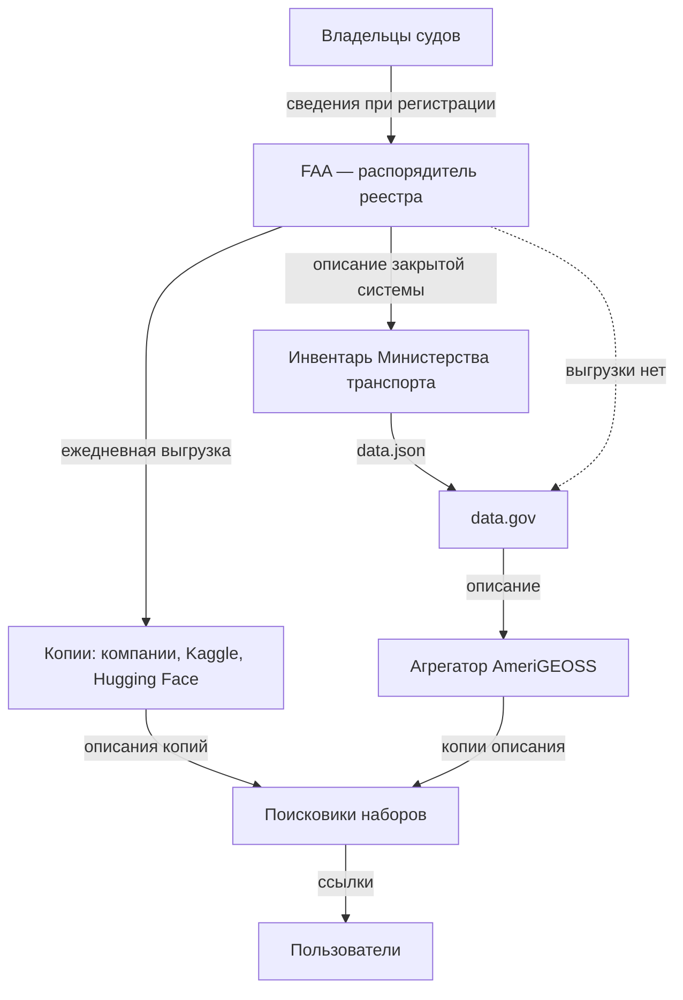

# Зарубежные методики

Готовые методики инвентаризации сходятся в трёх решениях: опись ведут постоянно, у каждой записи есть названный ответственный, а полный реестр отделён от того, что показывают всем. Расходятся они в главном для полноты — проверяет ли кто-то снаружи, что опись ничего не пропустила: так устроены только перечни Южной Кореи и, для статистики, оценка ODIN. Из американской модели стоит взять состав записи и разделение полного и общедоступного инвентаря, из корейской — внешнюю проверку и перечень ещё не открытого, из эстонской — регистрацию базы данных до её запуска, из финской — опубликованное описание ресурсов для запросов, из GovEx и ODI — порядок работы и картирование связей. Канада и Германия показывают обратное: инвентарь ради открытия данных и каталог «всех данных» без закона перестали вести, а описи, привязанные к праву на доступ или к регистрам, живут. Законы, реестры и платформы стран — в главах части «Страновые практики».

Сведения проверены 25 и 26 октября 2026 года, об Эстонии, Финляндии, Канаде, Китае, Японии и Германии — 28 октября 2026 года, если не указано иное.

## Коротко

| Методика | Что взять | Подробнее |
|----------|-----------|-----------|
| **США** | Полный инвентарь всех данных ведомства по закону, состав записи, заданный законом, отдельную общедоступную часть и сбор с проверкой по схеме | [Ниже](#инвентари-данных-федеральных-ведомств-сша) |
| **Великобритания** | Названного владельца у каждого актива, реестр в каждом министерстве, короткий список критически важных активов с общими метаданными и планом качества | [Ниже](#реестры-информационных-активов-великобритании), [«Великобритания»](../07-countries/03-united-kingdom.md) |
| **Франция** | Перечень по закону с ежегодным обновлением, список эталонных данных, администратора данных в министерстве, отраслевые описи с интервью | [Ниже](#политика-данных-франции), [«Франция»](../07-countries/04-france.md) |
| **Польша** | Постоянную программу с полугодовыми графиками и отчётами, уполномоченного в министерстве, опись реестров несколькими методами | [Ниже](#открытие-данных-в-польше), [«Польша»](../07-countries/05-poland.md) |
| **Южная Корея** | Внешнюю проверку перечней на пропуски со сроками, перечень ещё не открытого, ежегодную оценку с баллами, общий словарь терминов | [Ниже](#публичные-данные-южной-кореи), [«Южная Корея»](../07-countries/06-south-korea.md) |
| **Эстония** | Регистрацию каждой базы данных в открытом каталоге до запуска, проверку «не собирают ли это уже», согласование с ведомствами, описание до элемента данных | [Ниже](#каталог-riha-в-эстонии), [«Эстония»](../07-countries/07-estonia.md) |
| **Финляндия** | Модель управления информацией в каждом органе по закону, опубликованное описание ресурсов для запросов, совет, который проверяет исполнение | [Ниже](#модель-управления-информацией-в-финляндии), [«Финляндия»](../07-countries/08-finland.md) |
| **Канада** | Ежегодное описание фондов учреждения по закону о доступе — классы документов и банки персональных данных — и урок брошенного инвентаря открытых данных | [Ниже](#info-source-и-инвентарь-открытых-данных-канады), [«Канада»](../07-countries/09-canada.md) |
| **Китай** | Единый каталог данных всех органов по закону, режим обмена с основанием для закрытого, сроки обновления и ответственность | [Ниже](#каталоги-государственных-данных-китая), [«Китай»](../07-countries/10-china.md) |
| **Япония** | Открытые реестры файлов документов и файлов персональной информации всех министерств с общим поиском | [Ниже](#реестры-документов-и-персональных-данных-японии), [«Япония»](../07-countries/11-japan.md) |
| **Германия** | Открытую карту регистров с правовыми основаниями и выгрузкой — и урок закрытого каталога Datenatlas | [Ниже](#карта-регистров-и-datenatlas-в-германии), [«Германия»](../07-countries/12-germany.md) |
| **ODIN** | Готовый список категорий и раздельную оценку: есть ли данные и открыты ли они | [Ниже](#open-data-inventory-odin) |
| **GovEx** | Пять шагов, связного в каждом подразделении и координатора, закрытое в инвентаре с пояснением | [Ниже](#govex-data-inventory) |
| **ODI** | Карту участников и обменов: кто у кого берёт данные и где связь рвётся | [Ниже](#картирование-экосистем-данных-odi) |

## Методики в сравнении

Как устроена опись:

| Методика | Обязанность | Единица учёта | Кто ведёт |
|----------|-------------|---------------|-----------|
| **США** | Закон с 2019 года, политика — с 2013 года | Актив данных: набор или группа наборов | Ведомство; отвечает директор по данным |
| **Великобритания** | Политика; список активов для повторного использования — по регламенту 2015 года | Информационный актив | Министерство; у актива — владелец |
| **Франция** | Закон: перечень документов и публикация баз данных | Документ, база данных | Администрация; в министерстве — администратор данных |
| **Польша** | Закон: программа открытия данных, учёт систем | Ресурс, реестр, система | Министерство; уполномоченный по открытости данных |
| **Южная Корея** | Закон с 2013 года | Публичные данные учреждения | Учреждение; ответственный за предоставление данных |
| **Эстония** | Закон и постановление о RIHA 2008 года | База данных, информационная система | Владелец базы; согласуют пять ведомств, управление данными координирует Статистическое управление |
| **Финляндия** | Закон с 2020 года | Информационный ресурс, процесс, система | Орган; исполнение оценивает Совет по управлению информацией |
| **Канада** | Закон о доступе — описание фондов; директива 2014 года — инвентарь данных | Класс документов, банк персональных данных; набор данных | Учреждение; требования к публикации задаёт Секретариат Казначейского совета |
| **Китай** | Положение Госсовета 2025 года; каталоги — с 2016 года | Ресурс данных с элементами данных | Ведомство и регион; сводит уполномоченный орган Госсовета |
| **Япония** | Законы о документах и о персональной информации | Файл документов, файл персональной информации | Министерство; сводки — Канцелярия кабинета и Комиссия по защите персональной информации |
| **Германия** | Закон об идентификационном номере 2021 года — обзор регистров | Регистр | Федеральное административное ведомство вместе с Федеральным статистическим ведомством |
| **ODIN** | Нет: внешняя оценка | Категория данных и показатель | Open Data Watch, с отзывом статистической службы |
| **GovEx** | Нет: руководство для городов | Набор данных | Подразделения, сводит координатор |
| **ODI** | Нет: метод картирования | Участник и обмен между участниками | Команда проекта, часто на семинаре |

Что видно и что проверяют:

| Методика | Проверка на пропуски извне | Публичная часть | Перечень неоткрытого | Отдельный учёт систем |
|----------|----------------------------|-----------------|----------------------|-------------|
| **США** | Нет: сборщик проверяет форму | Да | В самом инвентаре | Нет открытого |
| **Великобритания** | Нет | Частично | Пометка в реестре | Нет |
| **Франция** | Нет | Да, перечень | Частично | Крупные проекты |
| **Польша** | Нет | Частично | Графики у координатора | Да |
| **Южная Корея** | Да, министерство | Да | Да, с годом | Да |
| **Эстония** | Нет: согласование до создания, а не поиск пропусков | Да, каталог RIHA | Нет: закрытые базы в каталоге вместе с открытыми | В том же каталоге |
| **Финляндия** | Частично: совет проверяет, опубликовано ли описание | Да, описание для запросов | Нет | В модели управления информацией |
| **Канада** | Нет | Да: Info Source; инвентарь открытых данных не обновляется | Нет: в инвентаре только то, что можно открыть | Нет |
| **Китай** | Частично: каталог проверяет уполномоченный орган, пропуски находят ревизии | Нет: каталог — для обмена внутри государства | Да: «не передаётся» с нормой закона | Запись связывают с информационной системой |
| **Япония** | Нет | Да, оба реестра | Нет: закрытое в реестры не вносят | Реестр систем закрыт |
| **Германия** | Нет | Да, карта регистров | Отметка у регистра: открыт полностью, частично или нет | Нет: в карте — базы и интерфейсы регистра |
| **ODIN** | Да, это и есть оценка | Да, оценки | Нет | Нет |
| **GovEx** | Нет | По решению органа управления данными | В самом инвентаре | Нет |
| **ODI** | Отзывы участников | По желанию | Нет | Нет |

Внешнюю проверку на пропуски у национальных описей делает только Корея; финский совет проверяет, опубликовано ли описание, но не что в нём. Перечень ещё не открытого Корея ведёт отдельным списком, а США и GovEx — внутри самого инвентаря: закрытые наборы описаны вместе с открытыми. Канада закрытое из опубликованного инвентаря убрала: в нём только наборы, которые можно открыть. Китай записывает закрытое в каталог вместе с нормой, которая запрещает передачу, а Япония закрытые сведения в реестры не вносит. Учёт систем отдельно от учёта данных ведут Польша и Корея; в Эстонии базы данных и системы — в одном каталоге, в Финляндии — в одной модели управления информацией; в США систему можно найти по полям записи — номеру ИТ-инвестиции и ссылке на уведомление о системе с персональными данными ([«Сопоставление с реестром»](./02-metadata-standards.md#сопоставление-с-реестром)).

## Инвентари данных федеральных ведомств США

США — единственная страна книги без своей главы, поэтому американская модель описана здесь целиком. Поля описания — в главе [«Стандарты описания»](./02-metadata-standards.md#dcat-us-30-и-полные-инвентари-сша), сбор и проверка на data.gov — в главе [«Data Mesh»](./03-data-mesh.md#федеративный-инвентарь-сша).

**Как складывалась.**

- **2013** — меморандум Административно-бюджетного управления при президенте (OMB) M-13-13 требует от федеральных ведомств вести **корпоративный инвентарь данных** (Enterprise Data Inventory) и публиковать его общедоступную часть файлом `data.json` — описаниями наборов в формате JSON ([«Стандарты описания»](./02-metadata-standards.md), врезка «Как читать машинные описания»). Файл составляют по схеме Project Open Data, теперь она называется DCAT-US v1.1. Руководство к меморандуму описывает три направления: расширять инвентарь по классам данных, обогащать описания, открывать то, что можно открыть. План инвентаризации и первый инвентарь ведомства сдавали к 30 ноября 2013 года. Все данные всех подразделений нужно было учесть, насколько возможно, к 30 ноября 2014 года; инвентарь обновляли и отчитывались о нём ежеквартально. Ведомство должно было завести и канал обратной связи: пользователи помогают решить, что открывать в первую очередь.
- **2019** — закон OPEN Government Data Act (раздел II закона Foundations for Evidence-Based Policymaking Act of 2018, подписан 14 января 2019 года) делает инвентарь обязанностью: каждое ведомство ведёт **полный инвентарь данных** (comprehensive data inventory). Тот же закон требует включать в стратегический план ведомства план получения доказательств (learning agenda). Это список вопросов, на которые ведомство хочет получить ответы для решений, и список данных, которые для этого нужно собрать, использовать или приобрести (5 U.S.C. § 312). По сути это цель и вопросы описи, закреплённые законом ([«Цели и вопросы»](../03-process/02-goals-and-questions.md)).
- **2025** — меморандум OMB M-25-05 даёт руководство по полным инвентарям: схема DCAT-US 3.0, все активы данных и публикация инвентаря — до 30 сентября 2026 года.

**Что учитывают.** Все активы данных, которые ведомство создаёт, собирает, контролирует или хранит, кроме систем национальной безопасности. Актив данных (data asset) — набор или группа наборов, которые можно объединить по общему признаку; случайная подборка не считается. База, купленная по контракту, — тоже актив ведомства, даже если её содержимое принадлежит компании. Актив, который есть у нескольких ведомств, каждое записывает в свой инвентарь.

**Состав записи по закону** (44 U.S.C. § 3511(a)(2)(A)):

- описание; названия и определения всех переменных; название;
- решения ведомства: открытые ли это государственные данные, закрыт ли актив от раскрытия по закону о свободе информации целиком или частично, можно ли включить его в федеральный каталог, подпадает ли он под требования открытого формата и открытой лицензии. В каждом пункте законны ответы «не можем определить» и «ещё не решили»;
- дата внесения в инвентарь и дата последнего обновления данных;
- как получить данные или запросить доступ, ограничения использования и доступа, где данные хранятся;
- какие ведомства ведут и обновляют актив и кто его владелец.

Новый актив вносят не позже 90 дней после того, как его создали или нашли, а весь инвентарь обновляют постоянно и не реже раза в год. Подразделения могут вести свои инвентари и сводить их в один инвентарь ведомства.

**Кто отвечает.** Требования к инвентарю выполняет директор по данным (Chief Data Officer) ведомства (44 U.S.C. § 3520(c)(5)). Описания для data.gov ведомства могут готовить в закрытой системе inventory.data.gov.

**Полный и общедоступный инвентарь.** Ещё Project Open Data требовал включать в общедоступную часть как минимум все открытые наборы и разрешал включать остальные — например, наборы с ограничениями, чтобы о них знали и знали, как их получить. У закрытого набора в описании объясняют, почему его нельзя открыть, а решение принимают вместе с юристами ведомства. Закон пошёл дальше: в инвентаре публикуют всё, что нельзя скрыть по закону о свободе информации (44 U.S.C. § 3511(a)(2)(C)). Решая, открывать ли набор, ведомство учитывает риск сопоставления: набор сам по себе безопасен, но вместе с другими доступными сведениями раскрывает людей или уязвимости (§ 3511(a)(2)(E)). По M-25-05 инвентарь публикуют по адресу `www.[ведомство].gov/data.json`, откуда его забирает федеральный каталог data.gov; убранные сведения отмечают в плане открытых данных ведомства — какой элемент и по какому исключению. Закрытый набор при этом остаётся в инвентаре и виден как запись. Как это выглядит в инвентаре Администрации общих служб (GSA), разобрано в главе [«Результат и поддержка»](../03-process/09-result-and-upkeep.md#пример-инвентарь-gsa).

**Слабые места.**

- **Руководство запоздало на шесть лет.** Счётная палата США (GAO) в октябре 2020 и декабре 2021 года отмечала, что OMB не выпустило предписанное законом руководство по полным инвентарям. Оно вышло только с меморандумом M-25-05 в январе 2025 года.
- **Неясно, обновляются ли инвентари.** В 2020 году все 24 крупнейших ведомства публиковали инвентари на своих сайтах и в федеральном каталоге, но сведений о том, насколько регулярно они их обновляют, по оценке GAO, мало. В 2021 году у одного из четырёх проверенных ведомств — AmeriCorps — полного инвентаря не было.
- **Форма вместо содержания.** Сборщик проверяет записи по схеме, но не смысл: инвентарь GSA формально соответствует DCAT-US 3.0 и при этом не пользуется новыми полями этой версии ([«Пример: инвентарь GSA»](../03-process/09-result-and-upkeep.md#пример-инвентарь-gsa)). Инвентарь Бюро статистики труда месяцами отклоняется целиком из-за спора о версии схемы ([«Федеративный инвентарь США»](./03-data-mesh.md#федеративный-инвентарь-сша)).

Главное в американской модели: один инвентарь на всё ведомство, состав записи задан законом, закрытое учитывают вместе с открытым, а общедоступную часть собирают в общий каталог.

## Реестры информационных активов Великобритании

Опись в британских министерствах выросла не из открытых данных, а из информационной безопасности и управления документами. Поэтому её единица — информационный актив, а у каждого актива есть владелец-руководитель, который вносит его в реестр министерства. С 2026 года поверх реестров ведут короткий список критически важных активов данных: у каждого — общий профиль метаданных, названный владелец данных и план действий по качеству. Слабое место видно по опубликованным реестрам: без владельца процесса они устаревают. Взять — владельца-руководителя у каждого актива и короткий список главного поверх полной описи; как устроены реестры и где их искать, — в главе [«Великобритания»](../07-countries/03-united-kingdom.md#реестры-информационных-активов).

## Политика данных Франции

Во Франции закон обязывает каждую администрацию вести и ежегодно публиковать перечень основных документов с публичной информацией. Там же — обязанность публиковать базы данных и список из девяти баз эталонных данных, на которые ссылаются остальные. В каждом министерстве есть администратор данных, алгоритмов и исходных кодов. Отраслевые описи 2021 года службы Etalab показывают подход «где найти нужное»: кабинетное исследование и интервью, на которых держатели подтверждают найденные базы. Слабое место — то же, что в Великобритании: перечни устаревают. Как с этими перечнями работать — в главе [«Франция»](../07-countries/04-france.md#реестры-и-платформы).

## Открытие данных в Польше

В Польше опись встроена в постоянную программу открытия данных: в каждом министерстве есть уполномоченный по открытости данных, раз в полгода министерство сдаёт график новых данных, раз в год — отчёт. Опись реестров государства собрали несколькими методами — обзором законов, учётом систем, анкетой и разбором ИТ-проектов, — а учёт систем и реестров с 2025 года закреплён законом. Взять — график с отчётом вместо разовой описи и сочетание методов для перечня реестров; подробности — в главе [«Польша»](../07-countries/05-poland.md#sist).

## Публичные данные Южной Кореи

В Корее учреждение по закону регистрирует перечень своих публичных данных на портале data.go.kr, а министерство проверяет перечни на пропуски и требует в установленный срок дорегистрировать недостающее. Рядом публикуют перечень того, что ещё не открыто, с годом открытия. Метаданные баз данных ведут до столбца с именами из общего словаря терминов, системы учитывают отдельно, а управление данными учреждений ежегодно оценивают баллами. Это ближе всего к полному инвентарю США, но с внешней проверкой и отдельным учётом систем. Как с этим работать при описи — в главе [«Южная Корея»](../07-countries/06-south-korea.md#как-провести-инвентаризацию).

## Каталог RIHA в Эстонии

В Эстонии каждую базу данных государства регистрируют в каталоге RIHA до того, как ею начинают пользоваться, а пользоваться незарегистрированной базой запрещено. До создания базы владелец проверяет, не собирают ли эти сведения уже, а документацию согласуют пять ведомств. Каталог открыт без входа и описывает и закрытые базы, кроме баз с государственной тайной, — до элементов данных. Слабое место — свежесть: из 1096 записей о работающих базах и системах 545 последний раз обновляли до 2021 года. Взять — регистрацию как условие работы базы и единый открытый каталог открытых и закрытых баз; подробности — в главе [«Эстония»](../07-countries/07-estonia.md#riha).

## Модель управления информацией в Финляндии

В Финляндии каждый орган по закону 2019 года ведёт модель управления информацией — процессы, информационные ресурсы, системы, обмены — и публикует описание своих ресурсов для тех, кто пишет запросы. Исполнение оценивает Совет по управлению информацией, но наказывать он не может: в 2022 году у 131 муниципалитета описания на сайте не нашлось. Слабое место — модель внутренняя, а совет проверяет, опубликовано ли описание, а не его полноту. Взять — опись как часть права на доступ; подробности — в главе [«Финляндия»](../07-countries/08-finland.md#модель-управления-информацией-и-описание-для-запросов).

## Info Source и инвентарь открытых данных Канады

В Канаде две описи с разной судьбой. Info Source — описание программ, классов документов и банков персональных данных каждого федерального учреждения — по закону о доступе к информации обновляют каждый год. Инвентарь открытых данных по директиве 2014 года опубликовали в 2017 году, в нём оказались только наборы, которые можно открыть, а теперь его не ведут. Взять — связь «программа → класс документов» и ежегодное обновление по закону; подробности — в главе [«Канада»](../07-countries/09-canada.md#info-source).

## Каталоги государственных данных Китая

В Китае каждое ведомство и регион ведёт каталог государственных данных: у записи — элементы данных, поставщик, частота обновления и режим обмена, а для закрытого — норма закона, которая запрещает передачу. Каталог обновляют за 10 рабочих дней после изменения закона или функций органа, за несоставленный каталог наказывают руководителей. Но опись работает на обмен внутри государства и снаружи не видна, а ревизия за 2024 год нашла больше десяти тысяч органов без каталогов или с каталогами не по правилам. Взять — режим обмена с основанием для закрытого и сроки обновления в акте; подробности — в главе [«Китай»](../07-countries/10-china.md#каталог-государственных-данных).

## Реестры документов и персональных данных Японии

В Японии полной описи данных нет, но есть две обязательные открытые описи с общим поиском по всем министерствам: реестр файлов документов — 20 126 525 файлов на конец марта 2025 года — и реестр файлов персональной информации. Учёт систем с идентификаторами закрыт, публикуются расходы по системам; Счётная палата Японии нашла 137 систем без идентификатора. Взять — общий поиск по реестрам всех органов и обязательную запись о файле персональной информации до его создания; подробности — в главе [«Япония»](../07-countries/11-japan.md#реестры-файлов-документов).

## Карта регистров и Datenatlas в Германии

В Германии открыто описаны не все данные, а регистры: Федеральное административное ведомство вместе с Федеральным статистическим ведомством ведёт карту регистров — 300 регистров с правовыми основаниями, держателями, объектами сведений и отметкой об открытости, с выгрузкой и программным интерфейсом. Каталог всех данных федеральных органов Datenatlas отключили 31 декабря 2025 года, потратив 26,2 млн евро. Взять — открытую карту регистров; урок Datenatlas — опись живёт, пока у неё есть задача и закон. Подробности — в главе [«Германия»](../07-countries/12-germany.md#карта-регистров-и-vip).

## Open Data Inventory (ODIN)

Open Data Inventory — оценка, которую некоммерческая организация Open Data Watch проводит раз в два года: насколько полно и открыто национальные статистические службы публикуют официальную статистику. Это инвентаризация со стороны пользователя — подход «где найти нужное» для статистики.

- **Что смотрят.** Сайт статистической службы и официальные сайты, на которые с него есть ссылка. Данные международных организаций не считаются: оценивают, что публикует сама страна.
- **По какому списку.** 22 категории в трёх группах — социальная, экономическая и финансовая, экологическая статистика; в выпуске 2022/23 года в них 65 показателей.
- **Как оценивают.** У каждой категории пять признаков охвата: есть ли показатели и нужные разрезы, данные за последние пять и десять лет, по регионам первого и второго уровня. И пять признаков открытости: машиночитаемый формат, непатентованный формат, метаданные, способы выгрузки — массовая выгрузка, программный интерфейс, выбор данных — и открытая лицензия.
- **Как проверяют.** Статистической службе отправляют список найденных наборов и дают месяц на поправки.

В выпуске 2024/25 года оценены 198 стран. Что взять для инвентаризации: готовый список категорий как список вопросов, раздельный счёт «есть ли данные» и «открыты ли они» и проверку снаружи с отзывом владельца ([«Цели и вопросы»](../03-process/02-goals-and-questions.md)).

## GovEx Data Inventory

Руководство Центра государственного совершенства (GovEx) Университета Джонса Хопкинса — практический образец описи для города. Оно предлагает пять шагов:

1. **Назначить, кто руководит:** директора по данным, орган управления данными или рабочую группу, в том числе с представителями жителей.
2. **Определить границы и план:** обязательные метаданные, сроки, указания исполнителям, показатели.
3. **Описать данные по плану.** Связные (liaisons) в каждом департаменте описывают его данные, ведущий менеджер сводит описания в инвентарь города в машиночитаемом виде — таблице, CSV или JSON.
4. **Проверить инвентарь и решить, какая часть будет публичной.** Решает орган управления данными.
5. **Расставить приоритеты публикации** — по стратегическим целям, нуждам подразделений и спросу жителей.

Типичные поля — название, содержание, периодичность обновления, лицензия, владелец или ответственный, персональные данные, источник. Чувствительные наборы руководство советует не исключать, а описывать с пояснением, в чём их чувствительность: Филадельфия включает в инвентарь и наборы, которые никогда не опубликуют. Инвентаризацию GovEx называет непрерывным процессом: некоторые города обязаны обновлять инвентарь ежегодно. Как находить данные, руководство не объясняет: их описывают сами подразделения. Что взять: связного в каждом подразделении и координатора ([«Кому отправлять»](../03-process/04-questionnaires.md#кому-отправлять)), план с обязательными полями и сроками, закрытое в инвентаре с пояснением.

## Картирование экосистем данных ODI

Метод британской некоммерческой организации Open Data Institute (ODI) показывает, как данные переходят между организациями и кто от этого выигрывает. Карта экосистемы — схема участников и обменов между ними. Инструмент ODI предлагает четыре шага на большом листе или доске:

1. **Нанести участников** — на три круга вокруг себя, организации с набором или задачи. Типичные роли: распорядитель данных, который их собирает и даёт доступ, участники, пополняющие набор, посредники и агрегаторы, создатели продуктов на данных, выгодоприобретатели, регуляторы.
2. **Нанести «формальные» обмены** — какие данные, от кого, к кому, а также деньги, услуги, лицензии и сертификаты.
3. **Нанести «мягкие» обмены** — знания, советы, обратную связь — пунктиром.
4. **Найти возможности** — где поток можно улучшить, какие данные открыть, кого привлечь.

Черновик рисуют за один-два часа и дорабатывают в два-три круга отзывов участников. Для инвентаризации карта полезна тем, что показывает первоисточник и копии, чужих владельцев и места, где поток рвётся. Вот карта для реестра воздушных судов США по находкам главы [«Поиск наборов данных»](../04-sources/05-dataset-search.md#пример-реестр-воздушных-судов-сша):

Пунктир — связь, которой нет: первоисточника на data.gov нет, и пользователь находит реестр только через копии. Карта ближе всего к [картам данных от продукта](../02-approaches/04-data-maps.md#от-продукта): связи «копия — первоисточник» и пробелы с неё переносят в реестр.

## Ограничения

- Модели стран описаны по законам и политикам. Как они исполняются, видно только по открытой части — опубликованным реестрам, перечням и отчётам.
- Почти все методики ставят на первое место открытые данные: закрытое попадает в опись как то, что «пока не открыто».
- Международные методики полной описи не дают: ODIN видит только опубликованное, GovEx не говорит, как находить данные, ODI рисует связи, а не состав.
- Высокие места Кореи, Франции и Польши в индексе открытых данных ОЭСР OURdata говорят об открытости данных, а не о полноте описи.
- Матрица сравнения — авторская, по документам на октябрь 2026 года; политики стран меняются.

## Источники

- США: [M-13-13 Open Data Policy](https://www.whitehouse.gov/wp-content/uploads/legacy_drupal_files/omb/memoranda/2013/m-13-13.pdf), 2013; Project Open Data — [Implementation Guide](https://web.archive.org/web/20240519174130/https://project-open-data.cio.gov/implementation-guide/), копия в Internet Archive от 19 мая 2024 года: сайт project-open-data.cio.gov теперь перенаправляет на resources.data.gov; по нему — сроки 2013–2014 годов, общедоступная часть как выборка из инвентаря, записи о закрытых наборах с объяснением и решением юристов, канал обратной связи, ежеквартальные отчёты; [44 U.S. Code § 3511](https://www.law.cornell.edu/uscode/text/44/3511) — подпункты (a)(2)(A), (C), (E) и пункт (a)(3), и [§ 3520](https://www.law.cornell.edu/uscode/text/44/3520), подпункт (c)(5); [5 U.S. Code § 312](https://www.law.cornell.edu/uscode/text/5/312) — план получения доказательств ведомства; [OMB M-25-05](https://www.whitehouse.gov/wp-content/uploads/2025/01/M-25-05-Phase-2-Implementation-of-the-Foundations-for-Evidence-Based-Policymaking-Act-of-2018-Open-Government-Data-Access-and-Management-Guidance.pdf) от 15 января 2025 года — раздел 4(a): состав, сроки, публикация, приложение со сроками; прочитано 26 октября 2026 года; [The OPEN Government Data Act: A Primer](https://www.everycrsreport.com/reports/IF12299.html) — Congressional Research Service; [inventory.data.gov](https://inventory.data.gov).
- GAO: [GAO-21-29 Open Data: Agencies Need Guidance to Establish Comprehensive Data Inventories; Information on Their Progress is Limited](https://www.gao.gov/products/gao-21-29), 8 октября 2020 года, — 24 ведомства, три рекомендации, первая закрыта после M-25-05; [GAO-22-104574 Open Data: Additional Action Required for Full Public Access](https://www.gao.gov/products/gao-22-104574), 16 декабря 2021 года, — AmeriCorps, Министерство юстиции, Государственный департамент, FDIC. Проверено 26 октября 2026 года.
- Open Data Watch: [Open Data Inventory](https://odin.opendatawatch.com/); [ODIN 2022/23 Methodology Guide](https://comunidades.cepal.org/rtccea/sites/rtccea/files/2022-08/ODIN%202022_23%20Methodology%20Guide.pdf) — копия на сайте ЭКЛАК: 22 категории, 65 показателей, пять признаков охвата и пять открытости, отзыв статистических служб; число стран в выпуске 2024/25 года — по [сообщению статистической службы Молдовы](https://statistica.gov.md/en/republic-of-moldova-ranks-17th-out-of-198-countries-and-12_61783.html) от 22 мая 2025 года. Сайт ODIN 26 октября 2026 года отдавал только заголовок страницы.
- GovEx: [Data Inventory](https://labs.centerforgov.org/data-governance/data-inventory/) — Johns Hopkins Bloomberg Center for Government Excellence, обновлено 17 июля 2024 года, лицензия CC BY 4.0; проверено 26 октября 2026 года.
- ODI: [Data Ecosystem Mapping](https://theodi.org/article/data-ecosystem-mapping-tool/) — инструмент и [руководство для печати](https://www.theodi.org/documents/465/ODI-Data-Ecosystem-Mapping-E28093-print-at-home-guide-A4-E28093-2019-06-26_FJiUBS3.pdf) от 26 июня 2019 года, лицензия CC BY-SA 4.0; [Mapping data ecosystems](https://theodi.org/article/mapping-data-ecosystems/) — описание метода, обновление 2022 года. Проверено 26 октября 2026 года.
- Великобритания: [The role of information asset owners in government](https://www.gov.uk/government/publications/information-asset-owner-role-guidance) — Кабинет министров, обновлено 1 октября 2025 года; [Data asset management policy in government](https://www.gov.uk/government/publications/data-asset-management-policy-in-government) — GDS, 27 мая 2026 года. Остальные источники — в главе [«Великобритания»](../07-countries/03-united-kingdom.md#источники).
- Франция: Кодекс отношений между публикой и администрацией, статьи L312-1-1, L321-4 и L322-6 — по [изданию кодекса на codes.droit.org](https://codes.droit.org/PDF/Code%20des%20relations%20entre%20le%20public%20et%20l'administration.pdf) от 24 октября 2026 года; [опись баз данных о занятости](https://www.data.gouv.fr/datasets/inventaire-des-bases-de-donnees-relatives-a-lemploi) — Etalab, 2021. Остальные — в главе [«Франция»](../07-countries/04-france.md#источники).
- Польша: закон об открытых данных — [единый текст Dz.U. 2023 poz. 1524](https://api.sejm.gov.pl/eli/acts/DU/2023/1524/text.html), статьи 28–31, 37, 38; [Kluczowe rejestry publiczne](https://www.gov.pl/web/ia/kluczowe-rejestry-publiczne). Остальные — в главе [«Польша»](../07-countries/05-poland.md#источники).
- Южная Корея: [закон о публичных данных](https://www.law.go.kr/법령/공공데이터의제공및이용활성화에관한법률), статьи 18 и 22, и [указ к нему](https://www.law.go.kr/법령/공공데이터의제공및이용활성화에관한법률시행령), статья 15; [перечень данных, которые предстоит открыть](https://www.data.go.kr/data/15127106/fileData.do). Остальные — в главе [«Южная Корея»](../07-countries/06-south-korea.md#источники).
- Эстония: [каталог RIHA](https://www.riha.ee) — число записей и дат обновления по программному интерфейсу `api/v1/systems`, 28 октября 2026 года; [закон о публичной информации](https://www.riigiteataja.ee/akt/130062026009) и [постановление о RIHA](https://www.riigiteataja.ee/akt/129122024015). Остальные — в главе [«Эстония»](../07-countries/07-estonia.md#источники).
- Финляндия: закон об управлении информацией [906/2019](https://www.finlex.fi/fi/lainsaadanto/2019/906), § 5, 10, 11, 28; [протокол Совета по управлению информацией 4/2022](https://api.hankeikkuna.fi/asiakirjat/8e9b8e45-f1e9-4b39-8eb2-a7c3b74de39f/587838c3-ec03-42e8-9598-cc22f41b2914/POYTAKIRJA_20220524073929.PDF) от 11 мая 2022 года. Остальные — в главе [«Финляндия»](../07-countries/08-finland.md#источники).
- Канада: [Access to Information Act](https://laws-lois.justice.gc.ca/eng/acts/A-1/), статья 5; [Open Data Inventory](https://open.canada.ca/data/en/dataset/4ed351cf-95d8-4c10-97ac-6b3511f359b7) — раздел 6.3 директивы, отметка о том, что инвентарь не ведут, число записей по программному интерфейсу. Остальные — в главе [«Канада»](../07-countries/09-canada.md#источники).
- Китай: [положение об обмене государственными данными](https://www.gov.cn/zhengce/content/202506/content_7026294.htm), статьи 12–17, 39; [отчёт Государственного ревизионного управления за 2024 год](https://www.audit.gov.cn/n5/n26/c10619920/part/10690741.pdf) от 24 июня 2025 года. Остальные — в главе [«Китай»](../07-countries/10-china.md#источники).
- Япония: [закон об управлении публичными документами](https://laws.e-gov.go.jp/law/421AC0000000066), статья 7; [отчёт Канцелярии кабинета об управлении документами за 2024 финансовый год](https://www8.cao.go.jp/chosei/koubun/houkoku/pdf2024_houkoku.pdf); [доклад Счётной палаты Японии](https://www.jbaudit.go.jp/pr/kensa/result/7/pdf/070912_point.pdf) от 12 сентября 2025 года. Остальные — в главе [«Япония»](../07-countries/11-japan.md#источники).
- Германия: [Registerlandkarte](https://registerlandkarte.de); [ответ правительства о Datenatlas](https://dserver.bundestag.de/btd/21/064/2106478.pdf), Drucksache 21/6478 от 11 июня 2026 года; [Datenmanagement in der Bundesverwaltung](https://bundesrechnungshof.de/fileadmin/import/___Alte_Struktur/Downloads/DE/Berichte/2022/datenmanagement-volltext-datenmanagement-volltext.pdf) — Bundesrechnungshof, 2022. Остальные — в главе [«Германия»](../07-countries/12-germany.md#источники).
- Рейтинги: [2023 OECD OURdata Index](https://www.oecd.org/content/dam/oecd/en/publications/reports/2023/12/2023-oecd-open-useful-and-re-usable-data-ourdata-index_cc9e8a9e/a37f51c3-en.pdf) — OECD, декабрь 2023 года: первая тройка — Корея, Франция, Польша; [Digital Government Index and OURdata Index: 2025 Results and Key Findings](https://www.oecd.org/content/dam/oecd/en/publications/reports/2026/02/digital-government-index-and-open-useful-and-re-usable-data-index_dbe102ed/6347ec74-en.pdf) — OECD, февраль 2026 года: Франция — 0,96, Корея — 0,95, Польша — 0,82; Open Data Maturity [2024](https://data.europa.eu/sites/default/files/2025-07/2024_odm_report.pdf) и [2025](https://data.europa.eu/sites/default/files/2025-12/2025_odm_report_6.pdf) — data.europa.eu.
