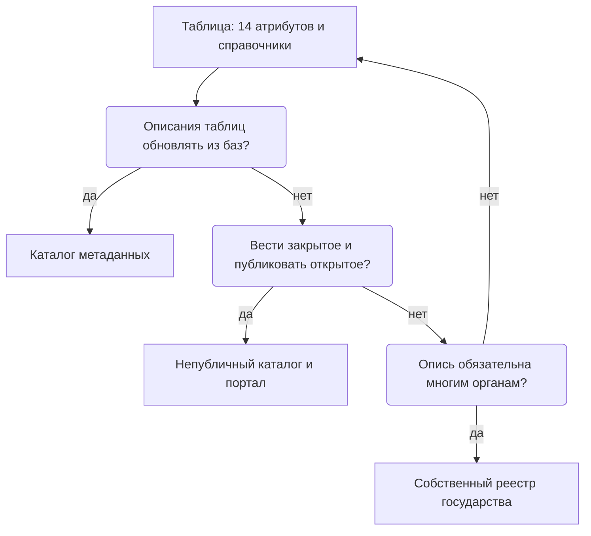
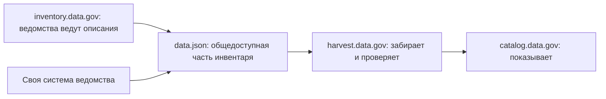

# От таблицы до каталога метаданных

Инструмент инвентаризации выбирают по цели и по тому, кто, как часто и откуда меняет записи. Начинают всегда с таблицы, и многим организациям её хватает надолго — если защитить её от автозамены и проверять программой. Каталог метаданных, непубличный каталог рядом с порталом и собственный реестр государства нужны, когда записи должны обновляться из систем, публиковаться регулярно или вестись многими органами. Варианты сочетают, но у каждого поля должна быть одна система, где его правят, а идентификаторы записей при любом переходе сохраняются.

Сведения проверены 25 октября 2026 года, если не указано иное.

## Коротко

| Что сделать | Что получается | Готово, когда |
|-------------|----------------|---------------|
| **[Выбрать вариант](#как-выбрать)** | Решение, чем вести реестр, с причиной | Признаки перехода сверены; известно, кто будет сопровождать систему |
| **[Устроить таблицу](#как-устроить)** | Таблица по шаблону: строка — запись, коды — из справочников | Первые десятки записей заполнены, состав колонок перестал меняться |
| **[Защитить её от порчи](#как-таблица-портит-данные)** | Текстовые колонки для кодов, импорт CSV, выгрузка в UTF-8 | Коды с ведущими нулями и даты пережили открытие и сохранение файла |
| **[Сопоставить поля](#куда-ложатся-14-атрибутов)** | Файл: колонка реестра, поле системы, первоисточник | У каждого атрибута есть место и одна система, где его правят |
| **[Перенести и сверить](#как-перейти-на-другой-вариант)** | Перенос программой с сохранёнными идентификаторами | Число записей совпало, выборка проверена глазами, у каждого расхождения есть решение |

## Четыре варианта

| Вариант | Что это | Когда подходит | Чего не умеет |
|---------|---------|----------------|---------------|
| **[Таблица](#таблица)** | Excel, Google Sheets, LibreOffice Calc или CSV; рядом — табличные базы данных вроде Grist | Старт, небольшая организация, быстрый аудит, карта данных под задачу | Не обновляется из систем; легко портится ручной правкой и автозаменой |
| **[Каталог метаданных](#каталог-метаданных)** | OpenMetadata, DataHub, Apache Atlas — сами собирают описания из баз и хранилищ | Много систем и таблиц; технические описания устаревают быстрее, чем их правят руками | Видит только подключённое; не знает полномочий и оснований; нужна команда сопровождения |
| **[Непубличный каталог рядом с порталом](#непубличный-каталог-рядом-с-порталом)** | Внутренний каталог с полным реестром, из которого общедоступная часть уходит на портал | Нужно вести закрытые наборы и одновременно публиковать открытые | Две системы надо держать согласованными, а выгрузку — проверять |
| **[Собственный реестр](#собственный-реестр)** | Реестр метаданных в архитектуре государства, связанный с учётом систем | Опись — постоянная обязанность органов по нормативному акту | Дорог в разработке; снаружи обычно закрыт |

Варианты не исключают друг друга. У министерства может быть таблица карты данных для руководства, каталог метаданных у аналитиков и выгрузка на портал. Плохо не то, что систем несколько, а то, что одну и ту же запись правят в двух местах. Поэтому у каждого поля назначают **систему-первоисточник** — место, где его правят; в остальных системах поле только показывают. Например, дату последнего изменения таблицы каталог метаданных видит в самой базе — её правят только там. Режим доступа с основанием каталог узнать не может — его правят в реестре и оттуда переносят в каталог. Если правка пришла не туда, её не сохраняют, а переносят в первоисточник.

## Как выбрать



- **Таблица — всегда первой.** Даже если впереди каталог, состав атрибутов, справочники и первые записи удобнее отработать в таблице ([шаблон реестра](../09-appendices/03-templates.md#реестр-данных)).
- **Стандарт описания — с первого дня.** Если колонки сопоставлены с DCAT или DCAT-US, переход на каталог не потребует переписывать атрибуты ([«Сопоставление с реестром»](../05-frameworks/02-metadata-standards.md#сопоставление-с-реестром)).
- **Описания ведут подразделения — федеративный сбор.** Каждое ведёт свои записи по общим правилам, а центр собирает и проверяет их программой ([«Data Mesh»](../05-frameworks/03-data-mesh.md)).
- **Для публичной части — каталог данных.** Как выбрать платформу портала и не дать ему умереть, разобрано в книге [«Каталоги данных»](https://datacatalogs.begtin.tech/).

### Когда переходить

| Признак | Что это значит | Что делать |
|---------|----------------|------------|
| Несколько человек правят одну таблицу и затирают правки друг друга | Таблица стала общим ресурсом без правил | Совместная правка с историей или табличная база данных с правами до строки |
| Владельцы должны заполнять записи сами | Сбор идёт по почте и копированием | Формы табличной базы или федеративный сбор с проверкой программой |
| Таблицы и столбцы в базах меняются чаще, чем правят реестр | Технические сведения устаревают | Каталог метаданных; реестр остаётся первоисточником деловых сведений |
| Общедоступную часть публикуют регулярно | Ручная выгрузка расходится с реестром | Непубличный каталог и выгрузка программой |
| Опись — обязанность многих органов по акту | Нужен общий реестр с правилами и проверкой | Собственный реестр или участие в государственном |

Переходить рано, если:

- **таблицу не ведут** — каталог тоже не будут;
- **состав атрибутов ещё меняется** — каждое изменение придётся переносить в настройки и импорт;
- **нет команды сопровождения** — каталогу метаданных нужны серверы, обновления и люди, которые разбирают ошибки сбора, а без них он устаревает быстрее таблицы;
- **цель — разовая карта под задачу** — ей хватит таблицы со снимком на дату ([«Снимок или живой реестр»](../03-process/09-result-and-upkeep.md#снимок-или-живой-реестр)).

### Где хранить

- **Реестр — данные с режимом доступа** ([«Полный реестр и общедоступная часть»](../03-process/09-result-and-upkeep.md#полный-реестр-и-общедоступная-часть)). Облачный сервис за рубежом для такого реестра может быть недопустим по правилам организации или по закону о персональных данных.
- **Облачный сервис может закрыться для целой страны** или сменить владельца ([«Как выбрать инструмент»](./02-mindmaps-and-boards.md#как-выбрать-инструмент)).
- **Полная выгрузка — регулярно и у себя**, что бы ни выбрали: CSV по шаблону или файл по стандарту описания.

## Таблица

Таблица — не временная мера, а нормальный инструмент реестра на сотни записей. Её слабые места известны, и почти все закрываются правилами.

### Как устроить

Реестр — это несколько листов: записи, владельцы, полномочия, для подхода «где найти нужное» — вопросы и связи. Какие листы бывают и как они ссылаются друг на друга, разобрано в главе [«Реестр как данные»](./03-registry-as-data.md#что-хранить), шаблоны — в приложении [«Шаблоны»](../09-appendices/03-templates.md). Колонки `title`, `description`, `format`, `issued`, `modified`, `license` и `publisher` в шаблоне названы как свойства DCAT-US, поэтому при переходе на каталог по стандарту их не переименовывают.

Так выглядит начало листа записей [registry.csv](pathname:///templates/registry.csv) в текстовом виде — заголовок и две записи, 7 колонок из 33:

```csv
id,title,update_frequency,access_level,modified,publisher,status
faa-aircraft-registry,Releasable Aircraft Database,daily,open,2026-10-23,faa,active
med-workers-register,Федеральный регистр медицинских работников,continuous,restricted,не установлено,ministry-health,active
```

Первая строка — коды колонок, каждая следующая — одна запись. Периодичность и режим доступа записаны кодами из справочника, дата — в виде ГГГГ-ММ-ДД, ненайденное — словами «не установлено», а не пустой ячейкой. Правила таблицы:

- **Строка — одна запись, ячейка — одно значение.** Несколько значений — через «;», как в шаблоне.
- **Одна строка заголовков.** Без объединённых ячеек, многоэтажной шапки, промежуточных итогов и пустых строк для красоты: программа читает первую строку как имена колонок, а следующие — как записи.
- **Коды — из справочников.** Списки значений для режима доступа, периодичности, типа и статуса записи — проверкой данных в Excel и LibreOffice Calc, раскрывающимися списками в Google Sheets. Иначе появятся «открыто», «откр.» и «да».
- **Цвет — не значение.** Заливку «закрытое — красным» программа не прочтёт, а при выгрузке в CSV она пропадёт. Режим доступа — кодом в колонке, цвет — условным форматированием по коду.
- **Примечания — в колонке**, а не в примечаниях к ячейкам: те тоже теряются при выгрузке.
- **Значения, а не формулы.** Формула при выгрузке может дать ошибку вместо значения.
- **Версии — у себя.** Выгрузка CSV в UTF-8 с датой в имени или коммит в git ([«История и версии»](./03-registry-as-data.md#история-и-версии)). История версий облачного сервиса живёт, пока живы сервис и доступ к нему.

### Как таблица портит данные

Электронная таблица угадывает тип значения и меняет его без спроса. Портятся именно идентификаторы, коды и даты — то, по чему записи связаны между собой и с другими реестрами.

| Что вводят | Что делает таблица | Чем грозит реестру |
|------------|--------------------|--------------------|
| Код с ведущим нулём: ИИН человека, родившегося в 2000-х, ИНН организации из Республики Адыгея с кодом 01 | Считает числом и отбрасывает ноль | Запись не находится по коду, связь с регистром рвётся |
| Длинный номер — 20-значный номер банковского счёта | Хранит не больше 15 значащих цифр, остальные заменяет нулями | Номер испорчен необратимо: после сохранения исходных цифр нет |
| Обозначение, похожее на дату: «1-2», «MARCH1», «SEPT1» | Превращает в дату | Обозначение заменено датой, а при выгрузке — числом |
| Дата «03.04.2026» | Понимает по настройкам компьютера: 3 апреля или 4 марта | У разных участников одна запись означает разные даты |
| CSV, сохранённый командой «CSV» в русской версии Excel для Windows | Записывает текст в кодировке Windows-1251, а не UTF-8 | Программа проверки и каталог видят вместо кириллицы нечитаемые символы |

В генетике автозамена стала массовой проблемой. В 2016 году ошибки в названиях генов нашли в каждой пятой статье с приложенными списками генов в Excel, а в 2021 году, по более широкой выборке, — в 30,9% статей. В 2019 году комитет по номенклатуре генов человека HGNC даже переименовал гены, обозначения которых Excel превращает в даты: MARCH1 стал MARCHF1, SEPT1 — SEPTIN1.

Подводит и предел размера. В октябре 2020 года в Англии 15 841 положительный тест на ковид не попал вовремя в ежедневную статистику и к службе отслеживания контактов. По объяснению BBC, результаты сводили в файле старого формата XLS, где на листе не больше 65 536 строк.

Как защититься:

- **Колонки с кодами — текстовые** до ввода данных: идентификаторы, ИИН, БИН, ИНН, ОГРН, коды классификаторов.
- **CSV открывают импортом**, а не двойным щелчком, с типом «текст» для колонок с кодами: в Excel — «Данные → Из текста/CSV», в LibreOffice — окно импорта текста.
- **Автопреобразование выключают.** В Excel для Microsoft 365 и Excel 2024 это настройка «Файл → Параметры → Данные → Автоматическое преобразование данных». В ней отключаются удаление ведущих нулей, обрезка до 15 цифр, экспонента у чисел рядом с буквой «E» и даты из строк букв и цифр. Настройку меняет у себя каждый участник.
- **Даты — в виде ГГГГ-ММ-ДД** (ISO 8601).
- **Выгрузка — «CSV UTF-8».**

### Проверка программой

Даже аккуратную таблицу после каждой выгрузки проверяет программа: форму записи — по схеме таблицы в стандарте Table Schema, связи и правдоподобие — отдельными правилами. Как написать схему, что проверять на каких уровнях и как связать проверку с публикацией, разобрано в главе [«Реестр как данные»](./03-registry-as-data.md#проверки).

### Таблица с типами и связями

Промежуточный шаг между таблицей и каталогом — табличная база данных: Grist, NocoDB, Baserow, Airtable. Она выглядит как таблица, но у колонки есть тип, листы связаны ссылками, а записи можно собирать формами. Для инвентаризации это даёт:

- **связи и типы** — колонка «владелец» ссылается на строку листа владельцев, идентификатор остаётся текстом, дата — датой;
- **формы и права до строки** — владелец заполняет опросный лист и правит только свои записи, служебные поля от него скрыты ([«Опросные листы и интервью»](../03-process/04-questionnaires.md));
- **история правок и программный интерфейс** — выгрузку в CSV для проверки и версий можно делать по расписанию.

Во Франции такой инструмент дало служащим государство: Grist входит в набор LaSuite для государственного сектора, по странице продукта им пользуются больше 50 000 служащих в 15 министерствах. Код Grist открыт; NocoDB и Baserow тоже можно развернуть на своём сервере, Airtable — только облачный сервис.

Ограничение то же, что у таблицы: записи вводят люди, из систем база не обновляется. И у каждой базы свой формат, поэтому реестр выгружают в CSV по шаблону — тогда смена инструмента не означает потерю результата.

## Каталог метаданных

Каталог метаданных подключается к базам данных, хранилищам и системам отчётности и сам собирает технические описания: таблицы, столбцы, типы, время последнего изменения, происхождение данных (lineage) — из каких таблиц получена эта. Подключение к системам одного вида делает **коннектор** — модуль каталога, который умеет читать описания, например, из PostgreSQL или Google Drive. Поверх собранного люди добавляют деловые сведения: описание, владельца, термины глоссария, отметки о персональных данных. Поэтому каталог хорошо отвечает на вопрос «что лежит в наших базах» и плохо — на вопрос «какие данные у нас есть и на каком основании».

### Что выбрать

| Каталог | Что полезно инвентаризации | Что учесть |
|---------|----------------------------|------------|
| **OpenMetadata** (Apache 2.0, разработчик — Collate) | Около сотни коннекторов; свои поля для любого вида объектов; импорт и выгрузка CSV; тесты качества; домены и продукты данных | Коннекторы к Google Drive и SFTP — в бета-версии: они видят файлы, но не их смысл и не владельцев |
| **DataHub** (Apache 2.0, разработчик — Acryl Data) | Свои поля с проверкой значений; загрузка из CSV добавляет к собранным объектам владельцев, теги, термины, описания и домен | Формы для владельцев с интерфейсом — только в платной DataHub Cloud |
| **Apache Atlas** (Apache 2.0) | Отметки передаются по цепочке происхождения: пометка о персональных данных переходит на производные таблицы | Создан для Hadoop — платформы для больших массивов данных; к другим системам подключений меньше |

Открытый код не гарантирует, что проект проживёт столько же, сколько реестр: репозиторий каталога Amundsen в сентябре 2026 года перевели в архив из-за отсутствия активности. Есть и коммерческие каталоги — Collibra, Alation, Atlan, Informatica — и каталоги облачных платформ: Microsoft Purview, Google Dataplex, AWS Glue Data Catalog, Databricks Unity Catalog. Их выбирают по тем же вопросам: что каталог подключает, можно ли добавить свои поля, можно ли выгрузить всё в открытом формате и где хранятся сведения ([«Где хранить»](#где-хранить)).

**Встроенный ИИ.** OpenMetadata по названиям столбцов и выборке значений находит персональные данные и ставит на столбец тег, а DataHub Cloud и BigQuery составляют описания таблиц и столбцов. Это черновики: DataHub Cloud помечает текст, который не проверил человек, а в BigQuery описания просматривают и правят перед публикацией. Проверяют их так же, как любую запись, составленную моделью ([«ИИ в инвентаризации»](../02-approaches/03-ai.md)). Каталоги открывают и для ИИ-агентов: у портала data.gouv.fr с февраля 2026 года есть экспериментальный сервер MCP. MCP (Model Context Protocol) — открытый протокол, по которому модели обращаются к внешним сервисам; через него агент ищет наборы портала и читает их описания и данные, только на чтение.

### Куда ложатся 14 атрибутов

Каталог описывает объекты систем — таблицы, файлы, отчёты, — а реестр описывает наборы данных с владельцем и основанием. Одни атрибуты каталог заполнит сам, для других у него есть стандартные поля, а третьи придётся добавить **настраиваемыми свойствами** — своими полями объекта: в OpenMetadata это custom properties, в DataHub — structured properties.

| Атрибут реестра | Куда в каталоге | Где первоисточник |
|-----------------|-----------------|-------------------|
| Идентификатор | Настраиваемое свойство, например `registryId`. Собственное имя объекта в каталоге меняется при переезде системы | Реестр |
| Наименование и описание | Отображаемое имя и описание объекта | Реестр; описания столбцов — каталог и владелец |
| Ответственный и контакты | Владелец объекта — пользователь или команда каталога | Реестр, пока не у всех ответственных есть учётные записи в каталоге |
| Периодичность обновления | Настраиваемое свойство со списком значений | Реестр; фактическую частоту показывает каталог, и расхождение с обещанной — находка |
| Режим доступа | Тег по справочнику и настраиваемое свойство с основанием | Реестр: права учётных записей в базе — не режим доступа |
| Ссылка для выгрузки и формат | Настраиваемые свойства; у внутренних наборов — адрес объекта в системе | Реестр |
| Дата публикации | Настраиваемое свойство | Реестр |
| Дата последнего изменения | Время изменения объекта по данным системы | Каталог |
| Отметка о контроле качества | Тесты качества каталога; вывод, годится ли набор для задачи, — настраиваемое свойство | Каталог — для правил, реестр — для вывода |
| Условия использования | Настраиваемое свойство или термин глоссария | Реестр |
| Организация-владелец | Домен | Реестр |

Схему данных каталог соберёт сам, а полномочие и нормативный акт удобно завести терминами глоссария: на один термин ссылаются все объекты, собранные по этому полномочию. Сопоставление авторское: готовой модели реестра с полномочиями и основаниями ни в OpenMetadata, ни в DataHub нет.

Записи без таблиц — бумажные журналы, данные у подрядчиков, внешние источники — каталог сам не найдёт. Их проще оставить только в реестре и сверять с каталогом, чем заводить в каталоге руками: каталог, где половину объектов завели вручную, перестаёт показывать то, что он видит сам.

### Как загрузить реестр в каталог

- **Подключать системы из реестра систем**, начиная с тех, где больше всего записей, а не все подряд. Каталог, собравший тысячи таблиц без владельцев, — та же опись ради описи ([«Опись ради описи»](../08-practices/01-practices-and-anti-patterns.md#опись-ради-описи)).
- **Связать запись с объектами и загружать программой.** В реестр добавляют колонку с полным именем объекта в каталоге, заводят настраиваемые свойства с теми же кодами, что в таблице, и загружают деловые сведения массовым импортом CSV или через программный интерфейс. В DataHub загрузка в режиме замены (OVERRIDE) стирает сведения в каталоге там, где в CSV пустая ячейка, поэтому начинают с режима дополнения (PATCH), он стоит по умолчанию.

### Чего каталог не видит

Каталог видит только подключённое. Таблиц на общих дисках, бумажных журналов и чужих данных в нём нет. Он не знает владельца и основания, путает права учётных записей в базе с режимом доступа и не отвечает на вопрос задачи. Поэтому каталог регулярно сверяют с реестром ([«Проверки»](./03-registry-as-data.md#проверки)):

- **таблица в каталоге без записи в реестре** — неописанный набор;
- **запись реестра без объекта в каталоге** — неподключённая система, бумажные или внешние данные.

Зато новые таблицы каталог замечает сам, и это его главное преимущество перед таблицей: реестр узнаёт о новых данных при сборе, а не при следующей описи.

## Непубличный каталог рядом с порталом

Портал открытых данных показывает опубликованное, а реестр — всё, что есть. Если вести их в одной системе, закрытые записи либо не помещаются, либо утекают. Поэтому полный реестр ведут во внутреннем каталоге, а общедоступную часть программа выгружает на портал ([«Полный реестр и общедоступная часть»](../03-process/09-result-and-upkeep.md#полный-реестр-и-общедоступная-часть)). Так устроен data.gov:



Закрытая система inventory.data.gov построена на CKAN — программе с открытым кодом для порталов данных — и выгружает описания по DCAT-US 3.0. Ведомство может вести инвентарь и в своей системе: сборщику нужен только файл `data.json` по стандарту. Сборщик проверяет файлы и даёт открытый программный интерфейс проверки ([«Федеративный инвентарь США»](../05-frameworks/03-data-mesh.md#федеративный-инвентарь-сша)). Сам catalog.data.gov с 2025 года — уже не CKAN, а собственное приложение, которое только показывает собранное. Три роли разделены: где ведут записи, кто собирает и проверяет, где показывают. Поэтому data.gov смог сменить программу каталога, не трогая инвентари ведомств: связь между ними — файл по стандарту, а не общая база.

Для своего непубличного каталога подходит CKAN: закрытые наборы в нём видят только участники организации, а расширение ckanext-dcat выгружает описания по DCAT ([«Как выгрузить и проверить»](../05-frameworks/02-metadata-standards.md#как-выгрузить-и-проверить)). Подойдёт и каталог метаданных, если он умеет выгружать описания по стандарту. Правила для этого варианта:

- **Общедоступную часть строит программа** при каждой версии реестра, а закрытые наборы в ней не пропадают, а объясняются ([«Закрытые наборы в стандартах»](../05-frameworks/02-metadata-standards.md#закрытые-наборы-в-стандартах)).
- **Выгрузку проверяют валидатором**, а потом смотрят, что увидел агрегатор.
- **Портал не правят руками.** Исправление, сделанное на портале, при следующей выгрузке пропадёт: правят в реестре.

## Собственный реестр

Четвёртый вариант — реестр данных как часть государственной архитектуры. Органы обязаны описывать свои данные в общей системе, записи связаны с учётом систем, а описание появляется при создании системы, а не когда до неё дошла инвентаризация:

- **Казахстан** — каталог цифровых данных из паспортов данных на архитектурном портале; паспорт новой системы составляют до ввода в эксплуатацию ([«Каталог цифровых данных»](../07-countries/01-kazakhstan.md#каталог-цифровых-данных)).
- **Южная Корея** — учёт систем IRM и системы метаданных баз учреждений с общим словарём терминов ([«Метаданные баз данных»](../07-countries/06-south-korea.md#метаданные-баз-данных)).
- **Польша** — репозиторий интероперабельности с метаданными публичных реестров, общедоступный по закону ([«Репозиторий интероперабельности»](../07-countries/05-poland.md#репозиторий-интероперабельности)).
- **Россия** — ЕИП НСУД с реестром информационных ресурсов; открытой части не найдено ([«НСУД»](../07-countries/02-russia.md#нсуд)).

Для описи внутри государства такой реестр — готовый источник: записи выгружают, сопоставляют с 14 атрибутами и дозаполняют. Для внешней инвентаризации он обычно закрыт, и о записях спрашивают владельца. Риск варианта — зависимость от архитектуры: при смене платформы или реорганизации ведомств записи переезжают вместе с системами. Поэтому реестр должен выгружаться по стандарту описания, а у органа — оставаться выгрузка своих записей.

## Как перейти на другой вариант

1. **Остановить правки на время переноса** — или записывать их в журнал, чтобы повторить в новой системе.
2. **Записать сопоставление файлом**: колонка реестра, поле новой системы, справочник значений, первоисточник. Полям, которым в новой системе нет места, заводят настраиваемые свойства.
3. **Сохранить идентификаторы.** Идентификатор записи переходит как есть, собственный идентификатор системы — отдельное поле. Иначе связи «вопрос — набор», карты и прошлые версии перестанут находить записи.
4. **Переносить программой**, а не копированием: перенос должен повторяться с тем же результатом.
5. **Сверить**: сколько записей было и стало — всего, по владельцам и режимам доступа; десяток записей — глазами, поле за полем. Разобрать три списка — только в новой системе, только в реестре, совпало с расхождениями, — и у каждого расхождения записать решение.
6. **Закрыть правку поля везде, кроме первоисточника.** Последнюю версию таблицы сохранить с датой: это архив, а не второй реестр.

## Пример

Запись реестра воздушных судов США из главы [«Реестр данных»](../03-process/05-registry.md#карточка-записи-faa) в разных вариантах. FAA публикует выгрузку открыто, а как FAA ведёт описания внутри, неизвестно, поэтому путь записи ниже — условный.

| Вариант | Где запись | Что добавляется | Что не должно потеряться |
|---------|------------|-----------------|--------------------------|
| **Таблица** | Строка `faa-aircraft-registry` в `registry.csv`: `open`, `daily`, ссылка на выгрузку, полномочие `faa-aircraft-registration` | — | Основание режима доступа; «не установлено» у даты публикации с объяснением |
| **Таблица с типами и связями** | Строка листа наборов; владелец `faa` и полномочие — ссылки на строки своих листов | Форма, через которую подразделение реестра подтверждает запись | Ссылки — по идентификаторам, а не по названиям |
| **Каталог метаданных** | Объекты для таблиц базы реестра и семи файлов выгрузки, у всех `registryId` = `faa-aircraft-registry` | Столбцы и типы из системы; фактическая дата изменения; тест «регистрационные номера не повторяются» | Полномочие 49 U.S.C. § 44103, право владельцев скрыть имя и адрес, условия использования — в базе их нет |
| **Непубличный каталог и портал** | Полная запись — во внутреннем каталоге, общедоступная — в `data.json` по DCAT-US | Сведения о распространении и формате по стандарту | Отметка, что выгрузка — не весь реестр: часть владельцев скрыта по закону |

В каждом варианте две вещи делает человек: основание и вывод о пригодности. Каталог найдёт столбец с годом выпуска и посчитает, что он пуст у 22% записей, но не скажет, годится ли набор для задачи и почему часть владельцев не видна.

## Частые ошибки

| Ошибка | Что происходит | Как исправить |
|--------|----------------|---------------|
| **Начать с каталога** | Каталог собрал тысячи таблиц без владельцев и оснований, а реестра по-прежнему нет | Сначала реестр по методам инвентаризации, потом подключение каталога |
| **Инструмент выбрали до цели** | Развернули каталог для аналитиков, а нужна карта для руководства — или наоборот | Сначала цель и вопросы, потом инструмент ([«Цели и вопросы»](../03-process/02-goals-and-questions.md)) |
| **Заброшенный проект** | Каталог на коде, который перестали развивать, остаётся без обновлений и исправлений | Смотреть на активность проекта до выбора; держать выгрузку по стандарту |

Сквозные ошибки — в главе [«Практики и антипаттерны»](../08-practices/01-practices-and-anti-patterns.md): [«Реестр только в отчёте или картинке»](../08-practices/01-practices-and-anti-patterns.md#реестр-только-в-отчёте-или-картинке), [«Пустые ячейки и значения по умолчанию»](../08-practices/01-practices-and-anti-patterns.md#пустые-ячейки-и-значения-по-умолчанию).

## Ограничения

- Возможности каталогов описаны по документации и репозиториям на октябрь 2026 года. Каталоги меняются быстро: перед выбором проверяйте документацию той версии, которую ставите.
- Коммерческие каталоги только названы, не сравниваются.
- Сопоставление 14 атрибутов с полями каталогов — авторское.
- Государственные реестры в Казахстане, Южной Корее и России снаружи закрыты; о них судят по нормативным актам и открытым сводкам.

## Источники

- OpenMetadata: [сайт](https://open-metadata.org/), [выпуск 2.0.6](https://github.com/open-metadata/OpenMetadata/releases/tag/2.0.6-release) от 21 октября 2026 года; документация версии 2.0 — [коннекторы](https://docs.open-metadata.org/v2.0.x/connectors) (99 на 25 октября 2026 года), [настраиваемые свойства](https://docs.open-metadata.org/v2.0.x/how-to-guides/guide-for-data-users/custom) 16 типов, [массовый импорт CSV](https://docs.open-metadata.org/v2.0.x/how-to-guides/data-discovery/import), [Google Drive](https://docs.open-metadata.org/v2.0.x/connectors/drive/googledrive), [Auto-Classification](https://docs.open-metadata.org/latest/how-to-guides/data-governance/classification/auto-classification). Демо-стенд sandbox.open-metadata.org 25 октября 2026 года пускал только после входа через Google, поэтому скриншота карточки таблицы в главе нет.
- DataHub: [сайт](https://datahub.com/), [выпуск v1.8.0](https://github.com/datahub-project/datahub/releases/tag/v1.8.0) от 22 октября 2026 года; документация — [Structured Properties](https://docs.datahub.com/docs/features/feature-guides/properties/overview), [CSV Enricher](https://docs.datahub.com/docs/generated/ingestion/sources/csv-enricher) (режимы PATCH и OVERRIDE), [Compliance Forms](https://docs.datahub.com/docs/features/feature-guides/compliance-forms/overview), [AI Documentation](https://docs.datahub.com/docs/automations/ai-docs); 25 октября 2026 года.
- [Apache Atlas](https://atlas.apache.org/) — [каталог выпусков](https://downloads.apache.org/atlas/) (2.5.0, весна 2026 года) и [репозиторий](https://github.com/apache/atlas) с кандидатами 2.6.0, 25 октября 2026 года; [Amundsen](https://github.com/amundsen-io/amundsen) — репозиторий в архиве с сентября 2026 года.
- [BigQuery — Generate data insights](https://docs.cloud.google.com/bigquery/docs/data-insights) — документация Google Cloud, октябрь 2026 года.
- [Expérimentation autour d'un serveur MCP pour datagouv](https://www.data.gouv.fr/posts/experimentation-autour-dun-serveur-mcp-pour-datagouv) — data.gouv.fr, 25 февраля 2026 года; [Model Context Protocol](https://modelcontextprotocol.io/).
- [CKAN 2.12.0](https://docs.ckan.org/en/2.12/changelog.html) — список изменений, выпуск от 26 августа 2026 года.
- data.gov: [список систем](https://github.com/GSA/data.gov/blob/main/SYSTEMS.md) — inventory.data.gov на CKAN 2.11.5 с доработками поддерживают до перевода на другую основу, целевой срок — зима 2026 года; репозитории [inventory-app](https://github.com/GSA/inventory-app) и [datagov-catalog](https://github.com/GSA/datagov-catalog); проверено 25 октября 2026 года.
- [Grist в LaSuite](https://lasuite.numerique.gouv.fr/produits/grist) — страница продукта, 25 октября 2026 года: размещён в облаке с французской квалификацией безопасности SecNumCloud; [grist-core](https://github.com/gristlabs/grist-core) — код, Apache 2.0.
- Microsoft: [Excel specifications and limits](https://support.microsoft.com/en-us/office/excel-specifications-and-limits-1672b34d-7043-467e-8e27-269d656771c3) — 15 значащих цифр; [Set automatic data conversions](https://support.microsoft.com/office/33d1d872-9926-4ef3-9364-492444d0c7ea); 25 октября 2026 года.
- Ziemann M., Eren Y., El-Osta A. [Gene name errors are widespread in the scientific literature](https://genomebiology.biomedcentral.com/articles/10.1186/s13059-016-1044-7) — Genome Biology, 2016, 17:177 (704 статьи из 3597); Abeysooriya M. et al. [Gene name errors: Lessons not learned](https://doi.org/10.1371/journal.pcbi.1008984) — PLOS Computational Biology, 2021, 17(7): e1008984 (3436 статей из 11 117, 2014–2020 годы); Bruford E. A. et al. [Guidelines for human gene nomenclature](https://doi.org/10.1038/s41588-020-0669-3) — Nature Genetics, 2020.
- [Excel: Why using Microsoft's tool caused Covid-19 results to be lost](https://www.bbc.com/news/technology-54423988) — BBC, 5 октября 2020 года (тесты за 25 сентября — 2 октября); [What a Hancock-up: Excel spreadsheet blunder blamed after England under-reports 16,000 COVID-19 cases](https://www.theregister.com/2020/10/05/excel_england_coronavirus_contact_error/) — The Register, 5 октября 2020 года.
