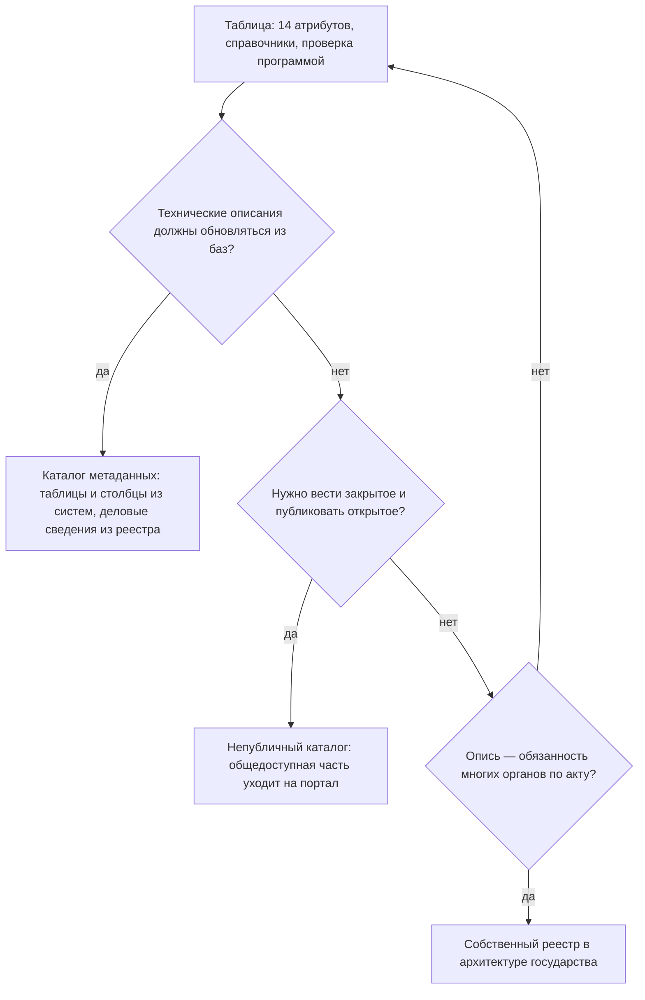

# От таблицы до каталога метаданных

Инструмент инвентаризации выбирают по цели и по тому, кто, как часто и откуда меняет записи. Начинают всегда с таблицы: в ней отрабатывают состав атрибутов, справочники и первые записи, и многим организациям её хватает надолго — если таблицу проверяет программа. Каталог метаданных с открытым кодом — OpenMetadata, DataHub — нужен, когда технические описания должны обновляться из самих баз. Он сам найдёт таблицы и столбцы, но не владельца, полномочие и режим доступа с основанием: их переносят из реестра. Непубличный каталог рядом с порталом открытых данных — когда надо вести и закрытые, и открытые наборы; общедоступную часть строит программа из полного реестра. Собственный реестр в архитектуре государства — когда опись становится обязанностью всех органов, как каталог цифровых данных в Казахстане или системы метаданных баз в Южной Корее. Уровни сочетают, а при переходе с одного на другой главное — сохранить идентификаторы и не завести две копии реестра: у каждого поля одна система-первоисточник.

## Коротко

| Что сделать | Что получается | Готово, когда |
|-------------|----------------|---------------|
| **[Начать с таблицы](#таблица)** | Таблица с 14 атрибутами, листами владельцев, полномочий и систем | Первые десятки записей заполнены, состав колонок перестал меняться от записи к записи |
| **[Защитить таблицу от порчи](#как-таблица-портит-данные)** | Текстовые колонки для кодов, списки значений, выгрузка CSV в UTF-8 | Идентификаторы с ведущими нулями и даты пережили открытие и сохранение файла |
| **[Проверять программой](#проверка-программой)** | Схема таблицы и отчёт об ошибках при каждой версии | Проверка проходит без ошибок; новая ошибка видна до публикации |
| **[Выбрать уровень](#как-выбрать)** | Решение, чем вести реестр дальше, с причиной | Признаки перехода сверены; известно, кто будет сопровождать систему |
| **[Сопоставить поля](#куда-ложатся-14-атрибутов)** | Файл сопоставления: колонка реестра, поле системы, первоисточник | У каждого атрибута есть место и одна система, где его правят |
| **[Перенести и сверить](#как-перейти-на-следующий-уровень)** | Перенос программой с сохранёнными идентификаторами и три списка расхождений | Число записей совпало, выборка проверена глазами, у каждого расхождения есть решение |



## Четыре уровня

| Уровень | Что это | Когда подходит | Кто ведёт записи | Ограничения |
|---------|---------|----------------|------------------|-------------|
| **Таблица** | Excel, Google Sheets, LibreOffice Calc или CSV с атрибутами реестра; рядом с ней — табличные базы данных вроде Grist | Старт, небольшая организация, быстрый аудит, карта данных под задачу | Команда инвентаризации; в табличной базе — и сами владельцы, через формы | Не обновляется из систем; легко испортить ручной правкой и автозаменой |
| **Каталог метаданных с открытым кодом** | OpenMetadata, DataHub, Apache Atlas — системы, которые собирают описания из баз, хранилищ, отчётов и конвейеров | Много систем и таблиц внутри организации; технические описания устаревают быстрее, чем их правят руками | Каталог — технические сведения; владельцы — деловые | Видит только подключённое; не знает полномочий и оснований; нужна команда сопровождения |
| **Непубличный каталог рядом с порталом открытых данных** | Внутренний каталог с полным реестром, из которого общедоступная часть выгружается на портал | Нужно вести чувствительные данные и одновременно публиковать открытые | Организация; портал собирает общедоступную часть | Две системы нужно держать согласованными, а выгрузку — проверять |
| **Собственный реестр** | Реестр метаданных в национальной архитектуре: связан с учётом систем, интеграционной и аналитической платформами | Опись — постоянная обязанность органов власти по нормативному акту | Органы — свои записи; центр — правила и проверку | Дорого в разработке; зависит от устойчивости архитектуры; снаружи обычно закрыт |

Пример третьего уровня — федеральные ведомства США: полный инвентарь ведомства и его общедоступная часть на data.gov ([ниже](#непубличный-каталог-рядом-с-порталом), [«Зарубежные методики»](../05-frameworks/04-international-practice.md#инвентари-данных-федеральных-ведомств-сша)). Пример четвёртого — Казахстан: с октября 2026 года там ведут каталог цифровых данных из паспортов данных цифровых объектов на архитектурном портале, рядом с реестром систем, а обмен и аналитика идут через интеграционную платформу Smart Bridge и аналитическую платформу Smart Data Ukimet ([«Каталог цифровых данных»](../07-countries/01-kazakhstan.md#каталог-цифровых-данных)).

Уровни не исключают друг друга. У министерства может быть таблица карты данных для руководства, каталог метаданных у аналитиков, внутренний каталог с выгрузкой на портал и записи в государственном реестре. Плохо не то, что систем несколько, а то, что одну и ту же запись правят в двух местах.

## Таблица

Таблица — не временная мера, а нормальный инструмент реестра на сотни записей. Слабые места таблицы известны, и почти все закрываются правилами.

### Как устроить

Листы — по шаблонам из приложения [«Шаблоны»](../09-appendices/03-templates.md):

- **Наборы** — [registry.csv](pathname:///templates/registry.csv): строка — запись, колонки — коды из шаблона. Колонки `title`, `description`, `format`, `issued`, `modified`, `license` и `publisher` названы как свойства DCAT-US v1.1, поэтому переход на каталог по стандарту не потребует переименований ([«Сопоставление с реестром»](../05-frameworks/02-metadata-standards.md#сопоставление-с-реестром)).
- **Владельцы и полномочия** — [owners.csv](pathname:///templates/owners.csv) и [mandates.csv](pathname:///templates/mandates.csv); записи ссылаются на них идентификаторами.
- **Системы** — записи с типом `system` в листе наборов или отдельный лист, если опись «чем владеем» начинается с учёта систем.
- **Вопросы и связи** — для подхода «где найти нужное» ([«Рабочая таблица»](./02-mindmaps-and-boards.md#рабочая-таблица)).

Правила:

- **Строка — одна запись, ячейка — одно значение.** Несколько значений — через «;», как в шаблоне.
- **Одна строка заголовков.** Без объединённых ячеек и многоэтажной шапки: программа читает первую строку как имена колонок.
- **Цвет — не значение.** Заливку «закрытое — красным» программа не прочтёт, а при выгрузке в CSV она пропадёт. Режим доступа — кодом в колонке, цвет — условным форматированием по коду.
- **Примечания — в колонке**, а не в примечаниях к ячейкам: те тоже теряются при выгрузке.
- **Списки значений** для `access_level`, `update_frequency`, `type`, `status`, `personal_data`: проверка данных в Excel и LibreOffice Calc, раскрывающиеся списки в Google Sheets.
- **Версии — у себя.** Выгрузка CSV в UTF-8 с датой в имени или коммит в git. История версий облачного сервиса — не замена: она живёт, пока живы сервис и доступ к нему ([«Интеллект-карты, доски и таблицы»](./02-mindmaps-and-boards.md)).

### Как таблица портит данные

Электронная таблица угадывает тип значения и меняет его без спроса. Для реестра это опасно: портятся именно идентификаторы, коды и даты, по которым записи связаны между собой и с другими реестрами.

| Что вводят | Что делает таблица | Чем грозит реестру |
|------------|--------------------|--------------------|
| Код с ведущим нулём: ИИН человека, родившегося в 2000-х, ИНН организации из Республики Адыгея с кодом 01 | Считает числом и отбрасывает ноль | Запись не находится по коду, связь с регистром рвётся |
| Длинный номер — 20-значный номер банковского счёта, длинный идентификатор | Хранит не больше 15 значащих цифр, остальные заменяет нулями и показывает число в экспоненциальной записи | Номер испорчен необратимо: после сохранения исходных цифр нет |
| Обозначение, похожее на дату: «1-2», «MARCH1», «SEPT1» | Превращает в дату | Обозначение заменено датой, а при выгрузке — числом |
| Дата «03.04.2026» | Понимает по настройкам компьютера: 3 апреля или 4 марта | У разных участников одна запись означает разные даты |
| CSV, сохранённый командой «CSV» в русской версии Excel для Windows | Записывает текст в кодировке Windows-1251, а не UTF-8 | Программа проверки и каталог видят вместо кириллицы нечитаемые символы |

В генетике автозамена стала массовой проблемой. В 2016 году ошибки в названиях генов нашли в каждой пятой статье с приложенными списками генов в Excel — в 704 из 3597. В 2021 году, по более широкой выборке статей 2014–2020 годов, — в 30,9%, в 3436 из 11 117. В 2019 году комитет по номенклатуре генов человека HGNC переименовал гены, обозначения которых Excel превращает в даты: MARCH1 стал MARCHF1, SEPT1 — SEPTIN1; в правилах 2020 года комитет объяснил переименование именно этим.

Предел размера — тоже ошибка. В октябре 2020 года в Англии 15 841 положительный тест на ковид за 25 сентября — 2 октября не попал в ежедневную статистику и с опозданием ушёл службе отслеживания контактов. По объяснению BBC, которое пересказывала The Register, результаты лабораторий сводили в файле старого формата XLS, где на листе не больше 65 536 строк; правительство говорило о превышении размера файла. Лист современного Excel вмещает 1 048 576 строк и 16 384 столбца, таблица Google — до 20 млн ячеек. Реестру этого хватит, но выгрузкам, которые с ним сверяют, — не всегда.

Как защититься:

- **Колонки с кодами — текстовые** до ввода данных: идентификаторы, ИИН, БИН, ИНН, ОГРН, коды классификаторов.
- **CSV открывают импортом**, а не двойным щелчком, с типом «текст» для колонок с кодами: в Excel — «Данные → Из текста/CSV», в LibreOffice — окно импорта текста.
- **Автопреобразование выключают.** В Excel для Microsoft 365 и Excel 2024 в «Файл → Параметры → Данные → Автоматическое преобразование данных» отключаются четыре замены: удаление ведущих нулей, обрезка до 15 цифр с экспоненциальной записью, экспонента у чисел рядом с буквой «E» и даты из строк букв и цифр. Настройку включает у себя каждый участник.
- **Даты — в виде ГГГГ-ММ-ДД** (ISO 8601).
- **Выгрузка — «CSV UTF-8».**
- **После каждой правки — проверка программой.**

### Проверка программой

Что проверять, перечислено в главе [«Реестр данных»](../03-process/05-registry.md#как-вести-реестр): пустые ячейки в 14 атрибутах, повторы идентификаторов, коды из справочников, ссылки на владельцев и полномочия, даты, адреса. Форму записи проще всего описать схемой таблицы — Table Schema из спецификаций Frictionless Data ([«Отраслевые стандарты»](../05-frameworks/02-metadata-standards.md#отраслевые-стандарты)). Схему хранят рядом с реестром, а программа сверяет с ней каждую строку.

Схема для части колонок шаблона `registry.csv`:

```yaml
# registry.schema.yaml
fields:
  - name: id
    type: string
    constraints:
      required: true
      unique: true
      pattern: "[a-z0-9-]+"
  - name: title
    type: string
    constraints:
      required: true
  - name: access_level
    type: string
    constraints:
      required: true
      enum: [open, unstructured, restricted, closed, unknown]
  - name: modified
    type: string
    constraints:
      required: true
      pattern: "\\d{4}(-\\d{2}(-\\d{2})?)?|нет.*|не установлено.*"
  - name: publisher
    type: string
    constraints:
      required: true
primaryKey: [id]
fieldsMatch: subset
```

```bash
frictionless validate registry.csv --schema registry.schema.yaml
```

`fieldsMatch: subset` разрешает описать не все колонки. Дата изменения — строка, а не дата: по правилам реестра вместо неё может стоять «нет» или «не установлено» с объяснением ([«Если сведение не найдено»](../03-process/05-registry.md#если-сведение-не-найдено)). Шаблон `registry.csv` эту проверку проходит. Добавленная строка с режимом доступа «открыто», датой «23.10.2026» и повторным идентификатором даёт ошибку в каждой из трёх колонок (frictionless 5.21.0, 25 октября 2026 года). Таблицу Google или Excel проверяют так же — через выгрузку в CSV. Полная схема всех колонок шаблона — [registry.schema.json](pathname:///templates/registry.schema.json) ([«Схема»](./03-registry-as-data.md#схема)).

Схема ловит только форму. Правдоподобие — дата изменения не раньше даты публикации — и связи — владелец есть в листе владельцев — проверяют отдельными правилами ([«Проверки программой»](../05-frameworks/03-data-mesh.md#проверки-программой)). Какие правила проверяют программой и на каких уровнях — в разделе [«Проверки»](./03-registry-as-data.md#проверки) главы «Реестр как данные».

### Таблица с типами и связями

Промежуточный шаг между таблицей и каталогом — табличная база данных: Grist, NocoDB, Baserow, Airtable. Она выглядит как таблица, но у колонки есть тип, листы связаны ссылками, а записи можно собирать формами. Для инвентаризации это даёт:

- **связи вместо копий** — колонка «владелец» ссылается на строку листа владельцев, и переименование ведомства правят в одном месте;
- **типы** — идентификатор остаётся текстом, дата — датой, режим доступа — значением из списка;
- **формы** — опросный лист для владельцев ([«Опросные листы и интервью»](../03-process/04-questionnaires.md)), ответ из которого сразу становится строкой;
- **права до строки и колонки** — владелец видит и правит свои записи, служебные поля от него скрыты;
- **историю правок и программный интерфейс** — выгрузку в CSV для проверки и версий можно делать по расписанию.

Во Франции такой инструмент дало служащим государство. Grist входит в набор LaSuite для государственного сектора: по странице продукта на 25 октября 2026 года им пользуются больше 50 000 служащих в 15 министерствах, а размещён он в облаке с квалификацией SecNumCloud. Код Grist открыт (Apache 2.0); NocoDB и Baserow тоже можно развернуть на своём сервере, Airtable — только облачный сервис.

Ограничение то же, что у таблицы: записи вводят люди, из систем база не обновляется. И у каждой базы свой формат — выгружайте реестр в CSV по шаблону, чтобы смена инструмента не означала потерю результата.

## Каталог метаданных

Каталог метаданных подключается к базам данных, хранилищам, системам отчётности и конвейерам данных и сам собирает технические описания: таблицы, столбцы, типы, происхождение данных (lineage) — из каких таблиц получена эта, — время последнего изменения. Поверх них люди добавляют деловые сведения: описание, владельца, термины глоссария, отметки о персональных данных. Поэтому каталог хорошо отвечает на вопрос «что лежит в наших базах» и плохо — на вопрос «какие данные у нас есть и на каком основании».

### Что выбрать

| Каталог | Версия и лицензия на 25 октября 2026 года | Что полезно инвентаризации | Что учесть |
|---------|-------------------------------------------|----------------------------|------------|
| **OpenMetadata** | 2.0.6 от 21 октября 2026 года; Apache 2.0; разработчик — Collate | В документации версии 2.0 — 99 коннекторов; настраиваемые свойства 16 типов для любого вида объектов; массовый импорт и выгрузка CSV для сервисов, баз, схем и таблиц; тесты качества; домены и продукты данных; импорт контрактов ODCS | Коннекторы к Google Drive и SFTP — в бета-версии: они видят файлы и таблицы Google на дисках, но не их смысл и не их владельцев |
| **DataHub** | 1.8.0 от 22 октября 2026 года; Apache 2.0; разработчик — Acryl Data | Структурированные свойства с типами и проверкой значений; источник CSV Enricher добавляет к уже собранным объектам владельцев, теги, термины глоссария, описания, домен и структурированные свойства; продукты данных в файлах YAML | Формы для владельцев (Compliance Forms) с интерфейсом есть только в платной DataHub Cloud, в открытой версии — только через программный интерфейс |
| **Apache Atlas** | 2.5.0, весна 2026 года, готовится 2.6.0; Apache 2.0 | Классификации, которые передаются по цепочке происхождения данных: отметка о персональных данных переходит на производные таблицы | Создан для экосистемы Hadoop — Hive, HBase, Kafka; для разнородных систем подключений меньше |
| **Amundsen** | Репозиторий переведён в архив в сентябре 2026 года из-за отсутствия активности | — | Пример риска: открытый код не гарантирует, что проект проживёт столько же, сколько реестр |

Есть и коммерческие каталоги — Collibra, Alation, Atlan, Informatica — и каталоги облачных платформ: Microsoft Purview, Google Dataplex, AWS Glue Data Catalog, Databricks Unity Catalog. Их выбирают по тем же вопросам: что каталог подключает, можно ли добавить свои поля, можно ли выгрузить всё в открытом формате и где хранятся сведения. Последний вопрос для государства часто решающий ([«Где хранить»](#где-хранить)).

Встроенный ИИ каталогов находит столбцы с персональными данными и составляет описания таблиц ([«Что уже умеют инструменты»](../02-approaches/03-ai.md#что-уже-умеют-инструменты)). Это черновики: их проверяет человек, как любую запись, составленную моделью.

### Куда ложатся 14 атрибутов

Каталог описывает объекты систем — таблицы, файлы, отчёты, — а реестр описывает наборы данных с владельцем и основанием. Поэтому одни атрибуты каталог заполнит сам, для других у него есть стандартные поля, а третьи придётся добавить настраиваемыми: в OpenMetadata это custom properties, в DataHub — structured properties.

| Атрибут реестра | Куда в каталоге | Где первоисточник |
|-----------------|-----------------|-------------------|
| Идентификатор | Настраиваемое свойство, например `registryId`. Собственный идентификатор каталога — полное имя объекта вида `сервис.база.схема.таблица` — меняется при переезде системы | Реестр |
| Наименование и описание | Отображаемое имя и описание объекта | Реестр; описания столбцов — каталог и владелец |
| Ответственный и контакты | Владелец объекта — пользователь или команда каталога; контакты людей вне организации — настраиваемое свойство | Реестр, пока не у всех ответственных есть учётные записи в каталоге |
| Периодичность обновления | Настраиваемое свойство со списком значений или срок обновления в контракте данных | Реестр; фактическую частоту показывает каталог, и расхождение с обещанной — находка |
| Режим доступа | Классификация или тег по справочнику и настраиваемое свойство с основанием | Реестр: права учётных записей в базе — не режим доступа ([«Чего не видит каталог метаданных»](../05-frameworks/01-dama-dmbok.md#чего-не-видит-каталог-метаданных)) |
| Ссылка для выгрузки и формат | Настраиваемые свойства; у внутренних наборов — адрес объекта в системе | Реестр |
| Дата публикации | Настраиваемое свойство | Реестр |
| Дата последнего изменения | Время последнего изменения объекта по данным системы | Каталог |
| Отметка о контроле качества | Тесты качества каталога и их итоги; вывод, годится ли набор для задачи, — настраиваемое свойство | Каталог — для правил, реестр — для вывода ([«Качество данных»](../03-process/07-quality.md)) |
| Условия использования | Настраиваемое свойство или термин глоссария с текстом лицензии | Реестр |
| Организация-владелец | Домен ([«Домены»](../05-frameworks/03-data-mesh.md#домены)) | Реестр |

Из расширенного состава схему данных каталог соберёт сам, а полномочие и нормативный акт удобно завести терминами глоссария: на один термин ссылаются все объекты, собранные по этому полномочию. Сопоставление авторское — готовой модели реестра с полномочиями и основаниями ни в OpenMetadata, ни в DataHub нет.

Записи без таблиц — бумажные журналы, данные у подрядчиков, внешние источники — каталог сам не найдёт. Их либо заводят через программный интерфейс объектами условной платформы вроде «бумажные журналы» или «внешние источники», либо оставляют только в реестре и сверяют. Второе проще поддерживать: каталог, где половину объектов завели руками, перестаёт показывать то, что он видит сам.

### Как загрузить реестр в каталог

Общий порядок перехода — [ниже](#как-перейти-на-следующий-уровень). Для каталога метаданных к нему добавляется своё:

- **Подключать системы из реестра систем**, начиная с тех, где больше всего записей, а не все подряд. Каталог, собравший тысячи таблиц без владельцев, — ещё одна опись ради описи ([«Опись ради описи»](../08-practices/01-practices-and-anti-patterns.md#опись-ради-описи)).
- **Завести настраиваемые свойства и справочники до загрузки** — с теми же кодами, что в таблице.
- **Связать запись с объектами.** В таблицу добавляют колонку с полным именем объекта в каталоге; у агрегата или группы объектов их несколько, через «;».
- **Загружать программой.** В OpenMetadata — массовым импортом CSV или через программный интерфейс, в DataHub — источником CSV Enricher. CSV Enricher только дополняет уже собранные объекты, а в режиме OVERRIDE пустые ячейки стирают сведения в каталоге: начинайте с режима по умолчанию, PATCH.

### Чего каталог не видит

Каталог видит только подключённое, не знает владельца и основания, путает права доступа в базе с режимом доступа и не отвечает на вопрос задачи ([«Чего не видит каталог метаданных»](../05-frameworks/01-dama-dmbok.md#чего-не-видит-каталог-метаданных)). Поэтому каталог регулярно сверяют с реестром. Таблица в каталоге без записи в реестре — неописанный набор. Запись реестра без объекта в каталоге — неподключённая система, бумажные или внешние данные. Новые таблицы каталог замечает сам, и это его главное преимущество перед таблицей: реестр узнаёт о новых данных при сборе, а не при следующей описи ([«Что проверять программой»](../03-process/09-result-and-upkeep.md#что-проверять-программой)).

## Непубличный каталог рядом с порталом

Портал открытых данных показывает опубликованное, а реестр — всё, что есть. Если вести их в одной системе, закрытые записи либо не помещаются, либо утекают. Поэтому полный реестр ведут во внутреннем каталоге, а общедоступную часть программа выгружает на портал ([«Полный реестр и общедоступная часть»](../03-process/09-result-and-upkeep.md#полный-реестр-и-общедоступная-часть)).

Так устроен data.gov. По списку систем data.gov на 25 октября 2026 года:

- **inventory.data.gov** — закрытая система, в которой ведомства могут вести описания для data.gov. Построена на CKAN 2.11.5 с доработками, выгружает описания по DCAT-US 3.0 и проверяет их по JSON-схемам из репозитория GSA/dcat-us. Её поддерживают до перевода с CKAN на другую основу, целевой срок — зима 2026 года.
- **harvest.data.gov** — сборщик: забирает общедоступные части инвентарей ведомств, файлы `data.json`, проверяет их и даёт открытый программный интерфейс проверки по DCAT-US ([«Федеративный инвентарь США»](../05-frameworks/03-data-mesh.md#федеративный-инвентарь-сша)).
- **catalog.data.gov** — с 2025 года не CKAN, а собственное приложение на Python, которое только показывает собранное. 25 октября 2026 года в нём 431 278 наборов.

Три роли разделены: где ведут записи, кто собирает и проверяет, где показывают. Поэтому data.gov смог сменить программу каталога, не трогая инвентари ведомств: связь между ними — файл по стандарту, а не общая база.

Для своего непубличного каталога подходит CKAN — версия 2.12.0 вышла 26 августа 2026 года. Закрытые наборы в нём видят только участники организации, а расширение ckanext-dcat выгружает описания по DCAT ([«Как выгрузить и проверить»](../05-frameworks/02-metadata-standards.md#как-выгрузить-и-проверить)). Подойдёт и каталог метаданных, если он умеет выгружать описания по стандарту.

Правила для этого уровня:

- **Общедоступную часть строит программа** при каждой версии реестра; какие записи и поля в неё входят, записано в паспорте реестра.
- **Закрытые наборы тоже показывают** — описание, владельца, режим доступа и порядок получения ([«Закрытые наборы в стандартах»](../05-frameworks/02-metadata-standards.md#закрытые-наборы-в-стандартах)).
- **Выгрузку проверяют валидатором**, а потом смотрят, что увидел агрегатор.
- **Портал не правят руками.** Исправление, сделанное на портале, при следующей выгрузке пропадёт: правят в реестре.

Как выбрать платформу для публичного каталога и не дать ему умереть, разобрано в книге [«Каталоги данных»](https://datacatalogs.begtin.tech/).

## Собственный реестр

Четвёртый уровень — реестр данных как часть государственной архитектуры. Органы обязаны описывать свои данные в общей системе, записи связаны с учётом систем, а описание появляется при создании системы, а не когда до неё дошла инвентаризация.

| Страна | Система | Что в ней | Что важно |
|--------|---------|-----------|-----------|
| **Казахстан** | Каталог цифровых данных на архитектурном портале govarch.kz по требованиям от 22 сентября 2026 года | Паспорта данных цифровых объектов до столбцов; рядом — реестр систем, Smart Bridge и Smart Data Ukimet | Паспорт новой системы составляют до ввода в промышленную эксплуатацию ([«Каталог цифровых данных»](../07-countries/01-kazakhstan.md#каталог-цифровых-данных)) |
| **Южная Корея** | IRM и системы управления метаданными баз учреждений, сведённые в центральную систему | Системы — в IRM; базы, таблицы и столбцы — с основанием хранения, открытостью и отметкой о персональных данных | Названия полей — из общего словаря стандартных терминов, 13 159 терминов в сентябре 2026 года ([«Метаданные баз данных»](../07-countries/06-south-korea.md#метаданные-баз-данных)) |
| **Польша** | Репозиторий интероперабельности — с 23 февраля 2027 года | Метаданные публичных реестров, сведения о программных интерфейсах, оценки интероперабельности | Общедоступен по закону; для работающих реестров — переходные сроки до 2029–2031 годов ([«Репозиторий интероперабельности»](../07-countries/05-poland.md#репозиторий-интероперабельности)) |
| **Россия** | ЕИП НСУД | Реестр информационных ресурсов, модель государственных данных, подсистема ведения метаданных | Открытой части не найдено ([«НСУД»](../07-countries/02-russia.md#нсуд)) |

Что заставляет такой реестр работать:

- **Связь с учётом систем.** Каждая запись данных ссылается на систему из реестра систем; систему выводят — записи меняют статус, а не исчезают ([«Как отметить в реестре»](../04-sources/06-legacy.md#как-отметить-в-реестре)).
- **Описание при создании.** Паспорт данных до ввода системы — это data-first в норме акта: реестр не отстаёт от систем ([«Принципы»](../01-basics/04-principles.md)).
- **Общий словарь и справочники**: одинаковые понятия называются одинаково во всех органах.
- **Проверка программой и ответственный за ошибки** — как в федеративном реестре ([«Data Mesh»](../05-frameworks/03-data-mesh.md#федеративное-управление)).
- **Общедоступная часть.** Без неё реестр видят только служащие, а внешняя инвентаризация знает о нём лишь по нормативным актам.

Для описи внутри государства такой реестр — готовый источник: паспорта и записи выгружают и сопоставляют с 14 атрибутами, пробелы дозаполняют. Для внешней инвентаризации он обычно закрыт, и о записях спрашивают владельца данных. Риск этого уровня — зависимость от архитектуры: при смене платформы или реорганизации ведомств записи переезжают вместе с системами. Поэтому реестр должен выгружаться в открытом формате по стандарту ([«Стандарты описания»](../05-frameworks/02-metadata-standards.md)), а у органа — оставаться выгрузка своих записей.

## Как выбрать

- **Начинайте с таблицы всегда.** Даже если впереди каталог, состав атрибутов и первые записи удобнее отработать в таблице ([шаблон реестра](../09-appendices/03-templates.md#реестр-данных)).
- **Стандарт описания с первого дня** — DCAT или DCAT-US: тогда переход с таблицы на каталог не потребует переписывать атрибуты ([«Стандарты описания»](../05-frameworks/02-metadata-standards.md)).
- **Каталог метаданных — когда описания должны обновляться сами**: данные в базах меняются чаще, чем люди успевают обновлять таблицу.
- **Если описания ведут подразделения — федеративный сбор.** Домены и продукты данных есть в OpenMetadata и DataHub, но каталог видит только подключённые системы ([«Платформа»](../05-frameworks/03-data-mesh.md#платформа)).
- **Для публичной части — каталог данных** ([«Каталоги данных»](https://datacatalogs.begtin.tech/)).

### Когда переходить

| Признак | Что это значит | Что делать |
|---------|----------------|------------|
| Несколько человек правят одну таблицу и затирают правки друг друга | Таблица стала общим ресурсом без правил | Совместная правка с историей или табличная база данных с правами до строки |
| Владельцы должны заполнять записи сами | Сбор идёт по почте и копированием | Формы табличной базы или федеративный сбор с проверкой программой |
| Таблицы и столбцы в базах меняются чаще, чем правят реестр | Технические сведения устаревают | Каталог метаданных; реестр остаётся источником деловых сведений |
| Общедоступную часть публикуют регулярно | Ручная выгрузка расходится с реестром | Непубличный каталог и выгрузка программой |
| Опись — обязанность многих органов по акту | Нужен общий реестр с правилами и проверкой | Собственный реестр или участие в государственном |

Переходить рано, если:

- **таблицу не ведут** — каталог тоже не будут;
- **состав атрибутов ещё меняется** — каждое изменение придётся переносить в настраиваемые свойства и импорт;
- **нет команды сопровождения** — каталог метаданных требует серверов, обновлений, настройки коннекторов и людей, которые разбирают ошибки сбора, а без них устаревает быстрее таблицы;
- **цель — разовая карта данных под задачу** — ей хватит таблицы и снимка с датой ([«Снимок или живой реестр»](../03-process/09-result-and-upkeep.md#снимок-или-живой-реестр)).

### Где хранить

- **Реестр — данные с режимом доступа.** В нём бывают имена и телефоны сотрудников, описания закрытых систем, отметки о персональных данных. Облачный сервис за рубежом для такого реестра может быть недопустим по правилам организации или по закону о персональных данных.
- **Облачный сервис может закрыться для целой страны.** Так в 2024–2026 годах Miro отключал пользователей из России ([«Интеллект-карты, доски и таблицы»](./02-mindmaps-and-boards.md)).
- **Что бы ни выбрали, полная выгрузка** — в CSV по шаблону или по стандарту описания — регулярно и у себя.

## Как перейти на следующий уровень

1. **Остановить правки на время переноса** — или записывать их в журнал, чтобы повторить в новой системе.
2. **Записать сопоставление файлом**: колонка реестра, поле новой системы, справочник значений, первоисточник ([«Как выгрузить и проверить»](../05-frameworks/02-metadata-standards.md#как-выгрузить-и-проверить)). Поля, которым в новой системе нет места, не выбрасывают, а заводят настраиваемыми свойствами.
3. **Сохранить идентификаторы.** Идентификатор записи переходит в новую систему как есть, собственный идентификатор системы — отдельное поле. Иначе связи «вопрос — набор», карты и прошлые версии перестанут находить записи.
4. **Переносить программой**, а не копированием: перенос должен повторяться с тем же результатом.
5. **Сверить числа и выборку**: сколько записей было и стало — всего, по владельцам и по режимам доступа. Десяток записей проверить глазами, поле за полем.
6. **Разобрать три списка**: что есть только в новой системе, что только в реестре, что совпало, но с расхождениями в полях. У каждого расхождения — решение и дата.
7. **Назначить первоисточник каждому полю** и закрыть правку этого поля в остальных местах. Последнюю версию таблицы сохранить с датой: это архив, а не второй реестр.

## Пример

Запись реестра воздушных судов США из главы [«Реестр данных»](../03-process/05-registry.md#пример-записи) на разных уровнях. FAA публикует выгрузку открыто, а как FAA ведёт описания внутри, неизвестно, поэтому путь записи ниже — условный.

| Уровень | Где запись | Что добавляется | Что не должно потеряться |
|---------|------------|-----------------|--------------------------|
| **Таблица** | Строка `faa-aircraft-registry` в `registry.csv`: `open`, `daily`, ссылка на ReleasableAircraft.zip, полномочие `faa-aircraft-registration` | — | Основание режима доступа; «не установлено» у даты публикации с объяснением |
| **Таблица с типами и связями** | Строка листа наборов; владелец `faa` и полномочие — ссылки на строки своих листов | Форма, через которую подразделение реестра подтверждает запись | Ссылки — по идентификаторам, а не по названиям |
| **Каталог метаданных** | Объекты для таблиц базы реестра и семи файлов выгрузки, у всех — `registryId` = `faa-aircraft-registry` | Столбцы и типы из системы вместо описания полей из PDF; фактическая дата изменения; тест «регистрационные номера не повторяются» | Полномочие 49 U.S.C. § 44103, право владельцев скрыть имя и адрес по 49 U.S.C. § 44114(b), условия использования — в базе их нет |
| **Непубличный каталог и портал** | Полная запись — во внутреннем каталоге, общедоступная — в файле `data.json` по DCAT-US | Сведения о распространении и формате по стандарту | Отметка, что выгрузка — не весь реестр: часть владельцев скрыта по закону |

На каждом уровне две вещи делает человек: основание и вывод о пригодности. Каталог найдёт столбец с годом выпуска и посчитает, что он пуст у 22% записей, но не скажет, годится ли набор для задачи и почему часть владельцев не видна.

## Частые ошибки

| Ошибка | Что происходит | Как исправить |
|--------|----------------|---------------|
| **Начать с каталога** | Каталог собрал тысячи таблиц без владельцев и оснований, а реестра по-прежнему нет | Сначала реестр по методам инвентаризации, потом подключение каталога |
| **Каталог считают итогом инвентаризации** | Бумажное, внешнее и закрытое выпало | Сверять каталог с реестром, полномочиями и учётом систем |
| **Две копии реестра** | Таблицу и каталог правят параллельно; через полгода они расходятся | У каждого поля одна система-первоисточник |
| **Новый идентификатор при переносе** | Связи «вопрос — набор», карты и прошлые версии ссылаются в никуда | Переносить идентификатор как есть, идентификатор системы — отдельным полем |
| **Excel «исправил» коды** | Коды без ведущих нулей, номера с нулями вместо цифр, обозначения стали датами | Текстовые колонки, импорт CSV с типом «текст», отключённое автопреобразование, проверка программой |
| **Цвет вместо значения** | При выгрузке режим доступа пропал | Код в колонке, цвет — по коду |
| **Портал правят руками** | Исправление пропадает при следующей выгрузке | Править в реестре, выгружать программой |
| **Реестр только в облачном сервисе** | Сервис закрылся или аккаунт заблокирован — реестра нет | Регулярная выгрузка CSV к себе или в git |
| **Инструмент выбрали до цели** | Развернули каталог для аналитиков, а нужна карта для руководства — или наоборот | Сначала цель и вопросы, потом инструмент ([«Цели и вопросы»](../03-process/02-goals-and-questions.md)) |
| **Заброшенный проект** | Каталог на коде, который перестали развивать, — без обновлений и исправлений | Смотреть на активность проекта до выбора; держать выгрузку по стандарту |

## Ограничения

- Версии, цифры и возможности каталогов — на 25 октября 2026 года, по документации и репозиториям. Каталоги меняются быстро: перед выбором проверяйте документацию той версии, которую ставите.
- Коммерческие каталоги только названы, не сравниваются.
- Сопоставление 14 атрибутов с полями каталогов — авторское.
- Пример с FAA условный: как FAA ведёт описания внутри, неизвестно.
- Государственные реестры четвёртого уровня в Казахстане, Южной Корее и России снаружи закрыты; о них судят по нормативным актам и открытым сводкам.

## Источники

- OpenMetadata: [сайт](https://open-metadata.org/), [выпуск 2.0.6](https://github.com/open-metadata/OpenMetadata/releases/tag/2.0.6-release) от 21 октября 2026 года; документация версии 2.0 — [коннекторы](https://docs.open-metadata.org/v2.0.x/connectors), [настраиваемые свойства](https://docs.open-metadata.org/v2.0.x/how-to-guides/guide-for-data-users/custom), [массовый импорт CSV](https://docs.open-metadata.org/v2.0.x/how-to-guides/data-discovery/import), [Google Drive](https://docs.open-metadata.org/v2.0.x/connectors/drive/googledrive); 25 октября 2026 года.
- DataHub: [сайт](https://datahub.com/), [выпуск v1.8.0](https://github.com/datahub-project/datahub/releases/tag/v1.8.0) от 22 октября 2026 года; документация — [Structured Properties](https://docs.datahub.com/docs/features/feature-guides/properties/overview), [CSV Enricher](https://docs.datahub.com/docs/generated/ingestion/sources/csv-enricher), [Compliance Forms](https://docs.datahub.com/docs/features/feature-guides/compliance-forms/overview); 25 октября 2026 года.
- [Apache Atlas](https://atlas.apache.org/) — [каталог выпусков](https://downloads.apache.org/atlas/) и [репозиторий](https://github.com/apache/atlas) с кандидатами 2.6.0, 25 октября 2026 года; [Amundsen](https://github.com/amundsen-io/amundsen) — репозиторий в архиве с сентября 2026 года.
- [CKAN 2.12.0](https://docs.ckan.org/en/2.12/changelog.html) — список изменений, выпуск от 26 августа 2026 года.
- data.gov: [список систем](https://github.com/GSA/data.gov/blob/main/SYSTEMS.md), репозитории [inventory-app](https://github.com/GSA/inventory-app) и [datagov-catalog](https://github.com/GSA/datagov-catalog); [catalog.data.gov](https://catalog.data.gov/dataset/) — число наборов; 25 октября 2026 года.
- [Grist в LaSuite](https://lasuite.numerique.gouv.fr/produits/grist) — страница продукта, 25 октября 2026 года; [grist-core](https://github.com/gristlabs/grist-core) — код, Apache 2.0.
- Frictionless Data: [Table Schema](https://datapackage.org/standard/table-schema/), [frictionless-py](https://framework.frictionlessdata.io/) — схема из главы проверена версией 5.21.0.
- Microsoft: [Excel specifications and limits](https://support.microsoft.com/en-us/office/excel-specifications-and-limits-1672b34d-7043-467e-8e27-269d656771c3), [Set automatic data conversions](https://support.microsoft.com/office/33d1d872-9926-4ef3-9364-492444d0c7ea); Google: [ограничения файлов в Google Диске](https://support.google.com/drive/answer/37603); 25 октября 2026 года.
- Ziemann M., Eren Y., El-Osta A. [Gene name errors are widespread in the scientific literature](https://genomebiology.biomedcentral.com/articles/10.1186/s13059-016-1044-7) — Genome Biology, 2016, 17:177; Abeysooriya M. et al. [Gene name errors: Lessons not learned](https://doi.org/10.1371/journal.pcbi.1008984) — PLOS Computational Biology, 2021, 17(7): e1008984; Bruford E. A. et al. [Guidelines for human gene nomenclature](https://doi.org/10.1038/s41588-020-0669-3) — Nature Genetics, 2020.
- [Excel: Why using Microsoft's tool caused Covid-19 results to be lost](https://www.bbc.com/news/technology-54423988) — BBC, 5 октября 2020 года; [What a Hancock-up: Excel spreadsheet blunder blamed after England under-reports 16,000 COVID-19 cases](https://www.theregister.com/2020/10/05/excel_england_coronavirus_contact_error/) — The Register, 5 октября 2020 года.
- Главы книги: [«Реестр данных»](../03-process/05-registry.md), [«Результат и поддержка»](../03-process/09-result-and-upkeep.md), [«Стандарты описания»](../05-frameworks/02-metadata-standards.md), [«Data Mesh»](../05-frameworks/03-data-mesh.md), [«DAMA-DMBOK»](../05-frameworks/01-dama-dmbok.md), [«Реестр как данные»](./03-registry-as-data.md), приложение [«Шаблоны»](../09-appendices/03-templates.md).
