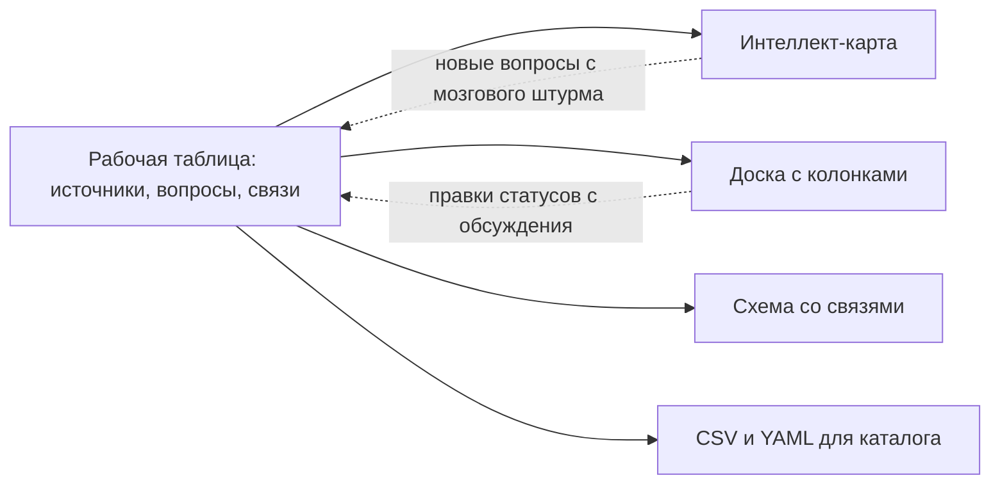
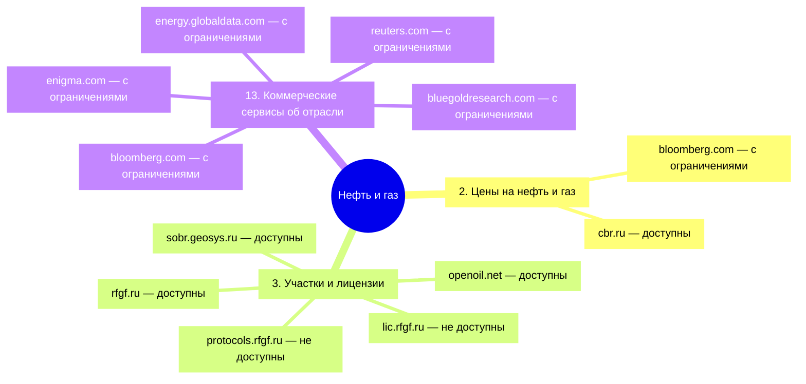
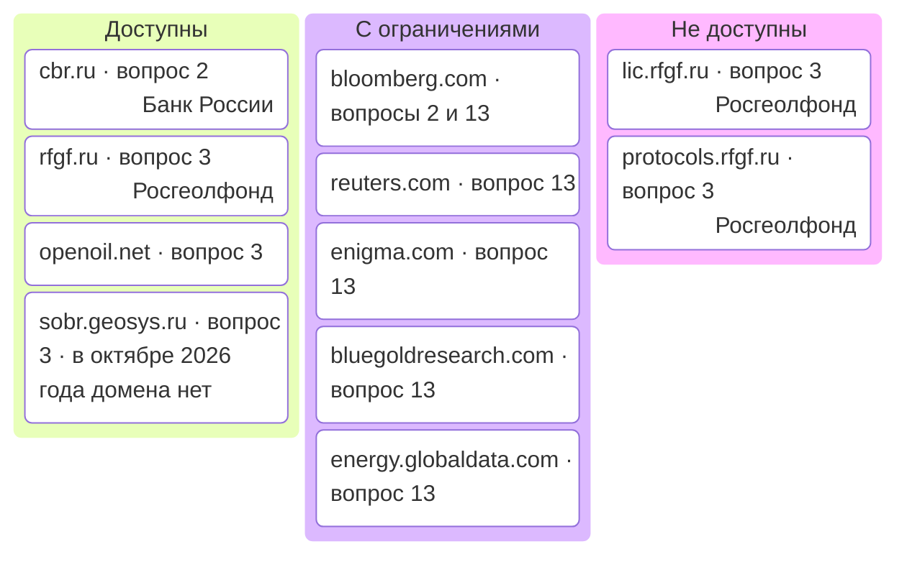

# Интеллект-карты, доски и таблицы

Сведения инвентаризации ведут в таблице, а интеллект-карту, доску и схему строят из неё — чтобы показать и обсудить. Интеллект-карта показывает тему, вопросы и источники на одном листе и помогает провести мозговой штурм. Доска с колонками нужна, чтобы обсудить доступность по ведомствам или следить за ходом опроса владельцев. Схема со связями — для карт от продукта и по полномочиям, таблица — чтобы вести, считать и проверять. Инструмент выбирают по трём вопросам: доступен ли он всем участникам, можно ли хранить в нём эти сведения и отдаёт ли он их в открытом формате. Облачный сервис может закрыться для целой страны или сменить владельца, поэтому исходник всегда в своей таблице, картинка — из неё, а правки с обсуждения переносят в таблицу в тот же день.

## Коротко

| Что сделать | Что получается | Готово, когда |
|-------------|----------------|---------------|
| **[Выбрать форму](#какая-форма-для-чего)** | Интеллект-карта, доска, схема или таблица под задачу | У каждой картинки есть читатель и вопрос, на который она отвечает |
| **[Выбрать инструмент](#как-выбрать-инструмент)** | Приложение или сервис для показа и обсуждения | Он открывается у всех участников, разрешён для этих сведений и отдаёт открытый формат |
| **[Завести рабочую таблицу](#рабочая-таблица)** | Листы «Источники», «Вопросы», «Связи» или реестр с владельцами | Одна строка — одна вещь, ссылки — идентификаторами, коды — из справочников |
| **[Построить картинку из таблицы](#картинка-из-таблицы)** | Интеллект-карта, доска или схема | Картинку можно пересобрать из таблицы, не перерисовывая |
| **[Провести обсуждение](#обсуждение-на-доске)** | Исправленные статусы, новые вопросы и источники | Правки перенесены в таблицу с основанием и датой, картинка пересобрана |
| **[Сохранить результат](#как-не-потерять-результат)** | Таблица, исходник картинки и экспорт с датой | Результат открывается без сервиса, в котором его рисовали |



## Какая форма для чего

| Форма | Что показывает | Когда удобна | Чего не умеет |
|-------|----------------|--------------|---------------|
| **Интеллект-карта** | Дерево: тема → вопрос → источник, цвет — доступность | Показать результат заказчику на одном листе; мозговой штурм вопросов; проверить полноту по типовым темам | Источник, который отвечает на несколько вопросов, повторяется в каждой ветке. Больше сотни узлов читается только с увеличением |
| **Доска с колонками** | Карточки в колонках: по ведомствам, статусам или этапам | Обсудить доступность; вести ход опроса владельцев | Плохо держит иерархию и связи |
| **Схема со связями** | Граф: системы, ресурсы и потоки между ними | Карты от продукта и по полномочиям, где один источник питает несколько продуктов | Раскладку приходится доводить руками; много узлов — путаница линий |
| **Таблица** | Строки и колонки | Вести реестр и карту, фильтровать, считать, проверять программой | Плохо показывает структуру руководителю |

Какой вид карты данных показывать какой формой, разобрано в главе [«Карты данных»](../02-approaches/04-data-maps.md#как-выбрать-вид-и-форму). Здесь — чем их рисовать и как не потерять сведения по дороге.

## Чем рисовать

На октябрь 2026 года:

| Инструмент | Что это | Где хранятся сведения | Когда удобен |
|------------|---------|-----------------------|--------------|
| **[Xmind](https://xmind.com/)** | Приложение для интеллект-карт: для компьютера, телефона и браузера. Импортирует Markdown, OPML и файлы FreeMind | Файл `.xmind`; у веб-версии — облако поставщика | Карта для печати и показа; карты атласа нарисованы в нём |
| **[Freeplane](https://www.freeplane.org/)** | Настольное приложение для интеллект-карт с открытым кодом (GPL 2.0). Формат `.mm` общий с FreeMind | Файл на своём компьютере | Бесплатно, без облака и регистрации — в том числе для карт закрытых систем |
| **[markmap](https://markmap.js.org/)** | Библиотека с открытым кодом (MIT): превращает Markdown в интерактивную интеллект-карту в браузере | Текстовый файл | Карта хранится как текст рядом с документацией или в git |
| **[Mermaid](https://mermaid.js.org/)** | Схемы из текстового описания с открытым кодом (MIT), в том числе интеллект-карты (`mindmap`) и доски (`kanban`) | Текст в странице или репозитории | Схемы на сайте и в репозитории: так нарисованы схемы этой книги |
| **Онлайн-доски** — Miro, Mural, FigJam | Совместные доски со стикерами, колонками и шаблонами интеллект-карт | Облако поставщика | Обсуждение в распределённой команде, если сервис доступен всем |
| **[Excalidraw](https://excalidraw.com/)** | Доска для эскизов с открытым кодом (MIT): работает в браузере, её можно развернуть на своём сервере | Файл `.excalidraw` или свой сервер | Схема со связями или доска без облака поставщика |
| **[Kanboard](https://kanboard.org/), [Wekan](https://wekan.fi/)** | Доски с колонками с открытым кодом (MIT) | Свой сервер | Ход опроса и работ по инвентаризации внутри организации |
| **Стикеры на стене** | Бумага, маркерная доска | Фотография | Мозговой штурм в одной комнате |

## Как выбрать инструмент

- **Доступен всем участникам** — из их страны и из сети их организации. Проверяют до встречи: у кого сервис не открылся, тот выпадает из обсуждения.
- **Разрешён для этих сведений.** Карта закрытых систем, перечень персональных данных в наборах или схема информационной системы бывают служебной информацией. Облако поставщика в другой стране — передача этих сведений за пределы организации, и решает её владелец данных, как и для внешних языковых моделей ([«Закрытые данные и внешние модели»](../02-approaches/03-ai.md#закрытые-данные-и-внешние-модели)). Для таких карт — настольное приложение или свой сервер.
- **Отдаёт открытый формат** — CSV, Markdown, OPML, `.mm`, а не только картинку и собственный файл. Иначе результат остаётся заперт в сервисе.
- **Принимает текст.** Если инструмент умеет импортировать Markdown или файл FreeMind, интеллект-карту можно построить из таблицы, а не рисовать ([«Картинка из таблицы»](#картинка-из-таблицы)).
- **Подходит формату встречи.** В одной комнате быстрее стикеры, в распределённой команде — общая доска.

:::warning[Облачные сервисы и доступность]
Облачный сервис может закрыться для пользователей целой страны или сменить владельца. Miro с сентября 2024 года прекратил платное обслуживание пользователей из России и Беларуси, оставив им бесплатный тариф. С 15 октября 2026 года, по письмам клиентам, о которых сообщили СМИ, сервис закрыл доступ с российских и белорусских IP-адресов для всех тарифов: не открываются ни доски, ни сайт, ни поддержка, а гостевой доступ к чужим доскам не помогает. 10 сентября 2026 года Bending Spoons объявила о покупке Miro — закрытие сделки ожидается в IV квартале 2026 года, — а 4 августа — о покупке Airtable; с новым владельцем могут смениться тарифы и условия. Перед выбором сервиса проверьте, доступен ли он всем участникам, а сведения храните в своей таблице.
:::

## Рабочая таблица

Рабочая таблица — файл с листами, в который сводят всё, что собрано за инвентаризацию. Лист — одна сущность, строка — одна вещь, листы связаны идентификаторами. Шаблоны листов — в приложении [«Шаблоны»](../10-appendices/03-templates.md).

| Лист | Строка | Шаблон | Подробнее |
|------|--------|--------|-----------|
| **Владельцы** | Организация: уровень, слой данных, вышестоящая организация, документ о полномочиях | [owners.csv](pathname:///templates/owners.csv) | [«Владельцы и полномочия»](../03-process/03-owners-and-mandates.md#как-записать) |
| **Полномочия** | Полномочие с цитатой акта и данными, которые из него следуют | [mandates.csv](pathname:///templates/mandates.csv) | [«Владельцы и полномочия»](../03-process/03-owners-and-mandates.md#как-записать) |
| **Реестр** | Набор данных: 14 обязательных атрибутов и расширенные | [registry.csv](pathname:///templates/registry.csv) | [«Реестр данных»](../03-process/05-registry.md#как-вести-реестр) |
| **Адресаты** и **Анкета** | Адресат опроса с датами и итогом; ответ о наборе | [respondents.csv](pathname:///templates/respondents.csv), [questionnaire.csv](pathname:///templates/questionnaire.csv) | [«Опросные листы и интервью»](../03-process/04-questionnaires.md#как-записать) |
| **Источники** | Источник карты: тип, владелец, основание, уровень, слой данных, адрес, синонимы, первоисточник у копии, откуда известно | [sources.csv](pathname:///templates/sources.csv) | [«Три слоя данных»](../04-sources/01-three-layers.md#как-записать) |
| **Вопросы** | Вопрос: постоянный номер, текст, типовая тема, задача, приоритет | [questions.csv](pathname:///templates/questions.csv) | [«Цели и вопросы»](../03-process/02-goals-and-questions.md#как-записать) |
| **Связи** | Пара «вопрос — источник» или «вопрос — набор»: статус доступа с основанием, итог проверки качества для этого вопроса и оговорка к нему, дата | [links.csv](pathname:///templates/links.csv) | [«Доступ и ограничения»](../03-process/06-access.md#как-записать), [«Годится ли для задачи»](../03-process/07-quality.md#годится-ли-для-задачи) |
| **Проверки качества** | Одна проверка набора | [quality-checks.csv](pathname:///templates/quality-checks.csv) | [«Качество данных»](../03-process/07-quality.md#как-записать-в-реестр) |
| **Журнал поиска** | Один запрос к поисковику или каталогу | [searches.csv](pathname:///templates/searches.csv) | [«Поиск наборов данных»](../04-sources/05-dataset-search.md#как-записать) |
| **Изменения** | Одно изменение записи при обновлении | [changes.csv](pathname:///templates/changes.csv) | [«Результат и поддержка»](../03-process/08-result-and-upkeep.md#как-записать) |

Подходу «чем владеем» нужны владельцы, полномочия, опрос и реестр; подходу «где найти нужное» — источники, вопросы и связи. Проверки качества, журнал поиска и изменения нужны обоим. Начинают с нескольких листов и добавляют остальные, когда в них появляется что записать.

**Как устроить листы**, чтобы из них можно было строить картинки и проверять их программой:

- **Одна строка — одна вещь**: не пишите несколько наборов в одну ячейку.
- **Ссылки — идентификаторами.** В листе «Связи» — `rfgf-ru`, а не «Росгеолфонд» или «сайт Росгеолфонда»: по названию две строки об одном источнике не связать.
- **Коды — из справочников**: статус доступа, тип, слой, итог проверки качества выбирают из выпадающего списка — проверкой данных в Excel, LibreOffice Calc или Google Sheets. Иначе появятся «открыто», «откр.» и «да» ([«Справочники значений»](../03-process/05-registry.md#справочники-значений)).
- **Цвет — не значение.** Заливка ячейки теряется при выгрузке в CSV. Статус пишут кодом, а цвет ставят условным форматированием по коду.
- **Без объединённых ячеек и итоговых строк** внутри листа: их не прочитает ни программа, ни фильтр.
- **Даты в одном формате** — `2026-10-25`, месяц — `2026-10`.
- **Заголовки — коды колонок из шаблонов**: тогда лист выгружается в CSV и проверяется тем же скриптом, что и атлас ([«Проверки»](./03-registry-as-data.md#проверки)).

Подойдёт любая таблица, которой пользуются в организации. Если листов много и ссылки между ними путаются, удобнее табличная база данных, где колонка ссылается на строку другого листа, а не хранит текст ([«Таблица с типами и связями»](./01-from-spreadsheet-to-catalog.md#таблица-с-типами-и-связями)). Когда записей становятся тысячи, а описания должны обновляться из самих систем, таблицу сменяет каталог метаданных ([«От таблицы до каталога метаданных»](./01-from-spreadsheet-to-catalog.md)).

## Картинка из таблицы

Картинку строят из таблицы, а не наоборот. Интеллект-карта — дерево, и из трёх листов её собирают так: тема — корень, вопрос из листа «Вопросы» — ветка, источник из листа «Связи» — лист ветки с доступностью этой пары. Формат выбирают по инструменту:

| Формат | Что переносит | Чем открыть |
|--------|---------------|-------------|
| **Markdown из заголовков**: `#` — тема, `##` — вопрос, `###` — источник | Дерево и текст | markmap; Xmind — импортом Markdown |
| **Файл FreeMind `.mm`** — XML | Дерево, цвет узла, ссылку на адрес | Freeplane и FreeMind — как свой файл; Xmind — импортом |
| **OPML** | Дерево и текст | Xmind — импортом; программы для планов |
| **Mermaid** — `mindmap` и `kanban` | Дерево или колонки с карточками | Сайты и редакторы, которые показывают Mermaid, — например, этот сайт |

Скрипт атласа делает это для каждой карты: строит из файла данных Markdown и файл FreeMind, их можно скачать со страницы карты. Цвет узла в файле FreeMind — тот же, что у кружков доступности на страницах атласа, а доступность записана и словами: при импорте в другой инструмент цвет может пропасть. Начало Markdown карты «Нефть и газ» — [oil-and-gas.md](pathname:///downloads/oil-and-gas.md):

```markdown
# Нефть и газ · декабрь 2019

## 2. Где найти информацию о ценах на нефть и газ?

### bloomberg.com (с ограничениями)
### cbr.ru (доступны)
```

Тот же приём годится для доски: колонка доски — значение одной колонки таблицы (ведомство, статус, этап опроса), карточка — строка. Умеет ли онлайн-доска делать карточки из строк, вставленных из таблицы, проверяют до встречи на нескольких строках; если не умеет, доску строят текстом Mermaid `kanban`, как в [примере](#пример-карта-нефть-и-газ-в-трёх-формах) ниже.

**Обратно — только через таблицу.** Если на обсуждении поправили картинку, правку вносят в таблицу и пересобирают картинку. Раскладку, переносы строк и оформление для печати доводят руками — это можно потерять при пересборке. Содержание руками на картинке не правят. Если исходника нет и карта существует только картинкой, её переносят в таблицу вручную, как карты атласа ([«Как перенести карту с картинки в данные»](./03-registry-as-data.md#как-перенести-карту-с-картинки-в-данные)). Экспорт интеллект-карты в Markdown или OPML сохраняет дерево, но не цвета, поэтому доступность, отмеченную только цветом, придётся переписывать с картинки.

**Сколько помещается.** На карте «Нефть и газ» 68 узлов: тема, 16 вопросов и 51 пара «вопрос — источник». На карте «Образование» — 102 узла, и её картинка для показа — 3172 × 3102 пикселя: целиком она читается только с увеличением. Если вопросов больше 20 или листьев больше сотни, карту делят по типовым темам на несколько карт с общим списком источников ([«С типовыми темами»](../02-approaches/04-data-maps.md#с-типовыми-темами)).

## Доска с колонками

В инвентаризации встречаются две доски.

**Карта доступности.** Колонка — ведомство, карточка — система или набор, цвет — статус по [шкале доступа](../03-process/06-access.md#шкала), включая серый «не установлено»; на обороте или в описании карточки — основание и дата. На обсуждении участники видят, у кого больше закрытых систем, и перекладывают карточку, если статус неверный. Колонками бывают и статусы: тогда видно, что запрашивать или открывать первым. Статус ставят паре «вопрос — источник», поэтому на доске по статусам источник, доступный для одного вопроса и закрытый для другого, попадает в две колонки ([«Чему ставить статус»](../03-process/06-access.md#чему-ставить-статус)).


**Ход опроса владельцев.** Колонки — «не отправлено», «отправлено», «напомнили», «ответили», «интервью», «внесено в реестр», «без ответа»; карточка — адресат из листа «Адресаты». Доска показывает координатору, кому напомнить и с кем договориться об интервью, но даты и итог пишут в таблицу: колонки `sent`, `reminded`, `answered`, `interview`, `result` ([«Как записать»](../03-process/04-questionnaires.md#как-записать)). Тогда охват опроса для паспорта считается по таблице, а не по доске.

## Обсуждение на доске

- **Доску готовят из таблицы.** Участники правят готовое, а не заполняют пустое: так быстрее, и правки сразу видны как отличия от записанного. Исключение — мозговой штурм вопросов: там пустая доска с колонками по типовым темам — статистика, организации, финансы, люди, ресурсы ([«Мозговой штурм»](../03-process/02-goals-and-questions.md#мозговой-штурм)).
- **На карточке — идентификатор из таблицы.** Новая карточка с обсуждения идентификатора не имеет, его дают при переносе в таблицу, заодно проверяя синонимы: не записан ли этот источник под другим именем ([«Один набор под разными именами»](../03-process/05-registry.md#один-набор-под-разными-именами)).
- **Переложить карточку — значит сменить статус, а для этого нужно основание.** Кто сказал, какой документ, какая ссылка. Без основания статус — «не установлено», а на карточке — вопрос владельцу ([«Порядок проверки»](../03-process/06-access.md#порядок-проверки)).
- **Один человек переносит правки в таблицу** — во время обсуждения или в тот же день — и записывает их в список изменений: что, на что и почему, например «обсуждение 20 октября, со слов отдела статистики, нужна ссылка».
- **После переноса доску пересобирают из таблицы** или помечают датой и закрывают для правок. Две живые копии — таблица и доска — расходятся за неделю.
- **Стикеры в комнате фотографируют** до того, как их снимут, и кладут фотографию рядом с таблицей.

## Как не потерять результат

- **Первоисточник — таблица**, картинка — её показ. Если таблица и картинка расходятся, верна таблица.
- **Храните исходник**, а не только экспорт в картинку: у карт атласа 2018–2019 годов исходников не сохранилось, и их пришлось переносить в данные с картинок, а карту [«Авиация»](../08-atlas/06-aviation.md) перенести не удалось.
- **Исходник — в открытом формате**: CSV для таблицы, Markdown, OPML или `.mm` для интеллект-карты — рядом с файлом инструмента.
- **Копия — у себя, а не только в облаке сервиса.** Сразу после обсуждения выгружают доску — таблицей или хотя бы картинкой с датой.
- **Храните версии** — копии с датой или репозиторий git ([«Версии и список изменений»](../03-process/08-result-and-upkeep.md#версии-и-список-изменений)).

## Пример: карта «Нефть и газ» в трёх формах

Карта [«Нефть и газ»](../08-atlas/03-oil-and-gas.md) — 16 вопросов, 37 источников и 51 пара «вопрос — источник» — показана тремя формами из одного файла данных.

**Таблица.** На странице карты источник записан один раз со всеми своими вопросами. Видно, что sobr.geosys.ru отвечает на три вопроса — об участках и лицензиях, о запланированных участках недр и о мониторинге недр, — а при проверке в октябре 2026 года его домена не оказалось. В таблице это одна строка и одна правка.

**Интеллект-карта.** На картинке 2019 года и в построенных из данных файлах 51 лист на 37 источников: 12 источников отвечают на несколько вопросов и повторяются в ветках. sobr.geosys.ru и gks.ru встречаются по три раза. Чтобы отметить исчезновение sobr.geosys.ru на картинке, нужно найти и исправить три узла.

Фрагмент — вопросы 2, 3 и 13 — в виде интеллект-карты:



**Доска.** Те же 12 пар на доске со статусами в колонках. bloomberg.com здесь одна карточка с двумя вопросами, а не два узла. Сразу видно, что в этих трёх вопросах не доступны только два сервиса Росгеолфонда, а все ограничения — у коммерческих сервисов: их данные продают.



Доступность на обеих схемах — по легенде карты 2019 года, заново она не проверялась. Обе схемы — текст Mermaid в файле этой главы, строки для них взяты из [data/maps/oil-and-gas.yaml](https://github.com/ivbeg/data-inventory/blob/main/data/maps/oil-and-gas.yaml). Вся карта в виде интеллект-карты — файлы [oil-and-gas.md](pathname:///downloads/oil-and-gas.md) и [oil-and-gas.mm](pathname:///downloads/oil-and-gas.mm).

## Частые ошибки

| Ошибка | Что происходит | Как исправить |
|--------|----------------|---------------|
| **Картинка вместо таблицы** | Карту нельзя проверить, обновить и сравнить с прошлой версией | Вести таблицу, картинку строить из неё ([«Реестр только в отчёте или картинке»](../09-practices/02-anti-patterns.md#реестр-только-в-отчёте-или-картинке)) |
| **Правки остались на доске** | Через неделю доска и таблица расходятся, и неясно, какая верна | Переносить правки в таблицу в тот же день, доску пересобирать |
| **Статус передан только цветом** | При выгрузке в CSV или импорте в другой инструмент статус пропадает | Код статуса в ячейке или словами в узле, цвет — по коду |
| **Источник под разными именами** | rfgf.ru, «Росгеолфонд» и «сайт Росгеолфонда» — три узла и три строки об одном источнике | Один идентификатор в листе «Источники», остальные названия — синонимы |
| **Сервис открывается не у всех** | Участники из другой страны или сети выпадают из обсуждения, а доступ к доскам могут закрыть целиком | Проверить доступ до встречи, хранить копию у себя |
| **Закрытые сведения в чужом облаке** | Описание закрытых систем передано поставщику без решения владельца | Настольное приложение или свой сервер для таких карт |
| **Одна карта на всё** | Больше сотни узлов: карта не помещается на экран, целиком её никто не читает | Несколько карт по типовым темам с общим списком источников |

## Ограничения

- Интеллект-карта — дерево: связи между ветками и потоки данных она показывает плохо. Для карт по полномочиям и от продукта нужна схема со связями ([«Виды карт»](../02-approaches/04-data-maps.md#виды-карт)).
- Форматы обмена переносят дерево и текст, но не всё оформление: при импорте в другой инструмент могут пропасть цвета, ссылки и ручная раскладка.
- Картинку из таблицы для печати почти всегда доводят руками — переносы, раскладка, размер шрифта. Эту работу повторяют при каждой пересборке.
- Сведения об инструментах — на октябрь 2026 года. Доступность сервисов в разных странах, их тарифы и владельцы меняются: перед выбором проверяйте заново.

## Источники

- [Miro окончательно закрыла Россию: не работают даже бесплатные аккаунты](https://www.securitylab.ru/news/578823.php) — SecurityLab, 16 октября 2026 года.
- [Miro ограничила россиянам доступ к аккаунтам, сайту и поддержке](https://ppc.world/news/miro-ogranichila-rossiyanam-dostup-k-akkauntam-saytu-i-podderzhke/) — ppc.world, 16 октября 2026 года, по письмам клиентам и сообщению ТАСС.
- [Goodwin Advises Miro on $1.35 Billion Acquisition Agreement by Bending Spoons](https://www.goodwinlaw.com/en/news-and-events/news/2026/09/announcements-technology-goodwin-advises-miro-acquisition-agreement-bending-spoons) — Goodwin, 10 сентября 2026 года.
- [Bending Spoons has entered into a definitive agreement to acquire Airtable for $1.285 billion](https://www.placera.se/pressmeddelanden/bending-spoons-bending-spoons-has-entered-into-a-definitive-agreement-to-acquire-airtable-for-1-285-billion-20260804) — пресс-релиз Bending Spoons, 4 августа 2026 года.
- Xmind: [импорт файлов](https://xmind.com/user-guide/import-new) и [импорт Markdown](https://xmind.com/help/import-markdown-file-windows) — руководство пользователя, октябрь 2026 года.
- [Freeplane](https://www.freeplane.org/) и [документация](https://docs.freeplane.org/); исходный код — [freeplane/freeplane](https://github.com/freeplane/freeplane), GPL 2.0.
- [markmap](https://markmap.js.org/) — [markmap/markmap](https://github.com/markmap/markmap), MIT.
- Mermaid: [интеллект-карты](https://mermaid.js.org/syntax/mindmap.html) и [доски](https://mermaid.js.org/syntax/kanban.html), версия 12.2 (октябрь 2026 года).
- [Excalidraw](https://github.com/excalidraw/excalidraw), [Kanboard](https://github.com/kanboard/kanboard), [Wekan](https://github.com/wekan/wekan) — MIT. Лицензии — по репозиториям на 25 октября 2026 года.
- Глава [«Реестр как данные»](./03-registry-as-data.md) — та же структура в файлах YAML и скрипт, который строит из них таблицы и интеллект-карты атласа.
- Приложение [«Шаблоны»](../10-appendices/03-templates.md) — листы рабочей таблицы.
