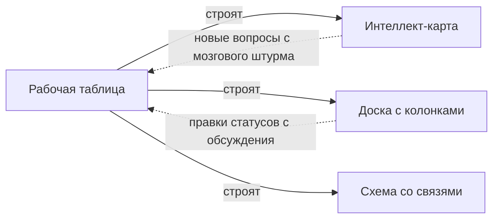
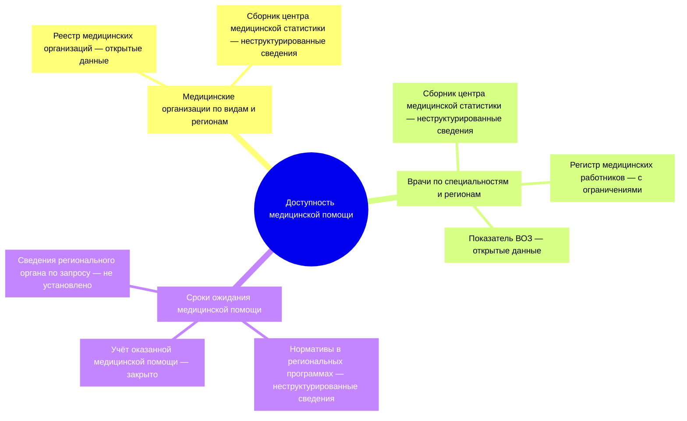
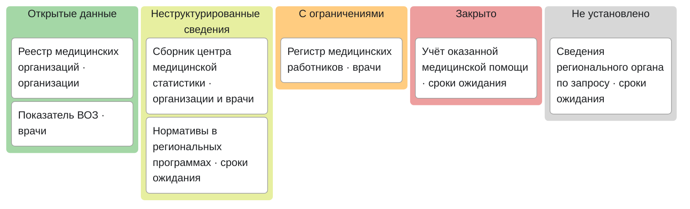

# Интеллект-карты и доски

Интеллект-карта и доска с колонками нужны, чтобы показать результат инвентаризации и обсудить его, а не чтобы его хранить. Сведения ведут в таблице, картинку строят из неё, а правки с обсуждения возвращают в таблицу в тот же день. Инструмент выбирают по трём вопросам: открывается ли он у всех участников, можно ли хранить в нём эти сведения и отдаёт ли он их в открытом формате. Облачный сервис может закрыться для целой страны, поэтому исходник всегда лежит в своей таблице.

Сведения проверены 25 октября 2026 года, если не указано иное.

## Коротко

| Форма | Что показывает и когда удобна | Чего не умеет |
|-------|-------------------------------|---------------|
| **[Интеллект-карта](#картинка-из-таблицы)** | Дерево «тема → вопрос → источник», доступность — словами и цветом. Показать результат заказчику на одном листе, провести мозговой штурм вопросов | Источник, который отвечает на несколько вопросов, повторяется в каждой ветке. Больше сотни узлов читается только с увеличением |
| **[Доска с колонками](#доска-с-колонками)** | Карточки в колонках: по статусам доступа, ведомствам или этапам. Обсудить доступность, вести ход опроса владельцев | Плохо держит иерархию и связи |
| **Схема со связями** | Граф систем, ресурсов и потоков между ними. Карты от продукта и по полномочиям, где один источник питает несколько продуктов | Раскладку доводят руками; при многих узлах линии путаются |
| **[Таблица](#рабочая-таблица)** | Строки и колонки. Вести, фильтровать, считать, проверять программой — первоисточник для всех картинок | Плохо показывает структуру руководителю |

Какой вид карты данных показывать какой формой, разобрано в главе [«Карты данных»](../02-approaches/04-data-maps.md#как-выбрать-вид-и-форму). Здесь — чем рисовать и как не потерять сведения по дороге.

## Чем рисовать

| Инструмент | Что это | Где хранятся сведения | Когда удобен |
|------------|---------|-----------------------|--------------|
| **[Xmind](https://xmind.com/)** | Приложение для интеллект-карт; импортирует Markdown, OPML и файлы FreeMind | Файл `.xmind`; у веб-версии — облако поставщика | Карта для печати и показа |
| **[Freeplane](https://www.freeplane.org/)** | Настольное приложение для интеллект-карт с открытым кодом; формат `.mm` общий с FreeMind | Файл на своём компьютере | Бесплатно, без облака — в том числе для карт закрытых систем |
| **[markmap](https://markmap.js.org/)** | Библиотека с открытым кодом: превращает Markdown в интерактивную карту в браузере | Текстовый файл | Карта хранится как текст рядом с документацией или в git |
| **[Mermaid](https://mermaid.js.org/)** | Схемы из текстового описания с открытым кодом, в том числе интеллект-карты и доски | Текст в странице или репозитории | Схемы на сайте и в репозитории — так нарисованы схемы этой книги |
| **Онлайн-доски** — Miro, Mural, FigJam | Совместные доски со стикерами, колонками и шаблонами карт | Облако поставщика | Обсуждение в распределённой команде, если сервис доступен всем |
| **[Excalidraw](https://excalidraw.com/)** | Доска для эскизов с открытым кодом; её можно развернуть на своём сервере | Файл `.excalidraw` или свой сервер | Схема со связями или доска без облака поставщика |
| **[Kanboard](https://kanboard.org/), [Wekan](https://wekan.fi/)** | Доски с колонками с открытым кодом | Свой сервер | Ход опроса и работ внутри организации |
| **Стикеры на стене** | Бумага, маркерная доска | Фотография | Мозговой штурм в одной комнате |

## Как выбрать инструмент

- **Доступен всем участникам** — из их страны и из сети их организации. Проверяют до встречи: у кого сервис не открылся, тот выпадает из обсуждения.
- **Разрешён для этих сведений.** Карта закрытых систем или перечень персональных данных в наборах бывают служебной информацией. Облако поставщика в другой стране — передача этих сведений за пределы организации, и решает её владелец данных, как и для внешних языковых моделей ([«Закрытые данные и внешние модели»](../02-approaches/03-ai.md#закрытые-данные-и-внешние-модели)). Для таких карт — настольное приложение или свой сервер.
- **Отдаёт открытый формат** — CSV, Markdown, OPML, `.mm`, а не только картинку и собственный файл. Иначе результат заперт в сервисе.
- **Принимает текст.** Если инструмент импортирует Markdown или файл FreeMind, карту строят из таблицы, а не рисуют.
- **Подходит формату встречи.** В одной комнате быстрее стикеры, в распределённой команде — общая доска.

:::warning[Облачный сервис может закрыться]
По письмам клиентам, о которых сообщили СМИ, с 15 октября 2026 года Miro закрыл доступ с российских и белорусских IP-адресов для всех тарифов. Закрыт и доступ к чужим доскам по гостевой ссылке. Условия может поменять и новый владелец: в сентябре 2026 года о покупке Miro договорилась Bending Spoons, которая в августе договорилась и о покупке Airtable.
:::

## Рабочая таблица

Картинку строят из рабочей таблицы — листов, в которые сведена инвентаризация. Для подхода «где найти нужное» это листы «Вопросы», «Источники» и «Связи», для подхода «чем владеем» — реестр с владельцами и полномочиями. Какие листы бывают и как они связаны идентификаторами, разобрано в главе [«Реестр как данные»](./03-registry-as-data.md#что-хранить), как устроить лист и защитить его от автозамены — в [«От таблицы до каталога метаданных»](./01-from-spreadsheet-to-catalog.md#как-устроить), шаблоны — в приложении [«Шаблоны»](../09-appendices/03-templates.md#карта-данных). Для картинки из этих правил важнее всего два: у каждой строки есть идентификатор, и статус записан кодом, а не цветом. Иначе картинку не пересобрать.

## Картинка из таблицы

Картинку строят из таблицы, а не наоборот, и правки идут обратно тоже через таблицу:



Интеллект-карта — дерево, и из трёх листов её собирают так: тема — корень, вопрос из листа «Вопросы» — ветка, источник из листа «Связи» — конечный узел ветки с доступностью этой пары. Вот три строки листа «Связи» условного примера ([links.csv](pathname:///templates/links.csv)):

```csv
question_n,source_id,status,status_basis,quality,quality_note,checked
2,med-workers-yearbook,unstructured,сборник на сайте центра,fit_with_caveats,нет деления на города и сёла,2026-10
2,med-workers-register,restricted,положение о системе,not_checked,выборки данных нет,2026-10
2,who-physicians,open,показатель скачан с сайта ВОЗ,fit_with_caveats,только по стране в целом,2026-10
```

Программа берёт текст вопроса 2 из листа «Вопросы», названия источников — из листа «Источники», а код статуса переводит в слова. Получается ветка карты в Markdown, где `##` — вопрос, а `###` — источник:

```markdown
## Где найти сведения о числе врачей по специальностям и регионам?

### Сборник центра медицинской статистики (неструктурированные сведения)
### Регистр медицинских работников (с ограничениями)
### Показатель ВОЗ (открытые данные)
```

Такую ветку открывают markmap и Xmind — импортом Markdown. Формат выбирают по инструменту:

- **Markdown из заголовков** — дерево и текст; markmap, Xmind.
- **Файл FreeMind `.mm`** — дерево, цвет узла и ссылка на адрес; Freeplane и FreeMind открывают его как свой, Xmind — импортом.
- **OPML** — дерево и текст; Xmind и программы для планов.
- **Текст Mermaid** — интеллект-карта или доска; сайты и редакторы, которые показывают Mermaid.

Цвет узла ставят по коду статуса, но статус пишут и словами: при импорте в другой инструмент цвет может пропасть. Такие файлы строят из листов таблицы небольшой программой — заново при каждой правке ([«Что из этого строится»](./03-registry-as-data.md#что-из-этого-строится)).

**Обратно — только через таблицу.** Если на обсуждении поправили картинку, правку вносят в таблицу и пересобирают картинку. Раскладку и оформление для печати доводят руками, содержание — нет. Если исходника нет и карта существует только картинкой, её переносят в таблицу вручную ([«Как перенести карту с картинки в данные»](./03-registry-as-data.md#как-перенести-карту-с-картинки-в-данные)).

**Сколько помещается.** Узлов на интеллект-карте больше, чем источников: узел — тема, каждый вопрос и каждая пара «вопрос — источник», поэтому источник, который отвечает на три вопроса, — три узла. Если вопросов больше 20 или узлов больше сотни, карту делят по типовым темам на несколько карт с общим списком источников ([«С типовыми темами»](../02-approaches/04-data-maps.md#с-типовыми-темами)).

## Доска с колонками

Колонка доски — значение одной колонки таблицы, карточка — строка. В инвентаризации встречаются две доски.

**Доска доступности.** Колонки — статусы [шкалы доступа](../03-process/06-access.md#шкала), от «открытые данные» до «не установлено», карточка — пара «вопрос — источник», а в описании карточки — основание и дата. Цвет колонки — от зелёного у открытых данных до красного у закрытых, а «не установлено» — серым: это не вывод о доступе, а вопрос, который ещё не закрыт. Сразу видно, что запрашивать или открывать первым. Источник, доступный для одного вопроса и закрытый для другого, попадает в две колонки ([«Чему ставить статус»](../03-process/06-access.md#чему-ставить-статус)). Колонками бывают и ведомства — тогда видно, у кого больше закрытого, а статус показывают цветом карточки и словами. Как выглядит доска по шкале, показано в [примере](#пример) ниже.

**Ход опроса владельцев.** Колонки — «не отправлено», «отправлено», «напомнили», «ответили», «интервью», «внесено в реестр», «без ответа»; карточка — адресат из листа «Адресаты». Доска показывает координатору, кому напомнить, но даты и итог пишут в таблицу ([«Как записать»](../03-process/04-questionnaires.md#как-записать)). Тогда охват опроса считается по таблице, а не по доске.

Как вести обсуждение на доске:

- **Доску готовят из таблицы.** Участники правят готовое, а не заполняют пустое: так быстрее, и правки видны как отличия от записанного. Исключение — мозговой штурм вопросов: там пустая доска с колонками по типовым темам ([«Мозговой штурм»](../03-process/02-goals-and-questions.md#мозговой-штурм)).
- **На карточке — идентификатор из таблицы.** Новой карточке идентификатор дают при переносе в таблицу, заодно проверяя, не записан ли этот источник под другим именем.
- **Переложить карточку — значит сменить статус, а для этого нужно основание**: кто сказал, какой документ, какая ссылка. Без основания статус — «не установлено», а на карточке — вопрос владельцу ([«Порядок проверки»](../03-process/06-access.md#порядок-проверки)).
- **Один человек переносит правки в таблицу** — во время обсуждения или в тот же день — и записывает в список изменений, что, на что и почему: «обсуждение 20 октября, со слов отдела статистики, нужна ссылка».
- **После переноса доску пересобирают из таблицы** или помечают датой и закрывают для правок. Онлайн-доску сразу выгружают к себе, стикеры в комнате фотографируют до того, как их снимут.

## Как не потерять результат

- **Первоисточник — таблица**, картинка — её показ. Если таблица и картинка расходятся, верна таблица.
- **Храните исходник в открытом формате**, а не только экспорт в картинку: CSV для таблицы, Markdown, OPML или `.mm` для карты. Экспорт карты в Markdown или OPML сохраняет дерево, но не цвета, поэтому доступность, отмеченную только цветом, придётся переписывать с картинки.
- **Копия и версии — у себя**, а не только в облаке сервиса: копии с датой или репозиторий git ([«История и версии»](./03-registry-as-data.md#история-и-версии)).

## Пример

**Где мы в примере.** Шаг 3: источники найдены ([«Поиск наборов данных»](../04-sources/05-dataset-search.md#условный-пример-доступность-медицинской-помощи)), у каждой пары «вопрос — источник» уже есть статус доступа ([«Доступ и ограничения»](../03-process/06-access.md#пример)); 15 вопросов руководства о доступности медицинской помощи в регионах. Для обсуждения с департаментом из листов «Вопросы», «Источники» и «Связи» построили три формы. Ниже — фрагмент: три вопроса, семь источников и восемь пар.

**Таблица.** В листе «Источники» каждый источник — одна строка, в листе «Связи» — строка на пару. Сборник центра медицинской статистики отвечает на два вопроса — о медицинских организациях и о врачах, — но описан один раз. Если центр перенесёт сборник на другой адрес, правят одну строку.

**Интеллект-карта.** Из тех же листов построен Markdown для markmap и Xmind, статус в узле записан словами. Сборник здесь — два узла в двух ветках: чтобы отметить его переезд на картинке, нужно найти и исправить оба.



**Доска.** Те же восемь пар на доске с колонками по шкале доступа. Сборник здесь одна карточка с двумя вопросами, а не два узла. Сразу видно, что по главному вопросу — о сроках ожидания — открытых данных нет: учёт оказанной помощи закрыт, нормативы есть только в текстах программ, а региональный орган ещё не ответил на запрос. С этим и идут к шестому шагу — договариваться о сводных данных ([«Доступ и ограничения»](../03-process/06-access.md#пример)).



Обе схемы — текст Mermaid в файле этой главы, строки для них взяты из листов по шаблонам [sources.csv](pathname:///templates/sources.csv) и [links.csv](pathname:///templates/links.csv). Пример показывает ход работы, а не то, как устроено здравоохранение в конкретной стране.

## Частые ошибки

| Ошибка | Что происходит | Как исправить |
|--------|----------------|---------------|
| **Правки остались на доске** | Через неделю доска и таблица расходятся, и неясно, какая верна | Переносить правки в таблицу в тот же день, доску пересобирать |
| **Одна карта на всё** | Больше сотни узлов: карта не помещается на экран, целиком её никто не читает | Несколько карт по типовым темам с общим списком источников |
| **Закрытые сведения в чужом облаке** | Описание закрытых систем передано поставщику без решения владельца | Настольное приложение или свой сервер для таких карт |

Сквозные ошибки — в главе [«Практики и антипаттерны»](../08-practices/01-practices-and-anti-patterns.md): [«Реестр только в отчёте или картинке»](../08-practices/01-practices-and-anti-patterns.md#реестр-только-в-отчёте-или-картинке), [«Статус доступа без основания»](../08-practices/01-practices-and-anti-patterns.md#статус-доступа-без-основания), [«Один набор под разными именами»](../08-practices/01-practices-and-anti-patterns.md#один-набор-под-разными-именами).

## Ограничения

- Интеллект-карта — дерево: связи между ветками и потоки данных она показывает плохо. Для карт по полномочиям и от продукта нужна схема со связями ([«Виды карт»](../02-approaches/04-data-maps.md#виды-карт)).
- Форматы обмена переносят дерево и текст, но не всё оформление: при импорте могут пропасть цвета, ссылки и ручная раскладка. Картинку для печати почти всегда доводят руками, и эту работу повторяют при каждой пересборке.
- Доступность сервисов в разных странах, их тарифы и владельцы меняются: перед выбором проверяйте заново.

## Источники

- [Miro окончательно закрыла Россию: не работают даже бесплатные аккаунты](https://www.securitylab.ru/news/578823.php) — SecurityLab, 16 октября 2026 года; [Miro ограничила россиянам доступ к аккаунтам, сайту и поддержке](https://ppc.world/news/miro-ogranichila-rossiyanam-dostup-k-akkauntam-saytu-i-podderzhke/) — ppc.world, 16 октября 2026 года, по письмам клиентам и сообщению ТАСС. Платное обслуживание пользователей из России и Беларуси Miro прекратил ещё в сентябре 2024 года.
- [Goodwin Advises Miro on $1.35 Billion Acquisition Agreement by Bending Spoons](https://www.goodwinlaw.com/en/news-and-events/news/2026/09/announcements-technology-goodwin-advises-miro-acquisition-agreement-bending-spoons) — Goodwin, 10 сентября 2026 года, закрытие сделки ожидается в IV квартале 2026 года; [Bending Spoons has entered into a definitive agreement to acquire Airtable for $1.285 billion](https://www.placera.se/pressmeddelanden/bending-spoons-bending-spoons-has-entered-into-a-definitive-agreement-to-acquire-airtable-for-1-285-billion-20260804) — пресс-релиз Bending Spoons, 4 августа 2026 года.
- Xmind: [импорт файлов](https://xmind.com/user-guide/import-new) и [импорт Markdown](https://xmind.com/help/import-markdown-file-windows) — руководство пользователя, октябрь 2026 года.
- [Freeplane](https://www.freeplane.org/), [документация](https://docs.freeplane.org/), код — [freeplane/freeplane](https://github.com/freeplane/freeplane), GPL 2.0; [markmap](https://github.com/markmap/markmap), MIT; Mermaid — [интеллект-карты](https://mermaid.js.org/syntax/mindmap.html) и [доски](https://mermaid.js.org/syntax/kanban.html), версия 12.2, MIT; [Excalidraw](https://github.com/excalidraw/excalidraw), [Kanboard](https://github.com/kanboard/kanboard), [Wekan](https://github.com/wekan/wekan) — MIT. Лицензии — по репозиториям на 25 октября 2026 года.
