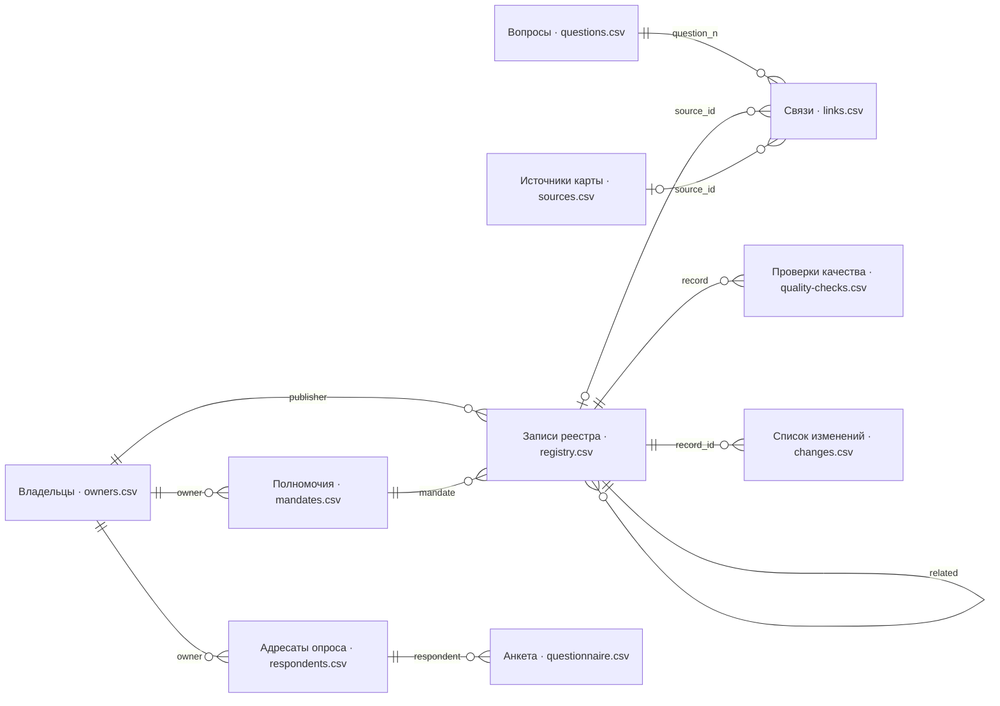
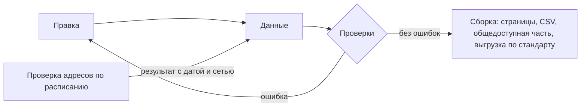

# Реестр как данные

Первоисточник результата инвентаризации — файлы с данными, а не отчёт, презентация или картинка. Отчёт нельзя проверить программой, сравнить с прошлой версией, отфильтровать по владельцу или выгрузить в каталог; файл можно. Реестр раскладывают на связанные таблицы с постоянными идентификаторами, рядом кладут схему, а программа проверяет каждую правку и строит из данных страницы, таблицы и выгрузки. Историю хранит git или копии с датой.

Сведения проверены 25 октября 2026 года, если не указано иное.

## Коротко

| Что сделать | Что получается | Готово, когда |
|-------------|----------------|---------------|
| **[Разложить реестр на таблицы](#что-хранить)** | Записи, владельцы, полномочия, вопросы, связи — каждая вещь в своей таблице | Ни одно сведение не записано в двух местах; связь «вопрос — набор» — отдельная строка |
| **[Дать идентификаторы](#идентификаторы)** | Постоянный код у каждой строки | Ссылки идут по коду, а не по названию или адресу |
| **[Выбрать формат](#формат)** | Таблица, CSV, YAML, JSON или база — под тех, кто правит | Файл читает программа без ручной подготовки |
| **[Описать схему](#схема)** | Файл схемы: поля, обязательность, справочники, форматы | Схема лежит рядом с данными, и по ней проверяют каждую версию |
| **[Настроить проверки](#проверки)** | Программа, которая запускается при каждой правке | Ошибка останавливает публикацию; предупреждения разбирает человек |
| **[Строить из данных](#что-из-этого-строится)** | Страницы, таблицы, CSV, общедоступная часть, выгрузка по стандарту | Ни одно представление не правят руками |
| **[Хранить историю](#история-и-версии)** | Репозиторий git или версии с датой, копия в другом месте | Любую прошлую версию можно восстановить и сравнить с текущей |

## Почему данные, а не документ

| Что нужно | Реестр в отчёте или на картинке | Реестр в файлах |
|-----------|---------------------------------|-----------------|
| Найти пустые поля и повторы | Перечитать глазами | Программа находит за секунды, при каждой правке |
| Узнать, что изменилось с прошлой версии | Сравнить два документа вручную | Построчное сравнение версий |
| Отобрать наборы одного владельца или с персональными данными | Переписать в новую таблицу | Фильтр или запрос |
| Обновить адрес источника, который есть на нескольких картах | Править каждую карту | Одна строка в общем списке источников |
| Опубликовать общедоступную часть или выгрузить в каталог | Набрать заново | Выборка записей и полей, выгрузка программой |
| Восстановить после потери | Переносить с картинки, если исходник не сохранился | Взять копию репозитория |

Последняя строка — не теория. После пожара в центре обработки данных Южной Кореи 26 сентября 2025 года список пострадавших систем сначала собрали по спискам мониторинга и памяти сотрудников — 647 систем. Когда восстановили систему, где хранился полный список, и сверили его с министерствами, систем оказалось 709 ([«Южная Корея»](../07-countries/06-south-korea.md#пример)). Опись, которая лежит только внутри описываемой системы, пропадает вместе с ней.

## Что хранить

Реестр — не одна большая таблица, а несколько связанных. В каждой строка описывает одну вещь, а линия на схеме — ссылку по идентификатору; подпись у линии — колонка, в которой ссылка записана. Шаблоны всех таблиц — в приложении [«Шаблоны»](../09-appendices/03-templates.md).



Системы, ресурсы и группы — строки того же листа записей с другим типом записи, а связи между записями — агрегат, копия, преемник — пишут в колонке `related`. Журнал поиска ([searches.csv](pathname:///templates/searches.csv)) ссылается на вопросы и найденные записи. Подходу «чем владеем» хватает владельцев, полномочий, записей и опроса; подходу «где найти нужное» нужны вопросы, источники и связи. Начинают с нескольких листов и добавляют остальные, когда в них появляется что записать.

Правила:

- **Каждая вещь описана один раз.** Владелец — строкой в таблице владельцев, а не текстом в сотне записей; источник — строкой в общем списке, а не в каждой карте. При переименовании правят одну строку.
- **Связь — своя строка со своими атрибутами.** Один источник бывает доступен для одного вопроса и закрыт для другого, годится для одной задачи и не годится для другой. Поэтому статус доступа и итог проверки качества записывают у пары, а не у источника ([«Чему ставить статус»](../03-process/06-access.md#чему-ставить-статус)).
- **Несколько значений — через «;» или отдельной таблицей.** Синонимы пишут в одной ячейке; если у значения есть свои атрибуты — дата, основание, — это отдельная таблица.
- **Наблюдения хранят, производные строят.** Результат проверки адреса или качества на дату нельзя получить заново: через месяц сайт ответит иначе. Его хранят с датой и тем, откуда проверяли. Таблицы для страниц, CSV и сводки получают из данных в любой момент — их строят ([ниже](#что-из-этого-строится)).
- **Записи не удаляют.** Исчезнувшему набору меняют статус и добавляют ссылку на копию в веб-архиве ([«Строку удаляют, когда источник исчез»](../08-practices/01-practices-and-anti-patterns.md#строку-удаляют-когда-источник-исчез)).
- **Общедоступная часть — выборка, а не вторая копия.** Её строит программа из полного реестра ([«Полный реестр и общедоступная часть»](../03-process/09-result-and-upkeep.md#полный-реестр-и-общедоступная-часть)).

## Идентификаторы

Идентификатор — постоянный код строки, на который ссылаются другие таблицы.

- **Не адрес и не название.** Сайт переезжает, ведомство переименовывают, а ссылки на запись должны остаться. Сайт Министерства здравоохранения Казахстана с октября 2019 года сменил адрес трижды ([«Что случилось с адресом»](../04-sources/06-legacy.md#что-случилось-с-адресом)). Если код не зависит от адреса, при переезде правят адрес и синонимы в одной строке, а связи и карты не меняются.
- **Латиница, цифры и дефис.** Такой код без ошибок переносится между программами, в адреса страниц и имена файлов. В шаблонах книги у сайта это домен с дефисами вместо точек — `egrul-nalog-ru`, у набора — короткое название: `faa-aircraft-registry`.
- **Не переиспользовать.** Код исчезнувшей записи не отдают новой: запись остаётся со статусом и ссылкой на веб-архив.
- **Префикс, если записи ведут несколько команд.** Два региона назвали свои листы ожидания одинаково — `waiting-list`, и проверка уникальности отклонила обе записи ([«Data Mesh»](../05-frameworks/03-data-mesh.md#пример)). С префиксом команды такого не бывает.

Удобный код и постоянный код — не обязательно одно и то же. В реестре каталогов Dateno у каждой записи читаемый `id`, совпадающий с именем файла, и `uid` вида `cdi00001085`, уникальный во всём реестре ([ниже](#большой-реестр-реестр-каталогов-dateno)). Тот же совет даёт комитет по номенклатуре генов человека HGNC: обозначения генов иногда меняются, поэтому в данных указывают постоянный номер — у гена SEPTIN1, бывшего SEPT1, это HGNC:2879 ([«Как таблица портит данные»](./01-from-spreadsheet-to-catalog.md#как-таблица-портит-данные)).

## Формат

Формат выбирают под тех, кто будет править реестр, а не под тех, кто будет его читать: читателю нужное построят из данных.

| Формат | Кому удобно | Сильные стороны | Слабые стороны |
|--------|-------------|-----------------|----------------|
| **Электронная таблица** | Составителям и владельцам, которые не пишут код | Привычно; раскрывающиеся списки; совместная правка | Сама меняет значения; версии плохо сравниваются |
| **CSV** | Обмену между программами, публикации, хранению в git | Читает любая программа; версии сравниваются построчно | Нет типов и вложенности; открытый в Excel файл портится при сохранении |
| **YAML** | Небольшому реестру, который правят руками и хранят в git | Вложенные списки; комментарии; читается человеком | Ошибка в отступе меняет смысл; для тысяч строк неудобен |
| **JSON** | Программам и программным интерфейсам | Стандарт обмена; в нём публикуют инвентари по DCAT-US | Руками править неудобно; комментариев нет |
| **База** — SQLite, DuckDB, PostgreSQL | Большому реестру с запросами и несколькими авторами | Ключи и ограничения проверяются при каждой записи | Нужен тот, кто её ведёт; историю версий делают отдельно |
| **Каталог метаданных** | Тысячам таблиц в подключённых системах | Сам собирает описания из систем | Не видит неподключённого и ничего не знает о полномочиях |

Как устроить электронную таблицу, чтобы из неё читала программа, и как защитить её от автозамены, разобрано в главе [«От таблицы до каталога метаданных»](./01-from-spreadsheet-to-catalog.md#как-устроить). Там же — табличные базы данных и каталоги метаданных. В реестре каталогов Dateno выбран YAML — по файлу на каталог, а для поиска и подсчётов из тех же файлов собирают общие наборы.

## Схема

Схема описывает, какой должна быть таблица: какие колонки есть, какие обязательны, какие значения допустимы, в каком формате даты, что не может повторяться и на что ссылается. Она лежит рядом с данными, и её читают и люди, и программы. Стандартных способов записать схему три:

- **Table Schema** проекта Frictionless Data — для таблиц CSV: типы, обязательность, справочники, шаблоны значений, уникальность, первичный и внешние ключи;
- **CSV on the Web** (W3C) — то же и связь колонок со словарями, например с DCAT;
- **JSON Schema** — для файлов JSON и YAML, в том числе вложенных.

Во Франции общие схемы таблиц собраны на schema.data.gouv.fr — 106 схем, по которым ведомства и местные органы публикуют однотипные данные ([«Франция»](../07-countries/04-france.md#datagouvfr-и-эталонные-данные)). Своя схема реестру нужна по той же причине: все, кто ведёт записи, проверяют их по одним правилам.

Полная схема шаблона реестра книги — [registry.schema.json](pathname:///templates/registry.schema.json) в формате Table Schema: все 33 колонки, 16 из них обязательны (14 атрибутов, дата проверки и «откуда известно»). В схеме есть справочники режима доступа, периодичности, типа записи, персональных данных и статуса, а также шаблоны для идентификатора, дат и связей. Так описана колонка режима доступа:

```json
{
  "name": "access_level",
  "title": "Режим доступа",
  "type": "string",
  "constraints": {"required": true, "enum": ["open", "unstructured", "restricted", "closed", "unknown"]}
}
```

Даты публикации и изменения в схеме — не тип «дата», а строка по шаблону: вместо даты допустимы «нет» и «не установлено» с пояснением ([«Если сведение не найдено»](../03-process/05-registry.md#если-сведение-не-найдено)). Шаблон [registry.csv](pathname:///templates/registry.csv) проходит проверку по схеме без ошибок. Чтобы показать, что ловит схема, в копию шаблона внесли пять типичных ошибок, и проверка нашла все пять:

| Что внесли | Что ответила проверка |
|------------|-----------------------|
| Режим доступа «откр.» вместо `open` | Значение не из справочника |
| Пустой ответственный | Не заполнено обязательное поле |
| Дата изменения «01.06.2026» | Значение не по шаблону |
| Связь «агрегат med-workers-register» вместо `aggregate_of:med-workers-register` | Значение не по шаблону |
| Второй сборник с идентификатором регистра | Повтор идентификатора |

<details>
<summary>Проверить самому</summary>

Проверка — программой [Frictionless](https://framework.frictionlessdata.io/), версия 5.21.0, 25 октября 2026 года:

```bash
pip install frictionless
frictionless validate registry.csv --schema registry.schema.json
```

</details>

Схема видит одну строку и одну колонку. Она не заметит, что связь ведёт на несуществующую запись `aggregate_of:med-workers-regster`, что дата изменения раньше даты публикации и что адрес давно не отвечает. Это проверяют правилами в программе ([«Проверки»](#проверки)). Ссылки между таблицами Table Schema умеет проверять внешними ключами, если таблицы описаны вместе, в одном пакете данных.

## Проверки

Проверки программой — первая ступень [проверки перед публикацией](../03-process/09-result-and-upkeep.md#проверка): всё, что можно проверить без человека. Их удобно делить на четыре уровня:

| Уровень | Что считать ошибкой | Чем и когда |
|---------|---------------------|-------------|
| **Строка** | Пусто обязательное поле; код не из справочника; идентификатор не из латиницы, цифр и дефисов; дата не по ISO 8601, в будущем или раньше публикации | Схема и правила программы — при каждой правке |
| **Таблица** | Повтор идентификатора или его совпадение с синонимом другой записи; пара «вопрос — источник» записана дважды; вопросы пронумерованы не по порядку | Схема и правила — при каждой правке |
| **Связи** | Нет владельца, полномочия или связанной записи, на которые ссылается строка; у группы не записан состав; в списке источников есть строка без связей | Правила программы или внешние ключи пакета данных — при каждой правке |
| **Внешний мир** | Адрес не отвечает; данные старше, чем обещает периодичность; владельца нет в действующем перечне органов; набор есть в каталоге или на портале, но не в реестре | Отдельная программа по расписанию; результат — с датой и сетью |

**Сообщение об ошибке** называет файл, строку и что не так: «links.csv, строка 12: источник egrul-nalog-r не описан в sources.csv». Тогда по нему исправляют, не открывая программу. Если ошибок нет, полезно печатать сводку — сколько записей, источников и связей проверено: по ней видно, что проверка прошла по всем файлам.

**Ошибки и предупреждения.** Ошибка останавливает публикацию. Предупреждение — повод посмотреть человеку. Пример — один адрес у нескольких записей: так бывает, когда в исходном документе у сервисов записаны только фрагменты адресов и всем оставили адрес главного сайта. Это не опечатка, а пробел, который закрывают при сверке. Так же и с совпадением названия и владельца у двух записей: это может быть дубль, а может — два выпуска одного ряда ([«Один набор под разными именами»](../03-process/05-registry.md#один-набор-под-разными-именами)).

**Когда запускать.** При каждой правке, а не перед публикацией: тогда ошибку исправляет тот, кто её сделал, пока помнит, что хотел записать. Проверку связывают со сборкой — страницы и файлы для скачивания строятся только из данных без ошибок:



**Что решает человек.** Программа говорит, что адрес умер или дата устарела, но не говорит почему. Переехал ли сайт, закрыли ли систему, забыли ли обновить дату — решает человек. Языковая модель может сравнить новую редакцию акта или сайта с прежней и показать, какие записи перепроверить ([«Когда применять»](../02-approaches/03-ai.md#когда-применять)), но и её вывод проверяет человек.

## Проверка адресов

Адреса проверяет отдельная программа: она проходит по всем адресам реестра по расписанию и для каждого записывает:

1. **есть ли домен** — с www и без www: бывает, что пропал только поддомен;
2. **что отвечает сайт** — код ответа, ошибка сертификата или отсутствие ответа за отведённое время;
3. **куда перенаправляет** — все шаги до конечного адреса и тот ли это домен;
4. **когда и откуда** — дату проверки и сеть.

Результат — наблюдение на дату, его хранят рядом с данными, в отдельном файле, по строке на адрес. Ответы удобно свести к справочнику:

| Результат | Что значит | Что делать |
|-----------|------------|------------|
| Открывается | Сайт ответил | Проверить, что на нём тот же ресурс |
| Перенаправляет | Ведёт на другой адрес или домен | Проверить, тот же ли владелец и ресурс на конечном адресе |
| Ошибка | Ответил ошибкой: 403, 404, 503 и другие | Перепроверить из сети страны; при 404 искать страницу на сайте и в веб-архиве |
| Ошибка сертификата | Сертификат просрочен или ему не доверяют за пределами страны | Перепроверить из сети страны |
| Не ответил | Таймаут или отказ в соединении | Перепроверить позже и из сети страны |
| Домена нет или у него нет адреса | Система доменных имён не знает такого домена или адреса | Веб-архив, затем преемник по документам |

Программа должна уметь перепроверять отдельные записи, не трогая остальные результаты, — после исправления адреса или из другой сети. Почему «не ответил» из-за рубежа не значит «исчез», как проверить, чей сайт на конечном адресе, и что записать в реестр — в главе [«Исчезнувшие системы и веб-архивы»](../04-sources/06-legacy.md#как-проверить-адрес). Программа делает только первые шаги этого порядка. В реестре каталогов Dateno такая программа раз в неделю проверяет, живы ли каталоги, и сохраняет отчёт.

## Что из этого строится

Программа читает данные и строит:

- **таблицу «вопрос — источник — статус»** для каждой карты или темы и **список пробелов** — вопросов без доступного источника;
- **таблицу источников** — каждый источник один раз, с номерами вопросов и результатом проверки адреса;
- **числа для паспорта** и **список изменений** из разницы версий;
- **CSV для скачивания**, **общедоступную часть** по правилу из паспорта и **выгрузку по стандарту** — DCAT, DCAT-AP или DCAT-US ([«Сопоставление с реестром»](../05-frameworks/02-metadata-standards.md#сопоставление-с-реестром));
- **интеллект-карты и доски** — Markdown, файл FreeMind `.mm` или текст Mermaid ([«Картинка из таблицы»](./02-mindmaps-and-boards.md#картинка-из-таблицы));
- **отчёт и справку** — таблицы и числа в них тоже из данных, а не набраны заново.

Построенные файлы в репозитории не хранят: их строят заново при каждой сборке, поэтому таблицы на страницах всегда совпадают с данными. В начале такого файла пишут, что он построен программой и руками его не правят. Исправление прямо в таблице страницы пропадёт при следующей сборке — и это правильно.

**Запрос вместо отчёта.** Реестру в файлах можно задать вопрос, о котором при составлении никто не думал. Например: на какие вопросы не осталось ни одной действующей записи — все связанные с ними записи выведены из оборота или потеряли адрес? Ответ — список вопросов, к источникам которых надо вернуться в первую очередь: искать преемника, копию в веб-архиве или другой источник ([«Где искать»](../04-sources/06-legacy.md#где-искать)). Из отчёта такой список пришлось бы собирать руками, перечитывая каждый вопрос, а по листам из шаблонов книги это один запрос.

<details>
<summary>Проверить самому</summary>

Запрос для [DuckDB](https://duckdb.org/) по листам [questions.csv](pathname:///templates/questions.csv), [links.csv](pathname:///templates/links.csv) и [registry.csv](pathname:///templates/registry.csv):

```sql
SELECT q.n, q.text
FROM 'questions.csv' q
JOIN 'links.csv' l ON l.question_n = q.n
JOIN 'registry.csv' r ON r.id = l.source_id
GROUP BY q.n, q.text
HAVING bool_and(r.status IN ('retired', 'url_broken'));
```

</details>

## История и версии

Что делать с версиями — не удалять записи, выпускать версию с датой и списком изменений, — разобрано в главе [«Результат и поддержка»](../03-process/09-result-and-upkeep.md#версии-и-список-изменений). Здесь — как это устроить. Проще всего хранить данные в репозитории git: он помнит каждую правку с датой, автором и комментарием и показывает разницу между любыми двумя версиями.

- **Одна вещь — одна строка.** Тогда разница между версиями читается: изменился статус доступа пары — изменилась одна строка листа «Связи».
- **Комментарий к правке — почему.** Не «обновил данные», а «перепроверены адреса из сети страны» или «владелец подтвердил периодичность». Из комментариев и разницы версий собирают список изменений для пользователей.
- **Выпуск — с меткой.** На каждую версию — `2026-10` или номер, как v1.27.0 у реестра каталогов Dateno, — ставят метку в репозитории, чтобы ссылка на версию не менялась.
- **Копия — в другом месте.** Удалённый репозиторий или выгрузка на другой сервер.

Если записи лежат по файлу на запись, история каждой записи видна отдельно. Если git для команды — барьер, версии хранят копиями с датой в имени: `registry-2026-10.csv`, `registry-2027-04.csv`. Сравнивать их сложнее, но прошлая версия хотя бы не потеряется.

## Кто правит и как

Хранить реестр в файлах не значит, что править его должны программисты. Составитель или ответственный правит данные, владелец процесса принимает правки и выпускает версии ([«Кто отвечает после публикации»](../03-process/09-result-and-upkeep.md#кто-отвечает-после-публикации)), а программа проверяет каждую правку и строит остальное. Правку организуют одним из трёх способов — от простого к надёжному:

1. **Общая таблица** с раскрывающимися списками и защищённой строкой заголовков. Владелец процесса выгружает её в CSV, проверяет программой и кладёт версию в репозиторий. Просто, но ошибка обнаружится только при выгрузке.
2. **Файлы в репозитории, правка через веб-интерфейс.** GitHub и GitLab позволяют править файл в браузере и предложить правку запросом на слияние. Проверка запускается на каждый запрос, а владелец процесса видит разницу и принимает её. Так проверяются правки в реестре каталогов Dateno.
3. **Форма или каталог**, которые пишут в базу и проверяют значения при вводе. Такой способ нужен, когда записей тысячи, а авторов десятки ([«Федеративный инвентарь США»](../05-frameworks/03-data-mesh.md#федеративный-инвентарь-сша)).

Полный реестр — данные с режимом доступа ([«Полный реестр и общедоступная часть»](../03-process/09-result-and-upkeep.md#полный-реестр-и-общедоступная-часть)). Его хранят в закрытом репозитории или внутренней системе, а в открытый кладут только общедоступную часть, которую строит программа. Реестр, собранный только из общедоступных сведений, можно держать открытым целиком, как реестр каталогов Dateno.

## Большой реестр: реестр каталогов Dateno

Реестр каталогов Dateno — тот же подход в большом масштабе; это проект автора книги. В нём десятки тысяч каталогов данных — порталов открытых данных, геопорталов, научных репозиториев ([«Поиск наборов данных»](../04-sources/05-dataset-search.md#инструменты)). Устройство на 25 октября 2026 года:

- **Запись — файл YAML.** Каждый каталог — отдельный файл в папке страны и вида каталога: портал открытых данных Казахстана — `data/entities/KZ/Federal/opendata/dataegovkz.yaml`.
- **Схема — JSON Schema.** Она описывает 25 полей, девять из них обязательны. Статус — из справочника: `active`, `inactive`, `scheduled`, `deprecated`; устаревший каталог не удаляют, а меняют ему статус.
- **Проверки — на каждое изменение.** При каждом изменении основной ветки и каждом запросе на слияние все файлы проверяются по схеме, затем запускаются тесты.
- **Производные — сборкой.** Из файлов собираются общие наборы — JSONL, Parquet, база DuckDB — и выпускаются версиями.

Файл на запись удобен тем, что две правки разных каталогов никогда не конфликтуют, а история каждого каталога видна отдельно. Цена — десятки тысяч файлов: искать и считать по ним удобнее в собранных наборах.

## Как перенести карту с картинки в данные

Бывает, что исходника нет и карта сохранилась только картинкой: интеллект-картой, картой для печати, снимком доски. Тогда её переносят в листы «Вопросы», «Источники» и «Связи» вручную. Вот ветка такой картинки из условного примера — цвет узла означает доступность, легенды на картинке нет:

```text
Врачи по спец-тям и регионам
├── Сборник ЦМС ................ жёлтый
├── Регистр мед. работников .... оранжевый
├── ВОЗ ........................ зелёный
└── ЦМС — сборник .............. жёлтый
```

После переноса — три строки в листе «Связи» вместо четырёх узлов. Сборник записан один раз, оба его названия с картинки ушли в синонимы листа «Источники», а цвет без легенды не стал статусом:

```csv
question_n,source_id,status,status_basis,quality,quality_note,checked
2,med-workers-yearbook,unknown,на картинке жёлтый без легенды; узел повторён дважды,not_checked,,2026-10
2,med-workers-register,unknown,на картинке оранжевый без легенды,not_checked,,2026-10
2,who-physicians,unknown,на картинке зелёный без легенды,not_checked,,2026-10
```

Порядок:

1. **Выписать как есть.** Вопросы, источники и отметки — дословно, с сокращениями и опечатками. Исправляют потом, и каждое исправление записывают.
2. **Решить, какой картинке в чём верить**, если их несколько: полные формулировки бывают только на одной, легенда — только на другой. Что откуда взято, записывают в паспорт.
3. **Записать расхождения, а не выбирать молча.** Если цвет нечем расшифровать или на одной картинке пара есть, а на другой нет, статус — «не установлено» (`unknown`) с пояснением. Статусы с картинки потом проверяют заново ([«Порядок проверки»](../03-process/06-access.md#порядок-проверки)).
4. **Убрать дубли и объединить синонимы.** Источник, указанный в вопросе дважды, — одна связь; другие названия — в синонимы.
5. **Дать идентификаторы** — по правилам [выше](#идентификаторы).
6. **Проверить программой**, а затем сверить выборку строк с картинкой глазами.

Владельцев на картинках обычно нет. Если их заполняют по домену сайта, такие записи помечают как не сверенные по документам: домен показывает, кто держит сайт, а не кто отвечает за данные ([«Владелец, оператор, ответственный»](../03-process/03-owners-and-mandates.md#владелец-оператор-ответственный)). Тот же порядок годится для переноса реестра из документа или презентации. Решения при переносе — тоже данные: без них через год не понять, откуда в реестре взялась строка.

## Пример

**Где мы в примере.** После шага 7 ([«Результат и поддержка»](../03-process/09-result-and-upkeep.md#условный-пример-доступность-медицинской-помощи)): реестр о доступности медицинской помощи в регионах опубликован. Листы по шаблонам книги лежат в закрытом репозитории министерства, а общедоступную часть и таблицы для департамента строит программа.

**Правка мимо данных.** Через месяц сотрудник департамента исправил ссылку на сборник прямо в опубликованной таблице общедоступной части. При следующей сборке исправление пропало: таблица строится из `registry.csv`. В паспорт записали правило — правят только данные, а под опубликованной таблицей появилась ссылка «Сообщить об ошибке».

**Вопрос вместо отчёта.** Заместитель министра спросил, на какие вопросы можно ответить только по закрытым данным. Запрос к `links.csv` и `registry.csv` ответил за несколько минут: такой вопрос один — о сроках ожидания, у всех его источников режим «с ограничениями» или «закрыто». Ответ сошёлся с планом: по этому вопросу договариваются о сводных данных вместо записей ([«Пробелы и план»](../03-process/08-gaps-and-plan.md#пример)). Пример показывает ход работы, а не то, как устроено здравоохранение в конкретной стране.

## Частые ошибки

| Ошибка | Что происходит | Как исправить |
|--------|----------------|---------------|
| **Всё — ошибки** | Сборка падает из-за того, что надо просто посмотреть, и проверку отключают | Ошибки и предупреждения отдельно |
| **Производные файлы в репозитории** | Таблица и данные расходятся, неясно, чему верить | Строить при сборке; хранить только данные и наблюдения |
| **Результат проверки без даты и сети** | «Не ответил» принимают за «исчез» | Дата и сеть в файле результатов |

Сквозные ошибки — в главе [«Практики и антипаттерны»](../08-practices/01-practices-and-anti-patterns.md): [«Реестр только в отчёте или картинке»](../08-practices/01-practices-and-anti-patterns.md#реестр-только-в-отчёте-или-картинке), [«Один набор под разными именами»](../08-practices/01-practices-and-anti-patterns.md#один-набор-под-разными-именами), [«Сдали и забыли»](../08-practices/01-practices-and-anti-patterns.md#сдали-и-забыли).

## Ограничения

- Программа ловит форму, а не правду. Запись с верным кодом и неверным владельцем пройдёт любую проверку; владельцев, режимы доступа и качество сверяют по документам и самим данным.
- Файлы и git — порог для тех, кто знает данные, но не работает с репозиториями. Его снимают таблицей с выгрузкой или правкой в браузере, но владелец процесса должен уметь работать с файлами.
- Когда записей тысячи, а авторов десятки, файлы в одном репозитории перестают справляться: нужен каталог метаданных или федеративный сбор с проверкой при сборе ([«Data Mesh»](../05-frameworks/03-data-mesh.md)).

## Источники

- Шаблоны [registry.csv](pathname:///templates/registry.csv) и [registry.schema.json](pathname:///templates/registry.schema.json) — проверены Frictionless 5.21.0 25 октября 2026 года.
- Frictionless Data. [Data Package v2 и Table Schema](https://datapackage.org/), 26 июня 2024 года; [Frictionless Framework](https://framework.frictionlessdata.io/). W3C. [Model for Tabular Data and Metadata on the Web](https://www.w3.org/TR/tabular-data-model/), 17 декабря 2015 года. [JSON Schema 2020-12](https://json-schema.org/draft/2020-12). [schema.data.gouv.fr](https://schema.data.gouv.fr/) — 106 схем на 25 октября 2026 года, по главе «Франция».
- [datenoio/dataportals-registry](https://github.com/datenoio/dataportals-registry) — реестр каталогов Dateno: структура папок (225 папок стран), схема `data/schemes/catalog.schema.json` (JSON Schema 2020-12), проверки в GitHub Actions, еженедельная проверка каталогов по воскресеньям, выпуск v1.27.0 от 15 октября 2026 года с наборами `full.jsonl` и `full.parquet`, 43 614 каталогов на ту же дату — проверено 25 октября 2026 года.
- Bruford E. A. et al. [Guidelines for human gene nomenclature](https://doi.org/10.1038/s41588-020-0669-3). Nature Genetics, 2020, 52: 754–758 — совет указывать номер HGNC; дата переименования SEPTIN1 (4 апреля 2019 года) и номер HGNC:2879 — по [genenames.org](https://www.genenames.org/), 25 октября 2026 года.
- [DuckDB](https://duckdb.org/docs/) — запрос из раздела «Что из этого строится» проверен на шаблонах книги в версии 1.5.
