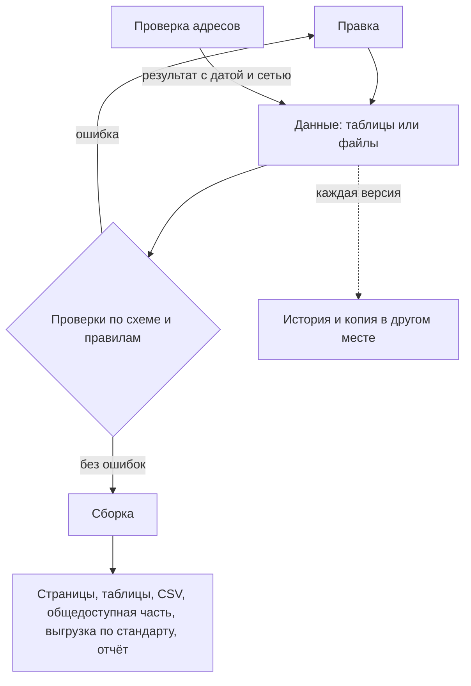

# Реестр как данные

Первоисточник результата инвентаризации — файлы с данными, а не отчёт, презентация или картинка. Отчёт нельзя проверить программой, сравнить с прошлой версией, отфильтровать по владельцу или выгрузить в каталог; файл можно. Реестр раскладывают на таблицы — записи, владельцы, полномочия, вопросы, связи, — в которых каждая вещь описана один раз, а ссылки идут по постоянному идентификатору. Формат выбирают под тех, кто правит: таблицу с раскрывающимися списками, CSV, YAML или базу. Рядом с данными лежит схема — какие поля обязательны и какие значения допустимы, — а программа проверяет данные при каждой правке и останавливает публикацию при ошибке. Страницы, таблицы, CSV для скачивания, общедоступную часть и выгрузку по стандарту строят из данных и руками не правят. Историю хранит git или версии с датой. Так устроен реестр каталогов Dateno: каждый каталог — отдельный файл YAML, каждая правка проверяется по схеме, а общие наборы для поиска и подсчётов собираются из файлов и выпускаются версиями ([ниже](#большой-реестр-реестр-каталогов-dateno)).

## Коротко

| Что сделать | Что получается | Готово, когда |
|-------------|----------------|---------------|
| **[Разложить реестр на таблицы](#что-хранить)** | Записи, владельцы, полномочия, вопросы и связи — каждая вещь в своей таблице | Ни одно сведение не записано в двух местах; связь «вопрос — набор» — отдельная строка |
| **[Дать идентификаторы](#идентификаторы)** | Постоянный код у каждой строки | Ссылки идут по коду, а не по названию или адресу; при переезде сайта код не меняется |
| **[Выбрать формат](#формат)** | Таблица, CSV, YAML, JSON или база — под тех, кто правит | Файл читает программа без ручной подготовки; правят его те, кто знает данные |
| **[Описать схему](#схема)** | Файл схемы: поля, обязательность, справочники, форматы | Схема лежит рядом с данными, и по ней проверяют каждую версию |
| **[Настроить проверки](#проверки)** | Скрипт или валидатор, который запускается при каждой правке | Ошибка останавливает сборку или публикацию; предупреждения разбирает человек |
| **[Строить из данных](#что-из-этого-строится)** | Страницы, таблицы, CSV, общедоступная часть, выгрузка по стандарту | Ни одно представление не правят руками; правка — только в данных |
| **[Хранить историю](#история-и-версии)** | Репозиторий git или версии с датой, копия в другом месте | Любую прошлую версию можно восстановить и сравнить с текущей |



## Почему данные, а не документ

Реестр в отчёте и реестр в файлах содержат одни и те же сведения, но делать с ними можно разное:

| Что нужно | Реестр в отчёте или на картинке | Реестр в файлах |
|-----------|---------------------------------|-----------------|
| Найти пустые поля и повторы | Перечитать глазами | Программа находит за секунды, при каждой правке |
| Узнать, что изменилось с прошлой версии | Сравнить два документа вручную | Построчное сравнение версий |
| Отобрать наборы одного владельца или с персональными данными | Переписать в новую таблицу | Фильтр или запрос |
| Обновить адрес источника, который есть на нескольких картах | Править каждую карту и не пропустить ни одной | Одна строка в общем списке источников |
| Выгрузить в каталог по DCAT | Набрать заново | Скрипт выгрузки ([«Как выгрузить и проверить»](../05-frameworks/02-metadata-standards.md#как-выгрузить-и-проверить)) |
| Опубликовать общедоступную часть | Вести вторую копию | Выборка записей и полей ([«Полный реестр и общедоступная часть»](../03-process/08-result-and-upkeep.md#полный-реестр-и-общедоступная-часть)) |
| Восстановить после потери | Переносить с картинки, если исходник не сохранился | Взять копию репозитория |

Последняя строка — не теория. В Южной Корее после пожара в центре обработки данных 26 сентября 2025 года список пострадавших систем сначала собрали по спискам мониторинга и памяти сотрудников — 647 систем. Полный список хранился в системе управления эксплуатацией центра, которую пришлось восстанавливать вместе с остальными; после её восстановления и сверки с министерствами систем оказалось 709 ([«Южная Корея»](../07-countries/06-south-korea.md#пример)). Опись, которая лежит только внутри описываемой системы, пропадает вместе с ней.

## Что хранить

Реестр — не одна большая таблица, а несколько связанных. В каждой строка описывает одну вещь, а связи между вещами — отдельные строки со своими атрибутами. Шаблоны всех таблиц — в приложении [«Шаблоны»](../09-appendices/03-templates.md):

| Таблица | Строка — это | Ключ | Ссылается на | Шаблон |
|---------|--------------|------|--------------|--------|
| **Записи реестра** | набор, ресурс, система, сайт или группа | `id` | владельца, полномочие, домен, другие записи | [registry.csv](pathname:///templates/registry.csv) |
| **Владельцы** | организация или подразделение | `id` | вышестоящую организацию, преемника | [owners.csv](pathname:///templates/owners.csv) |
| **Полномочия** | полномочие владельца с цитатой из акта | `id` | владельца, найденные записи | [mandates.csv](pathname:///templates/mandates.csv) |
| **Вопросы** | вопрос к данным | `n` | — | [questions.csv](pathname:///templates/questions.csv) |
| **Связи** | пара «вопрос — набор» | номер вопроса и `source_id` | вопрос, запись или источник | [links.csv](pathname:///templates/links.csv) |
| **Проверки качества** | одна проверка одного набора | `id` | запись, вопрос | [quality-checks.csv](pathname:///templates/quality-checks.csv) |
| **Журнал поиска** | один запрос в одном поисковике | `id` | вопрос, найденные записи | [searches.csv](pathname:///templates/searches.csv) |
| **Список изменений** | одно изменение одного поля | версия, запись и поле | запись | [changes.csv](pathname:///templates/changes.csv) |

Для подхода «чем владеем» хватает первых трёх таблиц, для подхода «где найти нужное» нужны вопросы и связи ([«Рабочая таблица»](./02-mindmaps-and-boards.md#рабочая-таблица)). Четыре правила:

- **Каждая вещь описана один раз.** Владелец — строкой в таблице владельцев, а не текстом в сотне записей; источник — строкой в общем списке, а не в каждой карте. Тогда при переименовании правят одну строку.
- **Связь — своя строка со своими атрибутами.** Один источник бывает доступен для одного вопроса и закрыт для другого, годится для одной задачи и не годится для другой. Поэтому доступность и итог проверки качества записывают у пары, а не у источника ([«Чему ставить статус»](../03-process/06-access.md#чему-ставить-статус)).
- **Несколько значений — через разделитель или отдельной таблицей.** Синонимы и причины ограничения пишут в одной ячейке через «;»; если у значения есть свои атрибуты — дата, основание, — это отдельная таблица.
- **Наблюдения хранят, производные — строят.** Результат проверки адресов или качества на дату нельзя получить заново: через месяц сайт ответит иначе. Его хранят вместе с данными, с датой и тем, откуда проверяли. Таблицы для страниц, CSV и сводки получают из данных в любой момент — их не хранят, а строят ([«Что из этого строится»](#что-из-этого-строится)).

## Идентификаторы

Идентификатор — постоянный код строки, на который ссылаются другие таблицы. Правила:

- **Не адрес и не название.** Сайт переезжает, ведомство переименовывают, а ссылки на запись должны остаться. Сайт Министерства здравоохранения Казахстана с октября 2019 года сменил адрес трижды — mz.gov.kz, dsm.gov.kz, gov.egov.kz, www.gov.kz ([«Что случилось с адресом»](../04-sources/06-legacy.md#что-случилось-с-адресом)). Если код записи не зависит от адреса, при переезде правят адрес и синонимы в одной строке, а связи и карты, которые ссылаются на код, не меняются.
- **Латиница, цифры и дефис.** Такой код без ошибок переносится между программами, в адреса страниц и имена файлов. В шаблонах книги у сайта это домен с дефисами вместо точек — `egrul-nalog-ru`, у набора — короткое название: `faa-aircraft-registry`.
- **Не переиспользовать.** Код исчезнувшей записи не отдают новой: запись остаётся со статусом и ссылкой на веб-архив ([«Строку удаляют, когда источник исчез»](../08-practices/02-anti-patterns.md#строку-удаляют-когда-источник-исчез)). Так и в реестре каталогов Dateno: устаревший каталог не удаляют, а меняют ему статус.
- **Префикс, если записи ведут несколько команд.** Два региона назвали свои листы ожидания одинаково — `waiting-list`, и проверка уникальности отклонила обе записи ([«Data Mesh»](../05-frameworks/03-data-mesh.md#пример)). С префиксом домена такого не бывает.

Удобный код и постоянный код — не обязательно одно и то же. В реестре каталогов Dateno у каждой записи два идентификатора: читаемый `id` совпадает с именем файла — `dataegovkz` у портала data.egov.kz, — а `uid` вида `cdi00001085` уникален во всём реестре ([ниже](#большой-реестр-реестр-каталогов-dateno)). Тот же совет даёт Комитет по номенклатуре генов человека HGNC. Обозначения генов иногда меняются — в 2019 году комитет переименовал SEPT1 в SEPTIN1, потому что Excel превращал прежнее обозначение в дату, — поэтому в данных он советует указывать постоянный номер: у гена SEPTIN1 это HGNC:2879 ([«Как таблица портит данные»](./01-from-spreadsheet-to-catalog.md#как-таблица-портит-данные)).

## Формат

Формат выбирают под тех, кто будет править реестр, а не под тех, кто будет его читать: читателю нужное построят из данных.

| Формат | Кому удобно | Сильные стороны | Слабые стороны |
|--------|-------------|-----------------|----------------|
| **Электронная таблица** — Excel, Google Sheets, LibreOffice | Составителям, владельцам и ответственным, которые не пишут код | Привычно; раскрывающиеся списки для справочников; совместная правка | Сама меняет значения; цвет и объединённые ячейки выдают за данные; версии плохо сравниваются |
| **CSV** | Обмену между программами, публикации, хранению в git | Читает любая программа; версии сравниваются построчно | Нет типов и вложенности; кодировка и разделитель — договорённость; открытый в Excel файл портится при сохранении |
| **YAML** | Небольшому реестру, который правят руками и хранят в git | Вложенные списки — вопрос и его источники; комментарии; читается человеком | Отступы — часть синтаксиса, ошибка в отступе меняет смысл; для тысяч строк неудобен |
| **JSON** | Программам и программным интерфейсам | Стандарт обмена; JSON-схема; в нём публикуют инвентари по DCAT-US | Руками править неудобно; комментариев нет |
| **База** — SQLite, DuckDB, PostgreSQL | Большому реестру с запросами и несколькими авторами | Ключи и ограничения проверяются при каждой записи; запросы SQL | Нужен тот, кто её ведёт; историю версий делают отдельно |
| **Каталог метаданных** | Тысячам таблиц в подключённых системах | Сам собирает описания из систем | Видит только подключённые системы и ничего не знает о полномочиях ([«От таблицы до каталога метаданных»](./01-from-spreadsheet-to-catalog.md)) |

Электронная таблица по умолчанию угадывает тип значения, и это главный её риск для реестра: она отбрасывает ведущие нули у кодов, обрезает длинные номера и превращает обозначения в даты. Что именно портится, как это случилось с обозначениями генов в научных статьях и как настроить таблицу, — в разделе [«Как таблица портит данные»](./01-from-spreadsheet-to-catalog.md#как-таблица-портит-данные).

Правила для таблиц, из которых будет читать программа:

- **Первая строка — названия колонок, одна строка — одна запись.** Без объединённых ячеек, промежуточных итогов и пустых строк для красоты.
- **Смысл — в значениях, а не в оформлении.** Цвет «закрыто» превращается в колонку `access_level` со значением `closed`; при выгрузке в CSV цвет пропадёт.
- **Справочники — раскрывающимися списками.** Проверка данных в Excel и Google Sheets не даст вписать «откр.» вместо `open`.
- **Колонки с кодами и датами — текстовые.** Даты — по ISO 8601: `2026-10-25` или `2026-10`.
- **Значения, а не формулы.** Формула при выгрузке может дать ошибку вместо значения.
- **CSV — в UTF-8 с разделителем-запятой**, как шаблоны книги. После каждой выгрузки файл проверяют программой, а не глазами.

Если нужна таблица с типами колонок, связями между листами и формами ввода, есть табличные базы данных — Grist, NocoDB, Baserow, Airtable ([«Таблица с типами и связями»](./01-from-spreadsheet-to-catalog.md#таблица-с-типами-и-связями)).

В реестре каталогов Dateno выбран YAML — по файлу на каталог: владелец, платформа, программные интерфейсы, языки и темы каталога записаны в одном файле. Для поиска и подсчётов из тех же файлов собирают JSONL, Parquet и базу DuckDB ([ниже](#большой-реестр-реестр-каталогов-dateno)).

## Схема

Схема описывает, какой должна быть таблица: какие колонки есть, какие обязательны, какие значения допустимы, в каком формате даты, что не может повторяться и на что ссылается. Она лежит рядом с данными, и её читают и люди, и программы. Стандартных способов записать схему три:

| Стандарт | Для чего | Что умеет |
|----------|----------|-----------|
| **Table Schema** из Frictionless Data Package v2 (26 июня 2024 года) | Таблицы CSV | Типы, обязательность, справочники (`enum`), шаблоны (`pattern`), уникальность, первичный и внешние ключи |
| **CSV on the Web** — рекомендации W3C от 17 декабря 2015 года | Таблицы CSV с описанием в JSON-LD | То же и связь колонок со словарями — например, с DCAT |
| **JSON Schema**, версия 2020-12 | Файлы JSON и YAML | Обязательные поля, типы, справочники, шаблоны, вложенные объекты |

Во Франции общие схемы таблиц собраны на schema.data.gouv.fr — 106 схем, по которым ведомства и местные органы публикуют однотипные данные ([«Франция»](../07-countries/04-france.md#datagouvfr-и-эталонные-данные)). Для реестра своя схема нужна по той же причине: все, кто ведёт записи, проверяют их по одним правилам.

Короткая схема для пяти колонок, которую удобно начать писать самому, — в главе [«От таблицы до каталога метаданных»](./01-from-spreadsheet-to-catalog.md#проверка-программой). Полная схема шаблона реестра книги — [registry.schema.json](pathname:///templates/registry.schema.json) в формате Table Schema: все 33 колонки, 14 из них обязательны, справочники режима доступа, периодичности, типа записи, персональных данных и статуса, шаблоны для идентификатора, дат и связей. Так описана колонка режима доступа:

```json
{
  "name": "access_level",
  "title": "Режим доступа",
  "type": "string",
  "constraints": {"required": true, "enum": ["open", "unstructured", "restricted", "closed", "unknown"]}
}
```

Даты публикации и изменения — не тип `date`, а строка по шаблону: в обязательных колонках вместо даты допустимы «нет» и «не установлено» с пояснением после тире ([«Если сведение не найдено»](../03-process/05-registry.md#если-сведение-не-найдено)). Проверка — одной командой [Frictionless](https://framework.frictionlessdata.io/):

```bash
frictionless validate registry.csv --schema registry.schema.json
```

Шаблон [registry.csv](pathname:///templates/registry.csv) проходит её без ошибок (Frictionless 5.21.0, 25 октября 2026 года). Чтобы показать, что ловит схема, в копию шаблона внесли пять типичных ошибок. Проверка нашла все пять:

| Что внесли | Что ответила проверка |
|------------|-----------------------|
| Режим доступа «откр.» вместо `open` | Значение не из справочника (`enum`) |
| Пустой ответственный | Нарушено обязательное поле (`required`) |
| Дата изменения «01.06.2026» | Значение не по шаблону (`pattern`) |
| Связь «агрегат med-workers-register» вместо `aggregate_of:med-workers-register` | Значение не по шаблону (`pattern`) |
| Второй сборник с идентификатором регистра | Повтор идентификатора (`unique` и первичный ключ) |

Схема видит одну строку и одну колонку. Она не заметит, что связь ведёт на несуществующую запись `aggregate_of:med-workers-regster`, что дата изменения раньше даты публикации, что у группы не записан состав и что адрес давно не отвечает. Это проверяют правилами в скрипте ([«Проверки»](#проверки)). Ссылки между таблицами Table Schema умеет проверять внешними ключами, если таблицы описаны вместе, в одном пакете данных.

## Проверки

Проверки — те же пункты, что в [проверке перед публикацией](../03-process/08-result-and-upkeep.md#проверка), только их выполняет программа. Удобно делить их на четыре уровня:

| Уровень | Что проверяют | Пример | Чем |
|---------|---------------|--------|-----|
| **Строка** | Обязательные поля, значения из справочников, форматы | У записи есть идентификатор, наименование и режим доступа из справочника; дата — по ISO 8601 | Схема или скрипт |
| **Таблица** | Уникальность, нумерация | Идентификаторы не повторяются; вопросы пронумерованы по порядку | Схема или скрипт |
| **Связи** | Ссылки ведут на существующие строки; нет строк, на которые никто не ссылается | Владелец записи есть в таблице владельцев; вопрос и источник из листа «Связи» описаны в своих листах; в списке источников нет строк без связей | Скрипт или внешние ключи пакета данных |
| **Мир** | Адреса живы, даты свежие, владельцы существуют | Проверка адресов; дата изменения не старше, чем обещает периодичность | Отдельный скрипт по расписанию |

Первые три уровня проверяют схемой и небольшим скриптом с правилами при каждой правке. Для реестра и карты по шаблонам книги ошибкой стоит считать, если:

- у записи нет обязательного поля или значение кодовой колонки — режима доступа, периодичности, типа, статуса — не из справочника;
- идентификатор повторяется или записан не латиницей, цифрами и дефисами;
- запись ссылается на владельца, полномочие или связанную запись, которых нет: опечатка в `aggregate_of:` или в идентификаторе владельца;
- в листе «Связи» номер вопроса или источник не описаны в своих листах или одна пара записана дважды;
- вопросы пронумерованы не по порядку, у вопроса нет текста;
- дата изменения раньше даты публикации, у группы не записан состав;
- в списке источников есть строка, на которую не ссылается ни одна связь;
- в результатах проверки адресов есть запись, которой нет в реестре.

Сообщение об ошибке называет файл, строку и что не так — например, «links.csv, строка 12: источник egrul-nalog-r не описан в sources.csv». Тогда по нему исправляют, не открывая скрипт. Если ошибок нет, полезно печатать сводку — сколько записей, источников и связей проверено: по ней видно, что проверка прошла по всем файлам.

**Ошибки и предупреждения.** Ошибка останавливает сборку: с ней результат публиковать нельзя. Предупреждение — повод посмотреть человеку. Пример — один адрес у нескольких записей. Так бывает, когда у сервисов в исходном документе или на карте записаны только фрагменты адресов, а восстановить полные не удалось, и всем записям оставили адрес главного сайта ([«Описание»](../03-process/05-registry.md#описание)). Остановить из-за этого сборку было бы неверно — это не опечатка, а пробел, который надо закрыть при сверке. Похоже с совпадением названия и владельца у двух записей: это может быть дубль, а может быть два выпуска одного ряда ([«Один набор под разными именами»](../03-process/05-registry.md#один-набор-под-разными-именами)).

**Когда запускать.** При каждой правке, а не перед публикацией: тогда ошибку исправляет тот, кто её сделал, пока помнит, что хотел записать. Проверку связывают со сборкой: если страницы, таблицы и файлы для скачивания строятся только после проверки без ошибок, данные с ошибкой не опубликуются. В реестре каталогов Dateno проверка по схеме идёт на каждое изменение основной ветки и каждый запрос на слияние ([ниже](#большой-реестр-реестр-каталогов-dateno)).

## Проверка адресов

Адреса проверяет отдельная программа, которая проходит по всем адресам реестра: есть ли домен, что отвечает сайт и куда перенаправляет. Это те же первые шаги, что при проверке одного адреса руками ([«Как проверить адрес»](../04-sources/06-legacy.md#как-проверить-адрес)), только для всех записей сразу и по расписанию. Так шаг [«Поддержка»](../03-process/08-result-and-upkeep.md#поддержка) для адресов становится одной командой. В реестре каталогов Dateno такая задача раз в неделю проверяет, живы ли каталоги, и сохраняет отчёт ([ниже](#большой-реестр-реестр-каталогов-dateno)).

Что проверяет программа по каждому адресу:

1. **Есть ли домен** — запрос к системе доменных имён (DNS). Адрес с www проверяют и без www: бывает, что пропал только поддомен, а сайт работает.
2. **Что отвечает сайт** — код ответа HTTP, ошибка сертификата или отсутствие ответа за отведённое время.
3. **Куда перенаправляет** — все шаги до конечного адреса, а не только первый, и на тот же ли это домен.
4. **Когда и откуда** — дату проверки и сеть, из которой она шла.

Результат — наблюдение на дату, его нельзя получить заново ([«Что хранить»](#что-хранить)). Его хранят рядом с данными, в отдельном файле, по строке на адрес, а таблицы показывают его рядом с адресом записи. Ответы удобно свести к небольшому справочнику:

| Результат | Что значит | Что делать |
|-----------|------------|------------|
| Открывается | Сайт ответил | Проверить, что на нём тот же ресурс |
| Перенаправляет | Ведёт на другой адрес или домен | Проверить конечный адрес: тот же владелец и ресурс или чужой сайт |
| Ошибка | Ответил ошибкой: 403, 404, 503 и другие | Перепроверить из сети страны; при 404 искать страницу на сайте и в веб-архиве |
| Ошибка сертификата | Сертификат просрочен или выдан центром, которому не доверяют за пределами страны | Перепроверить из сети страны |
| Не ответил | Таймаут или отказ в соединении | Перепроверить позже и из сети страны |
| У домена нет адреса | Домен есть, адреса у него нет | Веб-архив, затем преемник |
| Ошибка DNS | Система доменных имён ответила ошибкой | Перепроверить позже |
| Домена нет | Домен не существует | Веб-архив, затем преемник по документам |

Полезно уметь перепроверять отдельные записи, не трогая остальные результаты, — после исправления адреса или из другой сети, — и проверять той же программой внешние ссылки в документах и на страницах.

Три ограничения:

- **Результат зависит от сети.** «Домена нет» верно везде, а «не ответил» из-за рубежа может значить «открыт» в своей стране: многие государственные сайты не открываются из других стран. Поэтому в результатах записывают, откуда шла проверка, а государственные сайты перепроверяют из сети страны.
- **Ошибка бывает в самой проверке.** Программа, которая проверяет адрес только с www, сочтёт исчезнувшим сайт, у которого пропал один поддомен. Поэтому неожиданные результаты — например, «домена нет» у действующего ведомства — перепроверяют руками, а после исправления программы запускают её заново для этих записей.
- **Живой адрес — не живой источник.** Программа отвечает, жив ли адрес, но не что по нему. Домен, который перешёл к другому владельцу, открывается, но на нём чужой сайт ([«Что случилось с адресом»](../04-sources/06-legacy.md#что-случилось-с-адресом)). Такое пишут в пояснение к адресу и показывают рядом с результатом. Доступны ли данные, решает человек по [порядку проверки](../03-process/06-access.md#порядок-проверки).

## Что из этого строится

Программа читает данные и строит:

- **таблицу «вопрос — источник — статус»** для каждой карты или темы и **список пробелов** — вопросов без доступного источника;
- **таблицу источников** — каждый источник один раз, с типом, владельцем, номерами вопросов и результатом проверки адреса;
- **числа для паспорта** — состав по типам и режимам доступа, покрытие вопросов — и **список изменений** из разницы версий;
- **CSV для скачивания** — строка на запись или на пару «вопрос — источник»;
- **интеллект-карты** — Markdown из заголовков для markmap и Xmind и файл FreeMind `.mm` для Freeplane и Xmind: тема, вопросы и источники с доступностью ([«Картинка из таблицы»](./02-mindmaps-and-boards.md#картинка-из-таблицы));
- **схему со связями или доску** — для обсуждения, а не для хранения ([«Интеллект-карты, доски и таблицы»](./02-mindmaps-and-boards.md#доска-с-колонками));
- **общедоступную часть** — выборкой записей и полей по правилу из паспорта ([«Полный реестр и общедоступная часть»](../03-process/08-result-and-upkeep.md#полный-реестр-и-общедоступная-часть));
- **выгрузку по стандарту** — DCAT, DCAT-AP или DCAT-US ([«Сопоставление с реестром»](../05-frameworks/02-metadata-standards.md#сопоставление-с-реестром));
- **отчёт и справку** — таблицы и числа в них тоже из данных, а не набраны заново.

Построенные файлы в репозитории не хранят: их строят заново при каждой сборке, поэтому таблицы на страницах всегда совпадают с данными. В начале каждого такого файла пишут, что он построен программой и руками его не правят. Исправление прямо в таблице страницы пропадёт при следующей сборке — и это правильно.

**Запрос вместо отчёта.** Реестру в файлах можно задать вопрос, о котором при составлении никто не думал. Например: на какие вопросы не осталось ни одной действующей записи — все связанные с ними записи выведены из оборота или потеряли адрес? В [DuckDB](https://duckdb.org/) по листам из шаблонов книги — [questions.csv](pathname:///templates/questions.csv), [links.csv](pathname:///templates/links.csv) и [registry.csv](pathname:///templates/registry.csv) — это один запрос:

```sql
SELECT q.n, q.text
FROM 'questions.csv' q
JOIN 'links.csv' l ON l.question_n = q.n
JOIN 'registry.csv' r ON r.id = l.source_id
GROUP BY q.n, q.text
HAVING bool_and(r.status IN ('retired', 'url_broken'));
```

Ответ — список вопросов, к источникам которых надо вернуться в первую очередь: искать преемника, копию в веб-архиве или другой источник ([«Где искать»](../04-sources/06-legacy.md#где-искать)). Из отчёта такой список пришлось бы собирать руками, перечитывая каждый вопрос.

## История и версии

Реестр меняется, и пользователю важно знать, что и когда изменилось ([«Версии и список изменений»](../03-process/08-result-and-upkeep.md#версии-и-список-изменений)). Проще всего хранить данные в репозитории git: он помнит каждую правку с датой, автором и комментарием и показывает разницу между любыми двумя версиями.

- **Одна вещь — одна строка.** Тогда разница между версиями читается: изменился адрес — изменилась одна строка. Поэтому пару «вопрос — источник» записывают одной строкой листа «Связи» ([links.csv](pathname:///templates/links.csv)), а не тремя: изменение статуса доступа — изменение одной строки.
- **Комментарий к правке — почему.** Не «обновил данные», а «перепроверены адреса из сети страны» или «владелец подтвердил периодичность». Из комментариев и разницы версий собирают список изменений для пользователей.
- **Выпуск — с меткой.** Версию называют месяцем выпуска, `2026-10`, или номером, как v1.27.0 у реестра каталогов Dateno, и ставят на неё метку в репозитории, чтобы ссылка на версию не менялась.
- **Копия — в другом месте.** Удалённый репозиторий или выгрузка на другой сервер. Опись, которая хранится только внутри описываемой системы, пропадает вместе с ней.

По истории в git видно, кто, когда и зачем сделал каждую правку. Если записи лежат по файлу на запись, как в реестре каталогов Dateno, история каждой записи видна отдельно ([ниже](#большой-реестр-реестр-каталогов-dateno)).

Если git для команды — барьер, версии хранят копиями с датой в имени: `registry-2026-10.csv`, `registry-2027-04.csv`. Сравнивать их сложнее, но прошлая версия хотя бы не потеряется.

## Кто правит и как

Хранить реестр в файлах не значит, что править его должны программисты. Обычно ролей три:

- **Составитель или ответственный за записи** правит данные — в таблице, в файле или через форму.
- **Владелец процесса** принимает правки, разбирает предупреждения проверок и выпускает версии ([«Кто отвечает после публикации»](../03-process/08-result-and-upkeep.md#кто-отвечает-после-публикации)).
- **Программа** проверяет каждую правку и строит всё остальное.

Три способа организовать правку — от простого к надёжному:

1. **Общая таблица** с раскрывающимися списками и защищённой строкой заголовков. Владелец процесса выгружает её в CSV, проверяет программой и кладёт версию в репозиторий. Просто, но ошибка обнаружится только при выгрузке.
2. **Файлы в репозитории, правка через веб-интерфейс.** GitHub и GitLab позволяют править файл в браузере и предложить правку запросом на слияние. Проверка запускается на запрос, а владелец процесса видит разницу и принимает её. Так проверяются правки в реестре каталогов Dateno.
3. **Форма или каталог**, которые пишут в базу и проверяют значения при вводе. Нужен, когда записей тысячи, а авторов десятки ([«От таблицы до каталога метаданных»](./01-from-spreadsheet-to-catalog.md), [«Федеративный инвентарь США»](../05-frameworks/03-data-mesh.md#федеративный-инвентарь-сша)).

Полный реестр — данные с режимом доступа: в нём описания закрытых систем, имена и телефоны ответственных, отметки о персональных данных. Его хранят в закрытом репозитории или внутренней системе. В открытый репозиторий кладут только общедоступную часть — выборку, которую строит программа ([«Ограничения»](../03-process/05-registry.md#ограничения)). Реестр, собранный только из общедоступных сведений, можно держать открытым целиком, как реестр каталогов Dateno: его файлы лежат в открытом репозитории под лицензией CC BY 4.0 ([«Инструменты»](../04-sources/05-dataset-search.md#инструменты)).

## Большой реестр: реестр каталогов Dateno

Реестр каталогов Dateno — пример того же подхода в большом масштабе; это проект автора книги. На 15 октября 2026 года в нём 43 614 каталогов данных — порталов открытых данных, геопорталов, научных репозиториев и каталогов показателей ([«Поиск наборов данных»](../04-sources/05-dataset-search.md#инструменты)). Устройство на 25 октября 2026 года:

- **Запись — файл YAML.** Каждый каталог — отдельный файл в папке страны и вида каталога: портал открытых данных Казахстана — `data/entities/KZ/Federal/opendata/dataegovkz.yaml`. Папок стран — 225. Владелец, программная платформа, режим доступа, программные интерфейсы, языки и темы записаны внутри файла.
- **Схема — JSON Schema 2020-12.** Файл `data/schemes/catalog.schema.json` описывает 25 полей, девять из них обязательны: режим доступа, вид каталога, идентификатор, адрес, название, владелец, платформа, статус и `uid`. Статус — из справочника: `active`, `inactive`, `scheduled`, `deprecated`. Устаревший каталог не удаляют, а меняют ему статус.
- **Проверки — на каждое изменение.** При каждом изменении основной ветки и каждом запросе на слияние все файлы YAML проверяются по схеме, затем запускаются тесты. Раз в неделю, по воскресеньям, отдельная задача проверяет, живы ли каталоги, и сохраняет отчёт.
- **Производные — сборкой.** Из десятков тысяч файлов собираются общие наборы — `full.jsonl`, `full.parquet`, база DuckDB — и выпускаются версиями: v1.27.0 от 15 октября 2026 года.

Файл на запись удобен тем, что две правки разных каталогов никогда не конфликтуют, а история каждого каталога видна отдельно. Цена — десятки тысяч файлов: искать и считать по ним удобнее в собранных наборах, а не в папках.

## Как перенести карту с картинки в данные

Бывает, что исходника нет и карта сохранилась только картинкой: интеллект-картой, картой для печати, снимком доски или стикеров. Тогда её переносят в листы «Вопросы», «Источники» и «Связи» — [questions.csv](pathname:///templates/questions.csv), [sources.csv](pathname:///templates/sources.csv) и [links.csv](pathname:///templates/links.csv) — вручную:

1. **Выписать как есть.** Вопросы, источники и отметки доступности — дословно, с сокращениями и опечатками исходника. Исправляют потом, и каждое исправление записывают.
2. **Решить, какой картинке в чём верить**, если их несколько. Полные формулировки вопросов бывают только на одной, а легенда доступности — только на другой. Что откуда взято, записывают в паспорт.
3. **Записать расхождения**, а не выбирать молча. Если на одной картинке пара есть, а на другой нет, пару оставляют без статуса — `unknown` — с пояснением.
4. **Убрать дубли.** Источник, указанный в одном вопросе дважды, — одна связь; что на картинке он был дважды, отмечают в пояснении.
5. **Объединить синонимы.** Один сайт или одна группа источников под разными названиями — одна строка в листе «Источники», остальные названия — в `aliases`.
6. **Дать идентификаторы** — по правилам [выше](#идентификаторы).
7. **Проверить программой** — неописанные источники, повторы и сбитую нумерацию ловят [проверки](#проверки), — а затем сверить выборку строк с картинкой глазами.

Владельцев на картинках обычно нет. Если их заполняют по домену сайта, такие записи помечают как не сверенные по документам: домен показывает, кто держит сайт, а не кто отвечает за данные ([«Владелец, оператор, ответственный»](../03-process/03-owners-and-mandates.md#владелец-оператор-ответственный)).

Тот же порядок годится для переноса реестра из документа, презентации или таблицы в отчёте: сначала выписать как есть, затем разложить по таблицам, дать идентификаторы, объединить дубли и синонимы, записать каждое решение и расхождение, проверить программой и сверить выборку записей с исходником. Решения при переносе — тоже данные: без них через год не понять, откуда в реестре взялась строка.

## Пример

Продолжение условного примера из глав [«Реестр данных»](../03-process/05-registry.md#пример), [«Результат и поддержка»](../03-process/08-result-and-upkeep.md#пример) и [«Data Mesh»](../05-frameworks/03-data-mesh.md#пример): 15 вопросов руководства о доступности медицинской помощи в регионах, 31 запись.

**Файлы.** Реестр с первого дня вели не одной книгой Excel, а листами по шаблонам книги: `registry.csv` — записи, `owners.csv` и `mandates.csv` — шесть владельцев и 14 полномочий, `questions.csv` — 15 вопросов, `links.csv` — связи «вопрос — набор», `quality-checks.csv`, `searches.csv` с 12 пустыми запросами о сроках ожидания, паспорт и список изменений. Листы лежат в закрытом репозитории министерства: в записях есть имена ответственных и описания закрытых наборов.

**Схема и проверки.** Отдел медицинской статистики взял схему шаблона и добавил в скрипт правила: связанные записи и владельцы должны существовать, у групп должен быть состав, а совпадение владельца и названия у двух записей — предупреждение. Три ошибки перед первой публикацией нашли именно схема и скрипт. У двух записей из анкет периодичность «раз в год» не прошла справочник схемы. Таблицу одного региона, записанную дважды под разными идентификаторами, схема пропустила, а скрипт выдал предупреждение: совпали владелец и название.

**Что строят.** Из файлов при каждой правке собираются таблица «вопрос — источник — статус» и список пробелов для департамента, общедоступная часть — 30 записей из 31 по правилу из паспорта — и выгрузка записей министерства и центра во внутренний каталог. Таблицы для справки руководству тоже строятся из данных.

**Правка мимо данных.** Через месяц сотрудник департамента исправил ссылку на сборник прямо в опубликованной таблице общедоступной части. При следующей сборке исправление пропало: таблица строится из `registry.csv`. В паспорт записали правило — правят только данные, а под опубликованной таблицей появилась ссылка «Сообщить об ошибке».

**Вопрос вместо отчёта.** Заместитель министра спросил, на какие вопросы можно ответить только по закрытым данным. Запрос к `links.csv` и `registry.csv` ответил за несколько минут: на три из четырёх частично закрытых вопросов — у всех их источников режим `restricted` или `closed`. Эти три вопроса ушли в план шестого шага: договориться о сводных данных вместо записей ([«Пример»](../03-process/06-access.md#пример)).

**Обновление через полгода.** Список изменений не писали по памяти: его собрали из разницы между версиями `2026-10` и `2027-04`. Шесть изменённых записей и одна новая дали семь строк в [changes.csv](pathname:///templates/changes.csv). Пример показывает ход работы, а не то, как устроено здравоохранение в конкретной стране.

## Частые ошибки

| Ошибка | Что происходит | Как исправить |
|--------|----------------|---------------|
| **Правят представление, а не данные** | Исправление пропадает при следующей сборке или расходится с данными | Править только данные; на сгенерированных страницах — пометка и канал для замечаний |
| **Одна таблица на всё** | Владелец повторяется в сотне строк, при переименовании его правят не везде | Отдельные таблицы, ссылки идентификаторами |
| **Связи в ячейке источника** — «вопросы 2, 5, 14» | Нельзя записать доступность и качество для каждого вопроса | Связь — отдельная строка |
| **Ссылки по названию или адресу** | Переименование или переезд сайта рвут связь | Постоянные идентификаторы |
| **Смысл в цвете и объединённых ячейках** | При выгрузке в CSV смысл теряется | Колонка с кодом из справочника |
| **Таблица сама меняет значения** | Коды, номера и даты превращаются в числа и даты не того формата | Текстовые колонки, ISO 8601, проверка программой после каждой выгрузки |
| **Проверки только перед публикацией** | Ошибки копятся месяцами, их некому объяснить | Проверка при каждой правке |
| **Всё — ошибки** | Сборка падает из-за того, что надо просто посмотреть, и проверку отключают | Ошибки и предупреждения отдельно |
| **Производные файлы в репозитории** | Таблица и данные расходятся, неясно, чему верить | Строить при сборке; хранить только данные и наблюдения |
| **Результат проверки без даты и сети** | «Не ответил» принимают за «исчез» | Дата и сеть в файле результатов |
| **Полный реестр в открытом репозитории** | Утекают имена, телефоны, описания закрытых систем | Полный — в закрытом; открыто — общедоступная часть |
| **Единственная копия** | Реестр пропадает вместе с системой или ноутбуком | Удалённый репозиторий или выгрузка в другое место |

## Ограничения

- Программа ловит форму, а не правду. Запись с верным кодом и неверным владельцем пройдёт любую проверку; владельцев, режимы доступа и качество сверяют по документам и самим данным ([«Качество данных»](../03-process/07-quality.md)).
- Файлы и git — порог для тех, кто знает данные, но не работает с репозиториями. Его снимают таблицей с выгрузкой или правкой в браузере, но владелец процесса должен уметь работать с файлами.
- Проверка адресов зависит от сети и не видит, что по адресу; живой домен может принадлежать уже другому сайту.
- Когда записей тысячи, а авторов десятки, файлы в одном репозитории перестают справляться: нужен каталог метаданных или федеративный сбор с проверкой при сборе ([«Data Mesh»](../05-frameworks/03-data-mesh.md#проверки-программой)).

## Источники

- Шаблоны [registry.csv](pathname:///templates/registry.csv) и [registry.schema.json](pathname:///templates/registry.schema.json) — проверены Frictionless 5.21.0 25 октября 2026 года.
- Frictionless Data. [Data Package v2 и Table Schema](https://datapackage.org/), 26 июня 2024 года; [Frictionless Framework](https://framework.frictionlessdata.io/). W3C. [Model for Tabular Data and Metadata on the Web](https://www.w3.org/TR/tabular-data-model/), 17 декабря 2015 года. [JSON Schema 2020-12](https://json-schema.org/draft/2020-12).
- [datenoio/dataportals-registry](https://github.com/datenoio/dataportals-registry) — реестр каталогов Dateno: структура папок, схема `catalog.schema.json`, проверки в GitHub Actions и выпуск v1.27.0 от 15 октября 2026 года — проверены 25 октября 2026 года.
- Bruford E. A. et al. [Guidelines for human gene nomenclature](https://doi.org/10.1038/s41588-020-0669-3). Nature Genetics, 2020, 52: 754–758 — совет указывать номер HGNC; дата переименования SEPTIN1 (4 апреля 2019 года) и номер HGNC:2879 — по [genenames.org](https://www.genenames.org/), 25 октября 2026 года.
- Главы [«Реестр данных»](../03-process/05-registry.md) — какие поля нужны записи и как вести реестр, [«Результат и поддержка»](../03-process/08-result-and-upkeep.md) — версии, публикация и обновление, [«Стандарты описания»](../05-frameworks/02-metadata-standards.md) — выгрузка по DCAT и проверка, [«Исчезнувшие системы и веб-архивы»](../04-sources/06-legacy.md#как-проверить-адрес) — как проверить адрес и что случилось с адресом, [«Поиск наборов данных»](../04-sources/05-dataset-search.md#инструменты) — реестр каталогов Dateno, [«Южная Корея»](../07-countries/06-south-korea.md#пример) — пожар в центре обработки данных.
