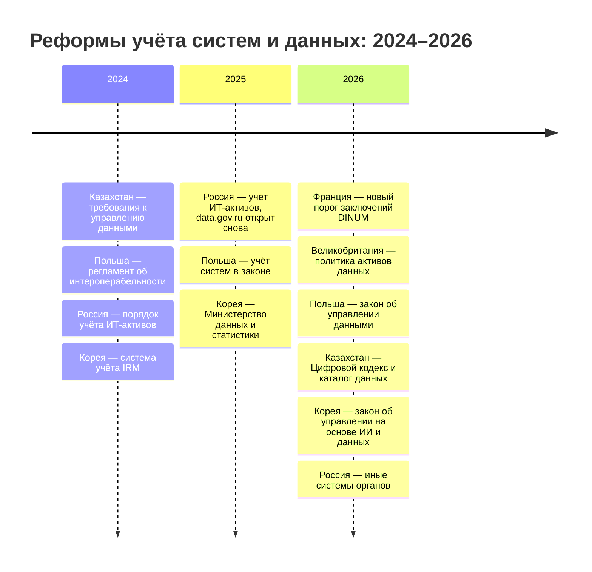
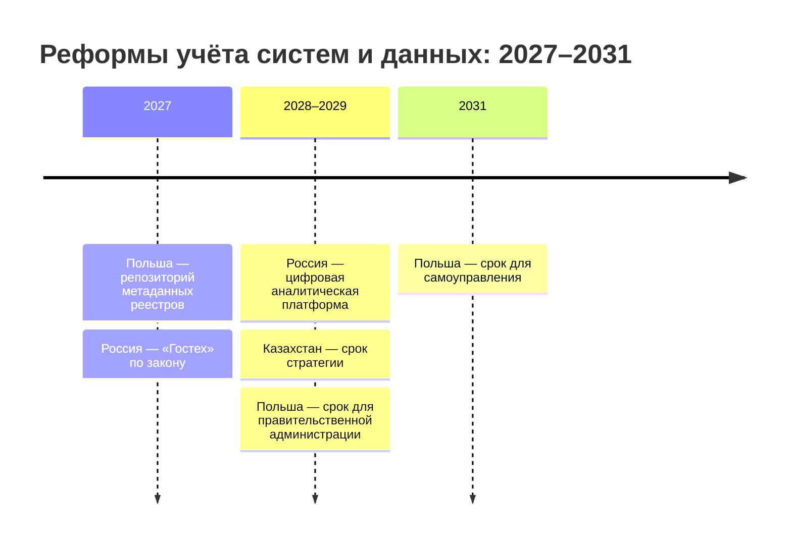

# Шесть стран в сравнении

В шести странах этой части опись данных государства складывается из одних и тех же семи элементов: акт, учёт систем, каталог данных, обмены, персональные данные, закупки и портал. Различается главное для внешнего исследователя — что из этого видно снаружи. Эта страница сравнивает страны и задаёт общий порядок работы, а главы стран показывают, где пройти каждый шаг. Инвентари данных США и правила Европейского союза — в главе [«Зарубежные методики»](../05-frameworks/04-international-practice.md).

Сведения проверены 25 октября 2026 года, если не указано иное.

## Коротко

| Страна | Кто координирует | Обязанность описи | Срок ответа на запрос |
|--------|------------------|-------------------|-----------------------|
| **[Казахстан](./01-kazakhstan.md)** | Министерство искусственного интеллекта и цифрового развития, архитектурно-координационный центр | Закон: Цифровой кодекс и требования к каталогу данных — 2026 год | 15 календарных дней |
| **[Россия](./02-russia.md)** | Минцифры России | Акты Правительства и закон: учёт систем — с 2015 года, иные системы органов — с 2026 года | 30 дней, отсрочка до 15 |
| **[Великобритания](./03-united-kingdom.md)** | Государственная цифровая служба | Политика: владельцы активов — с 2008 года, критически важные активы — с 2026 года | 20 рабочих дней |
| **[Франция](./04-france.md)** | Межминистерская цифровая дирекция | Закон: перечень документов с ежегодным обновлением — с 2016 года | Молчание в течение месяца — отказ, затем жалоба в комиссию |
| **[Польша](./05-poland.md)** | Министерство цифровизации | Закон: учёт систем — с 2025 года, итоги публикуются с 2017 года | 14 дней, до двух месяцев |
| **[Южная Корея](./06-south-korea.md)** | Министерство внутренних дел и безопасности | Закон: перечень публичных данных — с 2013 года | 10 дней, продление на 10 |

Реквизиты актов и сроки ответа — в приложении [«Нормативная база»](../09-appendices/02-legal-framework.md), как написать запрос — в главе [«Доступ и ограничения»](../03-process/06-access.md#запрос-владельцу).

## Что видно снаружи

Акты, закупки и порталы открытых данных открыты во всех шести странах. Остальное различается:

| Элемент | KZ | RU | UK | FR | PL | KR |
|---------|:--:|:--:|:--:|:--:|:--:|:--:|
| **Учёт систем** | ◐ | ○ | ◐ | ◐ | ● | ◐ |
| **Каталог данных** | ○ | ○ | ○ | ◐ | ◐ | ◐ |
| **Перечень закрытого или ещё не открытого** | ◐ | — | ◐ | ◐ | ● | ● |
| **Журнал обменов** | ● | ○ | ● | ● | ○ | ○ |
| **Описания систем с персональными данными** | ◐ | ● | ◐ | ◐ | ◐ | ● |

● — видно снаружи; ◐ — видна часть: сводка, устаревшая версия или отдельные отметки; ○ — только внутри государства; прочерк — такого списка нет. KZ — Казахстан, RU — Россия, UK — Великобритания, FR — Франция, PL — Польша, KR — Южная Корея.

Что стоит за отметками:

- **Учёт систем** открыт целиком только в Польше — таблицы SIST. В Казахстане открыт реестр систем без документации, в Великобритании — устаревшие реестры активов, во Франции — только крупные проекты, в Корее — сводка, в России учёт закрыт.
- **Перечень закрытого** полнее всего в Польше (перечень защищённых ресурсов) и Корее (перечень ещё не открытого). В Казахстане портал показывает долю размещённого от перечня, во Франции и Великобритании закрытое описано выборочно.
- **Журнал обменов** открыт в Казахстане (каталог сервисов Smart Bridge), Великобритании (реестр соглашений) и Франции (журнал DataPass).
- **Описания систем с персональными данными** открыты в России (реестр операторов) и Корее (файлы персональных данных); в остальных странах — отметки или реестры без описаний обработки. Во Франции реестр обработок государственного органа выдают любому по запросу, в Великобритании записи об обработке получает только надзорный орган. Хуже всего описаны системы безопасности: в России их данные обрабатывают без уведомления, в Корее не регистрируют файлы о национальной безопасности, расследованиях, налоговых и таможенных проверках, во Франции их видно только по актам о создании с заключением CNIL.

## Где искать по странам

| Страна | Портал, статистика, формы сбора | Учёт систем, персональные данные | Закупки (коды ИТ), акты |
|--------|---------------------------------|----------------------------------|-------------------------|
| **Казахстан** | data.egov.kz; stat.gov.kz и «Талдау»; приказы о формах административных данных | Реестр систем govarch.kz, каталог сервисов Smart Bridge | zakup.gov.kz (коды справочника ЕНС ТРУ); adilet.zan.kz |
| **Россия** | data.gov.ru; Росстат и ЕМИСС; Федеральный план статистических работ | ФГИС КИ — закрыта; реестр операторов персональных данных | zakupki.gov.ru (виды расходов 242 и 246, коды ОКПД2); pravo.gov.ru |
| **Великобритания** | data.gov.uk; ONS, список аккредитованной статистики, единой программы работ нет | Реестры информационных активов, реестр соглашений; реестр плательщиков сбора без описаний | Find a Tender, Contracts Finder (CPV 72); legislation.gov.uk |
| **Франция** | data.gouv.fr; Insee, программа обследований | Panorama, журнал DataPass; формальности CNIL | DECP, BOAMP (CPV 72); Légifrance |
| **Польша** | dane.gov.pl; Главное статистическое управление, программа обследований | Таблицы SIST, ключевые реестры; отметки в таблице открытости | e-Zamówienia, TED (CPV 72); ELI Сейма |
| **Южная Корея** | data.go.kr; перечень утверждённой статистики, KOSIS | Сводка IRM; файлы персональных данных на privacy.go.kr | KONEPS; law.go.kr |

Коды ставят неаккуратно: в России большая часть ИТ-расходов шла по виду 244 «Прочая закупка», поэтому контракты ищут ещё и по названию системы и заказчику. Как работать с каждым видом источника, с примерами США (data.gov, сборы сведений на reginfo.gov, уведомления о системах записей, USAspending с кодами группы D) и ЕС (data.europa.eu, TED), — в главе [«Государственные данные»](../04-sources/02-government.md).

## Реформы 2024–2031

Даты и подробности — в шкалах глав [«Казахстан»](./01-kazakhstan.md#правовая-основа), [«Россия»](./02-russia.md#правовая-основа) и [«Польша»](./05-poland.md#правовая-основа).

## Как провести инвентаризацию

### Чем владеем: общий порядок

Опись государственного органа в любой из шести стран проходит одни и те же шаги. Главы стран показывают, где пройти каждый шаг и видно ли это снаружи.

| Шаг | Что даёт реестру |
|-----|------------------|
| **1. Полномочия** | Какие данные орган обязан вести; основание записи ([«Где искать полномочия»](../03-process/03-owners-and-mandates.md#где-искать-полномочия)) |
| **2. Учёт систем** | Перечень систем с операторами, статусом и преемниками |
| **3. Каталог данных** | Состав и структуру данных, если орган их уже описал |
| **4. Обмены** | Что системы отдают и получают, кому и на каком основании |
| **5. Персональные данные** | Системы со сведениями о людях, цели, сроки хранения |
| **6. Формы сбора и статистика** | Что орган собирает и с какой периодичностью |
| **7. Закупки** | Состав данных из технических заданий, подрядчиков, предшественников систем |
| **8. Опубликованное** | Ссылки, форматы, даты; что обещано и не открыто |
| **9. Опрос** | Таблицы вне систем, копии, качество ([«Опросные листы и интервью»](../03-process/04-questionnaires.md)) |

Шаги 1–8 идут по документам, опрос — последним: анкету заранее заполняют тем, что уже найдено. Главная работа — сверка списков между собой: система есть в учёте, а её данных нет в каталоге; обмен есть, а набора нет. Каждое расхождение записывают и выясняют ([«Как методы проверяют друг друга»](../02-approaches/02-methods.md#как-методы-проверяют-друг-друга)).

### Где найти нужное: общий порядок

1. **Опубликованное** — порталы открытых данных, статистика, [поиск наборов](../04-sources/05-dataset-search.md). Это быстро, но портал показывает только то, что решили опубликовать.
2. **Кто собирает** — план статистических работ, положения о ведомствах.
3. **Где лежит** — учёт систем, журналы обменов, описания систем с персональными данными, закупки.
4. **Запрос владельцу** — по закону о доступе к информации, с названием найденной системы, акта или контракта: так ответ «данных нет» становится маловероятным.
5. **Если закрыто** — защищённый доступ для исследований, общественные и коммерческие копии с пометкой о первоисточнике ([«Три слоя данных»](../04-sources/01-three-layers.md)).

Адреса государственных сайтов проверяют из сети страны: многие закрыты для зарубежных адресов, и «не открывается» из-за рубежа не значит, что сайта нет. Сеть проверки записывают вместе с датой.

## С чего начинать снаружи

- **Казахстан** — реестр систем на govarch.kz, каталог сервисов Smart Bridge, data.egov.kz.
- **Россия** — закупки, реестр операторов персональных данных, акты о создании систем.
- **Великобритания** — поиск по GOV.UK, реестр соглашений об обмене данными, записи об алгоритмах.
- **Франция** — data.gouv.fr: перечни документов, журнал DataPass, данные о контрактах.
- **Польша** — таблицы SIST и перечень защищённых ресурсов на dane.gov.pl.
- **Южная Корея** — каталог data.go.kr и перечень ещё не открытого.

## Рейтинги

Место в индексе развития электронного правительства ООН (EGDI):

| Страна | 2022 | 2024 |
|--------|-----:|-----:|
| Южная Корея | 3 | 4 |
| Великобритания | 11 | 7 |
| Казахстан | 28 | 24 |
| Франция | 19 | 34 |
| Польша | 34 | 37 |
| Россия | 42 | 43 |

Обзор 2026 года на 25 октября 2026 года не вышел. В рейтингах открытых данных впереди Франция и Корея: Франция — первая в индексе ОЭСР OURdata 2025 года и в европейском Open Data Maturity 2025 года. Корея — первая в OURdata 2023 года и вторая в 2025-м. Польша входит в первую тройку обоих рейтингов. Рейтинги приводятся для ориентира: место в них не показывает, насколько полно государство знает свои данные. У Польши с её открытой описью систем место в EGDI ниже, чем у Великобритании, где центральный учёт закрыт.

## Источники

- Главы [«Казахстан»](./01-kazakhstan.md), [«Россия»](./02-russia.md), [«Великобритания»](./03-united-kingdom.md), [«Франция»](./04-france.md), [«Польша»](./05-poland.md), [«Южная Корея»](./06-south-korea.md) — все сравнения на этой странице сделаны по ним, с их датами и источниками; приложение [«Нормативная база»](../09-appendices/02-legal-framework.md).
- UN E-Government Knowledgebase, страницы стран: [Казахстан](https://publicadministration.un.org/egovkb/en-us/Data/Country-Information/id/87-Kazakhstan), [Россия](https://publicadministration.un.org/egovkb/en-us/Data/Country-Information/id/141-Russian-Federation), [Великобритания](https://publicadministration.un.org/egovkb/en-us/Data/Country-Information/id/182-United-Kingdom-of-Great-Britain-and-Northern-Ireland), [Франция](https://publicadministration.un.org/egovkb/en-us/Data/Country-Information/id/61-France), [Польша](https://publicadministration.un.org/egovkb/en-us/Data/Country-Information/id/135-Poland), [Южная Корея](https://publicadministration.un.org/egovkb/en-us/Data/Country-Information/id/138-Republic-of-Korea); [Data Center](https://publicadministration.un.org/egovkb/en-us/Data-Center) — последний выпуск обзора 2024 года, 25 октября 2026 года.
- [2023 OECD OURdata Index](https://www.oecd.org/content/dam/oecd/en/publications/reports/2023/12/2023-oecd-open-useful-and-re-usable-data-ourdata-index_cc9e8a9e/a37f51c3-en.pdf) — OECD, декабрь 2023 года; [Digital Government Index and OURdata Index: 2025 Results](https://www.oecd.org/content/dam/oecd/en/publications/reports/2026/02/digital-government-index-and-open-useful-and-re-usable-data-index_dbe102ed/6347ec74-en.pdf) — OECD, февраль 2026 года; Open Data Maturity [2024](https://data.europa.eu/sites/default/files/2025-07/2024_odm_report.pdf) и [2025](https://data.europa.eu/sites/default/files/2025-12/2025_odm_report_6.pdf) — data.europa.eu.
